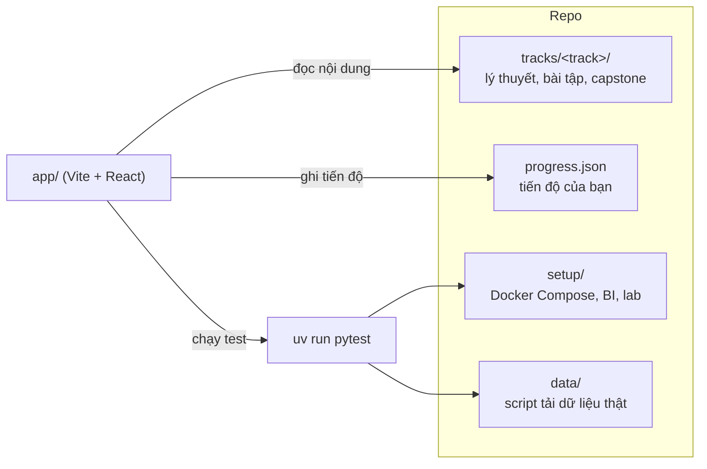

# Learning Platform: tự học Data, AI và DevOps

Bộ tài liệu tự học bằng tiếng Việt (giữ thuật ngữ tiếng Anh), kèm một **web app chạy local** để đọc lý thuyết,
làm bài, chạy test và theo dõi tiến độ ngay trên trình duyệt. Mỗi track bám theo một roadmap của
[roadmap.sh](https://roadmap.sh), học trên **dữ liệu thật** (Olist, NYC TLC, Online Retail II, dunnhumby,
Bike Sharing, MovieLens…) và mọi bài tập đều **tự chấm bằng `pytest`**.

## Các track

| Track | Trạng thái | Nội dung | Bám theo |
| --- | --- | --- | --- |
| [Data Engineer](tracks/data-engineer/README.md) | Đầy đủ | 12 module (00–11): nền tảng kỹ thuật, data modeling, NoSQL, warehouse & lakehouse, batch pipeline (Airflow, dbt, Prefect), Spark, Kafka, DevOps cho data, serving & BI, security & governance, cloud; lab CDC và GCP; 102 bài; capstone [Olist Data Platform](tracks/data-engineer/capstone/README.md) 12 milestone | [data-engineer](https://roadmap.sh/data-engineer) |
| [AI & Data Scientist](tracks/data-science/README.md) | Đầy đủ | 15 module từ toán, thống kê, A/B testing, causal inference tới ML, deep learning, MLOps và ML system design; 120 bài; capstone [Olist Customer Experience](tracks/data-science/capstone/README.md) 7 milestone | [ai-data-scientist](https://roadmap.sh/ai-data-scientist) |
| [Data Analyst](tracks/data-analyst/README.md) | Đầy đủ | 15 module từ tư duy phân tích, Excel, SQL, Python tới trực quan hoá và đọc biểu đồ, BI (Metabase, Superset, Streamlit), experimentation, product/business analytics và storytelling; 108 bài; capstone [dunnhumby Complete Journey](tracks/data-analyst/capstone/README.md) 7 milestone | [data-analyst](https://roadmap.sh/data-analyst) |
| [DevOps](tracks/devops/README.md) | Đang viết (6/17 module) | Linux, scripting, Git, mạng, Nginx; sắp tới container, CI/CD, OpenTofu, Ansible, Kubernetes, GitOps, observability, SRE; capstone vận hành [Olist Shop](tracks/devops/sample-app/README.md) như production trên máy local | [devops](https://roadmap.sh/devops) |
| AI Engineer | Đang viết (nhánh `ai-engineer`) | Neural network từ đầu, PyTorch, CV, NLP, LLM, RAG, agent, fine-tune, serving; sẽ gộp vào `main` khi xong | [ai-engineer](https://roadmap.sh/ai-engineer) |
| MLOps | Sắp có | Đã có chỗ trong app | [mlops](https://roadmap.sh/mlops) |

Mỗi module gồm:

- **Lý thuyết** (`README.md`) và **câu hỏi phỏng vấn** (`interview.md`).
- **Bài tập** 3 mức Basic → Intermediate → Advanced, mỗi bài có đề, test tự chấm, gợi ý và lời giải mẫu.
  Dạng bài: code `.py`/`.sql`/shell/config, notebook `.ipynb`, workbook Excel `.xlsx`, và bài chỉ có trắc nghiệm.
  Bài Advanced thường là bài mở: lời giải là `SOLUTION.md` (hướng làm và rubric) thay vì code.
- Một **milestone capstone** nối các module thành một dự án portfolio.



## Yêu cầu

| Công cụ | Dùng cho | Bắt buộc |
| --- | --- | --- |
| [uv](https://docs.astral.sh/uv/) | Python 3.12 và thư viện của bài tập | Có |
| Node.js 20+ và [pnpm](https://pnpm.io/) | Web app học tập | Có |
| Docker + Compose plugin | Postgres, Kafka, MongoDB… (Data Engineer), Metabase/Superset (Data Analyst), lab container (DevOps) | Khi module cần |
| LibreOffice Calc (`soffice`) | Chấm bài Excel module 02 Data Analyst, mở tệp `.xlsx` từ app | Khi học Data Analyst |
| Java 17/21 | PySpark (module 06 Data Engineer) | Khi module cần |
| Công cụ DevOps (shellcheck, jq, bubblewrap, openssl…) | Track DevOps, mỗi công cụ được dạy cài ở module dùng nó lần đầu: [setup/DEVOPS-TOOLS.md](setup/DEVOPS-TOOLS.md) | Khi học DevOps |
| Tài khoản Kaggle | Tải Olist, dunnhumby và một số bộ dữ liệu | Nên có |
| VS Code + extension Jupyter | Mở notebook từ app | Tuỳ chọn |

Máy tối thiểu 8 GB RAM, 15 GB đĩa trống (dữ liệu thật của các track khoảng 5 GB). Hướng dẫn cài từng thứ và
xử lý sự cố: [setup/SETUP.md](setup/SETUP.md).

## Bắt đầu nhanh

```bash
git clone https://github.com/Buicongbang04/Learning_Platform.git
cd Learning_Platform

# 1. Python và thư viện (uv tự tải Python 3.12 nếu máy chưa có)
uv sync

# 2. Kaggle token để tải dữ liệu thật (kaggle.com → Settings → API → Generate New Token)
cp setup/.env.example setup/.env
echo "KAGGLE_API_TOKEN=KGAT_..." >> setup/.env

# 3. Tải bộ Olist thật (dùng ở Data Engineer, AI & Data Scientist và một bài Data Analyst)
uv run python data/download_olist.py

# 4. Chạy app học tập
cd app && pnpm install && pnpm dev     # mở http://localhost:5173
```

`setup/.env` đã nằm trong `.gitignore`, **không commit** tệp này. Không có token hoặc mạng thì sinh Olist giả
làm dự phòng: `uv run python data/generate_olist.py --out data/raw/olist_synthetic`. Các bộ dữ liệu khác tải
khi cần, xem mục [Dữ liệu](#dữ-liệu).

## Cách học

1. Mở app, chọn track rồi bấm **Tiếp tục** ở thẻ *Học tiếp*. App luôn chỉ ra phần lý thuyết hoặc bài tập kế tiếp.
2. Đọc lý thuyết của module, đánh dấu từng phần đã đọc.
3. Làm bài ngay trong app, tuỳ dạng bài:
   - **Bài code**: tệp trong `starter/` hiện ở khung bên phải, tự lưu khi gõ. Bấm **Chạy test** (`Ctrl+Enter`).
   - **Bài notebook**: bấm **Mở trong VS Code**, làm và lưu notebook, rồi bấm **Chạy test**.
   - **Bài Excel**: mở tệp `.xlsx` bằng LibreOffice hoặc Excel, làm và lưu lại ngay trong tệp, rồi bấm **Chạy test**.
     Test đọc cả công thức lẫn giá trị đã tính lại.
   - **Bài trắc nghiệm** (và phần trắc nghiệm kèm nhiều bài khác): chọn đáp án, bấm **Nộp** để xem điểm và giải thích.
   Đạt thì bấm **Đánh dấu xong**.
4. Kẹt thì mở tab **Gợi ý & lời giải**: xem gợi ý trước, sau cùng mới xem lời giải.
5. Xong module thì làm milestone capstone tương ứng và ôn tab **Phỏng vấn**.

Tiến độ lưu ở `progress.json` ở gốc repo. Commit tệp này để giữ lịch sử học.

### Làm bài từ terminal

Mọi bài cũng làm được bằng editor quen thuộc: sửa tệp trong `starter/` rồi chạy test.

```bash
# chấm bài của bạn (chưa làm thì test fail, đó là bình thường)
uv run pytest tracks/data-science/modules/03-ab-testing/exercises/basic/01-two-sample-tests -q

# chấm lời giải mẫu (thư mục solutions/ cùng cấu trúc với exercises/)
SOLUTION=1 uv run pytest tracks/data-science/modules/03-ab-testing/exercises/basic/01-two-sample-tests -q

# cả một module
uv run pytest tracks/data-analyst/modules/03-sql-for-analysts -q
```

Với notebook, chọn kernel `.venv` ở gốc repo (do `uv sync` tạo). Cell gắn tag `explore` dùng để khám phá
dữ liệu, không được chấm. Test tự **skip** (kèm lời nhắc cách sửa) khi thiếu dữ liệu, dịch vụ Docker hay công
cụ ngoài, thay vì báo lỗi.

## Dữ liệu

Dữ liệu tải về nằm trong `data/raw/` và không được commit.

```bash
uv run python data/download_olist.py                 # Olist thật, cần KAGGLE_API_TOKEN
uv run python data/download_dataset.py --list        # danh mục các bộ khác, kèm nguồn và giấy phép
uv run python data/download_dataset.py online-retail-ii   # tải một bộ vào data/raw/online-retail-ii/
uv run python data/simulate_events.py --count 20 --stdout # event giả lập cho bài streaming
```

Bộ dữ liệu cần cho từng track và module, schema, ERD, giấy phép: [data/README.md](data/README.md). Lệnh tải
đủ dữ liệu cho track Data Analyst: mục 8.3 của [docs/superpowers/handoff-data-analyst.md](docs/superpowers/handoff-data-analyst.md).

## Dịch vụ Docker

Mỗi module chỉ cần vài dịch vụ, bật khi cần và tắt khi xong:

```bash
docker compose -f setup/docker-compose.yml up -d postgres          # bật theo tên
docker compose -f setup/docker-compose.yml --profile nosql up -d   # bật theo nhóm
docker compose -f setup/docker-compose.yml --profile all stop      # tắt hết, giữ dữ liệu
```

| Nhóm (`--profile`) | Dịch vụ | Dùng ở |
| --- | --- | --- |
| `sql` | Postgres | Data Engineer, Data Analyst |
| `nosql` | MongoDB, Redis, Cassandra, Neo4j | Data Engineer |
| `lake` | MinIO | Data Engineer |
| `stream` | Kafka | Data Engineer |
| `cloud` | LocalStack | Data Engineer |
| `bi` | Postgres, Metabase, Superset | Data Analyst (module 10, capstone) |
| `devops` | Mailpit (SMTP giả) | DevOps (không nằm trong `all`) |

Airflow, lab CDC và lab GCP có compose riêng trong `setup/airflow/`, `setup/cdc/`, `setup/cloud-gcp/`. Metabase,
Superset và Mailpit chỉ mở trên `127.0.0.1`. Cổng bị dự án khác chiếm thì đổi trong `setup/.env` (mẫu ở `setup/.env.example`).
Module nào cần dịch vụ nào: [setup/SETUP.md](setup/SETUP.md#5-module-cần-dịch-vụ-nào).

Dịch vụ BI cần nạp dữ liệu sau khi bật lần đầu:

```bash
docker compose -f setup/docker-compose.yml --profile bi up -d
uv run python setup/bi/init_bi.py    # tạo admin Metabase, kết nối database cho Metabase và Superset
uv run python setup/bi/load_da.py    # nạp schema `da` (Online Retail II, Bike Sharing)
```

Metabase ở http://127.0.0.1:3000, Superset ở http://127.0.0.1:8088. Không chạy `down -v` nếu muốn giữ dữ liệu.

## Xử lý sự cố thường gặp

| Triệu chứng | Cách sửa |
| --- | --- |
| Bài Excel báo `soffice.bin: ... libreglo.so: cannot open shared object file` | `LD_LIBRARY_PATH` đang chứa `/usr/lib/x86_64-linux-gnu` (thường do cấu hình CUDA trong `~/.bashrc`). Bỏ thư mục đó, giữ `$CUDA_HOME/lib64`, mở terminal mới |
| `bind: address already in use` khi bật dịch vụ | Đổi cổng trong `setup/.env`, xem [SETUP.md](setup/SETUP.md#cổng-bị-dự-án-khác-chiếm) |
| Test bị skip | Đọc lý do skip: thường là chưa tải dữ liệu, chưa bật dịch vụ hoặc thiếu công cụ, kèm lệnh sửa |
| Máy chậm khi chạy test cả track | Chạy từng module; giới hạn luồng bằng `OMP_NUM_THREADS=4` |

Các sự cố khác (Cassandra, Kafka, Airflow, quyền Docker, `uv sync`): [setup/SETUP.md](setup/SETUP.md#10-xử-lý-sự-cố).

## Cấu trúc repo

| Đường dẫn | Nội dung |
| --- | --- |
| `app/` | Web app học tập (Vite, React 19, TypeScript, Tailwind v4, CodeMirror); `server/` là API local đọc nội dung, lưu tệp và chạy test |
| `tracks/<track>/` | `track.json`, `modules/<id>/` (lý thuyết, phỏng vấn, `exercises/`, `solutions/`), `capstone/`; track DevOps có thêm `sample-app/` (Olist Shop) |
| `data/` | Script tải dữ liệu thật, sinh dữ liệu giả, giả lập event; danh mục và schema ở `data/README.md` |
| `setup/` | Docker Compose, Airflow, lab CDC, lab GCP, BI (`bi/`); hướng dẫn `SETUP.md` và `DEVOPS-TOOLS.md` |
| `testkit.py` | Tiện ích test dùng chung: nạp starter/solution, chạy notebook, đọc workbook Excel, kiểm tra dịch vụ |
| `tests/` | Test cho chính repo (testkit, script tải dữ liệu, dịch vụ BI) |
| `docs/superpowers/` | Spec, plan và tài liệu bàn giao của từng track (dành cho người viết nội dung) |
| `roadmap/` | Bản PDF roadmap gốc: Data Engineer, AI & Data Scientist, Data Analyst, AI Engineer, DevOps, MLOps, DevSecOps, Cyber Security, Linux, Inference Engineering, Forward Deployed Engineer |
| `CONTENT_SPEC.md` | Quy ước viết nội dung: cấu trúc thư mục, frontmatter, các dạng bài, trắc nghiệm, lời giải |
| `progress.json` | Tiến độ học (app tự tạo) |

## Đóng góp nội dung và thêm track mới

1. Tạo `tracks/<track-id>/track.json` với `status: "active"` và các module theo [CONTENT_SPEC.md](CONTENT_SPEC.md).
   App tự nhận track mới, không phải sửa code.
2. Thư viện Python mới cho bài tập thì thêm bằng `uv add <gói>`.
3. Kiểm tra trước khi commit:

```bash
SOLUTION=1 uv run pytest tracks/<track-id> -q   # lời giải mẫu phải qua test
uv run pytest tracks/<track-id> -q              # starter chỉ được FAIL hoặc SKIP, không ERROR
uv run pytest tests -q                          # test của repo
cd app && pnpm test && pnpm build               # test, typecheck và build app
```
