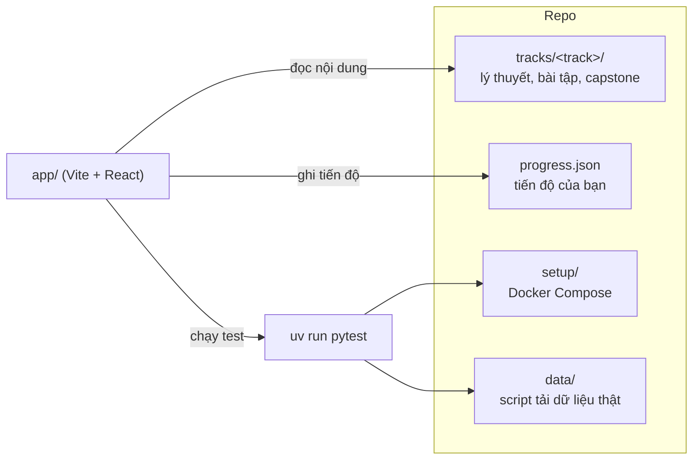

# Lộ trình tự học Data

Bộ tài liệu tự học **Data Engineer** và **AI & Data Scientist** bằng tiếng Việt, kèm một **web app chạy local**
để đọc lý thuyết, viết code, chạy test và theo dõi tiến độ ngay trên trình duyệt. Mọi track học trên
**dữ liệu thật** (Olist, NYC TLC, Cookie Cats, Hillstrom, MovieLens…) và có bài tập tự chấm bằng `pytest`.

## Các track

| Track | Trạng thái | Nội dung | Bám theo |
| --- | --- | --- | --- |
| [Data Engineer](tracks/data-engineer/README.md) | Đang có | 12 module (00–11), 102 bài tập, lab CDC và cloud, capstone [Olist Data Platform](tracks/data-engineer/capstone/README.md) 12 milestone | [roadmap.sh/data-engineer](https://roadmap.sh/data-engineer) |
| [AI & Data Scientist](tracks/data-science/README.md) | Đang có | 15 module từ toán, thống kê, A/B testing, causal inference tới ML, deep learning, MLOps và ML system design; 120 bài tập; capstone [Olist Customer Experience](tracks/data-science/capstone/README.md) 7 milestone | [roadmap.sh/ai-data-scientist](https://roadmap.sh/ai-data-scientist) |
| Data Analyst, AI Engineer, DevOps, MLOps | Sắp có | Đã có chỗ trong app, thêm nội dung vào `tracks/` là dùng được | |

Mỗi module gồm:

- **Lý thuyết** (`README.md`) và **câu hỏi phỏng vấn** (`interview.md`).
- **Bài tập** 3 mức Basic → Intermediate → Advanced. Bài lập trình là tệp `.py`, bài phân tích/modeling là
  notebook `.ipynb`; cả hai đều có test tự chấm, gợi ý và lời giải mẫu.
- Một **milestone capstone** nối các module thành một dự án portfolio hoàn chỉnh.



## Yêu cầu

| Công cụ | Dùng cho | Bắt buộc |
| --- | --- | --- |
| [uv](https://docs.astral.sh/uv/) | Python 3.12 và thư viện của bài tập | Có |
| Node.js 20+ và [pnpm](https://pnpm.io/) | Web app học tập | Có |
| Docker + Compose plugin | Postgres, Kafka, MongoDB… cho một số module Data Engineer | Khi module cần |
| Java 17/21 | PySpark (module 06 Data Engineer) | Khi module cần |
| Tài khoản Kaggle | Tải Olist thật và một số bộ dữ liệu | Nên có |
| VS Code + extension Jupyter | Mở notebook từ app | Tuỳ chọn |

Máy tối thiểu 8 GB RAM, 15 GB đĩa trống. Hướng dẫn cài từng thứ và xử lý sự cố: [setup/SETUP.md](setup/SETUP.md).

## Bắt đầu nhanh

```bash
git clone https://github.com/Buicongbang04/Learning_Platform.git
cd Learning_Platform

# 1. Python và thư viện (uv tự tải Python 3.12 nếu máy chưa có)
uv sync

# 2. Kaggle token để tải dữ liệu thật (lấy ở kaggle.com → Settings → API → Generate New Token)
cp setup/.env.example setup/.env
echo "KAGGLE_API_TOKEN=KGAT_..." >> setup/.env

# 3. Tải bộ Olist thật (dùng xuyên suốt cả hai track)
uv run python data/download_olist.py

# 4. Chạy app học tập
cd app && pnpm install && pnpm dev     # mở http://localhost:5173
```

`setup/.env` đã nằm trong `.gitignore`, **không commit** tệp này. Không có token hoặc mạng thì sinh dữ liệu giả
làm dự phòng: `uv run python data/generate_olist.py --out data/raw/olist_synthetic`.

## Cách học

1. Mở app, chọn track rồi bấm **Tiếp tục** ở thẻ *Học tiếp*. App luôn chỉ ra phần lý thuyết hoặc bài tập kế tiếp.
2. Đọc lý thuyết của module, đánh dấu từng phần đã đọc.
3. Làm bài tập ngay trong app: code trong `starter/` hiện ở khung bên phải, tự lưu khi gõ. Bấm **Chạy test**
   (`Ctrl+Enter`) để chấm, đạt thì bấm **Đánh dấu xong**. Bài notebook hiện 2 thẻ: giới thiệu bài với nút **Mở trong VS Code** và
   **Chạy test**, và trắc nghiệm bài học (tuỳ chọn) có điểm và đáp án sau khi nộp.
4. Kẹt thì mở tab **Gợi ý & lời giải**: xem gợi ý trước, sau cùng mới xem lời giải.
5. Xong module thì làm milestone capstone tương ứng và ôn tab **Phỏng vấn**.

Tiến độ lưu ở `progress.json` ở gốc repo. Commit tệp này để giữ lịch sử học.

### Làm bài từ terminal

Mọi bài cũng làm được bằng editor quen thuộc: sửa tệp trong `starter/` rồi chạy test.

```bash
# chấm code của bạn (chưa làm thì test fail, đó là bình thường)
uv run pytest tracks/data-science/modules/03-ab-testing/exercises/basic/01-two-sample-tests -q

# chấm lời giải mẫu (thư mục solutions/ cùng cấu trúc)
SOLUTION=1 uv run pytest tracks/data-science/modules/03-ab-testing/exercises/basic/01-two-sample-tests -q

# cả một module
uv run pytest tracks/data-engineer/modules/02-data-modeling -q
```

Với notebook, chọn kernel `.venv` ở gốc repo (do `uv sync` tạo). Cell gắn tag `explore` dùng để khám phá
dữ liệu, không được chấm.

## Dữ liệu

Dữ liệu tải về nằm trong `data/raw/` và không được commit.

```bash
uv run python data/download_olist.py               # Olist thật, cần KAGGLE_API_TOKEN
uv run python data/download_dataset.py --list      # danh mục bộ dữ liệu khác
uv run python data/download_dataset.py cookie-cats # tải một bộ vào data/raw/cookie-cats/
uv run python data/simulate_events.py --count 20 --stdout   # event giả lập cho streaming
```

Test của bài tập dùng dữ liệu nhỏ có sẵn; phần kiểm trên dữ liệu thật tự **skip** khi bộ chưa được tải.
Schema, ERD và danh mục bộ dữ liệu theo module: [data/README.md](data/README.md).

## Dịch vụ Docker (track Data Engineer)

Mỗi module chỉ cần vài dịch vụ, bật khi cần và tắt khi xong:

```bash
docker compose -f setup/docker-compose.yml up -d postgres          # bật theo tên
docker compose -f setup/docker-compose.yml --profile nosql up -d   # bật theo nhóm
docker compose -f setup/docker-compose.yml --profile all down      # tắt hết, giữ dữ liệu
```

Có sẵn Postgres, MongoDB, Redis, Cassandra, Neo4j, MinIO, Kafka, Metabase, LocalStack và Airflow
(`setup/airflow/`). Bài cần dịch vụ chưa bật sẽ tự skip kèm lệnh bật. Cổng mặc định bị dự án khác chiếm thì
đổi trong `setup/.env` (mẫu ở `setup/.env.example`). Module nào cần dịch vụ nào: [setup/SETUP.md](setup/SETUP.md#5-module-cần-dịch-vụ-nào).

Track AI & Data Scientist không cần Docker.

## Cấu trúc repo

| Đường dẫn | Nội dung |
| --- | --- |
| `app/` | Web app học tập (Vite, React 19, TypeScript, Tailwind v4, CodeMirror) |
| `tracks/<track>/` | `track.json`, `modules/<id>/` (lý thuyết, phỏng vấn, `exercises/`, `solutions/`), `capstone/` |
| `data/` | Script tải dữ liệu thật, sinh dữ liệu giả, giả lập event; schema ở `data/README.md` |
| `setup/` | Docker Compose cho các dịch vụ, Airflow, lab CDC, lab GCP; hướng dẫn `SETUP.md` |
| `testkit.py` | Tiện ích test dùng chung: nạp starter/solution, chạy notebook, kiểm tra dịch vụ |
| `tests/` | Test cho chính repo (testkit, script tải dữ liệu) |
| `roadmap/` | Bản PDF roadmap gốc |
| `CONTENT_SPEC.md` | Quy ước viết nội dung: cấu trúc thư mục, frontmatter, bài notebook, lời giải |
| `progress.json` | Tiến độ học (app tự tạo) |

## Đóng góp nội dung và thêm track mới

1. Tạo `tracks/<track-id>/track.json` với `status: "active"` và các module theo [CONTENT_SPEC.md](CONTENT_SPEC.md).
2. App tự nhận track mới, không phải sửa code.
3. Thư viện Python mới cho bài tập thì thêm bằng `uv add <gói>`.
4. Kiểm tra trước khi commit:

```bash
SOLUTION=1 uv run pytest tracks/<track-id> -q   # lời giải mẫu phải qua test
uv run pytest tests -q                          # test của repo
cd app && pnpm build                            # typecheck và build app
```
