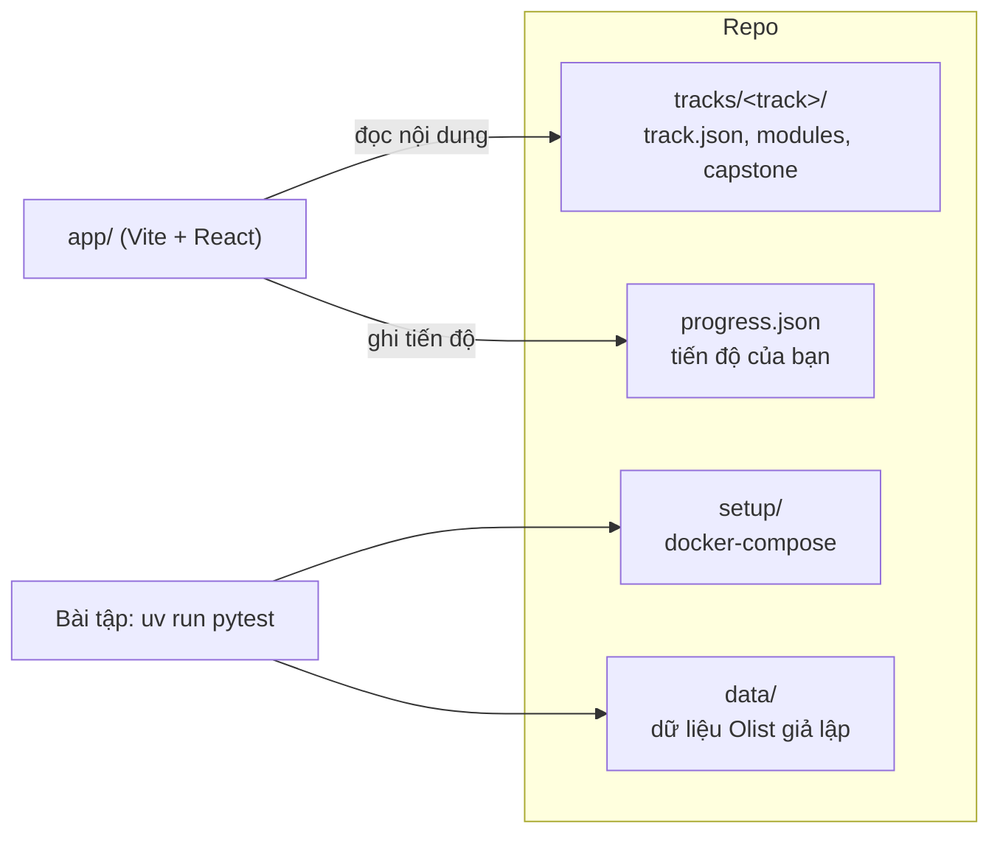

# Lộ trình tự học Data

Repo này gồm nội dung học (lý thuyết, bài tập Basic → Advanced, lời giải, capstone) và một **web app chạy local** để
đọc bài, làm bài và theo dõi tiến độ. Hiện có track **Data Engineer** bám theo
[roadmap.sh/data-engineer](https://roadmap.sh/data-engineer). Các track Data Analyst, Data Science, AI Engineer,
DevOps, MLOps đã có chỗ trong app ("Sắp có") và được thêm bằng cách thả nội dung vào `tracks/`.



## Bắt đầu nhanh

```bash
# 1. Python và thư viện cho bài tập (uv tự tải Python 3.12)
uv sync

# 2. App học tập
cd app && pnpm install && pnpm dev     # mở http://localhost:5173

# 3. Dịch vụ cho từng module, bật khi cần
docker compose -f setup/docker-compose.yml up -d postgres
```

Hướng dẫn cài đặt đầy đủ và xử lý sự cố: [setup/SETUP.md](setup/SETUP.md).

## Cách học

1. Mở app, bấm **Tiếp tục** ở thẻ Học tiếp. App luôn chỉ ra phần lý thuyết hoặc bài tập kế tiếp.
2. Đọc từng phần lý thuyết, đánh dấu đã đọc.
3. Làm bài tập trong VSCode: sửa các tệp trong `starter/`, chạy lệnh test app đưa cho, rồi bấm **Đánh dấu xong**.
4. Kẹt thì mở **Gợi ý**, sau cùng mới xem **Lời giải**. Kiểm tra lời giải mẫu: `SOLUTION=1 uv run pytest <thư mục bài> -q`.
5. Xong module thì làm milestone capstone tương ứng và ôn tab **Phỏng vấn**.

Tiến độ lưu ở `progress.json` ở gốc repo. Commit tệp này để giữ lịch sử học.

## Cấu trúc

| Thư mục | Nội dung |
| --- | --- |
| `app/` | Web app học tập (Vite, React, TypeScript, Tailwind v4) |
| `tracks/` | Nội dung theo track. Quy ước ở [CONTENT_SPEC.md](CONTENT_SPEC.md) |
| `tracks/data-engineer/` | 11 module, 89 bài tập, capstone Olist Data Platform |
| `setup/` | Docker Compose cho Postgres, MongoDB, Redis, Cassandra, Neo4j, MinIO, Kafka, Metabase, LocalStack, Airflow |
| `data/` | Sinh dữ liệu Olist giả lập, tải bộ thật, giả lập event streaming |
| `testkit.py` | Tiện ích test dùng chung cho mọi bài tập |
| `progress.json` | Tiến độ học (app tự tạo) |

## Thêm một track mới

1. Tạo `tracks/<track-id>/track.json` (đổi `status` từ `soon` thành `active`) và các module theo
   [CONTENT_SPEC.md](CONTENT_SPEC.md).
2. App tự nhận track mới, không phải sửa code. Thêm thư viện Python cho bài tập vào `pyproject.toml` rồi `uv sync`.
