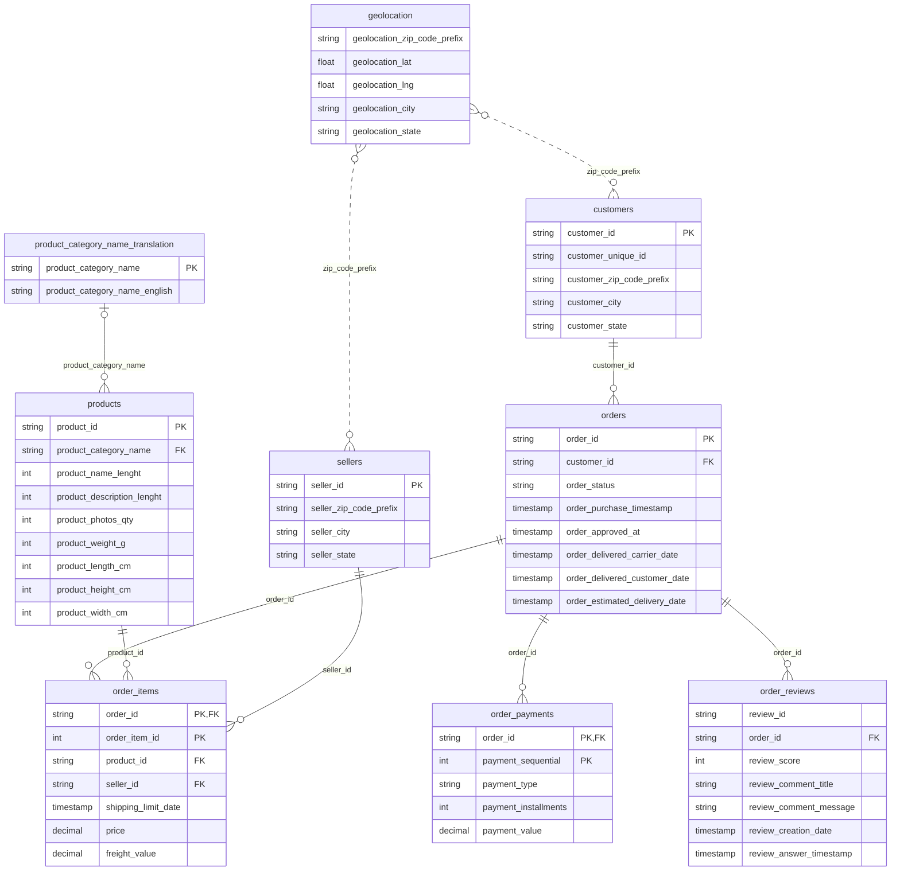

# Dữ liệu của lộ trình

Xương sống của lộ trình là **Brazilian E-Commerce Public Dataset by Olist** (~100 nghìn đơn hàng
2016–2018 trên sàn Olist, Brazil, 9 bảng), bổ sung bằng các bộ dữ liệu thật khác (NYC TLC, NASA logs,
UCI Air Quality, các API công khai: xem các mục bên dưới). Với Olist có hai cách lấy dữ liệu, cùng tên
tệp và cùng cột, nên code viết cho cách này chạy được với cách kia.

| Cách | Lệnh | Ghi chú |
| --- | --- | --- |
| Bộ thật từ Kaggle (mặc định cho capstone) | `uv run python data/download_olist.py` | Cần Kaggle token (`KAGGLE_API_TOKEN` trong `setup/.env`), xem đầu tệp script |
| Dữ liệu giả (dự phòng, test) | `uv run python data/generate_olist.py --out data/raw/olist_synthetic` | 50 000 đơn, seed cố định, không cần mạng. `--orders N`, `--out DIR`, `--seed S` |
| Event streaming | `uv run python data/simulate_events.py --count 20 --stdout` | JSON lines ra stdout, tệp (`--out`) hoặc Kafka (`--kafka`) |

Dữ liệu ghi vào `data/raw/` (đã nằm trong `.gitignore`, không commit).

```bash
uv run python data/generate_olist.py --out data/raw/olist_synthetic   # 50k đơn, ~3 giây
uv run python data/generate_olist.py --orders 2000 --out /tmp/olist_small
```

## Ca biên có chủ đích

Dữ liệu giả mô phỏng các điểm "bẩn" của bộ thật để bạn luyện data cleaning và data quality:

| Ca biên | Ở đâu | Tỉ lệ gần đúng |
| --- | --- | --- |
| Đơn `canceled`, `unavailable`, `created`... không có ngày giao | `orders` | ~3% không phải `delivered` |
| Đơn `unavailable` / `created` không có dòng nào trong `order_items` | `orders` ↔ `order_items` | phần lớn đơn `unavailable` |
| Giao trễ: `order_delivered_customer_date > order_estimated_delivery_date` | `orders` | ~8% đơn delivered |
| `delivered` nhưng thiếu `order_delivered_customer_date` hoặc `order_approved_at` | `orders` | ~0.2% mỗi loại |
| Đơn không có review | `orders` ↔ `order_reviews` | ~1% |
| Review không có tiêu đề / nội dung | `order_reviews` | ~88% / ~59% |
| Sản phẩm thiếu category và các cột mô tả | `products` | ~1.85% |
| Sản phẩm thiếu kích thước, khối lượng | `products` | ~0.1% |
| Category không có trong bảng dịch (`pc_gamer`, `portateis_cozinha_...`) | `products` ↔ `translation` | 2 category |
| Khách mua nhiều lần: `customer_unique_id` lặp, `customer_id` mới mỗi đơn | `customers` | ~3% |
| Nhiều dòng payment cho một đơn (voucher + thẻ), `payment_installments = 0` | `order_payments` | ~8% / rất hiếm |
| Zip của khách / seller không có trong `geolocation`; một zip có nhiều toạ độ | `geolocation` | ~0.3% |
| `freight_value = 0` | `order_items` | ~0.3% |

Dữ liệu giả **không** khớp số liệu thống kê của bộ thật; đừng dùng để rút ra kết luận kinh doanh.

## Sơ đồ quan hệ (ERD)



Đường nét đứt: `geolocation` **không** có khoá chính (một zip prefix có nhiều dòng), nên nối với
`customers` / `sellers` phải gộp trước (vd. lấy trung bình lat/lng theo zip) để tránh nhân dòng.

## Schema từng bảng

ID là chuỗi hex 32 ký tự. Timestamp dạng `YYYY-MM-DD HH:MM:SS`, giờ địa phương, ô trống là NULL.
Tên cột giữ nguyên bộ gốc, kể cả lỗi chính tả `lenght`.

### `olist_customers_dataset.csv`: customers

| Cột | Kiểu | Ý nghĩa |
| --- | --- | --- |
| `customer_id` | string (PK) | Khoá của khách **trong một đơn**. Mỗi đơn có một `customer_id` riêng |
| `customer_unique_id` | string | Định danh thật của một người. Dùng để đếm khách quay lại |
| `customer_zip_code_prefix` | string(5) | 5 số đầu của CEP (mã bưu chính). Đọc là string để giữ số 0 đầu |
| `customer_city` | string | Thành phố, chữ thường |
| `customer_state` | string(2) | Mã bang: SP, RJ, MG… |

### `olist_orders_dataset.csv`: orders

| Cột | Kiểu | Ý nghĩa |
| --- | --- | --- |
| `order_id` | string (PK) | Mã đơn |
| `customer_id` | string (FK → customers) | Khách của đơn, quan hệ 1–1 |
| `order_status` | string | `created`, `approved`, `invoiced`, `processing`, `shipped`, `delivered`, `canceled`, `unavailable` |
| `order_purchase_timestamp` | timestamp | Lúc đặt hàng. Thường dùng làm cột partition / ngày nghiệp vụ |
| `order_approved_at` | timestamp, null | Lúc thanh toán được duyệt |
| `order_delivered_carrier_date` | timestamp, null | Lúc giao cho hãng vận chuyển |
| `order_delivered_customer_date` | timestamp, null | Lúc khách nhận hàng |
| `order_estimated_delivery_date` | timestamp | Ngày giao dự kiến báo cho khách (giờ luôn 00:00:00) |

### `olist_order_items_dataset.csv`: order_items

| Cột | Kiểu | Ý nghĩa |
| --- | --- | --- |
| `order_id` | string (PK, FK → orders) | Mã đơn |
| `order_item_id` | int (PK) | Số thứ tự item trong đơn, bắt đầu từ 1. Mua 3 cái cùng sản phẩm = 3 dòng |
| `product_id` | string (FK → products) | Sản phẩm |
| `seller_id` | string (FK → sellers) | Người bán. Một đơn có thể có nhiều seller |
| `shipping_limit_date` | timestamp | Hạn seller phải giao hàng cho hãng vận chuyển |
| `price` | decimal(10,2) | Giá item, BRL |
| `freight_value` | decimal(10,2) | Phí vận chuyển phân bổ cho item, BRL |

**Grain** là ý nghĩa của một dòng dữ liệu. Ở đây, một dòng = một đơn vị sản phẩm trong một đơn.
Ví dụ khách mua 2 chiếc áo giống nhau thì có 2 dòng, mỗi dòng có giá và phần phí vận chuyển riêng.

Khi cộng tiền theo `order_id`, cần phân biệt ba con số:

| Con số | Công thức | Ý nghĩa |
| --- | --- | --- |
| Tiền hàng (`revenue` trong bài tập dùng `price`) | `SUM(price)` | Giá trị sản phẩm, chưa cộng vận chuyển |
| Phí vận chuyển (`freight`) | `SUM(freight_value)` | Tổng phí vận chuyển của các item |
| Tổng tiền hàng và vận chuyển | `SUM(price + freight_value)` | Dùng để đối chiếu với tổng thanh toán của đơn |

Ví dụ một đơn có 2 item, giá lần lượt 100 và 50 BRL, phí vận chuyển lần lượt 10 và 5 BRL:
tiền hàng = **150**, phí vận chuyển = **15**, tổng tiền hàng và vận chuyển = **165 BRL**.
Nếu khách trả 40 BRL bằng voucher và 125 BRL bằng thẻ, tổng `payment_value` cũng là 165 BRL.

Trong các bài tập định nghĩa `revenue = SUM(price)`, hãy dùng **150**, không dùng 165.
Các ví dụ dùng `SUM(payment_value)` đang đo **tổng thanh toán**, gồm cả phần vận chuyển.
Đây là những chỉ số khác nhau; khi so sánh, cần thống nhất cả trạng thái đơn được tính và khoảng ngày.
Các chỉ số luyện tập này chưa phải doanh thu kế toán hay doanh thu phí dịch vụ của riêng sàn Olist.

**Tránh cộng trùng khi join**: một đơn có nhiều item và nhiều dòng payment. Hãy cộng item theo đơn,
cộng payment theo đơn trong hai truy vấn riêng, rồi mới join hai kết quả bằng `order_id`.
Nếu join trực tiếp hai bảng chi tiết, 2 item × 2 payment sẽ tạo 4 dòng và có thể làm tổng tiền bị nhân lên.

### `olist_order_payments_dataset.csv`: order_payments

| Cột | Kiểu | Ý nghĩa |
| --- | --- | --- |
| `order_id` | string (PK, FK → orders) | Mã đơn |
| `payment_sequential` | int (PK) | Thứ tự lần thanh toán. Đơn trả bằng voucher + thẻ có nhiều dòng |
| `payment_type` | string | `credit_card`, `boleto`, `voucher`, `debit_card` (bộ thật có thêm `not_defined`) |
| `payment_installments` | int | Số kỳ trả góp (thẻ tín dụng); 0 là giá trị lạ cần xử lý |
| `payment_value` | decimal(10,2) | Số tiền của lần thanh toán. Tổng theo đơn ≈ tổng `price + freight_value` |

### `olist_order_reviews_dataset.csv`: order_reviews

| Cột | Kiểu | Ý nghĩa |
| --- | --- | --- |
| `review_id` | string | Mã review. Ở bộ thật **không** duy nhất (một review gắn nhiều đơn) |
| `order_id` | string (FK → orders) | Đơn được đánh giá |
| `review_score` | int 1–5 | Điểm hài lòng |
| `review_comment_title` | string, null | Tiêu đề, tiếng Bồ Đào Nha, phần lớn trống |
| `review_comment_message` | string, null | Nội dung, phần lớn trống. Có thể chứa PII → dùng ở module 10 |
| `review_creation_date` | timestamp | Lúc gửi khảo sát cho khách (sau khi giao) |
| `review_answer_timestamp` | timestamp | Lúc khách trả lời |

### `olist_products_dataset.csv`: products

| Cột | Kiểu | Ý nghĩa |
| --- | --- | --- |
| `product_id` | string (PK) | Mã sản phẩm |
| `product_category_name` | string, null (FK → translation) | Category tiếng Bồ Đào Nha |
| `product_name_lenght` | int, null | Số ký tự tên sản phẩm |
| `product_description_lenght` | int, null | Số ký tự mô tả |
| `product_photos_qty` | int, null | Số ảnh |
| `product_weight_g` | int, null | Khối lượng (gram) |
| `product_length_cm` | int, null | Dài (cm) |
| `product_height_cm` | int, null | Cao (cm) |
| `product_width_cm` | int, null | Rộng (cm) |

### `olist_sellers_dataset.csv`: sellers

| Cột | Kiểu | Ý nghĩa |
| --- | --- | --- |
| `seller_id` | string (PK) | Mã người bán |
| `seller_zip_code_prefix` | string(5) | 5 số đầu CEP |
| `seller_city` | string | Thành phố |
| `seller_state` | string(2) | Mã bang |

### `olist_geolocation_dataset.csv`: geolocation

| Cột | Kiểu | Ý nghĩa |
| --- | --- | --- |
| `geolocation_zip_code_prefix` | string(5) | 5 số đầu CEP, **lặp nhiều dòng** |
| `geolocation_lat` | float | Vĩ độ |
| `geolocation_lng` | float | Kinh độ |
| `geolocation_city` | string | Thành phố |
| `geolocation_state` | string(2) | Mã bang |

### `product_category_name_translation.csv`

| Cột | Kiểu | Ý nghĩa |
| --- | --- | --- |
| `product_category_name` | string (PK) | Category tiếng Bồ Đào Nha |
| `product_category_name_english` | string | Tên tiếng Anh |

## Order events (`simulate_events.py`)

Mỗi dòng là một JSON event, key Kafka là `order_id` (đảm bảo thứ tự trong cùng partition):

| Trường | Kiểu | Ý nghĩa |
| --- | --- | --- |
| `event_id` | uuid | Khoá dedup. Bản trùng có cùng `event_id` |
| `event_type` | string | `order_created` → `order_approved` → `payment_confirmed` → `shipped` → `delivered`, hoặc `canceled` |
| `order_id`, `customer_id`, `seller_id` | string | Khớp schema Olist (dùng `--orders-csv data/raw` để lấy ID có thật) |
| `event_time` | ISO-8601 UTC | Lúc sự việc xảy ra (event time) |
| `ingest_time` | ISO-8601 UTC | Lúc producer gửi (processing time). Event trễ có `ingest_time - event_time` vài phút |
| `payload` | object | Tuỳ loại: tổng tiền, phương thức thanh toán, hãng vận chuyển, lý do huỷ… |

Tuỳ chọn chính: `--dup-rate` (mặc định 0.03), `--late-rate` (0.03), `--cancel-rate` (0.05),
`--rate` (event/giây, mặc định 10 khi `--kafka`), `--topic` (mặc định `olist.order-events`),
`--bootstrap` (mặc định `localhost:9094`), `--seed`.

## Bộ dữ liệu thật cho track AI & Data Scientist

Track AI & Data Scientist ưu tiên dữ liệu thật: notebook thực hành và capstone dùng **Olist thật**
(`download_olist.py`) cùng các bộ công khai dưới đây. Mỗi bộ ghi vào `data/raw/<tên>/` (không commit).
Test của bài tập không cần các bộ này; phần kiểm trên dữ liệu thật tự skip khi chưa tải.

```bash
uv run python data/download_dataset.py --list
uv run python data/download_dataset.py cookie-cats
```

| Tên | Nội dung | Nguồn | Giấy phép | Module |
| --- | --- | --- | --- | --- |
| `cookie-cats` | A/B test vị trí gate (level 30 vs 40) của game Cookie Cats, 90 189 người chơi | [Kaggle](https://www.kaggle.com/datasets/yufengsui/mobile-games-ab-testing) | Không ghi rõ | 03 |
| `ab-data` | A/B test landing page, 294 478 dòng, có dòng gán nhóm sai | [Kaggle](https://www.kaggle.com/datasets/zhangluyuan/ab-testing) | Không ghi rõ | 03 |
| `hillstrom` | Thí nghiệm email ngẫu nhiên 3 nhánh, 64 000 khách: visit, conversion, spend | [MineThatData](https://blog.minethatdata.com/2008/03/minethatdata-e-mail-analytics-and-data.html) | Công bố cho học tập (2008) | 03, 04 |
| `lalonde` | NSW (LaLonde 1986, bản Dehejia-Wahba): `nsw_dw.dta` mẫu thí nghiệm 445 dòng + `psid_controls.dta` đối chứng quan sát 2 490 dòng; cột `treat`, `re74`, `re75`, `re78` | [NBER, Dehejia](https://users.nber.org/~rdehejia/nswdata2.html) | Công bố công khai cho nghiên cứu/giảng dạy | 06 |
| `prop99` | Panel 39 bang Mỹ x 1970-2000 (1 209 dòng): `cigsale`, `retprice`, `lnincome`...; California can thiệp 1988 (Abadie, Diamond, Hainmueller 2010) | [GitHub SyntheticControlMethods](https://github.com/OscarEngelbrektson/SyntheticControlMethods) | Repo MIT; dữ liệu từ bài gốc ADH (2010) | 06 |
| `card` | Card (1995) NLS Young Men, 3 010 nam giới: `lwage`, `educ`, `nearc4` (IV), `exper`... | [Rdatasets / wooldridge](https://vincentarelbundock.github.io/Rdatasets/doc/wooldridge/card.html) | Công bố công khai (David Card); bản CSV qua Rdatasets | 06 |
| `store-sales` | Doanh số ngày 1 115 cửa hàng Rossmann 2013-2015 (1 017 209 dòng `train.csv` + `store.csv`), mùa vụ tuần/năm | [Kaggle](https://www.kaggle.com/datasets/pratyushakar/rossmann-store-sales) | Không ghi rõ | 07 |
| `telco-churn` | 7 043 khách viễn thông, 21 cột, nhãn `Churn` | [Kaggle](https://www.kaggle.com/datasets/blastchar/telco-customer-churn) | Không ghi rõ | 11 |
| `movielens` | ml-latest-small: 100 836 rating, 610 người dùng, 9 742 phim (`ratings`, `movies`, `tags`, `links`) | [GroupLens](https://grouplens.org/datasets/movielens/latest/) | Học tập/nghiên cứu, không phân phối lại, ghi nguồn | 12 |
| `creditcard-fraud` | 284 807 giao dịch thẻ, 492 gian lận (0,17%) | [Kaggle](https://www.kaggle.com/datasets/mlg-ulb/creditcardfraud) | DbCL v1.0 | 12 |

Bộ có sẵn trong thư viện thì dùng thẳng, không qua registry: `statsmodels.datasets` (grunfeld, macrodata, co2...) và `torchvision.datasets.FashionMNIST` (tự tải về khi gọi).

### Bộ dữ liệu thật cho track Data Analyst

Ba bộ mới (cùng cách tải: `uv run python data/download_dataset.py <tên>`; lần chạy thứ hai không tải lại). Module 08 (bài intermediate 03, funnel)
dùng Olist thật; capstone dùng dunnhumby (`data/download_olist.py`, không thêm khoá). Số dòng dưới đây đếm thật sau khi tải (2026-10-29), là số tham chiếu cho các bài.

| Tên | Nội dung | Nguồn | Giấy phép | Module |
| --- | --- | --- | --- | --- |
| `bike-sharing-uci` | Thuê xe Capital Bikeshare 2011-2012 kèm thời tiết | [UCI #275](https://archive.ics.uci.edu/dataset/275/bike+sharing+dataset) | CC BY 4.0 | 08 |
| `online-retail-ii` | Giao dịch cửa hàng online quà tặng ở Anh, 2009-12-01 .. 2011-12-09 | [UCI #502](https://archive.ics.uci.edu/dataset/502/online+retail+ii) | CC BY 4.0 | 08, cohort/RFM |
| `dunnhumby-complete-journey` | 2 500 hộ gia đình siêu thị trong 2 năm, 8 tệp CSV | [Kaggle](https://www.kaggle.com/datasets/frtgnn/dunnhumby-the-complete-journey) | ODbL (database) / DbCL v1.0 (contents) | capstone |

Tệp giữ lại và số dòng (không tính dòng tiêu đề):

| Bộ | Tệp | Số dòng |
| --- | --- | --- |
| `bike-sharing-uci` | `hour.csv` | 17 379 |
| `bike-sharing-uci` | `day.csv` | 731 |
| `online-retail-ii` | `online_retail_II.xlsx`, sheet `Year 2009-2010` (2009-12-01 .. 2010-12-09) | 525 461 |
| `online-retail-ii` | `online_retail_II.xlsx`, sheet `Year 2010-2011` (2010-12-01 .. 2011-12-09) | 541 910 |
| `dunnhumby-complete-journey` | `transaction_data.csv` | 2 595 732 |
| `dunnhumby-complete-journey` | `causal_data.csv` (~696 MB) | 36 786 524 |
| `dunnhumby-complete-journey` | `product.csv` | 92 353 |
| `dunnhumby-complete-journey` | `coupon.csv` | 124 548 |
| `dunnhumby-complete-journey` | `campaign_table.csv` | 7 208 |
| `dunnhumby-complete-journey` | `coupon_redempt.csv` | 2 318 |
| `dunnhumby-complete-journey` | `hh_demographic.csv` | 801 |
| `dunnhumby-complete-journey` | `campaign_desc.csv` | 30 |

Ghi chú:

- Online Retail II là **một tệp `.xlsx` hai sheet** (`Year 2009-2010`, `Year 2010-2011`), không có bản CSV; đọc bằng
  `pd.read_excel(path, sheet_name=None)` (cần `openpyxl`, đã có trong `pyproject.toml`). Hai sheet **chồng nhau** từ 2010-12-01 đến 2010-12-09
  (đọc cả hai thì phải khử trùng). Cột: `Invoice`, `StockCode`, `Description`, `Quantity`, `InvoiceDate`, `Price`, `Customer ID`, `Country`.
  Hoá đơn bắt đầu bằng `C` là đơn huỷ/trả hàng (10 206 dòng ở sheet 1, 9 288 dòng ở sheet 2); `Customer ID` có giá trị thiếu.
- Dunnhumby: cột chính của `transaction_data.csv`: `household_key`, `BASKET_ID`, `DAY`, `PRODUCT_ID`, `QUANTITY`, `SALES_VALUE`, `STORE_ID`, `RETAIL_DISC`, `TRANS_TIME`, `WEEK_NO`, `COUPON_DISC`, `COUPON_MATCH_DISC`.
  `causal_data.csv` rất lớn, nên đọc bằng DuckDB hoặc `usecols`/`chunksize`.

### Bộ dữ liệu thật cho track Data Engineer

`download_dataset.py` cũng phục vụ track Data Engineer. Bài gọi `ensure("<tên>")` (tải vào thư mục tạm rồi
đổi tên, nên không bao giờ để lại thư mục dở). Dữ liệu người học làm sạch ghi vào `data/clean/<tên>/` (không commit).

| Tên | Nội dung | Nguồn | Giấy phép | Kích thước | Mốc ghim |
| --- | --- | --- | --- | --- | --- |
| `nyc-tlc` | Chuyến Yellow Taxi NYC (Parquet) + `taxi_zone_lookup.csv`, dùng cho Spark | [TLC](https://www.nyc.gov/site/tlc/about/tlc-trip-record-data.page) | Dữ liệu mở NYC | ~1,2 GB | 12 tháng 2019-01..2019-12 |
| `nasa-http-logs` | Access log HTTP NASA KSC, ~1,9 triệu request (Common Log) | [ITA](https://ita.ee.lbl.gov/html/contrib/NASA-HTTP.html) | Dùng tự do | ~20 MB (gz) | Tháng 7/1995 (`NASA_access_log_Jul95.gz`) |
| `air-quality-uci` | Cảm biến khí thật ở Ý, 9 357 dòng theo giờ, -200 là giá trị thiếu | [UCI #360](https://archive.ics.uci.edu/dataset/360/air+quality) | CC BY 4.0 | ~1,5 MB (zip) | Bản UCI id 360 (03/2004-04/2005) |

Ba nguồn dưới đây (hai API và một luồng SSE) không nằm trong danh mục vì việc thu thập chính là bài tập: notebook tự gọi API hoặc ghi luồng, lưu dữ liệu thô vào `data/raw/` và test tự skip khi chưa có.

| Thư mục | API | Giấy phép | Mốc ghim | Bài |
| --- | --- | --- | --- | --- |
| `data/raw/open-meteo/` | [Open-Meteo Historical Weather](https://open-meteo.com/en/docs/historical-weather-api), không cần key | CC BY 4.0 | TP.HCM (10.82, 106.63), Hà Nội (21.03, 105.85), 2023-01-01..2023-12-31, theo ngày, `models=era5` | 00 basic 01 |
| `data/raw/wikimedia-recentchange/*.jsonl` | [Wikimedia EventStreams `recentchange`](https://stream.wikimedia.org/v2/stream/recentchange), SSE, không cần key | CC0 (dữ liệu sự kiện) | Người học tự ghi từ luồng trực tiếp (không có bản tải sẵn, mỗi lần ghi ra tệp `.jsonl` riêng) | 07 advanced 03 |
| `data/raw/usgs-earthquakes/` | [USGS FDSN Event](https://earthquake.usgs.gov/fdsnws/event/1/), không cần key | Public domain | M ≥ 4.5 toàn cầu, 2024-01-01..2025-01-01, `run-NNN/page-NNN.json` + `state.json` | 00 intermediate 01 |

Bộ Kaggle tải qua `kagglehub` (client chính thức, cache ở `~/.cache/kagglehub`). Bộ có giấy phép
không rõ thì không trích mẫu vào repo: fixtures của test được sinh trong test.

## Nguồn

- Bộ gốc: https://www.kaggle.com/datasets/olistbr/brazilian-ecommerce (giấy phép CC BY-NC-SA 4.0)
- Olist: https://olist.com
