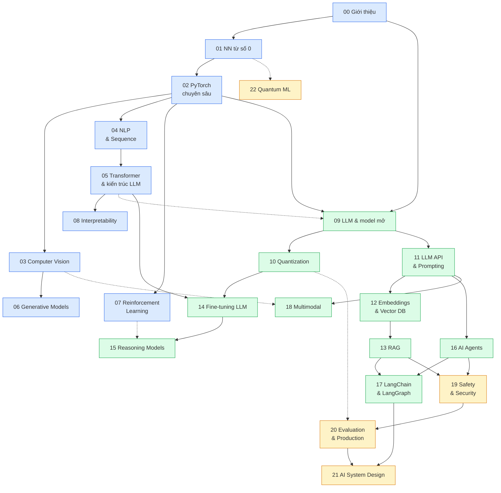

# Lộ trình AI Engineer

Lộ trình lấy [roadmap.sh/ai-engineer](https://roadmap.sh/ai-engineer) làm khung cho **phần B** (ứng dụng LLM) và
**mở rộng đáng kể** bằng **phần A** (hiểu và tự xây mô hình), cộng các chủ đề roadmap chưa có (đánh dấu ★ bên dưới).
Roadmap gốc gần như chỉ phủ nửa "gọi model qua API, RAG, agent" và lấy OpenAI làm trung tâm, một phần đã cũ
(Assistants API, DALL-E). Track này thay phần cũ bằng tương đương hiện hành và ghi chú rõ trong README từng module.

## Đối tượng và mục tiêu

Dành cho người đã xong track Data Engineer và track AI & Data Scientist (có module 13 Deep Learning: MLP, CNN, LSTM,
Transformer encoder trên FashionMNIST), Python/pandas/SQL vững. Mục tiêu là trở thành AI Engineer **hiểu AI từ bên
trong chứ không chỉ gọi API**: biết layer, neuron, attention hoạt động ra sao, và có **sản phẩm do chính mình làm**
(model tự train, ứng dụng dùng được) ở NLP, computer vision, game (reinforcement learning), agent, LangChain/LangGraph.

Quy tắc xuyên suốt:

- Kiến trúc cốt lõi (backprop, attention, GPT mini, DQN...) **tự cài đặt trước**, rồi mới dùng thư viện.
- Mọi bài làm được **miễn phí** trên máy của bạn. API trả phí (Claude, OpenAI, Gemini) chỉ là tùy chọn.
- Mỗi module phần A có ít nhất một bài Advanced là **dự án portfolio** chạy thật trên dữ liệu thật.
- Test không gọi LLM thật, không cần GPU hay mạng (dùng `FakeLLM`, model và dữ liệu cực nhỏ). Chất lượng thật được
  đo trong notebook và bài Advanced.

## Cách học: hai phần A và B

- **Phần A (00 đến 08): hiểu và tự xây mô hình.** Từ neuron tới GPT mini, CNN, diffusion, DQN/PPO, interpretability.
  Nặng về toán + PyTorch, nhiều bài train, một số bài cần GPU 12GB (có đường lui nhỏ hơn cho laptop).
- **Phần B (09 đến 22): ứng dụng LLM.** Model mở, quantization, API, embeddings, RAG, fine-tuning, reasoning, agent,
  LangGraph, multimodal, safety, evaluation, system design. Bám roadmap.sh, kết thúc bằng capstone
  [Trợ lý pháp luật tiếng Việt](capstone/README.md).

Phần B cần tối thiểu module 00 và 02 (PyTorch để dùng Hugging Face); module 05 được khuyên học trước, và
module 14 và 15 cần học 05 trước. Ai muốn đi nhanh tới ứng dụng: học **00, 01, 02, 04, 05** rồi sang phần B, quay lại 03, 06, 07, 08 sau. Mỗi module có lý thuyết (`README.md`),
`interview.md` và bài tập 3 mức Basic, Intermediate, Advanced có test tự chấm.

## Sơ đồ phụ thuộc



**Xanh dương** là phần A (tự xây mô hình). **Xanh lá** là phần B (xây ứng dụng và hệ thống LLM). **Vàng** là an toàn,
đưa vào production, thiết kế hệ thống và nhánh mở rộng (22). Đường nét đứt là phụ thuộc mềm (đọc trước thì tốt, không bắt buộc).

## Các module

★ = ngoài roadmap.sh. "Node roadmap" là nhóm node tương ứng trên roadmap.sh/ai-engineer.

| # | Module | Node roadmap | Kỹ năng chính |
| --- | --- | --- | --- |
| 00 | AI Engineer là gì | Introduction (What is an AI Engineer?, vs ML Engineer, AI vs AGI, Roles and Responsibilities, Impact on Product Development, LLMs, Inference, Training, Embeddings, Vector Databases, AI Agents, RAG, Prompt Engineering, Common Terminology) | Vai trò, AI vs AGI, tác động lên sản phẩm |
| 01 | Neural network từ số 0 ★ | mở rộng | Neuron, backprop bằng numpy, optimizer, init |
| 02 | PyTorch chuyên sâu ★ | mở rộng | GPU, mixed precision, normalization, debug train |
| 03 | Computer Vision ★ | mở rộng | LeNet tới ResNet/ViT, YOLO, segmentation |
| 04 | NLP & Sequence Models ★ | mở rộng | BPE, word2vec, LSTM, seq2seq, attention |
| 05 | Transformer & kiến trúc LLM ★ | mở rộng | GPT mini, RoPE, GQA, KV cache, MoE, scaling laws |
| 06 | Generative Models ★ | mở rộng | VAE, GAN, diffusion |
| 07 | Reinforcement Learning ★ | mở rộng | DQN, PPO, Gymnasium, RLHF |
| 08 | Interpretability ★ | mở rộng | Probing, logit lens, activation patching, SAE |
| 09 | LLM & model mở | Pre-trained Models (Benefits, Limitations, Capabilities/Context Length, Cut-off Dates), Popular AI Models (Claude, Gemini, Azure AI, SageMaker, Mistral, Cohere, Replicate), OpenAI Models, Open vs Closed Source, Popular Open Source Models, Hugging Face (Tasks, Hub, Models), Inference SDK, Transformers.js, Ollama (Models, SDK) | Chọn model, Hub, inference, sampling |
| 10 | Quantization ★ | mở rộng | GPTQ, AWQ, GGUF, bitsandbytes, đo VRAM |
| 11 | LLM API & Prompting | Open AI Platform, OpenAI API, Chat Completions API, Writing Prompts, Maximum Tokens, Token Counting, Managing Tokens, Pricing Considerations, Open AI Playground, Prompt Engineering, Common Terminology | Token, chi phí, prompt, structured output |
| 12 | Embeddings & Vector DB | What are Embeddings, Use Cases (Semantic Search, Data Classification, Recommendation, Anomaly Detection), OpenAI Embeddings API/Models, Sentence Transformers, Models on Hugging Face, Open-Source Embeddings, Vector Databases (Chroma, Pinecone, Weaviate, FAISS, LanceDB, Qdrant, Supabase, MongoDB Atlas), Indexing Embeddings, Similarity Search | Semantic search, indexing, vector DB |
| 13 | RAG | RAG & Implementation: RAG Usecases, Implementing RAG (Chunking, Embedding, Vector Database, Retrieval, Generation), Ways of Implementing RAG (Using SDKs Directly; LangChain, LlamaIndex trình bày ở 17), RAG Alternative | Chunking, hybrid, reranking, trích dẫn, eval |
| 14 | Fine-tuning LLM | Fine-tuning, RAG vs Fine-tuning | SFT, LoRA/QLoRA, DPO |
| 15 | Reasoning Models ★ | mở rộng | CoT, test-time compute, GRPO, distillation |
| 16 | AI Agents | Agents Usecases, Prompt Engineering, ReAct Prompting, Building AI Agents, Manual Implementation, OpenAI Functions / Tools (function calling), OpenAI Assistant API (đã cũ, thay bằng tool use hiện hành) | ReAct, tool use, MCP, memory, coding agent (nhiều ý ★) |
| 17 | LangChain & LangGraph ★ | Ways of Implementing RAG (LangChain, LlamaIndex) | LCEL, state graph, checkpoint, multi-agent |
| 18 | Multimodal AI | Multimodal AI Usecases/Tasks, Image Understanding, Image Generation, Video Understanding, Audio Processing, Text-to-Speech, Speech-to-Text, OpenAI Vision API, DALL-E API (cũ), Whisper API, Hugging Face Models, LangChain/LlamaIndex for Multimodal Apps, Implementing Multimodal AI | Vision, Whisper, TTS, sinh ảnh |
| 19 | AI Safety & Security | AI Safety and Ethics: Prompt Injection Attacks, Security and Privacy, Bias and Fairness, Safety Issues, OpenAI Moderation API, end-user IDs, adversarial testing, robust prompt engineering, Know your Customers/Usecases, Constraining outputs and inputs, Safety Best Practices | Prompt injection, red-teaming, guardrails |
| 20 | Evaluation & Production ★ | Development Tools (AI Code Editors, Code Completion Tools) | Evals, LLM-as-judge, vLLM, observability, chi phí |
| 21 | AI System Design ★ | mở rộng | Đóng khung bài toán, kiến trúc, case phỏng vấn |
| 22 | Quantum ML ★ | mở rộng (cập nhật dần) | Qubit, variational circuit, quantum kernel |

## Phần cứng và môi trường

| Máy | Cấu hình | Dùng cho |
| --- | --- | --- |
| Laptop | RTX 3050 Laptop 4GB, 16 core, 31GB RAM, Ollama | Chạy app, test, mọi bài Basic và Intermediate |
| PC | RTX 3060 12GB, 128GB RAM | Train nặng: GPT mini, diffusion, RL dài, QLoRA 7-8B, GRPO, LLM local 8-14B |

Mỗi bài ghi yêu cầu `CPU`, `GPU 4GB` hoặc `GPU 12GB (PC)` kèm thời gian chạy ước tính. Bài `GPU 12GB` luôn có
đường lui nhỏ hơn (model/dữ liệu nhỏ) để chạy trên laptop, kết quả kém hơn cũng được.

- **Python và GPU:** `pyproject.toml` ở gốc repo ghim `torch` bản CPU, đủ chạy test và các bài nhẹ. Bài train nặng
  dùng môi trường CUDA riêng (`ai-gpu`): xem [`setup/gpu/README.md`](../../setup/gpu/README.md), gồm cách cài, kiểm tra
  GPU và dùng Ollama trên PC qua LAN.
- **LLM qua `llmkit`:** mọi bài gọi LLM qua [`llmkit.py`](../../llmkit.py) (`llmkit.chat`, `llmkit.embed`), đổi nơi
  chạy model chỉ bằng biến môi trường hoặc `setup/.env`, không sửa code bài. Cấu hình chi tiết nằm trong docstring đầu
  `llmkit.py` và [`setup/SETUP.md`](../../setup/SETUP.md).

| Nơi chạy | Cấu hình |
| --- | --- |
| Ollama local (mặc định) | `ollama serve`, `ollama pull qwen2.5:3b`, `ollama pull bge-m3` |
| Ollama trên PC qua LAN | `OLLAMA_HOST=http://<ip-PC>:11434` |
| OmniRoute | `LLM_PROVIDER=openai_compat`, `LLM_BASE_URL`, `LLM_API_KEY`, `LLM_MODEL` |
| Gemini | `LLM_PROVIDER=openai_compat` với `LLM_BASE_URL=https://generativelanguage.googleapis.com/v1beta/openai`, `LLM_MODEL=gemini-2.5-flash`, `EMBED_MODEL=gemini-embedding-001` |

Không commit key. Trong test dùng `llmkit.FakeLLM` để LLM trả lời xác định, không cần mạng.

- **Model Ollama dùng ở bài Basic/Intermediate:** `qwen2.5:3b` (chat), `bge-m3` hoặc `nomic-embed-text` (embedding).
  `qwen2.5:7b` trở lên chỉ nằm ở bài Advanced hoặc cell "mở rộng" không chấm.

## Dữ liệu

Ưu tiên dữ liệu thật, ưu tiên tiếng Việt khi hợp lý. Danh sách bộ và lệnh tải ở [`data/README.md`](../../data/README.md):

```bash
uv run python data/download_dataset.py --list
uv run python data/download_dataset.py mnist        # MNIST (module 01)
uv run python data/download_dataset.py zalo-legal   # Zalo AI Legal Text Retrieval (module 13, capstone)
```

- **Hugging Face token:** tạo ở huggingface.co → Settings → Access Tokens, đặt `HF_TOKEN` trong `setup/.env`
  (hoặc `huggingface-cli login`). Một số bộ và model cần token để tránh giới hạn tải; không commit token.
- **Kaggle token:** như các track trước (`KAGGLE_API_TOKEN` trong `setup/.env`), cần cho các bộ lấy từ Kaggle.
- Bộ **Zalo legal** là mirror HF `GreenNode/zalo-ai-legal-text-retrieval-vn` (BEIR-style JSONL): 61 425 điều luật,
  3 298 câu hỏi, qrels train/test. Test chấm bài không cần các bộ này; phần kiểm trên dữ liệu thật tự skip khi chưa tải.

## Dự án portfolio

Bắt buộc có (đặt ở bài Advanced của module tương ứng):

| Dự án | Module |
| --- | --- |
| GPT mini tiếng Việt tự train từ số 0, sau đó quantize và so sánh | 05, 10 |
| Detector hoặc segmentation fine-tune trên bộ ảnh thật, kèm app nhỏ chạy webcam | 03 |
| Agent chơi game bằng DQN/PPO (Atari hoặc tương tự), quay video kết quả | 07 |
| Diffusion nhỏ sinh ảnh theo class | 06 |
| Reasoning model mini: GRPO cải thiện model nhỏ ở bài toán có đáp án kiểm được, có số liệu trước/sau | 15 |
| Trợ lý tài chính cá nhân đa phương thức: chụp hóa đơn Việt Nam, đọc bằng vision, phân loại chi tiêu, hỏi đáp bằng giọng (Whisper + TTS), agent lập báo cáo tháng | 18 |
| Coding/research agent: đọc tài liệu và repo, trả lời hoặc sửa code, có bộ task kiểm chứng được (test pass/fail) | 16 hoặc 17 |

Ngoài ra có capstone xuyên phần B: [Trợ lý pháp luật tiếng Việt](capstone/README.md) (9 milestone gắn với các module 10 tới 21).

## Ngoài phạm vi track này

- **Dạy lại module 13 Deep Learning của track DS và toán ML**: chỉ nhắc ngắn và trỏ sang các module đó.
- **MLOps hạ tầng sâu** (Kubernetes, CI/CD cho model, feature store): track MLOps/DevOps. Module 20 chỉ phủ phần
  đặc thù LLM (serving, eval, observability, chi phí).
- **Pretrain LLM lớn** (hơn khoảng 200M tham số): không, phần cứng không cho phép. GPT mini ở module 05 là bản thu nhỏ.

## Chuẩn bị

1. Môi trường Python: `uv sync` ở gốc repo (xem [`setup/SETUP.md`](../../setup/SETUP.md)).
2. Cài và kiểm tra môi trường GPU khi tới bài train nặng: [`setup/gpu/README.md`](../../setup/gpu/README.md).
3. Cài Ollama và kéo model: `ollama pull qwen2.5:3b`, `ollama pull bge-m3`.
4. Tạo Hugging Face token (và Kaggle token nếu cần), đặt vào `setup/.env`.

Lĩnh vực đổi rất nhanh: README mỗi module ghi ngày kiểm phiên bản thư viện và model hiện hành.
