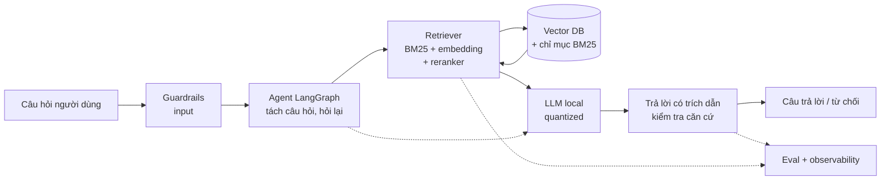

# Trợ lý pháp luật tiếng Việt

Dự án capstone xuyên suốt phần B của lộ trình AI Engineer. Bạn xây một **hệ thống hỏi đáp pháp luật tiếng Việt**:
RAG kết hợp agent (LangGraph), trả lời **kèm trích dẫn điều luật**, chạy local. Chín milestone đi từ baseline BM25
và đo recall@k, qua retrieval bằng embedding, RAG có trích dẫn, quantization, fine-tuning, agent, safety, eval và
serving, tới tài liệu system design của chính hệ thống.

Câu hỏi kỹ thuật xuyên suốt: **làm sao để trợ lý chỉ nói điều có căn cứ trong văn bản luật, và chứng minh điều đó bằng số?**
Trả lời "không đủ căn cứ" khi retrieval không tìm được điều luật phù hợp là hành vi đúng, không phải lỗi.

## Mục tiêu dự án

- Một hệ thống chạy được thật, mỗi con số trong báo cáo (recall@k, độ trung thực, độ trễ, chi phí) truy được về một
  script hoặc notebook chạy lại được.
- Thể hiện kỹ năng nhà tuyển dụng hỏi ở vị trí AI Engineer: retrieval, RAG, đánh giá, fine-tuning, agent, safety,
  serving và thiết kế hệ thống.
- Trung thực: kết luận "hybrid không hơn BM25 ở bộ này" hay "fine-tune không đáng" là kết luận tốt nếu số liệu nói vậy.

## Kiến trúc tổng



```mermaid
flowchart TD
    D[Zalo legal<br/>điều luật + câu hỏi + qrels] --> N[Chuẩn hóa văn bản]
    N --> I1[Chỉ mục BM25]
    N --> I2[Embedding + vector DB]
    I1 --> E1[recall@k baseline]
    I2 --> E2[recall@k hybrid + rerank]
    E1 --> CMP[So sánh trước/sau<br/>mỗi milestone]
    E2 --> CMP
```

## Dữ liệu

```bash
uv run python data/download_dataset.py zalo-legal   # ghi vào data/raw/zalo-legal/
```

Bộ **Zalo AI Legal Text Retrieval** (mirror HF `GreenNode/zalo-ai-legal-text-retrieval-vn`, định dạng BEIR-style
JSONL): **61 425 điều luật** (corpus), **3 298 câu hỏi** có nhãn điều luật liên quan, qrels tách train/test. Câu hỏi có nhãn
cho phép chấm retrieval bằng số. Chi tiết cấu trúc và giấy phép: [`data/README.md`](../../data/README.md). Không commit dữ liệu.
Nếu bộ này không tải được hợp lệ, chọn bộ hỏi đáp pháp luật tiếng Việt có nhãn tương đương và ghi lý do.

Cấu hình LLM và embedding: `llmkit` (Ollama mặc định, xem [README track](../README.md#phần-cứng-và-môi-trường)). Code dự án
đặt ở `capstone/project/`.

## Chín milestone

Mỗi milestone chỉ cần kiến thức các module trước nó (`after`). Phần này chỉ mô tả; tệp hướng dẫn từng milestone
được thêm sau.

| # | Milestone | Sau module | Kết quả cần nộp |
| --- | --- | --- | --- |
| 1 | **Dữ liệu và baseline BM25.** Chuẩn hóa văn bản luật (điều, khoản, tiêu đề), dựng chỉ mục BM25, đo recall@k | 12 | Script chuẩn hóa, bảng recall@k (k = 1, 5, 10, 20) trên qrels test |
| 2 | **Retrieval hiện đại.** Embedding + vector DB, hybrid, reranking, so với baseline | 13 | Bảng so sánh BM25 / dense / hybrid / rerank, phân tích câu hỏi hỏng |
| 3 | **RAG có trích dẫn.** Sinh câu trả lời trích đúng điều luật, đánh giá độ trung thực (faithfulness) | 13 | Pipeline RAG, số liệu faithfulness và tỉ lệ trích dẫn đúng |
| 4 | **Quantize và chạy local hiệu quả.** Quantize LLM, đo VRAM, tốc độ, chất lượng | 10 | Bảng đánh đổi độ chính xác / tốc độ / VRAM cho 2-3 mức quantize |
| 5 | **Fine-tune.** Fine-tune embedding hoặc LLM (QLoRA) trên dữ liệu luật, so trước/sau | 14 | Số liệu trước/sau trên cùng tập test, kết luận có đáng không |
| 6 | **Agent LangGraph.** Tách câu hỏi, tra cứu nhiều bước, hỏi lại khi thiếu thông tin | 17 | Graph chạy được, ví dụ câu hỏi nhiều vế và câu hỏi thiếu dữ kiện |
| 7 | **Safety.** Chống prompt injection, từ chối khi không có căn cứ, không bịa điều luật | 19 | Bộ test red-team, tỉ lệ từ chối đúng và tỉ lệ bịa điều luật |
| 8 | **Eval, observability, serving.** Eval suite, trace, serve và đo chi phí/độ trễ | 20 | Eval suite chạy được, dashboard hoặc log trace, số p50/p95 độ trễ |
| 9 | **Tài liệu system design.** Thiết kế của chính hệ thống: yêu cầu, kiến trúc, đánh đổi, mở rộng | 21 | Tài liệu thiết kế nộp như phỏng vấn system design |

Thứ tự `after` cụ thể có thể được điều chỉnh khi soạn tệp milestone, miễn mỗi milestone chỉ cần kiến thức các module trước.

## Cách chấm

- **Retrieval (milestone 1, 2, 5):** **recall@k** trên qrels test, cùng tập test cho mọi so sánh (không tune trên test).
  Báo cáo thêm MRR hoặc nDCG@10 nếu có. Mỗi cải tiến phải có số trước/sau.
- **Độ trung thực (milestone 3, 7):** tỉ lệ câu trả lời mà mọi khẳng định đều có căn cứ trong điều luật được trích
  (kiểm bằng LLM-as-judge kèm kiểm tay trên mẫu 30-50 câu), và tỉ lệ trích dẫn trỏ đúng điều luật có trong qrels.
- **Hệ thống (milestone 4, 6, 8):** VRAM, độ trễ p50/p95, chi phí mỗi câu hỏi; agent hoàn thành đúng các ca nhiều bước.
- **Rubric tổng:** mỗi milestone chấm theo (1) chạy lại được, (2) có số liệu đúng cách đo, (3) phân tích lỗi cụ thể,
  (4) kết luận trung thực kể cả khi kết quả âm. Số liệu bịa hoặc đo trên tập đã dùng để tune bị trừ nặng nhất.
