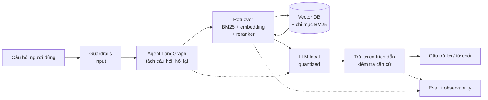
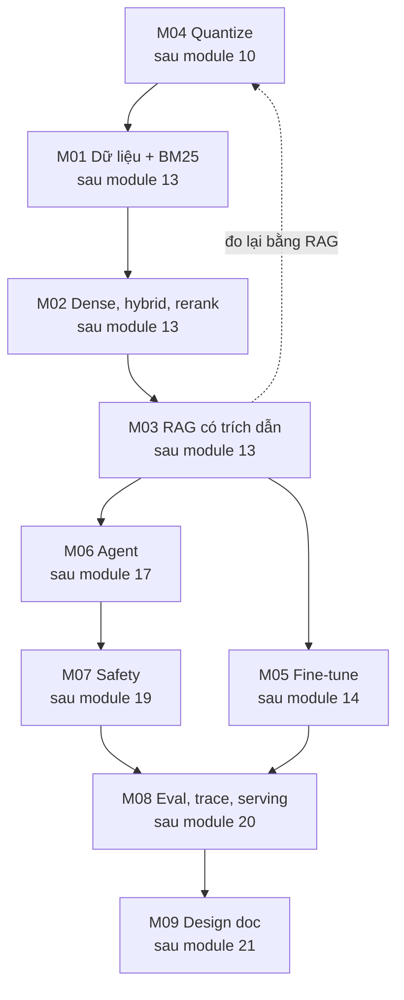

# Trợ lý pháp luật tiếng Việt

Dự án capstone xuyên suốt phần B của lộ trình AI Engineer. Bạn xây một **hệ thống hỏi đáp pháp luật tiếng Việt**:
RAG kết hợp agent (LangGraph), trả lời **kèm trích dẫn điều luật**, chạy local. Chín milestone đi từ baseline BM25
và đo recall@k, qua retrieval bằng embedding, RAG có trích dẫn, quantization, fine-tuning, agent, safety, eval và
serving, tới tài liệu system design của chính hệ thống.

Câu hỏi kỹ thuật xuyên suốt: **làm sao để trợ lý chỉ nói điều có căn cứ trong văn bản luật, và chứng minh điều đó bằng số?**
Trả lời "không đủ căn cứ" khi retrieval không tìm được điều luật phù hợp là hành vi đúng, không phải lỗi.

## Mục tiêu dự án

- Một hệ thống chạy được thật, mỗi con số trong báo cáo (recall@k, độ trung thực, độ trễ, chi phí) truy được về một
  script hoặc notebook chạy lại được.
- Thể hiện kỹ năng nhà tuyển dụng hỏi ở vị trí AI Engineer: retrieval, RAG, đánh giá, fine-tuning, agent, safety,
  serving và thiết kế hệ thống.
- Trung thực: kết luận "hybrid không hơn BM25 ở bộ này" hay "fine-tune không đáng" là kết luận tốt nếu số liệu nói vậy.

## Kiến trúc tổng



```mermaid
flowchart TD
    D[Zalo legal<br/>điều luật + câu hỏi + qrels] --> N[Chuẩn hóa văn bản]
    N --> I1[Chỉ mục BM25]
    N --> I2[Embedding + vector DB]
    I1 --> E1[recall@k baseline]
    I2 --> E2[recall@k hybrid + rerank]
    E1 --> CMP[So sánh trước/sau<br/>mỗi milestone]
    E2 --> CMP
```

## Dữ liệu

```bash
uv run python data/download_dataset.py zalo-legal   # ghi vào data/raw/zalo-legal/
```

Bộ **Zalo AI Legal Text Retrieval** (mirror HF `GreenNode/zalo-ai-legal-text-retrieval-vn`, định dạng BEIR-style
JSONL): **61 425 điều luật** (corpus) thuộc 3 271 văn bản, 3 298 câu hỏi, trong đó 3 196 câu có nhãn điều luật liên quan
trong qrels (2 432 ở split train, 788 ở split test, 24 câu có ở cả hai). Câu hỏi có nhãn cho phép chấm retrieval bằng số.
Chi tiết cấu trúc và giấy phép: [`data/README.md`](../../../data/README.md). Không commit dữ liệu hay đoạn trích từ nó.

Cấu hình LLM và embedding: `llmkit` (Ollama mặc định, `qwen2.5:3b` và `bge-m3`, xem
[README track](../README.md#phần-cứng-và-môi-trường)). Code dự án đặt ở [`project/`](project/).

## Định nghĩa dùng chung

Mọi milestone dùng **cùng** các định nghĩa dưới đây, giống module 13, 14, 17. Đổi định nghĩa nào thì ghi rõ trong báo cáo
và lý do.

| Khái niệm | Định nghĩa | Số trên Zalo Legal |
| --- | --- | --- |
| Tập đánh giá ghim | 300 `query-id` đầu tiên theo thứ tự xuất hiện trong `qrels/test.jsonl` (`load_questions(root, "test", 300)`) | 300 câu, 301 cặp (câu, điều đúng), đáp án thuộc 144 văn bản |
| Tập dev | 300 câu đầu của split train, bỏ `query-id` có trong split test; mọi tham số chọn ở đây | 300 câu |
| Dữ liệu train (M05) | split train trừ mọi câu trùng `query-id` hoặc trùng chữ với tập ghim | 7 câu ghim có cùng `query-id` và cùng chữ ở split train (nhãn khác) |
| Văn bản index | `normalize(title + "\n" + text)`: NFC, gộp khoảng trắng, bỏ dòng trống | `normalize` đổi 2 109 điều; 0 điều không ở dạng NFC |
| Thước đo retrieval | recall@k, MRR@10, nDCG@10 mức **điều**, định nghĩa mục 6 module 13 | một câu = 0.0033 trên 300 câu |
| Đơn vị nguồn trong prompt | khoản (tách tiếp theo điểm khi khoản dài hơn 1 500 ký tự), mỗi nguồn mở đầu bằng tiêu đề điều | 28 trên 1 600 nguồn khoản (300 câu ghim và 20 câu ngoài phạm vi, 5 nguồn mỗi câu) vẫn dài hơn 1 500 ký tự |
| Câu từ chối | đúng chuỗi `Không tìm thấy căn cứ trong tài liệu được cung cấp.` | |
| Trích đúng | câu trả lời trích hợp lệ (`[i]` trong khoảng) ít nhất một điều có trong qrels của câu đó | |

## Chín milestone

Mỗi milestone chỉ cần kiến thức các module trước nó (`after`).

| # | Milestone | Sau module | Kết quả cần nộp |
| --- | --- | --- | --- |
| [M01](milestones/m01-data-bm25-baseline.md) | **Dữ liệu và baseline BM25.** Chuẩn hoá văn bản luật, tập ghim, chỉ mục BM25, recall@k | 13 | `data.py`, `text.py`, `bm25.py`, `metrics.py`; bảng recall@k (k = 1, 5, 10, 20), phân tích lỗi |
| [M02](milestones/m02-dense-hybrid-rerank.md) | **Retrieval hiện đại.** Embedding + vector DB, hybrid RRF, reranking, so với baseline | 13 | Bảng BM25 / dense / hybrid / rerank, tham số chọn trên dev, phân tích theo cặp |
| [M03](milestones/m03-rag-citations-faithfulness.md) | **RAG có trích dẫn.** Nguồn theo khoản, trích dẫn kiểm bằng code, cổng từ chối, faithfulness | 13 | Pipeline RAG, tỉ lệ trích đúng, từ chối, faithfulness kèm kiểm judge |
| [M04](milestones/m04-quantize-local.md) | **Quantize và chạy local hiệu quả.** bpc trên văn bản luật, tốc độ, VRAM, Pareto front | 10 | Bảng 3+ mức quantize, mức đã chọn; sau M03 thêm số RAG |
| [M05](milestones/m05-finetune.md) | **Fine-tune.** Embedding (hoặc LLM bằng QLoRA) trên split train, không rò rỉ | 14 | Số trước/sau trên tập ghim, chi phí, kết luận có đáng không |
| [M06](milestones/m06-langgraph-agent.md) | **Agent LangGraph.** Tách câu hỏi, tra nhiều bước, hỏi lại, định tuyến | 17 | Đồ thị chạy được, bảng agent và RAG một lượt trên câu thường, hai vế, thiếu dữ kiện |
| [M07](milestones/m07-safety-guardrails.md) | **Safety.** Chống injection, từ chối khi không có căn cứ, không bịa điều luật | 19 | Bộ red-team, ASR có khoảng tin cậy, chặn oan, tỉ lệ bịa điều luật |
| [M08](milestones/m08-eval-observability-serving.md) | **Eval, observability, serving.** Eval suite một lệnh, judge hiệu chuẩn, trace, load test | 20 | Eval suite + cổng hồi quy, kappa, trace, p50/p95 có khoảng tin cậy, chi phí |
| [M09](milestones/m09-system-design-doc.md) | **Tài liệu system design.** Yêu cầu, ước lượng, kiến trúc, đánh đổi, rủi ro | 21 | Design doc 10 mục, README portfolio |

## Milestone nối nhau thế nào

Vì thứ tự module của lộ trình, bạn gặp **M04 trước M01**: M04 (sau module 10) đo quantize trên văn bản luật và chưa cần
retrieval; khi xong M03 bạn quay lại M04 để đo bằng chính pipeline RAG. Các milestone còn lại đi theo thứ tự số.



## Cấu trúc code

Code của capstone nằm ở [`project/`](project/) (`tests/conftest.py` tự thêm `project/` vào `sys.path`, không cần đặt
`PYTHONPATH`): package `legal_assistant/` có sẵn **khung hàm** theo milestone (docstring
là đặc tả) và test trên bộ luật tí hon hư cấu. Hàm còn `NotImplementedError` thì test của nó skip kèm lời nhắc; viết
xong thì test chạy thật:

```bash
uv run pytest tracks/ai-engineer/capstone/project/tests -q -rs
```

Phần chạy trên dữ liệu thật (index, gọi model, vòng lặp đánh giá, đồ thị, server) là script và notebook của bạn, gọi các
hàm trong package. Chi tiết ở [`project/README.md`](project/README.md). Capstone không có lời giải mẫu; mỗi milestone có
bảng **số tham chiếu** từ bản cài đặt của người soạn (M01 tới M03) hoặc trỏ tới số đã đo ở module tương ứng.

## Trình bày lên GitHub làm portfolio

1. **Tách thành repo riêng** khi xong M03: copy `project/` ra repo `tro-ly-phap-luat`, kèm hướng dẫn tải dữ liệu (không
   commit dữ liệu Zalo).
2. **README đầu trang**: hệ thống làm gì trong hai câu, sơ đồ kiến trúc, bảng "con số chính" có link tới script tạo ra nó.
3. **Mục "Decisions"**: vì sao hybrid với BM25 bigram, vì sao nguồn là khoản, có rerank không, mức quantize nào, có
   fine-tune không, khi nào đi đường agent. Đây là chỗ người phỏng vấn hỏi lại.
4. **Chạy lại được**: `uv run pytest` xanh, một lệnh chạy eval suite chế độ nhanh, một lệnh chạy đầy đủ.
5. **Ghi rõ giới hạn**: nhãn qrels một điều mỗi câu, corpus không có ngày hiệu lực, judge nhỏ, số đo trên máy dùng chung,
   không thay tư vấn của luật sư.

## Cách chấm

- **Retrieval (milestone 1, 2, 5):** **recall@k** trên qrels test, cùng tập test cho mọi so sánh (không tune trên test).
  Báo cáo thêm MRR hoặc nDCG@10 nếu có. Mỗi cải tiến phải có số trước/sau.
- **Độ trung thực (milestone 3, 7):** tỉ lệ câu trả lời mà mọi khẳng định đều có căn cứ trong điều luật được trích
  (kiểm bằng LLM-as-judge kèm kiểm tay và kappa trên mẫu 30-50 câu), và tỉ lệ trích dẫn trỏ đúng điều luật có trong qrels.
- **Hệ thống (milestone 4, 6, 8):** VRAM, độ trễ p50/p95 có khoảng tin cậy, chi phí mỗi 1 000 câu hỏi; agent hoàn thành
  đúng các ca nhiều bước và hỏi lại đúng lúc.
- **Safety (milestone 7):** tỉ lệ tấn công thành công có khoảng tin cậy, tỉ lệ chặn oan, tỉ lệ bịa điều luật.
- **Rubric tổng:** mỗi milestone chấm theo (1) chạy lại được, (2) có số liệu đúng cách đo, (3) phân tích lỗi cụ thể,
  (4) kết luận trung thực kể cả khi kết quả âm. Số liệu bịa hoặc đo trên tập đã dùng để tune bị trừ nặng nhất.
