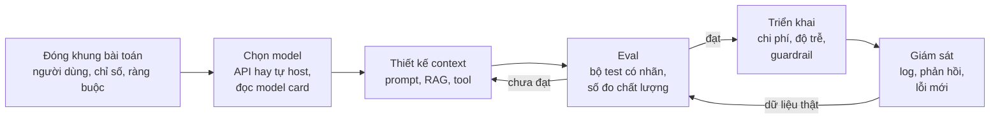
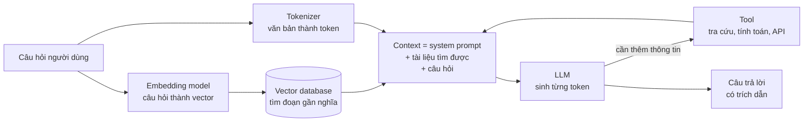
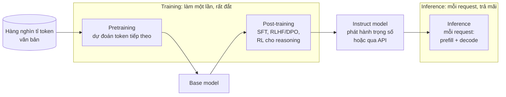
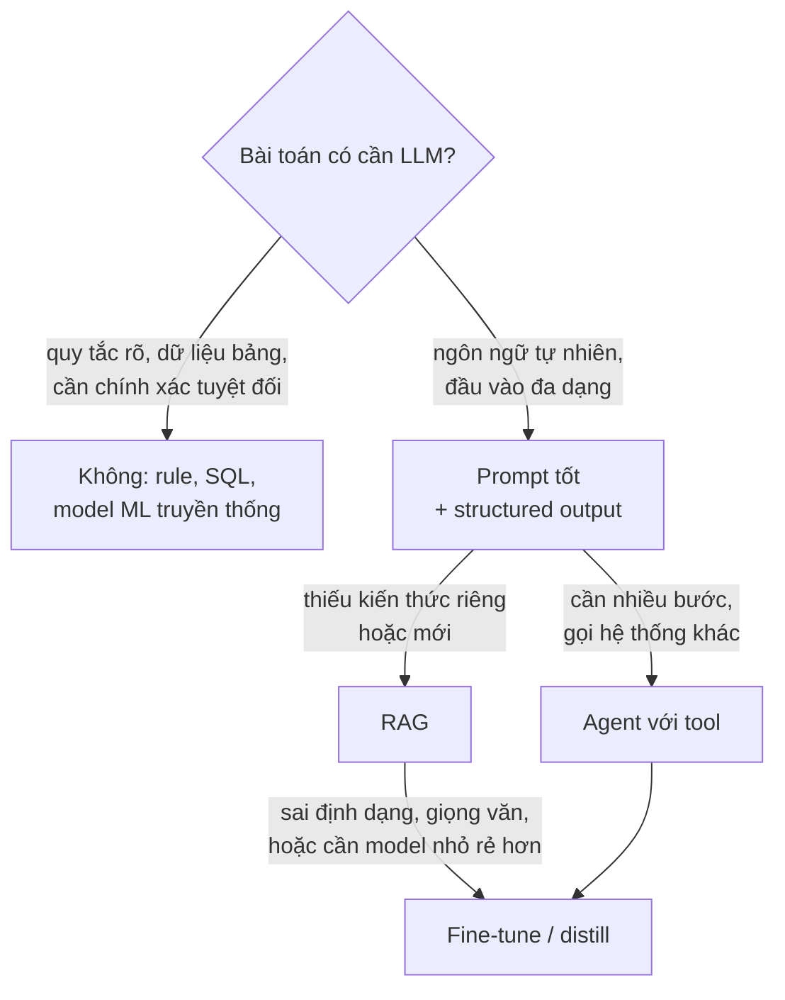

# AI Engineer là gì

Năm 2018 muốn có một hệ thống tóm tắt văn bản tiếng Việt, bạn cần dữ liệu có nhãn, vài tháng train và một đội
có PhD. Năm 2026 bạn có thể dựng bản chạy được trong một buổi chiều: gọi một model nền tảng (foundation model) qua
API hoặc chạy `qwen2.5:3b` trên laptop, viết prompt, thêm tài liệu của mình vào context. Nghề **AI Engineer** ra
đời từ sự dịch chuyển đó: phần lớn giá trị không còn nằm ở việc train model từ đầu, mà ở việc **biến model có sẵn
thành sản phẩm dùng được**: đúng, đủ nhanh, đủ rẻ, an toàn và đo được. Buổi chiều đầu tiên dễ; phần khó là đi từ
"demo chạy được" tới "sản phẩm 10 000 người dùng mỗi ngày mà không ai phải xin lỗi".

Module này là bản đồ cho cả track: AI Engineer làm gì và khác ML Engineer ở đâu, AI khác AGI thế nào, các thuật
ngữ bạn sẽ gặp ở mọi module sau (LLM, token, embedding, vector database, RAG, prompt engineering, agent), và hai
phép tính mà người làm nghề phải nhẩm được trong đầu: **chi phí** và **độ trễ** của inference. Lý thuyết đi kèm
con số đo thật trên máy của track (RTX 3050 Laptop 4GB, Ollama 0.13.5 với `qwen2.5:3b` bản Q4_K_M, kiểm ngày
2026-10-30). Giá API và danh sách model đổi theo tháng: mọi giá trích ở đây ghi rõ ngày kiểm và nguồn, còn giá dùng
trong bài tập là **giá giả định** để test không lỗi thời.

Sau module này bạn sẽ:

- Mô tả được vai trò, trách nhiệm của AI Engineer và phân biệt với ML Engineer, Data Scientist, Research Scientist.
- Nói rõ AI hẹp và AGI, và vì sao điều đó quan trọng với quyết định sản phẩm (không phải với tranh luận triết học).
- Giải thích ngắn gọn LLM, token, embedding, vector database, RAG, prompt engineering, agent và biết module nào học sâu.
- Phân biệt training và inference về compute, bộ nhớ, chi phí; tách độ trễ thành prefill và decode.
- Ước lượng chi phí một request, chi phí tháng, so API với tự host; đọc model card và `config.json` để biết model
  có chạy được trên GPU của mình không, giấy phép có cho dùng thương mại không.

| Mức | Bài | Nội dung |
| --- | --- | --- |
| Basic | 01 inference-cost | chi phí request, cache, giá theo độ dài prompt, chọn model theo ràng buộc |
| Basic | 02 model-card | đọc frontmatter model card, đếm tham số từ `config.json`, VRAM và KV cache |
| Intermediate | 01 token-counting | đếm token tiếng Việt và tiếng Anh trên IWSLT'15 thật với 3 tokenizer |
| Intermediate | 02 inference-latency | đo prefill, decode, TTFT với Ollama thật; mô hình độ trễ tuyến tính |
| Advanced | 01 ai-feature-brief | bản đánh giá khả thi một tính năng AI hỏi đáp pháp luật, có số đo |

## 1. AI Engineer là gì: vai trò và trách nhiệm

**AI Engineer** là kỹ sư xây sản phẩm và hệ thống dựa trên model AI có sẵn, chủ yếu là model nền tảng (LLM, model
embedding, model đa phương thức), và chịu trách nhiệm cho việc hệ thống đó **chạy tốt ngoài đời thật**. Chữ quan
trọng là "dựa trên": điểm xuất phát thường là một model đã được người khác pretrain với chi phí hàng triệu đô, và
công việc là chọn, ghép, điều chỉnh, đo và vận hành nó.

Công việc thực tế của AI Engineer theo vòng đời một tính năng:



Trách nhiệm cụ thể, mỗi dòng là một nhóm module của track:

| Trách nhiệm | Câu hỏi phải trả lời | Module |
| --- | --- | --- |
| Đóng khung bài toán | AI có phải lời giải không? Đo thành công bằng gì? | 00, 21 |
| Chọn và hiểu model | Model nào đủ tốt, đủ rẻ, giấy phép cho phép? Nó hỏng ở đâu? | 05, 09, 10 |
| Thiết kế context | Prompt, tài liệu, tool nào đưa vào context để model trả lời đúng? | 11, 12, 13, 16, 17 |
| Điều chỉnh model | Khi nào prompt không đủ và phải fine-tune, distill? | 14, 15 |
| Đánh giá | Bộ eval nào, số nào, ngưỡng nào thì được ship? | 13, 20 |
| An toàn | Prompt injection, lộ dữ liệu, nội dung độc hại, thiên lệch | 19 |
| Vận hành | Chi phí, độ trễ p95, serving, observability, cache | 10, 20 |

### AI Engineer, ML Engineer, Data Scientist, Research Scientist

Ranh giới mờ và khác nhau giữa các công ty, nhưng trọng tâm khác nhau rõ:

| | Research Scientist | ML Engineer | AI Engineer | Data Scientist |
| --- | --- | --- | --- | --- |
| Đầu vào | câu hỏi nghiên cứu | dữ liệu có nhãn của bài toán | model nền tảng + yêu cầu sản phẩm | dữ liệu kinh doanh + câu hỏi |
| Sản phẩm chính | phương pháp, model mới, paper | model train riêng, pipeline train/serve | tính năng, ứng dụng, agent dùng model | insight, thí nghiệm, model dự báo |
| Thời gian tới bản đầu | tháng | tuần tới tháng | giờ tới ngày | ngày tới tuần |
| Kỹ năng lõi | toán, thực nghiệm, đọc paper | feature, train, MLOps, hệ phân tán | prompt/context, RAG, eval, tích hợp, chi phí | thống kê, A/B test, SQL, giao tiếp |
| Đo bằng | benchmark, paper | metric offline (AUC, RMSE) + online | eval theo tác vụ, phản hồi người dùng, chi phí/request | quyết định kinh doanh được cải thiện |
| Hỏng thường gặp | không tái lập | train/serve skew, drift | hallucination, prompt injection, chi phí bùng | kết luận nhân quả sai |

Hai điểm hay bị hiểu sai:

- **AI Engineer không phải "người gọi API".** Khi model trả lời sai, người chỉ biết gọi API chỉ còn cách đổi prompt
  và cầu may. Người hiểu tokenizer, attention, KV cache, sampling biết lỗi nằm ở retrieval, ở context bị cắt, ở
  temperature hay ở chính giới hạn của model, và sửa đúng chỗ. Vì vậy track này có **phần A** (module 01 tới 08)
  tự xây model từ neuron tới GPT mini trước khi sang ứng dụng ở **phần B**.
- **ML Engineer không bị thay thế**, nhưng phạm vi dịch chuyển. Bài toán dạng bảng (dự báo churn, chấm điểm tín
  dụng, gợi ý) vẫn là đất của model train riêng: rẻ hơn, nhanh hơn, giải thích được hơn LLM nhiều bậc. AI Engineer
  lão luyện biết lúc nào **không** dùng LLM (mục 6).

## 2. AI và AGI

**AI** (Artificial Intelligence) theo nghĩa kỹ thuật là mọi hệ thống làm được việc mà ta coi là cần trí tuệ: từ cây
quyết định chấm điểm tín dụng tới LLM viết code. Toàn bộ AI đang dùng trong sản phẩm hiện nay là **AI hẹp** (narrow
AI) theo nghĩa có giới hạn năng lực đo được: rất giỏi ở một số việc, hỏng một cách khó đoán ở việc khác.

**AGI** (Artificial General Intelligence) là AI có năng lực **tổng quát** ngang hoặc hơn con người trên phần lớn
công việc trí tuệ. Không có định nghĩa thống nhất, và đó chính là vấn đề:

| Nguồn | Định nghĩa AGI (tóm tắt) | Điểm cần để ý |
| --- | --- | --- |
| OpenAI Charter (2018) | "hệ thống tự chủ cao, vượt con người ở phần lớn công việc có giá trị kinh tế" | đo bằng kinh tế, không bằng trí tuệ |
| Morris và cộng sự, Google DeepMind (2023), "Levels of AGI" | hai trục: **hiệu năng** (từ Emerging tới Superhuman) × **độ tổng quát** (hẹp hay rộng) | coi AGI là thang bậc, không phải một ngưỡng |
| Cách dùng đại chúng | "AI thông minh như người" | không kiểm được, dễ thành khẩu hiệu |

Vì sao một kỹ sư cần quan tâm? Không phải để dự đoán năm AGI ra đời, mà để tránh hai lỗi thiết kế ngược chiều nhau:

- **Đánh giá quá cao**: tin model "hiểu" nên giao việc không có kiểm tra. LLM viết lập luận pháp lý trôi chảy nhưng
  có thể trích một điều luật không tồn tại (hallucination). Hệ thống phải có trích dẫn kiểm được, eval, và người
  duyệt ở chỗ rủi ro cao (module 13, 19).
- **Đánh giá quá thấp**: không thử vì nghĩ "AI chưa làm được". Năng lực tăng theo từng thế hệ model; việc model năm
  ngoái hỏng có thể model năm nay làm tốt. Cách duy nhất biết là **eval trên bài toán của mình**, chạy lại mỗi khi có
  model mới.

Năng lực của LLM được mô tả là **"jagged frontier"** (biên năng lực răng cưa, Dell'Acqua và cộng sự, 2023): trong
một thí nghiệm với tư vấn viên BCG, dùng GPT-4 giúp tăng chất lượng ở các tác vụ nằm trong biên năng lực, nhưng làm
**giảm** độ chính xác ở tác vụ nằm ngoài biên, vì người dùng tin theo câu trả lời sai mà nghe hợp lý. Hai tác vụ trông
khó như nhau có thể nằm hai phía của biên. Hệ quả kỹ thuật: benchmark công khai cho biết model mạnh cỡ nào **nói
chung**; nó không thay được bộ eval vài trăm câu lấy từ đúng nghiệp vụ của bạn. Benchmark còn có rủi ro
**contamination** (câu hỏi lọt vào dữ liệu train), nên điểm cao chưa chắc là năng lực thật.

## 3. Bản đồ thuật ngữ: LLM, token, embedding, RAG, agent

Các khái niệm dưới đây xuất hiện trong mọi module phần B. Ở đây chỉ cần hiểu chúng là gì và nối với nhau thế nào;
mỗi khái niệm có module học sâu.



- **LLM (Large Language Model)**: mạng Transformer (thường là decoder-only) train để dự đoán **token tiếp theo**
  trên hàng nghìn tỉ token văn bản. Mọi thứ nó làm, từ trả lời, dịch, viết code tới gọi tool, đều là sinh tiếp token
  theo phân phối xác suất. Module 05 tự dựng một GPT mini; module 09 dùng model mở.
- **Token**: đơn vị model đọc và sinh, thường là một mảnh từ (subword) do tokenizer BPE tạo ra. Giá API, giới hạn
  context, tốc độ sinh đều tính bằng token, không bằng ký tự hay từ. Cùng một nội dung, số token phụ thuộc ngôn ngữ
  và tokenizer (mục 5 có số đo). Module 04 tự viết BPE.
- **Context window**: số token tối đa model xử lý trong một lần gọi, gồm cả prompt lẫn câu trả lời.
- **Embedding**: vector số dày đặc biểu diễn nghĩa của một đoạn văn; hai đoạn cùng nghĩa có vector gần nhau (cosine
  cao), kể cả khi khác chữ. Module 12.
- **Vector database**: kho lưu embedding và tìm nhanh các vector gần nhất (approximate nearest neighbor) trên hàng
  triệu vector: FAISS, Qdrant, pgvector, LanceDB... Module 12.
- **RAG (Retrieval-Augmented Generation)**: tìm tài liệu liên quan rồi đưa vào context để LLM trả lời dựa trên đó và
  trích nguồn. Cách chuẩn để LLM trả lời về **dữ liệu riêng** và dữ liệu mới hơn ngày cut-off của model. Module 13.
- **Prompt engineering**: thiết kế chỉ thị, ví dụ, định dạng đầu ra để model làm đúng việc. Hiện nay thường gọi rộng
  hơn là **context engineering**: quyết định toàn bộ những gì vào context. Module 11, 16.
- **AI agent**: LLM chạy trong vòng lặp, tự quyết định gọi tool nào, đọc kết quả, rồi đi tiếp tới khi xong việc.
  Mạnh với việc nhiều bước, nhưng mỗi bước thêm chi phí, độ trễ và chỗ hỏng. Module 16, 17.

Thuật ngữ chung khác bạn sẽ gặp:

| Thuật ngữ | Nghĩa ngắn | Module |
| --- | --- | --- |
| Pretraining / post-training | train trên văn bản thô / dạy làm theo chỉ thị, hội thoại, an toàn | 05, 14 |
| Fine-tuning, LoRA | train tiếp model trên dữ liệu của mình; LoRA chỉ train ma trận hạng thấp | 14 |
| Temperature, top-p | tham số sampling: cao thì đa dạng, thấp thì ổn định | 09 |
| Hallucination | nội dung sai nhưng nghe hợp lý, model nói tự tin | 13, 19 |
| Grounding | bắt câu trả lời bám vào nguồn kiểm được | 13 |
| Quantization | lưu trọng số ít bit hơn (8, 4 bit) để nhẹ và nhanh | 10 |
| KV cache | lưu key/value của các token đã xử lý để không tính lại khi sinh token mới | 05, 20 |
| MoE (Mixture of Experts) | mỗi token chỉ đi qua vài "expert" trong nhiều expert | 05 |
| Reasoning model | model sinh chuỗi suy luận (thinking tokens) trước khi trả lời | 15 |
| Tool / function calling | model trả về lời gọi hàm có cấu trúc thay vì văn bản | 11, 16 |
| MCP (Model Context Protocol) | giao thức chuẩn để ứng dụng cung cấp tool và dữ liệu cho LLM | 16 |
| Eval, LLM-as-judge | bộ kiểm chất lượng; dùng LLM chấm LLM (cần hiệu chuẩn với người) | 20 |
| Guardrail | lớp kiểm input/output để chặn nội dung hoặc hành động không an toàn | 19 |

Thử xem token trông thế nào. Khối dưới dùng `tiktoken` (tokenizer của OpenAI; lần đầu tải tệp mã hoá khoảng 4 MB):

```python
import tiktoken

vi = "Khi tôi còn nhỏ, tôi nghĩ rằng đất nước tôi là tốt nhất trên thế giới."
en = "When I was little, I thought my country was the best in the world."
for name in ["cl100k_base", "o200k_base"]:
    enc = tiktoken.get_encoding(name)
    print(f"{name}: vi {len(enc.encode(vi))} token, en {len(enc.encode(en))} token")
    print("   ", [enc.decode([t]) for t in enc.encode(vi)][:12])
```

```text
cl100k_base: vi 43 token, en 16 token
    ['K', 'hi', ' t', 'ô', 'i', ' c', 'ò', 'n', ' nh', 'ỏ', ',', ' t']
o200k_base: vi 19 token, en 16 token
    ['K', 'hi', ' tôi', ' còn', ' nhỏ', ',', ' tôi', ' nghĩ', ' rằng', ' đất', ' nước', ' tôi']
```

`cl100k_base` (thế hệ GPT-4, 2023) chặt mỗi âm tiết có dấu thành hai, ba mảnh ("t", "ô", "i"), nên câu tiếng Việt
tốn gần gấp ba câu tiếng Anh cùng nghĩa. `o200k_base` (từ GPT-4o, 2024) có từ vựng 200 nghìn token, phần lớn âm tiết tiếng Việt
là một token. Bài Intermediate 01 đo điều này trên 1 268 cặp câu thật.

## 4. Training và inference

Một model đi qua hai giai đoạn rất khác nhau về chi phí và người chịu chi phí:



- **Training** cập nhật trọng số: forward, backward, optimizer step, trên dữ liệu khổng lồ, chạy nhiều tuần trên
  hàng nghìn GPU. Gần như mọi AI Engineer **không** pretrain; họ dùng kết quả và đôi khi fine-tune nhẹ (module 14).
- **Inference** chỉ chạy forward với trọng số cố định để sinh câu trả lời. Đây là chi phí AI Engineer trả **mỗi
  ngày**, tỉ lệ với số người dùng: nó là giá vốn (COGS) của sản phẩm.

### Compute: 6ND và 2N

Quy tắc ước lượng chuẩn (Kaplan và cộng sự, 2020): với model $$N$$ tham số,

$$
C_{\text{train}} \approx 6ND \text{ FLOPs (D token huấn luyện)}, \qquad C_{\text{infer}} \approx 2N \text{ FLOPs mỗi token}
$$

Forward tốn khoảng $$2N$$ (mỗi tham số một phép nhân và một phép cộng), backward gấp đôi forward, nên train là
$$6N$$ mỗi token. Áp cho `Qwen2.5-3B` (3 085 938 688 tham số, đếm từ `config.json` ở bài Basic 02) pretrain trên khoảng
18 nghìn tỉ token (theo báo cáo kỹ thuật Qwen2.5):

```python
N = 3_085_938_688          # Qwen2.5-3B, đếm từ config.json
D = 18e12                  # token pretrain theo báo cáo Qwen2.5
train = 6 * N * D
per_token = 2 * N
print(f"train ≈ {train:.2e} FLOPs, inference ≈ {per_token:.2e} FLOPs/token")
print(f"= số FLOPs để sinh {train / per_token:.1e} token")
print(f"GPU giả định 100 TFLOPS hiệu dụng: train mất {train / 100e12 / 86400 / 365:.0f} GPU-năm")
```

```text
train ≈ 3.33e+23 FLOPs, inference ≈ 6.17e+09 FLOPs/token
= số FLOPs để sinh 5.4e+13 token
GPU giả định 100 TFLOPS hiệu dụng: train mất 106 GPU-năm
```

Một lần pretrain model "nhỏ" 3B tương đương khoảng 100 GPU-năm; inference một token chỉ tốn vài tỉ phép tính. Đó là
lý do kinh tế của nghề AI Engineer: người khác trả chi phí training một lần, bạn dùng lại vô số lần.

### Bộ nhớ: trọng số và KV cache

Inference cần chứa **trọng số** và **KV cache** trong VRAM (cộng một phần đệm cho tính toán):

$$
M_{\text{weights}} = N \cdot \frac{\text{bits}}{8}, \qquad
M_{\text{KV}} = 2 \cdot L \cdot n_{kv} \cdot d_{head} \cdot T \cdot B \cdot \text{bytes}
$$

với $$L$$ số layer, $$n_{kv}$$ số head key/value (GQA dùng ít head KV hơn head query), $$d_{head}$$ kích thước mỗi head,
$$T$$ số token trong context, $$B$$ batch, hệ số 2 cho key và value. Số đo trên các `config.json` thật (đếm tham số bằng
công thức của bài Basic 02, khớp từng tham số với `transformers` 5.22.0):

| Model | Tham số | Embedding chiếm | bf16 | 4 bit | KV cache 4 096 token (bf16) |
| --- | --- | --- | --- | --- | --- |
| Qwen2.5-0.5B-Instruct | 494 032 768 | 27.6% | 0.99 GB | 0.25 GB | 0.050 GB |
| Qwen2.5-3B-Instruct | 3 085 938 688 | 10.1% | 6.17 GB | 1.54 GB | 0.151 GB |
| Qwen2.5-7B-Instruct | 7 615 616 512 | 14.3% (không tied) | 15.23 GB | 3.81 GB | 0.235 GB |
| Mistral-7B-Instruct-v0.3 | 7 248 023 552 | 3.7% | 14.50 GB | 3.62 GB | 0.537 GB |

Ba điều đọc được từ bảng:

- Model nhỏ dành phần lớn tham số cho **embedding**: từ vựng 151 936 token × 896 chiều là 136 triệu tham số, hơn một
  phần tư Qwen2.5-0.5B. Từ vựng lớn giúp tiếng Việt tốn ít token (mục 3) nhưng tốn tham số.
- `qwen2.5:3b` của Ollama là tệp GGUF Q4_K_M 1.93 GB, lớn hơn 1.54 GB của 4 bit "lý tưởng" vì Q4_K_M dùng trung bình
  hơn 4 bit mỗi trọng số và giữ vài tensor ở độ chính xác cao hơn. Ollama báo model chiếm 2.39 GB VRAM với context
  4 096: 1.93 GB trọng số + 0.15 GB KV cache + phần đệm tính toán. Đọc thêm ở module 10.
- Mistral-7B có KV cache gấp 2.3 lần Qwen2.5-7B dù cùng cỡ: 32 layer × 8 head KV so với 28 layer × 4 head KV
  (cùng head_dim 128), $$\frac{32 \times 8}{28 \times 4} \approx 2.3$$. Với context dài và nhiều người dùng
  đồng thời, KV cache, không phải trọng số, quyết định bạn phục vụ được bao nhiêu request.

### Prefill và decode

Inference một request có hai pha:

1. **Prefill**: đưa cả prompt vào một lần, tính song song mọi token, điền KV cache. Nhiều phép nhân ma trận lớn nên
   **bị giới hạn bởi compute**; nhanh tính theo token mỗi giây.
2. **Decode**: sinh từng token một; mỗi token mới phải đọc **toàn bộ trọng số** từ VRAM chỉ để làm vài phép tính.
   **Bị giới hạn bởi băng thông bộ nhớ**; chậm và tuần tự.

Trần tốc độ decode khi batch 1 vì thế là băng thông chia cho số byte trọng số. RTX 3050 Laptop có bộ nhớ GDDR6 xung
6 001 MHz (`nvidia-smi`), tức khoảng 12 Gbps, bus 128 bit: $$12 \times 128 / 8 = 192$$ GB/s. Trọng số 1.93 GB cho trần
$$192 / 1.93 \approx 99$$ token/giây. Đo thật với Ollama (prompt 41 token, sinh 64 token, GPU rảnh): decode 64 token
trong 0.86 giây, tức **74 token/giây**, khoảng 75% trần; prefill 41 token trong 12 ms, khoảng **3 300 token/giây**,
nhanh hơn decode khoảng 45 lần. Lần gọi đầu tiên còn mất thêm 4.8 giây `load_duration` để nạp model vào VRAM
(**cold start**).

Máy của track được dùng chung: trong lúc viết bài, các tiến trình khác chiếm GPU 98–100% và gửi request vào cùng Ollama.
Cùng phép đo khi đó cho decode chỉ còn khoảng **8–28 token/giây** và prefill khoảng 250–1 200 token/giây. Ở một lần đo
khác, Ollama không còn đủ VRAM nên đẩy một phần model sang CPU (`ollama ps` báo 1.39 trong 2.65 GB nằm trên GPU), và
decode 64 token có lúc mất tới 53 giây. Cùng code, chậm từ 3 tới hơn 50 lần. Máy chia sẻ ("noisy neighbor"), thiếu VRAM,
cold start là lý do người ta báo độ trễ bằng **p50 và p95** chứ không bằng một lần đo. Bài Intermediate 02 cho bạn đo và
tự mô hình hoá điều này.

## 5. Chi phí và độ trễ inference

### Cấu trúc giá API

Nhà cung cấp tính tiền theo token, giá niêm yết theo **USD cho mỗi triệu token** (MTok), tách input và output. Một
request có $$n_{in}$$ token input, $$n_{out}$$ token output:

$$
\text{cost} = \frac{n_{in} \cdot p_{in} + n_{out} \cdot p_{out}}{10^6}
$$

Ảnh chụp giá công bố, **kiểm ngày 2026-10-30** trên trang giá chính thức (USD/MTok, mức chuẩn, không batch):

| Nhà cung cấp | Model | Input | Output | Input đọc từ cache | Ghi chú |
| --- | --- | --- | --- | --- | --- |
| Anthropic | Claude Fable 5.1 | 10 | 50 | 0.25 | |
| Anthropic | Claude Opus 5.5 | 4 | 20 | 0.20 | |
| Anthropic | Claude Sonnet 5.5 | 2 | 10 | 0.10 | |
| Anthropic | Claude Haiku 5.5 | 0.10 | 0.50 | 0.01 | prompt trên 100 000 token: 0.50 / 2.50 |
| OpenAI | gpt-6-astra | 10 | 50 | 1.00 | |
| OpenAI | gpt-6.1-sol | 2 | 10 | 0.10 | |
| OpenAI | gpt-6-luna | 0.10 | 0.50 | 0.01 | |
| Google | Gemini 4 Argon | 2 | 10 | 0.10 | giá tới 2026-11-30; từ 2026-12-01 là 4 / 20 |
| Google | Gemini 3.8 Flash | 0.75 | 3.75 | 0.075 | giá tới 2026-12-31; từ 2027-01-01 là 1.50 / 7.50 |

Những quy luật bền hơn con số:

- **Output đắt gấp nhiều lần input**: đúng 5 lần ở mọi dòng của bảng trên, 6 tới 8 lần ở vài model khác của Google
  (mục 4 giải thích vì sao: decode tuần tự, chiếm GPU lâu hơn mỗi token). Thiết kế để output ngắn (định dạng có cấu trúc, không bắt model "nhắc lại câu hỏi") tiết kiệm thật.
- **Prompt caching**: phần đầu prompt lặp lại (system prompt, tài liệu cố định) đọc từ cache rẻ bằng 1/10 tới 1/40 giá
  input (Haiku 5.5: 1/10; Sonnet 5.5, Opus 5.5: 1/20; Fable 5.1: 1/40); ghi vào cache có thể đắt hơn giá input thường (Anthropic: 1.25 lần với cache 5 phút).
- **Batch API** (gửi hàng loạt, nhận kết quả không đồng bộ) giảm 50% ở cả ba nhà cung cấp: dùng cho việc
  không cần trả lời ngay như gán nhãn, tóm tắt hàng loạt, chạy eval.
- **Giá theo độ dài prompt và giá khuyến mãi**: một số model tính giá cao hơn cho cả request khi prompt vượt ngưỡng
  (Claude Haiku 5.5: 100 000 token; Gemini 2.5 Pro: 200 000 token); giá khuyến mãi có ngày hết hạn. Bảng giá trong
  code của bạn phải có ngày và nguồn, và có người chịu trách nhiệm cập nhật.
- **Thinking tokens tính như output.** Trang giá Gemini ghi rõ "Output price (including thinking tokens)": reasoning
  model có thể sinh hàng nghìn token suy luận bạn không thấy nhưng vẫn trả tiền (module 15).

### Giá mỗi token không so sánh được giữa các model

Cùng một văn bản, số token phụ thuộc tokenizer. Đếm trên 1 268 cặp câu Anh–Việt của tập test IWSLT'15 (bài
Intermediate 01, sau khi bỏ tách từ):

| Tokenizer | Token tiếng Anh | Token tiếng Việt | Việt / Anh | Ký tự tiếng Việt mỗi token |
| --- | --- | --- | --- | --- |
| ký tự (tham chiếu) | 123 769 | 133 496 | 1.08 | 1.00 |
| byte UTF-8 (tham chiếu) | 123 800 | 178 601 | 1.44 | 0.75 |
| `cl100k_base` | 27 842 | 67 320 | **2.42** | 1.98 |
| `o200k_base` | 27 312 | 39 078 | 1.43 | 3.42 |
| Qwen2.5 | 28 088 | 38 298 | 1.36 | 3.49 |

Cùng nội dung, bản tiếng Việt chỉ dài hơn 8% theo ký tự, nhưng tốn gấp 2.42 lần token với tokenizer thế hệ cũ và
khoảng 1.4 lần với tokenizer mới. Nghĩa là "giá mỗi MTok" của hai model khác tokenizer không so được trực tiếp; phải
so **chi phí mỗi tác vụ** trên văn bản thật của bạn. Ví dụ thật: trang giá Anthropic ghi từ Claude 4.7 trở đi dùng
tokenizer mới "tạo ra khoảng 30% nhiều token hơn cho cùng văn bản". Đổi model mà giữ nguyên giá MTok vẫn có thể làm
hoá đơn tăng.

### Độ trễ

Người dùng cảm nhận độ trễ qua hai con số:

- **TTFT** (time to first token): từ lúc gửi tới khi thấy chữ đầu tiên. Gồm mạng, xếp hàng, cold start, prefill.
  Với chat có streaming, đây là con số quyết định cảm giác "nhanh".
- **TPOT** (time per output token, còn gọi ITL): thời gian giữa hai token sinh ra, nghịch đảo của tốc độ decode.

$$
T_{\text{E2E}} \approx \text{TTFT} + n_{out} \cdot \text{TPOT}
$$

Với `qwen2.5:3b` trên GPU rảnh (mục 4): prompt 2 000 token prefill khoảng $$2000 / 3300 \approx 0.6$$ giây, nhưng câu trả lời 500 token tốn
khoảng $$500 / 74 \approx 6.8$$ giây. **Độ dài output thường chi phối độ trễ**, và cũng chi phối chi phí. Báo cáo độ
trễ bằng phân vị (p50, p95, p99) trên nhiều request: trung bình che mất những request chậm, mà người dùng nhớ những
request chậm.

### API hay tự host?

Tự host trả tiền theo **giờ GPU**, không theo token. Nếu một GPU giá $$g$$ USD/giờ sinh được $$r$$ token/giây ở mức
sử dụng $$u$$ (tỉ lệ thời gian GPU thật sự bận):

$$
\text{USD mỗi triệu token} = \frac{g}{r \cdot 3600 \cdot u} \cdot 10^6
$$

Ví dụ với số **giả định**: GPU thuê 1 USD/giờ, phục vụ nhiều request song song (batching) đạt tổng 1 000 token/giây,
bận 30% thời gian, ra khoảng 0.93 USD mỗi MTok. Cùng GPU nhưng chỉ bận 5% thì 5.6 USD mỗi MTok, đắt hơn nhiều API. Tự host
thắng khi tải đều và lớn, khi dữ liệu không được rời hạ tầng của bạn, hoặc khi cần model đã fine-tune; API thắng khi tải
thấp hoặc thất thường, khi cần model mạnh nhất, và khi đội không có người vận hành GPU. Bài Basic 01 viết các phép tính
này thành hàm; module 20 và 21 làm kỹ hơn.

## 6. Tác động lên phát triển sản phẩm

LLM thay đổi cách làm sản phẩm ở bốn chỗ:

1. **Prototype rẻ, chặng cuối đắt.** Demo trong một ngày, nhưng đi từ 80% câu trả lời tốt lên 98% có thể mất nhiều
   tháng. Kế hoạch phải dành phần lớn thời gian cho eval và xử lý trường hợp khó, không cho demo.
2. **Đầu ra xác suất.** Cùng input có thể ra output khác; output đúng định dạng 99% vẫn hỏng 1% còn lại. Phát triển
   theo **eval**: một bộ test có nhãn, chạy mỗi khi đổi prompt, đổi model, đổi retrieval, như unit test của phần
   mềm thường (module 20).
3. **Chi phí biến đổi theo người dùng.** Phần mềm thường có chi phí biên gần 0; mỗi request LLM tốn tiền thật. Giá
   bán, giới hạn sử dụng, chọn model nhỏ cho việc dễ (routing) là quyết định sản phẩm, không chỉ kỹ thuật.
4. **Kiểu lỗi mới.** Hallucination, prompt injection (văn bản trong tài liệu ra lệnh cho model), lộ dữ liệu cá nhân,
   thiên lệch. Thiết kế UX phải cho người dùng kiểm được (trích dẫn, xem nguồn) và sửa được (module 19).

Thang lựa chọn kỹ thuật, đi từ rẻ và nhanh tới đắt và chậm; chỉ bước lên khi bước dưới đã đo là không đủ:



Lúc **không** nên dùng LLM: phép tính và quy tắc nghiệp vụ cứng (tính thuế, kiểm số dư), quyết định cần giải thích
theo luật mà không có người duyệt, bài toán đã có model nhỏ đạt chất lượng với chi phí thấp hơn hàng trăm lần (phân
loại có đủ nhãn, dự báo dạng bảng), và yêu cầu độ trễ vài mili giây. Một AI Engineer giỏi hay nói "không cần LLM ở
đây" hơn người ta nghĩ.

Ba kiểu tích hợp thường gặp, theo mức tự chủ tăng dần: **copilot** (gợi ý, người quyết định: soạn email, gợi ý code),
**tự động hoá có kiểm** (model làm, quy tắc hoặc người kiểm mẫu: trích xuất hoá đơn, phân loại ticket), **agent**
(model tự lên kế hoạch và hành động: agent viết code chạy test). Mức tự chủ càng cao, càng cần eval, giới hạn quyền,
và log đầy đủ.

## 7. Bức tranh model và sản phẩm (10/2026)

Phần này lỗi thời nhanh nhất; đọc như ảnh chụp ngày **2026-10-30** và học cách tự cập nhật.

**Model đóng qua API.** Ba nhà cung cấp lớn đều bán theo **bậc**: model lớn nhất cho suy luận khó và agent dài, model
giữa cân bằng, model nhỏ cho việc khối lượng lớn cần rẻ và nhanh (bảng giá mục 5): Anthropic (Claude Fable 5.1, Opus,
Sonnet, Haiku 5.5), OpenAI (gpt-6-astra, gpt-6.1-sol, gpt-6.1-terra, gpt-6-luna), Google (Gemini 4 Argon, Gemini 3.8 Flash).
Giá input của bậc cao nhất gấp 100 lần bậc thấp nhất ở cả Anthropic (Fable 5.1 so với Haiku 5.5; Opus 5.5 là
40 lần) và OpenAI (gpt-6-astra so với gpt-6-luna), nên **routing** (việc dễ cho model
nhỏ) là đòn bẩy chi phí lớn nhất.

**Model mở trọng số (open weights).** Tải về chạy trên máy mình, fine-tune được, dữ liệu không rời hạ tầng. Mười model
sinh văn bản tải nhiều nhất trên Hugging Face trong 30 ngày (API Hub, kiểm 2026-10-30) gồm GPT-2 (dùng nhiều để thử
nghiệm), các bản Qwen3 (0.6B, 4B, 8B, 14B), DeepSeek-V3.2, `gpt-oss-20b` của OpenAI, Qwen2.5-7B-Instruct,
Qwen2.5-0.5B-Instruct và một bản GGUF đóng gói lại; Llama 3.1-8B-Instruct của Meta đứng thứ 12. Llama và Gemma (Google)
cần đăng nhập và đồng ý điều khoản trước khi tải. "Mở trọng số"
**không** có nghĩa là mã nguồn mở theo nghĩa đầy đủ: thường không có dữ liệu train, và giấy phép khác nhau giữa các
model, kể cả trong cùng một họ (bài Basic 02: Qwen2.5-0.5B và 7B dùng Apache-2.0, còn Qwen2.5-3B dùng giấy phép
`qwen-research`).

**Xu hướng kỹ thuật** mà track này dạy kỹ:

- **MoE**: Qwen3-30B-A3B có 30.5 tỉ tham số nhưng mỗi token chỉ dùng 8 trong 128 expert, khoảng 3.35 tỉ tham số hoạt
  động (bài Basic 02 tự tính). Compute mỗi token như model 3B, nhưng VRAM phải chứa đủ 30B (module 05).
- **Reasoning model**: sinh suy luận trước khi trả lời, đổi thêm compute lúc inference lấy chất lượng (module 15).
- **Agent và tool use**: model gọi tool, đọc kết quả, làm nhiều bước; MCP chuẩn hoá cách nối tool (module 16).
- **Đa phương thức**: một model đọc ảnh, âm thanh, video; giá riêng theo từng loại input (module 18).
- **Context dài**: hàng trăm nghìn tới 1 triệu token, nhưng dài hơn nghĩa là đắt hơn và chậm hơn; RAG vẫn cần
  (module 13).
- **Chạy local**: Ollama, `llama.cpp`, GGUF và quantization đưa model 3B–8B lên laptop (module 09, 10).

Cách tự cập nhật mà không chạy theo tin tức: đọc **model card** và **trang giá chính thức** (không đọc bài đăng lại),
ghi ngày kiểm cạnh mỗi con số, và có một bộ eval nhỏ của chính mình để chạy lại khi có model mới. Một model "đứng đầu
bảng xếp hạng" nhưng trượt bộ eval của bạn thì không phải model tốt cho bạn.

## 8. Tài liệu tham khảo

Vai trò và nghề:

- [roadmap.sh: AI Engineer](https://roadmap.sh/ai-engineer), nhóm Introduction (What is an AI Engineer?, AI Engineer
  vs ML Engineer, Roles and Responsibilities, Impact on Product Development, AI vs AGI, LLMs, Inference, Training,
  Embeddings, Vector Databases, RAG, AI Agents, Prompt Engineering, Common Terminology).
- Swyx. [The Rise of the AI Engineer](https://www.latent.space/p/ai-engineer) (Latent Space, 2023).
- Chip Huyen. [AI Engineering](https://www.oreilly.com/library/view/ai-engineering/9781098166298/) (O'Reilly, 2025),
  chương 1 về khác biệt giữa AI engineering và ML engineering.

AI và AGI:

- [OpenAI Charter](https://openai.com/charter/) (2018).
- Morris và cộng sự. [Levels of AGI for Operationalizing Progress on the Path to AGI](https://arxiv.org/abs/2311.02462) (2023).
- Dell'Acqua và cộng sự. [Navigating the Jagged Technological Frontier](https://doi.org/10.2139/ssrn.4573321) (2023).

Training, inference, chi phí:

- Kaplan và cộng sự. [Scaling Laws for Neural Language Models](https://arxiv.org/abs/2001.08361) (2020), ước lượng 6ND.
- Qwen Team. [Qwen2.5 Technical Report](https://arxiv.org/abs/2412.15115) (2024).
- Ainslie và cộng sự. [GQA: Training Generalized Multi-Query Transformer Models](https://arxiv.org/abs/2305.13245) (2023).
- [Hugging Face: Model Cards](https://huggingface.co/docs/hub/model-cards).
- Trang giá chính thức (đã kiểm 2026-10-30): [Anthropic](https://platform.claude.com/docs/en/about-claude/pricing),
  [OpenAI](https://platform.openai.com/docs/pricing), [Google Gemini](https://ai.google.dev/gemini-api/docs/pricing).
- [Ollama API: các trường thời gian trong response](https://github.com/ollama/ollama/blob/main/docs/api.md).

Dữ liệu dùng trong bài:

- IWSLT'15 Anh–Việt (TED talks), mirror [stefan-it/nmt-en-vi](https://github.com/stefan-it/nmt-en-vi); xem `data/README.md`.
- Zalo AI Legal Text Retrieval, mirror [GreenNode/zalo-ai-legal-text-retrieval-vn](https://huggingface.co/datasets/GreenNode/zalo-ai-legal-text-retrieval-vn).
