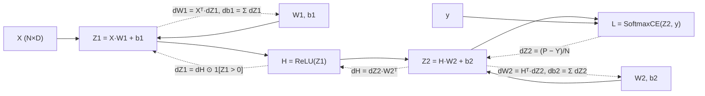
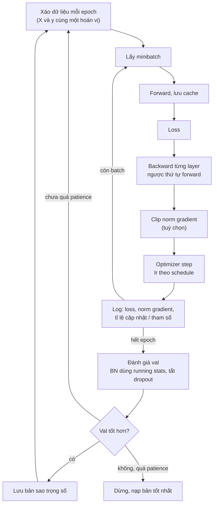
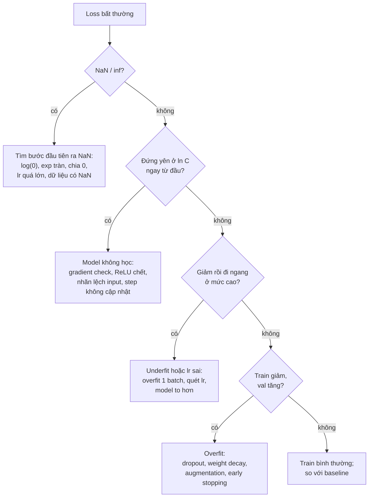

# Neural network từ số 0

Module 13 track Data Science dạy deep learning **bằng PyTorch**: `nn.Linear`, `loss.backward()`,
`torch.optim.AdamW` là những hộp đen bạn đã dùng được. Module này mở từng hộp ra. Mọi thứ, từ một
neuron, activation, loss, backprop, khởi tạo, optimizer tới BatchNorm và dropout, đều **tự viết bằng
numpy**, kiểm bằng gradient check, rồi mới **đối chiếu với PyTorch** để chắc mình hiểu đúng thứ thư
viện đang làm. Lý do không phải để bỏ PyTorch: từ module 02 trở đi bạn dùng nó suốt. Lý do là khi
model 7B fine-tune ra loss NaN lúc 2 giờ sáng, người sửa được là người biết gradient chảy qua từng
tầng thế nào, `eval()` đổi gì trong BatchNorm, và vì sao Adam cần warmup.

Toán nền (vector, ma trận, đạo hàm, chain rule, gradient descent, condition number) đã có ở
[module 01 track DS](../../../data-science/modules/01-math-for-ml/README.md); ở đây chỉ nhắc khi cần.
Vòng train PyTorch, overfitting và regularization ở mức dùng thư viện đã có ở
[module 13 track DS](../../../data-science/modules/13-deep-learning/README.md). Dữ liệu chính là
**MNIST** (70 000 ảnh chữ số viết tay 28×28). Tải:

```bash
uv run python data/download_dataset.py mnist
```

Mọi số liệu dưới đây là kết quả chạy thật các khối code trong bài (numpy 2.5.4, torch 2.14.1 bản CPU,
kiểm ngày 2026-10-30). Khối nào dùng MNIST thì chạy từ thư mục gốc repo.

Sau module này bạn sẽ:

- Giải thích một neuron là gì, vì sao cần phi tuyến, và tự viết activation, softmax ổn định số.
- Tự suy gradient của softmax + cross-entropy và của một layer Linear, viết backprop cho MLP bằng numpy.
- Kiểm gradient bằng sai phân hữu hạn và đối chiếu với `torch.autograd`.
- Chọn khởi tạo (Xavier, He) có cơ sở và nhận ra vanishing/exploding gradient bằng số đo.
- Tự viết SGD, momentum, Adam, AdamW, lr schedule và biết khi nào chọn cái nào.
- Tự viết BatchNorm, dropout; chẩn đoán loss NaN, loss đứng yên, overfit.

| Mức | Bài | Nội dung |
| --- | --- | --- |
| Basic | 01 activations | sigmoid, tanh, ReLU, GELU, softmax và đạo hàm, ổn định số |
| Basic | 02 gradient-check | sai phân trung tâm, sai số tương đối |
| Basic | 03 layers-backprop | `Linear`, `ReLU`, `SoftmaxCrossEntropy` có `forward`/`backward` |
| Intermediate | 01 mlp-mnist | MLP numpy trên MNIST thật |
| Intermediate | 02 init-and-optimizers | Xavier/He, SGD momentum, Adam/AdamW khớp PyTorch |
| Intermediate | 03 batchnorm-dropout | BatchNorm1d, dropout khớp PyTorch |
| Advanced | 01 numpy-framework-mnist | framework numpy nhỏ đạt ≥ 97.5% MNIST (portfolio) |
| Advanced | 02 debug-broken-training | sửa vòng train hỏng "im lặng" |

## 1. Neuron: từ hồi quy logistic tới perceptron, vì sao cần phi tuyến

### Một neuron

Một neuron nhận vector input $$x \in \mathbb{R}^d$$, tính tổ hợp tuyến tính rồi đưa qua một hàm
**activation** $$\varphi$$:

$$
z = w^\top x + b, \qquad a = \varphi(z)
$$

$$w$$ là trọng số, $$b$$ là bias, $$z$$ là **pre-activation** (với tầng cuối gọi là **logit**). Hình
học: $$w^\top x + b = 0$$ là một siêu phẳng; neuron đo "x nằm phía nào và cách siêu phẳng bao xa", rồi
$$\varphi$$ nắn con số đó.

Bạn đã gặp neuron này ở track DS dưới tên khác:

| Mô hình | Activation | Loss | Học bằng |
| --- | --- | --- | --- |
| Linear regression | không có ($$a = z$$) | MSE | normal equation hoặc gradient descent |
| Logistic regression | sigmoid | binary cross-entropy | gradient descent, Newton |
| Perceptron (Rosenblatt, 1958) | bước nhảy: 1 nếu $$z > 0$$, ngược lại 0 | không có loss khả vi | luật perceptron: sai thì $$w \leftarrow w + (y - \hat y)x$$ |

Logistic regression **là** một neuron sigmoid. Perceptron dùng hàm bước, đạo hàm bằng 0 ở mọi nơi nên
không train bằng gradient được; luật perceptron chỉ hội tụ khi dữ liệu tách được tuyến tính. Thay hàm
bước bằng hàm trơn (sigmoid, tanh, ReLU) là bước nhỏ nhưng quyết định: từ đó mọi tầng đều có gradient,
và backprop (mục 4) train được cả mạng nhiều tầng.

### Vì sao cần phi tuyến

Một neuron chỉ vẽ được một ranh giới thẳng. Ví dụ kinh điển là **XOR** (Minsky và Papert, 1969): lớp 1
khi hai toạ độ cùng dấu. Không đường thẳng nào tách được. Thêm tầng ẩn cũng **không** giúp nếu thiếu
activation phi tuyến, vì

$$
W_2(W_1x + b_1) + b_2 = (W_2W_1)x + (W_2b_1 + b_2)
$$

vẫn là một phép biến đổi tuyến tính, chồng 100 tầng cũng vậy. Thí nghiệm:

```python
import numpy as np

rng = np.random.default_rng(0)
X = rng.uniform(-1, 1, size=(400, 2))
y = (X[:, 0] * X[:, 1] > 0).astype(float)            # XOR: cùng dấu là lớp 1

def sigmoid(z):
    return 1 / (1 + np.exp(-z))

# 1) Logistic regression: một neuron, ranh giới là một đường thẳng
w, b = np.zeros(2), 0.0
for _ in range(2000):
    p = sigmoid(X @ w + b)
    w -= 0.5 * X.T @ (p - y) / len(y)
    b -= 0.5 * np.mean(p - y)
print("logistic regression acc:", np.mean((sigmoid(X @ w + b) > 0.5) == y))

# 2) Thêm một tầng ẩn 8 neuron, có và không có phi tuyến
def train_mlp(act, dact, hidden=8, steps=3000, lr=0.5):
    r = np.random.default_rng(1)
    W1, b1 = r.normal(0, 1, (2, hidden)), np.zeros(hidden)
    W2, b2 = r.normal(0, 1 / np.sqrt(hidden), hidden), 0.0
    for _ in range(steps):
        z1 = X @ W1 + b1
        h = act(z1)
        p = sigmoid(h @ W2 + b2)
        g = (p - y) / len(y)                          # dL/dlogit của BCE
        dh = np.outer(g, W2) * dact(z1)
        W2 -= lr * h.T @ g; b2 -= lr * g.sum()
        W1 -= lr * X.T @ dh; b1 -= lr * dh.sum(0)
    return np.mean((sigmoid(act(X @ W1 + b1) @ W2 + b2) > 0.5) == y)

print("MLP không activation (tuyến tính):", train_mlp(lambda z: z, lambda z: np.ones_like(z)))
print("MLP tanh:", train_mlp(np.tanh, lambda z: 1 - np.tanh(z) ** 2))
```

Kết quả: logistic regression **0.52** (ngang đoán mò), MLP 8 neuron ẩn không activation cũng **0.52**,
cùng MLP đó với tanh đạt **0.9875**. Tầng ẩn phi tuyến biến đổi không gian input thành không gian mà
lớp cuối (vẫn chỉ là một logistic regression) tách được bằng đường thẳng. Đó là cách nhìn đúng về mạng
nơ-ron: **các tầng ẩn học feature, tầng cuối là model tuyến tính trên các feature đó**.

### Quyết định thực tế

- Tầng **cuối** thường **không** có activation: trả về logits, để loss (cross-entropy) tự lo softmax
  hoặc sigmoid một cách ổn định số (mục 2, 3).
- Hai `Linear` liền nhau không activation không phải lúc nào cũng vô ích: nó là phân rã hạng thấp
  $$W \approx W_2W_1$$ (ít tham số hơn khi tầng giữa hẹp). LoRA ở module 14 dùng đúng ý này. Nhưng nó
  không thêm khả năng biểu diễn.
- Lỗi hay gặp: quên activation giữa hai tầng (model vẫn train, chỉ tệ như logistic regression, không
  báo lỗi); đặt ReLU ngay trước softmax/cross-entropy (logits bị chặn dưới ở 0, không âm được).

## 2. Activation và đạo hàm

### Bảng tra

| Activation | Công thức | Đạo hàm | Ưu | Nhược | Dùng ở đâu |
| --- | --- | --- | --- | --- | --- |
| Sigmoid | $$\sigma(z) = \frac{1}{1+e^{-z}}$$ | $$\sigma(1-\sigma)$$, tối đa 0.25 | ra xác suất (0, 1) | bão hoà, không quanh 0 | output nhị phân, cổng LSTM |
| Tanh | $$\tanh z$$ | $$1 - \tanh^2 z$$, tối đa 1 | quanh 0 | bão hoà ở hai đầu | RNN, mạng nông |
| ReLU | $$\max(0, z)$$ | 1 nếu $$z > 0$$, 0 nếu $$z < 0$$ | rẻ, không bão hoà phía dương | neuron "chết" khi $$z < 0$$ mãi | mặc định MLP, CNN |
| Leaky ReLU | $$\max(\alpha z, z)$$, $$\alpha \approx 0.01$$ | 1 hoặc $$\alpha$$ | không chết | thêm một siêu tham số | khi thấy nhiều ReLU chết |
| GELU | $$z\,\Phi(z)$$ | trơn | trơn quanh 0, hơi âm được | đắt hơn ReLU | BERT, GPT-2, ViT |
| SiLU (Swish) | $$z\,\sigma(z)$$ | $$\sigma(z)(1 + z(1-\sigma(z)))$$ | như GELU | như GELU | LLM hiện đại qua SwiGLU (module 05) |

$$\Phi$$ là CDF của phân phối chuẩn. Bản xấp xỉ tanh của GELU (dùng trong GPT-2, và trong
`gelu(approximate="tanh")` của PyTorch):

$$
\mathrm{GELU}(z) \approx \tfrac12 z\left(1 + \tanh\!\left(\sqrt{2/\pi}\,(z + 0.044715z^3)\right)\right)
$$

Tại $$z = 0$$ ReLU không khả vi; mọi framework quy ước đạo hàm bằng 0 ở đó. Không ảnh hưởng gì khi
train, nhưng có ảnh hưởng khi gradient check (mục 4).

### Softmax và vì sao phải trừ max

Với $$C$$ lớp, softmax biến logits thành phân phối xác suất:

$$
p_i = \frac{e^{z_i}}{\sum_j e^{z_j}}, \qquad \frac{\partial p_i}{\partial z_j} = p_i(\delta_{ij} - p_j)
$$

Jacobian là $$\mathrm{diag}(p) - pp^\top$$, ma trận $$C \times C$$. Bạn hầu như không bao giờ phải tạo ma
trận này: ghép với cross-entropy, gradient rút gọn thành $$p - y$$ (mục 3).

Softmax **bất biến khi cộng hằng**: $$\mathrm{softmax}(z - c) = \mathrm{softmax}(z)$$. Chọn $$c = \max_j z_j$$ thì số
mũ lớn nhất là $$e^0 = 1$$, không bao giờ tràn. Với log-xác suất, dùng **log-sum-exp**:

$$
\log p_i = z_i - m - \log\sum_j e^{z_j - m}, \qquad m = \max_j z_j
$$

```python
import numpy as np

z = np.array([1000.0, 1001.0, 1002.0])
with np.errstate(over="ignore", invalid="ignore"):
    naive = np.exp(z) / np.exp(z).sum()
print("softmax ngây thơ :", naive)

def softmax(z, axis=-1):
    e = np.exp(z - z.max(axis=axis, keepdims=True))   # trừ max: số mũ lớn nhất là e^0 = 1
    return e / e.sum(axis=axis, keepdims=True)

def log_softmax(z, axis=-1):
    m = z.max(axis=axis, keepdims=True)
    return z - m - np.log(np.exp(z - m).sum(axis=axis, keepdims=True))

print("softmax ổn định  :", softmax(z))
print("log_softmax      :", log_softmax(z))
z2 = np.array([0.0, 800.0])
with np.errstate(divide="ignore"):
    print("log(softmax(z2))  :", np.log(softmax(z2)), "| log_softmax(z2):", log_softmax(z2))

def sigmoid(x):
    # tách theo dấu để không bao giờ tính exp của số dương lớn
    out = np.empty_like(x)
    pos = x >= 0
    out[pos] = 1 / (1 + np.exp(-x[pos]))
    ex = np.exp(x[~pos])
    out[~pos] = ex / (1 + ex)
    return out

with np.errstate(over="raise"):                      # tràn số thì báo lỗi ngay
    print("sigmoid(±1000)   :", sigmoid(np.array([-1000.0, 0.0, 1000.0])))

x = np.array([-6.0, -2.0, 0.0, 2.0, 6.0])
s = sigmoid(x)
print("sigmoid'(x)      :", np.round(s * (1 - s), 5))
print("tanh'(x)         :", np.round(1 - np.tanh(x) ** 2, 5))
print("0.25 ** 10       :", 0.25 ** 10)
```

Kết quả: softmax ngây thơ của `[1000, 1001, 1002]` ra `[nan nan nan]` (vì $$e^{1000}$$ tràn thành `inf`, và
`inf/inf = nan`); bản trừ max ra `[0.090 0.245 0.665]`. Với `z2 = [0, 800]`, `log(softmax(z2))` ra
`-inf` cho lớp đầu (xác suất underflow về 0), còn `log_softmax` ra đúng `-800`. Sigmoid tách theo dấu
chạy được ở ±1000 mà không tràn số. Đạo hàm sigmoid tối đa **0.25** và còn **0.00247** ở $$z = \pm 6$$;
tanh còn **2e-05**: tầng bão hoà gần như không truyền gradient.

### Quyết định thực tế

- Tầng ẩn: **ReLU** cho MLP/CNN là mặc định rẻ và tốt; **GELU/SiLU** cho Transformer. Đừng dùng sigmoid
  ở tầng ẩn của mạng sâu: mỗi tầng nhân gradient với tối đa 0.25, 10 tầng còn
  $$0.25^{10} \approx 9.5 \times 10^{-7}$$.
- Output: không activation, trả logits. Cần xác suất để hiển thị thì gọi softmax **ngoài** loss.
- Luôn tính trong không gian log (`log_softmax`, `logaddexp`, `BCEWithLogitsLoss`) khi có log của xác
  suất. Đây là nguồn NaN số một trong code tự viết.
- Lỗi hay gặp: viết `np.exp(z) / np.exp(z).sum()` không trừ max; trừ max nhưng sai `axis` (trừ max của
  cả batch thay vì từng dòng: vẫn đúng về toán nhưng một dòng có logit nhỏ hơn hẳn sẽ underflow hết về
  0, ra `0/0 = nan`); quên `keepdims=True` nên broadcasting sai chiều mà không báo lỗi.

## 3. Layer, MLP, universal approximation và loss

### Layer Linear và MLP

Một **layer Linear** (fully connected, dense) gồm `out` neuron dùng chung input. Với một batch $$N$$ mẫu,
viết theo dòng (quy ước của module này và các bài tập):

$$
Z = XW + b, \qquad X \in \mathbb{R}^{N \times d_{in}},\; W \in \mathbb{R}^{d_{in} \times d_{out}},\; b \in \mathbb{R}^{d_{out}}
$$

PyTorch lưu `nn.Linear.weight` theo shape `(out, in)` và tính $$XW^\top$$; khi đối chiếu nhớ chuyển vị.
**MLP** là chuỗi `Linear → activation → Linear → ... → Linear`. MLP 784-128-10 cho MNIST có
$$784 \cdot 128 + 128 + 128 \cdot 10 + 10 = 101\,770$$ tham số; tầng đầu chiếm 99%. Quy luật chung: chi phí và
tham số của MLP nằm ở tầng có input rộng nhất.

### Universal approximation: hứa gì, không hứa gì

**Universal approximation theorem** (Cybenko 1989 cho sigmoid, Hornik 1991 tổng quát): MLP **một** tầng ẩn,
đủ rộng, với activation không đa thức, xấp xỉ được mọi hàm liên tục trên miền đóng bị chặn với sai số
tuỳ ý. Định lý nói **tồn tại** bộ trọng số, nhưng không nói:

- cần **bao nhiêu** neuron (có thể nhiều theo hàm mũ của số chiều input);
- gradient descent có **tìm ra** bộ trọng số đó không;
- model có **tổng quát hoá** ra dữ liệu mới không.

Thực tế, mạng **sâu** biểu diễn cùng một hàm với ít tham số hơn nhiều so với mạng nông rất rộng (mỗi
tầng tái sử dụng feature của tầng trước, kiểu hợp thành hàm). Vì vậy người ta xếp tầng chứ không chỉ
nới rộng một tầng, và cũng vì vậy cần mọi kỹ thuật ở mục 5 tới 7 để mạng sâu train được.

### Loss: MSE và cross-entropy

Cả hai đều là **maximum likelihood**. Giả sử $$y \sim \mathcal{N}(f(x), \sigma^2)$$ thì negative log-likelihood
là MSE (cộng hằng). Giả sử $$y \sim \mathrm{Categorical}(p)$$ với $$p = \mathrm{softmax}(z)$$ thì NLL là
**cross-entropy**:

$$
L = -\frac1N\sum_{n=1}^{N} \log p_{n, y_n}
$$

| Bài toán | Output | Loss | Gradient theo logit |
| --- | --- | --- | --- |
| Hồi quy | 1 số, không activation | MSE | $$\frac{2}{N}(\hat y - y)$$ |
| Nhị phân | 1 logit | sigmoid + BCE (`BCEWithLogitsLoss`) | $$\frac1N(p - y)$$ |
| Nhiều lớp, một nhãn | C logits | softmax + CE (`CrossEntropyLoss`) | $$\frac1N(p - y_{\text{onehot}})$$ |
| Nhiều nhãn cùng lúc | C logits | C sigmoid + BCE độc lập | $$\frac1N(p - y)$$ từng lớp |

### Vì sao softmax + CE có gradient p − y

Với một mẫu, $$y$$ one-hot và $$\log p_k = z_k - \log\sum_j e^{z_j}$$. Đạo hàm của log-sum-exp theo $$z_i$$
chính là $$p_i$$, nên

$$
\frac{\partial \log p_k}{\partial z_i} = \delta_{ki} - p_i
\quad\Rightarrow\quad
\frac{\partial L}{\partial z_i} = -\sum_k y_k(\delta_{ki} - p_i) = -y_i + p_i\sum_k y_k = p_i - y_i
$$

vì $$\sum_k y_k = 1$$. Lấy trung bình trên batch thì chia thêm $$N$$. Ba hệ quả đáng nhớ:

- Gradient **bị chặn** trong $$[-1, 1]$$ và tỉ lệ với mức sai: dự đoán sai càng tự tin, gradient càng
  lớn. Không có chỗ nào bão hoà.
- So với MSE trên sigmoid: gradient là $$(p - y)\,p(1-p)$$. Khi model sai rất tự tin ($$p \approx 0$$,
  $$y = 1$$), thừa số $$p(1-p) \approx 0$$ làm gradient biến mất đúng lúc cần học nhất. Đó là lý do
  phân loại dùng cross-entropy.
- Mỗi dòng gradient có tổng bằng 0: softmax chỉ quan tâm chênh lệch giữa các logit.

```python
import numpy as np
import torch

rng = np.random.default_rng(0)
N, C = 4, 10
logits = rng.normal(size=(N, C))
y = np.array([3, 0, 9, 3])

def softmax_ce(logits, y):
    z = logits - logits.max(axis=1, keepdims=True)
    log_p = z - np.log(np.exp(z).sum(axis=1, keepdims=True))
    loss = -log_p[np.arange(len(y)), y].mean()
    p = np.exp(log_p)
    p[np.arange(len(y)), y] -= 1                      # p - onehot(y)
    return loss, p / len(y)                           # chia N vì loss là trung bình

loss, dlogits = softmax_ce(logits, y)

t = torch.tensor(logits, requires_grad=True)
lt = torch.nn.functional.cross_entropy(t, torch.tensor(y))
lt.backward()
print(f"loss numpy {loss:.10f} | torch {lt.item():.10f}")
print("gradient khớp torch:", np.allclose(dlogits, t.grad.numpy(), atol=1e-12))
print("|tổng gradient mỗi dòng| lớn nhất:", np.abs(dlogits.sum(axis=1)).max())

# Ngay lúc khởi tạo, logits gần 0 nên p gần đều 1/C: loss phải gần ln(C)
small = 0.01 * rng.normal(size=(1000, C))
print(f"loss lúc khởi tạo {softmax_ce(small, rng.integers(0, C, 1000))[0]:.4f} | ln(10) = {np.log(10):.4f}")
```

Loss numpy và torch khớp tới 10 chữ số (`2.4571045801`), gradient khớp với `atol=1e-12`, tổng mỗi dòng
cỡ `4e-17` (bằng 0 trong sai số làm tròn). Lúc khởi tạo, logits nhỏ thì $$p \approx 1/C$$ nên loss phải gần
$$\ln C$$: đo được **2.3025**, so với $$\ln 10 = 2.3026$$. Đây là phép kiểm rẻ nhất bạn có: loss bước 0 lệch xa
$$\ln C$$ là khởi tạo hoặc pipeline có vấn đề; loss **đứng yên** ở $$\ln C$$ sau nhiều bước nghĩa là model
chưa học được gì (mục 7).

### Lỗi hay gặp

- Áp softmax rồi mới đưa vào `CrossEntropyLoss` (vốn nhận logits): softmax hai lần, vẫn chạy, học chậm.
- Gradient không chia $$N$$ trong khi loss là trung bình: tương đương nhân learning rate với batch size.
- Dùng `nn.CrossEntropyLoss` cho bài nhiều nhãn (mỗi ảnh có thể vừa "mèo" vừa "chó"): phải dùng sigmoid
  độc lập từng lớp.

## 4. Backprop trên computational graph, viết bằng numpy; gradient check

### Graph và luật lan truyền

Forward của MLP 2 tầng là một **computational graph**: mỗi nút là một phép toán, mỗi cạnh là một
tensor. Backprop đi ngược graph; mỗi nút chỉ cần biết **đạo hàm cục bộ** của nó và gradient đổ về từ
nút phía sau (chain rule, đã học ở module 01 DS mục 4).



Mũi tên liền là forward, mũi tên đứt là backward. Với layer Linear $$Z = XW + b$$ và gradient đến
$$\frac{\partial L}{\partial Z}$$ (viết tắt `dZ`):

$$
\frac{\partial L}{\partial X} = \frac{\partial L}{\partial Z} W^\top,\qquad
\frac{\partial L}{\partial W} = X^\top \frac{\partial L}{\partial Z},\qquad
\frac{\partial L}{\partial b} = \sum_{n} \frac{\partial L}{\partial Z_{n,:}}
$$

Mẹo nhớ không cần suy lại: **gradient có cùng shape với thứ nó là gradient**. `dW` phải là
`(D_in, D_out)`, mà chỉ có một cách nhân `X (N, D_in)` với `dZ (N, D_out)` ra shape đó: `X.T @ dZ`. Bias
được broadcast cho N dòng khi forward, nên backward **cộng** theo trục batch. Quy tắc tổng quát: một
tensor được dùng ở nhiều nơi (broadcast, fan-out, residual) thì gradient của nó là **tổng** gradient từ
mọi nơi; trong code tự viết đó là lý do dùng `+=` chứ không phải `=`.

### Viết bằng numpy và đối chiếu PyTorch

```python
import numpy as np
import torch

rng = np.random.default_rng(0)
N, D, H, C = 8, 5, 6, 3
X = rng.normal(size=(N, D))
y = rng.integers(0, C, N)
params = {
    "W1": rng.normal(0, np.sqrt(2 / D), (D, H)), "b1": rng.normal(0, 0.1, H),
    "W2": rng.normal(0, np.sqrt(2 / H), (H, C)), "b2": np.zeros(C),
}

def forward_backward(p, X, y):
    # forward: lưu lại mọi thứ backward cần (cache)
    z1 = X @ p["W1"] + p["b1"]
    h = np.maximum(z1, 0)
    z2 = h @ p["W2"] + p["b2"]
    z = z2 - z2.max(axis=1, keepdims=True)
    log_p = z - np.log(np.exp(z).sum(axis=1, keepdims=True))
    loss = -log_p[np.arange(len(y)), y].mean()
    # backward: đi ngược graph, mỗi nút nhân gradient đến với đạo hàm cục bộ
    dz2 = np.exp(log_p)
    dz2[np.arange(len(y)), y] -= 1
    dz2 /= len(y)
    grads = {"W2": h.T @ dz2, "b2": dz2.sum(axis=0)}
    dh = dz2 @ p["W2"].T
    dz1 = dh * (z1 > 0)                               # ReLU: cho qua chỗ z1 > 0
    grads["W1"] = X.T @ dz1
    grads["b1"] = dz1.sum(axis=0)
    return loss, grads

loss, grads = forward_backward(params, X, y)

# 1) Gradient check: sai phân trung tâm trên từng phần tử
def numerical_grad(name, eps=1e-6):
    g = np.zeros_like(params[name])
    for i in np.ndindex(g.shape):
        old = params[name][i]
        params[name][i] = old + eps; lp = forward_backward(params, X, y)[0]
        params[name][i] = old - eps; lm = forward_backward(params, X, y)[0]
        params[name][i] = old                         # trả lại giá trị cũ
        g[i] = (lp - lm) / (2 * eps)
    return g

for name in params:
    num = numerical_grad(name)
    rel = np.abs(grads[name] - num).max() / max(np.abs(grads[name]).max() + np.abs(num).max(), 1e-12)
    print(f"{name}: sai số tương đối {rel:.1e}")

# 2) Đối chiếu PyTorch với cùng trọng số
tp = {k: torch.tensor(v, requires_grad=True) for k, v in params.items()}
logits = torch.relu(torch.tensor(X) @ tp["W1"] + tp["b1"]) @ tp["W2"] + tp["b2"]
lt = torch.nn.functional.cross_entropy(logits, torch.tensor(y))
lt.backward()
print("loss khớp torch:", np.isclose(loss, lt.item()),
      "| gradient khớp torch:", all(np.allclose(grads[k], tp[k].grad.numpy()) for k in params))
```

Sai số tương đối của cả 4 tham số nằm trong khoảng **4e-11 tới 3e-10**, và loss, gradient khớp
`torch.autograd` với cùng trọng số. Bài Basic 03 đóng gói đúng các phép tính này thành lớp `Linear`,
`ReLU`, `SoftmaxCrossEntropy` có `forward`/`backward`, giống `nn.Module` thu nhỏ.

Ba điều đoạn code cho thấy về backprop thực tế:

- **Cache**: backward cần `X`, `z1`, `h`, `log_p` của forward. Mọi framework giữ activation của forward
  tới lúc backward, nên **bộ nhớ khi train lớn hơn nhiều so với khi suy luận** và tăng theo batch size.
  Gradient checkpointing (module 02) đánh đổi: bỏ bớt cache, tính lại khi backward.
- **Chi phí**: backward của mỗi Linear là hai phép nhân ma trận (cho `dX` và `dW`), forward là một. Một
  bước train tốn cỡ **3 lần** forward. Đó là lý do ước lượng FLOPs train là $$6 \times$$ số tham số $$\times$$ số
  token (module 05).
- **Đơn vị trừu tượng**: micrograd của Karpathy làm autograd trên từng **số vô hướng** (dễ hiểu, chậm);
  PyTorch và bài tập ở đây làm trên **tensor** (mỗi nút là một phép nhân ma trận), nhanh hơn hàng nghìn
  lần trên cùng phép tính.

### Gradient check làm sao cho đúng

Sai phân trung tâm $$\frac{f(w + \varepsilon) - f(w - \varepsilon)}{2\varepsilon}$$ có sai số $$O(\varepsilon^2)$$. Đo bằng
sai số tương đối (không phải tuyệt đối, vì gradient có thể rất nhỏ hoặc rất lớn):

$$
\mathrm{rel} = \frac{\max_i |g^{a}_i - g^{n}_i|}{\max\left(\max_i |g^{a}_i| + \max_i |g^{n}_i|,\ 10^{-12}\right)}
$$

| rel | Kết luận |
| --- | --- |
| dưới 1e-7 | đúng (float64) |
| 1e-7 tới 1e-4 | nghi ngờ; có thể do ReLU sát 0 |
| trên 1e-4 | gần như chắc chắn có bug |

Bẫy thường gặp:

- **float32**: sai số làm tròn cỡ 1e-7 bị chia cho $$\varepsilon$$, kết quả rác. Check luôn bằng float64.
- **ReLU sát 0**: nếu một $$z$$ nằm trong khoảng $$\pm\varepsilon$$ thì sai phân "nhảy" qua chỗ gãy, sai số lớn mà
  code không sai. Dùng batch nhỏ, kiểm lại vài lần với seed khác.
- **Ngẫu nhiên trong forward**: dropout phải tắt (hoặc cố định mask) khi check, BatchNorm phải dùng cùng
  batch.
- **Quên sửa lại tham số** sau khi cộng $$\varepsilon$$: các phần tử sau bị check trên trọng số đã lệch.
- **Bug tỉ lệ**: quên chia $$N$$ làm gradient lớn gấp $$N$$; rel thành $$\frac{N-1}{N+1}$$, với $$N = 8$$ là 0.78.
  Gradient check bắt được ngay, nhưng loss vẫn giảm (như lr lớn hơn) nên **chỉ nhìn loss thì không
  thấy**.
- Mạng lớn: check từng layer riêng trên input nhỏ, hoặc chọn ngẫu nhiên vài chục phần tử, đừng check
  toàn bộ triệu tham số.

## 5. Khởi tạo (Xavier, He) và vanishing/exploding gradient

### Vì sao khởi tạo quan trọng

- **Phá đối xứng**: khởi tạo mọi trọng số bằng nhau (kể cả bằng 0) thì mọi neuron trong một tầng nhận
  cùng gradient, cập nhật giống nhau mãi, tầng 128 neuron hoạt động như 1 neuron. Bias thì khởi tạo 0
  được (trọng số ngẫu nhiên đã phá đối xứng).
- **Giữ thang đo**: mỗi tầng nhân activation (forward) và gradient (backward) với một ma trận. Nếu mỗi
  lần nhân làm độ lớn thay đổi một hệ số $$k$$, sau $$L$$ tầng nó thay đổi $$k^L$$: $$0.5^{10} \approx 10^{-3}$$,
  $$2^{10} \approx 10^3$$. Đây là **vanishing / exploding gradient**.

### Suy ra Xavier và He

Với $$z_j = \sum_{i=1}^{n_{in}} w_{ij}x_i$$, $$w$$ và $$x$$ độc lập, trung bình 0:

$$
\mathrm{Var}(z_j) = n_{in}\,\mathrm{Var}(w)\,\mathbb{E}[x_i^2]
$$

Muốn giữ thang đo khi forward cần $$\mathrm{Var}(w) = 1/n_{in}$$; khi backward (gradient đi qua $$W^\top$$) cần
$$1/n_{out}$$.

- **Xavier / Glorot** (2010): thoả hiệp $$\mathrm{Var}(w) = \frac{2}{n_{in} + n_{out}}$$. Suy ra cho activation gần
  tuyến tính quanh 0 (tanh, sigmoid đã dời tâm, không activation).
- **He / Kaiming** (2015): ReLU xoá nửa phân phối, nên $$\mathbb{E}[\mathrm{ReLU}(z)^2] = \tfrac12\mathrm{Var}(z)$$. Bù hệ số 2:
  $$\mathrm{Var}(w) = \frac{2}{n_{in}}$$.

Dạng uniform tương đương: $$U(-a, a)$$ có phương sai $$a^2/3$$, nên Xavier uniform là
$$a = \sqrt{6/(n_{in} + n_{out})}$$.

Thí nghiệm: 10 tầng 512 neuron, input chuẩn hoá, đo std activation ở tầng 1/5/10 và std gradient khi
lan ngược về input:

```python
import numpy as np

relu = (lambda z: np.maximum(z, 0), lambda z: (z > 0).astype(float))
tanh = (np.tanh, lambda z: 1 - np.tanh(z) ** 2)

def run(name, act, std_fn, layers=10, width=512):
    rng = np.random.default_rng(0)
    f, df = act
    h = rng.normal(size=(1000, width))                # input đã chuẩn hoá: mean 0, std 1
    Ws, zs, stds = [], [], []
    for _ in range(layers):
        W = rng.normal(0, std_fn(width, width), (width, width))
        z = h @ W
        h = f(z)
        Ws.append(W); zs.append(z); stds.append(h.std())
    g = rng.normal(size=h.shape)                      # gradient giả từ loss đổ về
    gstd = []
    for W, z in zip(reversed(Ws), reversed(zs)):
        g = (g * df(z)) @ W.T
        gstd.append(g.std())
    sat = f" | |h| > 0.99: {np.mean(np.abs(h) > 0.99):.1%}" if f is np.tanh else ""   # tanh bão hoà
    print(f"{name:18s} std activation tầng 1/5/10: {stds[0]:.2e} {stds[4]:.2e} {stds[9]:.2e}"
          f" | std gradient về input: {gstd[-1]:.2e}{sat}")

run("tanh, N(0, 0.01)", tanh, lambda i, o: 0.01)
run("tanh, N(0, 1)", tanh, lambda i, o: 1.0)
run("tanh, Xavier", tanh, lambda i, o: np.sqrt(2 / (i + o)))
run("ReLU, Xavier", relu, lambda i, o: np.sqrt(2 / (i + o)))
run("ReLU, He", relu, lambda i, o: np.sqrt(2 / i))
```

| Activation, khởi tạo | std tầng 1 | std tầng 5 | std tầng 10 | std gradient về input |
| --- | --- | --- | --- | --- |
| tanh, $$\mathcal{N}(0, 0.01^2)$$ | 2.16e-01 | 5.61e-04 | **3.26e-07** | **3.22e-07** |
| tanh, $$\mathcal{N}(0, 1)$$ | 9.82e-01 | 9.82e-01 | 9.82e-01 | **2.73e+05** |
| tanh, Xavier | 6.29e-01 | 3.19e-01 | 2.24e-01 | 2.60e-01 |
| ReLU, Xavier | 5.85e-01 | 1.40e-01 | 2.27e-02 | 3.05e-02 |
| ReLU, He | 8.27e-01 | 7.93e-01 | 7.25e-01 | **9.75e-01** |

Đọc bảng:

- **Quá nhỏ** (std 0.01): activation co lại gần 0.01 × √512 ≈ 0.23 lần mỗi tầng, tới tầng 10 còn 3e-7.
  Gradient cũng vậy: tầng đầu gần như không học. Đây là vanishing gradient do khởi tạo.
- **Quá lớn** (std 1): std activation trông "đẹp" (0.98) nhưng **90.5%** activation có $$|h| > 0.99$$:
  tanh bão hoà. Gradient về input vẫn nổ tới 2.7e+05: mỗi tầng nhân với $$W^\top$$ có thang đo cỡ
  $$\sqrt{512} \approx 23$$, và 10% neuron chưa bão hoà đủ để khuếch đại. Std đẹp không có nghĩa là mạng khoẻ; phải nhìn cả
  phân phối và gradient.
- **Xavier với ReLU**: mỗi tầng mất khoảng √2, sau 10 tầng còn 0.02. Mạng nông (2 tới 3 tầng) không
  thấy khác biệt; mạng sâu thì thấy.
- **He với ReLU**: thang đo gần như giữ nguyên qua 10 tầng, gradient về input std 0.98.

### Quyết định thực tế

| Tình huống | Khởi tạo |
| --- | --- |
| ReLU, Leaky ReLU, GELU, SiLU | He (`kaiming_normal_`, `nonlinearity="relu"`) |
| tanh, sigmoid, tầng tuyến tính | Xavier (`xavier_uniform_`) |
| Mặc định của `nn.Linear` | Kaiming uniform với `a=√5`, tức $$U(-1/\sqrt{n_{in}}, 1/\sqrt{n_{in}})$$, phương sai $$\frac{1}{3n_{in}}$$, nhỏ hơn He 6 lần |
| Có BatchNorm/LayerNorm và residual | ít nhạy với khởi tạo; mặc định thường đủ |
| Tầng output, nhánh residual cuối | khởi tạo nhỏ hoặc 0 (GPT-2 chia std cho $$\sqrt{2 \cdot \text{số tầng}}$$, module 05) |

- Vanishing/exploding không chỉ do khởi tạo: activation bão hoà (sigmoid), chuỗi rất dài (RNN, xem module
  13 DS), learning rate lớn làm trọng số phình. Bộ công cụ chữa đầy đủ: khởi tạo đúng, ReLU-family,
  **normalization** (mục 7), **residual connection** (gradient có đường tắt cộng thẳng, module 02, 03),
  **gradient clipping** theo norm cho exploding.
- Cách đo: log **std activation và norm gradient từng tầng** ở vài bước đầu. Đây là chỗ hiểu bên trong
  trả lãi: nhìn số là biết tầng nào chết, không cần đoán.
- Lỗi hay gặp: dùng `np.random.randn(in, out)` (std 1) như nhiều tutorial cũ; khởi tạo He nhưng dùng
  `fan_out` nhầm `fan_in` khi shape trọng số là `(out, in)` như PyTorch.

## 6. Optimizer: SGD, momentum, RMSProp, Adam, AdamW, learning rate schedule

Module 01 DS mục 6 đã phân tích gradient descent và momentum trên hàm bậc hai (ngưỡng lr, condition
number). Ở đây là các optimizer dùng thật cho mạng nơ-ron, viết bằng numpy và so trên MNIST.

### Công thức

Ký hiệu $$g_t$$ là gradient minibatch ở bước $$t$$, $$\eta$$ là learning rate.

| Optimizer | Cập nhật | State mỗi tham số | Ghi chú |
| --- | --- | --- | --- |
| SGD | $$\theta \leftarrow \theta - \eta g_t$$ | 0 | nhiễu minibatch là một dạng regularization |
| Momentum (kiểu PyTorch) | $$v \leftarrow \mu v + g_t,\ \theta \leftarrow \theta - \eta v$$ | 1 | lr hiệu dụng khi gradient ổn định là $$\eta/(1-\mu)$$ |
| RMSProp | $$s \leftarrow \rho s + (1-\rho)g_t^2,\ \theta \leftarrow \theta - \eta\, g_t/(\sqrt{s} + \epsilon)$$ | 1 | chia theo độ lớn gradient từng toạ độ |
| Adam | $$m \leftarrow \beta_1 m + (1-\beta_1)g_t,\ v \leftarrow \beta_2 v + (1-\beta_2)g_t^2$$, $$\hat m = m/(1-\beta_1^t),\ \hat v = v/(1-\beta_2^t)$$, $$\theta \leftarrow \theta - \eta\,\hat m/(\sqrt{\hat v} + \epsilon)$$ | 2 | momentum + RMSProp + bias correction |
| AdamW | như Adam, thêm $$\theta \leftarrow \theta - \eta\lambda\theta$$ tách khỏi gradient | 2 | weight decay "decoupled" |

Hai chi tiết hay bị hỏi:

- **Bias correction**: $$m$$ và $$v$$ khởi tạo bằng 0, nên ở bước 1 $$m = 0.1g$$, $$v = 0.001g^2$$, bị kéo về 0. Chia
  cho $$1 - \beta^t$$ sửa đúng độ lệch đó; sau vài nghìn bước hệ số này về 1.
- **AdamW khác Adam + L2**: cộng $$\lambda\theta$$ vào gradient thì nó bị chia cho $$\sqrt{\hat v}$$ như mọi thứ khác,
  tham số có gradient lớn bị phạt ít. AdamW trừ thẳng vào tham số nên mọi tham số bị kéo về 0 cùng tỉ lệ
  (module 13 DS đã cho thấy hiệu ứng trên FashionMNIST).

### So trên MNIST

MLP 784-128-10, He init, batch 64, 3 epoch trên 60 000 ảnh, cùng seed. Chạy khoảng 10 giây trên CPU:

```python
import os

os.environ.setdefault("OMP_NUM_THREADS", "4")       # ma trận nhỏ: quá nhiều luồng BLAS chỉ làm chậm
import gzip
from pathlib import Path

import numpy as np

def load_idx(path):
    with gzip.open(path) as f:
        data = f.read()
    ndim = data[3]                                    # 4 byte đầu: magic, byte cuối là số chiều
    shape = np.frombuffer(data, ">u4", ndim, offset=4)
    return np.frombuffer(data, np.uint8, offset=4 + 4 * ndim).reshape(shape)

root = Path("data/raw/mnist")
X = load_idx(root / "train-images-idx3-ubyte.gz").reshape(-1, 784).astype(np.float32) / 255
y = load_idx(root / "train-labels-idx1-ubyte.gz").astype(np.int64)
Xt = load_idx(root / "t10k-images-idx3-ubyte.gz").reshape(-1, 784).astype(np.float32) / 255
yt = load_idx(root / "t10k-labels-idx1-ubyte.gz").astype(np.int64)

def init(seed):
    r = np.random.default_rng(seed)
    return [r.normal(0, np.sqrt(2 / 784), (784, 128)).astype(np.float32), np.zeros(128, np.float32),
            r.normal(0, np.sqrt(2 / 128), (128, 10)).astype(np.float32), np.zeros(10, np.float32)]

def loss_grads(P, xb, yb):
    W1, b1, W2, b2 = P
    z1 = xb @ W1 + b1
    h = np.maximum(z1, 0)
    z = h @ W2 + b2
    z = z - z.max(1, keepdims=True)
    log_p = z - np.log(np.exp(z).sum(1, keepdims=True))
    dz = np.exp(log_p)
    dz[np.arange(len(yb)), yb] -= 1
    dz /= len(yb)
    dz1 = (dz @ W2.T) * (z1 > 0)
    return -log_p[np.arange(len(yb)), yb].mean(), [xb.T @ dz1, dz1.sum(0), h.T @ dz, dz.sum(0)]

def sgd(lr, momentum=0.0):
    v = None
    def step(P, G, t):
        nonlocal v
        v = v or [np.zeros_like(p) for p in P]
        for p, g, vi in zip(P, G, v):
            vi *= momentum; vi += g                   # quy ước PyTorch: v = mu*v + g
            p -= lr * vi
    return step

def adamw(lr, b1=0.9, b2=0.999, eps=1e-8, wd=0.0):
    m = s = None
    def step(P, G, t):
        nonlocal m, s
        m = m or [np.zeros_like(p) for p in P]
        s = s or [np.zeros_like(p) for p in P]
        for p, g, mi, si in zip(P, G, m, s):
            mi *= b1; mi += (1 - b1) * g
            si *= b2; si += (1 - b2) * g * g
            mhat, shat = mi / (1 - b1 ** t), si / (1 - b2 ** t)   # bias correction
            p -= lr * wd * p                          # decoupled weight decay (chữ W trong AdamW)
            p -= lr * mhat / (np.sqrt(shat) + eps)
    return step

def train(step, epochs=3, bs=64, seed=0):
    P, rng, t, curve, last = init(seed), np.random.default_rng(seed), 0, [], []
    for _ in range(epochs):
        idx, total = rng.permutation(len(X)), 0.0
        for i in range(0, len(X), bs):
            b = idx[i:i + bs]
            loss, G = loss_grads(P, X[b], y[b])
            t += 1
            step(P, G, t)
            total += loss * len(b)
            last = (last + [loss])[-100:]             # loss 100 batch gần nhất
        curve.append(total / len(X))
    h = np.maximum(Xt @ P[0] + P[1], 0)
    acc = (np.argmax(h @ P[2] + P[3], 1) == yt).mean()
    dead = (h.max(axis=0) == 0).mean()               # neuron không bật với ảnh test nào
    return curve, acc, dead, np.mean(last)

for name, step in [("SGD lr 0.01", sgd(0.01)), ("SGD lr 0.1", sgd(0.1)),
                   ("SGD+momentum 0.9, lr 0.01", sgd(0.01, 0.9)), ("Adam lr 1e-3", adamw(1e-3)),
                   ("Adam lr 1e-1", adamw(1e-1))]:
    curve, acc, _, _ = train(step)
    print(f"{name:26s} train loss theo epoch {' '.join(f'{c:.3f}' for c in curve)} | test acc {acc:.4f}")

# Thang learning rate cho SGD, 1 epoch: lr quá lớn giết ReLU
for lr in [0.5, 1.0, 2.0, 5.0]:
    _, acc, dead, tail = train(sgd(lr), epochs=1)
    print(f"SGD lr {lr:<4} loss 100 batch cuối {tail:.3f} | test acc {acc:.4f} | ReLU chết {dead:.0%}")
```

| Optimizer | Train loss epoch 1 / 2 / 3 | Test acc |
| --- | --- | --- |
| SGD lr 0.01 | 0.872 / 0.407 / 0.342 | 0.9160 |
| SGD lr 0.1 | 0.362 / 0.190 / 0.144 | 0.9636 |
| SGD + momentum 0.9, lr 0.01 | 0.379 / 0.192 / 0.146 | 0.9622 |
| Adam lr 1e-3 | 0.292 / 0.130 / 0.091 | **0.9747** |
| Adam lr 1e-1 | 0.847 / 0.720 / 0.810 | 0.7288 |

| SGD 1 epoch | Loss 100 batch cuối | Test acc | ReLU chết |
| --- | --- | --- | --- |
| lr 0.5 | 0.126 | 0.9664 | 0% |
| lr 1.0 | 0.168 | 0.9552 | 27% |
| lr 2.0 | 2.061 | 0.2052 | 98% |
| lr 5.0 | **2.324** | 0.0982 | 100% |

Đọc kết quả:

- Momentum 0.9 với lr 0.01 cho đường cong gần trùng SGD lr 0.1: đúng công thức lr hiệu dụng
  $$0.01/(1 - 0.9) = 0.1$$. Momentum không phải phép màu, nó chủ yếu nhân lr và làm mượt hướng đi. Lợi
  thật của nó nằm ở bài toán cong lệch (condition number lớn, module 01 DS).
- Adam lr 1e-3 tốt nhất sau 3 epoch mà không cần tune. Nhưng Adam lr 1e-1 hỏng nặng: "Adam không cần
  tune lr" là sai, nó chỉ **ít nhạy** hơn SGD trong vùng hợp lý.
- Thang lr của SGD cho thấy chế độ hỏng điển hình: lr 1.0 vẫn ra 95.5% nhưng đã giết 27% neuron ẩn
  (công suất model mất đi mà accuracy chưa báo); lr 5.0 giết hết, output thành hằng số, loss đứng ở
  **2.324**, sát $$\ln 10$$, accuracy 0.0982 là tỉ lệ của đúng một lớp trong tập test. Mục 7 dùng lại triệu
  chứng này.
- Code dùng `OMP_NUM_THREADS=4`: với ma trận nhỏ, để BLAS dùng hết 16 luồng làm cùng đoạn code chậm đi
  vài lần vì chi phí đồng bộ. Đo trước khi tin "càng nhiều luồng càng nhanh".

### Vòng train



### Learning rate schedule

Module 01 DS có bảng các schedule cơ bản (step, exponential, inverse time). Với mạng nơ-ron hiện đại,
hai thứ gặp nhiều nhất:

- **Warmup**: tăng lr tuyến tính từ gần 0 trong vài trăm tới vài nghìn bước đầu. Lý do: lúc đầu trọng số
  ngẫu nhiên cho gradient lớn và hỗn loạn, và với Adam thì $$\hat v$$ ước lượng từ rất ít mẫu nên bước đi
  thất thường. Transformer gần như luôn cần warmup; MLP nhỏ trên MNIST thì không.
- **Cosine decay**: $$\eta_t = \eta_{min} + \tfrac12(\eta_{max} - \eta_{min})\left(1 + \cos\frac{\pi t}{T}\right)$$.
  Giảm chậm lúc đầu, nhanh ở giữa, chậm ở cuối. Lr nhỏ ở cuối cho phép "lắng" vào đáy, thường cho thêm
  vài phần trăm loss so với lr cố định.

### Chọn optimizer

| Tình huống | Chọn | Lý do |
| --- | --- | --- |
| Model mới, chưa biết gì | AdamW, lr 1e-3 (model nhỏ) tới 3e-4, weight decay 0.01 tới 0.1 | ít tune, hội tụ nhanh |
| Transformer, LLM, fine-tune | AdamW + warmup + cosine | gần như chuẩn ngành |
| CNN cho ảnh, có thời gian tune | SGD + momentum 0.9 + step/cosine | thường tổng quát hoá ngang hoặc hơn Adam |
| Bộ nhớ chật (model lớn) | SGD/momentum, hoặc Adam 8-bit (module 10, 14) | Adam giữ 2 state: tham số + gradient + 2 state = 4 lần bộ nhớ tham số (fp32) |

- Tìm lr theo thang log (1e-4, 3e-4, 1e-3, 3e-3...), chạy vài trăm bước mỗi mức, chọn mức lớn nhất mà
  loss còn giảm đều. Đổi batch size thì lr tối ưu cũng đổi.
- Lỗi hay gặp: so optimizer với lr của optimizer khác; momentum kiểu PyTorch ($$v = \mu v + g$$) khác kiểu
  sách ($$v = \mu v + \eta g$$) khi lr thay đổi giữa chừng, nên bài Intermediate 02 đối chiếu với
  `torch.optim` từng bước; áp weight decay cả lên bias và tham số của BatchNorm/LayerNorm (thường nên loại
  ra).

## 7. BatchNorm, LayerNorm, dropout; khi train hỏng thì nhìn gì

### BatchNorm

Với batch $$x \in \mathbb{R}^{N \times D}$$, **BatchNorm** chuẩn hoá từng feature theo batch rồi cho model tự
chọn lại thang đo bằng hai tham số học $$\gamma, \beta$$:

$$
\mu = \frac1N\sum_n x_n,\quad \sigma^2 = \frac1N\sum_n (x_n - \mu)^2,\quad
\hat x = \frac{x - \mu}{\sqrt{\sigma^2 + \epsilon}},\quad y = \gamma\hat x + \beta
$$

Train và eval **khác nhau**:

- **Train**: dùng $$\mu, \sigma^2$$ của batch hiện tại, đồng thời cập nhật **running stats** bằng trung bình
  trượt: $$\mu_{run} \leftarrow (1-m)\mu_{run} + m\mu$$, với $$m = 0.1$$ trong PyTorch. Chi tiết dễ sai:
  PyTorch chuẩn hoá bằng phương sai **lệch** (chia $$N$$) nhưng lưu running var **không lệch** (chia $$N-1$$).
- **Eval**: dùng running stats, output của một mẫu không phụ thuộc mẫu khác trong batch.

Backward phải tính cả việc $$\mu, \sigma$$ phụ thuộc mọi phần tử trong batch. Gọn lại theo từng feature:

$$
\frac{\partial L}{\partial x} = \frac{\gamma}{N\sqrt{\sigma^2 + \epsilon}}\left(N\frac{\partial L}{\partial y} - \sum_n \frac{\partial L}{\partial y_n} - \hat x\sum_n \frac{\partial L}{\partial y_n}\hat x_n\right)
$$

Vì sao BatchNorm giúp: giải thích ban đầu là giảm "internal covariate shift"; nghiên cứu sau (Santurkar và
cộng sự, 2018) cho thấy lý do chính là làm bề mặt loss **trơn hơn**, nên dùng được lr lớn hơn và ít nhạy
với khởi tạo. Cái giá: phụ thuộc batch.

### LayerNorm

**LayerNorm** chuẩn hoá theo **feature của từng mẫu** (trục ngược với BatchNorm), không có running stats,
train và eval giống hệt nhau.

| | BatchNorm | LayerNorm |
| --- | --- | --- |
| Chuẩn hoá theo | batch (mỗi feature) | feature (mỗi mẫu) |
| Train khác eval | có (running stats) | không |
| Batch size nhỏ (1 tới 8) | thống kê nhiễu, hỏng | không ảnh hưởng |
| Chuỗi độ dài thay đổi | khó | tự nhiên |
| Dùng ở | CNN | Transformer, RNN; LLM hiện đại dùng biến thể RMSNorm (module 05) |

### Dropout

**Inverted dropout**: khi train, mỗi phần tử bị đặt 0 với xác suất $$p$$ và phần còn lại nhân $$1/(1-p)$$ để
kỳ vọng không đổi; khi eval là phép đồng nhất. Backward dùng lại đúng mask đó. Module 13 DS đã đo hiệu
ứng regularization. Thêm vài điều cho người tự viết:

- Mask phải sinh mới mỗi forward và **lưu lại** cho backward; sinh mask mới trong backward là bug im lặng.
- Dropout đặt **trước** BatchNorm làm lệch phương sai giữa train và eval (running var học từ dữ liệu có
  dropout); thường đặt dropout sau khối norm + activation, hoặc chỉ ở các tầng fully connected cuối.
- Pretrain LLM lớn thường để dropout 0: dữ liệu đủ nhiều, overfit không phải vấn đề chính.

Đối chiếu bản numpy với `torch.nn.BatchNorm1d`, và kiểm kỳ vọng của inverted dropout:

```python
import numpy as np
import torch

rng = np.random.default_rng(0)
x = rng.normal(3.0, 2.0, size=(16, 4))               # batch 16, 4 feature, lệch mean và scale
gamma, beta, eps, mom = np.ones(4), np.zeros(4), 1e-5, 0.1
run_mean, run_var = np.zeros(4), np.ones(4)

# BatchNorm khi train: chuẩn hoá bằng thống kê của chính batch
mu, var = x.mean(axis=0), x.var(axis=0)              # var lệch (chia N) để chuẩn hoá
out = gamma * (x - mu) / np.sqrt(var + eps) + beta
run_mean = (1 - mom) * run_mean + mom * mu
run_var = (1 - mom) * run_var + mom * x.var(axis=0, ddof=1)   # running var không lệch (chia N-1)

bn = torch.nn.BatchNorm1d(4, eps=eps, momentum=mom).double()
bn.train()
out_t = bn(torch.tensor(x))
print("output train khớp torch:", np.allclose(out, out_t.detach().numpy()))
print("running_mean khớp:", np.allclose(run_mean, bn.running_mean.numpy()),
      "| running_var khớp:", np.allclose(run_var, bn.running_var.numpy()))

# Khi eval: dùng running stats, output của một mẫu không phụ thuộc mẫu khác trong batch
bn.eval()
one = torch.tensor(x[:1])
print("eval khớp:", np.allclose(bn(one).detach().numpy(), (x[:1] - run_mean) / np.sqrt(run_var + eps)))

# Inverted dropout: giữ kỳ vọng khi train, eval là identity
p = 0.5
a = np.ones(1_000_000)
mask = (rng.random(a.shape) >= p) / (1 - p)
print(f"mean sau dropout (train): {(a * mask).mean():.4f}")
```

Output train, `running_mean`, `running_var` (bản `ddof=1`) và output eval đều khớp torch. Đổi
`x.var(axis=0, ddof=1)` thành `x.var(axis=0)` thì `running_var` không còn khớp: đúng loại sai lệch mà
bài Intermediate 03 kiểm. Mean sau dropout trên một triệu phần tử là **0.9996**.

### Khi train hỏng thì nhìn gì



| Triệu chứng | Nguyên nhân hay gặp | Kiểm thế nào |
| --- | --- | --- |
| Loss NaN sau vài trăm bước | lr quá lớn làm logits phình rồi tràn; `log(softmax)` thay vì `log_softmax`; chia cho std = 0 (BN thiếu $$\epsilon$$, cột hằng trong dữ liệu) | `np.seterr(all="raise")` hoặc `torch.autograd.set_detect_anomaly(True)` để dừng ở phép toán đầu tiên; log max abs của logits và norm gradient |
| Loss đứng yên ở $$\ln C$$ | ReLU chết hết (bảng lr ở mục 6: lr 5.0 → loss 2.324); nhãn bị xáo khác input; quên gọi optimizer step; khởi tạo 0 | đếm tỉ lệ neuron không bao giờ bật; xem vài cặp (ảnh, nhãn) sau khi xáo; so trọng số trước và sau một bước |
| Loss giảm rất chậm | lr quá nhỏ; init quá nhỏ (vanishing); input chưa chuẩn hoá (pixel 0 tới 255) | quét lr theo log; log std activation từng tầng |
| Loss dao động mạnh, thỉnh thoảng nhảy vọt | lr hơi lớn; batch quá nhỏ; một vài mẫu lỗi | giảm lr, thêm warmup, clip gradient |
| Train tốt, val tệ | overfit; hoặc val tiền xử lý khác train | so khoảng cách train/val theo epoch; kiểm cùng một hàm chuẩn hoá |
| Val tốt khi train, tệ khi deploy | quên `eval()` (BN dùng thống kê batch, dropout bật); tiền xử lý khác | chạy cùng một mẫu qua hai đường, so từng tầng |

Quy trình nên làm **trước** khi train lâu (theo "A Recipe for Training Neural Networks" của Karpathy):

1. Loss ở bước 0 phải gần $$\ln C$$.
2. Gradient check trên mạng nhỏ (với code tự viết) hoặc so với một cài đặt tham chiếu.
3. **Overfit một batch** 32 mẫu: loss phải về gần 0, accuracy 100%. Không làm được thì là bug, không phải
   thiếu dữ liệu hay model nhỏ.
4. Log norm gradient từng tầng, std activation, tỉ lệ neuron chết, và tỉ lệ
   $$\lVert\Delta\theta\rVert / \lVert\theta\rVert$$ mỗi bước (quanh 1e-3 là lành mạnh theo kinh nghiệm CS231n; 1e-1 là lr quá
   lớn, 1e-6 là gần như không học).
5. Rồi mới tune kiến trúc và regularization.

Những bug "im lặng" kinh điển của code tự viết, đều không báo lỗi và loss vẫn có thể giảm: gradient
không chia batch size; xáo `X` và `y` bằng hai hoán vị khác nhau; nhiều tham số trỏ chung một mảng
numpy (`b1 = b2 = np.zeros(...)`, hoặc `[np.zeros(n)] * k`); sửa tại chỗ (`z *= ...`) một mảng đang
nằm trong cache của backward; quên chuyển sang chế độ eval khi đánh giá. Bài Advanced 02 cho bạn một vòng
train cài sẵn vài bug loại này.

## 8. Tài liệu tham khảo

Khoá học và bài viết:

- [CS231n: Neural Networks Part 1](https://cs231n.github.io/neural-networks-1/),
  [Part 2 (dữ liệu, khởi tạo, BatchNorm)](https://cs231n.github.io/neural-networks-2/),
  [Part 3 (gradient check, theo dõi train, optimizer)](https://cs231n.github.io/neural-networks-3/),
  [Backpropagation, Intuitions](https://cs231n.github.io/optimization-2/) (Stanford).
- Andrej Karpathy. [Neural Networks: Zero to Hero](https://karpathy.ai/zero-to-hero.html), đặc biệt bài 1
  (micrograd), bài 4 (activation, gradient, BatchNorm) và bài 5 ("Becoming a Backprop Ninja"); [micrograd](https://github.com/karpathy/micrograd).
- Andrej Karpathy. [A Recipe for Training Neural Networks](https://karpathy.github.io/2019/04/25/recipe/) (2019)
  và [Yes you should understand backprop](https://karpathy.medium.com/yes-you-should-understand-backprop-e2f06eab496b) (2016).
- Michael Nielsen. [Neural Networks and Deep Learning](http://neuralnetworksanddeeplearning.com/), chương 2 (backprop) và 5 (vanishing gradient).

Sách:

- Ian Goodfellow, Yoshua Bengio, Aaron Courville. [Deep Learning](https://www.deeplearningbook.org/) (MIT Press, 2016):
  [chương 6 Deep Feedforward Networks](https://www.deeplearningbook.org/contents/mlp.html),
  [chương 7 Regularization](https://www.deeplearningbook.org/contents/regularization.html),
  [chương 8 Optimization](https://www.deeplearningbook.org/contents/optimization.html).
- Aston Zhang và cộng sự. [Dive into Deep Learning](https://d2l.ai/), chương MLP và Optimization Algorithms.

Paper:

- Rumelhart, Hinton, Williams. [Learning representations by back-propagating errors](https://www.nature.com/articles/323533a0) (Nature, 1986).
- Cybenko. [Approximation by superpositions of a sigmoidal function](https://doi.org/10.1007/BF02551274) (1989).
- Glorot & Bengio. [Understanding the difficulty of training deep feedforward neural networks](https://proceedings.mlr.press/v9/glorot10a.html) (2010), Xavier init.
- He et al. [Delving Deep into Rectifiers](https://arxiv.org/abs/1502.01852) (2015), He init.
- Hendrycks & Gimpel. [Gaussian Error Linear Units (GELUs)](https://arxiv.org/abs/1606.08415) (2016).
- Kingma & Ba. [Adam: A Method for Stochastic Optimization](https://arxiv.org/abs/1412.6980) (2014).
- Loshchilov & Hutter. [Decoupled Weight Decay Regularization](https://arxiv.org/abs/1711.05101) (AdamW, 2019) và [SGDR](https://arxiv.org/abs/1608.03983) (cosine schedule, 2017).
- Ioffe & Szegedy. [Batch Normalization](https://arxiv.org/abs/1502.03167) (2015); Santurkar et al. [How Does Batch Normalization Help Optimization?](https://arxiv.org/abs/1805.11604) (2018).
- Ba, Kiros, Hinton. [Layer Normalization](https://arxiv.org/abs/1607.06450) (2016).
- Srivastava et al. [Dropout](https://jmlr.org/papers/v15/srivastava14a.html) (JMLR 2014).

Tài liệu PyTorch (để đối chiếu):

- [torch.nn.init](https://pytorch.org/docs/stable/nn.init.html), [CrossEntropyLoss](https://pytorch.org/docs/stable/generated/torch.nn.CrossEntropyLoss.html),
  [BatchNorm1d](https://pytorch.org/docs/stable/generated/torch.nn.BatchNorm1d.html), [torch.optim](https://pytorch.org/docs/stable/optim.html).

Roadmap và dữ liệu:

- [roadmap.sh: AI Engineer](https://roadmap.sh/ai-engineer), nhóm Introduction (Training, Inference). Module
  này là phần mở rộng ★, roadmap không có mục tự xây mạng nơ-ron.
- MNIST: [Yann LeCun, Corinna Cortes](https://yann.lecun.com/exdb/mnist/) (CC BY-SA 3.0).
