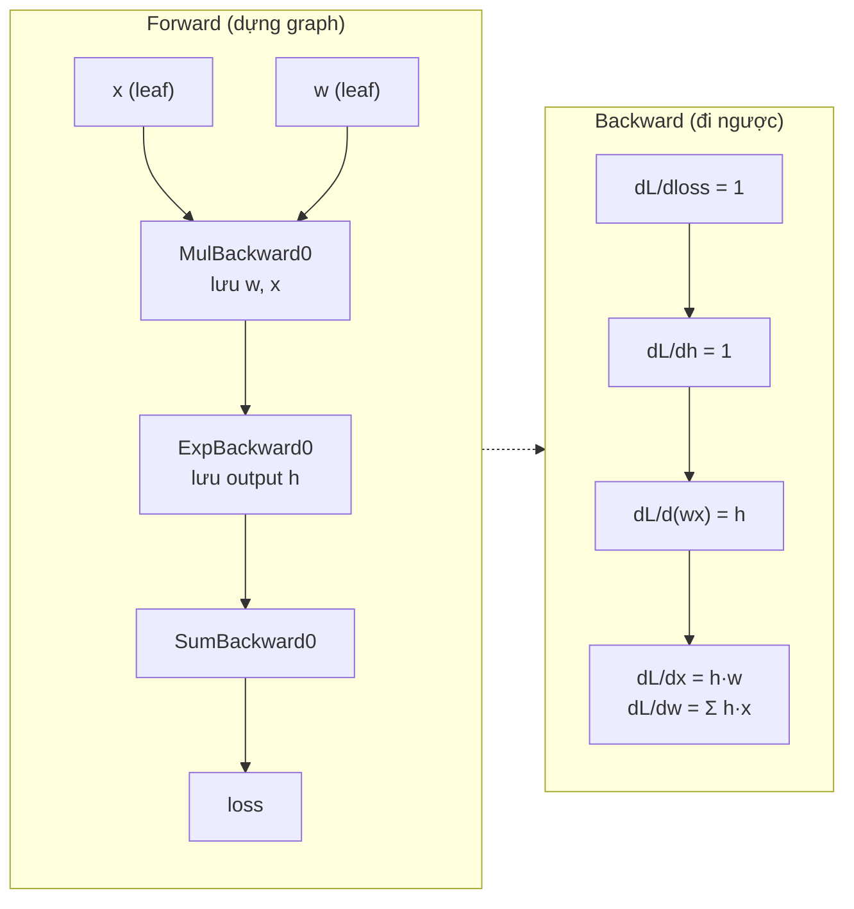
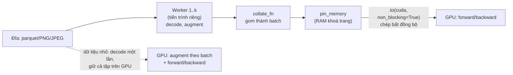
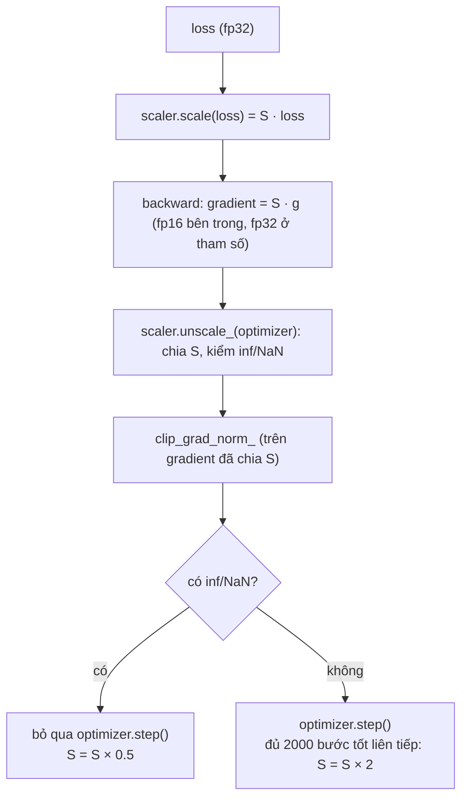
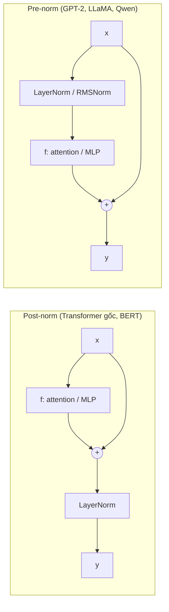
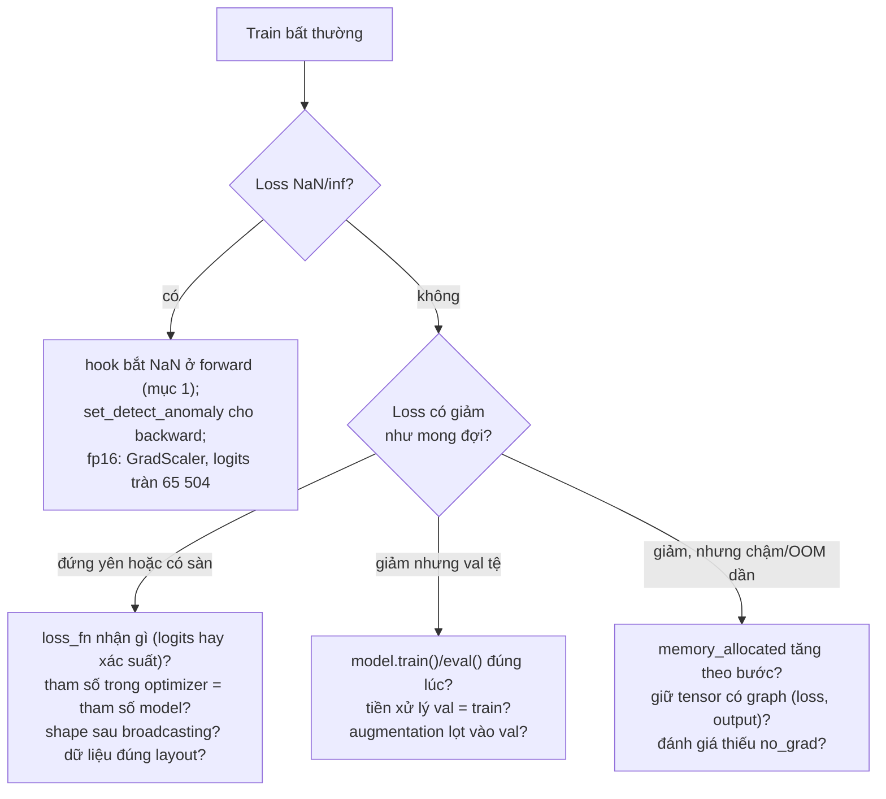

# PyTorch chuyên sâu

Module 01 mở hộp đen deep learning bằng numpy. Module này quay lại PyTorch, nhưng ở tầng mà người dùng thư viện
ít khi nhìn: autograd lưu gì cho backward và cách tự viết backward, `nn.Module` đăng ký tham số ra sao, vì sao GPU
hay ngồi chờ `DataLoader`, mixed precision thật sự đổi gì trong từng phép tính, bộ nhớ GPU nằm ở đâu khi train, vì
sao normalization và residual cho phép mạng sâu train được, và các bug "im lặng" chỉ PyTorch mới có. Đây là bộ kỹ
năng phân biệt người "chạy được notebook" với người làm cho một lần train 4GB VRAM chạy nhanh gấp đôi, hoặc tìm ra
vì sao nó không hội tụ.

Vòng train cơ bản, `Dataset`/`DataLoader`, CNN, chọn CPU/GPU và ước lượng bộ nhớ thô đã có ở
[module 13 track DS](../../../data-science/modules/13-deep-learning/README.md). Backprop, khởi tạo, optimizer,
BatchNorm/LayerNorm/dropout tự viết bằng numpy và quy trình debug chung (loss ở bước 0, gradient check, overfit một
batch) đã có ở [module 01](../01-nn-from-scratch/README.md); ở đây chỉ nhắc khi cần. Dữ liệu chính là **CIFAR-10**
(60 000 ảnh màu 32×32, 10 lớp). Tải (137 MB):

```bash
uv run python data/download_dataset.py cifar10
```

**Môi trường.** Env gốc của repo dùng torch bản CPU để test chạy ở mọi máy. Phần đo trên GPU dùng env riêng
`setup/gpu` (torch CUDA 12.6) qua kernel `ai-gpu` (xem [setup/gpu/README.md](../../../../setup/gpu/README.md)).
Số liệu GPU trong module đo trên **RTX 3050 Laptop 4GB** (Ampere, driver 550), torch 2.14.1+cu126; số liệu CPU
đo bằng torch 2.14.1+cpu, `OMP_NUM_THREADS=4`, ngày 2026-10-30. GPU này dùng chung với vài tiến trình khác lúc đo,
nên thời gian chỉ lấy từ những lần GPU rảnh và nên đọc như tỉ lệ, không như hằng số.

Sau module này bạn sẽ:

- Đọc được graph autograd (`grad_fn`, saved tensor, version counter), tự viết `torch.autograd.Function` và gắn
  hook để quan sát hay sửa gradient.
- Biết `nn.Module` đăng ký gì (tham số, buffer, module con), và các bug khi PyTorch "không thấy" một layer.
- Dựng pipeline dữ liệu không làm GPU đói, tái lập được với nhiều worker.
- Dùng autocast fp16/bf16 và GradScaler đúng thứ tự, biết khi nào cần loss scaling và vì sao.
- Phân rã bộ nhớ train thành tham số, gradient, trạng thái optimizer và activation; chữa OOM bằng gradient
  accumulation, checkpointing, mixed precision; đo bằng profiler và memory snapshot.
- Chọn BatchNorm/LayerNorm/GroupNorm/RMSNorm, pre-norm hay post-norm, và giải thích residual bằng gradient.
- Gỡ các bug im lặng của vòng train PyTorch bằng phép đo.

| Mức | Bài | Nội dung |
| --- | --- | --- |
| Basic | 01 custom-autograd-hooks | `SiLU` tự viết backward, straight-through estimator, gradient reversal, hook đo activation và gradient |
| Basic | 02 modules-norm-residual | RMSNorm, GroupNorm, block residual pre-norm, weight tying, param group cho weight decay |
| Basic | 03 fast-dataloader | decode CIFAR-10 một lần, `Dataset` có augmentation, worker có seed, augmentation theo batch |
| Intermediate | 01 mixed-precision | đo underflow fp16 trên gradient thật, tự viết dynamic loss scaling, so fp32/fp16/bf16 trên CIFAR-10 |
| Intermediate | 02 memory-accumulation-checkpointing | đo activation bằng `saved_tensors_hooks`, accumulation, checkpointing, profiler, memory snapshot |
| Advanced | 01 cifar10-speedrun | ResNet-9 đạt ≥ 94% CIFAR-10 trên GPU 4GB trong vài phút (portfolio) |
| Advanced | 02 debug-pytorch-training | sửa vòng train PyTorch có 5 bug im lặng |

## 1. Autograd từ bên trong: graph, saved tensor, custom Function, hook

### Graph được dựng khi forward chạy

PyTorch dựng graph **động**: mỗi phép toán trên tensor có `requires_grad=True` tạo một node (`grad_fn`) trỏ về các
node sinh ra input của nó. `backward()` đi ngược graph đó theo thứ tự topo, mỗi node nhận gradient theo output và
trả gradient theo từng input (vector-Jacobian product, đúng như backprop tự viết ở module 01 mục 4). Để tính được,
node phải **lưu lại** một số tensor của forward: `exp` lưu output, `mul` lưu hai input, `Linear` lưu input và
trọng số, `ReLU` lưu output. Đó chính là "activation memory" ở mục 5.



```python
import torch

x = torch.tensor([1.0, 2.0, 3.0], requires_grad=True)   # leaf: do người dùng tạo
w = torch.tensor(0.5, requires_grad=True)
h = (w * x).exp()                                          # non-leaf: kết quả của phép toán
loss = h.sum()

print("leaf?", x.is_leaf, h.is_leaf, "| grad_fn:", type(h.grad_fn).__name__)
print("graph ngược từ loss:", type(loss.grad_fn).__name__, "->",
      [type(f).__name__ for f, _ in loss.grad_fn.next_functions], "->",
      [type(f).__name__ for f, _ in h.grad_fn.next_functions])
print("ExpBackward lưu output:", h.grad_fn._saved_result is h or torch.equal(h.grad_fn._saved_result, h))

h.retain_grad()                                            # mặc định chỉ leaf giữ .grad
loss.backward()
print("x.grad", x.grad, "| h.grad", h.grad, "| w.grad", round(w.grad.item(), 4))

# Version counter: sửa tại chỗ một tensor mà backward còn cần
x2 = torch.tensor([1.0, 2.0], requires_grad=True)
y = x2.exp()
y.add_(1)                                                  # exp lưu output y để tính đạo hàm
try:
    y.sum().backward()
except RuntimeError as e:
    print("RuntimeError:", str(e)[:120], "...")

# no_grad và inference_mode
with torch.no_grad():
    a = x * 2
with torch.inference_mode():
    b = x * 2
print("no_grad:", a.requires_grad, "| inference_mode:", b.requires_grad, b.is_inference())
try:
    (b * x).sum().backward()
except RuntimeError as e:
    print("RuntimeError:", str(e)[:90], "...")
```

Kết quả: graph ngược là `SumBackward0 → ExpBackward0 → MulBackward0`; `x.grad = [0.8244, 1.3591, 2.2408]`
(bằng $$w e^{wx}$$), `w.grad = 20.5304` (bằng $$\sum x e^{wx}$$); `h.grad` chỉ có vì đã gọi `retain_grad()`. Sửa tại chỗ
`y.add_(1)` sau khi `exp` đã lưu `y` làm backward báo `one of the variables needed for gradient computation has
been modified by an inplace operation`: mỗi tensor có **version counter**, tăng sau mỗi phép tại chỗ, và node kiểm
lại version lúc backward. Đó là lý do PyTorch báo lỗi được, còn numpy tự viết ở module 01 thì sai im lặng.

Ba cách tắt autograd, chọn theo mục đích:

| Cách | Tắt gì | Dùng khi |
| --- | --- | --- |
| `torch.no_grad()` | không dựng graph trong khối | đánh giá, cập nhật tham số bằng tay |
| `torch.inference_mode()` | như `no_grad`, bỏ thêm version counter; tensor tạo ra không bao giờ vào graph được | serving, đánh giá thuần, nhanh hơn chút |
| `t.detach()` | một tensor tách khỏi graph, **chia storage** với tensor gốc | chặn gradient một nhánh (target network, stop-gradient), log giá trị |

`detach()` không chép dữ liệu: sửa tại chỗ tensor đã detach là sửa luôn tensor gốc (và làm hỏng version counter của nó).

### Custom `autograd.Function`

Tự viết backward khi: autograd không có đạo hàm bạn muốn (straight-through estimator cho phép làm tròn trong
quantization, gradient reversal), muốn backward rẻ bộ nhớ hơn (lưu ít tensor hơn, tính lại phần còn lại), hoặc
ghép nhiều op thành một kernel. Hợp đồng: `forward(ctx, *inputs)` chạy với autograd **tắt**, lưu tensor bằng
`ctx.save_for_backward`, số Python bằng `ctx.<tên>`; `backward(ctx, *grad_outputs)` trả **đúng một giá trị cho mỗi
input** của forward (`None` cho input không cần gradient). Luôn kiểm bằng `torch.autograd.gradcheck` ở float64.

```python
import torch
from torch import nn


class MyExp(torch.autograd.Function):
    @staticmethod
    def forward(ctx, x):
        y = x.exp()
        ctx.save_for_backward(y)          # lưu output: đạo hàm của exp chính là exp
        return y

    @staticmethod
    def backward(ctx, grad_out):          # nhận dL/dy, trả dL/dx; một giá trị cho mỗi input
        (y,) = ctx.saved_tensors
        return grad_out * y


x = torch.randn(5, dtype=torch.float64, requires_grad=True)
print("gradcheck:", torch.autograd.gradcheck(MyExp.apply, (x,)))
print("grad_fn:", type(MyExp.apply(x).grad_fn).__name__)

# Tensor hook: sửa gradient trên đường đi (ở đây chặn mỗi phần tử trong [-1, 1])
w = torch.tensor([3.0, -4.0], requires_grad=True)
handle = w.register_hook(lambda g: g.clamp(-1, 1))
(w * torch.tensor([10.0, 10.0])).sum().backward()
print("gradient đã bị chặn:", w.grad)
handle.remove()

# Module hook: dừng ở layer ĐẦU TIÊN cho ra giá trị không hữu hạn
def nan_guard(name):
    def hook(module, inputs, output):
        if not torch.isfinite(output).all():
            raise FloatingPointError(f"{name} ({type(module).__name__}) cho ra NaN/inf")
    return hook


net = nn.Sequential(nn.Linear(4, 4), nn.ReLU(), nn.Linear(4, 2))
for name, m in net.named_modules():
    if name:
        m.register_forward_hook(nan_guard(name))
with torch.no_grad():
    net[0].weight[0, 0] = float("inf")
try:
    net(torch.ones(1, 4))
except FloatingPointError as e:
    print("bắt được:", e)
```

`gradcheck` trả `True`, node của graph mang tên `MyExpBackward`, gradient `[10, 10]` bị hook chặn thành `[1, 1]`,
và hook dừng đúng ở layer `0 (Linear)` có trọng số inf thay vì để NaN lan ra loss.

### Hook: quan sát và can thiệp mà không sửa model

| Hook | Gắn vào | Thấy gì, khi nào | Dùng cho |
| --- | --- | --- | --- |
| `tensor.register_hook(fn)` | tensor | gradient theo tensor đó, **trước** khi cộng dồn; trả giá trị mới để thay | clip/scale gradient một nhánh, debug |
| `param.register_post_accumulate_grad_hook(fn)` | tham số (leaf) | tham số **sau** khi `.grad` đã cộng dồn | log norm gradient, optimizer chạy ngay trong backward để đỡ bộ nhớ |
| `module.register_forward_pre_hook` / `register_forward_hook` | module | input / output của forward | thống kê activation, bắt NaN, trích feature |
| `module.register_full_backward_hook` | module | gradient theo input và output của module | gradient flow theo layer |
| `torch.autograd.graph.saved_tensors_hooks(pack, unpack)` | context | mọi tensor được lưu cho backward | đo activation memory, offload sang CPU, nén |

Mỗi hàm `register_*` trả một handle: gọi `handle.remove()` khi xong. Hook quên gỡ chạy mãi ở mọi forward sau, và
nếu nó giữ tensor (không `detach`) thì giữ luôn graph của batch đó.

## 2. nn.Module: đăng ký tham số, buffer, state_dict, train/eval

`nn.Module.__setattr__` là nơi mọi thứ xảy ra: gán một `nn.Parameter` thì nó vào `_parameters`, gán một `nn.Module`
thì vào `_modules`, `register_buffer` thì vào `_buffers`. Mọi API khác (`parameters()`, `state_dict()`, `.to()`,
`train()`/`eval()`, `apply()`) chỉ duyệt ba dict đó, đệ quy qua module con. Thứ gì không nằm trong ba dict thì PyTorch
không biết tới, và không báo lỗi.

```python
import torch
from torch import nn


class Demo(nn.Module):
    def __init__(self):
        super().__init__()
        self.fc = nn.Linear(4, 4)                                  # module con: đăng ký
        self.scale = nn.Parameter(torch.ones(4))                   # tham số: đăng ký
        self.register_buffer("count", torch.zeros(()))             # buffer: vào state_dict, đi theo .to()
        self.register_buffer("cache", torch.zeros(4), persistent=False)  # buffer không lưu vào state_dict
        self.plain = torch.zeros(4)                                # tensor thường: PyTorch không biết nó
        self.layers_list = [nn.Linear(4, 4) for _ in range(2)]     # list Python: KHÔNG đăng ký
        self.layers = nn.ModuleList([nn.Linear(4, 4) for _ in range(2)])


m = Demo()
print("tham số :", [n for n, _ in m.named_parameters()])
print("buffer  :", [n for n, _ in m.named_buffers()])
print("state_dict:", list(m.state_dict()))
m = m.double()
print("dtype sau .double(): fc", m.fc.weight.dtype, "| count", m.count.dtype, "| plain", m.plain.dtype,
      "| layers_list[0]", m.layers_list[0].weight.dtype)
print("train mode lan xuống con:", m.eval().layers[0].training, "| list Python:", m.layers_list[0].training)


def init(mod):                                                     # apply: gọi hàm trên mọi module con
    if isinstance(mod, nn.Linear):
        nn.init.zeros_(mod.bias)


m.apply(init)
print("bias sau apply:", m.fc.bias.abs().sum().item(), m.layers[1].bias.abs().sum().item())
```

Kết quả: tham số gồm `scale`, `fc.*`, `layers.0.*`, `layers.1.*` nhưng **không** có gì từ `layers_list`; buffer
`cache` có trong `named_buffers()` nhưng không có trong `state_dict`; sau `.double()`, `plain` và `layers_list` vẫn
float32; `eval()` lan xuống `layers` nhưng `layers_list[0].training` vẫn `True`.

| Thứ | Ví dụ | `parameters()` (optimizer thấy) | `state_dict()` (checkpoint) | `.to()` / `.half()` | `train()`/`eval()` |
| --- | --- | --- | --- | --- | --- |
| `nn.Parameter` | trọng số, bias, γ của norm | có | có | có | không áp dụng |
| buffer (`persistent=True`) | `running_mean`, `num_batches_tracked` | không | có | có (tensor số thực đổi dtype) | không áp dụng |
| buffer `persistent=False` | causal mask, bảng RoPE tính sẵn | không | **không** | có | không áp dụng |
| module con | `nn.Linear`, `nn.ModuleList`, `nn.ModuleDict` | có (đệ quy) | có | có | có |
| tensor thường, list/dict Python | `self.mask = torch.ones(...)`, `[nn.Linear(...)]` | **không** | **không** | **không** | **không** |

Hệ quả thực tế:

- Layer để trong list Python: forward chạy bình thường, nhưng optimizer không cập nhật nó, checkpoint không lưu nó,
  và trên GPU sẽ lỗi device (tensor của nó còn ở CPU). Trên CPU thì im lặng hoàn toàn. Kiểm nhanh:
  `sum(p.numel() for p in model.parameters())` so với con số bạn tính tay.
- **Weight tying** (dùng chung embedding đầu vào và ma trận output của LM) là gán cùng một `Parameter` cho hai chỗ.
  `parameters()` tự bỏ trùng nên optimizer cập nhật một lần; `state_dict()` vẫn có hai khoá trỏ cùng storage.
- Weight decay chỉ nên áp cho ma trận trọng số (tham số từ 2 chiều), không cho bias và γ/β của norm; tách bằng
  **param group** (bài Basic 02).
- `model.eval()` chỉ đổi cờ `training`, ảnh hưởng tới module có hành vi khác nhau (BatchNorm, Dropout). Nó **không**
  tắt autograd; `torch.no_grad()` thì tắt autograd nhưng **không** đổi BatchNorm sang running stats. Đánh giá cần cả hai.
- `load_state_dict(strict=True)` (mặc định) báo khoá thiếu và thừa: đọc kỹ thông báo thay vì chuyển sang
  `strict=False` cho qua, vì đó thường là dấu hiệu một layer không được đăng ký hoặc đổi tên.
- `torch.compile(model)` biên dịch forward/backward thành kernel gộp: lợi nhất ở các op từng phần tử (norm, activation)
  vốn bị giới hạn bởi băng thông bộ nhớ; đổi lại lần chạy đầu mất thời gian biên dịch và lỗi khó đọc hơn. Bật sau khi code
  đã đúng, và đo trước/sau trên chính model của bạn (một hướng thử ở bài Advanced 01), không phải để gỡ lỗi.

## 3. DataLoader và đường đi của dữ liệu tới GPU

### GPU có đang chờ dữ liệu không

Một bước train là hai việc chạy song song (nếu cấu hình đúng): CPU chuẩn bị batch kế tiếp (đọc, decode, augment,
gom batch), GPU tính forward/backward batch hiện tại. Nếu CPU chậm hơn, GPU đứng chờ và mọi tối ưu ở mục 4, 5 vô
nghĩa. Dấu hiệu: `nvidia-smi` báo GPU-Util dao động thấp, profiler thấy khoảng trống giữa các kernel, thời gian
lấy batch (`next(it)`) cỡ thời gian một bước.



Đo trên CIFAR-10 (lời giải bài Basic 03, batch 256, 40 batch sau một batch khởi động, CPU 16 luồng nhưng **đang có tải
nặng từ tiến trình khác** lúc đo, nên đọc như tỉ lệ):

| Cách cấp dữ liệu | Ảnh/giây |
| --- | --- |
| PNG decode trong `__getitem__` mỗi lần, `num_workers=0` | 235 |
| PNG decode mỗi lần, `num_workers=4` | 4 358 |
| tensor uint8 đã decode một lần + augment từng ảnh, `num_workers=0` | 643 |
| như trên, `num_workers=2` | 7 041 |
| như trên, `num_workers=4` | 15 438 |
| `augment_batch` cả batch một lần trên CPU, một tiến trình | 8 590 |

Để so: một bước train ResNet-9 (W=32) bf16 trên RTX 3050 xử lý khoảng 9 800 ảnh/giây (mục 4). Decode PNG mỗi lần trong một
tiến trình (235 ảnh/giây) làm GPU chờ hơn 97% thời gian; decode một lần và thêm worker nhân thông lượng lên hàng chục lần.
Phần còn lại giữa "đủ" và "dư" là để dữ liệu ở ngay trên GPU.

### Các núm điều chỉnh

| Tham số | Làm gì | Chọn thế nào |
| --- | --- | --- |
| `num_workers` | số tiến trình chuẩn bị batch song song | bắt đầu 4, tăng tới khi thông lượng ngừng tăng; không vượt số lõi thật, nhớ GPU dùng chung CPU với tiến trình chính |
| `pin_memory=True` | batch nằm ở RAM khoá trang, chép sang GPU nhanh và bất đồng bộ được | bật khi train trên CUDA; vô ích trên CPU |
| `.to(device, non_blocking=True)` | không chặn CPU chờ chép xong | chỉ có tác dụng với tensor đã pin |
| `persistent_workers=True` | giữ worker sống giữa các epoch | bật khi `num_workers > 0`: tránh khởi động lại (fork, nạp dataset) mỗi epoch |
| `prefetch_factor` | số batch mỗi worker chuẩn bị trước (mặc định 2) | tăng khi thời gian từng batch dao động mạnh |
| `drop_last=True` | bỏ batch cuối thiếu | khi dùng BatchNorm (batch 1 mẫu báo lỗi) hoặc `torch.compile` (shape cố định) |

Quy tắc lớn hơn mọi núm: **đừng làm lại việc đắt mỗi epoch**. Decode PNG/JPEG, tokenize, resize là việc làm một lần
rồi lưu dạng tensor (hoặc memory-map); chỉ augmentation ngẫu nhiên mới phải làm mỗi lần. Với tập nhỏ như CIFAR-10
(150 MB ở uint8), giữ cả tập trên GPU và augment theo batch bằng phép toán tensor (bài Basic 03) bỏ được cả
`DataLoader`: đây là cách các "speedrun" CIFAR-10 đạt 94% trong vài giây trên A100.

### Tái lập với nhiều worker

Mỗi worker là một tiến trình fork từ tiến trình chính, mang **bản sao** của dataset. PyTorch tự seed `torch`,
`random` và `np.random` toàn cục trong mỗi worker từ `base_seed + worker_id` (`base_seed` lấy từ `generator` của
`DataLoader`), nhưng không đụng tới đối tượng bạn tự tạo như `np.random.default_rng(0)` trong `__init__`: mọi
worker mang cùng trạng thái, nên augmentation của worker 0 và worker 1 trùng nhau từng pixel. Augment "ngẫu nhiên"
mà thật ra lặp lại theo chu kỳ số worker, và không có lỗi nào báo. Chữa bằng `worker_init_fn` tạo lại generator
từ `torch.initial_seed()` trong mỗi worker, và truyền `generator=torch.Generator().manual_seed(seed)` cho
`DataLoader` để cả thứ tự xáo lẫn seed của worker đều tái lập.

## 4. Mixed precision: fp16, bf16, TF32 và loss scaling

### Ba định dạng 16 và 32 bit

| Định dạng | Bit (dấu / mũ / mantissa) | Giá trị lớn nhất | Normal nhỏ nhất | eps (khoảng cách sau 1.0) |
| --- | --- | --- | --- | --- |
| fp32 | 1 / 8 / 23 | $$3.4 \times 10^{38}$$ | $$1.2 \times 10^{-38}$$ | $$1.2 \times 10^{-7}$$ |
| TF32 (chỉ trong Tensor Core) | 1 / 8 / 10 | như fp32 | như fp32 | $$9.8 \times 10^{-4}$$ |
| fp16 | 1 / 5 / 10 | 65 504 | $$6.1 \times 10^{-5}$$ (subnormal tới $$6 \times 10^{-8}$$) | $$9.8 \times 10^{-4}$$ |
| bf16 | 1 / 8 / 7 | $$3.4 \times 10^{38}$$ | $$1.2 \times 10^{-38}$$ | $$7.8 \times 10^{-3}$$ |

fp16 có mantissa dài hơn (chính xác hơn) nhưng **phạm vi hẹp**; bf16 giữ nguyên phạm vi của fp32 (cùng 8 bit mũ) và
trả bằng độ chính xác. Hệ quả: fp16 dễ tràn (activation, logits lớn hơn 65 504) và dễ **underflow** (gradient nhỏ
hơn $$6 \times 10^{-8}$$ thành 0); bf16 gần như không tràn hay underflow nhưng mỗi phép cộng mất nhiều chữ số.

```python
import torch
import torch.nn.functional as F

for dt in (torch.float32, torch.float16, torch.bfloat16):
    fi = torch.finfo(dt)
    print(f"{str(dt):15s} max {fi.max:.2e}  normal nhỏ nhất {fi.tiny:.2e}  eps {fi.eps:.2e}")

g = torch.tensor([1e-3, 1e-5, 1e-7, 1e-8])                       # gradient nhỏ cỡ thường gặp
print("fp16          :", g.half().tolist())
print("fp16, x 2^16  :", (g * 2**16).half().float().div(2**16).tolist())
print("bf16          :", g.bfloat16().float().tolist())
print("1 + 1e-3 (bf16):", (torch.tensor(1.0, dtype=torch.bfloat16) + 1e-3).item(),
      "| 300 + 0.1 (fp16):", (torch.tensor(300.0, dtype=torch.float16) + torch.tensor(0.1, dtype=torch.float16)).item())

# autocast chọn dtype theo từng op: matmul xuống bf16, phép nhạy số (loss) giữ fp32
lin = torch.nn.Linear(8, 8)
x = torch.randn(4, 8)
with torch.autocast("cpu", dtype=torch.bfloat16):
    h = lin(x)
    p = F.softmax(h, dim=-1)
    loss = F.cross_entropy(h, torch.zeros(4, dtype=torch.long))
print("trong autocast: linear", h.dtype, "| softmax", p.dtype, "| cross_entropy", loss.dtype,
      "| tham số vẫn", lin.weight.dtype)
```

Kết quả: ở fp16, $$10^{-7}$$ thành $$1.19 \times 10^{-7}$$ (vùng subnormal, sai 19%) và $$10^{-8}$$ thành **0**; nhân $$2^{16}$$
trước khi ép rồi chia lại thì cả bốn giá trị sống sót với sai số dưới 0.03%. bf16 giữ được cả bốn (sai dưới 0.2%).
Nhưng $$1 + 10^{-3}$$ ở bf16 vẫn là 1.0, và $$300 + 0.1$$ ở fp16 vẫn là 300: cộng dồn nhiều số nhỏ vào một số lớn ở
16 bit là mất trắng. Vì vậy trọng số, cập nhật của optimizer và các phép giảm (sum, mean, softmax, norm, loss) phải
ở fp32.

### autocast làm gì

`torch.autocast(device_type, dtype)` không đổi dtype của tham số; nó chọn dtype cho **từng op** khi op chạy:

- Op hưởng lợi từ Tensor Core (matmul, `linear`, `conv`, `bmm`, attention) chạy ở fp16/bf16: input được ép xuống.
- Op nhạy số chạy ở fp32: trên CUDA gồm `softmax`, `log_softmax`, `cross_entropy`, `layer_norm`, `sum`... (đo trên
  RTX 3050: với cả fp16 lẫn bf16, output của các op này là float32). Trên CPU danh sách hẹp hơn: ví dụ trên cho thấy
  `softmax` vẫn ra bf16, chỉ `cross_entropy` ra fp32.
- Op còn lại chạy theo dtype rộng nhất của input.

Vì tham số vẫn fp32, gradient theo tham số cũng fp32 và optimizer cập nhật ở fp32: đây là "mixed" precision. Bộ nhớ
tiết kiệm đến từ **activation** lưu ở 16 bit (mục 5), không phải từ trọng số. Các bản ép xuống 16 bit của trọng số
được cache trong khối `autocast` và bị bỏ khi ra khỏi khối.

### Loss scaling cho fp16

Gradient theo activation thường rất nhỏ: loss là trung bình trên batch, nên mỗi phần tử chỉ mang phần của một mẫu.
Đo trên ResNet-9 lúc khởi tạo, một batch 256 ảnh CIFAR-10 (bài Intermediate 01 cho bạn đo lại): gradient theo
trọng số có trung vị cỡ $$4 \times 10^{-3}$$, còn gradient theo activation chỉ cỡ $$2 \times 10^{-7}$$, và một phần đáng kể
trong số đó nằm dưới ngưỡng subnormal của fp16. Backward ở fp16 làm việc trên chính các activation gradient đó.

Chữa bằng **loss scaling**: nhân loss với $$S$$ trước backward. Đạo hàm tuyến tính nên mọi gradient nhân $$S$$, ra khỏi
vùng underflow; trước khi optimizer dùng, chia lại cho $$S$$ ở fp32. $$S$$ quá lớn thì gradient tràn thành inf, nên
chọn **động**:



Mặc định `torch.amp.GradScaler` bắt đầu ở $$S = 2^{16}$$, vài bước đầu thường tràn và bị bỏ để $$S$$ tự hạ xuống mức
vừa đủ. Thứ tự trong vòng train là chỗ hay sai: clip gradient **trước** `unscale_` là clip gradient đang bị nhân
$$S$$, tức ngưỡng thật nhỏ đi $$S$$ lần. bf16 có cùng phạm vi mũ với fp32 nên **không cần** loss scaling; đó là lý do
gần như mọi LLM hiện đại train bằng bf16 trên GPU hỗ trợ nó (Ampere trở lên).

### TF32: tăng tốc fp32 mà không đổi code

Trên Ampere trở lên, Tensor Core có thể nhân ma trận fp32 bằng định dạng TF32 (mantissa 10 bit), cộng dồn ở fp32.
PyTorch mặc định bật TF32 cho **convolution** (`torch.backends.cudnn.allow_tf32 = True`) nhưng **tắt** cho matmul
(`torch.backends.cuda.matmul.allow_tf32 = False`; bật bằng `torch.set_float32_matmul_precision("high")`). Nghĩa là
một CNN chạy "fp32" trên RTX 30xx thực ra đã dùng TF32 cho conv.

### Đo trên RTX 3050 4GB

ResNet-9 (kiến trúc của bài Advanced 01, độ rộng `W`), batch 256 ảnh 32×32 ngẫu nhiên, SGD momentum, `channels_last`,
trung vị 3 lần × 40 bước, GPU không có tiến trình khác:

| Cấu hình | W = 32 (1.6 triệu tham số): ms/bước | peak MiB | W = 64 (6.6 triệu): ms/bước | peak MiB |
| --- | --- | --- | --- | --- |
| fp32 (conv dùng TF32 mặc định) | 51.7 | 515 | 139.5 | 1 050 |
| fp32, tắt TF32 | 87.7 | 713 | không đo được (*) | 1 472 |
| autocast fp16 + GradScaler | 25.3 | 312 | 68.7 | 645 |
| autocast bf16 | 26.1 | 312 | 70.9 | 645 |
| autocast fp16, **không** `channels_last` | | | 121.1 (dao động 82–201) | 645 |

(*) Với W = 64 tắt TF32, cuDNN cần workspace lớn hơn phần VRAM còn trống lúc đo (GPU dùng chung) và rơi về thuật
toán chậm (874 ms/bước): một ví dụ thật của việc bộ nhớ trống quyết định cả tốc độ.

Đọc bảng:

- AMP nhanh gấp **2.0×** fp32 (đã có TF32) và gấp 3.5× fp32 thuần ở W = 32; peak memory giảm khoảng 40% (activation
  16 bit; tham số, gradient, trạng thái optimizer vẫn fp32).
- fp16 và bf16 nhanh ngang nhau trên Ampere. Chọn **bf16** khi phần cứng hỗ trợ (không cần scaler, không lo tràn);
  fp16 + GradScaler cho GPU cũ (Turing, Volta) hoặc khi cần thêm bit mantissa.
- Tensor Core muốn `channels_last` (NHWC): bỏ nó thì cuDNN phải chuyển layout qua lại, chậm hơn rõ. Profiler ở bài
  Intermediate 02 cho thấy các kernel `nchwToNhwc` chiếm gần 9% thời gian GPU khi quên.
- Trong một vòng train thật (bài Intermediate 01, có augmentation, BatchNorm, đánh giá), mức tăng tốc nhỏ hơn con số
  ở bảng, vì phần không phải matmul/conv không được lợi từ 16 bit.

## 5. Bộ nhớ khi train: đo, gradient accumulation, checkpointing, profiler

### Bộ nhớ nằm ở đâu

$$
M_{train} \approx \underbrace{N_{param}\,(b_w + b_g + b_{opt})}_{\text{trạng thái train, cố định}} + \underbrace{M_{act}(\text{batch}, \text{độ phân giải}/\text{độ dài chuỗi})}_{\text{activation, tỉ lệ batch}} + \text{workspace, phân mảnh, context CUDA}
$$

```python
# Byte mỗi tham số cho "trạng thái train" (chưa tính activation), theo cách lưu trọng số, gradient, optimizer
recipes = {
    "fp32, AdamW":                          {"weights": 4, "grads": 4, "master": 0, "optimizer": 8},
    "autocast (AMP) của PyTorch, AdamW":    {"weights": 4, "grads": 4, "master": 0, "optimizer": 8},
    "bf16 + master fp32, AdamW (Megatron)": {"weights": 2, "grads": 2, "master": 4, "optimizer": 8},
    "bf16 thuần, AdamW bf16":               {"weights": 2, "grads": 2, "master": 0, "optimizer": 4},
    "fp32, SGD momentum":                   {"weights": 4, "grads": 4, "master": 0, "optimizer": 4},
}
models = {"ResNet-9 (6.6 triệu)": 6.57e6, "Qwen2.5-0.5B (494 triệu)": 494e6, "Qwen2.5-7B (7.6 tỉ)": 7.6e9}
print(f"{'cách lưu':38s} {'B/tham số':>9s}  " + "  ".join(f"{m:>26s}" for m in models))
for name, r in recipes.items():
    per = sum(r.values())
    print(f"{name:38s} {per:9d}  " + "  ".join(f"{n * per / 2**30:23.2f} GiB" for n in models.values()))
```

| Cách lưu | B/tham số | ResNet-9 | Qwen2.5-0.5B | Qwen2.5-7B |
| --- | --- | --- | --- | --- |
| fp32 hoặc autocast, AdamW | 16 | 0.10 GiB | 7.36 GiB | 113 GiB |
| bf16 + master fp32, AdamW | 16 | 0.10 GiB | 7.36 GiB | 113 GiB |
| bf16 thuần, AdamW bf16 | 8 | 0.05 GiB | 3.68 GiB | 57 GiB |
| fp32, SGD momentum | 12 | 0.07 GiB | 5.52 GiB | 85 GiB |

Hai bài học: (1) mixed precision **không** giảm trạng thái train (vẫn 16 B/tham số với AdamW), nên full fine-tune
Qwen2.5-0.5B bằng AdamW đã vượt 4 GB trước khi tính activation; đó là lý do module 14 dùng LoRA/QLoRA. (2) Với CNN nhỏ
như ResNet-9 thì ngược lại: trạng thái train chỉ 100 MB, **activation** mới là phần lớn (gần 1 GB ở batch 256 fp32,
bài Intermediate 02 đo từng giai đoạn), nên giảm batch, AMP và checkpointing là ba cần gạt hiệu quả.

### Đo bộ nhớ CUDA cho đúng

| Công cụ | Cho biết | Lưu ý |
| --- | --- | --- |
| `torch.cuda.memory_allocated()` | byte tensor đang sống | con số "thật" của model |
| `torch.cuda.max_memory_allocated()` + `reset_peak_memory_stats()` | đỉnh kể từ lần reset | thứ quyết định OOM; đo sau `synchronize()` |
| `torch.cuda.memory_reserved()` | byte caching allocator đang giữ | luôn ≥ allocated; khoảng chênh là block đã giải phóng nhưng giữ lại để dùng lại |
| `nvidia-smi` | reserved + context CUDA (vài trăm MB) + tiến trình khác | đừng dùng để đo model; dùng để xem ai đang chiếm GPU |
| `torch.cuda.memory_summary()` | bảng chi tiết allocator | có số lần cấp phát lỗi, phân mảnh |
| `torch.cuda.memory._record_memory_history()` + `_dump_snapshot()` | lịch sử từng lần cấp phát kèm stack trace | kéo tệp vào [pytorch.org/memory_viz](https://pytorch.org/memory_viz); công cụ chính khi điều tra OOM thật |
| `torch.profiler.profile(profile_memory=True)` | thời gian và bộ nhớ theo từng op | xuất trace xem bằng Perfetto |

Phân mảnh: allocator cấp block theo kích thước; batch có shape thay đổi liên tục (chuỗi độ dài khác nhau) để lại các
lỗ trống không dùng lại được, nên OOM xảy ra dù tổng bộ nhớ trống còn đủ. `PYTORCH_CUDA_ALLOC_CONF=expandable_segments:True`
giảm vấn đề này.

### Gradient accumulation

Batch $$B$$ không vừa bộ nhớ thì chia thành $$k$$ micro-batch, backward từng cái (gradient tự cộng dồn trong `.grad`,
đó là lý do PyTorch không tự xoá gradient), rồi `step` một lần. Muốn tương đương batch lớn thì loss của micro-batch
$$j$$ (cỡ $$b_j$$) phải nhân trọng số $$b_j / B$$:

$$
\nabla \frac{1}{B}\sum_{i=1}^{B} \ell_i = \sum_{j=1}^{k} \frac{b_j}{B}\,\nabla\Bigl(\frac{1}{b_j}\sum_{i \in j} \ell_i\Bigr)
$$

Chia cho $$k$$ chỉ đúng khi mọi micro-batch bằng nhau. Hai giới hạn: thời gian không giảm (vẫn chừng ấy phép tính,
thêm chi phí của batch nhỏ), và **BatchNorm không tương đương**: thống kê tính trên micro-batch, không trên batch
lớn. Bài Intermediate 02 đo chênh lệch gradient giữa 4 × 64 và 256: rất lớn với BatchNorm, gần như bằng sai số làm
tròn với GroupNorm. Mô hình dùng LayerNorm/RMSNorm (Transformer) không gặp vấn đề này.

### Activation checkpointing

Không lưu activation bên trong một đoạn mạng, chỉ lưu input của đoạn; khi backward tới đoạn đó, chạy lại forward
của đoạn rồi mới backward. Với $$n$$ layer chia thành $$\sqrt n$$ đoạn, bộ nhớ activation từ $$O(n)$$ còn $$O(\sqrt n)$$,
đổi lại thêm khoảng **một lần forward** (Chen et al. 2016). Thực tế:

- `torch.utils.checkpoint.checkpoint(fn, *args, use_reentrant=False)`; bản non-reentrant là mặc định nên dùng, giữ
  trạng thái RNG (Dropout tính lại ra đúng mask cũ) và chạy được với `torch.autograd.grad`.
- Checkpoint đúng **một** đoạn bao cả mạng gần như không giảm peak: lúc backward tính lại, toàn bộ activation lại
  nằm trong bộ nhớ cùng lúc. Checkpoint **từng layer nhỏ** có thể giữ nhiều hơn không checkpoint (giữ input của mọi
  layer, kể cả những thứ vốn không cần). Chọn đoạn cỡ vừa, thường là một block Transformer.
- BatchNorm trong đoạn checkpoint bị chạy forward hai lần, running stats cập nhật hai lần mỗi bước.
- Với LLM, checkpoint mỗi block Transformer là cấu hình phổ biến khi fine-tune (`model.gradient_checkpointing_enable()`
  trong Hugging Face).

### Thứ tự thử khi gặp OOM

1. Đo trước: `max_memory_allocated` theo từng giai đoạn (sau forward, backward, step) để biết phần nào lớn.
2. Activation lớn: autocast bf16/fp16, giảm batch + gradient accumulation, checkpointing, giảm độ dài chuỗi/độ phân giải.
3. Trạng thái train lớn: optimizer nhẹ hơn (SGD momentum, Adam 8-bit), LoRA (module 14), offload hay sharding (FSDP,
   ZeRO) khi có nhiều GPU.
4. Phân mảnh: `expandable_segments`, sắp batch theo độ dài, tránh giữ tham chiếu tới tensor không cần (loss chưa
   `.item()`, list output).
5. Kiểm rò rỉ: bộ nhớ tăng đều theo bước là có thứ đang giữ graph (mục 7).

## 6. Normalization và residual: vì sao mạng sâu train được

### Bốn kiểu normalization

Mọi normalization đều tính $$\hat x = (x - \mu)/\sqrt{\sigma^2 + \epsilon}$$ rồi nhân $$\gamma$$, cộng $$\beta$$ học được; chúng chỉ khác
**tập phần tử** dùng để tính $$\mu, \sigma^2$$. Với tensor ảnh `(N, C, H, W)` hoặc chuỗi `(N, T, D)`:

| Loại | $$\mu, \sigma^2$$ tính trên | Phụ thuộc mẫu khác trong batch | Train và eval khác nhau | Dùng ở |
| --- | --- | --- | --- | --- |
| BatchNorm | mỗi kênh, qua (N, H, W) | có | có: eval dùng running stats | CNN với batch từ khoảng 32 |
| LayerNorm | mỗi mẫu (mỗi token), qua (C, H, W) hoặc D | không | không | Transformer (BERT, GPT-2) |
| GroupNorm | mỗi mẫu, mỗi nhóm C/G kênh | không | không | CNN batch nhỏ: detection, segmentation, U-Net của diffusion |
| RMSNorm | như LayerNorm nhưng không trừ $$\mu$$, không có $$\beta$$ | không | không | LLM hiện đại (LLaMA, Qwen, Mistral) |

GroupNorm với 1 nhóm là LayerNorm trên (C, H, W), với C nhóm là InstanceNorm (bài Basic 02 kiểm cả hai). BatchNorm cần
batch đủ lớn để thống kê ổn định, làm gradient accumulation không còn tương đương (mục 5), và là nguồn bug train/eval kinh
điển; đổi lại nó hơi regularize (nhiễu của thống kê batch) và gộp được vào conv khi deploy. Các loại không phụ thuộc
batch thì không có những vấn đề đó, nên Transformer dùng LayerNorm/RMSNorm: chuỗi độ dài khác nhau, batch nhỏ khi model
lớn, và lúc sinh từng token batch có thể là 1.

### Residual: một đường cộng thẳng cho gradient

Block residual tính $$y = x + f(x)$$, nên

$$
\frac{\partial y}{\partial x} = I + \frac{\partial f}{\partial x}
$$

Qua $$L$$ block, gradient về tầng đầu là tích của $$L$$ ma trận dạng $$I + J_l$$: khai triển ra có số hạng $$I$$ (đường tắt đi
thẳng), không bị nhân liên tiếp với các Jacobian như mạng plain $$\prod_l J_l$$. He et al. (2015) cho thấy mạng plain sâu
hơn train **tệ hơn** cả trên tập train (degradation), không phải do overfit; residual sửa điều đó, và mạng có thể bắt đầu
gần phép đồng nhất rồi học "phần sai khác".

Nhưng đường tắt cũng **cộng dồn phương sai**: $$\mathrm{Var}(x_{l+1}) = \mathrm{Var}(x_l) + \mathrm{Var}(f(x_l))$$ (nếu
không tương quan). Không có gì giữ $$f$$ nhỏ thì activation lớn dần theo độ sâu. Thí nghiệm dưới đo đúng điều đó trên mạng
conv 20 tầng (độ rộng 16, He init), một batch ngẫu nhiên:

```python
import torch
import torch.nn.functional as F
from torch import nn


class Layer(nn.Module):
    """conv 3x3 -> (BatchNorm) -> ReLU, có hoặc không có đường tắt."""

    def __init__(self, c, norm, residual, zero_init=False):
        super().__init__()
        self.conv = nn.Conv2d(c, c, 3, padding=1, bias=not norm)
        self.norm = nn.BatchNorm2d(c) if norm else nn.Identity()
        self.residual = residual
        nn.init.kaiming_normal_(self.conv.weight, nonlinearity="relu")      # He init
        if not norm:
            nn.init.zeros_(self.conv.bias)
        if zero_init:
            nn.init.zeros_(self.norm.weight)                                  # γ = 0: nhánh bắt đầu bằng 0

    def forward(self, x):
        out = F.relu(self.norm(self.conv(x)))
        return x + out if self.residual else out


def make(depth, norm, residual, zero_init=False, w=16):
    torch.manual_seed(0)
    return nn.Sequential(nn.Conv2d(3, w, 3, padding=1), *[Layer(w, norm, residual, zero_init) for _ in range(depth)],
                         nn.AdaptiveAvgPool2d(1), nn.Flatten(), nn.Linear(w, 10))


x = torch.randn(64, 3, 32, 32, generator=torch.Generator().manual_seed(1))
y = torch.randint(0, 10, (64,), generator=torch.Generator().manual_seed(2))
for name, kw in [("plain", dict(norm=False, residual=False)), ("plain + BN", dict(norm=True, residual=False)),
                 ("residual", dict(norm=False, residual=True)), ("residual + BN", dict(norm=True, residual=True)),
                 ("residual + BN, γ = 0", dict(norm=True, residual=True, zero_init=True))]:
    net = make(20, **kw)
    stds = []
    hooks = [m.register_forward_hook(lambda mod, i, o: stds.append(o.std().item())) for m in net if isinstance(m, Layer)]
    loss = F.cross_entropy(net(x), y)
    loss.backward()
    g = [m.conv.weight.grad.norm().item() for m in net if isinstance(m, Layer)]
    ratio = f"{g[0] / g[-1]:.2f}" if g[-1] > 0 else "không xác định (gradient conv = 0, chỉ γ, β có gradient)"
    print(f"{name:22s} std activation tầng 1 / 10 / 20: {stds[0]:8.2e} {stds[9]:8.2e} {stds[19]:8.2e}"
          f" | loss {loss.item():9.3f} | |grad| tầng 1 / tầng 20 = {ratio}")
```

| Mạng 20 tầng | Std activation tầng 1 / 10 / 20 | Loss lúc khởi tạo ($$\ln 10 = 2.30$$) | Norm gradient tầng 1 / tầng 20 |
| --- | --- | --- | --- |
| plain | 0.47 / 0.15 / 0.08 | 2.340 | 0.25 |
| plain + BN | 0.58 / 0.59 / 0.62 | 2.255 | 18.2 |
| residual | 0.74 / 23.8 / 6 640 | 7 600 | 0.09 |
| residual + BN | 0.83 / 1.96 / 3.00 | 5.447 | 1.70 |
| residual + BN, γ = 0 ở mỗi nhánh | 0.58 / 0.58 / 0.58 | 2.301 | conv chưa có gradient; γ, β có |

Rồi train mỗi mạng 300 bước (SGD momentum, lr 0.05, batch 128, 20 000 ảnh CIFAR-10 thật, đánh giá trên 2 000 ảnh test;
script ngoài module, CPU):

| Mạng 20 tầng | Loss 20 bước cuối | Test acc |
| --- | --- | --- |
| plain | 2.304 (không học) | 0.093 |
| residual | NaN | 0.098 |
| plain + BN | 1.674 | 0.327 |
| residual + BN | 1.716 | 0.350 |
| residual + BN, γ = 0 | 2.058 | 0.247 |

Đọc kết quả:

- **Plain, không norm**: activation co dần (0.47 xuống 0.08) dù dùng He init: He init chỉ giữ **kỳ vọng** của bình phương
  activation, còn với 16 kênh thì giá trị điển hình của một batch vẫn trôi theo độ sâu. Gradient ở tầng đầu chỉ bằng 1/4 tầng cuối, và mạng **không học được gì** trong 300 bước.
- **Residual, không norm**: phương sai cộng dồn qua 20 nhánh, activation tăng gần $$10^4$$ lần, loss khởi đầu 7 600 và ra NaN.
  Đường tắt một mình không đủ.
- **Normalization** giữ thang activation ổn định ở mọi tầng và là thứ làm cả hai mạng train được. Mạng plain + BN có gradient
  ở tầng đầu lớn gấp 18 lần tầng cuối: BN chặn activation nhưng không chặn gradient nổ qua độ sâu; residual + BN cân bằng
  hơn (1.7).
- **Zero-init γ** (Goyal et al. 2017): mỗi nhánh residual bắt đầu bằng 0 nên cả mạng là phép đồng nhất lúc khởi tạo, loss
  đúng $$\ln 10$$, activation không lớn dần. Conv chưa nhận gradient ở bước đầu (vì nhân với $$\gamma = 0$$), nhưng $$\gamma$$
  có gradient nên nhánh "mở dần". Cái giá thấy ngay trong bảng: sau chỉ 300 bước, bản γ = 0 còn **kém hơn** (0.247 so với
  0.350) vì các nhánh mất thời gian mở ra. Lợi ích của nó là ổn định khi mạng rất sâu hoặc lr lớn (Goyal et al. dùng nó để
  train ImageNet với batch 8 192), không phải học nhanh hơn ở mạng 20 tầng. GPT-2 làm việc tương tự bằng cách thu nhỏ
  projection cuối của mỗi block theo $$1/\sqrt{2L}$$.

### Pre-norm và post-norm



Post-norm $$y = \mathrm{LN}(x + f(x))$$ chuẩn hoá cả đường tắt ở mỗi block, nên gradient qua đường tắt vẫn bị nhân qua $$L$$
lần LayerNorm; mạng sâu cần warmup dài và dễ phân kỳ. Pre-norm $$y = x + f(\mathrm{LN}(x))$$ giữ đường tắt sạch từ input tới
output: train ổn định với lr lớn và ít warmup (Xiong et al. 2020), nên gần như mọi LLM hiện đại dùng pre-norm, kèm một norm
cuối trước head. Đổi lại, ở mạng rất sâu, đóng góp của các block sau nhỏ dần so với tổng trên đường tắt. Bài Basic 02 dựng
block pre-norm với RMSNorm, zero-init `fc2`, và weight tying như một LM thật.

### Quyết định thực tế

- CNN, batch ≥ 32: BatchNorm + residual (ResNet). Batch nhỏ hoặc phải dùng accumulation: GroupNorm (32 nhóm).
- Transformer: pre-norm, RMSNorm (hoặc LayerNorm), norm cuối trước head.
- Khởi tạo nhánh residual nhỏ hoặc bằng 0 (γ của BN cuối nhánh, hoặc projection cuối), nhất là khi mạng sâu.
- Bias ngay trước BatchNorm là thừa (BN trừ mean): `Conv2d(..., bias=False)`.
- Không áp weight decay cho γ, β của norm (mục 2).

## 7. Debug khi train hỏng: bug đặc trưng của PyTorch

Quy trình chung (loss ở bước 0 gần $$\ln C$$, gradient check, overfit một batch, log norm gradient và tỉ lệ cập nhật)
ở [module 01 mục 7](../01-nn-from-scratch/README.md) vẫn
đúng. PyTorch thêm một lớp bug riêng: autograd và `nn.Module` làm nhiều việc ngầm, và khi bạn dùng sai, chúng lặng lẽ
làm việc khác với ý bạn. Ba loại triệu chứng chính:



```python
import torch
import torch.nn.functional as F

# 1) Softmax hai lần: CrossEntropyLoss đã tự làm log_softmax. Loss có sàn và gradient nhỏ hẳn
y = torch.tensor([3])
perfect = F.one_hot(y, 10).float() * 20                     # logits rất tự tin và đúng
print("CE(logits) khi đúng tuyệt đối:", round(F.cross_entropy(perfect, y).item(), 4),
      "| CE(softmax(logits)):", round(F.cross_entropy(F.softmax(perfect, 1), y).item(), 4))
z = torch.zeros(1, 10, requires_grad=True)
F.cross_entropy(z, y).backward()
g1 = z.grad.norm().item()
z.grad = None
F.cross_entropy(F.softmax(z, 1), y).backward()
print(f"norm gradient lúc khởi tạo: đúng {g1:.3f} | softmax hai lần {z.grad.norm().item():.3f}")

# 2) Broadcasting âm thầm: pred (N, 1) trừ target (N,) thành ma trận (N, N)
target = torch.arange(4.0)
pred = target.clone().unsqueeze(1)                           # dự đoán ĐÚNG HẾT, nhưng shape (N, 1)
print("shape (pred - target):", tuple((pred - target).shape),
      "| MSE viết tay:", ((pred - target) ** 2).mean().item(), "| MSE đúng:", ((pred.squeeze(1) - target) ** 2).mean().item())

# 3) view và permute: cùng shape, khác dữ liệu
hwc = torch.arange(2 * 2 * 3).reshape(2, 2, 3)              # ảnh 2x2, 3 kênh, dạng (H, W, C)
print("kênh 0 đúng (permute):", hwc.permute(2, 0, 1)[0].flatten().tolist(),
      "| kênh 0 sai (reshape):", hwc.reshape(3, 2, 2)[0].flatten().tolist())
```

Kết quả: với 10 lớp, cross-entropy trên `softmax(logits)` **không bao giờ xuống dưới 1.4612** kể cả khi model đúng
tuyệt đối (xác suất lớn nhất của softmax trên một vector trong $$[0, 1]$$ là $$e/(e + 9) = 0.232$$), và gradient lúc
khởi tạo nhỏ đi 10 lần (0.095 so với 0.949). Dự đoán đúng hết mà MSE viết tay vẫn ra 2.5 vì shape `(4, 1) - (4,)`
thành `(4, 4)` (`F.mse_loss` cảnh báo trường hợp này, phép trừ viết tay thì không). `reshape`/`view` từ `(H, W, C)`
sang `(C, H, W)` cho tensor đúng shape nhưng trộn pixel: kênh 0 nhận `[0, 1, 2, 3]` (ba kênh của hai pixel đầu)
thay vì `[0, 3, 6, 9]`.

| Bug im lặng | Triệu chứng | Phép thử khoanh vùng |
| --- | --- | --- |
| Softmax/sigmoid trước `CrossEntropyLoss`/`BCEWithLogitsLoss` | loss giảm chậm, có sàn (1.46 với 10 lớp) | loss khi model đúng tuyệt đối; đọc tài liệu: loss nhận **logits** |
| Layer trong list/dict Python | phần đó không học, checkpoint thiếu khoá, lỗi device trên GPU | so số tham số với tính tay; `load_state_dict` vào model mới rồi so output |
| Tạo optimizer trước khi thay một layer (`model.fc = nn.Linear(...)`) | layer mới không học | so `id` tham số trong `optimizer.param_groups` với `model.parameters()` |
| `eval()` không trả về `train()` | BatchNorm train bằng running stats cũ, dropout tắt; val tệ dần | assert `model.training` trong vòng train; xem running stats có đổi không |
| `zero_grad` sai chỗ trong accumulation | chỉ micro-batch cuối có gradient | so gradient với một backward trên cả batch (lr = 0) |
| `view`/`reshape` thay `permute` | model vẫn học được ít, accuracy thấp hơn hẳn mức mong đợi | vẽ lại một ảnh sau tiền xử lý; so một pixel trước và sau |
| Broadcasting `(N, 1)` với `(N,)` | loss không về 0 dù model khớp | assert shape trước khi tính loss |
| Đánh giá thiếu `no_grad` và cộng dồn loss tensor (`total += loss`) | bộ nhớ tăng theo batch, OOM ở đánh giá; `total` có `grad_fn` | `torch.cuda.memory_allocated()` theo bước; `type(total)` |
| Clip gradient trước `scaler.unscale_` | ngưỡng clip nhỏ đi $$S$$ lần, train gần như đứng | log norm gradient trước/sau unscale |
| Augmentation hoặc chuẩn hoá khác nhau giữa train và val | val tệ hơn train một khoảng cố định | chạy cùng một ảnh qua hai đường, so tensor |
| Scheduler bước theo batch nhưng cấu hình theo epoch (hoặc ngược lại) | lr về 0 quá sớm hoặc không bao giờ giảm | log lr mỗi bước, vẽ ra |

Công cụ PyTorch cho phần "đo" của quy trình:

- `torch.autograd.set_detect_anomaly(True)`: backward dừng ở op đầu tiên sinh NaN và in traceback forward của op đó.
  Chậm, chỉ bật khi gỡ lỗi. NaN sinh ra ở forward thì dùng forward hook như mục 1.
- Hook ghi norm gradient từng tham số và thống kê activation từng layer (bài Basic 01): thấy layer nào chết, nổ, hay
  không nhận gradient.
- `torch.testing.assert_close` so với một cài đặt tham chiếu (bản không AMP, không checkpoint, không accumulation):
  mọi "tối ưu" phải cho cùng gradient trong sai số.
- `torch.use_deterministic_algorithms(True)` và seed cố định khi cần tái lập chính xác một lần chạy hỏng.
- `torch.cuda.memory_allocated()` in mỗi N bước: rò rỉ thì tăng đều, không rò rỉ thì đi ngang.

Bài Advanced 02 cho bạn một vòng train CIFAR-10 có 5 bug loại này. Quy tắc giống module 01: mỗi giả thuyết một phép
thử, sửa ở gốc chứ không bù triệu chứng bằng cách chỉnh lr.

## 8. Tài liệu tham khảo

Tài liệu PyTorch:

- [Autograd mechanics](https://pytorch.org/docs/stable/notes/autograd.html) (graph, saved tensor, in-place,
  `no_grad`/`inference_mode`), [Extending torch.autograd](https://pytorch.org/docs/stable/notes/extending.html)
  (custom `Function`), [Hooks for saved tensors](https://pytorch.org/tutorials/intermediate/autograd_saved_tensors_hooks_tutorial.html).
- [torch.nn.Module](https://pytorch.org/docs/stable/generated/torch.nn.Module.html) (`register_buffer`, hook,
  `state_dict`), [torch.utils.data](https://pytorch.org/docs/stable/data.html) (worker, `worker_init_fn`, tái lập),
  [Reproducibility](https://pytorch.org/docs/stable/notes/randomness.html).
- [Automatic Mixed Precision](https://pytorch.org/docs/stable/amp.html) (danh sách op theo dtype),
  [AMP examples](https://pytorch.org/docs/stable/notes/amp_examples.html) (GradScaler với clip, accumulation),
  [TF32 trên Ampere](https://pytorch.org/docs/stable/notes/cuda.html#tensorfloat-32-tf32-on-ampere-and-later-devices).
- [CUDA memory management](https://pytorch.org/docs/stable/notes/cuda.html#memory-management),
  [Understanding CUDA Memory Usage](https://pytorch.org/docs/stable/torch_cuda_memory.html) (memory snapshot),
  [torch.profiler](https://pytorch.org/docs/stable/profiler.html),
  [torch.utils.checkpoint](https://pytorch.org/docs/stable/checkpoint.html).
- [Performance Tuning Guide](https://pytorch.org/tutorials/recipes/recipes/tuning_guide.html) (`channels_last`,
  `pin_memory`, `zero_grad(set_to_none)`), [Channels last](https://pytorch.org/tutorials/intermediate/memory_format_tutorial.html).

Paper:

- Micikevicius et al. [Mixed Precision Training](https://arxiv.org/abs/1710.03740) (2017): loss scaling, master weights fp32.
- Kalamkar et al. [A Study of BFLOAT16 for Deep Learning Training](https://arxiv.org/abs/1905.12322) (2019).
- Chen et al. [Training Deep Nets with Sublinear Memory Cost](https://arxiv.org/abs/1604.06174) (2016): checkpointing.
- Rajbhandari et al. [ZeRO: Memory Optimizations Toward Training Trillion Parameter Models](https://arxiv.org/abs/1910.02054) (2019).
- He et al. [Deep Residual Learning](https://arxiv.org/abs/1512.03385) (2015) và [Identity Mappings in Deep Residual Networks](https://arxiv.org/abs/1603.05027) (2016, pre-activation).
- Ioffe & Szegedy. [Batch Normalization](https://arxiv.org/abs/1502.03167) (2015); Ba et al. [Layer Normalization](https://arxiv.org/abs/1607.06450) (2016);
  Wu & He. [Group Normalization](https://arxiv.org/abs/1803.08494) (2018); Zhang & Sennrich. [Root Mean Square Layer Normalization](https://arxiv.org/abs/1910.07467) (2019).
- Xiong et al. [On Layer Normalization in the Transformer Architecture](https://arxiv.org/abs/2002.04745) (2020): pre-norm và post-norm.
- Goyal et al. [Accurate, Large Minibatch SGD: Training ImageNet in 1 Hour](https://arxiv.org/abs/1706.02677) (2017): zero-init γ, warmup, lr theo batch.
- Ganin & Lempitsky. [Unsupervised Domain Adaptation by Backpropagation](https://arxiv.org/abs/1409.7495) (2015): gradient reversal.
- Bengio, Léonard, Courville. [Estimating or Propagating Gradients Through Stochastic Neurons](https://arxiv.org/abs/1308.3432) (2013): straight-through estimator.

Bài viết và code:

- Andrej Karpathy. [A Recipe for Training Neural Networks](https://karpathy.github.io/2019/04/25/recipe/) (2019).
- David Page. [cifar10-fast](https://github.com/davidcpage/cifar10-fast) (2018, kèm loạt bài "How to train your ResNet"): ResNet-9 94% CIFAR-10, nguồn của kiến trúc ResNet-9 trong module.
- Keller Jordan. [airbench](https://github.com/KellerJordan/cifar10-airbench): CIFAR-10 94% trong vài giây.
- Horace He. [Making Deep Learning Go Brrrr From First Principles](https://horace.io/brrr_intro.html): compute-bound, memory-bound, overhead.
- [Stas Bekman, ML Engineering](https://github.com/stas00/ml-engineering): chương training, debug, bộ nhớ.

Roadmap và dữ liệu:

- [roadmap.sh: AI Engineer](https://roadmap.sh/ai-engineer), nhóm Introduction (Training). Module này là phần mở rộng ★.
- CIFAR-10: Krizhevsky, [Learning Multiple Layers of Features from Tiny Images](https://www.cs.toronto.edu/~kriz/learning-features-2009-TR.pdf) (2009); bản parquet [uoft-cs/cifar10](https://huggingface.co/datasets/uoft-cs/cifar10).
