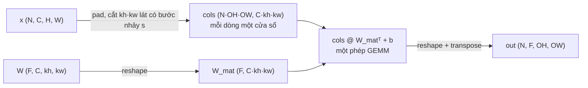
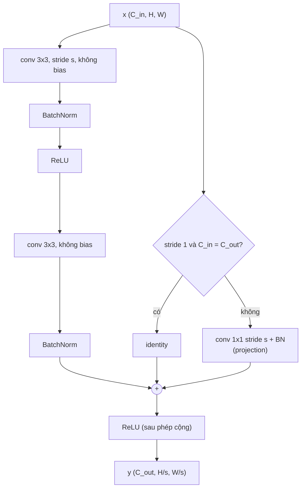
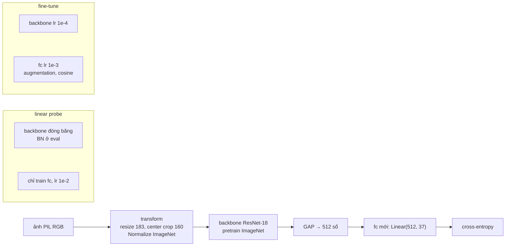
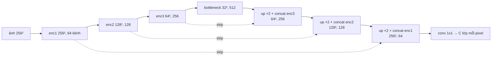
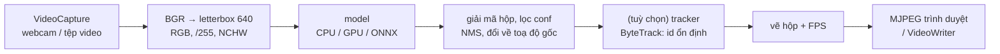

# Computer Vision

Module 13 track Data Science đã cho bạn một CNN chạy được trên FashionMNIST: công thức kích thước output,
weight sharing, và một thí nghiệm transfer learning nhỏ. Module này đi tiếp theo hai hướng. **Vào trong**:
tự viết conv2d bằng numpy (im2col, backward, pooling), hiểu vì sao ResNet train được 100 tầng, và dựng một
Vision Transformer từ patch embedding. **Ra ngoài**: dùng backbone pretrain cho bài toán thật, phát hiện và
khoanh vùng người đi bộ bằng YOLO, đo đúng cách bằng mAP và mIoU, rồi đóng gói thành một app chạy webcam.

Backprop và gradient check dùng lại từ [module 01](../01-nn-from-scratch/README.md); BatchNorm, residual ở mức
PyTorch, mixed precision và DataLoader ở [module 02](../02-pytorch-deep-dive/README.md); attention ở mức khái niệm
ở [module 13 track DS](../../../data-science/modules/13-deep-learning/README.md) (mục 5), chi tiết Transformer ở
[module 05](../05-transformers-llm-architecture/README.md). Ba bộ dữ liệu thật:

```bash
uv run python data/download_dataset.py cifar10       # 60 000 ảnh 32x32, 10 lớp (137 MB)
uv run python data/download_dataset.py oxford-pets   # 7 349 ảnh chó mèo, 37 giống (754 MB)
uv run python data/download_dataset.py penn-fudan    # 170 ảnh đường phố, 423 người có mask (53 MB)
```

Weights pretrain (ResNet-18 ImageNet 45 MB, YOLO11n 5.4 MB, YOLO11n-seg 5.9 MB) chỉ tải trong cell `explore`
và bài Advanced, vào `~/.cache/torch` và `~/.cache/ai-engineer/weights`. Mọi số liệu dưới đây là kết quả chạy
thật (numpy 2.5.4, torch 2.14.1, torchvision 0.29.1, ultralytics 8.4.178, opencv 5.0.0, kiểm ngày 2026-10-30),
trên laptop i7-11800H + RTX 3050 4GB; số thời gian CPU đo lúc máy đang chạy nhiều việc khác nên chỉ dùng để so
thứ bậc.

Sau module này bạn sẽ:

- Viết conv2d (forward, backward) và pooling bằng numpy, tính được tham số, FLOPs, bộ nhớ và receptive field
  của một kiến trúc trên giấy.
- Giải thích bước tiến LeNet → VGG → ResNet → ViT bằng các vấn đề mà mỗi bước giải quyết, và tự dựng ResNet,
  ViT bằng PyTorch.
- Thiết kế augmentation không làm sai nhãn, chọn giữa linear probe, fine-tune và train từ đầu có đối chứng.
- Tự viết IoU, NMS, AP, mAP, mIoU; dùng ultralytics YOLO để detect và segment, đọc đúng con số nó báo.
- Đưa model vào một vòng xử lý video thời gian thực với OpenCV, tránh các lỗi train/serve skew kinh điển.

| Mức | Bài | Nội dung |
| --- | --- | --- |
| Basic | 01 conv2d-im2col | im2col, col2im, conv2d forward/backward bằng numpy |
| Basic | 02 pooling-receptive-field | max/avg pooling có backward, kích thước output, receptive field |
| Basic | 03 iou-nms | đổi định dạng hộp, IoU vector hoá, NMS, batched NMS |
| Intermediate | 01 resnet-vit-cifar10 | LeNet-5, ResNet-20, ViT tự viết attention, train trên CIFAR-10 |
| Intermediate | 02 transfer-learning-pets | linear probe, fine-tune, từ đầu trên Oxford-IIIT Pet |
| Intermediate | 03 detection-segmentation-eval | AP, mAP@[.5:.95], mIoU tự viết; đo YOLO trên Penn-Fudan |
| Advanced | 01 pedestrian-detector-webcam | fine-tune YOLO trên Penn-Fudan + app webcam/video (portfolio) |
| Advanced | 02 debug-vision-pipeline | gỡ 4 bug im lặng trong pipeline ảnh: train/serve skew |

## 1. Convolution từ bên trong: im2col, backward, pooling, receptive field

### Phép tính

Một tầng conv có $$F$$ bộ lọc, mỗi bộ lọc là một khối $$C \times k_h \times k_w$$. Output tại kênh $$f$$, vị trí
$$(i, j)$$ là tích vô hướng của bộ lọc với cửa sổ ảnh tương ứng (deep learning gọi là convolution, toán học gọi
là cross-correlation vì kernel không bị lật):

$$
\text{out}[n, f, i, j] = b_f + \sum_{c=1}^{C}\sum_{u=0}^{k_h-1}\sum_{v=0}^{k_w-1} W[f, c, u, v]\; x[n, c,\, s\,i + u,\, s\,j + v]
$$

(với $$x$$ đã đệm $$p$$ pixel 0 mỗi phía, $$s$$ là stride). Ba con số cần tính được trên giấy cho mỗi tầng:

| Đại lượng | Công thức | Ví dụ: conv 3×3, 64 → 64 kênh, ảnh 56×56 (ResNet-18) |
| --- | --- | --- |
| Tham số | $$F(Ck_hk_w + 1)$$ | 36 928 |
| Phép nhân-cộng (MAC) | $$F \cdot Ck_hk_w \cdot OH \cdot OW$$ | 115.6 triệu |
| Activation lưu cho backward | $$N \cdot F \cdot OH \cdot OW$$ số | 200 704 số mỗi ảnh |

Tham số không phụ thuộc kích thước ảnh, còn tính toán và bộ nhớ tỉ lệ với số pixel: đó là lý do CNN rẻ về
tham số mà đắt về FLOPs, ngược với tầng Linear. Gấp đôi cạnh ảnh thì FLOPs và activation gấp bốn.

### im2col: biến conv thành một phép nhân ma trận

Vòng lặp trực tiếp có sáu tầng lồng nhau. Thư viện CPU (và cuDNN với thuật toán GEMM) làm cách khác: **trải mỗi
cửa sổ thành một dòng** của một ma trận `cols` shape `(N·OH·OW, C·kh·kw)`, rồi cả tầng conv là

$$
\text{out}_{mat} = \text{cols}\; W_{mat}^\top + b, \qquad W_{mat} = W.\text{reshape}(F, C k_h k_w)
$$



PyTorch có sẵn bước trải: `F.unfold` trả đúng `cols` (chuyển vị, theo từng ảnh). Đoạn sau kiểm rằng conv chỉ là
`unfold` + một phép nhân ma trận; bài Basic 01 bắt bạn tự viết `unfold` và cả chiều ngược lại bằng numpy:

```python
import torch
import torch.nn.functional as F

torch.manual_seed(0)
x = torch.randn(64, 16, 32, 32)          # 64 ảnh, 16 kênh
W = torch.randn(32, 16, 3, 3)            # 32 bộ lọc 3x3
cols = F.unfold(x, kernel_size=3, padding=1)            # (64, 16*9, 32*32): mỗi CỘT là một cửa sổ
out = (W.reshape(32, -1) @ cols).reshape(64, 32, 32, 32)
print("cols:", tuple(cols.shape), "| sai lệch so với conv2d:", (out - F.conv2d(x, W, padding=1)).abs().max().item())
print(f"input {x.numel() * 4 / 1e6:.1f} MB, cols {cols.numel() * 4 / 1e6:.1f} MB")
```

Kết quả: sai lệch cỡ `3e-5` (sai số float32 của hai thứ tự cộng khác nhau); `cols` nặng **37.7 MB** trong khi
input chỉ **4.2 MB**: mỗi pixel bị chép vào 9 cửa sổ. Đó là cái giá của im2col, và là lý do cuDNN có thêm
"implicit GEMM" (không dựng `cols` thật), Winograd (giảm phép nhân cho kernel 3×3) và FFT (kernel lớn), rồi
`torch.backends.cudnn.benchmark = True` thử từng thuật toán để chọn cái nhanh nhất cho shape của bạn. Đổi lại,
im2col biến conv thành GEMM, phép toán được tối ưu kỹ nhất trên mọi phần cứng: trên cùng tầng conv đó (64
ảnh), bốn vòng lặp Python qua từng `(n, f, oh, ow)` mất khoảng **31 giây**, bản numpy im2col **45 ms**, nhanh
hơn khoảng 700 lần.

### Backward

Vì forward là một layer Linear áp lên `cols`, backward là công thức Linear của module 01, cộng thêm một bước
gom về ảnh. Đặt $$D$$ là $$\partial L/\partial\,\text{out}$$ sắp thành `(N·OH·OW, F)`:

$$
\frac{\partial L}{\partial W_{mat}} = D^\top \text{cols}, \qquad
\frac{\partial L}{\partial b} = \sum_{\text{hàng}} D, \qquad
\frac{\partial L}{\partial\,\text{cols}} = D\, W_{mat}, \qquad
\frac{\partial L}{\partial x} = \mathrm{col2im}\!\left(\frac{\partial L}{\partial\,\text{cols}}\right)
$$

`col2im` rải mỗi dòng về cửa sổ của nó và **cộng** những gì rơi vào cùng một pixel: một pixel nằm trong 9 cửa sổ
thì gradient của nó là tổng 9 đóng góp (chain rule cộng theo mọi đường đi). Nó không phải nghịch đảo của
im2col mà là **chuyển vị** (adjoint): $$\langle \mathrm{im2col}(x), c\rangle = \langle x, \mathrm{col2im}(c)\rangle$$, đúng
tính chất bài Basic 01 kiểm. Một hệ quả đáng nhớ: gradient theo input của conv chính là một **transposed
convolution** (conv "ngược", ra ảnh to hơn) với cùng trọng số. Mục 6 dùng chính phép này làm tầng upsample của
mạng segmentation.

### Pooling và global average pooling

- **Max pooling** $$k \times k$$ stride $$s$$: lấy max mỗi cửa sổ; backward đưa gradient về **đúng vị trí max**, các
  vị trí khác nhận 0, cửa sổ chồng nhau thì cộng dồn. Không có tham số.
- **Average pooling**: backward rải đều $$1/k^2$$ gradient về cả cửa sổ.
- **Global average pooling (GAP)**: trung bình cả feature map thành một số mỗi kênh. Module 13 track DS đã thấy
  95% tham số của CNN nằm ở tầng Linear sau `Flatten`; GAP thay tầng đó: ResNet-18 có 512 kênh cuối nên head chỉ
  là `Linear(512, C)`, và model nhận được ảnh cỡ bất kỳ.

Xu hướng hiện đại thay max pooling bằng **conv stride 2** (học được cách giảm mẫu); ResNet chỉ còn một max pool ở
gốc, ConvNeXt và ViT không dùng pooling trong thân.

### Receptive field

Receptive field của một neuron là vùng input có thể ảnh hưởng tới nó. Đi từ input lên, với $$r_0 = 1$$, $$j_0 = 1$$:

$$
r_l = r_{l-1} + d_l\,(k_l - 1)\, j_{l-1}, \qquad j_l = j_{l-1}\, s_l
$$

$$j_l$$ là khoảng cách giữa hai neuron kề nhau ở tầng $$l$$, tính bằng pixel input; $$d_l$$ là dilation. Vài con số
(bài Basic 02 tính và kiểm bằng gradient):

| Chồng tầng | Receptive field | Ghi chú |
| --- | --- | --- |
| 3 conv 3×3 stride 1 | 7 | như một conv 7×7 nhưng $$27C^2$$ thay vì $$49C^2$$ tham số, thêm 2 phi tuyến |
| Gốc ResNet: conv 7×7/2 + maxpool 3×3/2 | 11, jump 4 | sau hai tầng, mỗi bước đã là 4 pixel |
| VGG-16 tới pool5 | 212, jump 32 | gần cả ảnh 224 |
| conv 3×3 dilation 1, 2, 4 | 15 | nở nhanh mà không giảm độ phân giải (DeepLab, WaveNet) |

Đây là receptive field **lý thuyết**. Vùng thật sự ảnh hưởng (effective receptive field) tập trung ở giữa, gần
dạng Gauss, nhỏ hơn nhiều (Luo et al. 2016). Hệ quả thiết kế: vật thể to hơn receptive field thì model chỉ thấy
từng mảnh, nên detector dùng nhiều tầng feature (FPN) cho vật to nhỏ khác nhau.

### Quyết định thực tế

- Kernel 3×3 là mặc định; kernel 1×1 để đổi số kênh rẻ (bottleneck); 7×7 chỉ ở gốc hoặc dạng depthwise
  (ConvNeXt).
- **Depthwise separable** (MobileNet): một conv $$k \times k$$ riêng từng kênh rồi conv 1×1 trộn kênh, tốn
  $$Ck^2 + CF$$ thay vì $$CFk^2$$ tham số (nhỏ hơn khoảng $$k^2$$ lần khi $$F$$ lớn). Rẻ FLOPs nhưng không chắc nhanh
  hơn trên GPU vì ít tính toán trên mỗi byte đọc.
- Conv ngay trước BatchNorm để `bias=False`: BN trừ mean nên bias bị triệt tiêu, chỉ tốn tham số.
- Lỗi hay gặp: nhầm NCHW với NHWC (OpenCV, PIL, numpy ảnh là HWC; PyTorch là CHW) và đổi bằng `reshape` thay vì
  `permute` (shape đúng, nội dung bị xáo, model vẫn "học" nhưng tệ đi mà không báo lỗi); quên rằng FLOPs tăng
  theo bình phương cạnh ảnh khi tăng `imgsz`.

## 2. Kiến trúc CNN: LeNet tới ResNet

### Mỗi thế hệ giải quyết một vấn đề

| Năm | Model | Tham số | Ý tưởng chính | Vấn đề nó giải quyết |
| --- | --- | --- | --- | --- |
| 1998 | LeNet-5 | 60 nghìn | conv + pooling + FC, train bằng backprop | đọc chữ số trên séc, không cần feature tay |
| 2012 | AlexNet | 60 triệu | ReLU, dropout, augmentation, train trên 2 GPU | ImageNet: lỗi top-5 từ 26% xuống 15.3% |
| 2014 | VGG-16 | 138 triệu | chỉ conv 3×3 chồng sâu, chia đôi ảnh thì gấp đôi kênh | thiết kế đơn giản, đều đặn; sâu hơn thì tốt hơn (tới 19 tầng) |
| 2014 | GoogLeNet | 6.8 triệu | khối Inception nhiều nhánh, conv 1×1 giảm kênh | chính xác như VGG với ít tham số hơn 20 lần |
| 2015 | ResNet | 11.7 triệu (18) tới 60 triệu (152) | residual connection + BatchNorm | train được 152 tầng; hết "degradation" |
| 2017–19 | MobileNet, EfficientNet | 3–66 triệu | depthwise separable; co giãn đều sâu/rộng/độ phân giải | chạy trên điện thoại; tối ưu accuracy theo FLOPs |
| 2022 | ConvNeXt | 28 triệu trở lên | CNN "hiện đại hoá" theo ViT: kernel 7×7 depthwise, LayerNorm, GELU | CNN thuần ngang ViT cùng ngân sách |

Bài Intermediate 01 dựng LeNet-5 (bản ReLU + max pool cho ảnh màu 32×32: **62 006** tham số), ResNet cho CIFAR và
một ViT nhỏ, rồi train cùng một vòng train.

### Degradation và residual connection

Trước ResNet, người ta thấy một điều lạ: mạng "plain" 56 tầng có lỗi **train** cao hơn mạng 20 tầng, dù về lý
thuyết mạng sâu chỉ cần chép 20 tầng kia và cho 36 tầng còn lại làm hàm đồng nhất. Không phải overfit (lỗi train
cũng cao), mà là **tối ưu khó**: chồng nhiều tầng phi tuyến khó học nổi cả hàm đồng nhất. He et al. (2015) đổi
câu hỏi: thay vì học $$H(x)$$, mỗi khối học phần dư $$F(x) = H(x) - x$$:

$$
y = \mathrm{ReLU}\big(F(x) + x\big), \qquad \frac{\partial L}{\partial x} = \frac{\partial L}{\partial y}\,\frac{\partial y}{\partial x} = \frac{\partial L}{\partial y}\left(\frac{\partial F}{\partial x} + I\right) \text{ (trong vùng ReLU mở)}
$$

Muốn khối thành đồng nhất chỉ cần $$F = 0$$ (đẩy trọng số về 0, việc dễ), và gradient luôn có một đường đi thẳng
qua số hạng $$I$$ không bị nhân dồn qua các tầng: đó là lý do ResNet 1 000 tầng vẫn train được.



ResNet cho CIFAR (mục 4.2 bài báo) có $$6n + 2$$ tầng: một conv gốc, ba stage mỗi stage $$n$$ khối hai conv với 16,
32, 64 kênh, GAP và một Linear. ResNet-20 ($$n = 3$$) có **272 474** tham số với shortcut projection, ResNet-56 có
**855 770**: ít hơn LeNet-5 bốn lần về tham số ở tầng Linear, nhưng tính toán nhiều hơn khoảng 6 lần vì mọi tầng
đều chạy trên ảnh 32×32 hoặc 16×16.

Chi tiết làm nên khác biệt:

- **BatchNorm sau mỗi conv** giữ phân phối activation ổn định (module 01 mục 7, module 02); conv trước BN không
  cần bias.
- **ReLU sau phép cộng**, không đặt trong nhánh tắt. Bản "pre-activation" (He et al. 2016b, BN → ReLU → conv) để
  đường tắt sạch hoàn toàn, tốt hơn khi rất sâu.
- **Zero-init γ của BN cuối mỗi khối**: lúc khởi tạo mọi khối là đồng nhất, mạng sâu bắt đầu như mạng nông. Một
  dòng code, thêm vài phần mười điểm trên ImageNet (Goyal et al. 2017).
- **Bottleneck** (ResNet-50 trở lên): 1×1 giảm kênh 4 lần → 3×3 → 1×1 tăng lại, để khối sâu mà rẻ.

### Đo trên CIFAR-10

«BẢNG_CIFAR»

### Chọn backbone năm 2026

- Bài toán phân loại/feature chung: bắt đầu từ ResNet-50 hoặc ConvNeXt-T pretrain (thư viện `timm` có hàng trăm
  weights), so với một ViT pretrain tốt (DINOv2, CLIP) nếu có GPU.
- Chạy trên thiết bị yếu: MobileNetV3, EfficientNet-B0, hoặc backbone của YOLO bản `n`; đo latency trên đúng
  phần cứng đích, không tin FLOPs.
- Đừng tự thiết kế kiến trúc mới cho bài toán sản phẩm: dữ liệu, augmentation và cách đánh giá quyết định nhiều
  hơn vài tầng.

## 3. Vision Transformer

### Ảnh thành chuỗi patch

ViT (Dosovitskiy et al. 2020) dùng nguyên Transformer encoder của NLP, chỉ thay "từ" bằng **patch**:

1. Cắt ảnh $$H \times W$$ thành $$N = HW/P^2$$ patch $$P \times P$$ không chồng nhau, chiếu mỗi patch (vector
   $$3P^2$$ số) thành vector $$D$$ chiều bằng **một phép tuyến tính dùng chung**. Phép đó chính là một conv
   kernel $$P$$ stride $$P$$ (mục 1): patch embedding là conv không chồng cửa sổ.
2. Ghép một **CLS token** học được vào đầu chuỗi (vector của nó ở tầng cuối dùng để phân loại), cộng
   **position embedding** học được (attention không biết thứ tự, mục dưới).
3. $$L$$ khối pre-norm: $$x \leftarrow x + \mathrm{MHSA}(\mathrm{LN}(x))$$, $$x \leftarrow x + \mathrm{MLP}(\mathrm{LN}(x))$$.

Multi-head self-attention, với mỗi head $$h$$ chiều $$d_h = D/H$$:

$$
\mathrm{head}_h = \mathrm{softmax}\!\left(\frac{Q_hK_h^\top}{\sqrt{d_h}}\right)V_h,\qquad Q_h = XW^Q_h,\; K_h = XW^K_h,\; V_h = XW^V_h
$$

Chia $$\sqrt{d_h}$$ để tích vô hướng không lớn theo số chiều (softmax bão hoà, gradient về 0). Module 05 mổ xẻ
từng mảnh của khối này (causal mask, RoPE, KV cache); ở đây cần nắm hai tính chất. Thứ nhất, attention
**hoán vị đồng biến**: đảo thứ tự patch thì output đảo theo, không đổi gì khác, nên không có position embedding
ViT chỉ là một "túi patch". Thứ hai, chi phí $$O(N^2D)$$ theo số patch:

| Ảnh, patch | Số token $$N$$ | Ma trận attention mỗi head |
| --- | --- | --- |
| 32×32, patch 4 (bài Intermediate 01) | 64 | 64 × 64 |
| 224×224, patch 16 (ViT-B/16) | 196 | 196 × 196 |
| 224×224, patch 8 | 784 | 784 × 784 (gấp 16 lần) |
| 1024×1024, patch 16 (ảnh vệ tinh, y tế) | 4 096 | 16.8 triệu phần tử |

Vì vậy ảnh độ phân giải cao dùng biến thể có attention cục bộ (Swin: attention trong cửa sổ, dịch cửa sổ giữa
các tầng) hoặc FlashAttention (module 05).

### Inductive bias và cơn khát dữ liệu

CNN mang sẵn hai giả định về ảnh: **cục bộ** (pixel gần nhau liên quan) và **dịch chuyển đồng biến** (con mèo ở
góc nào cũng là mèo). ViT gần như không có: ngoài việc cắt patch, mọi quan hệ không gian phải học từ dữ liệu.
Hệ quả, đo ở bài báo gốc: train trên ImageNet-1k (1.3 triệu ảnh), ViT-B **thua** ResNet cùng cỡ; pretrain trên
JFT-300M (300 triệu ảnh) thì vượt. DeiT (Touvron et al. 2021) thu hẹp khoảng cách bằng augmentation mạnh,
regularization và distillation từ một CNN thầy. Số đo ở mục 2 cho cùng xu hướng ở quy mô nhỏ: «CÂU_VIT».

### Quyết định thực tế

- Train từ đầu trên dữ liệu nhỏ (dưới vài trăm nghìn ảnh): CNN. Có backbone ViT pretrain tốt (DINOv2, CLIP,
  SigLIP): ViT thường thắng khi fine-tune, và là encoder ảnh của gần như mọi vision LLM (module 18).
- Patch nhỏ thì chính xác hơn nhưng số token và chi phí tăng theo bình phương; đổi độ phân giải lúc fine-tune thì
  phải **nội suy position embedding** (timm làm sẵn).
- Lỗi hay gặp: quên position embedding (model vẫn học, chỉ kém đi); dùng post-norm cho mạng sâu mà không warmup
  (dễ phân kỳ); dùng `nn.MultiheadAttention` với `batch_first=False` mặc định và đưa vào `(B, N, D)` (chạy được,
  trộn sai trục).

## 4. Data augmentation và transfer learning

### Augmentation: dạy model những bất biến bạn biết trước

Augmentation sinh biến thể của ảnh train mà **nhãn không đổi**. Mỗi phép là một khẳng định về bài toán: lật ngang
là "mèo quay trái hay phải vẫn là mèo"; nếu khẳng định sai (lật chữ "b" thành "d", lật ảnh X-quang làm tim sang
phải) thì augmentation dạy sai.

| Nhóm | Phép | Dùng khi | Cẩn thận |
| --- | --- | --- | --- |
| Hình học | random crop, resized crop, lật ngang, xoay nhỏ, affine | gần như mọi bài | detection/segmentation phải biến đổi **cả hộp và mask** cùng ảnh |
| Màu | độ sáng, tương phản, bão hoà, hue | ánh sáng thay đổi | khi màu là tín hiệu (biển báo, chín/xanh) thì nhẹ tay |
| Xoá vùng | Cutout, Random Erasing | che khuất | vùng xoá không được che mất toàn bộ vật |
| Trộn ảnh | Mixup (trộn tuyến tính hai ảnh và nhãn), CutMix (dán mảnh) | model lớn, nhiều epoch | nhãn thành "mềm", cần loss nhận phân phối |
| Tự động | RandAugment, TrivialAugment | không muốn tune tay | vẫn phải kiểm từng phép có giữ nhãn không |
| Detection | Mosaic (ghép 4 ảnh), copy-paste | YOLO mặc định | tắt mosaic ở vài epoch cuối (`close_mosaic`) cho khớp phân phối ảnh thật |

Augmentation chỉ áp lúc **train**. Lúc eval, transform phải tất định (resize, center crop, normalize). Augment
trên tập val làm con số dao động; quên augment ở train thì model học thuộc nhanh. Số đo trên ResNet-20 ở mục 2:
«CÂU_AUG».

### Transfer learning: ba chiến lược

Module 13 track DS đã có sơ đồ chọn chiến lược và một thí nghiệm có đối chứng trên FashionMNIST, nơi linear probe
**thua** train từ đầu vì nguồn quá hẹp. Với ảnh tự nhiên và backbone ImageNet, bức tranh đảo ngược. Bài
Intermediate 02 đo trên Oxford-IIIT Pet (37 giống chó mèo, khoảng 100 ảnh train mỗi giống), ResNet-18, ảnh 160×160:

«BẢNG_PETS»



Những điều cần làm đúng:

- **Normalize đúng thống kê** mà weights đã thấy (ImageNet: mean `(0.485, 0.456, 0.406)`, std `(0.229, 0.224,
  0.225)`), và **cùng cách resize/crop**. torchvision ghi sẵn trong `weights.transforms()`; đọc nó thay vì đoán.
- **Đóng băng cả BatchNorm**: `requires_grad = False` không ngăn BN ở chế độ train cập nhật running mean/var
  theo dữ liệu mới. Khi chỉ train head, đưa các tầng BN về `eval()` sau mỗi lần gọi `model.train()`.
- **Learning rate theo nhóm** (discriminative lr): head mới khởi tạo ngẫu nhiên cần lr lớn, backbone đã tốt chỉ cần
  lr nhỏ (thường 10 lần nhỏ hơn); lr lớn cho backbone xoá mất đặc trưng pretrain trong vài trăm bước. Không weight
  decay cho bias và tham số BN.
- **Linear probe trước**: nó rẻ (trích feature một lần, train một tầng Linear trong vài giây), cho một baseline
  mạnh và cho biết backbone có hợp miền dữ liệu không. Fine-tune toàn bộ chỉ đáng khi probe còn cách mục tiêu xa
  và bạn có GPU.

## 5. Object detection: IoU, NMS, anchor, YOLO, mAP

### Bài toán và định dạng hộp

Detection trả về một danh sách $$(\text{hộp}, \text{lớp}, \text{score})$$ có độ dài thay đổi theo ảnh. Ba định dạng
hộp hay gặp, nhầm một cái là toàn bộ đánh giá sai:

| Định dạng | Cột | Dùng ở |
| --- | --- | --- |
| xyxy | $$x_1, y_1, x_2, y_2$$ pixel | torchvision, Pascal VOC, output của YOLO (`boxes.xyxy`) |
| xywh | $$x_1, y_1, w, h$$ pixel | COCO JSON |
| cxcywh chuẩn hoá | $$c_x/W, c_y/H, w/W, h/H$$ trong $$[0, 1]$$ | tệp nhãn YOLO |

Thêm một bẫy: **toạ độ pixel rời rạc hay liên tục**. Annotation của Penn-Fudan ghi $$(X_{min}, Y_{min}) -
(X_{max}, Y_{max})$$ đếm từ 1 và bao gồm pixel cuối; đổi sang hệ liên tục (pixel $$c$$ chiếm đoạn $$[c, c+1)$$) là
trừ 1 ở góc trên trái và giữ nguyên góc dưới phải. Bài Intermediate 03 kiểm: 407/423 hộp trong tệp annotation trùng
khít hộp suy từ mask theo quy ước này; 16 hộp còn lại lệch vì người gán nhãn vẽ hộp tay khác mask.

### IoU và NMS

$$
\mathrm{IoU}(A, B) = \frac{|A \cap B|}{|A \cup B|}
$$

IoU là thước đo khớp hộp dùng ở mọi nơi: ghép prediction với nhãn khi đánh giá, gán nhãn cho anchor khi train,
và NMS. Làm loss thì IoU có điểm yếu (bằng 0 và hết gradient khi hai hộp không giao), nên YOLO dùng biến thể
**CIoU** (thêm khoảng cách tâm và tỉ lệ khung), DETR dùng **GIoU**.

Một detector dày đặc như YOLO dự đoán ở **mỗi ô của feature map** (ảnh 640 cho 8 400 ô ở ba tỉ lệ), nên một người
nhận hàng chục hộp gần trùng nhau. **Non-Maximum Suppression** giữ hộp score cao nhất, loại mọi hộp cùng lớp có IoU
với nó vượt ngưỡng, lặp lại với phần còn lại (bài Basic 03). Ngưỡng là đánh đổi: thấp thì hai người đứng sát nhau
bị gộp làm một (mất recall trong đám đông), cao thì còn hộp trùng (mất precision). Số đo trên Penn-Fudan:
«BẢNG_NMS»

### Các họ detector

```mermaid
flowchart TB
    subgraph TS ["Two-stage: Faster/Mask R-CNN"]
        direction LR
        A1[backbone + FPN] --> A2["RPN đề xuất ~1000 vùng<br/>từ anchor"] --> A3["RoIAlign cắt feature<br/>từng vùng"] --> A4["head: lớp + chỉnh hộp<br/>(+ mask)"] --> A5[NMS]
    end
    subgraph OS ["One-stage: YOLOv8/11, RetinaNet, FCOS"]
        direction LR
        B1[backbone + neck FPN/PAN] --> B2["head dày đặc: mỗi ô 3 tỉ lệ<br/>dự đoán hộp + lớp"] --> B3[NMS]
    end
    subgraph E2E ["End-to-end: DETR, YOLOv10, YOLO26"]
        direction LR
        C1[backbone] --> C2["gán nhãn một-một<br/>(Hungarian) khi train"] --> C3["mỗi vật đúng một hộp<br/>không cần NMS"]
    end
```



- **Two-stage** chính xác, chậm hơn; Mask R-CNN thêm nhánh mask (mục 6).
- **Anchor-based** (Faster R-CNN, YOLOv3–v5, RetinaNet): mỗi ô có vài hộp mẫu cỡ cố định, model dự đoán độ lệch so
  với anchor. Phải chọn cỡ anchor theo dữ liệu (k-means trên hộp nhãn), sai cỡ là mất vật nhỏ.
- **Anchor-free** (FCOS, YOLOv8, YOLO11): mỗi ô dự đoán thẳng khoảng cách tới bốn cạnh. Ít siêu tham số; YOLOv8/11
  dự đoán mỗi khoảng cách như một phân phối (Distribution Focal Loss) và gán nhãn theo chất lượng dự đoán (Task
  Aligned Assigner).
- **NMS-free**: gán mỗi vật đúng một prediction lúc train, nên lúc chạy không cần NMS và latency ổn định hơn trong
  đám đông. DETR mở đường; YOLOv10 và YOLO26 (ultralytics 8.4) đưa vào họ YOLO.
- **Focal loss** (RetinaNet): với hàng chục nghìn ô mà chỉ vài ô có vật, loss bị nền dễ áp đảo; focal loss giảm
  trọng số mẫu đã đoán đúng tự tin.

### mAP: đọc đúng con số

Gộp prediction của cả tập, sắp theo score giảm dần, ghép với nhãn theo IoU $$\ge t$$ (mỗi nhãn chỉ ghép một lần,
prediction thừa là false positive). Sau $$k$$ prediction đầu:

$$
\text{precision}_k = \frac{TP_k}{k}, \qquad \text{recall}_k = \frac{TP_k}{N_{gt}}, \qquad
\mathrm{AP}_t = \sum_k (r_k - r_{k-1})\, \max_{k' \ge k} p_{k'}
$$

(all-point interpolation, Pascal VOC từ 2010; COCO lấy mẫu 101 mức recall, chênh vài phần nghìn). **AP50** dùng
$$t = 0.5$$, đo "tìm thấy vật không"; **AP@[.5:.95]** (COCO, ultralytics gọi `mAP50-95`) trung bình 10 ngưỡng 0.50
tới 0.95, thưởng cho hộp **khít**. mAP là trung bình AP qua các lớp. Ba điều hay đọc sai:

- AP được tính trên **toàn bộ** danh sách prediction, nên phải chạy với confidence rất thấp (0.001). Ngưỡng 0.25
  là ngưỡng **hiển thị** cho app, dùng nó để đo AP là cắt mất đuôi đường PR.
- Nhãn thiếu biến dự đoán đúng thành false positive: Penn-Fudan không gán nhãn người bị che nhiều hoặc ở xa.
- AP50 cao mà AP thấp nghĩa là model tìm được vật nhưng vẽ hộp lệch (hoặc quy ước hộp của nhãn khác của model).

YOLO11n pretrain trên COCO, chưa thấy Penn-Fudan, đo bằng bộ đánh giá tự viết ở bài Intermediate 03 trên cả 170 ảnh:

«BẢNG_YOLO_ZS»

### Fine-tune YOLO bằng ultralytics

Dữ liệu theo định dạng YOLO (mỗi ảnh một tệp `.txt`, mỗi dòng `lớp cx cy w h` chuẩn hoá) cộng một `data.yaml`, rồi:

```bash
uv run yolo detect train data=data.yaml model=yolo11n.pt epochs=30 imgsz=512 batch=8 project=~/.cache/ai-engineer/runs
```

Bài Advanced 01 làm đúng việc này trên Penn-Fudan (136 ảnh train, 34 ảnh val):

«BẢNG_YOLO_FT»

## 6. Segmentation: semantic, instance, U-Net, Mask R-CNN, mIoU

### Ba bài toán

| Bài toán | Output | Phân biệt hai người cạnh nhau? | Model tiêu biểu | Thước đo |
| --- | --- | --- | --- | --- |
| Semantic | một lớp cho mỗi pixel | không | FCN, U-Net, DeepLab, SegFormer | mIoU |
| Instance | một mask cho mỗi vật đếm được | có | Mask R-CNN, YOLO-seg, SAM (theo prompt) | mask AP |
| Panoptic | mỗi pixel: lớp + id vật (vật đếm được) hoặc chỉ lớp (trời, đường) | có | Mask2Former | PQ |

### Encoder-decoder và U-Net

Mạng phân loại thu nhỏ ảnh 32 lần để có ngữ nghĩa; segmentation cần trả lại độ phân giải đầy đủ. **FCN** (Long et
al. 2015) thay tầng FC bằng conv 1×1 và upsample bản đồ điểm số. **U-Net** (Ronneberger et al. 2015) thêm nhánh
giải mã đối xứng và **skip connection** nối feature cùng độ phân giải từ nhánh mã hoá sang: nhánh sâu biết "đây
là người", nhánh nông biết "viền ở đúng pixel này".



Upsample bằng **transposed convolution** (chính là backward của conv theo input, mục 1) học được nhưng dễ sinh
vân ô bàn cờ khi kernel không chia hết cho stride; cách an toàn là nội suy bilinear rồi conv 3×3. **DeepLab** giữ
độ phân giải bằng dilated conv và gom ngữ cảnh nhiều tỉ lệ (ASPP).

### Instance: Mask R-CNN và YOLO-seg

**Mask R-CNN** (He et al. 2017) = Faster R-CNN + một nhánh conv nhỏ dự đoán mask 28×28 cho mỗi vùng đề xuất.
Mảnh quan trọng là **RoIAlign**: cắt feature của từng vùng bằng nội suy bilinear thay vì làm tròn toạ độ
(RoIPool), vì lệch nửa ô feature (16 pixel ảnh) là hỏng mask. **YOLO-seg** (theo YOLACT) dự đoán một bộ "mask mẫu"
(prototype) cho cả ảnh và mỗi hộp một vector hệ số; mask của vật là tổ hợp tuyến tính các mask mẫu, cắt theo hộp.
Rẻ hơn Mask R-CNN nhiều, đủ tốt cho thời gian thực. **SAM** (Segment Anything) tách hẳn: segment theo prompt (điểm,
hộp), không biết lớp; hay dùng để **gán nhãn nhanh** rồi train model nhỏ.

### Thước đo và loss

$$
\mathrm{IoU}_c = \frac{TP_c}{TP_c + FP_c + FN_c}, \qquad \mathrm{mIoU} = \frac{1}{C}\sum_c \mathrm{IoU}_c, \qquad
\mathrm{Dice}_c = \frac{2\,TP_c}{2\,TP_c + FP_c + FN_c}
$$

TP, FP, FN đếm pixel và **cộng trên cả tập** trước khi chia (trung bình theo ảnh cho số khác, thiên vị ảnh ít
pixel). Pixel accuracy gần như vô nghĩa khi nền áp đảo. Loss hay dùng: cross-entropy theo pixel cộng **Dice loss**
(tối ưu thẳng độ chồng, ít bị lớp hiếm chìm). YOLO11n-seg pretrain COCO, chưa thấy Penn-Fudan, gộp mask mọi người
thành mask "người" (bài Intermediate 03):

«BẢNG_SEG»

## 7. Từ model tới sản phẩm: OpenCV, thời gian thực, train/serve skew

### OpenCV trong 6 dòng cần nhớ

| Việc | OpenCV | Bẫy |
| --- | --- | --- |
| Đọc ảnh | `cv2.imread(path)` | trả **BGR** uint8 HWC; tệp không tồn tại thì trả `None`, không báo lỗi |
| Đổi màu | `cv2.cvtColor(img, cv2.COLOR_BGR2RGB)` | model PyTorch/PIL train trên RGB |
| Resize | `cv2.resize(img, (W, H), interpolation=cv2.INTER_AREA)` | tham số là `(rộng, cao)`, ngược với `shape` `(cao, rộng)` |
| Camera/video | `cap = cv2.VideoCapture(0 hoặc "x.mp4")`, `ok, frame = cap.read()` | `ok == False` khi hết video hoặc camera bận |
| Ghi video | `cv2.VideoWriter(path, cv2.VideoWriter_fourcc(*"mp4v"), fps, (W, H))` | sai `(W, H)` thì ra tệp rỗng, không lỗi |
| Vẽ | `cv2.rectangle`, `cv2.putText` | toạ độ phải là `int` |

Bản `opencv-python-headless` (của env này, chạy được trên server) **không có** `cv2.imshow`. App ở bài Advanced 01
phát hình qua trình duyệt (MJPEG trên HTTP) và ghi ra tệp video, nên chạy được cả trên máy không màn hình và với
người không có webcam (đưa vào một tệp video).

### Vòng xử lý thời gian thực



Ngân sách thời gian: 30 FPS là 33 ms cho **cả** vòng. Đo trên laptop này với YOLO11n:

«BẢNG_LATENCY»

Khi không đủ nhanh, theo thứ tự rẻ nhất: giảm `imgsz` (FLOPs tỉ lệ bình phương), chạy GPU, export **ONNX** hoặc
**OpenVINO**/TensorRT (`model.export(format="onnx")`), lượng tử hoá INT8 (module 10), đọc camera ở một luồng riêng để
không chờ I/O, bỏ bớt khung (detect mỗi 2 khung, tracker nội suy ở giữa).

### Train/serve skew: model đúng, pipeline sai

Lỗi nguy hiểm nhất của CV trong sản phẩm không làm chương trình dừng, chỉ làm accuracy tụt âm thầm. Bài Advanced 02
cho bạn gỡ bốn lỗi như vậy trên CIFAR-10:

- **Thứ tự kênh**: train bằng PIL (RGB), phục vụ bằng `cv2.imread` (BGR). Lớp phụ thuộc màu (bầu trời xanh ↔ cam)
  hỏng trước.
- **Bố cục bộ nhớ**: `reshape(N, 3, H, W)` thay vì `permute(0, 3, 1, 2)` khi đổi HWC sang CHW.
- **Chuẩn hoá và resize khác nhau** giữa train và serve (mean/std khác, `INTER_LINEAR` so với antialias của PIL,
  thiếu letterbox), ảnh JPEG nén lại từ camera, xoay EXIF của ảnh điện thoại.
- **Chế độ train/eval**: quên `model.eval()` thì BatchNorm dùng thống kê của batch đang chạy; dự đoán một ảnh phụ
  thuộc ảnh khác trong batch, và batch 1 cho kết quả rác.

Cách phòng: một hàm `preprocess` duy nhất dùng cho cả train, eval và serve; test "ảnh đọc từ tệp qua pipeline
serving cho cùng logits với ảnh trong bộ test"; log phân phối input (mean từng kênh) ở production và so với lúc
train.

## 8. Tài liệu tham khảo

Sách và khoá học:

- Stanford [CS231n: Deep Learning for Computer Vision](https://cs231n.github.io/), bài
  [Convolutional Networks](https://cs231n.github.io/convolutional-networks/) (im2col, receptive field).
- Aston Zhang và cộng sự. [Dive into Deep Learning](https://d2l.ai/), chương
  [Convolutional Neural Networks](https://d2l.ai/chapter_convolutional-neural-networks/index.html),
  [Modern CNNs](https://d2l.ai/chapter_convolutional-modern/index.html) và
  [Computer Vision](https://d2l.ai/chapter_computer-vision/index.html).
- Simon J. D. Prince. [Understanding Deep Learning](https://udlbook.github.io/udlbook/) (2023), chương 10–12.

Paper:

- LeCun et al. [Gradient-Based Learning Applied to Document Recognition](https://ieeexplore.ieee.org/document/726791) (1998), LeNet-5.
- Krizhevsky, Sutskever, Hinton. [ImageNet Classification with Deep CNNs](https://papers.nips.cc/paper_files/paper/2012/hash/c399862d3b9d6b76c8436e924a68c45b-Abstract.html) (2012), AlexNet.
- Simonyan & Zisserman. [Very Deep Convolutional Networks](https://arxiv.org/abs/1409.1556) (2014), VGG.
- He et al. [Deep Residual Learning for Image Recognition](https://arxiv.org/abs/1512.03385) (2015) và
  [Identity Mappings in Deep Residual Networks](https://arxiv.org/abs/1603.05027) (2016).
- Goyal et al. [Accurate, Large Minibatch SGD](https://arxiv.org/abs/1706.02677) (2017), zero-init γ.
- Luo et al. [Understanding the Effective Receptive Field](https://arxiv.org/abs/1701.04128) (2016).
- Howard et al. [MobileNets](https://arxiv.org/abs/1704.04861) (2017); Tan & Le [EfficientNet](https://arxiv.org/abs/1905.11946) (2019);
  Liu et al. [A ConvNet for the 2020s](https://arxiv.org/abs/2201.03545) (2022).
- Dosovitskiy et al. [An Image is Worth 16x16 Words](https://arxiv.org/abs/2010.11929) (2020), ViT; Touvron et al.
  [DeiT](https://arxiv.org/abs/2012.12877) (2021); Liu et al. [Swin Transformer](https://arxiv.org/abs/2103.14030) (2021).
- Zhang et al. [mixup](https://arxiv.org/abs/1710.09412) (2017); Yun et al. [CutMix](https://arxiv.org/abs/1905.04899) (2019);
  Cubuk et al. [RandAugment](https://arxiv.org/abs/1909.13719) (2019).
- Ren et al. [Faster R-CNN](https://arxiv.org/abs/1506.01497) (2015); Redmon et al. [YOLO](https://arxiv.org/abs/1506.02640) (2015);
  Lin et al. [Focal Loss / RetinaNet](https://arxiv.org/abs/1708.02002) (2017); Tian et al. [FCOS](https://arxiv.org/abs/1904.01355) (2019);
  Carion et al. [DETR](https://arxiv.org/abs/2005.12872) (2020); Wang et al. [YOLOv10](https://arxiv.org/abs/2405.14458) (2024).
- Long et al. [Fully Convolutional Networks](https://arxiv.org/abs/1411.4038) (2015); Ronneberger et al.
  [U-Net](https://arxiv.org/abs/1505.04597) (2015); Chen et al. [DeepLab](https://arxiv.org/abs/1606.00915) (2016);
  He et al. [Mask R-CNN](https://arxiv.org/abs/1703.06870) (2017); Bolya et al. [YOLACT](https://arxiv.org/abs/1904.02689) (2019);
  Kirillov et al. [Segment Anything](https://arxiv.org/abs/2304.02643) (2023).
- Everingham et al. [The PASCAL VOC Challenge](http://host.robots.ox.ac.uk/pascal/VOC/pubs/everingham10.pdf) (2010) và
  [COCO detection evaluation](https://cocodataset.org/#detection-eval) (định nghĩa AP, mAP@[.5:.95]).

Tài liệu thư viện:

- PyTorch [Conv2d](https://pytorch.org/docs/stable/generated/torch.nn.Conv2d.html),
  [unfold](https://pytorch.org/docs/stable/generated/torch.nn.functional.unfold.html);
  torchvision [models và weights](https://pytorch.org/vision/stable/models.html),
  [transforms v2](https://pytorch.org/vision/stable/transforms.html), [ops (nms, box_iou)](https://pytorch.org/vision/stable/ops.html).
- Ultralytics: [YOLO11](https://docs.ultralytics.com/models/yolo11/), [YOLO26](https://docs.ultralytics.com/models/yolo26/),
  [định dạng dataset detect](https://docs.ultralytics.com/datasets/detect/), [metrics](https://docs.ultralytics.com/guides/yolo-performance-metrics/),
  [export](https://docs.ultralytics.com/modes/export/).
- OpenCV [tài liệu Python](https://docs.opencv.org/4.x/d6/d00/tutorial_py_root.html).
- [timm](https://huggingface.co/docs/timm/index): thư viện backbone pretrain.

Roadmap và dữ liệu:

- [roadmap.sh: AI Engineer](https://roadmap.sh/ai-engineer): module này là phần mở rộng ★ (roadmap chỉ nhắc
  vision ở mức dùng model đa phương thức, module 18).
- CIFAR-10: [Krizhevsky 2009](https://www.cs.toronto.edu/~kriz/cifar.html) (bản mirror
  [HF uoft-cs/cifar10](https://huggingface.co/datasets/uoft-cs/cifar10)).
- Oxford-IIIT Pet: [Parkhi et al. 2012](https://www.robots.ox.ac.uk/~vgg/data/pets/) (CC BY-SA 4.0; mirror
  [HF timm/oxford-iiit-pet](https://huggingface.co/datasets/timm/oxford-iiit-pet)).
- Penn-Fudan Pedestrian: [Wang, Shi et al. 2007](https://www.cis.upenn.edu/~jshi/ped_html/) (dùng cho nghiên cứu).
