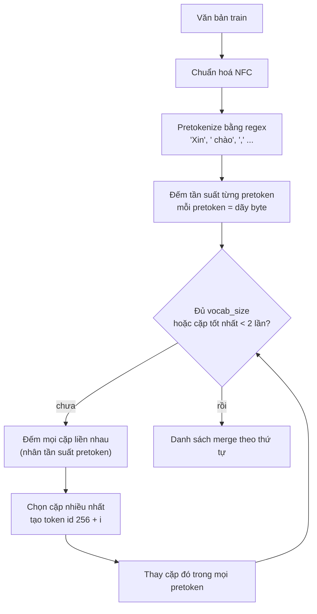
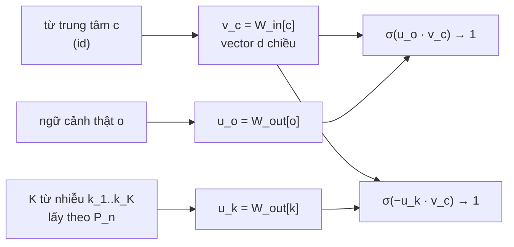
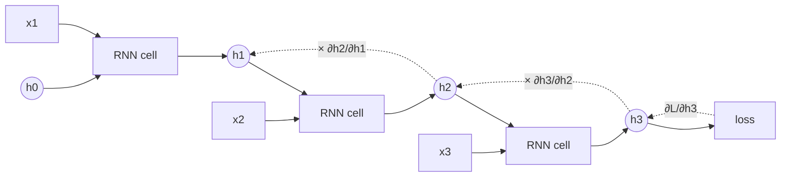
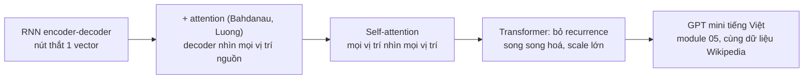

# NLP & Sequence Models

Module 01 mở hộp đen của một MLP; module này mở hộp đen của **mô hình ngôn ngữ trước Transformer**. Một LLM hiện
đại là chuỗi các quyết định mà module này dạy từng cái một: văn bản thành token thế nào (BPE), token thành vector thế
nào (embedding, word2vec), mô hình nhớ ngữ cảnh ra sao (RNN, LSTM), dịch một chuỗi sang chuỗi khác ra sao
(seq2seq), và cơ chế **attention** sinh ra từ đúng giới hạn của RNN. Module 05 chỉ cần bỏ phần "recurrent" của
attention là ra Transformer. Mọi thứ cốt lõi đều **tự viết trước** (BPE, word2vec, LSTM cell, attention), rồi mới
dùng thư viện (`tokenizers`, `nn.LSTM`, `sacrebleu`) và đối chiếu.

Tiếng Việt được đối xử như ngôn ngữ chính, không phải phụ đề: chữ có dấu tổ hợp (Unicode NFC/NFD), viết theo âm tiết
("học sinh" là hai âm tiết, một từ), hai kiểu đặt dấu thanh ("hoà" và "hòa"), và cái giá phải trả khi tokenizer được
train chủ yếu trên tiếng Anh.

LSTM, word2vec ở mức dùng thư viện đã có ở [module 13 track DS](../../../data-science/modules/13-deep-learning/README.md);
backprop, gradient check, khởi tạo đã có ở [module 01](../01-nn-from-scratch/README.md). Dữ liệu thật:

```bash
uv run python data/download_dataset.py uit-vsfc       # 16 175 câu phản hồi sinh viên, 3 nhãn cảm xúc
uv run python data/download_dataset.py iwslt15-en-vi  # 133 317 cặp câu Anh-Việt (TED), dev tst2012, test tst2013
uv run python data/download_dataset.py wikipedia-vi   # 2 shard Wikipedia tiếng Việt 20231101 (644 340 bài)
```

Mọi số liệu dưới đây là kết quả chạy thật (numpy 2.5.4, torch 2.14.1, tokenizers 0.23.3, tiktoken 0.14.0, sacrebleu
2.6.0, kiểm ngày 2026-10-30). Số train trên GPU lấy từ RTX 3050 Laptop 4GB qua env `setup/gpu`; số trên CPU dùng 4
luồng.

Sau module này bạn sẽ:

- Giải thích NFC/NFD, byte-level, pretokenization và tự viết một BPE tokenizer byte-level đúng tới từng merge.
- Đo "thuế token" của tiếng Việt với các tokenizer thật và biết nó ảnh hưởng chi phí, context length ra sao.
- Suy gradient của skip-gram negative sampling, tự train word2vec trên Wikipedia tiếng Việt, ghép âm tiết thành từ.
- Chỉ ra bằng số vì sao RNN mất gradient, LSTM sửa được tới đâu, và tự viết LSTM forward + BPTT khớp `nn.LSTM`.
- Dựng seq2seq với attention Bahdanau và Luong, decode greedy và beam search, đánh giá bằng perplexity, BLEU, chrF.

| Mức | Bài | Nội dung |
| --- | --- | --- |
| Basic | 01 bpe-tokenizer | BPE byte-level, NFC, pretokenize, encode theo thứ hạng merge |
| Basic | 02 word2vec-sgns | vocab, subsampling, phân phối nhiễu, bước SGD skip-gram negative sampling bằng numpy |
| Basic | 03 lstm-numpy | LSTM forward + BPTT bằng numpy khớp `nn.LSTM`, gradient clipping |
| Intermediate | 01 word2vec-wikipedia | word2vec trên Wikipedia tiếng Việt, ghép âm tiết thành từ, analogy |
| Intermediate | 02 lstm-sentiment | BiLSTM phân loại cảm xúc UIT-VSFC, packing, macro-F1, so baseline TF-IDF |
| Intermediate | 03 seq2seq-attention | attention Bahdanau/Luong, seq2seq Anh-Việt, greedy decode, BLEU |
| Advanced | 01 nmt-en-vi | dịch máy Anh-Việt hoàn chỉnh: BPE, attention, beam search, BLEU (portfolio) |
| Advanced | 02 lm-perplexity | language model LSTM tiếng Việt: byte vs âm tiết vs BPE, bits-per-character |

## 1. Từ văn bản tới con số: Unicode, âm tiết và tokenization

Model chỉ nhận số. **Tokenization** cắt văn bản thành các đơn vị (token) rồi gán mỗi đơn vị một id; embedding
(mục 3) biến id thành vector. Chọn đơn vị là một đánh đổi:

| Đơn vị | Ví dụ "Giảng viên nhiệt tình" | Vocab | Chuỗi dài | Từ lạ (OOV) |
| --- | --- | --- | --- | --- |
| Ký tự | `G i ả n g ␣ v i ê n ...` | vài trăm | rất dài | không có |
| Byte UTF-8 | 27 byte (chữ có dấu 2-3 byte) | đúng 256 | dài nhất | không bao giờ |
| Âm tiết / từ theo khoảng trắng | `giảng`, `viên`, `nhiệt`, `tình` | hàng chục nghìn | ngắn | nhiều, cần `<unk>` |
| Từ tiếng Việt (đã tách từ) | `giảng_viên`, `nhiệt_tình` | lớn hơn nữa | ngắn nhất | nhiều nhất |
| Subword (BPE, WordPiece, Unigram) | `giảng`, `␣viên`, `␣nhiệt`, `␣tình` (BPE 1 000 của bài Basic 01, chữ thường); từ hiếm thành nhiều mảnh | chọn được (8k-200k) | vừa | không có nếu byte-level |

LLM hiện đại gần như đều dùng **subword byte-level**: không bao giờ gặp token lạ (mọi chuỗi đều là chuỗi byte), mà
từ phổ biến vẫn là một token. Mục 2 dựng thuật toán; ở đây là những thứ phải đúng **trước** khi tokenizer chạy.

### Unicode: NFC, NFD và hai kiểu đặt dấu

Chữ "ế" có hai cách biểu diễn hợp lệ. **NFC** (dựng sẵn) là một code point `U+1EBF`; **NFD** (tổ hợp) là
`e` + dấu mũ `U+0302` + dấu sắc `U+0301`. Hai chuỗi trông giống hệt nhau trên màn hình nhưng khác nhau từng byte, nên
tokenizer, vocab, BM25, so khớp chuỗi đều coi là hai từ khác nhau.

```python
import unicodedata

a = "Tiếng Việt có dấu"                        # gõ bằng bộ gõ "Unicode dựng sẵn" (NFC)
b = unicodedata.normalize("NFD", a)            # "Unicode tổ hợp": chữ gốc + dấu rời
print(a == b, len(a), len(b), len(a.encode()), len(b.encode()))
print([hex(ord(c)) for c in unicodedata.normalize("NFD", "ế")], "ế".encode())
print(unicodedata.normalize("NFC", b) == a)

# Chuẩn hoá NFC KHÔNG gộp hai kiểu đặt dấu thanh: "hoà" (kiểu cũ) và "hòa" (kiểu mới) vẫn khác nhau
print(unicodedata.normalize("NFC", "hoà") == unicodedata.normalize("NFC", "hòa"))
```

Kết quả: `False 17 24 24 31`, NFD của "ế" là `['0x65', '0x302', '0x301']` và UTF-8 của nó là 3 byte
`b'\xe1\xba\xbf'`; chuẩn hoá về NFC thì hai chuỗi bằng nhau (`True`). Dòng cuối là `False`: NFC không giải quyết
chuyện **đặt dấu thanh** kiểu cũ (`hoà`, `hoá`, `thuỷ`) hay kiểu mới (`hòa`, `hóa`, `thủy`). Đếm trên dữ liệu của
module:

| Kiểu | IWSLT'15 train.vi | Wikipedia (50 000 bài đầu shard 1) |
| --- | --- | --- |
| `hoà` / `hòa` | 808 / 0 | 35 / 702 |
| `hoá` / `hóa` | 3 331 / 0 | 58 / 875 |
| `thuỷ` / `thủy` | 244 / 0 | 1 / 364 |

IWSLT dùng toàn kiểu cũ, Wikipedia gần như toàn kiểu mới. Một model train trên Wikipedia rồi chạy trên văn bản kiểu
IWSLT sẽ thấy `hoá` là từ hiếm. Quyết định thực tế:

- **Luôn chuẩn hoá NFC** ở mọi cửa vào (train, index, query, inference). Dữ liệu của module đã là NFC (đếm 0 câu NFD
  trong UIT-VSFC và 4 câu trong 133 317 câu IWSLT), nhưng input người dùng gõ từ bộ gõ "Unicode tổ hợp" thì không.
- Chuẩn hoá kiểu dấu thanh là **tuỳ bài toán**: cần cho search và đếm từ, không nên làm khi output phải giữ đúng
  chính tả gốc. Nếu làm, làm ở cả train lẫn serve.
- Lỗi hay gặp: chuẩn hoá lúc train nhưng quên lúc serve; `lower()` trước rồi mới NFC (vẫn đúng, nhưng `casefold()`
  và `lower()` khác nhau với vài ký tự); cắt chuỗi theo số byte giữa một chữ có dấu.

### Âm tiết, từ và tách từ

Tiếng Việt viết theo **âm tiết**: khoảng trắng tách âm tiết chứ không tách từ ("học sinh", "Hà Nội", "cơ sở vật chất").
Có ba cách xử lý:

1. **Coi âm tiết là đơn vị** (tách theo khoảng trắng): đơn giản, vocab vừa phải (âm tiết tiếng Việt có hạn, UIT-VSFC
   chỉ có 1 535 âm tiết xuất hiện ≥ 2 lần). Module 13 (RAG) dùng cách này cho BM25.
2. **Tách từ** bằng công cụ (VnCoreNLP, underthesea, pyvi) thành `học_sinh`, `hà_nội`. PhoBERT bắt buộc input đã tách
   từ. Đánh đổi: thêm một model vào pipeline, lỗi tách từ lan xuống dưới, không có công cụ nào đúng 100%.
3. **Để subword tự học**: BPE trên đủ dữ liệu tự gộp âm tiết phổ biến thành một token (mục 2), và mô hình học quan hệ
   giữa các âm tiết. Đây là lựa chọn của mọi LLM đa ngữ.

Bài Intermediate 01 làm một biến thể rẻ của cách 2: tự phát hiện cụm hai âm tiết hay đi cùng nhau (mục 3).

### Thuế token của tiếng Việt

Tokenizer của LLM được train trên dữ liệu chủ yếu tiếng Anh, nên tiếng Việt bị cắt vụn hơn. Đếm trên **cùng một nội
dung**: 1 268 câu TED trong `tst2013` và bản dịch tiếng Việt của chúng.

```python
import html
from pathlib import Path

import tiktoken

root = Path("data/raw/iwslt15-en-vi")
en = [html.unescape(s) for s in (root / "tst2013.en").read_text(encoding="utf-8").splitlines()]
vi = [html.unescape(s) for s in (root / "tst2013.vi").read_text(encoding="utf-8").splitlines()]
for name in ["gpt2", "cl100k_base", "o200k_base"]:
    enc = tiktoken.get_encoding(name)
    n_en = sum(len(enc.encode(s)) for s in en)
    n_vi = sum(len(enc.encode(s)) for s in vi)
    print(f"{name:12} en {n_en:6} token | vi {n_vi:6} token | vi/en {n_vi / n_en:.2f}")
```

| Tokenizer | Vocab | Token tiếng Anh | Token tiếng Việt | Việt / Anh | Token mỗi âm tiết Việt |
| --- | --- | --- | --- | --- | --- |
| `gpt2` (GPT-2, 2019) | 50 257 | 28 224 | 121 296 | 4.30 | 3.60 |
| `cl100k_base` (GPT-3.5/4) | 100 277 | 28 335 | 67 341 | 2.38 | 2.00 |
| `o200k_base` (GPT-4o) | 200 019 | 28 266 | 39 100 | 1.38 | 1.16 |
| Qwen2.5 (`tokenizer.json` trên HF) | 151 665 | 28 581 | 38 320 | 1.34 | 1.14 |

Cột cuối chia cho 33 682 âm tiết của bản tiếng Việt. Với `gpt2`, mỗi âm tiết có dấu thành 3-4 token (gần như byte
thô), nên cùng nội dung tốn **4.3 lần** token: trả tiền API gấp 4.3, context 8k chỉ chứa lượng chữ của 1.9k token
tiếng Anh, sinh chậm gấp 4.3. Tokenizer đời mới có vocab lớn hơn và nhiều dữ liệu đa ngữ hơn nên thuế giảm còn khoảng
1.35. Khi chọn model cho sản phẩm tiếng Việt, **đo số token trên dữ liệu của bạn** trước khi so giá theo token.

## 2. BPE: thuật toán, byte-level và các biến thể

**Byte Pair Encoding** (Sennrich và cộng sự, 2016, mượn từ một thuật toán nén năm 1994) học từ dữ liệu một danh sách
**merge**: bắt đầu từ đơn vị nhỏ nhất, lặp lại việc gộp cặp đứng cạnh nhau xuất hiện nhiều nhất thành một token mới.



### Byte-level

GPT-2 bắt đầu từ **256 byte** chứ không từ ký tự: vocab cơ sở cố định, mọi chuỗi UTF-8 đều mã hoá được, không bao giờ
cần `<unk>`. Cái giá: chữ có dấu tiếng Việt chiếm 2-3 byte, nên tokenizer phải học lại từng chữ cái có dấu từ byte.
Ví dụ train trên văn bản `"nhà "*4 + "nhanh "*3 + "nhạc "*2 + "anh "*5`, 10 merge đầu là:

| Thứ tự | Cặp được gộp | Token mới |
| --- | --- | --- |
| 0 | `n` + `h` | `nh` |
| 1 | `␣` + `nh` | `␣nh` |
| 2 | `a` + `nh` | `anh` |
| 3 | `␣` + `anh` | `␣anh` |
| 4 | `0xC3` + `0xA0` | `à` (2 byte) |
| 5 | `␣nh` + `anh` | `␣nhanh` |
| 6 | `␣nh` + `à` | `␣nhà` |
| 7 | `0xA1` + `c` | nửa chữ `ạ` + `c` (không phải UTF-8 hợp lệ) |
| 8 | `0xBA` + (7) | vẫn chưa hợp lệ |
| 9 | `0xE1` + (8) | `ạc` (3 byte của `ạ` + `c`) |

Merge 7, 8 tạo token **không phải chuỗi UTF-8 hợp lệ**: in riêng ra sẽ thấy `�`. Đó là lý do `decode` phải nối byte
của mọi token rồi mới giải mã UTF-8 một lần, và khi stream từng token ra màn hình (module 09) phải giữ lại byte dở dang.

### Pretokenization và encode theo thứ hạng

Hai chi tiết làm BPE thật khác BPE trong sách:

- **Pretokenize** trước khi merge, bằng một regex tách từ (kèm dấu cách đứng trước), dấu câu, khoảng trắng. Merge không
  bao giờ vượt ranh giới pretoken, nên không có token kiểu `"tình,␣"` ghép cuối từ này với dấu câu và đầu từ khác.
  Train chỉ cần đếm **tần suất của từng pretoken khác nhau** một lần, rồi đếm cặp nhân với tần suất: nhanh hơn nhiều
  lần so với quét lại toàn bộ văn bản mỗi merge.
- **Encode** một pretoken mới không phải "tham lam từ trái sang phải". Lặp lại: trong các cặp liền nhau hiện có, gộp
  cặp có **thứ hạng merge thấp nhất** (học sớm nhất). Với merge `[(b, c), (a, b)]`, `"abc"` thành `a` + `bc`, vì `(b, c)`
  được học trước. Encode khác thứ tự lúc train thì id ra khác với tokenizer gốc: model nhận chuỗi id nó chưa từng thấy.

### Kích thước vocab

Train BPE byte-level tự viết (bài Basic 01) trên 11 426 câu train của UIT-VSFC, đo trên 3 166 câu test:

| vocab_size | Số merge | Token mỗi âm tiết | Byte mỗi token | Thời gian train (Python thuần) |
| --- | --- | --- | --- | --- |
| 256 (byte thô) | 0 | 5.43 | 1.00 | 0 |
| 512 | 256 | 1.63 | 3.34 | 1.4 s |
| 1 000 | 744 | 1.16 | 4.69 | 4.4 s |
| 2 000 | 1 744 | 1.03 | 5.27 | 10 s |

Chỉ 744 merge đã đưa về 1.16 token mỗi âm tiết, vì UIT-VSFC là văn bản hẹp (phản hồi sinh viên, toàn chữ thường).
Vocab lớn hơn thì chuỗi ngắn hơn (attention rẻ hơn, context chứa nhiều chữ hơn) nhưng ma trận embedding và lớp output
to hơn, token hiếm được học ít hơn. LLM nhỏ dùng 32k-64k, model đa ngữ 150k-260k. Thư viện `tokenizers` (Rust) train
cùng thuật toán nhanh hơn hàng trăm lần; bài Advanced 01 dùng nó sau khi bạn đã tự viết.

### Các biến thể

| | BPE | WordPiece | Unigram (SentencePiece) |
| --- | --- | --- | --- |
| Học | gộp cặp **nhiều nhất** | gộp cặp làm **tăng likelihood** nhiều nhất | bắt đầu vocab lớn, **bỏ dần** token ít đóng góp nhất |
| Encode | áp merge theo thứ hạng | khớp dài nhất từ trái (`##` cho phần sau) | Viterbi trên xác suất token, có thể sample nhiều cách cắt |
| Dùng ở | GPT-2/3/4, Llama 3, Qwen | BERT, PhoBERT (BPE fastBPE) | T5, mT5, Gemma, Llama 2 |

SentencePiece coi khoảng trắng là ký tự `▁` và không cần pretokenize theo ngôn ngữ, hợp với tiếng Nhật, Trung; nó có
cả chế độ BPE lẫn Unigram. Lỗi hay gặp với tokenizer trong sản phẩm: tokenizer lúc serve khác lúc train (khác phiên
bản, khác chuẩn hoá); quên thêm/bỏ token đặc biệt (`<bos>`, `<eos>`); người dùng gõ chuỗi trùng token đặc biệt
(`<|endoftext|>`) và bị hiểu là lệnh (module 19); token "glitch" xuất hiện trong vocab nhưng gần như không có trong dữ
liệu train model nên embedding của nó chưa được học.

## 3. Word embeddings: word2vec skip-gram với negative sampling

### Từ one-hot tới vector dày

One-hot cho mỗi từ một chiều riêng: "giảng" và "dạy" cách nhau đúng bằng "giảng" và "máy chiếu". **Giả thuyết phân bố**
(Firth, 1957: "you shall know a word by the company it keeps") nói từ có ngữ cảnh giống nhau thì nghĩa giống nhau.
word2vec (Mikolov và cộng sự, 2013) biến giả thuyết đó thành một bài toán dự đoán: học hai ma trận
$$W_{in}, W_{out} \in \mathbb{R}^{V \times d}$$ sao cho vector của từ trung tâm $$v_c$$ dự đoán được các từ ngữ cảnh $$o$$
trong cửa sổ quanh nó (**skip-gram**).



### Từ softmax đầy đủ tới negative sampling

Skip-gram gốc dùng softmax trên cả vocab: $$p(o \mid c) = \frac{\exp(u_o^\top v_c)}{\sum_{w=1}^{V} \exp(u_w^\top v_c)}$$.
Mẫu số tốn $$O(V d)$$ cho **mỗi** cặp, với $$V$$ cỡ trăm nghìn là không chịu nổi. **Negative sampling** thay bài toán
"chọn đúng từ trong V từ" bằng $$K+1$$ bài phân loại nhị phân: cặp thật $$(c, o)$$ nhãn 1, và $$K$$ cặp $$(c, k)$$ với
$$k$$ lấy ngẫu nhiên từ phân phối nhiễu, nhãn 0:

$$
L = -\log \sigma(u_o^\top v_c) - \sum_{k=1}^{K} \log \sigma(-u_k^\top v_c)
$$

Dùng $$\frac{d}{dx}\log\sigma(x) = 1 - \sigma(x)$$, gradient gọn đến mức viết tay được:

$$
\frac{\partial L}{\partial v_c} = (\sigma(u_o^\top v_c) - 1)\,u_o + \sum_k \sigma(u_k^\top v_c)\,u_k, \qquad
\frac{\partial L}{\partial u_o} = (\sigma(u_o^\top v_c) - 1)\,v_c, \qquad
\frac{\partial L}{\partial u_k} = \sigma(u_k^\top v_c)\,v_c
$$

Mỗi bước chỉ chạm $$K + 2$$ dòng của hai ma trận: chi phí $$O(K d)$$ thay vì $$O(V d)$$. Ba chi tiết quyết định chất
lượng, đều có trong mã C gốc:

- **Phân phối nhiễu** $$P_n(w) \propto \text{count}(w)^{0.75}$$. Mũ 0.75 nâng từ hiếm lên: từ xuất hiện 16 lần chỉ nặng
  gấp 8 lần từ xuất hiện 1 lần thay vì 16.
- **Subsampling** từ quá phổ biến ("của", "là", "và"): giữ mỗi lần xuất hiện của từ có tần suất tương đối $$f$$ với xác
  suất $$\min\left(1, \left(\sqrt{f/t} + 1\right) \frac{t}{f}\right)$$, $$t \approx 10^{-4}$$ hoặc $$10^{-5}$$. Vừa nhanh hơn vừa
  tốt hơn: cặp ("hà_nội", "của") gần như không mang thông tin.
- **Cửa sổ động**: với mỗi vị trí, lấy cửa sổ thật $$b$$ ngẫu nhiên từ 1 tới `window`, nên ngữ cảnh gần được đếm nhiều hơn
  ngữ cảnh xa.

Trong một batch, cùng một từ có thể là center ở hai cặp, hoặc vừa là context vừa là negative. Gradient của các lần đó
phải **cộng dồn** (`np.add.at` trong numpy, `index_add_` trong torch). Viết `W[idx] -= lr * grad` thì numpy chỉ giữ
lần ghi cuối của chỉ số lặp: không báo lỗi, chỉ học kém đi. Bài Basic 02 có test bắt đúng lỗi này.

### Ghép âm tiết thành từ

Với tiếng Việt, train word2vec trên âm tiết cho vector của "hà" (trộn Hà Nội, Hà Giang, sông Hà, họ Hà) chứ không cho
"Hà Nội". Mikolov đề xuất phát hiện **cụm từ** bằng điểm kiểu PMI rồi gộp cụm thành một token:

$$
\text{score}(a, b) = \frac{(\text{count}(ab) - \delta) \cdot N}{\text{count}(a)\,\text{count}(b)}
$$

$$N$$ là tổng số token, $$\delta$$ trừ bớt để cặp hiếm không được điểm cao do may. Bài Intermediate 01 làm thí nghiệm
này trên 5 000 bài Wikipedia dài (lấy ngẫu nhiên, seed 0), 6.43 triệu âm tiết: với $$\delta = 5$$, count tối thiểu 5,
ngưỡng 100, có 13 077 cụm được gộp (`việt_nam`, `sử_dụng`, `thành_phố`, `hoa_kỳ`...), còn 5.47 triệu token. Rồi train
SGNS 100 chiều, window 5, 5 negative, 3 epoch (khoảng 2 phút trên CPU 4 luồng):

| Truy vấn | Train trên âm tiết | Train sau khi ghép cụm |
| --- | --- | --- |
| `hà_nội` | không có trong vocab | `sài_gòn`, `hồ_chí`, `đà_nẵng`, `tp`, `đà_lạt` |
| `hà` | `oai`, `chiểu`, `giang`, `niệp`, `lạng` | `lê_hựu`, `nhữ`, `hoài`, `nhiêu`, `huyên` |
| `bóng_đá` | không có | `cầu_thủ`, `đội_tuyển`, `thi_đấu`, `bóng_rổ` |
| `mèo` | `cộc`, `nòi`, `quạ`, `thằn`, `sói` | `sói`, `ngỗng`, `cá_mập`, `vẹt`, `thằn_lằn` |

Không ghép cụm thì "hà" gần "oai", "giang", "lạng": vector học được là của **âm tiết** trong tên địa danh;
"mèo" gần "thằn" và "lằn" (hai nửa của "thằn lằn"). Ghép cụm thì láng giềng của "mèo" toàn là con vật. Phép tính
analogy $$v_b - v_a + v_c$$ (kiểu "vua − đàn ông + phụ nữ") trên 17 cặp nước–thủ đô và 9 cặp giới tính có trong vocab:
đúng ở vị trí 1 **11.4%** (31/272) và **18.1%** (13/72). Thấp, và đó là con số trung thực: word2vec gốc đạt khoảng 50-60%
khi train trên hàng tỉ từ; 5 triệu token chỉ đủ học quan hệ chủ đề, chưa đủ học quan hệ tuyến tính. Ngưỡng PMI cũng
có giá: `trung_quốc` không được gộp, vì "quốc" quá phổ biến nên điểm của cặp thấp.

### Sau word2vec

| | word2vec | GloVe | fastText | Contextual (ELMo, BERT, LLM) |
| --- | --- | --- | --- | --- |
| Học từ | cửa sổ cục bộ, dự đoán | ma trận đồng xuất hiện toàn cục | như word2vec + n-gram ký tự | cả câu, qua model sâu |
| Một từ có | 1 vector | 1 vector | 1 vector, dựng được cho từ lạ | vector khác nhau theo ngữ cảnh |
| Dùng khi | tài nguyên nhỏ, feature nhanh | như word2vec | ngôn ngữ nhiều hình thái, lỗi chính tả | hầu hết bài toán hiện nay |

Embedding tĩnh không phân biệt "đường" (con đường) với "đường" (đường ăn). Embedding theo ngữ cảnh và embedding câu dùng
cho search, RAG là chủ đề của module 12; ý tưởng "hai vật gần nhau trong không gian vector thì liên quan" thì giữ nguyên.

## 4. RNN và BPTT: vì sao gradient biến mất

### Recurrent neural network

Một RNN đọc chuỗi $$x_1, \dots, x_T$$ từng bước, giữ một **hidden state** $$h_t$$ làm bộ nhớ, dùng **cùng** tham số ở mọi bước:

$$
h_t = \tanh(W_{xh} x_t + W_{hh} h_{t-1} + b), \qquad \hat y_t = W_{hy} h_t
$$

Chia sẻ tham số theo thời gian giúp model xử lý chuỗi dài tuỳ ý với số tham số cố định, giống conv chia sẻ tham số theo
không gian.



### Backprop through time

Trải RNN theo thời gian thì nó là một mạng sâu $$T$$ tầng chung trọng số; **BPTT** chỉ là backprop trên đồ thị đã trải.
Gradient của $$W_{hh}$$ là tổng đóng góp của mọi bước. Gradient từ bước $$T$$ về bước $$k$$ đi qua tích các Jacobian:

$$
\frac{\partial h_T}{\partial h_k} = \prod_{t=k+1}^{T} \frac{\partial h_t}{\partial h_{t-1}} = \prod_{t=k+1}^{T} \mathrm{diag}\left(1 - h_t^2\right) W_{hh}
$$

Tích của $$T - k$$ ma trận: nếu chuẩn của mỗi thừa số nhỏ hơn 1 (giá trị riêng lớn nhất của $$W_{hh}$$ nhỏ, hoặc tanh
bão hoà làm $$1 - h_t^2 \approx 0$$) thì gradient co lại **theo cấp số nhân** (vanishing); lớn hơn 1 thì nổ
(exploding). Đây đúng là vấn đề của mạng sâu ở module 01 mục 5, nhưng tệ hơn vì mọi tầng dùng cùng một $$W_{hh}$$.

Đo trực tiếp: chuẩn gradient của tổng $$h_{100}$$ theo input $$x_t$$, ngay sau khởi tạo mặc định của PyTorch:

```python
import torch
import torch.nn as nn

torch.manual_seed(0)
T, N, D, H = 100, 32, 16, 64
x = torch.randn(T, N, D)


def grad_by_step(net: nn.Module) -> torch.Tensor:
    """Chuẩn gradient của tổng h_T theo input x_t, cho từng bước t."""
    xx = x.clone().requires_grad_(True)
    out, _ = net(xx)
    (g,) = torch.autograd.grad(out[-1].sum(), xx)
    return g.norm(dim=(1, 2))


nets = {"RNN tanh": nn.RNN(D, H), "LSTM": nn.LSTM(D, H)}
for bias in [1.0, 3.0]:
    lstm = nn.LSTM(D, H)
    with torch.no_grad():
        lstm.bias_ih_l0[H:2 * H] += bias          # khối thứ hai (i, f, g, o) là cổng quên
    nets[f"LSTM, bias cổng quên +{bias:g}"] = lstm
for name, net in nets.items():
    n = grad_by_step(net)
    print(f"{name:26}", "  ".join(f"t={t}: {n[t]:.1e}" for t in [99, 90, 50, 0]))
```

| Model (khởi tạo) | t = 99 | t = 90 | t = 50 | t = 0 |
| --- | --- | --- | --- | --- |
| RNN tanh | 1.3e+01 | 3.4e-02 | 2.2e-12 | 0 (underflow) |
| LSTM mặc định | 2.0e+00 | 2.9e-02 | 2.5e-10 | 2.7e-20 |
| LSTM, bias cổng quên +1 | 4.0e+00 | 4.3e-01 | 7.7e-04 | 3.7e-07 |
| LSTM, bias cổng quên +3 | 3.3e+00 | 1.2e+00 | 1.1e+00 | 5.3e+00 |

Sau 10 bước, gradient của RNN đã nhỏ đi 400 lần; sau 50 bước thì bằng 0 trong float32. Điều bất ngờ là **LSTM với
khởi tạo mặc định cũng mất gradient gần như RNN**; mục 5 giải thích vì sao và vì sao một dòng sửa bias cứu được nó.

### Xử lý trong thực tế

- **Exploding**: cắt gradient theo **chuẩn toàn cục** (gộp mọi tham số), `clip_grad_norm_(params, 1.0)`. Cắt theo
  chuẩn giữ hướng gradient; cắt từng phần tử (`clip_grad_value_`) thì đổi hướng. Theo dõi chuẩn trước khi cắt: nó
  tăng vọt là dấu hiệu sắp NaN.
- **Vanishing**: không cắt được, phải đổi kiến trúc: LSTM/GRU (mục 5), kết nối tắt, hoặc attention (mục 6) cho mỗi bước
  output đường đi ngắn tới mọi bước input.
- **Truncated BPTT**: với chuỗi rất dài (language model trên cả cuốn sách), chỉ backprop $$k$$ bước (vd. 128), nhưng
  vẫn **chuyền hidden state** sang đoạn sau (`h.detach()`). Model vẫn thấy ngữ cảnh xa ở forward, chỉ không học được
  phụ thuộc xa hơn $$k$$ bước. Bài Advanced 02 dùng cách này.

## 5. LSTM và GRU: con đường cộng cho gradient

### Phương trình LSTM

LSTM (Hochreiter và Schmidhuber, 1997; cổng quên thêm bởi Gers và cộng sự, 2000) tách bộ nhớ thành **cell state**
$$c_t$$ và hidden state $$h_t$$, điều khiển bằng ba cổng sigmoid. Theo thứ tự khối trong `nn.LSTM` (i, f, g, o):

$$
\begin{aligned}
z_t &= W_{ih} x_t + b_{ih} + W_{hh} h_{t-1} + b_{hh} \in \mathbb{R}^{4H} \\
i_t &= \sigma(z_t^{(i)}), \quad f_t = \sigma(z_t^{(f)}), \quad g_t = \tanh(z_t^{(g)}), \quad o_t = \sigma(z_t^{(o)}) \\
c_t &= f_t \odot c_{t-1} + i_t \odot g_t \\
h_t &= o_t \odot \tanh(c_t)
\end{aligned}
$$

| Thành phần | Vai trò |
| --- | --- |
| $$f_t$$ cổng quên | giữ lại bao nhiêu phần của bộ nhớ cũ |
| $$i_t$$ cổng vào, $$g_t$$ ứng viên | ghi bao nhiêu thông tin mới, và thông tin gì |
| $$o_t$$ cổng ra | lộ ra bao nhiêu bộ nhớ thành $$h_t$$ |
| $$c_t$$ | "băng chuyền": cập nhật bằng phép **cộng**, không qua ma trận |

### Vì sao gradient sống được

Đạo hàm của $$c_t$$ theo $$c_{t-1}$$ dọc đường cộng chỉ là $$\mathrm{diag}(f_t)$$, không có $$W_{hh}$$, không có đạo hàm
tanh:

$$
\frac{\partial c_T}{\partial c_k} \approx \prod_{t=k+1}^{T} \mathrm{diag}(f_t)
$$

(đúng ra còn các nhánh đi qua $$h$$ và các cổng, nhưng đây là nhánh chính). Gradient sống được khi $$f_t \approx 1$$.
Khởi tạo mặc định cho bias cỡ 0 nên $$f_t \approx \sigma(0) = 0.5$$: sau 50 bước còn $$0.5^{50} \approx 10^{-15}$$, đúng
như bảng mục 4. Đặt bias cổng quên bằng 1 (Jozefowicz và cộng sự, 2015 khuyên vậy) cho $$f \approx 0.73$$, bằng 3 cho
$$f \approx 0.95$$: LSTM bắt đầu ở chế độ "nhớ mặc định" và tự học khi nào quên.

Thí nghiệm: chuỗi $$T$$ ký hiệu ngẫu nhiên trong 8 ký hiệu, model phải trả lời ký hiệu **đầu tiên** sau khi đọc hết
chuỗi (phụ thuộc xa đúng $$T$$ bước). Hidden 64, Adam lr 3e-3, batch 64, 1 500 bước, clip 1.0, seed 0; accuracy trên 2 000
chuỗi mới (đoán mò 0.125):

| T | RNN tanh | LSTM mặc định | LSTM bias quên +1 | LSTM bias quên +3 |
| --- | --- | --- | --- | --- |
| 10 | 0.858 | 1.000 | 1.000 | 1.000 |
| 20 | 0.124 | 0.116 | 1.000 | 1.000 |
| 50 | 0.126 | 0.127 | 0.118 | 1.000 |

Với $$T = 20$$, LSTM mặc định cũng thất bại y như RNN; chỉ đổi một bias là học được hoàn hảo. Kiến trúc cho **khả năng**
giữ gradient, khởi tạo quyết định model có dùng được khả năng đó ngay từ đầu không. Bài Basic 03 có một test kiểm đúng
điều này trên LSTM numpy của bạn.

### GRU

GRU (Cho và cộng sự, 2014) gộp cổng quên và cổng vào thành một **cổng cập nhật** $$z_t$$, bỏ cell state riêng:

$$
\begin{aligned}
r_t &= \sigma(W_r x_t + U_r h_{t-1} + b_r), \quad z_t = \sigma(W_z x_t + U_z h_{t-1} + b_z) \\
n_t &= \tanh(W_n x_t + r_t \odot (U_n h_{t-1}) + b_n) \\
h_t &= (1 - z_t) \odot n_t + z_t \odot h_{t-1}
\end{aligned}
$$

Ít tham số hơn LSTM một phần tư, thường cho kết quả ngang. Bài seq2seq ở mục 6 dùng GRU.

### Dùng trong thực tế: padding, packing, hai chiều

Batch câu dài ngắn khác nhau phải **pad** cho bằng nhau. Nếu đưa thẳng vào `nn.LSTM`, hidden state cuối của câu ngắn
là state sau khi đọc thêm cả đống `<pad>`, nên kết quả phụ thuộc câu đó nằm chung batch với câu nào. Dùng
`pack_padded_sequence(x, lengths, enforce_sorted=False)` để LSTM dừng đúng ở độ dài thật của từng câu; với output từng
bước thì `pad_packed_sequence` rồi mask. **Bidirectional** chạy thêm một LSTM từ phải sang trái và nối hai state:
mỗi vị trí thấy cả ngữ cảnh hai phía (không dùng được cho sinh văn bản, vì tương lai chưa có).

Bài Intermediate 02 phân loại cảm xúc 3 lớp trên UIT-VSFC (test: 1 409 negative, 167 neutral, 1 590 positive), embedding
128, hidden 128, dropout 0.3, Adam 2e-3, 6 epoch, chọn epoch theo macro-F1 trên validation:

| Model | Test accuracy | Macro-F1 | F1 lớp neutral |
| --- | --- | --- | --- |
| Đoán toàn positive | 0.5022 | 0.2229 | 0 |
| TF-IDF (1-2 gram) + logistic regression | 0.8977 | 0.7159 | 0.311 |
| LSTM một chiều | 0.9021 | 0.7246 | 0.327 |
| BiLSTM | 0.9037 | 0.7549 | 0.415 |

Đọc bảng như một kỹ sư: accuracy gần như không phân biệt được ba model (0.898-0.904), vì 95% câu thuộc hai lớp dễ.
Khác biệt nằm ở lớp neutral hiếm (4% dữ liệu train), nên **macro-F1** mới là thước đo đúng. Baseline TF-IDF train trong vài
giây mà chỉ kém BiLSTM 0.04 macro-F1, và BiLSTM vẫn đoán sai 112 / 167 câu neutral. Bài học quen thuộc từ track DS: luôn đo
baseline rẻ trước, và chọn metric theo lớp mà sản phẩm quan tâm.

## 6. Seq2seq và attention: Bahdanau, Luong

### Encoder-decoder và nút thắt cổ chai

Dịch máy biến một chuỗi thành một chuỗi khác dài khác nhau. **Seq2seq** (Sutskever và cộng sự, 2014; Cho và cộng sự, 2014)
dùng hai RNN: **encoder** đọc câu nguồn và nén thành vector cuối, **decoder** khởi đầu từ vector đó và sinh từng token đích,
mỗi bước nhận token vừa sinh làm input. Toàn bộ câu nguồn, dài 5 hay 50 từ, phải lọt qua **một** vector cỡ cố định: đó là nút
thắt cổ chai. Chất lượng của seq2seq thuần tụt nhanh khi câu dài ra.

**Attention** (Bahdanau, Cho, Bengio, 2015) bỏ nút thắt: giữ output của encoder ở **mọi** vị trí $$k_1, \dots, k_S$$, và ở mỗi
bước decoder tính một tổ hợp có trọng số của chúng, trọng số do chính decoder quyết định:

$$
e_j = \text{score}(q, k_j), \qquad \alpha_j = \frac{\exp(e_j)}{\sum_{j'} \exp(e_{j'})}, \qquad c = \sum_j \alpha_j k_j
$$

```mermaid
sequenceDiagram
    participant E as Encoder (BiGRU)
    participant A as Attention
    participant D as Decoder (GRU)
    E->>E: đọc "i was very proud ." → k1..k5
    E->>D: s0 = tanh(W [h_fwd; h_bwd])
    loop mỗi bước t
        D->>A: query (s_{t-1} với Bahdanau, s_t với Luong)
        A->>A: score với k1..k5, softmax (padding = -inf)
        A-->>D: context c_t = Σ α_j k_j
        D->>D: logits → token y_t (argmax hoặc beam)
    end
```

Vị trí padding phải có trọng số **đúng bằng 0**: gán score `-inf` trước softmax. Nhân mask sau softmax thì tổng trọng số
không còn bằng 1 và gradient vẫn chảy vào padding.

### Hai họ attention

| | Bahdanau (additive) | Luong (multiplicative) |
| --- | --- | --- |
| Score | $$v^\top \tanh(W_q q + W_k k_j)$$ | dot: $$q^\top k_j$$; general: $$q^\top W k_j$$ |
| Query | state **cũ** $$s_{t-1}$$, tính trước bước RNN | state **mới** $$s_t$$, tính sau bước RNN |
| Context đi vào | input của RNN $$[e_t; c_t]$$ và lớp output | $$\tilde h_t = \tanh(W_c[s_t; c_t])$$ rồi lớp output |
| Train teacher forcing | lặp từng bước (RNN cần $$c_t$$) | RNN chạy cả chuỗi một lần, attention cho mọi bước bằng một `bmm` |
| Chi phí score | thêm một MLP nhỏ mỗi cặp $$(t, j)$$ | một tích vô hướng mỗi cặp |

Luong còn đề xuất **input feeding** (đưa $$\tilde h_{t-1}$$ vào input bước sau) để decoder biết mình đã nhìn đâu; có nó thì cũng
mất khả năng chạy song song. Dot-product attention của Transformer, $$\mathrm{softmax}(QK^\top/\sqrt{d})V$$, là Luong dot chạy
cho mọi query cùng lúc, chia thêm $$\sqrt{d}$$ để score không phình theo số chiều.

### Teacher forcing, exposure bias, decode

Train: input của decoder ở bước $$t$$ là token **đúng** của bước trước (teacher forcing), loss là cross-entropy mọi bước, bỏ
qua padding. Inference: input là token model **tự sinh**, một lỗi sớm đẩy model vào trạng thái chưa từng thấy (exposure bias:
lặp từ, bịa nội dung).

- **Greedy**: argmax mỗi bước, dừng ở `<eos>`. Nhanh, nhưng không sửa được lựa chọn tồi ban đầu.
- **Beam search**: giữ $$k$$ tiền tố có tổng log-xác suất cao nhất. Tổng log-xác suất luôn giảm khi câu dài thêm, nên beam
  thiên vị câu ngắn; chuẩn hoá độ dài (Wu và cộng sự, 2016): $$\text{score} / \left(\frac{5 + L}{6}\right)^{\alpha}$$, $$\alpha \approx 0.6$$.

### Đo trên dữ liệu thật

Bài Intermediate 03, trên CPU 4 luồng. **Đảo chuỗi** (input là chuỗi 5 tới 20 ký hiệu, output là chính nó viết ngược),
embedding 16, hidden 32 cố ý nhỏ, Adam 3e-3, 1 500 bước batch 64, đánh giá 500 chuỗi mới (đúng nguyên chuỗi):

| Model | Đúng nguyên chuỗi |
| --- | --- |
| Không attention | 0.108 |
| Luong (general) | 0.980 |
| Bahdanau | 1.000 |

Không attention, encoder phải nén chuỗi 20 ký hiệu vào một vector 32 chiều và thất bại; có attention, decoder chỉ cần học
"nhìn vào vị trí đối xứng", ma trận attention là một đường chéo ngược gần như hoàn hảo.

**Dịch Anh-Việt câu ngắn**: 46 311 cặp câu IWSLT'15 mà cả hai phía dài 1 tới 15 từ, vocab 4 000 từ mỗi phía, embedding 64,
hidden 128, dropout 0.2, Adam 1e-3, 3 epoch; BLEU trên 378 câu `tst2013` thoả cùng điều kiện độ dài:

| Model | Train perplexity epoch 1 / 2 / 3 | BLEU (378 câu) |
| --- | --- | --- |
| Không attention | 167.0 / 75.0 / 55.9 | 3.25 |
| Luong (general) | 189.5 / 79.2 / 55.6 | 4.15 |

Trên câu ngắn và model nhỏ train 3 epoch, attention hơn gần 1 BLEU: nút thắt chưa phải giới hạn chính, dữ liệu và thời gian
train mới là. Heatmap attention của câu "i was very proud of my country ." cho thấy lý do: mọi bước sinh đều dồn trọng số vào
dấu chấm cuối câu (vị trí mà encoder hai chiều đã tóm tắt cả câu), tức model chưa học căn chỉnh và dùng attention như một
vector cố định. Cả hai model đều dịch "and i was very proud ." thành câu sai nghĩa ("và tôi rất rất nhiều ."). Trong một thử
nghiệm riêng với cùng cấu hình, Bahdanau có train loss epoch 1 là 4.51 so với 5.24 của Luong (nó đưa context vào chính RNN),
nhưng mỗi epoch chậm hơn khoảng 3 lần trên CPU vì phải lặp từng bước.

**Dịch Anh-Việt đầy đủ** (bản tham chiếu của bài Advanced 01, GPU): BPE 8 000 mỗi ngôn ngữ (`tokenizers`, 1.13 token mỗi từ
tiếng Anh), 130 700 cặp có ≤ 80 token, embedding 256, BiGRU 512, attention Luong general, dropout 0.3, Adam 1e-3, batch 64
xếp theo độ dài, 13.6 triệu tham số, chọn epoch theo BLEU greedy trên `tst2012`:

| Epoch | 1 | 2 | 4 | 6 | 8 |
| --- | --- | --- | --- | --- | --- |
| Train loss (mỗi token BPE) | 4.64 | 3.96 | 3.65 | 3.48 | 3.33 |
| Dev perplexity | 52.9 | 41.3 | 34.9 | 29.4 | 26.5 |
| Dev BLEU (greedy) | 4.1 | 5.8 | 6.8 | 8.7 | 9.9 |

Trên `tst2013` (1 268 câu), checkpoint epoch 8: greedy **BLEU 9.78**, beam 5 **BLEU 11.63** (chữ ký
`nrefs:1|case:mixed|tok:none`, chrF 27.9). Mỗi epoch 5-7 phút trên RTX 3050 4GB dùng chung, dưới 1.5 GB VRAM; decode greedy
24 giây, beam 5 (từng câu) 90 giây.

@@FILL_ABLATION

Đặt con số vào bối cảnh: hệ thống attention LSTM nhiều tầng của Stanford (Luong và Manning, 2015) đạt khoảng 23 BLEU trên
`tst2013`, và các Transformer công bố sau này còn cao hơn nhiều. Model một tầng train 45 phút còn xa mức đó, và đường dev BLEU vẫn đang lên ở epoch 8.
Bản dịch đọc trôi chảy nhưng hay **bịa**: câu "And I was very proud ." được dịch "Và tôi rất hào hứng ."; câu dài về chủ tịch
Kim Il-Sung thành "lịch sử của Alan Kay". Đó là chữ ký của language model mạnh hơn bộ phận "nhìn vào câu nguồn": decoder viết
câu tiếng Việt hợp lý dù attention chưa căn đúng.

## 7. Đánh giá: perplexity, BLEU, chrF; cầu nối sang Transformer

### Perplexity và bits-per-character

Language model gán xác suất cho chuỗi bằng quy tắc chuỗi $$p(x_1..x_N) = \prod_i p(x_i \mid x_{<i})$$. Loss là cross-entropy trung
bình mỗi token, và

$$
\text{PPL} = \exp\left(\frac{1}{N}\sum_{i=1}^{N} -\log p(x_i \mid x_{<i})\right)
$$

đọc là "model phân vân trung bình giữa bao nhiêu lựa chọn mỗi token". Model đoán đều trên vocab $$V$$ có PPL bằng $$V$$.
Perplexity **phụ thuộc tokenizer**: $$N$$ là số token. Model byte-level đoán từng byte (rất dễ đoán byte thứ hai của "ế") nên
PPL theo token nhỏ; model BPE vocab lớn có PPL theo token lớn hơn nhiều dù có thể tốt hơn. So công bằng phải quy về đơn vị
độc lập tokenizer: tổng NLL chia cho số ký tự (hoặc byte) của văn bản, đổi sang bit:

$$
\text{bpc} = \frac{\sum_i -\log p(x_i \mid x_{<i})}{n_{\text{chars}} \cdot \ln 2}
$$

Bài Advanced 02 train cùng một LSTM với byte, BPE 2 000 và BPE 8 000 trên Wikipedia tiếng Việt:

| Tokenizer | Vocab | Ký tự mỗi token | Tham số | Perplexity theo token | Bit mỗi token | **bpc** |
| --- | --- | --- | --- | --- | --- | --- |
| Byte | 256 | 0.78 | 3.9 triệu | 3.58 | 1.84 | 2.34 |
| BPE byte-level | 2 000 | 2.90 | 5.2 triệu | 55.8 | 5.80 | 2.00 |
| BPE byte-level | 8 000 | 3.48 | 9.8 triệu | 118.7 | 6.89 | 1.98 |

(LSTM 2 tầng 512, 3 000 bước batch 32 × 128 token, 1 000 bài train, đánh giá trên 664 568 ký tự của 100 bài khác; GPU dùng
chung, 8-14 phút mỗi model.) Nhìn cột perplexity thì model byte "tốt nhất" với 3.58 và BPE 8 000 "tệ nhất" với 118.7; nhìn
bpc thì thứ tự **ngược lại**. bpc mới đúng: cả ba cùng nén một văn bản, model BPE 8 000 cần 1.98 bit cho mỗi ký tự, model byte
cần 2.34. Một phần khác biệt đến từ ngân sách: cùng 3 000 bước, model byte chỉ đọc 9.7 triệu ký tự, BPE 8 000 đọc 43 triệu;
so sánh trung thực phải nói rõ ngân sách (bước, ký tự, hay FLOP).

### BLEU, chrF và sacrebleu

**BLEU** (Papineni và cộng sự, 2002) đo trùng n-gram với bản dịch tham chiếu: precision n-gram $$p_n$$ (n = 1..4, mỗi n-gram chỉ
được tính tối đa số lần nó có trong reference), trung bình nhân, nhân **brevity penalty**:

$$
\text{BLEU} = \text{BP} \cdot \exp\left(\frac14 \sum_{n=1}^{4} \log p_n\right), \qquad \text{BP} = \min\left(1, e^{1 - r/c}\right)
$$

với $$c$$ là tổng độ dài bản dịch, $$r$$ của reference. Tính trên **cả corpus** (cộng số đếm của mọi câu rồi mới chia), không
trung bình BLEU từng câu. **chrF** (Popović, 2015) là F-score trên n-gram **ký tự**, ít nhạy với tách từ và hình thái, hợp với
tiếng Việt (âm tiết ngắn, một lỗi dấu là sai cả âm tiết với BLEU).

Con số BLEU vô nghĩa nếu không kèm cách tính. Cùng hai câu:

```python
from sacrebleu.metrics import BLEU, CHRF

refs = ["Tôi đã rất tự hào về đất nước tôi.", "Ở trường, chúng tôi học rất nhiều về lịch sử."]
hyps = ["Tôi rất tự hào về đất nước của tôi.", "Ở trường, chúng tôi học nhiều về lịch sử."]

bleu = BLEU()                                   # tokenize mặc định "13a": tách dấu câu khỏi từ
print(bleu.corpus_score(hyps, [refs]), "|", bleu.get_signature())
print("tokenize none:", round(BLEU(tokenize="none").corpus_score(hyps, [refs]).score, 2))
print("chrF         :", round(CHRF().corpus_score(hyps, [refs]).score, 2))
print("1 câu, sentence BLEU:", round(bleu.sentence_score(hyps[0], [refs[0]]).score, 2))
```

Kết quả: `BLEU = 68.05 95.2/78.9/64.7/53.3 (BP = 0.953 ...)` với chữ ký `nrefs:1|case:mixed|eff:no|tok:13a|smooth:exp|
version:2.6.0`; `tokenize="none"` cho 65.34 (không tách `tôi.` thành `tôi .`); chrF 79.27; sentence BLEU của câu đầu 59.88.
Quy tắc: luôn dùng sacrebleu, báo cáo kèm chữ ký, và chỉ so hai con số có **cùng** chữ ký trên **cùng** tập test. IWSLT'15
đã tách từ sẵn nên module dùng `tokenize="none"`.

BLEU và chrF chỉ đo trùng chuỗi. Cho quyết định quan trọng, dùng metric học được (COMET, so với đánh giá người tốt hơn nhiều)
và đánh giá người trên mẫu. Module 20 quay lại chuyện đánh giá trong sản phẩm.

### Cầu nối sang module 05

Ba giới hạn của RNN mà bạn đã đo được trong module này:

1. **Tuần tự**: bước $$t$$ chờ bước $$t-1$$; trên GPU, Bahdanau chậm hơn Luong vì phải lặp, và cả hai không song song được trong
   encoder. Train trên chuỗi dài chậm, không tận dụng được GPU lớn.
2. **Đường đi gradient dài**: phụ thuộc xa $$n$$ bước phải đi qua $$n$$ Jacobian (mục 4, 5); LSTM chỉ giảm nhẹ vấn đề.
3. **Nút thắt**: attention đã cho decoder nhìn thẳng vào encoder, nhưng **bên trong** encoder và decoder thông tin vẫn chảy
   qua recurrence.

Transformer (Vaswani và cộng sự, 2017, "Attention Is All You Need") bỏ recurrence: mọi vị trí attend tới mọi vị trí bằng
**self-attention** $$\mathrm{softmax}(QK^\top/\sqrt{d})V$$ (chính là Luong dot), thứ tự do positional encoding mang, mọi bước tính
song song, đường đi giữa hai vị trí bất kỳ dài 1.



| | RNN/LSTM + attention | Transformer |
| --- | --- | --- |
| Train trên chuỗi dài $$n$$ | $$n$$ bước tuần tự | song song, chi phí attention $$O(n^2)$$ |
| Đường đi giữa hai vị trí | tới $$n$$ bước | 1 bước |
| Inference sinh từng token | state cố định $$O(H)$$ mỗi bước | KV cache lớn dần theo độ dài |
| Tokenizer, embedding, đánh giá | BPE, embedding, PPL/bpc, BLEU | **y hệt** (module này) |

Module 05 train một GPT mini trên đúng dữ liệu Wikipedia tiếng Việt của bài Advanced 02: con số bits-per-character của LSTM
là baseline để Transformer vượt qua, và nhờ bpc, hai con số so được với nhau dù tokenizer khác.

## 8. Tài liệu tham khảo

Khoá học và sách:

- Stanford [CS224N: Natural Language Processing with Deep Learning](https://web.stanford.edu/class/cs224n/), các bài
  word vectors, RNN/LSTM, seq2seq + attention.
- Dan Jurafsky, James H. Martin. [Speech and Language Processing](https://web.stanford.edu/~jurafsky/slp3/) (bản 3, nháp),
  chương N-gram LM (perplexity), Embeddings, RNNs and LSTMs, Machine Translation.
- Andrej Karpathy. [Let's build the GPT Tokenizer](https://www.youtube.com/watch?v=zduSFxRajkE) và [minbpe](https://github.com/karpathy/minbpe);
  [The Unreasonable Effectiveness of Recurrent Neural Networks](https://karpathy.github.io/2015/05/21/rnn-effectiveness/).
- Christopher Olah. [Understanding LSTM Networks](https://colah.github.io/posts/2015-08-Understanding-LSTMs/).
- Aston Zhang và cộng sự. [Dive into Deep Learning](https://d2l.ai/), chương Recurrent Neural Networks, Modern RNNs, Attention.

Paper:

- Sennrich, Haddow, Birch. [Neural Machine Translation of Rare Words with Subword Units](https://arxiv.org/abs/1508.07909) (BPE, 2016).
- Radford và cộng sự. [Language Models are Unsupervised Multitask Learners](https://cdn.openai.com/better-language-models/language_models_are_unsupervised_multitask_learners.pdf) (GPT-2, BPE byte-level, 2019).
- Kudo, Richardson. [SentencePiece](https://arxiv.org/abs/1808.06226) (2018); Kudo. [Subword Regularization](https://arxiv.org/abs/1804.10959) (Unigram, 2018).
- Mikolov và cộng sự. [Efficient Estimation of Word Representations in Vector Space](https://arxiv.org/abs/1301.3781) và
  [Distributed Representations of Words and Phrases and their Compositionality](https://arxiv.org/abs/1310.4546) (2013).
- Goldberg, Levy. [word2vec Explained](https://arxiv.org/abs/1402.3722) (2014), suy gradient negative sampling.
- Bengio, Simard, Frasconi. [Learning long-term dependencies with gradient descent is difficult](https://doi.org/10.1109/72.279181) (1994);
  Pascanu, Mikolov, Bengio. [On the difficulty of training recurrent neural networks](https://arxiv.org/abs/1211.5063) (2013).
- Hochreiter, Schmidhuber. [Long Short-Term Memory](https://doi.org/10.1162/neco.1997.9.8.1735) (1997); Jozefowicz, Zaremba, Sutskever.
  [An Empirical Exploration of Recurrent Network Architectures](https://proceedings.mlr.press/v37/jozefowicz15.html) (2015, bias cổng quên).
- Cho và cộng sự. [Learning Phrase Representations using RNN Encoder-Decoder](https://arxiv.org/abs/1406.1078) (GRU, 2014);
  Sutskever, Vinyals, Le. [Sequence to Sequence Learning with Neural Networks](https://arxiv.org/abs/1409.3215) (2014).
- Bahdanau, Cho, Bengio. [Neural Machine Translation by Jointly Learning to Align and Translate](https://arxiv.org/abs/1409.0473) (2015).
- Luong, Pham, Manning. [Effective Approaches to Attention-based Neural Machine Translation](https://arxiv.org/abs/1508.04025) (2015);
  Luong, Manning. [Stanford Neural Machine Translation Systems for Spoken Language Domains](https://nlp.stanford.edu/pubs/luong-manning-iwslt15.pdf) (IWSLT 2015).
- Wu và cộng sự. [Google's Neural Machine Translation System](https://arxiv.org/abs/1609.08144) (2016, length penalty).
- Papineni và cộng sự. [BLEU](https://aclanthology.org/P02-1040/) (2002); Post. [A Call for Clarity in Reporting BLEU Scores](https://arxiv.org/abs/1804.08771) (sacrebleu, 2018);
  Popović. [chrF](https://aclanthology.org/W15-3049/) (2015); Rei và cộng sự. [COMET](https://arxiv.org/abs/2009.09025) (2020).
- Vaswani và cộng sự. [Attention Is All You Need](https://arxiv.org/abs/1706.03762) (2017), cầu nối sang module 05.

Tiếng Việt và dữ liệu:

- Nguyen và cộng sự. [UIT-VSFC: Vietnamese Students' Feedback Corpus](https://ieeexplore.ieee.org/document/8573337) (2018); dữ liệu trên
  [HF uitnlp/vietnamese_students_feedback](https://huggingface.co/datasets/uitnlp/vietnamese_students_feedback).
- IWSLT'15 en-vi: [Stanford NMT](https://nlp.stanford.edu/projects/nmt/), bản sao [stefan-it/nmt-en-vi](https://github.com/stefan-it/nmt-en-vi).
- Wikipedia tiếng Việt: [HF wikimedia/wikipedia](https://huggingface.co/datasets/wikimedia/wikipedia) (CC BY-SA 3.0).
- Nguyen, Nguyen. [PhoBERT](https://arxiv.org/abs/2003.00744) (2020, cần tách từ); [VnCoreNLP](https://github.com/vncorenlp/VnCoreNLP), [underthesea](https://github.com/undertheseanlp/underthesea).
- [Unicode Normalization Forms (UAX #15)](https://unicode.org/reports/tr15/).

Thư viện:

- [Hugging Face tokenizers](https://huggingface.co/docs/tokenizers), [tiktoken](https://github.com/openai/tiktoken),
  [sacrebleu](https://github.com/mjpost/sacrebleu), [torch.nn.LSTM](https://pytorch.org/docs/stable/generated/torch.nn.LSTM.html),
  [pack_padded_sequence](https://pytorch.org/docs/stable/generated/torch.nn.utils.rnn.pack_padded_sequence.html).

Roadmap:

- [roadmap.sh: AI Engineer](https://roadmap.sh/ai-engineer): module này là phần mở rộng ★ (roadmap chỉ nhắc tokens,
  embeddings ở mức dùng API).
