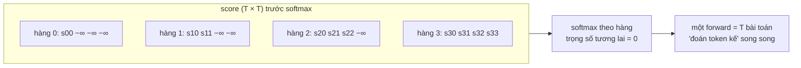
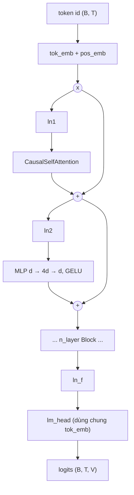
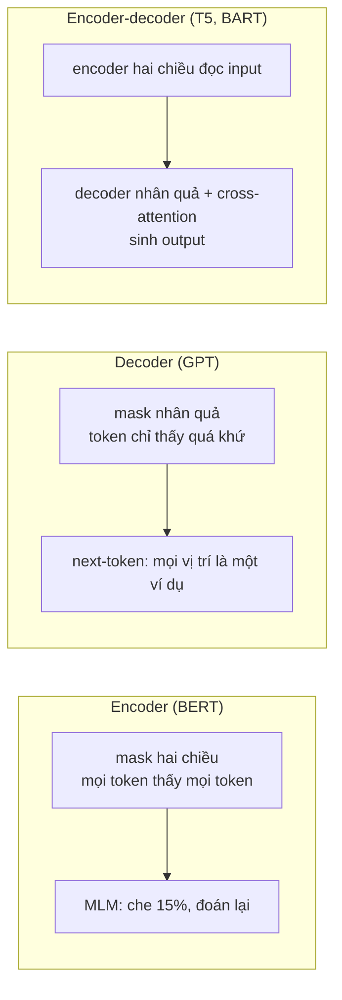
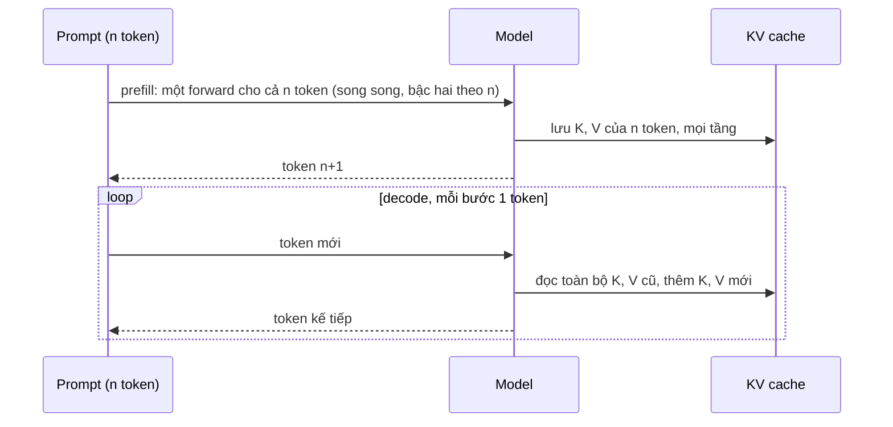
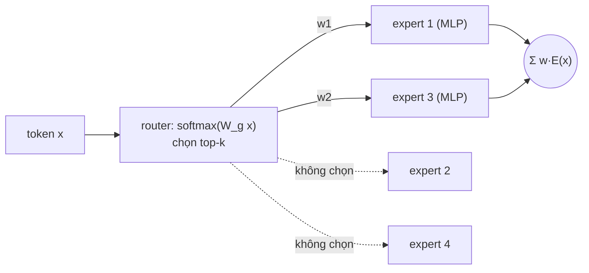
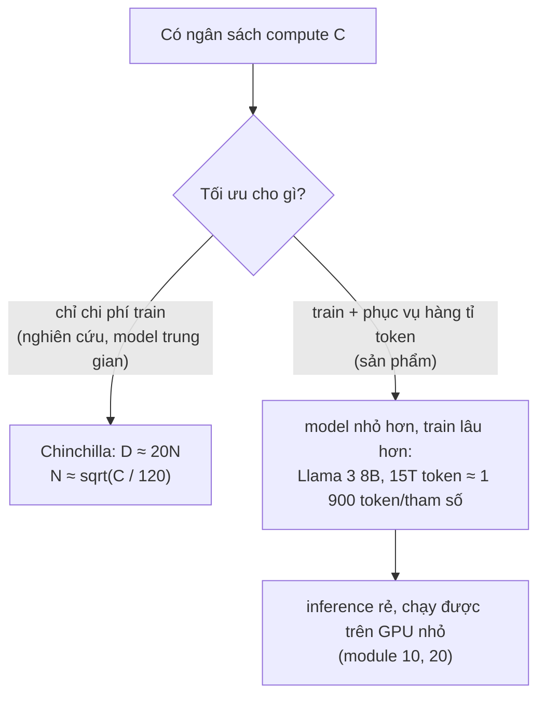

# Transformer & kiến trúc LLM

Module 04 kết thúc ở attention: decoder RNN nhìn lại mọi vị trí của encoder. Module này bỏ hẳn recurrence và đi tiếp tới
LLM hiện đại. Bạn **tự dựng GPT mini** từ các phép nhân ma trận (attention, MLP, LayerNorm, causal mask), train nó trên đúng
dữ liệu Wikipedia tiếng Việt mà LSTM của module 04 đã dùng và so bằng cùng đơn vị bits-per-character, rồi lần lượt thay từng
mảnh của GPT-2 bằng mảnh của Llama (RMSNorm, RoPE, SwiGLU, grouped-query attention, KV cache) và đo xem mỗi mảnh đáng giá bao
nhiêu. Hai hướng đang định hình thế hệ model mới, **Mixture-of-Experts** và **state space model** (Mamba), được tự viết ở
mức lõi. Cuối cùng là **scaling laws**: đo trên GPT mini, đọc công thức Chinchilla, và hiểu vì sao các model nhỏ ngày nay được
train lâu hơn nhiều so với "tối ưu compute".

Tokenizer BPE, embedding, perplexity, bits-per-character và sampling (temperature, top-k) giữ nguyên định nghĩa của
[module 04](../04-nlp-sequence-models/README.md) (mục 2 và 7); autograd, mixed precision, residual và normalization ở mức PyTorch
có ở [module 02](../02-pytorch-deep-dive/README.md). GPT mini của module này được [module 08](../08-interpretability/README.md)
mổ xẻ và [module 10](../10-quantization/README.md) quantize. Dữ liệu thật:

```bash
uv run python data/download_dataset.py wikipedia-vi   # 2 shard Wikipedia tiếng Việt 20231101 (644 340 bài, 117 MB)
uv sync --project setup/gpu                           # env CUDA cho bài train (xem setup/gpu/README.md)
```

Mọi số liệu dưới đây là kết quả chạy thật với seed ghim (torch 2.14.1, tokenizers 0.23.3, numpy 2.5.4), kiểm ngày 2026-11-01.
Số trên CPU dùng 4 luồng. Số train trên GPU đo trên **PC RTX 3060 12GB** qua env `setup/gpu`, GPU dùng chung với một tiến trình
khác; trừ cấu hình PC của bài Advanced 01, mọi model dưới 1.6 GB VRAM nên cũng vừa GPU laptop 4GB (chậm hơn, chưa đo lại).

Sau module này bạn sẽ:

- Tự viết causal self-attention nhiều head, LayerNorm, Block pre-norm và một lớp `GPT` hoàn chỉnh, kiểm bằng
  `F.scaled_dot_product_attention` và bằng tính nhân quả.
- Train GPT mini trên Wikipedia tiếng Việt, đánh giá bằng cửa sổ trượt, vượt LSTM của module 04 ở cùng ngân sách.
- Giải thích bằng số khác biệt BERT và GPT, và chọn kiến trúc cho bài toán.
- Tự viết RoPE, RMSNorm, SwiGLU, GQA, KV cache; tính KV cache của model thật; đo đóng góp của từng mảnh.
- Tự viết lớp MoE top-k với loss cân tải và selective scan của Mamba; biết khi nào chúng hấp dẫn.
- Đếm tham số và FLOP, khớp scaling law, dùng Chinchilla để chia ngân sách compute.

| Mức | Bài | Nội dung |
| --- | --- | --- |
| Basic | 01 gpt-mini | LayerNorm, causal self-attention, MLP, Block pre-norm, `GPT` (weight tying, khởi tạo, sinh văn bản) |
| Basic | 02 rope-gqa-kv-cache | RMSNorm, RoPE, SwiGLU, grouped-query attention, KV cache |
| Basic | 03 moe-ssm | MoE top-k + loss cân tải; SSM: rời rạc hoá, quét, tích chập, selective scan |
| Intermediate | 01 train-gpt-wikipedia | vòng pretrain: chia dữ liệu, batch, warmup + cosine, weight decay, cửa sổ trượt, bpc so với LSTM |
| Intermediate | 02 bert-vs-gpt | MLM 80/10/10, mask hai chiều và nhân quả, điền chỗ trống và sinh văn bản |
| Intermediate | 03 scaling-laws | đếm tham số và FLOP, khớp power law trên 5 model, Chinchilla |
| Advanced | 01 gpt-mini-vietnamese | GPT mini tiếng Việt từ số 0 trên 95 triệu ký tự, checkpoint cho module 08 và 10 (portfolio) |
| Advanced | 02 modern-llm-ablation | từ GPT-2 tới Llama: ablation từng thành phần, độ nhiễu giữa seed, KV cache |

## 1. Self-attention và khối Transformer

### Từ attention của module 04 tới self-attention

Attention Luong dot ở module 04 cho decoder một tổ hợp có trọng số của các vector encoder. **Self-attention** làm điều đó
cho mọi vị trí của **cùng** một chuỗi: mỗi token $$x_i$$ chiếu thành ba vector, query $$q_i = x_i W_Q$$ (mình đang tìm gì), key
$$k_i = x_i W_K$$ (mình chứa gì) và value $$v_i = x_i W_V$$ (mình đóng góp gì), rồi

$$
\mathrm{Attention}(Q, K, V) = \mathrm{softmax}\left(\frac{QK^\top}{\sqrt{d_{head}}} + M\right)V
$$

với $$M$$ là mask. Cả chuỗi tính bằng hai phép nhân ma trận, không có vòng lặp theo thời gian: đó là thứ cho Transformer train
song song trên GPU, và đường đi giữa hai vị trí bất kỳ chỉ dài một bước.

Chia $$\sqrt{d_{head}}$$ vì nếu các thành phần của $$q, k$$ có phương sai 1 thì $$q \cdot k$$ có phương sai $$d_{head}$$; score lớn làm
softmax gần one-hot và gradient qua nó gần 0:

```python
import torch

torch.manual_seed(0)
d = 64
q, k = torch.randn(1, d), torch.randn(16, d)
scores = q @ k.T
for name, s in [("không chia", scores), ("chia sqrt(d)", scores / d ** 0.5)]:
    p = torch.softmax(s, dim=-1)
    print(f"{name:13s} std score {s.std():5.2f}  trọng số lớn nhất {p.max():.3f}  entropy {-(p * p.log()).sum():.2f}")
```

Kết quả: không chia, score có độ lệch chuẩn 7.05 và một vị trí chiếm 0.995 trọng số (entropy 0.04); chia $$\sqrt{d}$$, độ lệch
chuẩn 0.88, trọng số lớn nhất 0.222, entropy 2.49 (tối đa là $$\ln 16 = 2.77$$).

**Multi-head**: chia $$d_{model}$$ thành $$H$$ head cỡ $$d_{head} = d_{model}/H$$, mỗi head attention riêng, nối lại rồi qua một
phép chiếu $$W_O$$. Cùng chi phí với một head lớn, nhưng mỗi head học được một kiểu quan hệ riêng (token liền trước, dấu ngoặc
mở, chủ ngữ của động từ...); module 08 nhìn vào từng head.

### Causal mask

Language model đoán token $$t+1$$ từ $$x_{\le t}$$. Mask nhân quả đặt $$M_{ij} = -\infty$$ khi $$j > i$$, **trước** softmax:



Nhờ mask, một forward trên chuỗi $$T$$ token cho $$T$$ dự đoán cùng lúc, mỗi dự đoán chỉ dùng quá khứ. Thiếu mask, loss train
giảm rất nhanh (model nhìn trộm đáp án) nhưng model vô dụng khi sinh. Test quan trọng nhất của bài Basic 01: đổi token ở vị trí 7,
logits ở 0..6 phải không đổi. Self-attention **không có** khái niệm thứ tự: không có position embedding, attention trên các
key giống hệt nhau cho cùng output ở mọi vị trí; thứ tự do position embedding (GPT-2) hoặc RoPE (mục 4) mang.

### Khối Transformer và chi phí

Một Block gồm attention (trộn thông tin **giữa** các token) và MLP $$d \to 4d \to d$$ (biến đổi **từng** token), mỗi phần bọc
trong residual và LayerNorm. Chi phí attention là $$O(T^2 d)$$ phép tính và một ma trận score $$T \times T$$ cho mỗi head. Đo một
lớp attention ($$d = 256$$, 4 head, batch 1, forward, bf16 không dùng):

| T | Tự viết (ms) | SDPA (ms) | Bộ nhớ đỉnh tự viết (MB) | Bộ nhớ đỉnh SDPA (MB) |
| --- | --- | --- | --- | --- |
«BENCH_ATT_ROWS»

(«BENCH_ATT_NOTE») Bản tự viết vật chất hoá ma trận score $$4 \times T \times T$$ float32: gấp đôi $$T$$ là gấp bốn bộ nhớ.
`F.scaled_dot_product_attention` gọi kernel kiểu **FlashAttention** (Dao và cộng sự, 2022): tính softmax theo từng khối
trong SRAM của GPU với một mẹo cộng dồn ổn định số, không bao giờ ghi ma trận $$T \times T$$ ra bộ nhớ. Số phép tính vẫn bậc
hai, nhưng bộ nhớ tuyến tính và nhanh hơn nhiều lần vì bớt đọc ghi bộ nhớ. Bài tập tự viết attention để hiểu; code thật dùng SDPA.

## 2. GPT mini: kiến trúc, train và so với LSTM

### Residual stream



Nên đọc GPT như một **residual stream** shape `(B, T, d)`: embedding ghi vào, mỗi Block đọc một bản đã chuẩn hoá và **cộng**
vào một độ chỉnh, `ln_f` và `lm_head` đọc kết quả. Hình ảnh này là nền của interpretability (module 08): logit lens chiếu stream
ở giữa chừng ra vocab, activation patching thay một phần đóng góp vào stream.

Các lựa chọn của GPT-2 mà bài Basic 01 cài:

- **Pre-norm** $$x \leftarrow x + f(\mathrm{LN}(x))$$ thay cho post-norm $$x \leftarrow \mathrm{LN}(x + f(x))$$ của Transformer gốc:
  đường residual không qua norm nào nên gradient tới lớp đầu không co dãn theo độ sâu (module 02, mục 6).
- **LayerNorm** chuẩn hoá theo chiều đặc trưng của từng token (không phụ thuộc batch như BatchNorm, module 01 mục 7).
- **Khởi tạo** $$\mathcal{N}(0, 0.02)$$, riêng các lớp chiếu về residual $$\mathcal{N}(0, 0.02/\sqrt{2L})$$: mỗi Block cộng hai lần
  vào stream, thu nhỏ để phương sai stream không lớn dần theo độ sâu. Loss ban đầu khoảng $$\ln V$$ (đoán đều).
- **Weight tying**: `lm_head` dùng chung ma trận với `tok_emb`. Với $$V = 8\,000$$, $$d = 256$$ tiết kiệm 2.05 triệu tham số.

Số tham số mỗi Block (có bias) là $$12d^2 + 13d$$: qkv $$3d^2$$, chiếu ra $$d^2$$, MLP $$8d^2$$. Cộng embedding $$Vd + T_{max}d$$. GPT mini
4 tầng, $$d = 256$$, $$V = 8\,000$$, context 128 có 5 240 320 tham số, trong đó 3.16 triệu ngoài embedding.

### Vòng pretrain

Không có gì khác vòng train của module 02 ngoài mấy quy ước đã thành chuẩn: lấy cửa sổ ngẫu nhiên `block_size` token từ chuỗi
token nối dài, `y` là `x` dịch một vị trí; AdamW với $$\beta_2 = 0.95$$ (phản ứng nhanh hơn 0.999 với gradient thay đổi), weight
decay 0.1 chỉ cho ma trận (không cho bias và tham số norm); learning rate **warmup** tuyến tính vài trăm bước (moment của Adam
còn ước lượng kém ở đầu, module 01 mục 6) rồi **cosine** về 10% giá trị đỉnh; clip gradient norm 1.0; bf16 autocast trên GPU.

### Đánh giá: cửa sổ trượt

Perplexity và bpc giữ đúng định nghĩa của [module 04](../04-nlp-sequence-models/README.md) (mục 7): tổng NLL trên **cả** chuỗi
validation, chia số token (perplexity) hoặc số ký tự nhân $$\ln 2$$ (bpc). LSTM chuyền state qua cả chuỗi; Transformer chỉ nhìn
được `block_size` token. Cắt validation thành khúc rời thì token đầu mỗi khúc gần như không có ngữ cảnh, loss bị đẩy lên. Module
này đánh giá bằng **cửa sổ trượt** với stride bằng nửa context: mỗi target tính đúng một lần và (trừ cửa sổ đầu) có ít nhất nửa
context làm ngữ cảnh. Module 10 đo model đã quantize bằng đúng hàm này.

### So với LSTM trên cùng dữ liệu

Cùng 1 000 bài train và 100 bài validation của module 04 (validation 664 568 ký tự), cùng BPE 8 000, cùng 3 000 bước batch
32 × 128 token:

| Model | Tham số | Phần cứng, thời gian | Perplexity theo token | bpc |
| --- | --- | --- | --- | --- |
| LSTM 2 tầng 512 (module 04) | 9.83 triệu | RTX 3060, 1.9 phút | 117.0 | 1.975 |
| GPT mini 4 tầng, $$d$$ 256 (GPT-2) | 5.24 triệu | RTX 3060, «I01_GPU_TIME» | «I01_GPU_PPL» | «I01_GPU_BPC» |
| GPT mini bản Llama (mục 4) | 5.00 triệu | RTX 3060, 2.6 phút | 93.0 | 1.879 |
| GPT mini $$d$$ 128, 1 500 bước (bản CPU của bài Intermediate 01) | 1.83 triệu | CPU 4 luồng, 8.3 phút | 164.5 | 2.115 |

Transformer một nửa số tham số vượt LSTM ở cùng ngân sách; bản CPU nhỏ hơn và train một nửa số bước thì chưa. Đọc bảng như kỹ
sư: mỗi dòng phải kèm số tham số và ngân sách. Trên **toàn bộ** bài dài của hai shard (95.5 triệu ký tự, bài Advanced 01), GPT
mini 5.3 triệu tham số context 256 đạt bpc 1.540 sau 5.3 phút, bản 13.8 triệu tham số đạt «ADV_PC_BPC» (mục 7): với Transformer,
dữ liệu và compute là giới hạn chính, không phải kiến trúc.

Văn bản sinh từ "Hà Nội là" (model 5.24 triệu tham số trên 1 000 bài, temperature 0.8, top-k 40): "Hà Nội là một trong những người
vô thần. Vì thế, ông làm đồng thời cũng không thành công với công đồng hóa, nên rất ít và có sức khỏe. ..." Đúng chính tả, ngữ
pháp cục bộ hợp lý, nội dung vô nghĩa; greedy rơi vào vòng lặp. Sampling (temperature, top-k, top-p) và vì sao greedy lặp được
nói kỹ ở module 09.

## 3. BERT, GPT, T5: cùng khối, khác mask và mục tiêu



| | BERT (2018) | GPT (2018 →) | T5 / BART (2019) |
| --- | --- | --- | --- |
| Mask | hai chiều | nhân quả | encoder hai chiều, decoder nhân quả |
| Mục tiêu train | masked LM (15%: 80% `[MASK]`, 10% token ngẫu nhiên, 10% giữ) | token kế tiếp | khôi phục đoạn bị che / bị hỏng |
| Tín hiệu train mỗi chuỗi | khoảng 15% token | mọi token | các đoạn bị che |
| Giỏi | hiểu: phân loại, NER, embedding, retrieval | sinh văn bản, làm mọi việc qua prompt khi đủ lớn | biến chuỗi thành chuỗi: dịch, tóm tắt |
| Dùng hôm nay | PhoBERT, bge-m3 (module 12), reranker | gần như mọi LLM | model dịch, model nhỏ chuyên dụng |

Quy tắc 80/10/10 của BERT tồn tại vì `[MASK]` không bao giờ xuất hiện khi dùng model: nếu lúc train mọi chỗ cần đoán đều là
`[MASK]`, model không học biểu diễn tốt cho token thật. Bài Intermediate 02 train cùng một `TinyTransformer` hai lần, chỉ đổi cờ
`causal` và loss, cùng 1 000 bài Wikipedia, cùng số bước:

«I02_TABLE»

«I02_TEXT»

## 4. Từ GPT-2 tới Llama: RMSNorm, RoPE, SwiGLU, GQA

Kiến trúc LLM mở từ 2023 hội tụ về một "công thức Llama". Khác GPT-2 ở bốn chỗ:

| | GPT-2 (2019) | Llama 2 7B (2023) | Llama 3 8B (2024) | Qwen2.5 7B (2024) | Mistral 7B (2023) |
| --- | --- | --- | --- | --- | --- |
| Tầng × $$d_{model}$$ | 12 × 768 (bản small) | 32 × 4 096 | 32 × 4 096 | 28 × 3 584 | 32 × 4 096 |
| Head query / KV | 12 / 12 | 32 / 32 | 32 / 8 | 28 / 4 | 32 / 8 |
| Norm | LayerNorm | RMSNorm | RMSNorm | RMSNorm | RMSNorm |
| Vị trí | học được, 1 024 vị trí | RoPE | RoPE, base 500 000 | RoPE, base 1 000 000 | RoPE, sliding window 4 096 |
| MLP | GELU, $$4d$$ | SwiGLU, 11 008 | SwiGLU, 14 336 | SwiGLU, 18 944 | SwiGLU, 14 336 |
| Vocab | 50 257 | 32 000 | 128 256 | 152 064 | 32 000 |

(Theo `config.json` của từng model trên Hugging Face.)

**RMSNorm** (Zhang, Sennrich 2019): $$\frac{x}{\sqrt{\mathrm{mean}(x^2) + \epsilon}} \odot g$$, bỏ trừ trung bình và bias của
LayerNorm. Rẻ hơn, chất lượng tương đương.

**SwiGLU** (Shazeer 2020): $$W_2(\mathrm{SiLU}(W_1 x) \odot W_3 x)$$. Thêm một ma trận "cổng" $$W_3$$; để giữ số tham số bằng MLP
$$4d$$ thì chiều ẩn là $$\frac{8}{3}d$$ (làm tròn lên bội của 64 hoặc 256).

**RoPE** (Su và cộng sự, 2021): thay vì cộng position embedding vào input, **quay** từng cặp chiều của $$q$$ và $$k$$ một góc tỉ lệ
với vị trí. Với cặp $$(x_i, x_{i + d/2})$$ ở vị trí $$m$$, góc $$m\theta_i$$, $$\theta_i = b^{-2i/d}$$:

$$
\begin{pmatrix} x'_i \\ x'_{i+d/2} \end{pmatrix} =
\begin{pmatrix} \cos m\theta_i & -\sin m\theta_i \\ \sin m\theta_i & \cos m\theta_i \end{pmatrix}
\begin{pmatrix} x_i \\ x_{i+d/2} \end{pmatrix}
$$

Tích vô hướng của hai vector đã quay chỉ phụ thuộc hiệu góc: $$\langle R_m q, R_n k\rangle = \langle q, R_{n-m} k\rangle$$. Score
attention phụ thuộc **khoảng cách** tương đối, không có tham số, không giới hạn bảng vị trí. Các tần số trải từ 1 radian mỗi
token (chiều đầu) tới $$b^{-1}$$ (chiều cuối): chiều nhanh mã hoá vị trí gần, chiều chậm mã hoá vị trí xa. Kéo dài context sau
khi train bằng cách giãn tần số (position interpolation, NTK-aware, YaRN) hoặc tăng base. Có hai quy ước ghép cặp: liền kề
$$(2i, 2i+1)$$ của paper gốc và nửa-nửa $$(i, i + d/2)$$ của Llama trên Hugging Face; trộn hai quy ước khi chuyển checkpoint là
một bug kinh điển.

**Grouped-query attention** (Ainslie và cộng sự, 2023): $$H$$ head query chia thành $$G$$ nhóm, mỗi nhóm dùng chung một cặp K, V.
$$G = H$$ là MHA, $$G = 1$$ là multi-query (Shazeer 2019). Lợi ích nằm ở KV cache (mục 5): nhỏ hơn $$H/G$$ lần.

### Mỗi mảnh đáng giá bao nhiêu ở quy mô nhỏ

Bài Advanced 02 đi từ bản đầy đủ (RMSNorm, RoPE, SwiGLU, GQA 4 head query / 2 kv head, 4 tầng, $$d$$ 256, tie embedding) và
đổi **một** thứ mỗi lần; cùng dữ liệu, tokenizer, 3 000 bước batch 32 × 128, learning rate, đánh giá như mục 2. Hai seed (seed
đổi cả khởi tạo lẫn thứ tự batch):

«ABL_TABLE»

«ABL_TEXT»

## 5. Inference: prefill, decode và KV cache

Sinh văn bản có hai giai đoạn rất khác nhau:



**Prefill** xử lý cả prompt một lần, bị giới hạn bởi compute; quyết định thời gian tới token đầu (TTFT). **Decode** sinh từng
token; mỗi bước đọc toàn bộ trọng số và KV cache để làm rất ít phép tính, nên bị giới hạn bởi **băng thông bộ nhớ**. Đó là lý do
quantize (module 10) và GQA làm decode nhanh lên: ít byte phải đọc hơn.

Không có cache, bước thứ $$t$$ phải forward lại cả $$t$$ token: sinh $$n$$ token tốn $$O(n^2)$$ token-forward. Với cache, mỗi bước chỉ
chiếu token mới và attend vào K, V đã lưu. Đo trên GPT mini bản Llama (4 tầng, $$d$$ 256, 2 kv head), prompt 32 token, greedy (cả
hai cách sinh ra **đúng cùng** token):

«KV_TABLE»

«KV_TEXT»

Bộ nhớ cache:

$$
\text{KV cache} = 2 \cdot L \cdot H_{kv} \cdot d_{head} \cdot T \cdot B \cdot \text{bytes mỗi phần tử}
$$

| Model (bf16) | $$L$$ | $$H_{kv}$$ | $$d_{head}$$ | Mỗi token | Một chuỗi 8 192 token | Batch 16 × 8 192 |
| --- | --- | --- | --- | --- | --- | --- |
| Llama 2 7B (MHA) | 32 | 32 | 128 | 512 KiB | 4 GiB | 64 GiB |
| Llama 3 8B (GQA 8) | 32 | 8 | 128 | 128 KiB | 1 GiB | 16 GiB |
| Qwen2.5 7B (GQA 4) | 28 | 4 | 128 | 56 KiB | 448 MiB | 7 GiB |
| GPT mini bản Llama | 4 | 2 | 64 | 2 KiB | 16 MiB | 256 MiB |

Với batch lớn hoặc context dài, cache vượt cả trọng số (Llama 3 8B bf16 là 16 GB). Các kỹ thuật giảm nó: GQA/MQA, quantize
cache (int8/fp8), **sliding window** (Mistral: chỉ giữ 4 096 token gần nhất mỗi tầng), **MLA** (DeepSeek-V2/V3: nén K, V vào một
latent nhỏ rồi giải nén khi tính), **PagedAttention** (vLLM: cấp phát cache theo trang như bộ nhớ ảo, không phí chỗ do cấp phát
liền khối; module 20), chia sẻ cache của prefix chung giữa các request (prompt caching). Speculative decoding dùng một model
nháp nhỏ đoán vài token rồi model lớn kiểm một lần, tận dụng việc decode thừa compute.

## 6. Mixture-of-Experts và state space model

### MoE: nhiều tham số, ít phép tính mỗi token



Lớp MLP được thay bằng $$E$$ expert; router chọn top-k expert cho **từng token**, output là tổng có trọng số. Mỗi token chỉ đi
qua k expert: FLOP mỗi token như một model nhỏ, tổng tham số (dung lượng tri thức) như một model lớn.

| Model | Tổng tham số | Hoạt động mỗi token | Expert |
| --- | --- | --- | --- |
| Mixtral 8x7B (2024) | 46.7 tỉ | 12.9 tỉ | 8, top-2 |
| DeepSeek-V3 (2024) | 671 tỉ | 37 tỉ | 256 routed + 1 shared, top-8 |
| Qwen3-30B-A3B (2025) | 30.5 tỉ | 3.3 tỉ | 128, top-8 |

(Theo technical report và model card của từng model.)

Router dễ **sụp**: vài expert được chọn nhiều nên học nhanh hơn nên càng được chọn, expert khác chết. Loss cân tải của Switch
Transformer (Fedus và cộng sự, 2021):

$$
\mathcal{L}_{aux} = E \sum_{i=1}^{E} f_i P_i
$$

với $$f_i$$ là tỉ lệ lượt chọn rơi vào expert $$i$$ và $$P_i$$ là xác suất router trung bình cho expert $$i$$; bằng 1 khi chia đều,
bằng $$E$$ khi dồn hết về một expert. DeepSeek-V3 thay loss phụ bằng một bias điều chỉnh theo tải. Cái giá của MoE khi đưa vào sản
phẩm: VRAM phải chứa **mọi** expert (MoE rẻ compute, không rẻ bộ nhớ), cân tải giữa GPU khi expert nằm rải, và ở batch nhỏ (chạy
local một người dùng) mỗi bước vẫn phải đọc trọng số của nhiều expert khác nhau.

### State space model và Mamba

Một SSM liên tục ánh xạ input $$x(t)$$ qua trạng thái ẩn $$h(t) \in \mathbb{R}^N$$: $$h'(t) = A h(t) + B x(t)$$, $$y(t) = C h(t)$$. Rời rạc
hoá với bước $$\Delta$$ bằng zero-order hold (A chéo):

$$
\bar A = e^{\Delta A}, \qquad \bar B = (e^{\Delta A} - 1) A^{-1} B, \qquad h_t = \bar A h_{t-1} + \bar B x_t, \qquad y_t = C h_t
$$

Khi $$\bar A, \bar B, C$$ không đổi theo thời gian (S4, Gu và cộng sự, 2021), mở hồi quy ra được một **tích chập**
$$y_t = \sum_k C \bar A^k \bar B \, x_{t-k}$$: train song song như CNN, inference như RNN với trạng thái cỡ cố định. **Mamba** (Gu,
Dao 2023) cho $$\Delta, B, C$$ **phụ thuộc token** (selective): $$\Delta$$ lớn thì $$\bar A \to 0$$ (quên, nạp token mới), $$\Delta = 0$$
thì bỏ qua token. Hết là tích chập, nhưng hồi quy vẫn tuyến tính theo $$h$$ nên quét song song được (parallel scan) bằng kernel
viết riêng cho GPU.

| | Transformer | Mamba (SSM chọn lọc) |
| --- | --- | --- |
| Train trên chuỗi $$T$$ | song song, $$O(T^2)$$ | song song (scan), $$O(T)$$ |
| Bộ nhớ khi sinh | KV cache tăng tuyến tính theo $$T$$ | trạng thái cố định $$D \times N$$ mỗi tầng |
| Chi phí mỗi token mới | tăng theo độ dài context | không đổi |
| Chép lại chính xác một đoạn xa | tốt (nhìn thẳng vào token) | kém hơn: mọi thứ phải nén vào trạng thái |

Vì điểm yếu ở hàng cuối, xu hướng hiện nay là **hybrid**: phần lớn lớp là SSM hoặc linear attention, xen vài lớp attention đầy
đủ (Jamba, Zamba, Samba, Nemotron-H, Qwen3-Next). Bài Basic 03 tự viết lõi của cả MoE và selective scan; chạy Mamba thật cần
kernel CUDA của thư viện `mamba-ssm`, nằm ngoài phạm vi module.

## 7. Scaling laws

### Loss giảm theo power law

Kaplan và cộng sự (2020) đo hàng trăm Transformer và thấy test loss giảm theo power law của số tham số non-embedding $$N$$, số
token $$D$$ và compute $$C$$, đều đặn qua bảy bậc độ lớn, khi hai đại lượng kia không là nút thắt. Compute train xấp xỉ

$$
C \approx 6ND
$$

(forward khoảng $$2N$$ FLOP mỗi token: mỗi tham số một phép nhân và một phép cộng; backward gấp đôi forward). Ví dụ: GPT mini cấu hình
PC của bài Advanced 01 (10.6 triệu tham số non-embedding, 131 triệu token) cần khoảng $$8 \times 10^{15}$$ FLOP; RTX 3060 đạt cỡ
«ADV_PC_TFLOPS» TFLOP/s thực tế ở bf16 trên model này (theo thời gian đo được), nên mất «ADV_PC_TIME».

Bài Intermediate 03 train 5 GPT mini chỉ khác $$d$$ (4 tầng, cùng số token) và khớp $$L(N) = c + aN^{-\alpha}$$:

«I03_TABLE»

«I03_TEXT»

### Chinchilla: chia ngân sách thế nào

Với ngân sách $$C$$ cố định, tăng $$N$$ thì phải giảm $$D$$. Hoffmann và cộng sự (2022) khớp

$$
L(N, D) = E + \frac{A}{N^{\alpha}} + \frac{B}{D^{\beta}}, \qquad E = 1.69,\ A = 406.4,\ B = 410.7,\ \alpha = 0.34,\ \beta = 0.28
$$

và tìm ra rằng $$N$$ và $$D$$ nên tăng cùng tỉ lệ, khoảng **20 token mỗi tham số**. Gopher (280 tỉ tham số, 300 tỉ token, khoảng
$$5.0 \times 10^{23}$$ FLOP) bị Chinchilla (70 tỉ tham số, 1.4 nghìn tỉ token, cùng compute) vượt; công thức trên cho 1.993 so với
1.937. Với ngân sách của Gopher, quy tắc 20 token mỗi tham số khuyên khoảng 65 tỉ tham số, 1.3 nghìn tỉ token.



Chinchilla tối ưu **compute train**. Sản phẩm trả tiền cho **inference** suốt đời model, và inference tỉ lệ với $$N$$, nên ngành
train model nhỏ vượt xa mức 20 token mỗi tham số (Llama 3 8B: 15 nghìn tỉ token; Qwen2.5: 18 nghìn tỉ token). Loss vẫn giảm, chỉ
chậm hơn trên mỗi FLOP. Hai lưu ý: scaling laws dự đoán **loss**, không dự đoán trực tiếp năng lực cụ thể; và chúng giả định dữ
liệu đủ và đủ tốt, giới hạn mà các đội pretrain đang chạm tới (dữ liệu sinh, lặp nhiều epoch, lọc chất lượng).

## 8. Tài liệu tham khảo

Khoá học và bài viết:

- Andrej Karpathy. [Let's build GPT: from scratch, in code, spelled out](https://www.youtube.com/watch?v=kCc8FmEb1nY),
  [nanoGPT](https://github.com/karpathy/nanoGPT), [Let's reproduce GPT-2 (124M)](https://www.youtube.com/watch?v=l8pRSuU81PU).
- Jay Alammar. [The Illustrated Transformer](https://jalammar.github.io/illustrated-transformer/) và
  [The Illustrated GPT-2](https://jalammar.github.io/illustrated-gpt2/).
- Harvard NLP. [The Annotated Transformer](https://nlp.seas.harvard.edu/annotated-transformer/).
- Anthropic. [A Mathematical Framework for Transformer Circuits](https://transformer-circuits.pub/2021/framework/index.html)
  (residual stream, nền của module 08).
- Sebastian Raschka. [The Big LLM Architecture Comparison](https://magazine.sebastianraschka.com/p/the-big-llm-architecture-comparison).
- Stanford [CS336: Language Modeling from Scratch](https://stanford-cs336.github.io/spring2025/).
- Hugging Face. [The Ultra-Scale Playbook](https://huggingface.co/spaces/nanotron/ultrascale-playbook) (train phân tán, bộ nhớ, compute).

Paper:

- Vaswani và cộng sự. [Attention Is All You Need](https://arxiv.org/abs/1706.03762) (2017).
- Radford và cộng sự. [Improving Language Understanding by Generative Pre-Training](https://cdn.openai.com/research-covers/language-unsupervised/language_understanding_paper.pdf) (GPT, 2018);
  [Language Models are Unsupervised Multitask Learners](https://cdn.openai.com/better-language-models/language_models_are_unsupervised_multitask_learners.pdf) (GPT-2, 2019).
- Devlin và cộng sự. [BERT](https://arxiv.org/abs/1810.04805) (2018); Raffel và cộng sự. [T5](https://arxiv.org/abs/1910.10683) (2019).
- Xiong và cộng sự. [On Layer Normalization in the Transformer Architecture](https://arxiv.org/abs/2002.04745) (pre-norm, 2020).
- Zhang, Sennrich. [Root Mean Square Layer Normalization](https://arxiv.org/abs/1910.07467) (2019).
- Su và cộng sự. [RoFormer: Enhanced Transformer with Rotary Position Embedding](https://arxiv.org/abs/2104.09864) (2021).
- Shazeer. [GLU Variants Improve Transformer](https://arxiv.org/abs/2002.05202) (2020);
  [Fast Transformer Decoding: One Write-Head is All You Need](https://arxiv.org/abs/1911.02150) (MQA, 2019).
- Ainslie và cộng sự. [GQA](https://arxiv.org/abs/2305.13245) (2023).
- Touvron và cộng sự. [Llama 2](https://arxiv.org/abs/2307.09288) (2023); Grattafiori và cộng sự. [The Llama 3 Herd of Models](https://arxiv.org/abs/2407.21783) (2024).
- Dao và cộng sự. [FlashAttention](https://arxiv.org/abs/2205.14135) (2022); Kwon và cộng sự. [PagedAttention / vLLM](https://arxiv.org/abs/2309.06180) (2023).
- Shazeer và cộng sự. [Outrageously Large Neural Networks: The Sparsely-Gated Mixture-of-Experts Layer](https://arxiv.org/abs/1701.06538) (2017);
  Fedus, Zoph, Shazeer. [Switch Transformers](https://arxiv.org/abs/2101.03961) (2021); Jiang và cộng sự. [Mixtral of Experts](https://arxiv.org/abs/2401.04088) (2024);
  DeepSeek-AI. [DeepSeek-V3 Technical Report](https://arxiv.org/abs/2412.19437) (2024).
- Gu, Goel, Ré. [Efficiently Modeling Long Sequences with Structured State Spaces](https://arxiv.org/abs/2111.00396) (S4, 2021);
  Gu, Dao. [Mamba](https://arxiv.org/abs/2312.00752) (2023); Lieber và cộng sự. [Jamba](https://arxiv.org/abs/2403.19887) (2024).
- Kaplan và cộng sự. [Scaling Laws for Neural Language Models](https://arxiv.org/abs/2001.08361) (2020);
  Hoffmann và cộng sự. [Training Compute-Optimal Large Language Models](https://arxiv.org/abs/2203.15556) (Chinchilla, 2022).

Tài liệu thư viện:

- [torch.nn.functional.scaled_dot_product_attention](https://pytorch.org/docs/stable/generated/torch.nn.functional.scaled_dot_product_attention.html),
  [nn.TransformerEncoderLayer](https://pytorch.org/docs/stable/generated/torch.nn.TransformerEncoderLayer.html),
  [torch.compile](https://pytorch.org/docs/stable/generated/torch.compile.html).
- Hugging Face Transformers: [LlamaConfig](https://huggingface.co/docs/transformers/model_doc/llama),
  [KV cache](https://huggingface.co/docs/transformers/kv_cache).

Roadmap và dữ liệu:

- [roadmap.sh: AI Engineer](https://roadmap.sh/ai-engineer). Module này là phần mở rộng ★: roadmap không có mục tự dựng Transformer.
- Wikipedia tiếng Việt: [wikimedia/wikipedia](https://huggingface.co/datasets/wikimedia/wikipedia), bản 20231101.vi (CC BY-SA 3.0, GFDL).
