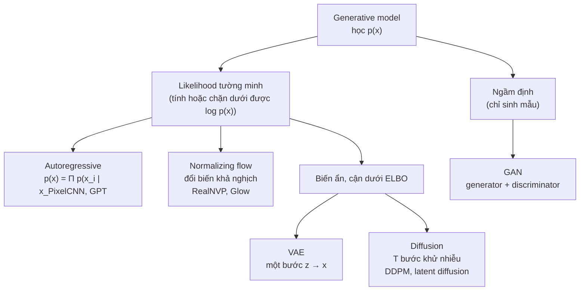
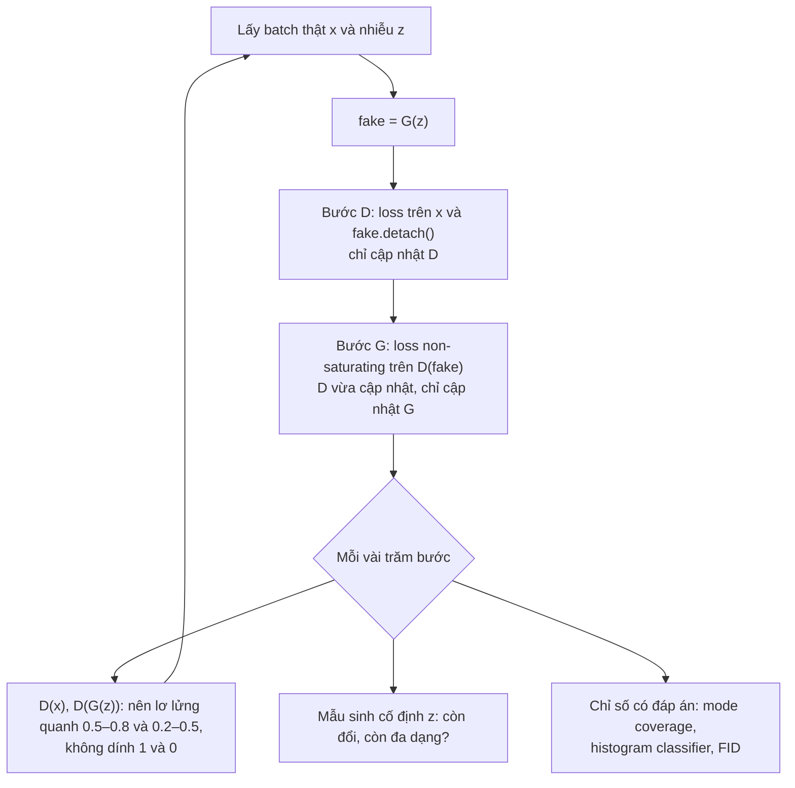
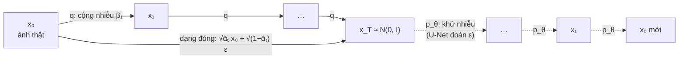
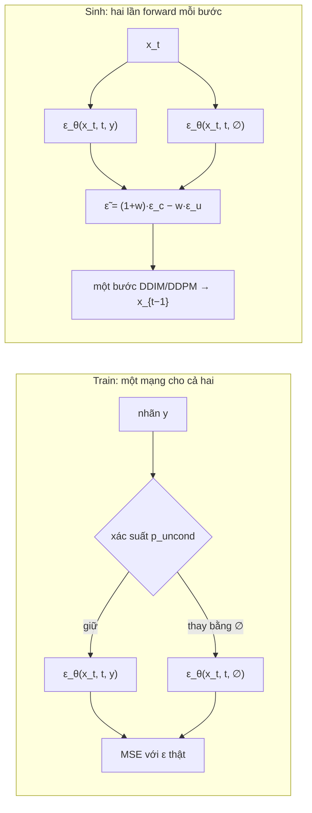

# Generative Models

Mọi model ở các module trước học $$p(y \mid x)$$: cho một ảnh, đoán nhãn. Module này học thứ khó hơn nhiều,
$$p(x)$$: phân phối của chính dữ liệu, đủ tốt để **sinh** ra ảnh mới chưa từng có trong tập train. Bốn họ model
đi theo thứ tự lịch sử và cũng là thứ tự ý tưởng: **autoencoder** (nén rồi giải nén), **VAE** (autoencoder có xác
suất, học bằng cận dưới ELBO), **GAN** (hai mạng đấu nhau, không cần likelihood) và **diffusion** (học cách khử
nhiễu từng bước, nền của Stable Diffusion, DALL·E 3, Sora). Mỗi họ đều **tự viết phần lõi trước** (ELBO và
reparameterization, vòng train DCGAN và đo mode collapse, forward/reverse process và noise schedule của DDPM), rồi mới
nhìn sang thư viện `diffusers` để đối chiếu.

Backprop, khởi tạo và optimizer ở [module 01](../01-nn-from-scratch/README.md); BatchNorm, GroupNorm, residual, mixed
precision ở [module 02](../02-pytorch-deep-dive/README.md); conv, conv transpose, U-Net và cách đọc CIFAR-10 ở
[module 03](../03-computer-vision/README.md) (mục 1 và 6). Attention trong U-Net và cross-attention cho text dùng lại
[module 05](../05-transformers-llm-architecture/README.md); sinh ảnh từ text với `diffusers` ở mức sản phẩm nằm ở
[module 18](../18-multimodal/README.md). Ba bộ dữ liệu thật:

```bash
uv run python data/download_dataset.py mnist      # 70 000 chữ số viết tay 28x28 (11 MB)
uv run python data/download_dataset.py cifar10    # 60 000 ảnh màu 32x32, 10 lớp (137 MB)
# FashionMNIST (70 000 ảnh quần áo 28x28, 30 MB) do torchvision tự tải vào data/raw/fashion-mnist khi chạy bài Intermediate 03
```

Mọi số liệu dưới đây là kết quả chạy thật (torch 2.14.1, torchvision 0.29.1, diffusers 0.41.0, kiểm ngày 2026-11-01): khối
code trong bài chạy trên CPU; thí nghiệm có ghi "PC" chạy trên RTX 3060 12GB (CPU Xeon E5-2696 v3) lúc GPU đang chia với một
bài train khác, nên **thời gian chỉ để so thứ bậc**, còn loss, accuracy, FID thì không phụ thuộc điều đó. Mỗi bài đều có
cấu hình chạy được trên CPU hoặc laptop GPU 4GB.

Sau module này bạn sẽ:

- Phân biệt các họ generative model theo cách chúng định nghĩa và học $$p(x)$$, và biết họ nào hợp bài toán nào.
- Tự suy ELBO, KL dạng đóng, reparameterization trick; đo khoảng hở giữa ELBO và log-likelihood bằng cận IWAE;
  nhận ra posterior collapse bằng số.
- Viết vòng train GAN đúng (detach, thứ tự bước, loss non-saturating), dựng DCGAN, và đo mode collapse bằng mode coverage
  và classifier thay vì nhìn loss.
- Tự viết forward process, posterior, noise schedule, loss và hai sampler (DDPM, DDIM) của diffusion; đọc đúng
  `diffusers` sau khi đã tự viết.
- Sinh ảnh có điều kiện bằng classifier-free guidance và đánh giá bằng FID, KID, classifier accuracy, biết các con số
  đó đáng tin tới đâu.

| Mức | Bài | Nội dung |
| --- | --- | --- |
| Basic | 01 vae-elbo | KL dạng đóng, reparameterization, log-likelihood Bernoulli, ELBO, cận importance-weighted |
| Basic | 02 gan-objectives | loss D, G saturating và non-saturating, D tối ưu và JS, gradient penalty, mode coverage |
| Basic | 03 ddpm-forward-posterior | schedule linear và cosine, $$q(x_t \mid x_0)$$ dạng đóng, posterior, mean của bước ngược |
| Intermediate | 01 vae-mnist | autoencoder và VAE trên MNIST, cận IWAE, active units, $$\beta$$-VAE |
| Intermediate | 02 dcgan-mode-collapse | GAN 2D trên 8 Gauss, DCGAN trên MNIST, chẩn đoán mode collapse |
| Intermediate | 03 ddpm-fashion-mnist | U-Net nhỏ, DDPM và DDIM tự viết, EMA, so với `diffusers` |
| Advanced | 01 class-conditional-diffusion | diffusion theo class trên CIFAR-10, classifier-free guidance, FID/KID (portfolio) |
| Advanced | 02 debug-broken-ddpm | sửa một pipeline DDPM hỏng "im lặng" |

## 1. Mô hình sinh: học phân phối của dữ liệu

### Bài toán

Cho các mẫu $$x^{(1)}, \dots, x^{(N)}$$ rút từ một phân phối chưa biết $$p_{data}$$, học một model $$p_\theta$$ sao cho
$$p_\theta \approx p_{data}$$. "Xấp xỉ" có thể hiểu theo hai nghĩa, và hai nghĩa này kéo các họ model về hai hướng:

- **Mật độ (density)**: tính được $$p_\theta(x)$$ cho một $$x$$ bất kỳ. Học bằng maximum likelihood, tức minimize
  $$\mathrm{KL}(p_{data} \,\|\, p_\theta)$$, giống mọi loss ở module 01 (cross-entropy cũng là maximum likelihood).
- **Lấy mẫu (sampling)**: sinh được $$x \sim p_\theta$$ nhanh, mẫu đẹp và đa dạng. Không nhất thiết tính được $$p_\theta(x)$$.

Một model có thể giỏi cái này mà dở cái kia. Ví dụ đơn giản nhất: coi mỗi pixel MNIST là một Bernoulli độc lập với xác suất
bằng độ sáng trung bình của pixel đó trên tập train. Model này có likelihood tính được ngay:

```python
import gzip
import math
from pathlib import Path

import numpy as np

ROOT = next(p for p in [Path.cwd(), *Path.cwd().parents] if (p / "pyproject.toml").exists())

def read_images(name):
    data = gzip.open(ROOT / "data/raw/mnist" / name).read()
    return np.frombuffer(data, np.uint8, offset=16).reshape(-1, 784) / 255.0

train, test = read_images("train-images-idx3-ubyte.gz"), read_images("t10k-images-idx3-ubyte.gz")

# Model 1: mỗi pixel một Bernoulli độc lập, xác suất = mean pixel đó trên tập train (kẹp để tránh log 0)
p = np.clip(train.mean(0), 1e-3, 1 - 1e-3)
nll = -(test * np.log(p) + (1 - test) * np.log(1 - p)).sum(1).mean()
print(f"Bernoulli độc lập từng pixel: {nll:.1f} nats/ảnh = {nll / (784 * math.log(2)):.3f} bits/dim")

# Model 2: "đoán mò" p = 0.5 mọi pixel
print(f"p = 0.5 mọi pixel           : {784 * math.log(2):.1f} nats/ảnh = 1.000 bits/dim")

# Mẫu sinh từ model 1 trông thế nào: tỉ lệ pixel sáng (> 0.5) so với ảnh thật
rng = np.random.default_rng(0)
samples = (rng.random((1000, 784)) < p).astype(float)
print("pixel sáng mỗi ảnh: thật", round((test > 0.5).sum(1).mean(), 1), "| mẫu sinh", round(samples.sum(1).mean(), 1))
```

Model độc lập từng pixel đạt **206.0 nats/ảnh (0.379 bits/dim)** trên 10 000 ảnh test, tốt hơn hẳn mức đoán mò 543.4. Mẫu
sinh từ nó có đúng số pixel sáng trung bình (102.5 so với 105.2 của ảnh thật) nhưng chỉ là một đám nhiễu hình bầu dục: model
không biết pixel cạnh nhau phải sáng cùng nhau. Mọi model trong module này là các cách khác nhau để học **sự phụ thuộc giữa
các chiều**. Con số 206 là mốc: VAE MLP ở bài Intermediate 01 đạt khoảng **99.8** nats/ảnh trên cùng dữ liệu.

Đơn vị hay dùng là **bits per dimension**: NLL tính bằng nats chia cho $$D\ln 2$$, với $$D$$ là số chiều (784 với MNIST, 3 072
với CIFAR-10). Nó cho phép so model trên ảnh có kích thước khác nhau. Chú ý: likelihood trên pixel liên tục và trên pixel rời
rạc 256 mức là hai con số khác nhau; so bits/dim giữa các paper phải chắc chúng dùng cùng cách lượng tử hoá (dequantization).

### Bản đồ các họ model



| Họ | Học bằng | Sinh mẫu | log p(x) | Chất lượng ảnh | Phủ hết dữ liệu | Train |
| --- | --- | --- | --- | --- | --- | --- |
| Autoregressive | maximum likelihood chính xác | chậm, tuần tự từng chiều | chính xác | tốt | tốt | ổn định |
| Normalizing flow | maximum likelihood chính xác | một lần forward | chính xác | trung bình | tốt | ổn định, kiến trúc gò bó |
| VAE | ELBO (cận dưới) | một lần forward | cận dưới | mờ | tốt | ổn định |
| GAN | trò chơi minimax | một lần forward | không có | sắc nét | dễ thiếu mode | khó, dễ hỏng |
| Diffusion | ELBO đơn giản hoá (khử nhiễu) | chậm: 10 tới 1 000 lần forward | cận dưới | tốt nhất hiện nay | tốt | ổn định |

Ba cột cuối là "tam giác" hay được nhắc (generative learning trilemma, Xiao et al. 2022): chất lượng mẫu, độ phủ (đa dạng) và
tốc độ sinh; mỗi họ cổ điển chỉ giỏi hai trong ba. Phần lớn nghiên cứu từ 2021 là tìm cách lấy cả ba: diffusion ít bước (DDIM,
distillation, consistency model), GAN được ổn định hoá, latent diffusion chạy trong không gian nén của một autoencoder.

### Quyết định thực tế

- Sinh ảnh, âm thanh, video chất lượng cao, có điều kiện (text, class, ảnh khác): **diffusion** (hoặc flow matching, họ hàng gần
  của nó), thường trong latent space của một autoencoder. Đây là mặc định năm 2026.
- Cần sinh rất nhanh (thời gian thực, một lần forward), dữ liệu hẹp (mặt người, một loại sản phẩm), hoặc làm loss phụ để ảnh
  sắc (super-resolution, decoder của autoencoder): **GAN** hoặc loss adversarial.
- Cần biểu diễn nén, phát hiện bất thường, hoặc latent space có cấu trúc để nội suy: **autoencoder / VAE**.
- Text và chuỗi rời rạc: **autoregressive** (module 05). Diffusion cho text tồn tại nhưng chưa thay được.
- Lỗi hay gặp: so NLL giữa model khác cách xử lý pixel (nhị phân hoá, liên tục, 256 mức); kết luận "model tốt" chỉ vì vài mẫu
  được chọn tay trông đẹp; quên rằng model sinh có thể **thuộc lòng** tập train (mục 7).

## 2. Autoencoder: nén được chưa chắc sinh được

### Cấu trúc

Một **autoencoder** gồm encoder $$z = f_\phi(x)$$ nén $$x$$ xuống một vector **latent** ít chiều, và decoder
$$\hat x = g_\theta(z)$$ dựng lại. Train để tái tạo: minimize $$\ell(x, g_\theta(f_\phi(x)))$$, ví dụ MSE hoặc
binary cross-entropy từng pixel. Điểm thắt (bottleneck) buộc model giữ lại thông tin quan trọng nhất.

- **Linear autoencoder** (không activation, loss MSE) học đúng **không gian con của PCA** (Baldi và Hornik, 1989): cùng không
  gian với $$k$$ thành phần chính đầu, dù các vector cơ sở có thể bị xoay. Autoencoder phi tuyến là PCA "cong".
- **Denoising autoencoder** (Vincent et al., 2008): đưa vào $$\tilde x = x + \text{nhiễu}$$, bắt tái tạo $$x$$ sạch. Model phải học
  cấu trúc dữ liệu để biết bỏ đi phần nào. Đây là tổ tiên trực tiếp của diffusion (mục 5): diffusion chính là một denoising
  autoencoder được train ở **mọi mức nhiễu** rồi dùng lặp lại.

### Vì sao không lấy decoder đi sinh ảnh

Ý tưởng tự nhiên: train xong, bỏ encoder, chọn một $$z$$ bất kỳ rồi decode. Thất bại vì không có gì ép các mã $$z$$ nằm ở một vùng
biết trước. Bài Intermediate 01 đo trên MNIST (MLP 784-512-16, 20 epoch, CPU):

| Model | BCE tái tạo trên test (nats/ảnh) | Std mã latent theo chiều | Mẫu từ $$z \sim \mathcal{N}(0, I)$$: tỉ lệ classifier tự tin > 0.9 |
| --- | --- | --- | --- |
| Autoencoder, latent 16 | **69.1** | 2.98 tới 4.30 | **0.000** |
| VAE, latent 16 | 79.7 (+ KL 23.8) | khoảng 1 (bị KL kéo về) | 0.334 |
| Ảnh thật (mốc) | | | 0.839 |

Autoencoder tái tạo tốt hơn VAE 10.6 nats mỗi ảnh, nhưng mã của nó trải rộng gấp 3 tới 4 lần $$\mathcal{N}(0, I)$$ và có "lỗ" giữa
các cụm: $$z$$ lấy ngẫu nhiên rơi vào vùng decoder chưa từng thấy, sinh ra nét nhoè không giống chữ số nào (không mẫu nào
được classifier nhận ra với độ tin > 0.9). VAE trả giá ở tái tạo để đổi lấy một latent space **liền và đã biết phân phối**.

### Quyết định thực tế

- Autoencoder vẫn rất hữu dụng khi **không cần sinh**: nén, giảm chiều phi tuyến, khởi tạo, và **phát hiện bất thường**
  (train trên dữ liệu bình thường, mẫu có lỗi tái tạo cao là bất thường; module 12 track DS).
- Latent diffusion (Stable Diffusion) dùng một autoencoder (thực ra là VAE với KL rất nhỏ, cộng loss perceptual và adversarial)
  để nén ảnh 512×512×3 xuống 64×64×4, rồi chạy diffusion trong không gian đó: rẻ hơn khoảng 48 lần số chiều.
- Lỗi hay gặp: latent quá rộng nên autoencoder học hàm gần đồng nhất (tái tạo hoàn hảo, latent vô nghĩa); dùng sigmoid + MSE
  cho ảnh nhị phân (gradient bão hoà như mục 3 module 01); đánh giá bằng lỗi tái tạo trên tập train.

## 3. VAE: ELBO, reparameterization và posterior collapse

### Model biến ẩn và ELBO

VAE (Kingma và Welling, 2014; Rezende et al., 2014) coi mỗi ảnh được sinh từ một biến ẩn: $$z \sim p(z) = \mathcal{N}(0, I)$$,
rồi $$x \sim p_\theta(x \mid z)$$ với decoder là mạng nơ-ron. Likelihood $$p_\theta(x) = \int p_\theta(x \mid z)p(z)\,dz$$ không tính
được (tích phân trên mọi $$z$$), và posterior $$p_\theta(z \mid x)$$ cũng vậy. Thêm một encoder $$q_\phi(z \mid x)$$ xấp xỉ posterior,
rồi viết

$$
\log p_\theta(x) = \underbrace{\mathbb{E}_{q_\phi(z \mid x)}\big[\log p_\theta(x \mid z)\big] - \mathrm{KL}\big(q_\phi(z \mid x)\,\|\,p(z)\big)}_{\text{ELBO}(x)} + \mathrm{KL}\big(q_\phi(z \mid x)\,\|\,p_\theta(z \mid x)\big)
$$

Số hạng cuối không âm, nên ELBO là **cận dưới** của $$\log p_\theta(x)$$ (evidence lower bound), bằng nhau đúng khi $$q$$ trùng posterior
thật. Maximize ELBO theo cả $$\theta$$ và $$\phi$$ làm hai việc cùng lúc: đẩy likelihood lên, và kéo $$q$$ về gần posterior. Hai số
hạng của ELBO có nghĩa rõ ràng:

- **Reconstruction** $$\mathbb{E}_q[\log p_\theta(x \mid z)]$$: mã $$z$$ của ảnh phải đủ thông tin để dựng lại ảnh.
- **KL** $$\mathrm{KL}(q(z \mid x)\,\|\,p(z))$$: mã của từng ảnh không được đi quá xa prior. Đây là thứ lấp "lỗ" trong latent space
  ở mục 2. Theo lý thuyết thông tin, nó là số nats mà mã $$z$$ mang về $$x$$ (chặn trên của mutual information trung bình).

Với $$q = \mathcal{N}(\mu, \mathrm{diag}(\sigma^2))$$ và $$p = \mathcal{N}(0, I)$$, KL có dạng đóng, cộng trên $$d$$ chiều latent:

$$
\mathrm{KL} = \frac12\sum_{j=1}^{d}\left(\mu_j^2 + \sigma_j^2 - 1 - \log\sigma_j^2\right)
$$

Encoder trả $$\log\sigma^2$$ (`logvar`) thay vì $$\sigma$$ để không phải ràng buộc dương và tránh $$\log 0$$. Bài Basic 01 viết công thức
này và kiểm với `torch.distributions`.

### Reparameterization trick

ELBO có kỳ vọng theo $$q_\phi$$, mà $$q_\phi$$ phụ thuộc chính tham số $$\phi$$ cần lấy gradient. Lấy mẫu $$z \sim q_\phi$$ trực tiếp thì
gradient không đi qua được phép lấy mẫu. Cách giải: viết $$z = \mu_\phi(x) + \sigma_\phi(x)\odot\varepsilon$$ với
$$\varepsilon \sim \mathcal{N}(0, I)$$ **không phụ thuộc** $$\phi$$. Kỳ vọng thành kỳ vọng theo $$\varepsilon$$, và gradient đi thẳng qua
$$\mu, \sigma$$ như mọi phép tính khác. Cách tổng quát hơn là **score function estimator** (REINFORCE, cũng là policy gradient của
module 07): $$\nabla_\phi \mathbb{E}_{q_\phi}[f(z)] = \mathbb{E}_{q_\phi}[f(z)\nabla_\phi \log q_\phi(z)]$$, dùng được cả khi $$z$$ rời rạc, nhưng
phương sai lớn hơn nhiều. So hai cách trên một bài toán có đáp số biết trước:

```python
import torch

torch.manual_seed(0)
# Mục tiêu: gradient theo mu của E_{z ~ N(mu, 1)} [z^2] = mu^2 + 1, đáp số đúng là 2 * mu
mu, n, trials = torch.tensor(1.5), 100, 2000
est_score, est_reparam = [], []
for _ in range(trials):
    eps = torch.randn(n)
    z = mu + eps
    est_score.append((z ** 2 * (z - mu)).mean())        # score function (REINFORCE): f(z) * d/dmu log N(z; mu, 1)
    m = mu.clone().requires_grad_()
    ((m + eps) ** 2).mean().backward()                   # reparameterization: gradient đi qua z = mu + eps
    est_reparam.append(m.grad)
for name, est in [("score function", est_score), ("reparameterization", est_reparam)]:
    est = torch.stack(est)
    print(f"{name:19s}: trung bình {est.mean():.3f} (đúng 3.000), độ lệch chuẩn {est.std():.3f}")
```

Cả hai đều không chệch (trung bình 3.018 và 3.000), nhưng độ lệch chuẩn **0.697** so với **0.194**: score function cần khoảng
13 lần số mẫu để ồn ngang reparameterization. Trong VAE thật với hàng trăm nghìn tham số, khoảng cách còn lớn hơn; đó là lý do
VAE train được bằng một mẫu $$z$$ mỗi ảnh.

### Likelihood của decoder quyết định mẫu trông thế nào

- **Bernoulli** từng pixel (decoder trả logits, loss là binary cross-entropy cộng trên pixel): hợp với ảnh gần nhị phân như MNIST
  (81.5% pixel đúng bằng 0 hoặc 1). Với ảnh xám nó vẫn dùng được nhưng không còn là một phân phối chuẩn hoá đúng trên $$[0, 1]$$
  (continuous Bernoulli, Loaiza-Ganem và Cunningham 2019, sửa chỗ này).
- **Gaussian** với phương sai cố định $$\sigma^2$$: $$-\log p(x \mid z) = \frac{1}{2\sigma^2}\lVert x - \hat x\rVert^2 + \text{hằng}$$, tức MSE. Chọn
  $$\sigma$$ là chọn trọng số giữa tái tạo và KL: MSE "trần" ngầm định $$\sigma^2 = 1/2$$, quá lớn với pixel trong $$[0, 1]$$, nên KL thắng
  và ảnh mờ.

Vì sao mẫu VAE **mờ**: decoder dự đoán **trung bình** của $$p(x \mid z)$$, mà mỗi $$z$$ ứng với nhiều ảnh hơi khác nhau (nét dày, mỏng,
lệch vài pixel); trung bình của chúng là một ảnh nhoè. GAN không có vấn đề này vì không dựng ảnh trung bình, và diffusion tránh
nó bằng cách sinh qua nhiều bước, mỗi bước chỉ phải đoán một chút.

### Đo ELBO cách log-likelihood bao xa: cận IWAE

ELBO chỉ là cận dưới. Importance sampling với $$K$$ mẫu cho cận chặt hơn (Burda et al., 2016):

$$
\mathcal{L}_K = \mathbb{E}\left[\log\frac{1}{K}\sum_{k=1}^{K}\frac{p_\theta(x \mid z_k)\,p(z_k)}{q_\phi(z_k \mid x)}\right], \qquad
\mathcal{L}_1 = \text{ELBO} \le \mathcal{L}_K \le \mathcal{L}_{K+1} \le \log p_\theta(x)
$$

Tính tổng các tỉ số trong không gian log (log-sum-exp, như softmax ở module 01): mỗi số hạng cỡ $$e^{-100}$$, cộng trực tiếp là
underflow về 0. VAE-16 ở bài Intermediate 01 trên 10 000 ảnh test MNIST: $$-\mathcal{L}_1 =$$ **103.5**, $$-\mathcal{L}_{100} =$$ **99.8** nats/ảnh
(0.184 bits/dim). Khoảng hở 3.7 nats là cái giá của việc $$q$$ chỉ là Gauss đường chéo; khi báo cáo log-likelihood của VAE, luôn báo
$$\mathcal{L}_K$$ với $$K$$ lớn, và ghi rõ $$K$$.

### β-VAE và posterior collapse

Thay KL bằng $$\beta\,\mathrm{KL}$$: $$\beta > 1$$ ép latent gọn hơn (Higgins et al., 2017, dùng để học biểu diễn "tách bạch"), $$\beta < 1$$ ưu
tiên tái tạo. Khi KL quá mạnh, decoder học cách **bỏ qua** một số chiều $$z$$: với những chiều đó, $$q(z_j \mid x) = p(z_j)$$ với mọi
$$x$$, KL của chúng bằng 0 và chúng không mang thông tin gì. Đó là **posterior collapse**. Đo bằng **active units**: chiều $$j$$ là
"sống" nếu $$\mathrm{Var}_x(\mathbb{E}_q[z_j]) > 0.01$$. Bài Intermediate 01 (VAE-16, 20 epoch, test MNIST, CPU):

| $$\beta$$ | Recon (nats) | KL (nats) | $$-$$ELBO ($$\beta = 1$$) | Active units | Mẫu sinh tự tin > 0.9 |
| --- | --- | --- | --- | --- | --- |
| 0.5 | 74.5 | 30.6 | 105.1 | 16/16 | 0.269 |
| 1 | 79.7 | 23.8 | **103.5** | 16/16 | 0.334 |
| 4 | 107.7 | 9.8 | 117.5 | 12/16 | 0.406 |
| 10 | 144.1 | 3.8 | 147.9 | **6/16** | 0.409 |

Đọc bảng: $$\beta = 1$$ cho ELBO tốt nhất (đúng thứ nó tối ưu); $$\beta = 10$$ giết 10 trên 16 chiều latent và tái tạo tệ gần gấp đôi,
nhưng mẫu sinh lại "rõ" hơn theo classifier, vì latent gọn hơn nên ít vùng trống hơn. Không có một $$\beta$$ đúng cho mọi việc: chọn
theo mục tiêu (likelihood, chất lượng mẫu, hay biểu diễn), và đo đúng mục tiêu đó.

Posterior collapse nặng nhất khi decoder **quá mạnh**, tự mô hình hoá được dữ liệu mà không cần $$z$$ (decoder autoregressive như
PixelCNN hay LSTM cho text). Các cách chữa: KL annealing (tăng $$\beta$$ từ 0 lên 1 trong vài epoch đầu), free bits (không phạt KL dưới
một ngưỡng mỗi chiều), decoder yếu hơn.

### Lỗi hay gặp

- Nhầm `logvar` với log std: $$\sigma = e^{\text{logvar}/2}$$, không phải $$e^{\text{logvar}}$$. Không báo lỗi, chỉ học sai thang đo.
- Dùng `F.binary_cross_entropy(..., reduction="mean")` (trung bình trên 784 pixel) cùng KL cộng trên chiều latent: tái tạo bị chia
  784 lần, tương đương $$\beta = 784$$, posterior collapse gần như toàn bộ, mẫu sinh là một ảnh trung bình mờ.
- Tính KL trung bình trên chiều latent thay vì cộng; lấy `sigmoid` rồi `log` thay vì làm việc với logits (NaN khi logits lớn).
- Báo "log-likelihood" mà thật ra là ELBO một mẫu; so ELBO của model nhị phân hoá MNIST với model ảnh xám.

## 4. GAN: hai mạng đấu nhau, và mode collapse

### Trò chơi minimax

GAN (Goodfellow et al., 2014) bỏ hẳn likelihood. Generator $$G$$ biến nhiễu $$z \sim p(z)$$ thành mẫu $$G(z)$$; discriminator $$D$$ trả xác suất
một mẫu là thật. Hai mạng chơi trò chơi

$$
\min_G \max_D\; V(D, G) = \mathbb{E}_{x \sim p_{data}}[\log D(x)] + \mathbb{E}_{z \sim p(z)}[\log(1 - D(G(z)))]
$$

Với $$G$$ cố định, $$D$$ tối ưu có dạng đóng $$D^*(x) = \frac{p_{data}(x)}{p_{data}(x) + p_g(x)}$$. Thay vào:

$$
V(D^*, G) = -\log 4 + 2\,\mathrm{JS}(p_{data}\,\|\,p_g)
$$

nên với $$D$$ tối ưu, $$G$$ đang minimize Jensen-Shannon divergence, đạt cực tiểu $$-\log 4$$ đúng khi $$p_g = p_{data}$$ (khi đó $$D^* = 1/2$$
khắp nơi). Bài Basic 02 kiểm đẳng thức này trên histogram.

Hai điều lý thuyết không nói: $$D$$ không bao giờ tối ưu (mỗi bước chỉ cập nhật một chút), và $$G, D$$ là mạng nơ-ron trên phân phối
liên tục số chiều cao, nơi $$p_{data}$$ và $$p_g$$ thường nằm trên hai "đa tạp" gần như không giao nhau. Khi đó JS bằng hằng $$\log 2$$ bất kể
hai phân phối gần hay xa, và gradient của nó về $$G$$ bằng 0 (Arjovsky và Bottou, 2017). Đó là gốc của mọi khó khăn khi train GAN.

### Saturating và non-saturating

Loss của $$G$$ trong minimax là $$\log(1 - D(G(z)))$$. Đầu quá trình train, $$D$$ phân biệt dễ, $$D(G(z)) \approx 0$$, và với logit $$l$$
($$D = \sigma(l)$$):

$$
\frac{\partial}{\partial l}\log(1 - \sigma(l)) = -\sigma(l) \approx 0, \qquad
\frac{\partial}{\partial l}\big(-\log\sigma(l)\big) = -(1 - \sigma(l)) \approx -1
$$

Bản minimax gốc ("saturating") gần như không có gradient đúng lúc $$G$$ cần học nhất; bản "non-saturating" $$-\log D(G(z))$$ có cùng điểm
cố định nhưng gradient lớn khi $$G$$ còn tệ. Goodfellow đã đề xuất bản thứ hai ngay trong bài báo gốc, và đó là mặc định. Thí nghiệm
DCGAN trên MNIST ở bài Intermediate 02 (cùng mọi thứ, chỉ đổi loss của G) cho thấy khi nào điều đó quan trọng: với siêu tham số chuẩn hai bản
cho kết quả gần như nhau, nhưng khi D mạnh hơn hẳn (lr của D gấp 10), bản saturating có $$D(G(z))$$ rơi về 0.000 và G kẹt ở 3 lớp chữ số, còn
bản non-saturating vẫn học được 9 lớp (bảng cuối mục này).

### DCGAN: các quy tắc làm GAN ảnh train được

Radford et al. (2016) tìm ra một bộ quy tắc kiến trúc sau rất nhiều thử nghiệm: không pooling (conv stride 2 ở D, conv transpose
stride 2 ở G); BatchNorm ở cả hai mạng trừ output của G và input của D; ReLU trong G với Tanh ở output (ảnh chuẩn hoá về
$$[-1, 1]$$), LeakyReLU 0.2 trong D; Adam lr 2e-4, $$\beta_1 = 0.5$$; khởi tạo $$\mathcal{N}(0, 0.02^2)$$.

Conv transpose (module 03 mục 6) có một bẫy riêng cho model sinh: khi kernel không chia hết cho stride, các cửa sổ chồng nhau
**không đều**, để lại vân bàn cờ (checkerboard artifact, Odena et al., 2016). Thấy ngay khi cho mọi trọng số bằng 1:

```python
import torch
from torch import nn

# ConvTranspose2d kernel 3 stride 2 (kernel không chia hết cho stride) và kernel 4 stride 2, mọi trọng số bằng 1, input toàn 1
for k, p in [(3, 1), (4, 1)]:
    up = nn.ConvTranspose2d(1, 1, kernel_size=k, stride=2, padding=p, bias=False)
    nn.init.ones_(up.weight)
    out = up(torch.ones(1, 1, 4, 4)).detach()[0, 0]
    print(f"kernel {k}, stride 2 -> {tuple(out.shape)}, giá trị ở giữa ảnh:")
    print(out[2:6, 2:6].int().tolist())
```

Kernel 3 stride 2 cho các pixel nhận 1, 2 hoặc 4 lần đóng góp xen kẽ (`[[1, 2, 1, 2], [2, 4, 2, 4], ...]`): ảnh đầu ra có vân ô
vuông ngay cả khi input phẳng. Kernel 4 stride 2 (DCGAN dùng) cho mọi pixel ở giữa đúng 4 đóng góp. Cách khác hay dùng trong U-Net
của diffusion: upsample nearest rồi conv 3×3, không bao giờ có vân.

### Mode collapse

$$G$$ chỉ cần lừa được $$D$$ **hiện tại**. Nếu $$D$$ đang đánh giá một vùng là "rất thật", cách rẻ nhất để giảm loss của $$G$$ là đổ mọi $$z$$
về vùng đó. $$D$$ học ra và phạt vùng đó, $$G$$ nhảy sang vùng khác: model "nhảy mode" thay vì phủ hết. Trường hợp cực đoan, mọi
$$z$$ cho cùng một ảnh. Lý thuyết minimax nói $$\min_G\max_D$$, nhưng gradient descent xen kẽ không phân biệt được nó với
$$\max_D\min_G$$, mà nghiệm của bài toán sau chính là "đổ hết vào một điểm" (Goodfellow, NIPS 2016 tutorial).

Đo mode collapse cần dữ liệu biết đáp án. Bộ đồ chơi chuẩn là **8 Gauss trên một vòng tròn** (bán kính 2, độ lệch 0.02): một mode
được "phủ" khi có ít nhất 10 mẫu nằm trong 3 độ lệch chuẩn quanh tâm. Bài Intermediate 02 (MLP 2 tầng ẩn 128, 3 000 vòng, batch 256,
3 seed, CPU):

| Cấu hình | Mode phủ (3 seed) | Mẫu chất lượng cao | Độ trải std (dữ liệu: 1.41) |
| --- | --- | --- | --- |
| Minimax gốc (saturating) | 8 / 8 / 8 | 0.41 tới 0.68 | 1.40 tới 1.42 |
| Non-saturating | 8 / 8 / 8 | 0.54 tới 0.65 | 1.39 tới 1.44 |
| Non-saturating, G cập nhật 5 lần mỗi vòng | 1 / 0 / 0 | 0.00 tới 0.01 | **0.10, 0.14**, 1.03 |
| WGAN-GP (critic 5 lần mỗi vòng) | 8 / 8 / 8 | 0.32 tới 0.37 | 1.36 tới 1.37 |

Với cấu hình chuẩn, cả hai loss đều phủ đủ 8 mode, nhưng số mode phủ đếm mỗi 500 vòng **nhảy lên xuống** (`[1, 2, 8, 5, 8, 8]` với
non-saturating seed 0) trước khi ổn định: đó là động lực đuổi bắt ở trên. Cho G cập nhật 5 lần mỗi bước D (G tối ưu theo một D gần như đứng
yên) thì mẫu co về một vùng nhỏ cỡ 0.1, không nằm trên mode nào: mode collapse đúng nghĩa đen. WGAN-GP phủ đủ mode ở mọi seed, đổi lại mẫu
chưa "sắc" bằng sau cùng số vòng.

Với ảnh thật không có tâm mode để đếm, dùng một **classifier** đã train làm giám khảo: histogram lớp dự đoán của 10 000 mẫu sinh
(mất lớp nào, lệch về lớp nào, đo bằng KL tới phân phối đều) và tỉ lệ mẫu mà classifier tự tin. DCGAN trên MNIST ở bài
Intermediate 02:

| DCGAN, 3 epoch × 20 000 ảnh (CPU) | Tự tin > 0.9 | Số lớp ≥ 1% | KL tới đều | D(x) / D(G(z)) | Histogram 10 lớp |
| --- | --- | --- | --- | --- | --- |
| Ảnh test thật (mốc) | 0.951 | 10 | 0.002 | | |
| Chuẩn (lr 2e-4 cả hai), non-saturating | 0.400 | 9 | 0.315 | 0.735 / 0.266 | `[706, 56, 1264, 3029, 517, 898, 219, 1276, 453, 1582]` |
| D mạnh (lr D 2e-3), non-saturating | 0.363 | 9 | 0.357 | 0.816 / 0.180 | `[491, 78, 1344, 3324, 690, 633, 129, 1133, 622, 1556]` |
| D mạnh, saturating | **0.093** | **3** | **1.208** | **1.000 / 0.000** | `[1, 16, 3949, 3829, 0, 2180, 0, 8, 17, 0]` |

Cùng thí nghiệm trên GPU (PC, 15 epoch × 60 000 ảnh): bản chuẩn cân bằng hơn hẳn (tự tin 0.617, KL 0.042, đủ 10 lớp), còn D mạnh + saturating sụp hẳn:
$$D(G(z)) = 0.000$$ từ epoch 2, và từ epoch 8 có **97%** mẫu bị chấm là chữ 1 (`[0, 9710, 0, 0, 0, 290, 0, 0, 0, 0]`).

Hai điều đáng nhớ. Mode collapse trên ảnh thật không phải lúc nào cũng là "mọi ảnh giống hệt nhau"; dạng nhẹ là histogram lệch: với ngân sách
CPU ngắn, DCGAN chuẩn sinh chữ 3 gấp 54 lần chữ 1, điều mà nhìn lưới 64 ảnh không thấy. Và ở dòng cuối, loss của G gần 0 đúng lúc G hỏng nặng nhất:
loss GAN không phải thước đo chất lượng.

### Khi train GAN thì nhìn gì



- **Loss của G và D không nói lên chất lượng**: chúng là hai bên của một trò chơi, một bên giảm thì bên kia tăng. Loss D về 0 là dấu
  hiệu xấu ($$D$$ thắng tuyệt đối, $$G$$ hết gradient), không phải tốt.
- Hai lỗi cài đặt kinh điển: không `detach()` mẫu giả ở bước D (gradient của loss D chảy vào G, rồi `opt_g.zero_grad()` xoá đi nên
  không thấy lỗi, chỉ tốn gấp đôi tính toán; nặng hơn là khi gradient đó được tích luỹ vào G), và gọi lại `G(z)` hoặc dùng logits cũ
  của D chưa cập nhật ở bước G. Bài Intermediate 02 có test so từng tham số với bản tham chiếu.

### Các cách ổn định hoá

| Kỹ thuật | Ý tưởng | Ghi chú |
| --- | --- | --- |
| WGAN (Arjovsky et al., 2017) | thay JS bằng khoảng cách Wasserstein-1, D thành "critic" không sigmoid, phải 1-Lipschitz | có gradient cả khi hai phân phối rời nhau |
| WGAN-GP (Gulrajani et al., 2017) | ép Lipschitz bằng phạt $$(\lVert\nabla_{\hat x} D(\hat x)\rVert - 1)^2$$ trên điểm nội suy thật/giả | cần `create_graph=True`; Basic 02 |
| Spectral normalization (Miyato et al., 2018) | chia trọng số mỗi tầng của D cho giá trị kỳ dị lớn nhất | rẻ, `torch.nn.utils.parametrizations.spectral_norm` |
| TTUR (Heusel et al., 2017) | lr của D lớn hơn lr của G | cùng bài báo giới thiệu FID |
| Minibatch std, progressive growing, StyleGAN | cho D thấy độ đa dạng của batch; tăng độ phân giải dần | họ StyleGAN là đỉnh của GAN ảnh |
| R1 penalty (Mescheder et al., 2018) | phạt gradient của D chỉ trên ảnh thật | dùng trong StyleGAN2 |

### Quyết định thực tế

- Năm 2026, GAN thuần cho sinh ảnh tổng quát đã nhường chỗ cho diffusion. GAN còn mạnh ở: sinh một lần forward (thời gian thực),
  miền hẹp, super-resolution, và **loss adversarial phụ** cho decoder của autoencoder trong latent diffusion, hay để chưng cất
  diffusion về 1–4 bước (adversarial diffusion distillation).
- Bắt đầu từ một kiến trúc đã biết là train được (DCGAN, StyleGAN2) với đúng siêu tham số của nó; đổi một thứ mỗi lần.
- Theo dõi bằng chỉ số có đáp án (mode coverage trên dữ liệu đồ chơi, histogram classifier, FID mỗi vài nghìn bước), giữ checkpoint
  tốt nhất theo chỉ số đó: GAN có thể tệ đi khi train lâu hơn.

## 5. Diffusion: DDPM từ forward process tới sampler

### Forward process: phá dữ liệu thành nhiễu

DDPM (Ho et al., 2020, dựa trên Sohl-Dickstein et al., 2015) định nghĩa một chuỗi Markov cố định, không có tham số học, cộng dần
nhiễu Gauss vào ảnh qua $$T$$ bước:

$$
q(x_t \mid x_{t-1}) = \mathcal{N}\big(\sqrt{1 - \beta_t}\,x_{t-1},\ \beta_t I\big), \qquad t = 1, \dots, T
$$

Hệ số $$\sqrt{1-\beta_t}$$ co tín hiệu lại đúng mức để phương sai giữ ổn định (variance preserving): dữ liệu phương sai 1 vẫn có phương
sai 1 ở mọi bước. Đặt $$\alpha_t = 1 - \beta_t$$, $$\bar\alpha_t = \prod_{s=1}^{t}\alpha_s$$. Tổng các Gauss độc lập vẫn là Gauss, nên nhảy thẳng từ
$$x_0$$ tới bước bất kỳ được:

$$
q(x_t \mid x_0) = \mathcal{N}\big(\sqrt{\bar\alpha_t}\,x_0,\ (1 - \bar\alpha_t) I\big)
\quad\Longleftrightarrow\quad
x_t = \sqrt{\bar\alpha_t}\,x_0 + \sqrt{1 - \bar\alpha_t}\,\varepsilon,\ \ \varepsilon \sim \mathcal{N}(0, I)
$$

Dạng đóng này là thứ làm diffusion train rẻ: mỗi bước train chọn một $$t$$ ngẫu nhiên, tạo $$x_t$$ trong một phép tính, không phải chạy
$$t$$ bước. $$T$$ đủ lớn và $$\bar\alpha_T \approx 0$$ thì $$x_T$$ gần như là nhiễu thuần $$\mathcal{N}(0, I)$$.



### Noise schedule

Schedule $$\beta_1, \dots, \beta_T$$ quyết định tín hiệu mất nhanh hay chậm. Đo bằng **signal-to-noise ratio**
$$\mathrm{SNR}(t) = \bar\alpha_t/(1 - \bar\alpha_t)$$. Hai schedule kinh điển (chỉ số $$t$$ dưới đây theo quy ước 0-based của bài tập, $$t = 0$$ là bước 1 của
bài báo), số đo từ lời giải bài Basic 03:

| $$t$$ | 0 | 99 | 249 | 499 | 749 | 999 |
| --- | --- | --- | --- | --- | --- | --- |
| Linear ($$\beta$$ 1e-4 tới 0.02): $$\sqrt{\bar\alpha_t}$$ | 0.9999 | 0.947 | 0.724 | 0.280 | 0.058 | 0.0064 |
| Linear: SNR (dB) | 40.0 | 9.4 | 0.4 | -10.7 | -24.7 | -43.9 |
| Cosine ($$s = 0.008$$): $$\sqrt{\bar\alpha_t}$$ | 1.000 | 0.986 | 0.920 | 0.703 | 0.380 | 0.000 |
| Cosine: SNR (dB) | 43.8 | 15.4 | 7.4 | -0.1 | -7.7 | -86.1 |

Schedule linear của DDPM phá tín hiệu rất nhanh: tới bước 259 đã mất một nửa phương sai tín hiệu, sau bước 673 tín hiệu chỉ còn
dưới 10% biên độ, và **32.6%** số bước có SNR dưới -20 dB (gần như nhiễu thuần, model học ít ở đó). Schedule cosine (Nichol và
Dhariwal, 2021), định nghĩa trực tiếp $$\bar\alpha_t = f(t)/f(0)$$ với $$f(t) = \cos^2\!\big(\frac{t/T + s}{1 + s}\cdot\frac{\pi}{2}\big)$$, giữ nửa tín
hiệu tới bước 496 và chỉ 6.4% số bước dưới -20 dB: ngân sách train dàn đều hơn trên các mức nhiễu. Chênh lệch rõ nhất với ảnh
nhỏ (28×28, 32×32); với ảnh lớn, nhiều pixel tương quan nên cùng một mức nhiễu phá ít thông tin hơn, và người ta lại dịch
schedule về phía nhiễu nhiều hơn (Hoogeboom et al., 2023).

Chi tiết dễ bỏ qua: với linear, $$\bar\alpha_T = 4.04 \times 10^{-5}$$, **không phải 0**. Lúc train, $$x_T$$ vẫn còn một chút tín hiệu; lúc sinh, ta
bắt đầu từ nhiễu thuần. Lệch nhỏ này làm model khó sinh ảnh rất tối hoặc rất sáng (Lin et al., 2024, "zero terminal SNR"). Cosine có
$$\bar\alpha_T = 2.4 \times 10^{-9}$$ nhờ chặn $$\beta \le 0.999$$.

### Đảo ngược: posterior và mạng dự đoán nhiễu

Bước ngược $$q(x_{t-1} \mid x_t)$$ không tính được (cần biết phân phối dữ liệu), nhưng nếu biết thêm $$x_0$$ thì posterior là Gauss dạng
đóng (tích hai Gauss, bài Basic 03 suy và kiểm bằng định lý Bayes):

$$
q(x_{t-1} \mid x_t, x_0) = \mathcal{N}\big(\tilde\mu_t(x_t, x_0),\ \tilde\beta_t I\big), \quad
\tilde\mu_t = \frac{\sqrt{\bar\alpha_{t-1}}\,\beta_t}{1 - \bar\alpha_t}\,x_0 + \frac{\sqrt{\alpha_t}\,(1 - \bar\alpha_{t-1})}{1 - \bar\alpha_t}\,x_t, \quad
\tilde\beta_t = \frac{1 - \bar\alpha_{t-1}}{1 - \bar\alpha_t}\,\beta_t
$$

Model $$p_\theta(x_{t-1} \mid x_t) = \mathcal{N}(\mu_\theta(x_t, t), \sigma_t^2 I)$$ học bắt chước posterior này. ELBO của cả chuỗi tách thành tổng các
KL giữa hai Gauss, mỗi bước một số hạng. Ho et al. viết $$\mu_\theta$$ qua một mạng $$\varepsilon_\theta(x_t, t)$$ **dự đoán nhiễu** đã cộng vào:
thay $$x_0 = (x_t - \sqrt{1 - \bar\alpha_t}\,\varepsilon)/\sqrt{\bar\alpha_t}$$ vào $$\tilde\mu_t$$ được

$$
\mu_\theta(x_t, t) = \frac{1}{\sqrt{\alpha_t}}\left(x_t - \frac{\beta_t}{\sqrt{1 - \bar\alpha_t}}\,\varepsilon_\theta(x_t, t)\right)
$$

và mỗi số hạng KL thành, sai khác một trọng số theo $$t$$, $$\lVert\varepsilon - \varepsilon_\theta(x_t, t)\rVert^2$$. Bỏ trọng số đi được **loss "simple"**,
thứ mọi người dùng:

$$
L_{\text{simple}} = \mathbb{E}_{t \sim \mathcal{U}\{1..T\},\ x_0,\ \varepsilon}\Big[\big\lVert\varepsilon - \varepsilon_\theta\big(\sqrt{\bar\alpha_t}\,x_0 + \sqrt{1 - \bar\alpha_t}\,\varepsilon,\ t\big)\big\rVert^2\Big]
$$

Một vòng train là: lấy ảnh, lấy $$t$$ và $$\varepsilon$$ ngẫu nhiên, tạo $$x_t$$, hồi quy MSE. Không có minimax, không có KL cần cân bằng,
nên train ổn định như một bài hồi quy. Bỏ trọng số làm cận ELBO lỏng hơn (likelihood tệ hơn một chút) nhưng mẫu đẹp hơn, vì loss
dồn sức cho các mức nhiễu trung bình, nơi cấu trúc ảnh được quyết định.

Hai cách nhìn cùng một model, cho ra cùng một mạng:

- **Denoising**: $$\hat x_0 = (x_t - \sqrt{1 - \bar\alpha_t}\,\varepsilon_\theta)/\sqrt{\bar\alpha_t}$$ là ước lượng ảnh sạch tốt nhất (theo MSE) từ $$x_t$$.
- **Score**: theo công thức Tweedie, $$\nabla_{x_t}\log p(x_t) = -\varepsilon^*(x_t, t)/\sqrt{1 - \bar\alpha_t}$$. Mạng dự đoán nhiễu chính là
  (một bội của) **score**, hướng làm tăng mật độ dữ liệu; sinh ảnh là đi ngược dòng nhiễu theo score (Song et al., 2021, nhìn
  diffusion như một phương trình vi phân ngẫu nhiên). Cách nhìn này giải thích guidance ở mục 6.

Ngoài $$\varepsilon$$, mạng có thể dự đoán $$x_0$$ trực tiếp hoặc $$v = \sqrt{\bar\alpha_t}\,\varepsilon - \sqrt{1 - \bar\alpha_t}\,x_0$$ (Salimans và Ho, 2022);
ba cách tương đương về toán, khác ở trọng số ngầm theo $$t$$. $$v$$-prediction ổn định hơn ở hai đầu schedule và hay dùng khi chưng cất.

### Sinh mẫu: DDPM và DDIM

**DDPM (ancestral sampling)**: bắt đầu từ $$x_T \sim \mathcal{N}(0, I)$$, mỗi bước tính $$\mu_\theta$$ rồi cộng $$\sigma_t z$$, $$T$$ lần forward của mạng.
Ho et al. thử $$\sigma_t^2 = \beta_t$$ và $$\sigma_t^2 = \tilde\beta_t$$, hai cực tối ưu khi dữ liệu là nhiễu thuần và khi dữ liệu là một điểm; với
$$T = 1000$$ chúng cho kết quả gần như nhau. Hai mẹo hay dùng: kẹp $$\hat x_0$$ vào $$[-1, 1]$$ trước khi tính mean (ảnh không bao giờ ra khỏi
miền), và **không** cộng nhiễu ở bước cuối.

**DDIM** (Song, Meng, Ermon, 2021) để ý rằng loss chỉ dùng các marginal $$q(x_t \mid x_0)$$, không dùng cấu trúc Markov. Có cả một họ
quá trình ngược có cùng marginal; thành viên tất định ($$\eta = 0$$) đi theo

$$
x_{t_{prev}} = \sqrt{\bar\alpha_{t_{prev}}}\,\hat x_0 + \sqrt{1 - \bar\alpha_{t_{prev}}}\,\varepsilon_\theta(x_t, t)
$$

"giữ nguyên nhiễu đã đoán, đổi mức nhiễu". Vì không cộng nhiễu mới, có thể **nhảy cóc** qua một dãy con 50, 20, 10 bước của $$T$$ mà
vẫn dùng đúng model đã train với $$T = 1000$$, và cùng $$x_T$$ luôn cho cùng ảnh (nội suy trong không gian nhiễu được). Bài Intermediate 03
đo trên FashionMNIST (U-Net 1.05 triệu tham số, 8 000 bước train, PC):

| Sampler (model linear, EMA) | Lần forward | Tự tin > 0.9 | KL tới đều | Thời gian 1 000 ảnh |
| --- | --- | --- | --- | --- |
| DDPM | 1 000 | 0.499 | 0.064 | 108.5 s |
| DDIM | 100 | 0.448 | 0.060 | 11.0 s |
| DDIM | 50 | 0.445 | 0.059 | 5.5 s |
| DDIM | 10 | 0.380 | 0.078 | 1.1 s |
| DDPM, trọng số thô (không EMA) | 1 000 | 0.433 | 0.262 | 107.9 s |

Giám khảo là một CNN FashionMNIST; trên ảnh **thật** nó chỉ tự tin > 0.9 ở 0.674 số ảnh (áo, áo khoác, sơ mi dễ lẫn), nên 0.5 là mức khá. DDIM 50 bước
nhanh gấp 20 lần và mất khoảng 0.05 (với 1 000 mẫu, đổi seed nhiễu đã lệch khoảng 0.03); 10 bước thì sai số rời rạc hoá lộ rõ hơn.

### Đối chiếu với `diffusers`

Sau khi tự viết, đọc thư viện dễ hơn nhiều: `DDPMScheduler` giữ đúng các mảng $$\beta$$, $$\bar\alpha$$ ở trên, `add_noise` là $$q(x_t \mid x_0)$$ dạng đóng,
`step` là một bước của sampler. Khối dưới (chạy trên CPU, không tải model) so `add_noise` với công thức:

```python
import torch
from diffusers import DDPMScheduler

sched = DDPMScheduler(num_train_timesteps=1000, beta_schedule="linear", beta_start=1e-4, beta_end=0.02)
ab = sched.alphas_cumprod
print("alphas_cumprod tại 0, 499, 999:", [f"{ab[t].item():.4g}" for t in (0, 499, 999)])

x0 = torch.rand(2, 1, 4, 4) * 2 - 1
noise = torch.randn(2, 1, 4, 4, generator=torch.Generator().manual_seed(0))
t = torch.tensor([10, 900])
by_formula = ab[t].sqrt().view(-1, 1, 1, 1) * x0 + (1 - ab[t]).sqrt().view(-1, 1, 1, 1) * noise
print("add_noise khớp công thức:", torch.allclose(sched.add_noise(x0, noise, t), by_formula, atol=1e-6))

cos = DDPMScheduler(num_train_timesteps=1000, beta_schedule="squaredcos_cap_v2")
print("cosine: beta lớn nhất", round(cos.betas.max().item(), 4), "| alphas_cumprod cuối", f"{cos.alphas_cumprod[-1].item():.2e}")
sched.set_timesteps(50)
print("50 bước suy luận (5 bước đầu):", sched.timesteps[:5].tolist())
```

`alphas_cumprod` tại 0, 499, 999 là 0.9999, 0.07859, 4.036e-05 (khớp bảng trên: $$0.2803^2 \approx 0.0786$$), `add_noise` khớp công thức,
schedule `squaredcos_cap_v2` là cosine với $$\beta$$ chặn ở 0.999. Điểm khác cần biết: 50 bước suy luận của `diffusers` mặc định cách
đều kiểu "leading" (`[980, 960, 940, ...]`, bắt đầu từ 980 chứ không phải 999), khác dãy `linspace(0, 999, 50)` của bài tập. Hai cách
cho chất lượng gần nhau, nhưng khi so số với một paper, phải biết paper dùng dãy nào (Lin et al., 2024, phân tích các cách chọn dãy bước
này và cho thấy chúng đủ để đổi kết quả).

### Quyết định thực tế

- Mặc định hợp lý cho ảnh nhỏ: $$T = 1000$$, schedule cosine, dự đoán $$\varepsilon$$ (hoặc $$v$$), U-Net có GroupNorm và attention ở độ phân giải
  thấp, AdamW lr 1e-4 tới 2e-4, **EMA** trọng số (0.999 tới 0.9999), sinh bằng DDIM 50 bước hoặc một sampler ODE bậc cao (DPM-Solver).
- EMA gần như bắt buộc với diffusion: trọng số dao động nhiều giữa các bước vì loss ở mỗi $$t$$ rất ồn; trung bình trượt cho model mượt
  hơn hẳn: ở bảng trên, KL tới phân phối đều của mẫu sinh là 0.064 với EMA so với 0.262 với trọng số thô. Lưu cả
  trọng số thô và EMA trong checkpoint.
- Loss gần như đứng yên sau vài nghìn bước (FashionMNIST, schedule linear: quanh 0.040; cosine: 0.072, cao hơn mà mẫu không tệ hơn) trong khi mẫu vẫn đẹp lên rõ: loss là trung bình trên
  mọi mức nhiễu, phần lớn là các mức không thể khử tốt hơn. Đánh giá bằng mẫu sinh và chỉ số (mục 7), không bằng loss.
- Lỗi hay gặp: ảnh ở $$[0, 1]$$ thay vì $$[-1, 1]$$ (nhiễu chuẩn có thang lớn gấp đôi tín hiệu); lệch chỉ số $$t$$ một bước giữa lúc train
  và lúc sinh; quên căn ($$\bar\alpha_t$$ thay vì $$\sqrt{\bar\alpha_t}$$); cộng nhiễu ở bước cuối; sinh bằng model ở `train()` khi có dropout. Bài
  Advanced 02 gom các lỗi loại này.

## 6. Sinh có điều kiện: classifier guidance và classifier-free guidance

### Đưa điều kiện vào mạng

Model có điều kiện học $$p(x \mid y)$$ với $$y$$ là class, câu mô tả hay ảnh khác. Với diffusion, chỉ cần cho $$y$$ vào mạng dự đoán nhiễu:
$$\varepsilon_\theta(x_t, t, y)$$. Class đi qua một `nn.Embedding` cộng vào time embedding (cách của bài Advanced 01); text đi qua một text
encoder (CLIP, T5) rồi vào U-Net bằng **cross-attention** (module 05): query từ feature map của ảnh, key và value từ các token text.

Chỉ "cho điều kiện vào" thường chưa đủ: model học $$p(x \mid y)$$ đúng nghĩa thống kê, nên mẫu sinh **đa dạng** như dữ liệu, kể cả những
ảnh mơ hồ, khó nhận ra class. Guidance đổi một ít đa dạng lấy độ "đúng class" và độ rõ.

### Classifier guidance

Theo cách nhìn score (mục 5), $$\nabla\log p(x_t \mid y) = \nabla\log p(x_t) + \nabla\log p(y \mid x_t)$$. Dhariwal và Nichol (2021) train thêm một classifier
trên ảnh **có nhiễu** $$x_t$$ rồi sinh với score đã khuếch đại:

$$
\nabla\log p(x_t) + s\,\nabla\log p_\phi(y \mid x_t), \qquad s > 1
$$

tương đương lấy mẫu từ $$p(x)\,p(y \mid x)^s$$ (đã chuẩn hoá), phân phối "nhọn" hơn quanh những ảnh mà classifier tin chắc. Nhược điểm:
phải train một classifier riêng chịu được mọi mức nhiễu, và gradient của classifier dễ bị "lừa" như adversarial example.

### Classifier-free guidance (CFG)

Ho và Salimans (2022) bỏ classifier: train **một** mạng vừa có điều kiện vừa không, bằng cách mỗi bước train thay nhãn bằng một nhãn
rỗng $$\varnothing$$ với xác suất $$p_{uncond}$$ (thường 0.1 tới 0.2). Khi sinh, chạy mạng hai lần và trộn:

$$
\tilde\varepsilon = (1 + w)\,\varepsilon_\theta(x_t, t, y) - w\,\varepsilon_\theta(x_t, t, \varnothing)
= \varepsilon_\theta(x_t, t, y) + w\big(\varepsilon_\theta(x_t, t, y) - \varepsilon_\theta(x_t, t, \varnothing)\big)
$$

Hiệu $$\varepsilon(y) - \varepsilon(\varnothing)$$ tỉ lệ với $$-\nabla\log p(y \mid x_t)$$ theo định lý Bayes: CFG là classifier guidance với một classifier "ngầm định"
lấy từ chính model sinh. $$w = 0$$ là model có điều kiện thuần; nhiều code (kể cả `diffusers`) viết theo
$$s = 1 + w$$ ("guidance scale" 7.5 của Stable Diffusion là $$w = 6.5$$): đọc kỹ quy ước trước khi so số.



Guidance làm gì với phân phối thấy rõ nhất trên một bài có đáp án tuyệt đối: hai lớp Gauss 2 chiều,
$$y = 1$$ là $$\mathcal{N}((1, 0), 0.5^2 I)$$, $$y = 0$$ là $$\mathcal{N}((-1, 0), 0.5^2 I)$$, nhiễu dự đoán **chính xác** bằng công thức đóng (không có mạng nào
học sai), sinh 20 000 mẫu lớp 1 bằng DDIM 100 bước:

| $$w$$ | Mean trục x | Std trục x | Std trục y | Tỉ lệ mẫu ở phía lớp 1 (x > 0) |
| --- | --- | --- | --- | --- |
| 0 | 0.996 | 0.489 | 0.488 | 0.9782 |
| 0.5 | 1.185 | 0.392 | 0.488 | 1.0000 |
| 1 | 1.317 | 0.349 | 0.488 | 1.0000 |
| 3 | 1.668 | 0.280 | 0.488 | 1.0000 |
| 7 | 2.109 | 0.239 | 0.488 | 1.0000 |

Ba điều đọc được, và chúng đúng cả với Stable Diffusion: (1) $$w = 0$$ tái tạo đúng phân phối (mean 1, std 0.5, và 2.2% mẫu nằm phía lớp
kia, đúng $$1 - \Phi(2)$$); guidance cho mẫu "đúng class" tuyệt đối nhưng **không còn là mẫu của** $$p(x \mid y)$$. (2) Guidance đẩy mẫu **ra xa**
lớp kia (mean 2.1 khi $$w = 7$$, vượt hẳn tâm thật), tạo ảnh "quá đặc trưng", màu bão hoà khi $$w$$ lớn. (3) Đa dạng chỉ mất theo **hướng
phân biệt các lớp** (std trục x giảm một nửa), hướng không liên quan tới class (trục y) giữ nguyên. Với ảnh, hướng phân biệt là các đặc
trưng của class, nên ảnh rõ class hơn mà vẫn khác nhau ở bố cục, màu nền.

Trên CIFAR-10 (bài Advanced 01, U-Net 8.95 triệu tham số, 35 000 bước, PC; 5 000 mẫu, 500 mỗi lớp, DDIM 50 bước; FID/KID với Inception-v3
của torchvision so với 10 000 ảnh test; classifier ResNet-20 test accuracy 0.9047 làm giám khảo):

| Cấu hình | FID | KID × 1000 | Class accuracy |
| --- | --- | --- | --- |
| Không điều kiện (nhãn rỗng) | 31.04 | 20.71 | 0.101 |
| $$w = 0$$ | 26.17 | 16.34 | 0.699 |
| $$w = 0.5$$ | 21.98 | 11.32 | 0.860 |
| $$w = 1$$ | **20.52** | 8.45 | 0.927 |
| $$w = 2$$ | 22.11 | **6.58** | 0.972 |
| $$w = 4$$ | 30.41 | 8.27 | 0.990 |

Kết quả có cùng hình dạng như bài đồ chơi: class accuracy tăng đều theo $$w$$, còn FID (đo cả chất lượng lẫn đa dạng) tốt nhất ở một
$$w$$ vừa phải ($$w = 1$$) rồi tệ đi vì đa dạng mất dần: $$w = 4$$ cho 99% ảnh đúng class mà FID tệ ngang bản không điều kiện. Bài báo CFG báo đúng đường
cong đánh đổi này trên ImageNet. Chú ý KID chọn $$w = 2$$ chứ không phải $$w = 1$$: hai thước đo cân chất lượng và đa dạng khác nhau, nên "guidance tốt
nhất" phụ thuộc thước đo bạn chọn.

### Từ đây tới Stable Diffusion

| Thành phần | Bài Advanced 01 | Stable Diffusion (SD 1.x) |
| --- | --- | --- |
| Không gian diffusion | pixel 3×32×32 | latent 4×64×64 của một VAE (ảnh 512×512) |
| Điều kiện | `nn.Embedding` 11 hàng (10 class + rỗng) cộng vào time embedding | 77 token qua CLIP text encoder, cross-attention trong U-Net |
| Mạng | U-Net 8.95 triệu tham số | U-Net 860 triệu tham số |
| Guidance | CFG, $$p_{uncond} = 0.1$$ | CFG, guidance scale mặc định 7.5 |
| Sampler | DDIM 50 bước tự viết | PNDM/DDIM/DPM-Solver, 20 tới 50 bước |

Các hướng mới: thay U-Net bằng Transformer trên patch latent (**DiT**, Peebles và Xie, 2023; nền của SD3, Sora); **flow matching /
rectified flow** (Lipman et al., 2023; Liu et al., 2023) học một trường vận tốc đi thẳng từ nhiễu tới dữ liệu, cùng gia đình với DDIM
nhưng đường đi thẳng hơn nên cần ít bước hơn; **consistency model** và distillation (1 tới 4 bước). Module 18 dùng các model này qua
`diffusers` ở mức sản phẩm.

### Quyết định thực tế

- CFG là mặc định cho mọi diffusion có điều kiện; train với $$p_{uncond}$$ 0.1 tới 0.2, quét $$w$$ khi sinh (không phải train lại), chọn theo
  chỉ số bạn quan tâm. Chi phí: mỗi bước sinh hai lần forward (gộp thành một batch đôi).
- $$w$$ lớn cho ảnh "đẹp" theo mắt người hơn FID cho thấy; người dùng sản phẩm thường thích $$w$$ lớn hơn giá trị tối ưu FID. Đánh giá cả hai.
- Lỗi hay gặp: dùng nhãn rỗng trùng một class thật (ví dụ 0); quên dropout nhãn lúc train rồi vẫn trộn CFG lúc sinh (nhánh $$\varnothing$$ chưa
  từng được học, ra rác); nhầm quy ước $$w$$ và $$s = 1 + w$$.

## 7. Đánh giá mô hình sinh: các con số nói gì và không nói gì

### Các chỉ số

| Chỉ số | Đo gì | Cách tính | Lưu ý |
| --- | --- | --- | --- |
| NLL, bits/dim | likelihood trên test | chính xác (AR, flow) hoặc cận ($$\mathcal{L}_K$$ của VAE, ELBO của diffusion) | không có cho GAN; likelihood cao không có nghĩa mẫu đẹp (Theis et al., 2016) |
| Inception Score | mẫu rõ class và đa dạng class | $$\exp\,\mathbb{E}_x\,\mathrm{KL}(p(y \mid x)\,\|\,p(y))$$ với classifier ImageNet | không so với dữ liệu thật; nhạy với cài đặt |
| **FID** | khoảng cách phân phối feature thật và sinh | Fréchet giữa hai Gauss khớp với feature Inception-v3 (2048 chiều) | chuẩn ngành; chệch theo số mẫu |
| **KID** | như FID | MMD bình phương với kernel đa thức bậc 3, ước lượng không chệch | không chệch, dùng được với ít mẫu |
| Precision / recall | chất lượng và độ phủ, tách riêng | tỉ lệ mẫu sinh nằm trong "đa tạp" của dữ liệu thật và ngược lại (Kynkäänniemi et al., 2019) | tách được mode collapse khỏi ảnh xấu |
| Classifier accuracy | mẫu có đúng class yêu cầu không | classifier train trên dữ liệu thật chấm mẫu sinh có điều kiện | không đo đa dạng trong class |

FID (Heusel et al., 2017) khớp một Gauss $$(\mu_r, \Sigma_r)$$ vào feature của ảnh thật, $$(\mu_g, \Sigma_g)$$ vào feature của ảnh sinh, rồi tính

$$
\mathrm{FID} = \lVert\mu_r - \mu_g\rVert^2 + \mathrm{tr}\Big(\Sigma_r + \Sigma_g - 2\big(\Sigma_r\Sigma_g\big)^{1/2}\Big)
$$

Số hạng đầu bắt lệch "trung bình" (màu, độ sáng, nội dung), số hạng sau bắt lệch độ đa dạng: mode collapse làm $$\Sigma_g$$ co lại và FID
tăng dù từng ảnh đẹp. KID (Bińkowski et al., 2018) dùng cùng feature nhưng đo bằng MMD với kernel $$k(a, b) = (a^\top b/d + 1)^3$$, có ước
lượng không chệch nên so được giữa các tập mẫu cỡ khác nhau.

### FID chệch theo số mẫu

FID của **hai tập ảnh thật** không bằng 0, và giá trị phụ thuộc mạnh vào số ảnh. Đo trên CIFAR-10 (feature Inception-v3 của torchvision,
$$n$$ ảnh train đầu so với 10 000 ảnh test, PC):

| Số ảnh train thật | 1 000 | 2 000 | 5 000 | 10 000 |
| --- | --- | --- | --- | --- |
| FID so với 10 000 ảnh test | 30.52 | 15.44 | 7.42 | 4.95 |
| KID × 1000 | -0.01 | -0.06 | 0.00 | 0.01 |

Cùng một phân phối (ảnh CIFAR-10 thật), FID giảm 6 lần khi tăng số mẫu từ 1 000 lên 10 000, trong khi KID (không chệch) luôn quanh 0. Model ở bài
Advanced 01 có FID 20.5 trên 5 000 mẫu: muốn biết nó cách ảnh thật bao xa, so với mốc 7.42 cùng số mẫu, không so với 0.

Hệ quả thực tế: chỉ so FID tính với **cùng số mẫu, cùng tập thật, cùng cài đặt** (cùng trọng số Inception, cùng cách resize). FID trong
paper thường tính với 50 000 mẫu bằng Inception bản TensorFlow (`pytorch-fid`, `torch-fidelity`, `clean-fid` đều có bản đó); con số của
bài Advanced 01 dùng trọng số torchvision và 5 000 mẫu nên **không so trực tiếp với paper được**, chỉ so giữa các cấu hình trong cùng
bài. Parmar et al. (2022, clean-fid) cho thấy riêng cách resize ảnh (thư viện, thuật toán nội suy) đã làm FID lệch vài điểm.

### Quyết định thực tế

- Báo ít nhất một chỉ số chất lượng-phân phối (FID hoặc KID) **cộng** một chỉ số đúng-điều-kiện (classifier accuracy, CLIP score cho
  text) **cộng** lưới mẫu không chọn tay (seed cố định, ảnh đầu tiên của mỗi lớp). Ghi số mẫu, tập thật, cài đặt.
- Kiểm **thuộc lòng**: với vài mẫu sinh, tìm ảnh train gần nhất (theo feature) và đặt cạnh nhau. Diffusion trên tập nhỏ có thể chép
  nguyên ảnh train (Carlini et al., 2023); FID không bắt được điều này, nó còn thưởng cho việc chép.
- Với sản phẩm, đánh giá của người (A/B, xếp hạng theo cặp) vẫn là chuẩn cuối cùng; chỉ số tự động để lọc và theo dõi hồi quy.
- Lỗi hay gặp: tính FID với feature từ ảnh ở thang khác nhau ($$[-1, 1]$$ cho ảnh sinh, $$[0, 1]$$ cho ảnh thật); so FID 1 000 mẫu với FID
  50 000 mẫu; chọn checkpoint theo FID trên chính tập test rồi báo FID đó như kết quả "chưa thấy".

## 8. Tài liệu tham khảo

Khoá học, bài giảng, sách:

- [Stanford CS236: Deep Generative Models](https://deepgenerativemodels.github.io/) (Stefano Ermon), bài giảng và
  [notes](https://deepgenerativemodels.github.io/notes/).
- Kevin Murphy. [Probabilistic Machine Learning: Advanced Topics](https://probml.github.io/pml-book/book2.html) (MIT Press, 2023),
  phần IV Generation (VAE, GAN, diffusion).
- Simon Prince. [Understanding Deep Learning](https://udlbook.github.io/udlbook/) (MIT Press, 2023), chương 14–18.
- Lilian Weng. [What are Diffusion Models?](https://lilianweng.github.io/posts/2021-07-11-diffusion-models/) (2021) và
  [From Autoencoder to Beta-VAE](https://lilianweng.github.io/posts/2018-08-12-vae/) (2018).
- Calvin Luo. [Understanding Diffusion Models: A Unified Perspective](https://arxiv.org/abs/2208.11970) (2022), suy ELBO của diffusion
  từng bước.
- Ian Goodfellow. [NIPS 2016 Tutorial: Generative Adversarial Networks](https://arxiv.org/abs/1701.00160).

Paper:

- Kingma và Welling. [Auto-Encoding Variational Bayes](https://arxiv.org/abs/1312.6114) (2014); Burda, Grosse, Salakhutdinov.
  [Importance Weighted Autoencoders](https://arxiv.org/abs/1509.00519) (2016); Higgins et al.
  [β-VAE](https://openreview.net/forum?id=Sy2fzU9gl) (ICLR 2017).
- Goodfellow et al. [Generative Adversarial Networks](https://arxiv.org/abs/1406.2661) (2014); Radford, Metz, Chintala.
  [DCGAN](https://arxiv.org/abs/1511.06434) (2016); Arjovsky, Chintala, Bottou. [Wasserstein GAN](https://arxiv.org/abs/1701.07875) (2017);
  Gulrajani et al. [Improved Training of Wasserstein GANs](https://arxiv.org/abs/1704.00028) (2017); Metz et al.
  [Unrolled GAN](https://arxiv.org/abs/1611.02163) (2017, thí nghiệm 8 Gauss); Odena, Dumoulin, Olah.
  [Deconvolution and Checkerboard Artifacts](https://distill.pub/2016/deconv-checkerboard/) (Distill, 2016).
- Ho, Jain, Abbeel. [Denoising Diffusion Probabilistic Models](https://arxiv.org/abs/2006.11239) (2020); Song, Meng, Ermon.
  [DDIM](https://arxiv.org/abs/2010.02502) (2021); Nichol và Dhariwal. [Improved DDPM](https://arxiv.org/abs/2102.09672) (2021, schedule
  cosine); Song et al. [Score-Based Generative Modeling through SDEs](https://arxiv.org/abs/2011.13456) (2021).
- Dhariwal và Nichol. [Diffusion Models Beat GANs on Image Synthesis](https://arxiv.org/abs/2105.05233) (2021, classifier guidance);
  Ho và Salimans. [Classifier-Free Diffusion Guidance](https://arxiv.org/abs/2207.12598) (2022); Rombach et al.
  [Latent Diffusion Models](https://arxiv.org/abs/2112.10752) (2022, Stable Diffusion); Peebles và Xie.
  [DiT](https://arxiv.org/abs/2212.09748) (2023); Lipman et al. [Flow Matching](https://arxiv.org/abs/2210.02747) (2023); Lin et al.
  [Common Diffusion Noise Schedules and Sample Steps are Flawed](https://arxiv.org/abs/2305.08891) (2024).
- Heusel et al. [GANs Trained by a Two Time-Scale Update Rule](https://arxiv.org/abs/1706.08500) (2017, FID); Bińkowski et al.
  [Demystifying MMD GANs](https://arxiv.org/abs/1801.01401) (2018, KID); Kynkäänniemi et al.
  [Improved Precision and Recall Metric](https://arxiv.org/abs/1904.06991) (2019); Parmar, Zhang, Zhu.
  [On Aliased Resizing and Surprising Subtleties in GAN Evaluation](https://arxiv.org/abs/2104.11222) (2022, clean-fid); Carlini et al.
  [Extracting Training Data from Diffusion Models](https://arxiv.org/abs/2301.13188) (2023).

Thư viện:

- [Hugging Face Diffusers](https://huggingface.co/docs/diffusers/index): [DDPMScheduler](https://huggingface.co/docs/diffusers/api/schedulers/ddpm),
  [DDIMScheduler](https://huggingface.co/docs/diffusers/api/schedulers/ddim), [UNet2DModel](https://huggingface.co/docs/diffusers/api/models/unet2d).
- [torchvision.models.inception_v3](https://pytorch.org/vision/stable/models/generated/torchvision.models.inception_v3.html);
  [clean-fid](https://github.com/GaParmar/clean-fid), [torch-fidelity](https://github.com/toshas/torch-fidelity) (FID chuẩn paper).

Roadmap và dữ liệu:

- [roadmap.sh: AI Engineer](https://roadmap.sh/ai-engineer): nhóm Multimodal (image generation). Phần tự viết VAE, GAN, DDPM là phần mở
  rộng ★ của track.
- MNIST ([LeCun, Cortes](https://yann.lecun.com/exdb/mnist/), CC BY-SA 3.0); FashionMNIST
  ([Zalando Research](https://github.com/zalandoresearch/fashion-mnist), MIT); CIFAR-10
  ([Krizhevsky, 2009](https://www.cs.toronto.edu/~kriz/cifar.html)).
