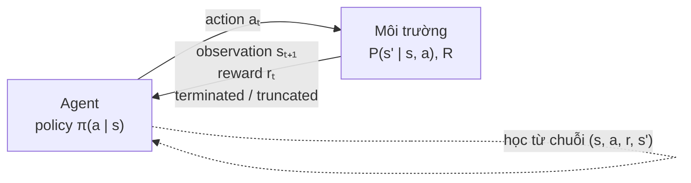
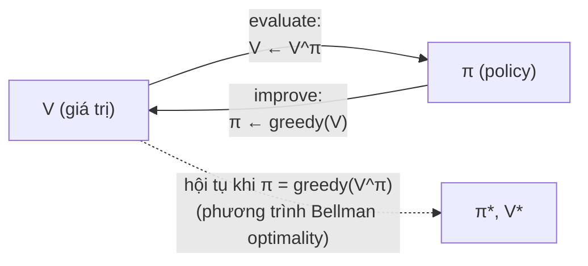
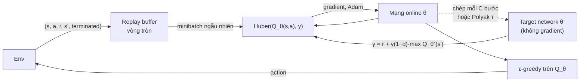
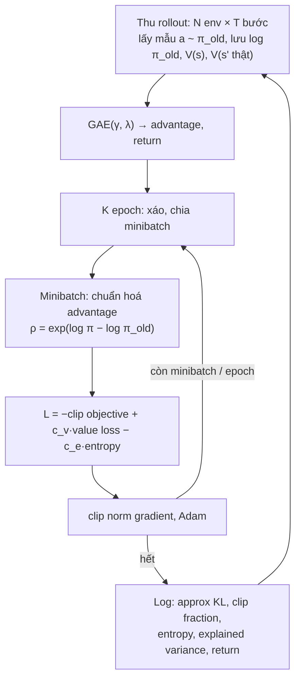
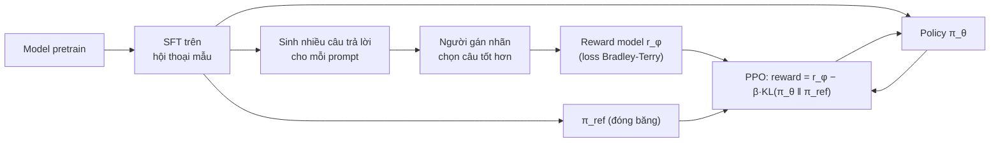

# Reinforcement Learning

Mọi module trước đều học từ một tập dữ liệu có sẵn đáp án: ảnh kèm nhãn, câu kèm từ tiếp theo. Reinforcement learning (RL)
bỏ giả định đó. Một **agent** hành động trong một **môi trường**, chỉ nhận lại một con số **reward** (thường thưa và trễ), và
phải tự tìm chuỗi hành động cho tổng reward lớn nhất. Không ai nói action đúng là gì; dữ liệu do chính policy của agent sinh ra,
nên policy tệ thì dữ liệu cũng tệ. Đó là lý do RL khó hơn supervised learning nhiều lần, và cũng là lý do nó là công cụ duy nhất
cho các bài toán ra quyết định tuần tự: chơi game, điều khiển robot, và từ 2022 là bước **RLHF** biến một LLM biết đoán chữ
thành một trợ lý biết nghe lời.

Module này đi từ MDP và dynamic programming (biết trước mô hình) tới Q-learning (học từ tương tác), DQN (thay bảng bằng mạng
nơ-ron), REINFORCE và PPO (học thẳng policy), rồi kết bằng RLHF để nối sang [module 14](../14-fine-tuning-llm/README.md) (DPO) và
[module 15](../15-reasoning-models/README.md) (GRPO). Mọi thuật toán đều **tự viết** (numpy cho bảng, PyTorch cho mạng) trước khi
nhắc tới thư viện. Backprop, khởi tạo, Adam ở [module 01](../01-nn-from-scratch/README.md); vòng train PyTorch, `nn.Module`,
gradient clipping ở [module 02](../02-pytorch-deep-dive/README.md).

**Môi trường.** Env dùng [Gymnasium](https://gymnasium.farama.org/) 1.4.0 (FrozenLake, CliffWalking, CartPole, LunarLander cần
Box2D) và [ALE](https://ale.farama.org/) qua `ale-py` 0.12.1 cho Atari; ROM Atari đóng gói sẵn trong `ale-py`, không có bộ dữ liệu
nào phải tải. Tất cả đã có trong env gốc. Mọi số liệu dưới đây là kết quả chạy thật trên CPU (numpy 2.5, torch 2.14.1 bản CPU,
`OMP_NUM_THREADS=4`, PC Xeon E5-2696 v3 dùng chung với một tiến trình train khác), ngày 2026-11-01, với seed ghim; riêng lần train
Atari ở mục 6 đo trên GPU RTX 3060 12GB của PC (cũng dùng chung). Bài tập tương ứng cho bạn tự dựng lại từng bảng.

Sau module này bạn sẽ:

- Mô hình hoá một bài toán thành MDP, viết phương trình Bellman, phân biệt `terminated` với `truncated` và biết vì sao nhầm hai
  thứ đó là lỗi số một của code RL.
- Tự viết value iteration, policy iteration, Q-learning, SARSA, và giải thích off-policy khác on-policy bằng số đo.
- Tự viết DQN với replay buffer, target network (hard và soft), Double DQN; đo được Q-value nổ khi bỏ target network.
- Suy ra policy gradient, tự viết REINFORCE có baseline, GAE, PPO với clipped objective; đọc approx KL và clip fraction.
- Đánh giá agent đúng cách (nhiều seed, episode đánh giá cố định, đường cong theo số bước) và làm một agent chơi game có video.
- Giải thích RLHF (reward model Bradley-Terry, KL penalty, PPO trên LLM) đủ sâu để hiểu vì sao DPO và GRPO ra đời.

| Mức | Bài | Nội dung |
| --- | --- | --- |
| Basic | 01 dynamic-programming | policy evaluation, value iteration, policy iteration trên FrozenLake |
| Basic | 02 tabular-q-learning | ε-greedy, Q-learning, SARSA, time limit; CliffWalking |
| Basic | 03 returns-gae | reward-to-go, n-step return, GAE(λ), chuẩn hoá advantage |
| Intermediate | 01 dqn-cartpole | replay buffer, target network soft/hard, Double DQN trên CartPole |
| Intermediate | 02 policy-gradient-ppo | REINFORCE, baseline, PPO + GAE trên CartPole, 3 thuật toán x 3 seed |
| Advanced | 01 lunarlander-agent | agent hạ cánh LunarLander, nhiều seed, video (portfolio) |
| Advanced | 02 debug-broken-ppo | sửa một cài đặt PPO hỏng mà không báo lỗi |

## 1. Bài toán RL: MDP, return, phương trình Bellman, API Gymnasium

### Vòng lặp agent và môi trường



Ở mỗi bước $$t$$ agent thấy trạng thái $$s_t$$, chọn action $$a_t \sim \pi(\cdot \mid s_t)$$, môi trường trả reward $$r_t$$ và trạng thái
mới $$s_{t+1} \sim P(\cdot \mid s_t, a_t)$$. Bộ $$(\mathcal S, \mathcal A, P, R, \gamma)$$ là một **Markov decision process** (MDP). "Markov"
nghĩa là $$s_{t+1}$$ chỉ phụ thuộc $$(s_t, a_t)$$, không phụ thuộc quá khứ xa hơn: nếu observation không đủ thông tin (một khung hình
Atari không cho biết bóng đang bay về đâu) thì phải tự làm cho nó Markov, ví dụ chồng 4 khung hình liên tiếp (mục 4).

Mục tiêu là cực đại **return** có chiết khấu

$$
G_t = r_t + \gamma r_{t+1} + \gamma^2 r_{t+2} + \dots = \sum_{k \ge 0} \gamma^k r_{t+k}, \qquad 0 \le \gamma \le 1
$$

$$\gamma$$ vừa là một phần định nghĩa bài toán (reward hôm nay quý hơn reward mai), vừa là một núm kỹ thuật: "tầm nhìn" hiệu dụng
cỡ $$1/(1-\gamma)$$ bước, $$\gamma = 0.99$$ là khoảng 100 bước. $$\gamma$$ nhỏ thì dễ học (phương sai thấp) nhưng agent cận thị; mục 2 đo
hiệu ứng này trên FrozenLake.

### Value function và phương trình Bellman

Với một policy $$\pi$$:

$$
V^\pi(s) = \mathbb E_\pi[G_t \mid s_t = s], \qquad Q^\pi(s, a) = \mathbb E_\pi[G_t \mid s_t = s, a_t = a], \qquad V^\pi(s) = \sum_a \pi(a \mid s)\, Q^\pi(s, a)
$$

Tách bước đầu ra khỏi phần còn lại cho **phương trình Bellman expectation**, một hệ tuyến tính với $$|\mathcal S|$$ ẩn:

$$
Q^\pi(s, a) = \sum_{s'} P(s' \mid s, a)\big[R(s, a, s') + \gamma V^\pi(s')\big]
$$

Policy tối ưu $$\pi^*$$ có giá trị $$V^*(s) = \max_\pi V^\pi(s)$$ ở **mọi** trạng thái cùng lúc (luôn tồn tại một policy tất định như vậy),
và thoả **phương trình Bellman optimality**, phi tuyến vì có $$\max$$:

$$
Q^*(s, a) = \sum_{s'} P(s' \mid s, a)\big[R(s, a, s') + \gamma \max_{a'} Q^*(s', a')\big], \qquad \pi^*(s) = \arg\max_a Q^*(s, a)
$$

Gần như mọi thuật toán của module là một cách giải xấp xỉ một trong hai phương trình này: biết $$P$$ thì lặp thẳng (mục 2); không
biết $$P$$ thì thay kỳ vọng bằng mẫu (mục 3, 4); hoặc bỏ value function, tối ưu thẳng $$\pi$$ bằng gradient (mục 5, 6).

### API Gymnasium và `terminated` khác `truncated`

Gymnasium là chuẩn de facto (kế thừa OpenAI Gym, Farama Foundation duy trì). Hai hàm:

- `obs, info = env.reset(seed=...)`: seed chỉ cần ở lần reset đầu (các lần sau tiếp tục chuỗi ngẫu nhiên), nhưng truyền seed
  khác nhau cho từng episode đánh giá giúp tái lập từng episode.
- `obs, reward, terminated, truncated, info = env.step(action)`.

| Cờ | Nghĩa | Ví dụ | Giá trị trạng thái sau | Bootstrap? |
| --- | --- | --- | --- | --- |
| `terminated` | MDP thật sự kết thúc | rơi xuống hố, sào đổ, tàu chạm đất | 0 theo định nghĩa | không |
| `truncated` | lần chạy bị cắt vì lý do ngoài MDP | time limit 500 bước của CartPole | không phải 0, chỉ là ta không đi tiếp | có, từ $$V(s_{t+1})$$ |

Trước Gymnasium 0.26, `step` trả một cờ `done` gộp cả hai, và rất nhiều code (kể cả code trong paper) coi time limit là trạng thái
kết thúc. Hậu quả: ở bước 500 của CartPole, target là $$r$$ thay vì $$r + \gamma V(s')$$; critic bị dạy rằng trạng thái tốt nhất (sắp
đạt 500) có giá trị gần 0, mâu thuẫn với chính những trạng thái giống hệt nó ở bước 300. Basic 02, 03 và Intermediate 01 đều có
test bắt lỗi này.

Vector env (`gym.vector.SyncVectorEnv`, `AsyncVectorEnv`) chạy N env cùng lúc và tự reset env nào kết thúc. Gymnasium 1.x mặc định
chế độ `NEXT_STEP` (bước sau lần kết thúc là một bước "reset" không có action); chế độ `SAME_STEP` mà Intermediate 02 dùng thì reset
ngay và đặt observation thật cuối episode vào `info["final_obs"]`: cần nó để bootstrap đúng khi bị `truncated`.

Mốc của policy ngẫu nhiên và một policy viết tay (đẩy xe về phía sào đang ngã) trên ba env của module, 100 episode seed 0..99:

```python
import gymnasium as gym
import numpy as np

def run(env_id, policy, episodes=100, **kw):
    env = gym.make(env_id, **kw)
    rng = np.random.default_rng(0)
    returns, ends = [], {"terminated": 0, "truncated": 0}
    for ep in range(episodes):
        obs, info = env.reset(seed=ep)
        total, done = 0.0, False
        while not done:
            obs, reward, terminated, truncated, info = env.step(policy(obs, rng, env))
            total += reward
            done = terminated or truncated
        ends["terminated" if terminated else "truncated"] += 1
        returns.append(total)
    print(f"{env_id:15s} obs {str(env.observation_space.shape or env.observation_space.n):6s} "
          f"actions {env.action_space.n} | time limit {env.spec.max_episode_steps:4d} | "
          f"return {np.mean(returns):8.2f} ± {np.std(returns):6.2f} | {ends}")

random_policy = lambda obs, rng, env: int(rng.integers(env.action_space.n))
lean_policy = lambda obs, rng, env: int(obs[2] + obs[3] > 0)   # đẩy xe về phía sào đang ngã

run("FrozenLake-v1", random_policy)
run("CartPole-v1", random_policy)
run("CartPole-v1", lean_policy)
run("LunarLander-v3", random_policy)
```

| Env | Observation | Action | Time limit | Policy ngẫu nhiên | Ghi chú |
| --- | --- | --- | --- | --- | --- |
| FrozenLake-v1 (4x4, trơn) | 16 trạng thái rời rạc | 4 | 100 | 0.01 (tỉ lệ tới đích) | reward 1 duy nhất ở đích |
| CartPole-v1 | 4 số thực | 2 | 500 | 23.7 ± 12.2 | policy viết tay 2 dòng: **493.1**, 95/100 episode bị `truncated` |
| LunarLander-v3 | 8 số thực | 4 | 1 000 | −192.0 ± 114.6 | ≥ 200 được coi là "giải được" |

Policy viết tay một dòng đạt 493 trên CartPole mà không học gì. Bài học đầu tiên của RL thực tế: **luôn có baseline** (ngẫu nhiên,
heuristic, luật nghiệp vụ). Một agent DQN đạt 300 nghe có vẻ tốt cho tới khi bạn biết `if` một dòng được 493.

### Quyết định thực tế

- Trước khi chọn RL, hỏi: có dữ liệu nhãn hay mô hình chính xác không? Có thì supervised learning hoặc tối ưu hoá/planning thường
  rẻ và ổn định hơn. RL đáng giá khi quyết định ảnh hưởng tới dữ liệu tương lai và có simulator rẻ để thử sai.
- **Reward design** là nửa bài toán. Agent tối ưu đúng thứ bạn viết, không phải thứ bạn muốn (mục 7 gọi là reward hacking).
  Reward thưa (chỉ +1 ở đích) đúng nghĩa nhưng khó học; reward shaping giúp học nhanh nhưng dễ sinh hành vi lạ.
- Lỗi hay gặp: gộp `terminated` và `truncated`; không seed env khi đánh giá; quên `env.close()` với env có render; tin return của
  một seed duy nhất.

## 2. Dynamic programming: policy evaluation, value iteration, policy iteration

Khi biết $$P$$ và $$R$$ (FrozenLake cho sẵn trong `env.unwrapped.P`), phương trình Bellman giải được bằng lặp. **Bellman backup**
cho một trạng thái là một lần áp vế phải của phương trình với $$V$$ hiện có:

$$
V_{k+1}(s) = \sum_a \pi(a \mid s) \sum_{s'} P(s' \mid s, a)\big[R + \gamma (1 - d)\, V_k(s')\big]
$$

với $$d = 1$$ khi chuyển đó là `terminated`. Toán tử backup là một **γ-contraction** theo chuẩn max: mỗi lần quét, sai số tới nghiệm
nhân tối đa $$\gamma$$. Từ sai số ban đầu cỡ 1, cần khoảng $$\log(\text{tol}) / \log\gamma$$ lần quét: với $$\gamma = 0.99$$ và tol $$10^{-10}$$
là khoảng 2 300 lần quét trong trường hợp xấu nhất, thực tế ít hơn vì sai số co nhanh hơn chặn trên.

- **Policy evaluation**: lặp backup theo $$\pi$$ cố định, ra $$V^\pi$$.
- **Policy improvement**: $$\pi'(s) = \arg\max_a Q^\pi(s, a)$$. Định lý cải thiện policy: $$V^{\pi'} \ge V^\pi$$ ở mọi trạng thái, bằng nhau
  chỉ khi $$\pi$$ đã tối ưu.
- **Policy iteration**: xen kẽ hai bước trên tới khi policy không đổi. Số vòng nhỏ (số policy tất định là hữu hạn và mỗi vòng
  tốt lên nghiêm ngặt).
- **Value iteration**: gộp hai bước thành một backup có $$\max$$, lặp tới khi hội tụ, cuối cùng lấy greedy.



Sơ đồ là ý tưởng **generalized policy iteration**: mọi thuật toán RL đều xen kẽ "ước lượng giá trị của policy hiện tại" và "cải
thiện policy theo giá trị đó", chỉ khác nhau ở độ chính xác và tần suất của từng bước. Q-learning làm cả hai bước sau từng chuyển;
PPO làm evaluate bằng critic, improve bằng vài bước gradient.

### Số đo trên FrozenLake

FrozenLake 4x4 trơn: đi đúng hướng chỉ với xác suất 1/3, trượt sang hai bên với 1/3 mỗi phía; 4 hố, reward 1 ở đích.
Cài đặt của bài Basic 01, quét đồng bộ, tol $$10^{-10}$$; tỉ lệ tới đích đo trên 10 000 episode (seed 1 000 000 trở đi, time limit 100):

| $$\gamma$$ | $$V^*(0)$$ | Value iteration | Policy iteration | Tỉ lệ tới đích của $$\pi^*$$ |
| --- | --- | --- | --- | --- |
| 0.9 | 0.0689 | 145 lần quét | 2 lần evaluate | 73.2% |
| 0.99 | 0.5420 | 571 lần quét | 3 lần evaluate | 74.6% |
| 1.0 | 0.8235 | 806 lần quét | 3 lần evaluate | 74.6% |

Policy ngẫu nhiên đều có $$V(0) = 0.0124$$ và tới đích 1.5% số episode. Đọc bảng:

- $$V^*(0)$$ với $$\gamma = 1$$ là **xác suất** tới đích nếu đi mãi không giới hạn (0.82); time limit 100 bước của env cắt bớt một phần.
- $$\gamma = 0.9$$ cho $$V^*(0)$$ chỉ 0.069 (đích cách trung bình khoảng 40 bước, $$0.9^{40} \approx 0.015$$), nhưng policy của nó vẫn tới đích
  73.2%, chỉ kém 1.4 điểm. $$\gamma$$ nhỏ làm **giá trị** nhỏ chứ không nhất thiết làm **policy** tệ; policy của $$\gamma = 0.9$$ "sốt ruột"
  hơn (episode trung bình 40.5 bước so với 43.7) và chấp nhận rủi ro cao hơn một chút. $$\gamma$$ 0.99 và 1.0 cho cùng một policy ở đây.
- Policy iteration cần 2 tới 3 vòng, value iteration cần hàng trăm lần quét; nhưng mỗi vòng policy iteration tự nó là một lần policy
  evaluation hàng trăm lần quét. Tổng chi phí cùng cỡ; trên MDP lớn có thể giải evaluate bằng hệ tuyến tính, khi đó policy iteration
  thắng rõ.

### Giới hạn

DP cần biết $$P$$ và phải quét **mọi** trạng thái mỗi vòng. FrozenLake 8x8 có 64 trạng thái, CartPole có không gian liên tục, Atari có
$$256^{210 \times 160 \times 3}$$ khung hình khả dĩ. Hai giới hạn này (không biết mô hình, không gian quá lớn) dẫn thẳng tới mục 3
(học từ mẫu) và mục 4 (xấp xỉ bằng mạng nơ-ron). DP vẫn sống trong thực tế ở bài toán nhỏ có mô hình rõ (quản lý tồn kho, định giá
theo thời gian) và là bộ kiểm tra: mọi thuật toán học từ mẫu nên được thử trên một MDP nhỏ có nghiệm DP để so.

## 3. Học từ tương tác: TD, Q-learning, SARSA, exploration

### Thay kỳ vọng bằng mẫu

Không biết $$P$$ thì không tính được tổng $$\sum_{s'}$$, nhưng agent có thể **thử** và quan sát một $$s'$$. Hai cách ước lượng giá trị từ mẫu:

| | Monte Carlo (MC) | Temporal difference (TD) |
| --- | --- | --- |
| Target | return thật $$G_t$$ (chờ hết episode) | $$r_t + \gamma V(s_{t+1})$$ (một bước rồi "bootstrap") |
| Bias | không | có (dùng ước lượng $$V$$ của chính mình) |
| Phương sai | cao (cộng nhiễu của cả episode) | thấp (nhiễu một bước) |
| Học khi chưa hết episode | không | có |

Cập nhật TD có dạng chung "ước lượng mới = cũ + α · (target − cũ)", với $$\delta = \text{target} - \text{cũ}$$ là **TD error**. n-step return và
GAE (mục 5) nằm giữa hai cực MC và TD.

### Q-learning và SARSA

Học thẳng $$Q$$ để chọn action mà không cần mô hình:

$$
\text{Q-learning:}\quad Q(s,a) \leftarrow Q(s,a) + \alpha\big[r + \gamma(1-d)\max_{a'} Q(s', a') - Q(s,a)\big]
$$

$$
\text{SARSA:}\quad Q(s,a) \leftarrow Q(s,a) + \alpha\big[r + \gamma(1-d)\,Q(s', a') - Q(s,a)\big], \quad a' \text{ là action agent sẽ làm thật}
$$

Q-learning là **off-policy**: target dùng $$\max$$, tức giá trị của policy greedy, bất kể dữ liệu do policy nào sinh ra. Nhờ vậy nó học
được từ dữ liệu cũ, từ policy khác, thậm chí từ hành vi hoàn toàn ngẫu nhiên. SARSA là **on-policy**: học giá trị của chính policy
đang chạy, kể cả phần khám phá.

**Exploration.** Agent luôn chọn action đang tốt nhất sẽ không bao giờ biết action khác có tốt hơn không. **ε-greedy**: với xác suất
ε chọn ngẫu nhiên, còn lại chọn greedy; ε giảm dần (lịch tuyến tính hoặc mũ). Lý thuyết hội tụ của Q-learning dạng bảng cần mọi cặp
$$(s, a)$$ được thăm vô hạn lần và $$\alpha$$ giảm hợp lý (điều kiện Robbins-Monro). Cách khác: khởi tạo Q lạc quan (agent tò mò thử mọi
thứ vì tưởng chúng tốt), UCB, Boltzmann/softmax, hay entropy bonus của PPO (mục 6).

### Số đo: FrozenLake và CliffWalking

Q-learning của bài Basic 02 trên FrozenLake 4x4 trơn, $$\alpha = 0.1$$, $$\gamma = 0.99$$, ε giảm tuyến tính từ 1 về 0.05 trong nửa đầu, 3 seed;
policy greedy đánh giá trên cùng 10 000 episode như bảng mục 2:

| Số episode train | Thời gian / seed | Tỉ lệ tới đích của greedy (3 seed) | $$V^{\pi}(0)$$ của greedy | $$\max_a Q(0, a)$$ học được |
| --- | --- | --- | --- | --- |
| 2 000 | 5 s | 73.2% / 73.7% / 73.6% | 0.533 / 0.533 / 0.531 | 0.566 / 0.510 / 0.551 |
| 10 000 | 13 s | 74.6% / 74.6% / 74.8% | 0.542 / 0.542 / 0.542 | 0.511 / 0.555 / 0.553 |

Với 10 000 episode, policy greedy có $$V^\pi(0) = 0.542$$, đúng bằng $$V^*(0)$$ của DP, trong khi $$\max_a Q(0,a)$$ học được vẫn lệch
$$\pm 0.03$$ quanh 0.542: **policy hội tụ trước giá trị**. Đó là điều
tốt (ta cần policy), và cũng là cảnh báo: đừng đọc giá trị Q như một ước lượng chính xác của return.

CliffWalking (lưới 4x12, đi từ góc trái dưới sang góc phải dưới; hàng dưới cùng là vực, rơi xuống −100 và về điểm xuất phát; mỗi
bước −1), $$\alpha = 0.2$$, ε = 0.1 cố định, 500 episode, 3 seed:

| | Return lúc train (200 episode cuối) | Đường greedy cuối cùng |
| --- | --- | --- |
| Q-learning | −52.3 / −48.3 / −54.8 | −13: 13 bước sát vực, cả 3 seed |
| SARSA | −23.5 / −21.7 / −23.8 | −17: 17 bước, cách vực một hàng, cả 3 seed |

Q-learning học đúng đường tối ưu sát vực (13 bước) nhưng lúc train thỉnh thoảng bị ε đẩy xuống vực, nên return lúc train **tệ hơn**.
SARSA tính cả rủi ro của khám phá vào giá trị, chọn đường vòng an toàn. Khi nào cần mỗi loại: robot thật, xe tự lái đang học, hay
bất kỳ hệ thống nào mà hành vi **trong lúc học** gây hậu quả thì on-policy an toàn hơn; khi chỉ policy cuối quan trọng, hoặc muốn
học từ log cũ, off-policy hiệu quả hơn.

### Maximization bias và Double Q-learning

$$\max$$ trên các ước lượng có nhiễu bị lệch lên: kể cả khi mọi action có giá trị thật bằng 0, $$\mathbb E[\max_a \hat Q(a)] > 0$$.
Q-learning lấy max ở **mọi** bước rồi bootstrap, nên độ lệch tích luỹ. Double Q-learning (van Hasselt 2010) giữ hai bộ ước lượng
độc lập: một bộ **chọn** action, bộ kia **đánh giá** nó.

```python
import numpy as np

rng = np.random.default_rng(0)
n_actions, n_samples, trials = 10, 5, 100_000
q_true = np.zeros(n_actions)                                   # mọi action thật ra như nhau: giá trị 0
rewards = rng.normal(q_true, 1.0, size=(trials, 2, n_samples, n_actions))
est_a = rewards[:, 0].mean(axis=1)                              # ước lượng từ nửa mẫu thứ nhất
est_b = rewards[:, 1].mean(axis=1)                              # ước lượng độc lập từ nửa còn lại
single = est_a.max(axis=1)                                      # max của chính ước lượng mình chọn
double = est_b[np.arange(trials), est_a.argmax(axis=1)]         # chọn bằng A, đánh giá bằng B
print(f"giá trị thật của action tốt nhất: {q_true.max():.3f}")
print(f"max ước lượng (một bộ)         : {single.mean():.3f}")
print(f"double estimator (hai bộ)      : {double.mean():.3f} ± {double.std() / np.sqrt(trials):.3f}")
```

10 action đều có giá trị thật 0, mỗi action ước lượng từ 5 mẫu nhiễu: max của ước lượng trung bình là **0.687**, double estimator
cho **−0.002 ± 0.001** (không lệch). Double DQN (mục 4) dùng đúng ý này với mạng online chọn, target network đánh giá.

### Quyết định thực tế

- Bảng Q chỉ dùng được khi số trạng thái nhỏ (vài nghìn tới vài triệu) và rời rạc. Trạng thái liên tục thì rời rạc hoá (tile coding)
  hoặc dùng function approximation: mục 4.
- Lỗi hay gặp: `argmax` không tie-break ngẫu nhiên (Q khởi tạo 0, agent luôn chọn action 0 và kẹt); khám phá chỉ chọn trong action
  không greedy; trả TD error sau khi cập nhật; lịch ε tính theo bước nhưng truyền số episode (hoặc ngược lại).

## 4. Deep Q-Network: replay buffer, target network, Atari

### Thay bảng bằng mạng

DQN (Mnih và cộng sự, Nature 2015) thay bảng bằng mạng $$Q_\theta(s, \cdot)$$ trả Q của mọi action một lần, rồi tối thiểu hoá

$$
L(\theta) = \mathbb E_{(s,a,r,s',d) \sim \mathcal D}\Big[\ell\big(Q_\theta(s,a) - y\big)\Big], \qquad y = r + \gamma(1-d)\max_{a'} Q_{\theta^-}(s', a')
$$

với $$\ell$$ là Huber loss (bình phương khi sai số nhỏ, tuyến tính khi lớn, để một target sai lệch không cho gradient khổng lồ), và $$y$$
coi như **hằng số** khi lấy gradient (semi-gradient). Ghép ba thứ: function approximation, bootstrapping, off-policy là cái Sutton và
Barto gọi là **deadly triad**: từng thứ một thì an toàn, cả ba cùng lúc thì không có gì đảm bảo hội tụ, Q có thể nổ. DQN thêm hai
mảnh để giữ nó ổn định:

- **Replay buffer**: lưu chuyển vào một bộ đệm vòng tròn (100 000 tới 1 000 000 chuyển), mỗi bước học lấy một minibatch ngẫu
  nhiên. Phá tương quan giữa các mẫu liên tiếp (gradient descent giả định mẫu gần độc lập) và dùng mỗi chuyển nhiều lần. Chỉ làm
  được vì Q-learning là off-policy.
- **Target network** $$\theta^-$$: một bản sao của mạng, đứng yên trong lúc mạng online học. Không có nó, mỗi bước cập nhật $$\theta$$ cũng
  dịch chuyển chính target $$y$$: mạng đuổi theo cái bóng của mình. Hard update chép $$\theta^- \leftarrow \theta$$ mỗi C bước (Nature DQN:
  10 000); soft (Polyak) update $$\theta^- \leftarrow (1-\tau)\theta^- + \tau\theta$$ sau mỗi bước học, $$\tau$$ cỡ 0.005.



**Double DQN** (van Hasselt 2016) sửa maximization bias của mục 3 với chi phí bằng 0: chọn $$a^* = \arg\max_{a'} Q_\theta(s', a')$$ bằng mạng
online, đánh giá bằng target: $$y = r + \gamma(1-d)Q_{\theta^-}(s', a^*)$$. Các cải tiến khác gộp lại thành Rainbow (Hessel 2018):

| Cải tiến | Ý chính | Khi nào đáng thêm |
| --- | --- | --- |
| Double DQN | chọn bằng online, đánh giá bằng target | gần như luôn luôn, một dòng code |
| Dueling | tách $$Q = V + A$$ trong kiến trúc | nhiều action có giá trị gần nhau |
| Prioritized replay | lấy mẫu theo độ lớn TD error | reward thưa, chuyển hiếm mà quan trọng |
| n-step return | target cộng n reward rồi mới bootstrap | lan truyền reward nhanh hơn (Basic 03) |
| Distributional (C51, QR-DQN) | học phân phối return thay vì kỳ vọng | Atari, khi cần hiệu năng cao nhất |
| Noisy nets | khám phá bằng nhiễu trong trọng số thay ε | khám phá khó |

### Số đo trên CartPole

Bài Intermediate 01: MLP 4-128-128-2, Adam lr $$10^{-4}$$, batch 128, buffer 50 000, học mỗi bước từ bước 1 000, ε từ 1 về 0.05 trong
10 000 bước, $$\gamma = 0.99$$, Huber, clip norm 10, 50 000 bước env, 3 seed. Đánh giá greedy trên 20 episode cố định (seed 10 000..10 019);
checkpoint tốt nhất chọn bằng eval 10 episode mỗi 5 000 bước trên seed khác (100 000..100 009):

| Cấu hình | Return trọng số cuối (seed 0 / 1 / 2) | Checkpoint tốt nhất theo eval định kỳ | $$\max_a Q(s_0, a)$$ / return chiết khấu thật | Thời gian / seed |
| --- | --- | --- | --- | --- |
| Soft update $$\tau = 0.005$$ | 500.0 / 488.4 / 500.0 | 500.0 / 488.4 / 500.0 | 97.7 / 99.2 | 87 s |
| Hard update mỗi 500 bước | 111.7 / 108.3 / 239.3 | 444.3 / 500.0 / 281.4 | 66.6 / 74.6 | 83 s |
| Không target network | 9.4 / 9.4 / 9.4 | 9.4 / 9.4 / 9.4 | khoảng 1.26 triệu / 9.0 | 83 s |

Cột Q là trung bình 3 seed của $$\max_a Q(s_0, a)$$ ở 20 trạng thái đầu và return chiết khấu thật của policy greedy từ đó (tối đa
$$\sum_{k<500} 0.99^k \approx 99.3$$). Đọc bảng:

- **Không có target network, Q nổ lên cỡ một triệu** trong khi return thật là 9: mạng đuổi theo chính nó, mỗi bước học đẩy target lên
  theo, policy sụp về luôn đẩy một phía. Cùng code, chỉ khác một dòng.
- **Hard update mỗi 500 bước** học được (có checkpoint chạm 500) nhưng không giữ được: trọng số cuối chỉ còn 108 tới 239. Soft update với
  $$\tau = 0.005$$ (target trôi chậm, đều) ổn định hơn rõ ở cả 3 seed, và Q dự đoán gần như khớp return thật.
- Checkpoint tốt nhất theo eval định kỳ cứu được phần lớn khác biệt của hard update: đánh giá định kỳ là một phần của thuật toán,
  không phải trang trí.

Ba điều thực tế rút ra:

- **DQN trên CartPole không đơn điệu.** Đường cong lên xuống thất thường, kể cả sau khi đã chạm 500, vì buffer dần chỉ còn trạng thái
  "sào đứng thẳng" và mạng quên cách cứu một cây sào sắp đổ (catastrophic forgetting). Thực tế luôn **đánh giá định kỳ trên env riêng
  với policy greedy và giữ checkpoint tốt nhất** (Stable-Baselines3 gọi là `EvalCallback`), thay vì lấy trọng số cuối.
- Siêu tham số quyết định nhiều hơn thuật toán: trong lúc chuẩn bị bài, cùng code với lr $$10^{-3}$$, học mỗi 4 bước, batch 64, mạng
  rộng 256 và hard update mỗi 500 bước cho return cuối chỉ 169 / 162 / 269 (checkpoint tốt nhất 369 / 500 / 500); bỏ thêm target network
  thì cũng sụp về return 9 như bảng trên. Luôn so cấu hình trên nhiều seed, đổi từng biến một, trước khi kết luận.
- Đo **wall-clock và số bước env** cùng lúc. Trên CPU, một bước env CartPole tốn vài micro giây, một bước học (forward 3 lần,
  backward, Adam) tốn khoảng 1.5 ms: DQN chậm vì học, không vì env.

### Atari: tiền xử lý của Nature DQN

DQN nổi tiếng vì chơi 49 game Atari ở mức người từ **pixel**, cùng một kiến trúc và siêu tham số. Để làm được, observation được
tiền xử lý thành một trạng thái gần Markov và rẻ:

| Bước | Lý do |
| --- | --- |
| Lặp mỗi action 4 khung (frame skip), lấy max của 2 khung cuối | giảm 4 lần số quyết định; max chống nhấp nháy sprite |
| Xám, thu về 84x84 | 210x160x3 → 7 056 byte, màu gần như không mang thông tin |
| Chồng 4 khung gần nhất | một khung không cho biết vận tốc, 4 khung thì có (Markov hơn) |
| Clip reward về {−1, 0, 1} | cùng lr cho mọi game dù thang điểm khác nhau |
| No-op ngẫu nhiên lúc reset, mất mạng coi như hết episode khi train | đa dạng trạng thái đầu; tín hiệu "chết là xấu" rõ hơn |
| Sticky action (ALE v5: lặp action cũ với xác suất 0.25) | env ngẫu nhiên hơn, chống học thuộc lòng một chuỗi action |

```python
import time

import ale_py
import gymnasium as gym
import numpy as np

gym.register_envs(ale_py)
env = gym.make("ALE/Pong-v5", frameskip=1)                            # frame skip do wrapper làm, kèm max-pool
env = gym.wrappers.AtariPreprocessing(env, frame_skip=4, screen_size=84, grayscale_obs=True, noop_max=30)
env = gym.wrappers.FrameStackObservation(env, 4)
obs, info = env.reset(seed=0)
print("observation:", obs.shape, obs.dtype, "| action:", env.action_space.n, env.unwrapped.get_action_meanings())

rng = np.random.default_rng(0)
start, steps, total, done = time.perf_counter(), 0, 0.0, False
while not done:
    obs, reward, terminated, truncated, info = env.step(int(rng.integers(env.action_space.n)))
    total += reward
    steps += 1
    done = terminated or truncated
elapsed = time.perf_counter() - start
print(f"policy ngẫu nhiên, 1 ván Pong: điểm {total:.0f}, {steps} bước agent ({4 * steps} khung), {steps / elapsed:.0f} bước/giây")
```

Observation là 4 khung 84x84 `uint8` (28 224 byte), 6 action. Policy ngẫu nhiên thua trắng −21 sau 838 bước agent (3 352 khung). Một
env đơn qua các wrapper Python chạy khoảng 1 500 bước agent mỗi giây trên CPU (máy dùng chung); ngân sách chuẩn của PPO trên Atari
trong CleanRL là 10 triệu bước, tức gần 2 giờ chỉ riêng cho env. Vì vậy Atari luôn chạy song song: `ale_py.vector_env.AtariVectorEnv`
làm tiền xử lý y hệt bằng C++ đa luồng, 8 env với 4 luồng đo được khoảng 6 200 bước mỗi giây với action ngẫu nhiên, và mạng CNN đưa lên
GPU.

### Lỗi hay gặp với DQN

- `Q(s, a)` shape `(B, 1)` trừ target shape `(B,)`: broadcasting ra ma trận `(B, B)`, loss vẫn là một số, mạng học trung bình của mọi
  target. Không có lỗi nào được báo. Luôn `squeeze` và `assert` shape.
- Lưu `terminated or truncated` vào buffer (mục 1).
- Target tính có gradient (quên `no_grad`/`detach`): khi target net là chính mạng online, gradient đi qua cả $$Q(s')$$.
- Đánh giá với ε > 0 rồi báo con số đó như hiệu năng của policy, hoặc đánh giá trên đúng những episode đang train.
- Tiết kiệm bộ nhớ Atari: lưu khung `uint8` và chồng khung lúc lấy mẫu; buffer 1 triệu chuyển 4x84x84 float32 là 113 GB.

## 5. Policy gradient: REINFORCE, baseline, actor-critic, GAE

### Tối ưu thẳng policy

Thay vì học giá trị rồi suy ra policy, tham số hoá policy $$\pi_\theta(a \mid s)$$ (mạng ra logits, softmax) và leo gradient của
$$J(\theta) = \mathbb E_{\tau \sim \pi_\theta}[G(\tau)]$$. Vấn đề: $$J$$ là kỳ vọng theo phân phối **phụ thuộc** $$\theta$$, không đạo hàm qua việc lấy mẫu
được. Mẹo log-đạo hàm $$\nabla_\theta p = p\,\nabla_\theta \log p$$ cho:

$$
\nabla_\theta J(\theta) = \mathbb E_{\tau}\Big[\sum_t \nabla_\theta \log \pi_\theta(a_t \mid s_t)\; G_t\Big]
$$

Xác suất chuyển $$P(s' \mid s, a)$$ không phụ thuộc $$\theta$$ nên biến mất khỏi gradient: **không cần mô hình môi trường**, chỉ cần đạo hàm
được $$\log \pi$$. Thay $$G(\tau)$$ của cả episode bằng reward-to-go $$G_t$$ (reward trước bước $$t$$ không phụ thuộc $$a_t$$) đã giảm phương
sai mà không thêm bias. **REINFORCE** (Williams 1992) ước lượng kỳ vọng trên bằng vài episode lấy mẫu; trong code, đó là một loss
"giả" $$-\frac1N\sum \log\pi(a_t \mid s_t)\,G_t$$ để autograd tính đúng gradient trên.

Hiểu bằng trực giác: tăng log-xác suất của action đã làm, tỉ lệ với return sau đó. Đây chính là supervised learning trên action
của mình, có trọng số. Và đó cũng là điểm yếu: nếu mọi return đều dương (CartPole: mọi reward là +1), mọi action đều được đẩy lên,
chỉ khác mức độ; tín hiệu "action này tốt hơn action kia" chìm trong nhiễu.

### Baseline

Trừ một baseline $$b(s_t)$$ không phụ thuộc action không làm lệch gradient, vì
$$\mathbb E_{a \sim \pi}[\nabla \log \pi(a \mid s)\, b(s)] = b(s) \nabla \sum_a \pi(a \mid s) = b(s)\nabla 1 = 0$$, nhưng giảm phương sai mạnh khi
$$b$$ gần $$\mathbb E[G_t \mid s_t]$$. Thí nghiệm trên một bandit 3 action với reward lớn mà chênh lệch nhỏ (10, 11, 12), policy đều:

```python
import numpy as np

rng = np.random.default_rng(0)
theta = np.array([0.0, 0.0, 0.0])                              # policy softmax trên 3 action
mean_reward = np.array([10.0, 11.0, 12.0])                     # reward lớn, chênh lệch nhỏ
p = np.exp(theta) / np.exp(theta).sum()
true_grad = p * (mean_reward - p @ mean_reward)                # ∇_θ E[r] của softmax
N = 100_000
a = rng.choice(3, size=N, p=p)
r = mean_reward[a] + rng.normal(0, 1, N)
score = np.eye(3)[a] - p                                       # ∇_θ log π(a) của softmax
for name, b in [("không baseline", 0.0), ("baseline = E[r]", p @ mean_reward)]:
    g = score * (r - b)[:, None]
    print(f"{name:16s} trung bình {np.round(g.mean(0), 3)} | phương sai mỗi mẫu {g.var(0).sum():7.2f}"
          f" | số mẫu cần cho sai số chuẩn 0.05: {g.var(0).sum() / 0.05**2:9.0f}")
print("gradient thật   ", np.round(true_grad, 3))
```

Cả hai ước lượng đều đúng kỳ vọng (gradient thật `[-0.333, 0, 0.333]`), nhưng phương sai mỗi mẫu là **81.6** không baseline so với
**0.89** có baseline: cần 32 644 mẫu thay vì 357 cho cùng độ chính xác, gấp hơn 90 lần. Trong RL thật, baseline tốt nhất là một
mạng **critic** $$V_\phi(s)$$ học song song bằng hồi quy về $$G_t$$, và $$G_t - V_\phi(s_t)$$ là ước lượng của **advantage**
$$A(s, a) = Q(s, a) - V(s)$$: action này tốt hơn mức trung bình bao nhiêu.

### Actor-critic và GAE

Critic không chỉ làm baseline mà còn thay được $$G_t$$ bằng target bootstrap, đổi chút bias lấy rất nhiều phương sai. Với TD error
$$\delta_t = r_t + \gamma(1-d_t)V(s_{t+1}) - V(s_t)$$, **Generalized Advantage Estimation** (Schulman 2016) lấy trung bình có trọng số mũ
của mọi ước lượng n-step:

$$
\hat A_t^{\text{GAE}(\gamma, \lambda)} = \sum_{k \ge 0} (\gamma\lambda)^k \delta_{t+k} = \delta_t + \gamma\lambda\,\hat A_{t+1}
$$

| $$\lambda$$ | Tương đương | Bias | Phương sai |
| --- | --- | --- | --- |
| 0 | TD error một bước $$\delta_t$$ | cao (tin critic hoàn toàn) | thấp |
| 0.95 (mặc định PPO) | trung bình mũ các n-step | thấp | vừa |
| 1 | $$G_t - V(s_t)$$ (Monte Carlo trừ baseline) | 0 | cao |

Đệ quy ngược chỉ đúng khi cắt đúng ở ranh giới episode: bước cuối của episode không được cộng advantage của episode sau (env đã
reset), và chỉ `terminated` mới bỏ $$V(s_{t+1})$$. Bài Basic 03 viết hàm này với cả hai trường hợp.

### Số đo: REINFORCE, baseline, PPO trên CartPole

Bài Intermediate 02: actor và critic là hai MLP 64-64 tanh tách rời, cùng 150 000 bước env, 3 seed. REINFORCE: 8 episode mỗi lần cập
nhật, Adam lr $$10^{-3}$$. PPO (mục 6): 4 env, 128 bước mỗi rollout, 4 epoch, 4 minibatch, lr $$2.5 \times 10^{-4}$$ giảm tuyến tính, GAE
$$\lambda = 0.95$$. Return trung bình của các episode kết thúc trong cửa sổ 10 000 bước trước mốc:

| Thuật toán | 50k bước (seed 0 / 1 / 2) | 100k bước | 150k bước | Policy greedy cuối, 20 episode |
| --- | --- | --- | --- | --- |
| REINFORCE | 218 / 206 / 244 | 335 / 379 / 295 | 362 / 408 / 446 | 496.5 / 500 / 500 |
| REINFORCE + baseline | 270 / 231 / 187 | 387 / 410 / 439 | 417 / 431 / 472 | 495.1 / 500 / 500 |
| PPO | 288 / 377 / 286 | 416 / 374 / 420 | 463 / 450 / 488 | 500 / 500 / 500 |

Baseline thắng REINFORCE trần ở cả 3 seed từ mốc 100k trở đi; ở 50k chênh lệch còn nằm trong dao động giữa seed. PPO dẫn ở mọi
mốc: dùng mỗi mẫu 4 lần, advantage từ GAE ít nhiễu hơn reward-to-go, và 4 env song song cho dữ liệu đa dạng hơn. Cột cuối là một cảnh
báo: policy **greedy** của cả ba thuật toán đều gần 500, CartPole dễ tới mức lấy argmax che hết khác biệt. Con số phân biệt được thuật
toán là return lúc train (policy lấy mẫu) và tốc độ đạt tới nó. So với DQN ở mục 4, PPO ổn định hơn hẳn trên cùng bài với ít tinh
chỉnh hơn; đó là lý do PPO là lựa chọn mặc định cho action rời rạc khi env rẻ.

### Lỗi hay gặp

- Để gradient chảy qua baseline hoặc advantage (thiếu `detach`): policy loss kéo critic theo hướng vô nghĩa.
- Quên dấu trừ: loss là $$-\log\pi \cdot A$$, tối thiểu hoá nó là **tăng** xác suất action có advantage dương.
- Lấy action bằng `argmax` khi thu dữ liệu: policy gradient cần action **lấy mẫu** từ $$\pi$$, nếu không $$\log\pi$$ của action đã làm không
  tương ứng với phân phối đã sinh dữ liệu.
- Action liên tục (robot, LunarLanderContinuous): policy là Gaussian $$\mathcal N(\mu_\theta(s), \sigma^2)$$, `log_prob` cộng theo chiều action;
  mọi thứ khác giữ nguyên.

## 6. PPO, đánh giá agent và agent chơi game

### Từ trust region tới clipped objective

Policy gradient dùng mỗi mẫu một lần rồi bỏ (dữ liệu là của policy cũ, gradient chỉ đúng tại chỗ). Muốn dùng một batch nhiều bước
gradient thì phải sửa bằng **importance ratio** $$\rho_t(\theta) = \pi_\theta(a_t \mid s_t) / \pi_{\theta_{\text{old}}}(a_t \mid s_t)$$ và giữ policy mới
không đi quá xa policy cũ, vì ngoài vùng đó ước lượng advantage không còn đúng. TRPO (Schulman 2015) ràng buộc KL bằng tối ưu bậc
hai, phức tạp. **PPO** (Schulman 2017) thay bằng một phép cắt:

$$
L^{\text{CLIP}}(\theta) = \mathbb E_t\Big[\min\big(\rho_t(\theta)\hat A_t,\ \mathrm{clip}(\rho_t(\theta), 1-\epsilon, 1+\epsilon)\hat A_t\big)\Big]
$$

Với $$\epsilon = 0.2$$, đọc theo dấu advantage:

| | $$\hat A > 0$$ (action tốt, muốn tăng $$\rho$$) | $$\hat A < 0$$ (action tệ, muốn giảm $$\rho$$) |
| --- | --- | --- |
| $$\rho < 0.8$$ | $$\min = \rho\hat A$$: còn gradient, được kéo lên lại | $$\min = 0.8\hat A$$: hằng, gradient 0, đã giảm đủ |
| $$0.8 \le \rho \le 1.2$$ | $$\rho\hat A$$, gradient bình thường | $$\rho\hat A$$, gradient bình thường |
| $$\rho > 1.2$$ | $$\min = 1.2\hat A$$: hằng, gradient 0, đã tăng đủ | $$\min = \rho\hat A$$: còn gradient, được kéo xuống lại |

Lấy $$\min$$ nghĩa là objective là một **cận dưới bi quan**: phép cắt chỉ tắt gradient khi nó đẩy policy đi xa hơn theo hướng có lợi,
không bao giờ chặn việc sửa sai. Loss đầy đủ một minibatch:

$$
L = -L^{\text{CLIP}} + c_v \cdot \tfrac12\big(V_\phi(s_t) - \hat R_t\big)^2 - c_e \cdot \mathcal H\big[\pi_\theta(\cdot \mid s_t)\big]
$$

với $$\hat R_t = \hat A_t + V(s_t)$$ (return mà critic học), $$c_v = 0.5$$, entropy bonus $$c_e = 0.01$$ để policy không sụp về tất định quá sớm.



### Siêu tham số và chẩn đoán

| Siêu tham số | CartPole (Intermediate 02) | LunarLander (Advanced 01) | Ghi chú |
| --- | --- | --- | --- |
| Số env × bước mỗi rollout | 4 × 128 | 16 × 512 | batch lớn hơn thì gradient ít nhiễu hơn, mỗi lần cập nhật đắt hơn |
| Epoch × minibatch | 4 × 4 | 4 × 128 (64 mẫu mỗi minibatch) | nhiều epoch thì tận dụng mẫu hơn nhưng dễ đi xa policy cũ |
| $$\gamma$$, $$\lambda$$ | 0.99, 0.95 | 0.999, 0.98 | episode dài, reward hạ cánh ở cuối: cần $$\gamma$$ lớn |
| lr | $$2.5 \times 10^{-4}$$ giảm về 0 | $$3 \times 10^{-4}$$ giảm về 0 | Adam `eps=1e-5` |
| $$\epsilon$$ clip, $$c_e$$, clip norm | 0.2, 0.01, 0.5 | 0.2, 0.01, 0.5 | |

Những gì cần log mỗi lần cập nhật, và vùng bình thường:

- **approx KL** $$\approx \mathbb E[(\rho - 1) - \log\rho]$$ (ước lượng không âm, ít nhiễu của KL giữa policy cũ và mới): thường dưới 0.02. Lớn
  hơn nhiều thì giảm lr hoặc số epoch (hoặc dừng epoch sớm khi vượt ngưỡng).
- **clip fraction**: tỉ lệ mẫu có $$|\rho - 1| > \epsilon$$, thường dưới 0.2 (CartPole của Intermediate 02 không vượt 0.09). Bằng 0 suốt
  nhiều lần cập nhật là policy gần như đứng yên (lr quá nhỏ, hoặc lr đã giảm về gần 0 ở cuối); trên 0.3 là đi quá xa.
- **entropy**: giảm dần từ $$\ln n_A$$. Rơi về gần 0 sớm là policy sụp, mất khám phá.
- **explained variance** của critic $$1 - \mathrm{Var}(\hat R - V)/\mathrm{Var}(\hat R)$$: gần 1 là critic tốt; âm là critic tệ hơn hằng số.

Cài PPO cho đúng khó hơn công thức gợi ý: bài "The 37 Implementation Details of PPO" (Huang và cộng sự, ICLR blog track 2022)
liệt kê các chi tiết như khởi tạo orthogonal, actor head gain 0.01, chuẩn hoá advantage theo minibatch, lr giảm tuyến tính, clip
norm 0.5, mỗi chi tiết thay đổi kết quả đo được. Bài Advanced 02 cho bạn gỡ một bản PPO hỏng "im lặng".

### Đánh giá agent cho đúng

RL có phương sai giữa các seed lớn tới mức nhiều kết quả trong paper không tái lập được (Henderson và cộng sự, 2018). Quy tắc tối
thiểu cho một con số đáng tin:

- **Nhiều seed train** (ít nhất 3, tốt hơn 5 tới 10), báo cáo trung bình kèm độ phân tán, hoặc IQM với khoảng tin cậy bootstrap như
  thư viện `rliable` (Agarwal và cộng sự, NeurIPS 2021).
- **Episode đánh giá cố định** (danh sách seed reset cố định), tách khỏi episode train; nói rõ policy greedy hay lấy mẫu.
- Vẽ đường cong theo **số bước env** (sample efficiency) và ghi cả wall-clock, phần cứng.
- Chọn checkpoint bằng eval định kỳ trên một tập seed, báo cáo trên **tập seed khác** (như train/val/test của supervised learning).

### Agent chơi game: LunarLander và Atari

LunarLander-v3: hạ một tàu đổ bộ xuống giữa hai lá cờ; 8 observation (vị trí, vận tốc, góc, hai chân chạm đất), 4 action (không làm
gì, động cơ trái, động cơ chính, động cơ phải). Reward shaping theo khoảng cách, vận tốc, góc, +10 mỗi chân chạm đất, −0.3 mỗi
khung bật động cơ chính, +100 khi hạ cánh yên, −100 khi rơi. 200 điểm được coi là giải được.

Bản tham chiếu của bài Advanced 01 (PPO tự viết, cấu hình cột LunarLander ở bảng trên, 1 triệu bước env, CPU 4 luồng), 3 seed, đánh
giá policy greedy trên 100 episode cố định (seed 10 000..10 099):

| Seed | Trung bình ± độ lệch chuẩn | IQM | Episode ≥ 200 | Checkpoint tốt nhất | Policy lấy mẫu | Train |
| --- | --- | --- | --- | --- | --- | --- |
| 0 | 222.2 ± 23.0 | 222.2 | 83% | 222.3 | 162.3 | 4.7 phút |
| 1 | 239.5 ± 20.8 | 240.3 | 98% | 230.7 | 230.8 | 4.8 phút |
| 2 | 238.7 ± 21.6 | 238.6 | 97% | 236.6 | 246.9 | 4.9 phút |

Gộp 300 episode: trung bình 233.5, IQM 234.1, 92.7% episode trên 200; cả 3 seed vượt ngưỡng "giải được". Ba điều đáng giá hơn con số:

- **Số bước gradient quyết định.** Lần chạy đầu của bản tham chiếu chia batch 8 192 mẫu thành minibatch 256 (128 bước gradient mỗi
  lần cập nhật): sau 1 triệu bước, policy greedy chỉ được −18.3 / 31.8 / 136.5. Chỉ đổi sang minibatch 64 (512 bước gradient) cho
  bảng trên, cùng số bước env. Approx KL và clip fraction của hai cấu hình gần như giống nhau (KL trung bình nửa sau khoảng 0.0024 so
  với 0.0026), nên chẩn đoán đó không bắt được vấn đề này: chỉ thí nghiệm đổi đúng một biến mới thấy.
- **Greedy và lấy mẫu có thể lệch xa.** Seed 0 greedy 222 nhưng lấy mẫu 162; ở lần chạy hỏng nói trên thì ngược lại (seed 0 greedy −18,
  lấy mẫu 91). Báo cáo phải nói rõ con số là của policy nào.
- **Xem video.** Episode tốt nhất (276 điểm, 378 bước) hạ thẳng xuống giữa hai cờ; episode tệ nhất của seed tốt nhất (168 điểm, 631
  bước) chạm đất sát cờ phải rồi trượt ra ngoài, vừa nghiêng vừa đốt động cơ bên. Trung bình 239 che kiểu thất bại này.

Atari là bản "khó" của cùng bài: observation là pixel (mục 4), cần CNN và GPU. Bản tham chiếu (phần mở rộng của Advanced 01): cùng
PPO, mạng CNN kiểu Nature DQN (3 conv + Linear 512, actor và critic chung thân), 16 env `AtariVectorEnv` (sticky action 0.25 như v5,
no-op 30), 128 bước mỗi rollout, 4 epoch × 4 minibatch, clip 0.1, lr $$2.5\times10^{-4}$$ giảm dần, 3 triệu bước agent (12 triệu khung),
một seed. Trên RTX 3060 12GB dùng chung: 39.6 phút, khoảng 1 260 bước mỗi giây, VRAM đỉnh 0.25 GB.

| Bước agent | 100k | 500k | 1M | 1.5M | 2M | 2.5M | 3M |
| --- | --- | --- | --- | --- | --- | --- | --- |
| Return lúc train (20 ván gần nhất) | −20.6 | −19.2 | −12.4 | −14.7 | −12.2 | −11.2 | −10.3 |

Policy greedy trên 10 ván đánh giá: −11.1 ± 5.4 (policy ngẫu nhiên: −21). Agent đã học đỡ bóng và ghi được 2 tới 18 điểm mỗi ván,
nhưng vẫn thua: ở ngân sách này Pong chưa giải được, benchmark của CleanRL dùng 10 triệu bước. So hai bài cùng thuật toán: LunarLander
giải xong trong 5 phút CPU mỗi seed, Pong 40 phút GPU mới đi được một nửa đường. Đó là cái giá của học từ pixel.

Video lấy bằng `render_mode="rgb_array"`: mỗi bước `env.render()` trả một mảng `(H, W, 3)` `uint8`, ghi thành mp4 bằng
`imageio` (đã có trong env cùng `imageio-ffmpeg`). Wrapper `gymnasium.wrappers.RecordVideo` cần `moviepy`, không có trong env của repo.

### Thư viện

| Thư viện | Dùng khi |
| --- | --- |
| [Stable-Baselines3](https://stable-baselines3.readthedocs.io/) | cần một cài đặt PPO/DQN/SAC đã kiểm kỹ, API gọn; baseline để so code tự viết |
| [CleanRL](https://docs.cleanrl.dev/) | đọc và sửa: mỗi thuật toán một tệp, có benchmark công khai |
| [RLlib](https://docs.ray.io/en/latest/rllib/) | train phân tán nhiều máy, multi-agent |
| [TRL](https://huggingface.co/docs/trl) | RL trên LLM: PPO, DPO, GRPO (module 14, 15) |

Env của repo không cài thư viện RL nào: mọi bài dùng code tự viết. Muốn so với SB3 thì cài vào một env riêng, đừng sửa `pyproject.toml`
của repo.

## 7. RLHF: từ reward model tới PPO trên LLM

### Vì sao LLM cần RL

Một LLM pretrain (module 05) chỉ học đoán token tiếp theo; SFT trên hội thoại mẫu (module 14) dạy nó định dạng trả lời. Nhưng "câu
trả lời tốt" khó viết thành nhãn token-by-token, trong khi con người **so sánh** hai câu trả lời thì dễ và nhất quán hơn. RLHF
(Christiano 2017; InstructGPT, Ouyang và cộng sự 2022) biến sở thích đó thành reward rồi dùng RL tối ưu:



**Reward model.** Một LLM (thường cùng họ với policy) bỏ đầu ra từ vựng, thay bằng một đầu ra vô hướng $$r_\phi(x, y)$$. Với cặp câu trả
lời mà người chọn $$y_w$$ hơn $$y_l$$, mô hình **Bradley-Terry** giả định $$P(y_w \succ y_l) = \sigma\big(r_\phi(x, y_w) - r_\phi(x, y_l)\big)$$, nên loss
là logistic regression trên hiệu reward:

$$
L_{\text{RM}}(\phi) = -\mathbb E_{(x, y_w, y_l)}\Big[\log\sigma\big(r_\phi(x, y_w) - r_\phi(x, y_l)\big)\Big]
$$

**Tối ưu policy có KL penalty.** Objective là

$$
\max_\theta\ \mathbb E_{x,\ y \sim \pi_\theta(\cdot \mid x)}\big[r_\phi(x, y)\big] - \beta\,\mathrm{KL}\big(\pi_\theta(\cdot \mid x)\,\|\,\pi_{\text{ref}}(\cdot \mid x)\big)
$$

Trong cài đặt PPO, mỗi **token** là một action, trạng thái là prompt cộng các token đã sinh, episode là một câu trả lời. Reward
model chỉ chấm ở token cuối; KL được trải ra từng token như một reward âm $$-\beta\big(\log\pi_\theta(y_t \mid \cdot) - \log\pi_{\text{ref}}(y_t \mid \cdot)\big)$$.
Mọi thứ ở mục 5, 6 áp nguyên: value head ước lượng $$V$$ của từng tiền tố, GAE trên chuỗi token, clipped objective. Cái giá: bốn model
trong bộ nhớ cùng lúc (policy, reference, reward model, critic), sinh văn bản trong vòng lặp train chậm, và rất nhạy siêu tham số.

### Nghiệm đóng, reward hacking, và đường sang DPO, GRPO

Objective có KL ở trên có nghiệm đóng (với mỗi prompt): $$\pi^*(y \mid x) \propto \pi_{\text{ref}}(y \mid x)\exp\big(r(x, y)/\beta\big)$$. $$\beta$$ lớn thì
bám sát reference, $$\beta$$ nhỏ thì dồn hết xác suất vào câu reward model chấm cao nhất. Reward model chỉ là một **proxy** học từ nhãn
có nhiễu và thiên vị, nên tối ưu nó quá mạnh sẽ khai thác chỗ sai của nó: **reward hacking** (Gao và cộng sự 2022 đo được chất lượng
thật tăng rồi giảm khi KL tăng). Thí nghiệm đồ chơi, không train LLM: 8 câu trả lời ứng viên có chất lượng thật và độ dài, người
gán nhãn thích câu tốt hơn nhưng hơi thiên vị câu dài, reward model tuyến tính fit bằng loss Bradley-Terry, policy là nghiệm đóng ở
trên:

```python
import numpy as np

rng = np.random.default_rng(0)
quality = np.array([0.9, 0.7, 0.2, 0.5, 0.1, 0.8, 0.3, 0.0])      # chất lượng thật của 8 câu trả lời ứng viên
length = np.array([1.0, 1.5, 1.2, 2.0, 1.4, 1.2, 1.8, 6.0])       # độ dài (trăm token)
X = np.stack([quality, length], axis=1)

# Người gán nhãn so từng cặp theo Bradley-Terry, nhưng bị thiên vị câu dài
label_w = np.array([4.0, 0.8])
pairs = rng.integers(0, 8, size=(4000, 2))
pairs = pairs[pairs[:, 0] != pairs[:, 1]]
diff = X[pairs[:, 0]] - X[pairs[:, 1]]
prefer_first = rng.random(len(pairs)) < 1 / (1 + np.exp(-diff @ label_w))

# Reward model tuyến tính: logistic regression trên hiệu feature = loss Bradley-Terry
w = np.zeros(2)
for _ in range(5000):
    p = 1 / (1 + np.exp(-diff @ w))
    w -= 1.0 * diff.T @ (p - prefer_first) / len(diff)
acc = np.mean((diff @ w > 0) == prefer_first)
print(f"reward model: w = {np.round(w, 2)} | khớp nhãn {acc:.3f}")

r_rm = X @ w
pi_ref = np.full(8, 1 / 8)                                         # policy SFT: chưa phân biệt câu nào
print(f"{'beta':>6s} | {'E[r_RM]':>7s} | {'E[chất lượng thật]':>18s} | {'KL(pi||pi_ref)':>14s} | câu được chọn nhiều nhất")
for beta in [10.0, 1.0, 0.5, 0.3, 0.2, 0.1, 0.05]:
    logits = np.log(pi_ref) + r_rm / beta                          # nghiệm tối ưu: pi ∝ pi_ref · exp(r / beta)
    pi = np.exp(logits - logits.max())
    pi /= pi.sum()
    kl = np.sum(pi * np.log(pi / pi_ref))
    print(f"{beta:6.2f} | {pi @ r_rm:7.2f} | {pi @ quality:18.3f} | {kl:14.3f} | câu {pi.argmax()} (p = {pi.max():.2f})")
```

| $$\beta$$ | $$\mathbb E[r_{\text{RM}}]$$ | Chất lượng thật trung bình | KL tới reference |
| --- | --- | --- | --- |
| (reference đều) | 3.37 | 0.438 | 0 |
| 10 | 3.51 | 0.455 | 0.006 |
| 1 | 4.22 | **0.500** | 0.341 |
| 0.5 | 4.46 | 0.430 | 0.677 |
| 0.2 | 4.68 | 0.189 | 1.367 |
| 0.05 | 4.77 | 0.001 | 2.068 |

Reward model học được trọng số độ dài 0.80 (đúng thiên vị của nhãn), khớp 76.7% nhãn (nhãn Bradley-Terry vốn nhiễu). Khi $$\beta$$
giảm, reward model chấm policy ngày càng cao, chất lượng thật **tăng rồi giảm**: ở $$\beta = 0.05$$ policy chọn chắc chắn câu dài nhất,
chất lượng 0. KL penalty là thứ duy nhất ngăn chuyện đó, và chọn $$\beta$$ (hay ngân sách KL) là quyết định quan trọng nhất của RLHF.

Nghiệm đóng ở trên cũng là cửa sang hai module sau:

- **DPO** ([module 14](../14-fine-tuning-llm/README.md), Rafailov 2023): đảo nghiệm đóng để viết reward theo policy,
  $$r(x, y) = \beta\log\frac{\pi_\theta(y \mid x)}{\pi_{\text{ref}}(y \mid x)} + \text{hằng}$$, thế vào loss Bradley-Terry. Ra một loss supervised trên cặp ưu tiên,
  không reward model riêng, không sinh văn bản trong lúc train, không PPO.
- **GRPO** ([module 15](../15-reasoning-models/README.md), DeepSeekMath 2024): vẫn là RL kiểu PPO (ratio, clip, KL tới reference), nhưng bỏ
  critic: sinh một nhóm câu trả lời cho mỗi prompt, advantage của mỗi câu là reward của nó chuẩn hoá theo trung bình và độ lệch chuẩn
  của nhóm. Reward thường **kiểm được** (đáp số toán đúng, code qua test: RLVR), nên khó hack hơn reward model học từ sở thích.

| Cách | Reward | Model trong bộ nhớ | Sinh văn bản lúc train | Dùng khi |
| --- | --- | --- | --- | --- |
| RLHF + PPO | reward model học từ so sánh | policy, reference, RM, critic | có | ngân sách lớn, cần tối ưu reward phức tạp |
| DPO | ngầm trong policy | policy, reference | không | có bộ cặp ưu tiên, muốn đơn giản và ổn định |
| GRPO | kiểm được (đúng/sai) hoặc RM | policy, reference (± RM) | có, cả nhóm | toán, code, reasoning có đáp án kiểm được |

### Quyết định thực tế

- Theo dõi cùng lúc reward của RM, KL tới reference, độ dài câu trả lời và một bộ đánh giá **độc lập** (người hoặc LLM-as-judge,
  module 20). Reward RM tăng mà đánh giá độc lập đứng yên là dấu hiệu hacking.
- Thiên vị phổ biến của reward model: câu dài, giọng tự tin, định dạng gạch đầu dòng, chiều theo ý người hỏi (sycophancy).
- Trong sản phẩm, đa số team không tự chạy PPO trên LLM: DPO hoặc biến thể của nó cho alignment, GRPO cho reasoning, thông qua TRL.
  Hiểu PPO vẫn cần để đọc paper, debug KL nổ, và hiểu vì sao các phương pháp mới làm như vậy.

## 8. Tài liệu tham khảo

Sách và khoá học:

- Richard Sutton, Andrew Barto. [Reinforcement Learning: An Introduction](http://incompleteideas.net/book/the-book-2nd.html), bản 2 (2018),
  chương 3 (MDP), 4 (DP), 6 (TD, Q-learning, SARSA, ví dụ CliffWalking), 13 (policy gradient).
- OpenAI. [Spinning Up in Deep RL](https://spinningup.openai.com/en/latest/), phần "Intro to Policy Optimization".
- David Silver. [UCL Course on RL](https://www.davidsilver.uk/teaching/) (2015).
- Hugging Face. [Deep RL Course](https://huggingface.co/learn/deep-rl-course/unit0/introduction).

Paper:

- Mnih et al. [Human-level control through deep reinforcement learning](https://www.nature.com/articles/nature14236) (Nature 2015), DQN.
- van Hasselt. [Double Q-learning](https://papers.nips.cc/paper/2010/hash/091d584fced301b442654dd8c23b3fc9-Abstract.html) (NeurIPS 2010);
  van Hasselt, Guez, Silver. [Deep Reinforcement Learning with Double Q-learning](https://arxiv.org/abs/1509.06461) (AAAI 2016).
- Hessel et al. [Rainbow](https://arxiv.org/abs/1710.02298) (AAAI 2018).
- Williams. [Simple statistical gradient-following algorithms for connectionist RL](https://link.springer.com/article/10.1007/BF00992696) (1992), REINFORCE.
- Schulman et al. [Trust Region Policy Optimization](https://arxiv.org/abs/1502.05477) (2015);
  [High-Dimensional Continuous Control Using Generalized Advantage Estimation](https://arxiv.org/abs/1506.02438) (2016);
  [Proximal Policy Optimization Algorithms](https://arxiv.org/abs/1707.06347) (2017).
- Huang et al. [The 37 Implementation Details of Proximal Policy Optimization](https://iclr-blog-track.github.io/2022/03/25/ppo-implementation-details/) (ICLR blog track 2022).
- Henderson et al. [Deep Reinforcement Learning that Matters](https://arxiv.org/abs/1709.06560) (AAAI 2018); Agarwal et al.
  [Deep RL at the Edge of the Statistical Precipice](https://arxiv.org/abs/2108.13264) (NeurIPS 2021), IQM và `rliable`.
- Machado et al. [Revisiting the Arcade Learning Environment](https://arxiv.org/abs/1709.06009) (JAIR 2018), sticky actions.
- Christiano et al. [Deep RL from Human Preferences](https://arxiv.org/abs/1706.03741) (2017); Ouyang et al.
  [Training language models to follow instructions with human feedback](https://arxiv.org/abs/2203.02155) (InstructGPT, 2022).
- Gao, Schulman, Hilton. [Scaling Laws for Reward Model Overoptimization](https://arxiv.org/abs/2210.10760) (2022).
- Rafailov et al. [Direct Preference Optimization](https://arxiv.org/abs/2305.18290) (2023); Shao et al.
  [DeepSeekMath](https://arxiv.org/abs/2402.03300) (2024), GRPO.

Tài liệu thư viện:

- [Gymnasium](https://gymnasium.farama.org/) (API, `terminated`/`truncated`, vector env), [ALE](https://ale.farama.org/) (Atari),
  [Stable-Baselines3](https://stable-baselines3.readthedocs.io/), [CleanRL](https://docs.cleanrl.dev/), [TRL](https://huggingface.co/docs/trl).

Roadmap:

- [roadmap.sh: AI Engineer](https://roadmap.sh/ai-engineer). Module này là phần mở rộng ★ (roadmap chỉ nhắc RLHF trong phần
  fine-tuning); bài portfolio agent chơi game nằm trong bảng portfolio của [README track](../../README.md).
