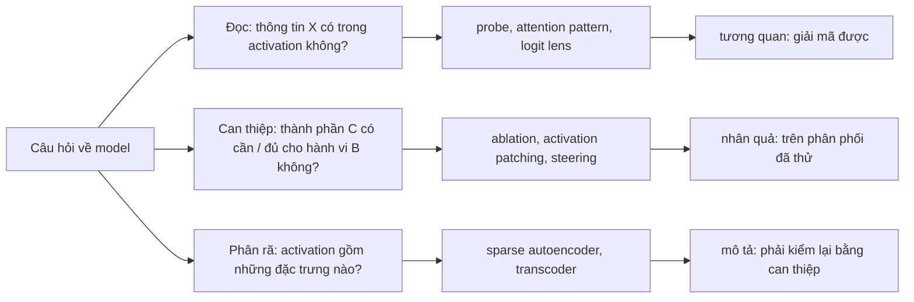
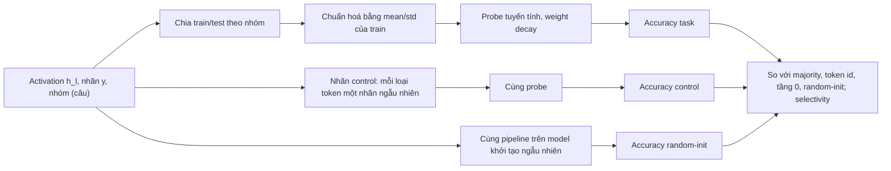
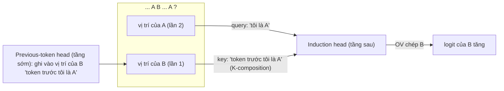
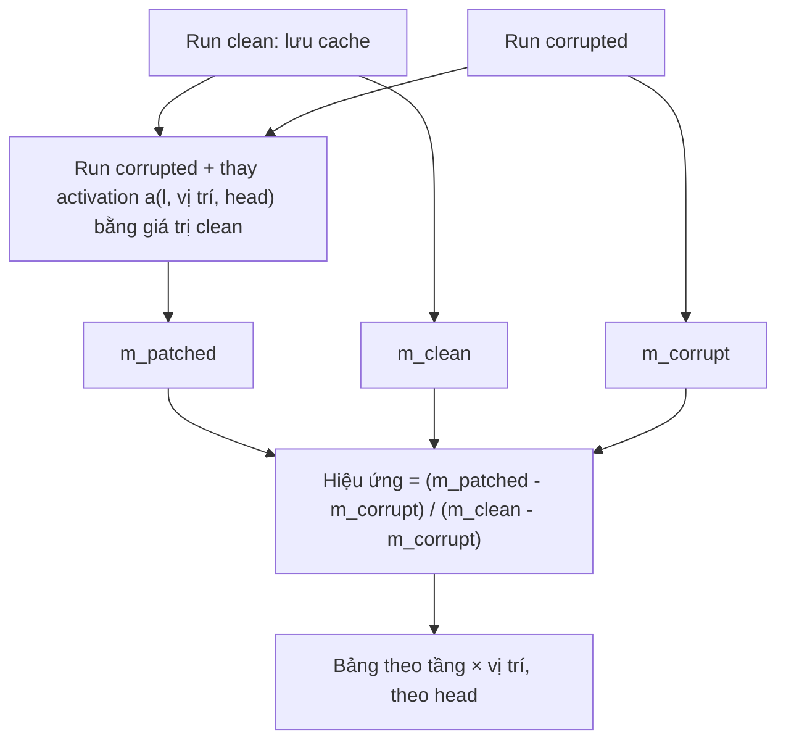
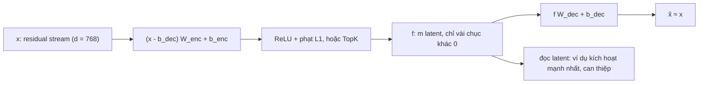
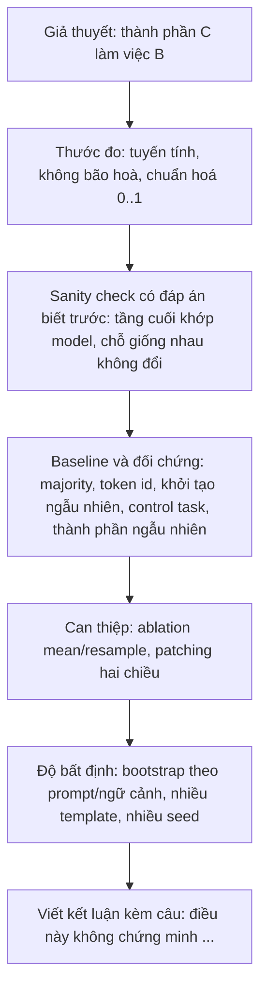

# Interpretability

Module 05 dựng GPT mini từ các phép nhân ma trận; module này mở nó ra khi nó đang chạy. Câu hỏi không còn là "model đạt bao nhiêu"
mà là "model tính ra kết quả đó **bằng cách nào**": thông tin nào nằm ở tầng nào, head nào nhìn vào đâu và có cần thiết không, dự đoán
hình thành dần qua các tầng ra sao, đường đi của một quyết định cụ thể, và residual stream được ghép từ những "đặc trưng" nào. Năm
công cụ trả lời năm câu hỏi đó: **probing**, **attention analysis**, **logit lens**, **activation patching** và **sparse autoencoder**.
Mỗi công cụ được tự cài bằng hook PyTorch trên chính lớp `GPT` của module 05, không dùng thư viện interpretability, và mỗi kết quả đi
kèm câu hỏi khó chịu nhất: nó chứng minh được gì, và không chứng minh được gì.

Residual stream, LayerNorm pre-norm, weight tying và lớp `GPT` (tên module con cố định, attention đọc được qua
`blocks[i].attn.attn_dropout`) giữ đúng định nghĩa của [module 05](../05-transformers-llm-architecture/README.md) (mục 1, 2);
perplexity và cross-entropy theo [module 04](../04-nlp-sequence-models/README.md). Hai model được mổ xẻ:

- **GPT-2 small** (OpenAI 2019, 124 triệu tham số, 12 tầng × 12 head, $$d = 768$$): đúng kiến trúc của lớp `GPT` module 05, nên trọng
  số nạp thẳng vào lớp đó (bài Intermediate 01). Đây là model được cộng đồng interpretability nghiên cứu kỹ nhất, có kết quả công bố để
  đối chiếu. Tải từ Hugging Face trong cell `explore` (548 MB, chạy được trên CPU). Mọi bài Intermediate dùng nó.
- **GPT mini tiếng Việt** bạn train ở bài Advanced 01 module 05 (định dạng `gpt-mini-v1`), đặt đường dẫn vào biến môi trường
  `GPT_MINI_CKPT`. Số liệu GPT mini trong bài này đo trên checkpoint tham chiếu của module 05 (cấu hình PC: 6 tầng, 6 head,
  $$d = 384$$, 13.8 triệu tham số, bpc 1.347); checkpoint của bạn sẽ cho số khác. Bài Advanced 01 là của riêng model này.

Văn bản đánh giá: **IWSLT15 En-Vi** (bản ghi các bài nói TED, tiếng Anh cho GPT-2, tiếng Việt cho GPT mini) và **UIT-VSFC** (phản hồi
sinh viên tiếng Việt có nhãn cảm xúc) đã có trong registry:

```bash
uv run python data/download_dataset.py iwslt15-en-vi
uv run python data/download_dataset.py uit-vsfc
```

Mọi số liệu dưới đây là kết quả chạy thật với seed ghim (torch 2.14.1, transformers 5.22.0, CPU 4 luồng trên PC dùng chung với
tiến trình khác), kiểm ngày 2026-11-01. Script và log tham chiếu nằm ngoài repo; các bài tập cho bạn tự dựng lại
phần lớn các con số, trên GPT-2 small.

Sau module này bạn sẽ:

- Gắn hook đúng chỗ (trước hay sau LayerNorm, input hay output của sublayer), ghi cache, tách residual stream thành tổng các đóng góp.
- Train linear probe với đủ đối chứng (baseline, control task, model khởi tạo ngẫu nhiên, chia dữ liệu không rò rỉ) và nói đúng
  điều probe chứng minh.
- Tìm head previous-token, duplicate-token, induction bằng phép đo có kiểm soát, và kiểm chúng bằng ablation đúng cách.
- Đọc dự đoán qua từng tầng bằng logit lens, biết vì sao phải áp LayerNorm cuối và khi nào cần tuned lens; tính direct logit
  attribution.
- Thiết kế thí nghiệm activation patching (clean/corrupted, thước đo, denoising/noising), đọc bảng kết quả, đối chiếu với mạch IOI đã
  công bố.
- Tự viết sparse autoencoder (L1, TopK), đánh giá bằng FVU, L0, latent chết, cross-entropy khi ghép vào model, và đọc latent có phê
  phán.

| Mức | Bài | Nội dung |
| --- | --- | --- |
| Basic | 01 hooks-residual-stream | `run_with_cache`, đóng góp từng head, phân rã residual stream |
| Basic | 02 attention-logit-lens | điểm previous-token / duplicate / induction, logit lens, hạng token, direct logit attribution |
| Basic | 03 linear-probe-controls | probe logistic tự cài, chia theo nhóm, control task, baseline, diff-in-means |
| Intermediate | 01 gpt2-heads-lens-probe | GPT-2 small trong lớp `GPT` module 05: bản đồ head, ablation, logit lens, probe có đối chứng |
| Intermediate | 02 activation-patching-ioi | patching residual / sublayer / head trên bài toán IOI, so với Wang và cộng sự (2022) |
| Intermediate | 03 sparse-autoencoder | SAE L1 và TopK trên residual stream GPT-2, FVU, L0, latent chết, CE recovered, đọc latent |
| Advanced | 01 interpret-gpt-mini | báo cáo interpretability cho GPT mini tiếng Việt của bạn (portfolio) |
| Advanced | 02 debug-interpretability | kiểm lại một bản phân tích có lỗi im lặng |

## 1. Interpretability hỏi gì; residual stream và hook

### Ba loại câu hỏi, ba mức bằng chứng

"Hiểu model" là một cụm từ quá rộng. Trong thực tế nó tách thành ba loại câu hỏi, mỗi loại cần một loại bằng chứng khác nhau:



Lỗi phổ biến nhất của cả người mới lẫn paper vội là trả lời câu hỏi loại 2 bằng bằng chứng loại 1: "probe đọc được cảm xúc ở tầng 4,
vậy tầng 4 quyết định cảm xúc", "head này nhìn vào chủ ngữ, vậy nó tìm chủ ngữ". Module này đi theo đúng thứ tự: đọc (mục 2–4), can
thiệp (mục 3, 5), phân rã (mục 6), và mỗi mục kết thúc bằng điều phương pháp đó **không** chứng minh.

Phân biệt thêm hai trường phái. **Behavioral / black-box** (eval, counterfactual, saliency trên input) không cần activation, dùng được
với API đóng. **Mechanistic interpretability** (Olah, Elhage và cộng sự) cố dịch tính toán bên trong thành thuật toán người đọc được:
"head A chép token trước, head B dùng nó để tìm lần xuất hiện cũ". Module này là phần thứ hai, ở mức một AI Engineer cần để gỡ lỗi,
giám sát và đọc paper một cách phê phán.

### Residual stream là một tổng

Với Transformer pre-norm (GPT-2, GPT mini, Llama), Block $$l$$ tính

$$
x^{mid}_l = x_l + \mathrm{attn}_l(\mathrm{LN}_1(x_l)), \qquad x_{l+1} = x^{mid}_l + \mathrm{mlp}_l(\mathrm{LN}_2(x^{mid}_l))
$$

nên residual stream cuối là **tổng** mọi thứ từng được ghi vào nó, và output của attention lại là tổng theo head:

$$
x_L = e_{tok} + e_{pos} + \sum_{l}\Big(\sum_{h} z_{l,h} W_{O,l,h}^\top + b_{O,l} + \mathrm{mlp}_l\Big), \qquad \text{logits} = \mathrm{LN}_f(x_L)\,W_U^\top
$$

$$z_{l,h}$$ là output của head $$h$$ trước khi chiếu, $$W_{O,l,h}$$ là khối cột tương ứng của ma trận chiếu ra. Ba công cụ của module
dựa trực tiếp vào tính cộng này: logit lens đọc $$x_l$$ giữa chừng bằng $$\mathrm{LN}_f$$ và $$W_U$$; direct logit attribution chiếu từng số
hạng lên hướng của một logit; patching thay một số hạng bằng giá trị của input khác. Post-norm (Transformer gốc, BERT) đặt LayerNorm
**trên** đường residual nên phá tính cộng thuần này.

### Hook: đặt máy đo đúng chỗ

PyTorch cho gắn hàm vào mọi `nn.Module`: `register_forward_pre_hook(fn)` nhận **input** của module (trả tuple thì tuple đó thay
input), `register_forward_hook(fn)` nhận input và **output** (trả tensor thì tensor đó thay output). Mỗi lệnh trả về một handle có
`.remove()`; hook quên gỡ sẽ âm thầm sửa mọi lần forward sau. Với lớp `GPT` của module 05:

| Đại lượng | Nằm ở | Bẫy |
| --- | --- | --- |
| Residual stream vào Block $$l$$ | input của `blocks[l]` | output của `blocks[l].ln1` là stream **đã chuẩn hoá**, không phải residual |
| Stream sau attention | input của `blocks[l].ln2` | |
| Output attention / MLP | output của `blocks[l].attn` / `.mlp` | kiểm bằng sổ sách residual: stream vào + output attention = stream sau attention |
| Ma trận attention | output của `blocks[l].attn.attn_dropout` | khi model ở chế độ train, đó là ma trận **sau** dropout |
| Output từng head | input của `blocks[l].attn.proj` | tách head theo cột `h*head_dim .. (h+1)*head_dim` |

Khác biệt giữa "trước" và "sau" LayerNorm không nhỏ. Residual stream của GPT-2 small có vài chiều lớn hơn hẳn phần còn lại, và
$$\gamma$$ của `ln_f` trải từ 0.004 tới 17.4. Một vector giả lập có một chiều outlier và $$\gamma$$ nhỏ ở chiều đó cho thấy LayerNorm đổi
cả thang lẫn hướng:

```python
import torch

torch.manual_seed(0)
x = torch.randn(4, 16)
x[:, 3] += 40.0                                    # một chiều "outlier" như stream thật của GPT-2
ln = torch.nn.LayerNorm(16)
with torch.no_grad():
    ln.weight.uniform_(0.5, 1.5)
    ln.weight[3] = 0.05                            # gamma nhỏ ở chiều outlier
y = ln(x)
print("norm trước LN:", x.norm(dim=-1).round().tolist())
print("norm sau LN  :", y.norm(dim=-1).round(decimals=2).tolist())
print("cosine(x, LN(x)):", torch.nn.functional.cosine_similarity(x, y, dim=-1).round(decimals=2).tolist())
```

Kết quả: norm khoảng 40 trước LayerNorm, khoảng 1.2 sau đó, và cosine giữa hai vector chỉ 0.18 tới 0.20. Probe, lens hay SAE train
trên một trong hai sẽ cho kết quả khác hẳn trên cái kia, nên mọi báo cáo phải ghi rõ đo ở điểm nào. Trên GPT-2 small thật (10 ngữ
cảnh TED), norm trung bình của residual stream ra khỏi tầng 0, 3, 6, 9, 11 là 52, 67, 88, 158, 454, còn ở vị trí đầu (token
`<|endoftext|>`) là khoảng 2 800–3 200 ở các tầng 3–9: vị trí đầu là một "attention sink" mà nhiều head đổ attention vào khi không
có gì để làm, và mọi thống kê gộp (SAE, probe, chuẩn hoá) phải loại nó ra. Bài Basic 01 viết `run_with_cache` đặt đủ các máy đo trên và
kiểm chúng bằng chính tính cộng: tổng các thành phần phải bằng stream cuối, và `lm_head(ln_f(·))` của stream cuối phải bằng logits.

### GPT-2 small trong lớp `GPT` của bạn

GPT-2 small là đúng kiến trúc của module 05: pre-norm, LayerNorm, positional embedding học được, MLP $$4d$$, weight tying. Khác biệt
duy nhất là GELU xấp xỉ tanh (thay `mlp.act`), và tên tham số/chiều lưu trọng số của thư viện `transformers`. Nạp xong, logits khớp
bản Hugging Face tới $$10^{-4}$$, và mọi công cụ của module chạy trên một model thật mà không cần thư viện interpretability. Bài
Intermediate 01 làm việc chuyển đổi đó. Với model khác kiến trúc (Llama, Qwen: RMSNorm, RoPE, SwiGLU) bạn sẽ dùng thư viện (mục 7),
nhưng các điểm đo vẫn là những điểm ở bảng trên.

## 2. Probing: đọc thông tin bằng một model tuyến tính

### Probe là gì

Chọn một điểm đo (residual stream ra khỏi tầng $$l$$), một thuộc tính có nhãn (cảm xúc của câu, token đã xuất hiện chưa, từ loại), rồi
train một classifier nhỏ $$g$$ đoán nhãn từ activation:

$$
\hat y = \arg\max\ \mathrm{softmax}(W h_l + b), \qquad \min_{W, b}\ \frac1N\sum_i \mathrm{CE}(W h_{l,i} + b,\ y_i) + \lambda \lVert W\rVert^2
$$

Accuracy trên tập test cao nghĩa là thuộc tính **giải mã tuyến tính được** từ $$h_l$$. Một dạng còn đơn giản hơn là **diff-in-means**:
hướng $$\mu_1 - \mu_0$$ nối tâm hai lớp, không cần train, ít overfit, và chính là hướng hay dùng để steering (mục 7). Probe tuyến tính
được ưa hơn MLP probe không phải vì nó mạnh hơn mà vì nó **yếu** hơn: MLP đủ lớn tự tính được thuộc tính từ input, lúc đó probe đo năng
lực của probe chứ không phải của model.

### Đối chứng: thứ biến 95% thành một kết luận

Một con số accuracy đứng một mình gần như vô nghĩa. Bốn đối chứng tối thiểu:

| Đối chứng | Trả lời câu hỏi | Cách làm |
| --- | --- | --- |
| Majority và baseline từ input | thuộc tính có đoán được mà không cần model không? | lớp phổ biến nhất; bảng tra theo token id; probe trên embedding (tầng 0) |
| Control task (Hewitt & Liang, 2019) | probe có đủ sức **học thuộc** không? | gán cho mỗi loại token một nhãn ngẫu nhiên cố định theo phân phối nhãn thật, train probe y hệt; **selectivity** = accuracy task − accuracy control |
| Model khởi tạo ngẫu nhiên | thông tin do **train** mà có, hay do kiến trúc và input? | cùng kiến trúc, chưa train, cùng probe |
| Chia dữ liệu không rò rỉ | test có thật sự "mới" không? | chia theo câu/văn bản (không theo token), chuẩn hoá bằng thống kê của train |



### Ví dụ: cảm xúc câu trong GPT mini tiếng Việt

GPT mini tham chiếu chưa từng thấy nhãn cảm xúc. Lấy câu phản hồi sinh viên của UIT-VSFC (bỏ nhãn trung tính: 4 000 câu train, 1 500
câu test, tỉ lệ tích cực 0.51 ở train, 0.54 ở test), trung bình residual stream theo token của mỗi câu ở từng tầng, train probe logistic:

| Stream | GPT mini đã train | GPT mini khởi tạo ngẫu nhiên |
| --- | --- | --- |
| embedding (trung bình embedding = "túi từ") | 0.904 | 0.897 |
| ra khỏi tầng 0 | 0.892 | 0.867 |
| ra khỏi tầng 2 | 0.905 | 0.850 |
| ra khỏi tầng 3 | 0.898 | 0.847 |
| ra khỏi tầng 5 (cuối) | 0.897 | 0.843 |

Majority baseline 0.538.

Nếu chỉ báo "probe ở tầng 2 đạt 90.5%", người đọc sẽ nghĩ model đã học khái niệm cảm xúc. Các đối chứng kể câu chuyện khác: trung
bình **embedding** (không qua tầng nào, chỉ là túi từ) đã đạt 0.904, và cả embedding ngẫu nhiên cũng đạt 0.897, vì cảm xúc của câu phản
hồi sinh viên nằm gần hết trong vài từ ("nhiệt tình", "chán"). Các tầng của GPT mini **không thêm** thông tin đo được về cảm xúc (0.89
tới 0.905, chênh nhau trong phạm vi nhiễu của 1 500 câu test); điều duy nhất các tầng đã train làm được là **giữ** thông tin đó tốt hơn
các tầng ngẫu nhiên (0.84 tới 0.87). Kết luận đúng: "cảm xúc giải mã được tuyến tính ở mọi tầng, chủ yếu nhờ thông tin từ vựng có sẵn ở
input", không phải "tầng 2 biểu diễn cảm xúc".

### Probe không chứng minh điều gì

Probe cho thấy thông tin **có mặt và đọc được tuyến tính**. Nó không cho thấy model **dùng** thông tin đó: một hướng có thể giải mã
được mà không tầng nào phía sau đọc nó. Muốn nói "dùng", phải can thiệp: xoá hướng đó khỏi stream (INLP, amnesic probing, LEACE) rồi
đo hành vi, hoặc cộng thêm theo hướng đó (steering) và xem hành vi đổi đúng như dự đoán. Bài Basic 03 viết bộ công cụ; bài
Intermediate 01 áp nó lên GPT-2 small với thuộc tính "token này đã xuất hiện trong ngữ cảnh chưa", nơi các đối chứng làm đổi hẳn cách
đọc kết quả.

## 3. Attention: pattern, head previous-token và induction

### Đọc một pattern

Head $$h$$ ở tầng $$l$$ có ma trận attention $$A = \mathrm{softmax}\big(QK^\top/\sqrt{d_h} + \text{mask}\big)$$, hàng là vị trí query, cột
là vị trí key. Output của head ở vị trí $$i$$ là $$\sum_j A_{ij}\, v_j W_O$$: nó **chép** thông tin từ các vị trí $$j$$ theo trọng số $$A_{ij}$$.
Elhage và cộng sự (2021) tách mỗi head thành hai mạch độc lập: **QK circuit** quyết định nhìn vào đâu, **OV circuit** quyết định chép
gì. Pattern chỉ cho thấy nửa thứ nhất.

Vì thế attention là công cụ **sinh giả thuyết**, không phải lời giải thích. Ba cảnh báo: attention lớn vào vị trí $$j$$ không có nghĩa
đóng góp lớn (nếu $$\lVert v_j W_O\rVert$$ nhỏ: nhiều head đổ attention vào token đầu như một chỗ "không làm gì"); ở tầng sau, "vị trí $$j$$"
đã trộn thông tin từ nhiều token; và trên một số tác vụ có thể đổi attention mà output gần như không đổi (Jain & Wallace, 2019).

### Các loại head đo được bằng phép thử có kiểm soát

Thay vì nhìn pattern trên vài câu, đo hành vi của head trên một phân phối dựng sẵn mà đáp án biết trước:

| Loại head | Nhìn vào | Phép đo |
| --- | --- | --- |
| Previous-token | vị trí $$t - 1$$ | attention trung bình $$A_{t, t-1}$$ trên văn bản thật |
| Duplicate-token | lần xuất hiện trước của **chính** token hiện tại | trên dãy `[BOS] + r + r` ($$r$$ ngẫu nhiên, dài $$n$$): $$A_{t, t-n}$$ ở nửa sau |
| Induction | token **đứng sau** lần xuất hiện trước | cùng dãy: $$A_{t, t-n+1}$$ ở nửa sau |

Dãy token ngẫu nhiên lặp lại là phép thử sạch: nửa đầu không đoán được (không có quy luật ngôn ngữ nào), nửa sau đoán được hoàn toàn
nếu model biết nhìn lại. Khác biệt loss giữa hai nửa đo năng lực "chép trong ngữ cảnh".

### Mạch induction



Induction head cần một head ở tầng **trước** đã ghi "token trước tôi là gì" vào key: đây là **K-composition**, ví dụ chuẩn về hai head ở
hai tầng phối hợp qua residual stream. Olsson và cộng sự (2022) cho thấy induction head xuất hiện đột ngột trong quá trình train, đúng
lúc loss trên các token cuối của ngữ cảnh dài giảm vọt, và cho rằng chúng là một cơ chế nền của in-context learning (không phải toàn
bộ). Model 1 tầng không thể có induction head theo nghĩa này.

Trên GPT mini tham chiếu (6 tầng), dãy lặp lại `r + r` với $$n = 50$$, 20 dãy:

head induction mạnh nhất là 5.5 (0.62) và 5.0 (0.55), đều ở **tầng cuối**; head previous-token mạnh nhất (đo trên văn bản TED tiếng
Việt) là 3.4 (0.70) và 2.1 (0.48), ở tầng trước đó, đúng thứ tự mà K-composition đòi hỏi. Không head nào có điểm duplicate trên 0.03.
Loss trên nửa đầu của dãy là 12.6 nat, nửa sau 5.7 nat: model chép được, nhưng kém xa một model lớn (bài Intermediate 01 đo GPT-2
small).

### Ablation: từ "trông giống" tới "cần cho"

Điểm attention là tương quan. Để biết head có **cần** cho hành vi không, tắt nó rồi đo hành vi:

| Cách tắt | Thay output head bằng | Rủi ro |
| --- | --- | --- |
| Zero ablation | 0 | trạng thái ngoài phân phối: model hỏng vì "lạ", có thể làm hỏng cả hành vi không liên quan |
| Mean ablation | trung bình output của head trên văn bản thường | xoá cả phần thông tin chung; phụ thuộc tập tham chiếu |
| Resample ablation | output của head trên một input khác | nhiễu, cần lấy trung bình nhiều lần |

Luôn đo thêm hai thứ: một hành vi **không** cần head đó (ví dụ loss nửa đầu của dãy lặp lại) để thấy phép can thiệp có "sạch" không, và
tắt **cùng số head ngẫu nhiên** để chắc hiệu ứng không phải của "tắt bất kỳ k head nào". Các head có thể dự phòng cho nhau: tắt một head
không ảnh hưởng không chứng minh nó vô dụng; tắt cả nhóm mới thấy.

Trên GPT mini tham chiếu (dãy lặp lại seed 1, mean ablation, mean lấy trên văn bản TED tiếng Việt): tắt head induction mạnh nhất đưa
loss nửa sau từ 5.75 lên 8.69 nat, tắt hai head lên 11.70, ba head lên 12.14, tức gần bằng nửa đầu (không còn chép được), trong khi loss
nửa đầu chỉ nhích từ 12.60 lên 12.87. Tắt hai head **ngẫu nhiên** (điểm induction dưới 0.1), năm lần: 5.79, 6.30, 8.54, 9.19, 5.95. Hai
lần tắt ngẫu nhiên cũng làm hỏng đáng kể: model 36 head nhỏ tới mức nhiều head góp phần vào việc chép (ví dụ head previous-token mà mạch
cần). Kết luận được phép: "hai head 5.5 và 5.0 cần cho việc chép chuỗi trên dãy ngẫu nhiên, mạnh hơn trung bình một cặp head bất kỳ";
không được phép: "việc chép chuỗi chỉ do hai head này".

Bài Basic 02 viết các phép đo điểm head; bài Intermediate 01 vẽ bản đồ 144 head của GPT-2 small và kiểm bằng zero, mean ablation và
head ngẫu nhiên.

## 4. Logit lens, tuned lens và direct logit attribution

### Logit lens

Nếu residual stream là một bản nháp được sửa dần qua các tầng, có thể đọc bản nháp ở tầng $$l$$ bằng chính đường ra của model
(nostalgebraist, 2020):

$$
p_l = \mathrm{softmax}\big(\mathrm{LN}_f(x_l)\,W_U^\top\big)
$$

$$\mathrm{LN}_f$$ là bắt buộc. Unembedding được train để đọc stream **đã chuẩn hoá**; stream giữa chừng có norm khác hẳn (mục 1) và vài
chiều outlier mà $$\gamma$$ của $$\mathrm{LN}_f$$ dập đi. Bỏ $$\mathrm{LN}_f$$ thì logits sai thang (softmax quá tự tin, cross-entropy hàng chục
nat trên GPT-2) và lệch hướng. Ba thước đo cho mỗi tầng: cross-entropy với token thật, tỉ lệ vị trí mà top-1 của lens trùng top-1 của
model, và $$\mathrm{KL}(p_{model} \Vert p_l)$$.

GPT mini tham chiếu, 20 ngữ cảnh 128 token của `tst2013.vi`:

| Stream | CE (nat) | Trùng top-1 với model | KL | Hạng trung vị của token đúng |
| --- | --- | --- | --- | --- |
| embedding | 37.27 | 0.031 | 33.29 | 1 422 |
| ra khỏi tầng 0 | 5.72 | 0.232 | 2.17 | 29 |
| ra khỏi tầng 1 | 5.70 | 0.202 | 2.15 | 34 |
| ra khỏi tầng 2 | 5.23 | 0.296 | 1.71 | 17 |
| ra khỏi tầng 3 | 4.64 | 0.437 | 1.15 | 7 |
| ra khỏi tầng 4 | 4.18 | 0.582 | 0.69 | 5 |
| ra khỏi tầng 5 (cuối) | 3.61 | 1.000 | 0.00 | 3 |

Đọc bảng: ở embedding, lens gần như luôn đoán lại **chính token hiện tại** (vì weight tying, 100% vị trí), nên CE rất cao. Từ tầng 0,
dự đoán đã có hình dạng (token đúng ở hạng trung vị 29 trong 8 000), rồi sắc dần; ở tầng 1 trùng top-1 và hạng hơi lùi so với tầng 0
trước khi tiến tiếp.
Bản laptop 4 tầng cho đường tương tự (trùng top-1 0.30, 0.27, 0.49, 1.00). Với model nhỏ này bỏ `ln_f` chỉ làm CE tăng nhẹ (4.82 so với
4.64 ở tầng 3) vì stream chưa có outlier lớn như GPT-2: đừng khái quát một quan sát trên model nhỏ sang model lớn.

### Tuned lens và giới hạn

Logit lens giả định mọi tầng dùng **cùng hệ toạ độ** với tầng cuối. Ở nhiều model (BLOOM, GPT-Neo, Pythia) giả định đó sai ở tầng sớm
và lens cho rác dù thông tin có ở đó. **Tuned lens** (Belrose và cộng sự, 2023) học cho mỗi tầng một phép affine $$A_l x + b_l$$ (khởi tạo
bằng đồng nhất) tối thiểu $$\mathrm{KL}(p_{model} \Vert \mathrm{softmax}(\mathrm{LN}_f(A_l x_l + b_l) W_U^\top))$$ trên dữ liệu train, nên đọc
tầng sớm trung thực hơn và ít thiên lệch về một vài token. Cả hai là phép **đọc**: chúng cho thấy cái giải mã được bằng unembedding
(hoặc một biến đổi học được), không cho thấy tầng đó "quyết định".

### Direct logit attribution

Logit difference giữa hai token $$a$$ và $$b$$ là $$\mathrm{LN}_f(x_L) \cdot (W_U[a] - W_U[b])$$. Nếu giữ thang $$\sigma$$ của $$\mathrm{LN}_f$$ cố định
(lấy từ stream cuối), phần còn lại tuyến tính, nên tách được theo từng thành phần $$c_i$$ của residual stream (mục 1):

$$
\mathrm{logit}_a - \mathrm{logit}_b = \sum_i \frac{c_i - \mu(c_i)}{\sigma(x_L)} \cdot \big(\gamma \odot (W_U[a] - W_U[b])\big) + \beta \cdot (W_U[a] - W_U[b])
$$

Mỗi số hạng là **đóng góp trực tiếp** của một head hoặc một MLP lên câu trả lời. Hai giới hạn: $$\sigma$$ đổi khi bỏ một thành phần, nên
DLA không phải hiệu ứng khi xoá thành phần đó; và DLA bỏ sót mọi thành phần tác động **gián tiếp** (qua head khác). Wang và cộng sự (mục 5)
cho thấy một lớp head có hiệu ứng nhân quả lớn mà DLA gần bằng 0. Bài Basic 02 viết logit lens và DLA; bài Intermediate 01 đo logit lens trên GPT-2
small.

## 5. Activation patching và causal tracing

### Thí nghiệm can thiệp hoán đổi

Activation patching (còn gọi interchange intervention, causal mediation analysis) hỏi một câu nhân quả hẹp và trả lời được: **nếu chỉ
activation này mang giá trị của input khác, output đổi bao nhiêu?**

1. Cặp prompt **clean** và **corrupted** giống nhau tối đa, khác ở đúng thông tin cần khảo, cùng độ dài token. Ví dụ IOI: "When Mary and
   John went to the store, **John** gave a drink to" (đáp án Mary) và cùng câu với **Mary** ở vị trí đó (đáp án đảo thành John).
2. **Thước đo** $$m$$: logit difference giữa đáp án clean và đáp án corrupted ở vị trí cuối. Nó tuyến tính theo stream cuối (cộng được
   qua thành phần, mục 4) và không bão hoà như xác suất.
3. Chạy cả hai, lưu cache. **Denoising**: chạy corrupted, thay một activation bằng giá trị clean, đo
   $$\frac{m_{patched} - m_{corrupt}}{m_{clean} - m_{corrupt}}$$ (0 là "không khôi phục gì", 1 là "khôi phục hết"). **Noising**: ngược lại.
4. Đi từ thô tới mịn: residual stream theo (tầng, vị trí) để thấy thông tin nằm ở đâu và chuyển đi lúc nào; output attention/MLP từng
   tầng; từng head; cuối cùng **path patching** (chỉ thay đường từ head A tới head B) để tách tác động trực tiếp khỏi gián tiếp.



Hai câu hỏi khác nhau: denoising hỏi "riêng thành phần này **đủ** để khôi phục chưa", noising hỏi "phá riêng thành phần này có làm hỏng
không, tức nó có **cần** không". Khi các đường song song **cộng** hiệu ứng (additive), denoising từng đường cho hiệu ứng nhỏ và noising từng đường cũng nhỏ; khi chúng là
đường **dự phòng** (OR, backup), denoise một đường đã khôi phục gần hết trong khi noise một đường gần như không phá gì; một thành phần là nút
cổ chai cho cả hai hiệu ứng lớn.

### Một kiểm tra miễn phí

Ở tầng 0, hai prompt chỉ khác nhau ở một vị trí $$k$$. Patch residual stream tầng 0 ở vị trí $$k$$ phải cho **đúng** run clean (hiệu ứng
1), ở mọi vị trí khác phải cho 0, và vì attention chỉ nhìn về trước, mọi vị trí trước $$k$$ phải cho 0 ở **mọi** tầng. Bảng patching
nào vi phạm điều này là bảng của một hook đặt sai chỗ. Bài Intermediate 02 dựng test dựa đúng trên các tính chất đó.

### Ví dụ trên GPT mini: chép lại một chuỗi

GPT mini tham chiếu không làm được IOI tiếng Anh, nhưng làm tốt việc chép chuỗi (mục 3). Clean: dãy ngẫu nhiên 30 token lặp lại hai
lần; corrupted: đổi đúng một token ở bản thứ nhất (vị trí 11). Ở vị trí 40 (lần xuất hiện thứ hai của token đứng ngay trước token bị
đổi), model phải đoán lại token ở vị trí 11; thước đo là logit difference giữa token clean và token corrupted, 20 dãy:

logit difference trung bình 8.26 (clean) và −6.64 (corrupted). Patch residual stream theo (tầng, vị trí), chỉ hai cột khác 0:

| Vào tầng | 0 | 1 | 2 | 3 | 4 | 5 |
| --- | --- | --- | --- | --- | --- | --- |
| Vị trí 11 (token bị đổi) | 1.00 | 0.98 | 0.98 | 0.96 | 0.97 | 0.88 |
| Vị trí 40 (vị trí dự đoán) | 0.00 | 0.00 | 0.00 | 0.00 | 0.00 | 0.11 |

Patch từng head (mọi vị trí): 5.5 = 0.42, 5.0 = 0.38, mọi head khác dưới 0.06. Thông tin nằm yên ở vị trí của token bị đổi qua năm tầng,
và chỉ hai head induction ở tầng cuối chuyển nó sang vị trí dự đoán: patching xác nhận bằng can thiệp điều mà điểm attention ở mục 3 chỉ
gợi ý. (Tầng 5 là tầng cuối nên không có "residual vào tầng 6" để thấy vị trí 40 sáng lên hoàn toàn.)

### IOI trên GPT-2 small và những gì paper đã làm thêm

Wang và cộng sự (2022) tìm trong GPT-2 small một mạch khoảng 26 head cho IOI, chia thành các lớp theo chức năng: head phát hiện tên lặp
lại (duplicate token, induction) ở vị trí của chủ ngữ thứ hai; head "S-inhibition" chép thông tin "tên này là chủ ngữ" sang vị trí
cuối; head "name mover" ở vị trí cuối nhìn vào tên còn lại và chép nó lên logit; và cả những head đẩy ngược đáp án. Họ dùng nhiều
template, corruption "ABC" (thay cả ba tên bằng tên khác), path patching, và kiểm mạch tìm được có **đầy đủ** (một mình tái tạo được hành
vi) và **tối thiểu** không. Bài Intermediate 02 cho bạn tự dựng lại phần đầu của câu chuyện đó bằng patching và DLA, rồi đối chiếu.

### Causal tracing, attribution patching và các bẫy

- **Causal tracing** (Meng và cộng sự, 2022, ROME): corruption là nhiễu Gaussian cộng vào embedding của chủ thể, rồi khôi phục từng
  activation để định vị nơi lưu "sự kiện" (subject → attribute) trong các MLP tầng giữa. Nhiễu nhân tạo đưa model ra khỏi phân phối, và
  Hase và cộng sự (2023) cho thấy vị trí định vị được bằng tracing không dự đoán tầng nào sửa (edit) hiệu quả nhất: định vị và can thiệp
  là hai câu hỏi khác nhau.
- **Attribution patching** (Nanda, 2023; Syed và cộng sự, 2023): với hàng nghìn thành phần, xấp xỉ hiệu ứng patching bằng khai triển
  bậc nhất $$\Delta m \approx (a_{clean} - a_{corrupt}) \cdot \nabla_a m\big|_{corrupt}$$, chỉ cần hai lần forward và một lần backward; dùng để lọc
  ứng viên rồi patch thật. Xấp xỉ kém ở thành phần có hiệu ứng lớn và phi tuyến (như vị trí đầu, attention bão hoà).
- **Self-repair** (McGrath và cộng sự, 2023, "Hydra effect"): tắt hoặc patch một head làm các head phía sau bù lại, nên hiệu ứng từng head
  không cộng thành hiệu ứng của cả nhóm, và một head có đóng góp trực tiếp lớn có thể có hiệu ứng patching nhỏ.
- **Phạm vi**: kết luận chỉ đúng trên phân phối prompt đã thử. Một template, một kiểu corruption, 32 prompt là bằng chứng cho hành vi hẹp
  đó, chưa phải "model giải IOI bằng mạch này" nói chung.

## 6. Superposition và sparse autoencoder

### Vì sao không đọc từng neuron

Một neuron MLP hay một chiều của residual stream thường bật cho nhiều khái niệm không liên quan (**polysemantic**). Elhage và cộng sự
(2022, "Toy Models of Superposition") giải thích bằng **superposition**: khi các đặc trưng **thưa** (hiếm khi cùng bật), model đặt
nhiều đặc trưng hơn số chiều theo các hướng gần trực giao, chấp nhận chút nhiễu giao thoa để đổi lấy dung lượng. Trong $$d$$ chiều có
thể xếp số hướng "gần trực giao" tăng theo hàm mũ của $$d$$, nên mô hình hàng nghìn chiều có chỗ cho rất nhiều đặc trưng. Hệ quả: đơn vị
phân tích đúng là **hướng**, không phải neuron, và cần một cách tìm ra các hướng đó.

```python
import torch

torch.manual_seed(0)
for d in [10, 100, 768]:
    v = torch.nn.functional.normalize(torch.randn(4000, d), dim=1)
    cos = (v @ v.T).fill_diagonal_(0).abs()
    print(f"d = {d:4d}: 4 000 hướng ngẫu nhiên, |cosine| trung bình {cos.mean():.3f}, lớn nhất {cos.max():.3f}")
```

Với $$d = 768$$ (residual stream của GPT-2 small), 4 000 hướng **ngẫu nhiên** đã có |cosine| trung bình 0.029 và lớn nhất 0.189; với $$d = 10$$
con số là 0.259 và 0.984. Hướng do model học còn được đặt có chủ đích, nên chỗ cho đặc trưng thưa lớn hơn nhiều so với số chiều.

### Sparse autoencoder

SAE học một từ điển có $$m \gg d$$ hướng sao cho mỗi activation được tái dựng bằng **ít** hướng (Bricken và cộng sự 2023; Cunningham và
cộng sự 2023):

$$
f(x) = \sigma\big((x - b_{dec})W_{enc} + b_{enc}\big) \in \mathbb{R}^m, \qquad \hat x = f(x)\,W_{dec} + b_{dec}
$$



Hai cách tạo độ thưa:

| Biến thể | Loss | Ưu | Nhược |
| --- | --- | --- | --- |
| ReLU + L1 | $$\lVert x - \hat x\rVert^2 + \lambda \sum_i f_i \lVert W_{dec,i}\rVert$$ | đơn giản, liên tục | phải dò $$\lambda$$; L1 kéo mọi kích hoạt nhỏ đi (shrinkage); L0 khó kiểm soát |
| TopK (Gao và cộng sự, 2024) | $$\lVert x - \hat x\rVert^2$$, chỉ giữ $$k$$ latent lớn nhất | chọn thẳng L0 = k, không shrinkage, dễ mở rộng | không trơn ở biên top-k; latent chết vẫn có nếu không xử lý |

Phạt L1 nhân với norm hàng decoder (hoặc chuẩn hoá hàng decoder về 1 sau mỗi bước): nếu không, SAE "ăn gian" bằng cách thu nhỏ $$f$$ và
phóng to hàng decoder, L1 giảm mà không thưa hơn. Các bản mới hơn như JumpReLU (Rajamanoharan và cộng sự, 2024) dùng ngưỡng học được.
Trước khi train, chuẩn hoá activation bằng một hằng số để $$\mathbb{E}\lVert x\rVert^2 = d$$ (cùng siêu tham số dùng được cho nhiều tầng),
và loại vị trí đầu (norm cực lớn, mục 1).

### Đánh giá: ba trục, luôn báo cùng nhau

| Trục | Thước đo | Bẫy |
| --- | --- | --- |
| Tái dựng | FVU $$= \sum\lVert x - \hat x\rVert^2 / \sum\lVert x - \bar x\rVert^2$$ | kiểm hàm FVU bằng một SAE chỉ trả về trung bình của dữ liệu: phải ra đúng 1 |
| Độ thưa | L0 trung bình; tỉ lệ latent **chết** (không bật trên một tập lớn), latent quá dày | so FVU của hai SAE khác L0 là vô nghĩa |
| Trung thành | CE khi ghép SAE vào model; loss recovered $$= \frac{CE_{abl} - CE_{SAE}}{CE_{abl} - CE_{gốc}}$$ | zero ablation residual stream làm $$CE_{abl}$$ rất tệ nên tỉ lệ đẹp; báo cả CE tăng tuyệt đối |

GPT mini tham chiếu, SAE TopK ($$k = 32$$, 3 072 latent, gấp 8 lần $$d$$) trên residual stream vào tầng 3, 500 nghìn token TED tiếng
Việt (`train.vi`), 488 bước batch 4 096 trên CPU (143 giây); đánh giá trên 75 nghìn token của `tst2012.vi` + `tst2013.vi`:

| Thước đo | Giá trị |
| --- | --- |
| FVU | 0.156 |
| L0 | 32 |
| Latent chết | 0.7% |
| CE: model gốc / ghép SAE | 4.023 / 4.215 nat |
| CE: zero ablation / mean ablation tầng 3 | 9.249 / 7.649 nat |
| Loss recovered so với zero / so với mean | 0.963 / 0.947 |

Cùng một SAE, "96%" hay "95%" tuỳ baseline, và cả hai che mất rằng model mất 0.19 nat mỗi token (perplexity tăng khoảng 21%) khi ghép
SAE vào chỉ một tầng.

### Đọc latent và giới hạn

Cách đọc phổ biến: xem các ví dụ kích hoạt mạnh nhất của latent (mỗi văn bản một ví dụ), đặt tên ("dấu phẩy sau mệnh đề phụ", "tên tỉnh
miền Tây"), rồi kiểm tên đó bằng ví dụ kích hoạt **yếu** và bằng can thiệp (tắt latent, xem hành vi đổi đúng như tên gọi không). Ở quy mô
lớn, việc đặt tên được tự động hoá bằng một LLM (auto-interpretability) và hiển thị trên dashboard như Neuronpedia.

Những vấn đề đã biết: **feature splitting** (từ điển lớn hơn tách một đặc trưng thành nhiều đặc trưng con), **feature absorption** (latent
"bắt đầu bằng chữ S" không bật ở những token đã có latent riêng), latent chết hoặc quá dày, phần "dark matter" không tái dựng được, và
latent không nhất thiết là đơn vị mà model **dùng** để tính toán. Các hướng tiếp theo: transcoder (tái dựng output MLP từ input của nó),
crosscoder (một từ điển chung cho nhiều tầng hoặc hai model), và attribution graph ghép chúng thành mạch. Bài Intermediate 03 cho bạn tự
viết SAE, kiểm trên dữ liệu đồ chơi có đáp án, train trên GPT-2 small và đọc latent.

## 7. Interpretability trong công việc AI Engineer

### Dùng vào đâu

| Việc | Phương pháp | Ghi chú thực tế |
| --- | --- | --- |
| Gỡ lỗi "vì sao model sai ở loại input này" | counterfactual + patching, DLA | bắt đầu bằng hành vi; patching khoanh vùng tầng/thành phần |
| Giám sát rẻ trong production | probe trên activation (token cuối hoặc trung bình) | một phép nhân vector trong lần forward phục vụ; train lại khi đổi checkpoint |
| Đổi hành vi không cần fine-tune | steering vector (diff-in-means, latent SAE) | đo tác dụng phụ như mọi thay đổi model |
| So model trước/sau fine-tune, quantize | logit lens, probe, patching trên cùng tập | thấy khả năng nào bị mất ở tầng nào |
| Trả lời kiểm toán, khách hàng | tổng hợp các bằng chứng trên, kèm giới hạn | không hứa "giải thích toàn bộ" |

Nghiên cứu gần đây cho cả tin tốt lẫn tin xấu. Probe tuyến tính đơn giản trên activation phát hiện được hành vi khó thấy từ văn bản
(Anthropic, "Simple probes can catch sleeper agents", 2024). Nhưng khi so trên các bài toán thực tế, latent SAE chưa vượt được probe
tuyến tính thường (nhóm interpretability của Google DeepMind công bố kết quả âm này năm 2025 và giảm ưu tiên SAE). Hướng mới như
transcoder và attribution graph (Anthropic, "Circuit tracing", 2025) đang thay đổi nhanh: đọc bản mới nhất trước khi chọn công cụ.

### Thư viện

Tự viết hook để hiểu; khi làm thật trên model lớn hoặc khác kiến trúc, dùng thư viện và kiểm nó bằng chính các phép thử của module
(logits khớp model gốc, tổng thành phần bằng stream cuối, patching ở chỗ hai input giống nhau không đổi gì).

| Thư viện | Dùng khi | Lưu ý |
| --- | --- | --- |
| TransformerLens | model nhỏ/vừa được hỗ trợ, cần tên hook chuẩn, patching nhanh | `from_pretrained` mặc định gộp trọng số LayerNorm và trừ tâm các ma trận ghi vào stream: activation khác model gốc (dùng `from_pretrained_no_processing` khi cần khớp) |
| nnsight | can thiệp bất kỳ model Hugging Face nào, kể cả chạy từ xa | cú pháp "trace" riêng |
| pyvene | can thiệp có cấu trúc (interchange intervention, DAS) | hướng nghiên cứu causal abstraction |
| SAELens, Neuronpedia | SAE train sẵn (Gemma Scope, Llama Scope), dashboard latent | SAE gắn với đúng checkpoint và đúng điểm hook |

Module này không thêm thư viện nào: mọi thứ chạy bằng PyTorch và `transformers` đã có trong môi trường của track.

### Checklist trước khi tin một kết quả (của mình hay của người khác)



1. Điểm đo ghi rõ (trước/sau LayerNorm, vị trí nào, có loại token đầu không).
2. Sanity check có đáp án biết trước chạy trước khi nhìn kết quả thật.
3. Baseline và đối chứng đúng loại cho phương pháp (bảng ở các mục 2–6).
4. Bằng chứng tương quan không được viết thành kết luận nhân quả.
5. Con số có khoảng tin cậy; kết quả giữ khi đổi template, seed, tập dữ liệu.
6. Phạm vi kết luận ghi đúng phân phối đã thử.

Bài Advanced 02 cho bạn một bản phân tích chạy được, con số trông hợp lý, và lỗi nằm đúng ở những chỗ checklist này bắt.

## 8. Tài liệu tham khảo

Nền tảng và tổng quan:

- Chris Olah và cộng sự. [Zoom In: An Introduction to Circuits](https://distill.pub/2020/circuits/zoom-in/) (Distill, 2020).
- Nelson Elhage và cộng sự. [A Mathematical Framework for Transformer Circuits](https://transformer-circuits.pub/2021/framework/index.html) (Anthropic, 2021): residual stream, QK/OV circuit, composition.
- Catherine Olsson và cộng sự. [In-context Learning and Induction Heads](https://transformer-circuits.pub/2022/in-context-learning-and-induction-heads/index.html) (Anthropic, 2022).
- Neel Nanda. [A Comprehensive Mechanistic Interpretability Explainer & Glossary](https://www.neelnanda.io/mechanistic-interpretability/glossary) và [ARENA (chương 1: Transformer interpretability)](https://github.com/callummcdougall/ARENA_3.0).
- Leonard Bereska, Efstratios Gavves. [Mechanistic Interpretability for AI Safety: A Review](https://arxiv.org/abs/2404.14082) (2024).

Probing:

- Yonatan Belinkov. [Probing Classifiers: Promises, Shortcomings, and Advances](https://arxiv.org/abs/2102.12452) (Computational Linguistics, 2022).
- John Hewitt, Percy Liang. [Designing and Interpreting Probes with Control Tasks](https://arxiv.org/abs/1909.03368) (EMNLP 2019).
- Yanai Elazar và cộng sự. [Amnesic Probing](https://arxiv.org/abs/2006.00995) (TACL 2021); Nora Belrose và cộng sự. [LEACE: Perfect linear concept erasure in closed form](https://arxiv.org/abs/2306.03819) (2023).

Attention:

- Sarthak Jain, Byron Wallace. [Attention is not Explanation](https://arxiv.org/abs/1902.10186) (NAACL 2019); Sarah Wiegreffe, Yuval Pinter. [Attention is not not Explanation](https://arxiv.org/abs/1908.04626) (EMNLP 2019).
- Goro Kobayashi và cộng sự. [Attention is Not Only a Weight: Analyzing Transformers with Vector Norms](https://arxiv.org/abs/2004.10102) (EMNLP 2020).
- Guangxuan Xiao và cộng sự. [Efficient Streaming Language Models with Attention Sinks](https://arxiv.org/abs/2309.17453) (2023).

Logit lens:

- nostalgebraist. [interpreting GPT: the logit lens](https://www.lesswrong.com/posts/AcKRB8wDpdaN6v6ru/interpreting-gpt-the-logit-lens) (2020).
- Nora Belrose và cộng sự. [Eliciting Latent Predictions from Transformers with the Tuned Lens](https://arxiv.org/abs/2303.08112) (2023).

Activation patching và mạch:

- Kevin Wang và cộng sự. [Interpretability in the Wild: a Circuit for Indirect Object Identification in GPT-2 small](https://arxiv.org/abs/2211.00593) (ICLR 2023).
- Kevin Meng và cộng sự. [Locating and Editing Factual Associations in GPT](https://arxiv.org/abs/2202.05262) (ROME, NeurIPS 2022); Peter Hase và cộng sự. [Does Localization Inform Editing?](https://arxiv.org/abs/2301.04213) (NeurIPS 2023).
- Stefan Heimersheim, Neel Nanda. [How to use and interpret activation patching](https://arxiv.org/abs/2404.15255) (2024); Fred Zhang, Neel Nanda. [Towards Best Practices of Activation Patching in Language Models](https://arxiv.org/abs/2309.16042) (ICLR 2024).
- Neel Nanda. [Attribution Patching: Activation Patching At Industrial Scale](https://www.neelnanda.io/mechanistic-interpretability/attribution-patching) (2023); Aaquib Syed và cộng sự. [Attribution Patching Outperforms Automated Circuit Discovery](https://arxiv.org/abs/2310.10348) (2023).
- Thomas McGrath và cộng sự. [The Hydra Effect: Emergent Self-repair in Language Model Computations](https://arxiv.org/abs/2307.15771) (2023).
- Arthur Conmy và cộng sự. [Towards Automated Circuit Discovery for Mechanistic Interpretability](https://arxiv.org/abs/2304.14997) (ACDC, NeurIPS 2023).

Superposition và sparse autoencoder:

- Nelson Elhage và cộng sự. [Toy Models of Superposition](https://transformer-circuits.pub/2022/toy_model/index.html) (Anthropic, 2022).
- Trenton Bricken và cộng sự. [Towards Monosemanticity: Decomposing Language Models With Dictionary Learning](https://transformer-circuits.pub/2023/monosemantic-features/index.html) (Anthropic, 2023); Hoagy Cunningham và cộng sự. [Sparse Autoencoders Find Highly Interpretable Features in Language Models](https://arxiv.org/abs/2309.08600) (2023).
- Adly Templeton và cộng sự. [Scaling Monosemanticity](https://transformer-circuits.pub/2024/scaling-monosemanticity/index.html) (Anthropic, 2024).
- Leo Gao và cộng sự. [Scaling and evaluating sparse autoencoders](https://arxiv.org/abs/2406.04093) (OpenAI, 2024): TopK.
- Senthooran Rajamanoharan và cộng sự. [Jumping Ahead: Improving Reconstruction Fidelity with JumpReLU Sparse Autoencoders](https://arxiv.org/abs/2407.14435) (2024); Tom Lieberum và cộng sự. [Gemma Scope](https://arxiv.org/abs/2408.05147) (2024).
- Google DeepMind mechanistic interpretability team. [Negative Results for SAEs On Downstream Tasks and Deprioritising SAE Research](https://www.alignmentforum.org/posts/4uXCAJNuPKtKBsi28/negative-results-for-saes-on-downstream-tasks) (2025).
- Emmanuel Ameisen và cộng sự. [Circuit Tracing: Revealing Computational Graphs in Language Models](https://transformer-circuits.pub/2025/attribution-graphs/methods.html) (Anthropic, 2025).

Ứng dụng:

- Monte MacDiarmid và cộng sự. [Simple probes can catch sleeper agents](https://www.anthropic.com/research/probes-catch-sleeper-agents) (Anthropic, 2024).
- Alexander Matt Turner và cộng sự. [Steering Language Models With Activation Engineering](https://arxiv.org/abs/2308.10248) (2023); Andy Zou và cộng sự. [Representation Engineering](https://arxiv.org/abs/2310.01405) (2023).

Thư viện:

- [TransformerLens](https://github.com/TransformerLensOrg/TransformerLens), [nnsight](https://nnsight.net/), [pyvene](https://github.com/stanfordnlp/pyvene), [SAELens](https://github.com/jbloomAus/SAELens), [Neuronpedia](https://www.neuronpedia.org/).
- [PyTorch: `register_forward_hook`](https://pytorch.org/docs/stable/generated/torch.nn.Module.html#torch.nn.Module.register_forward_hook).

Model và dữ liệu:

- Alec Radford và cộng sự. [Language Models are Unsupervised Multitask Learners](https://cdn.openai.com/better-language-models/language_models_are_unsupervised_multitask_learners.pdf) (GPT-2, 2019); trọng số [openai-community/gpt2](https://huggingface.co/openai-community/gpt2) (giấy phép MIT).
- IWSLT 2015 English-Vietnamese ([Stanford NLP](https://nlp.stanford.edu/projects/nmt/), mirror [stefan-it/nmt-en-vi](https://github.com/stefan-it/nmt-en-vi) mà registry dùng); UIT-VSFC ([uitnlp/vietnamese_students_feedback](https://huggingface.co/datasets/uitnlp/vietnamese_students_feedback)).
- [roadmap.sh: AI Engineer](https://roadmap.sh/ai-engineer). Module này là phần mở rộng ★, roadmap không có mục interpretability riêng.
