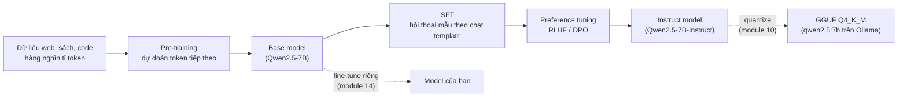
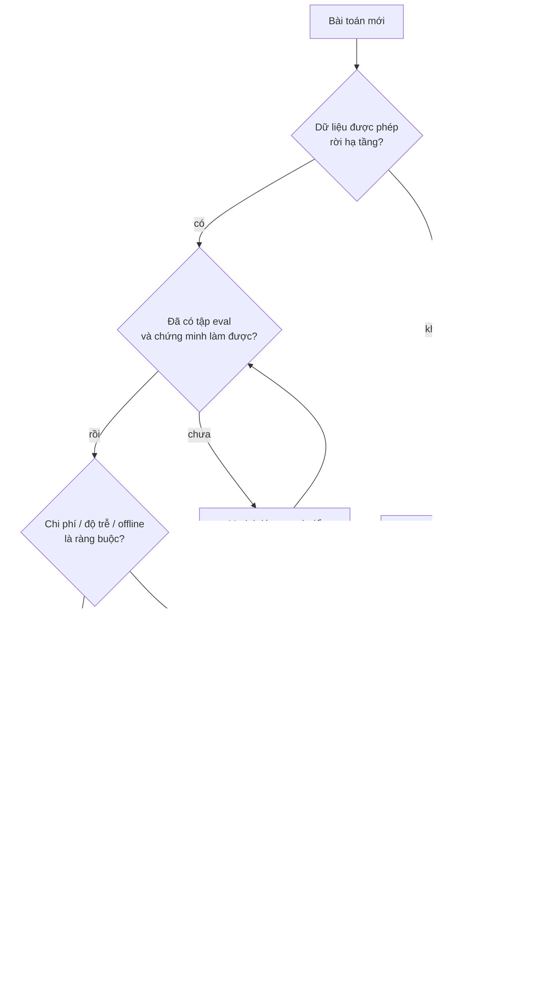
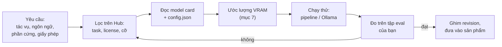
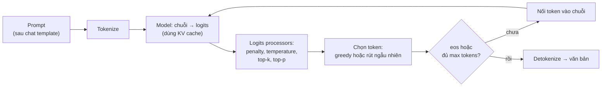
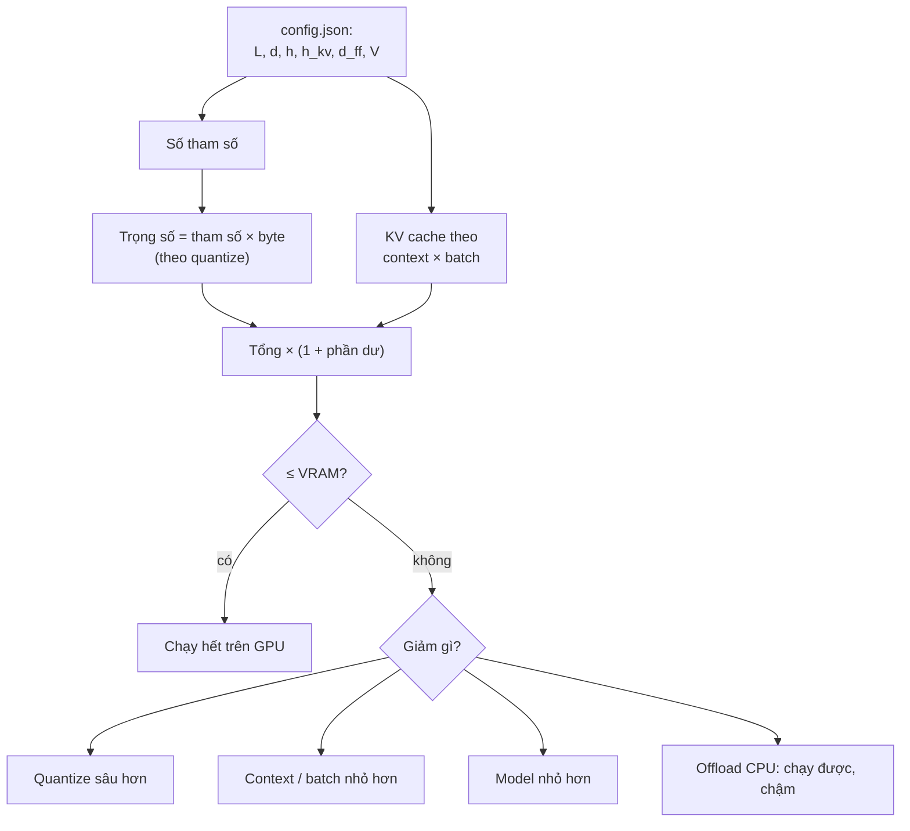

# LLM & model mã nguồn mở

Phần A dựng model từ số 0: neuron, attention, GPT mini. Phần B bắt đầu từ thực tế ngược lại: gần như không ai train LLM
từ đầu, AI Engineer **chọn** một model đã train sẵn, đóng hoặc mở, rồi chạy, đo, ghép nó vào sản phẩm. Module này dạy
làm việc đó có hiểu biết: model pre-trained làm được gì và không làm được gì, chọn giữa model đóng (API) và model mở
trọng số, tìm và đọc model trên Hugging Face, chạy local bằng Transformers và Ollama, nắm chính xác vòng sinh token và
các núm sampling, và ước lượng một model có vừa máy của bạn không, trước khi tải 5 GB về.

Các khối code chạy từ **gốc repo**, ví dụ dán vào `uv run python -`. Khối Hugging Face tải
`Qwen/Qwen2.5-0.5B-Instruct` (khoảng 1 GB) lần đầu; khối Ollama cần `ollama serve` với `qwen2.5:3b` (xem
[README track](../../README.md)). Mọi con số dưới đây là kết quả chạy thật trên laptop của track ngày 2026-10-30
(CPU 16 luồng, RTX 3050 4GB, 32 GB RAM, Ollama 0.13.5, `transformers` 5.22.0), lúc **máy đang chạy song song việc
khác** (load average 35 tới 60, GPU bị chương trình khác chiếm khoảng 3.5 GB): con số **tốc độ** của bạn sẽ khác,
thường tốt hơn; con số **đếm** (tham số, token, byte) thì giống hệt.

Sau module này bạn sẽ:

- Giải thích lợi ích và giới hạn của LLM pre-trained: knowledge cut-off, context length, hallucination, chi phí theo token.
- So sánh model đóng (OpenAI, Claude, Gemini, Mistral, Cohere) với model mở trọng số (Qwen, Llama, Gemma, Mistral...)
  theo chất lượng, chi phí, dữ liệu, giấy phép, và chọn có lý do.
- Tìm, đọc model card và `config.json`, chạy model trên Hugging Face bằng `pipeline` và bằng vòng sinh tự viết.
- Tự cài greedy, temperature, top-k, top-p, repetition penalty trên logits và biết đặt chúng cho từng tác vụ.
- Hiểu tokenizer và chat template, đo chi phí token của tiếng Việt.
- Chạy và cấu hình Ollama (model, tag, Modelfile, REST API), tránh bẫy `num_ctx`.
- Ước lượng VRAM: tham số × byte + KV cache.

| Mức | Bài | Nội dung |
| --- | --- | --- |
| Basic | 01 sampling | softmax, greedy, temperature, top-k, top-p, repetition/presence/frequency penalty |
| Basic | 02 vram-sizing | đếm tham số từ `config.json`, KV cache, context lớn nhất vừa ngân sách VRAM |
| Basic | 03 chat-template | template Qwen2.5 (ChatML) và Llama 3 viết tay, cắt lịch sử theo context |
| Intermediate | 01 hf-generate | vòng sinh token, KV cache với `past_key_values`, distinct-n theo temperature, fertility tiếng Việt |
| Intermediate | 02 ollama-rest | REST API thô: payload, stream NDJSON, TTFT, token/s, `/api/show`, Modelfile, bẫy `num_ctx` |
| Advanced | 01 model-selection-benchmark | chọn model local cho phân loại chủ đề UIT-VSFC: chất lượng, độ trễ, bộ nhớ |
| Advanced | 02 needle-in-haystack | context length thật của `qwen2.5:3b` theo độ dài, vị trí, `num_ctx` |

## 1. Pre-trained model: lợi ích, giới hạn, capabilities

### Từ pre-training tới model bạn gọi

LLM decoder-only (module 05) được train với một mục tiêu duy nhất: cho chuỗi token $$x_1, \dots, x_{t}$$, dự đoán
token tiếp theo. Loss là cross-entropy trên hàng nghìn tỉ token:

$$
\mathcal{L}(\theta) = -\sum_{t} \log p_\theta(x_{t+1} \mid x_1, \dots, x_t)
$$

Model học được ngữ pháp, kiến thức thế giới, một phần khả năng suy luận, chỉ vì những thứ đó giúp đoán token tiếp
theo tốt hơn. Kết quả là một **base model**: giỏi nối tiếp văn bản, chưa biết "trả lời câu hỏi". Hai bước sau biến nó
thành model bạn chat được:



Chi phí pre-training là lý do tồn tại của "pre-trained model": báo cáo kỹ thuật Qwen2.5 ghi dữ liệu pre-training
**18 nghìn tỉ token**; train lại cỡ đó cần hàng nghìn GPU trong nhiều tuần. Bạn nhận lại toàn bộ khoản đầu tư đó
dưới dạng một tệp trọng số hoặc một endpoint API.

### Lợi ích

- **Không cần dữ liệu có nhãn để bắt đầu**: một prompt tốt đã làm được phân loại, trích xuất, tóm tắt, dịch, viết code.
- **Đa nhiệm**: một model cho hàng chục tác vụ, thay vì một model ML riêng cho mỗi tác vụ.
- **Nền để tinh chỉnh**: fine-tune vài nghìn mẫu (module 14) rẻ hơn train từ đầu hàng nghìn lần.
- **Thời gian ra sản phẩm**: prototype trong một buổi chiều.

### Giới hạn

| Giới hạn | Nguyên nhân | Thiết kế xung quanh nó |
| --- | --- | --- |
| **Knowledge cut-off** | Dữ liệu train dừng ở một ngày; model không biết là nó không biết | RAG (module 13), tool/search, đưa ngày hiện tại vào system prompt |
| **Hallucination** | Model tối ưu "câu nghe hợp lý", không tối ưu "câu đúng" | Grounding bằng nguồn, trích dẫn, cho phép "không biết", eval |
| **Context length hữu hạn** | Vị trí được train tới một độ dài; KV cache tốn bộ nhớ | Đếm token, chunking, tóm tắt lịch sử (mục 4, 7) |
| **Không tất định** | Sampling (mục 5), số học float trên phần cứng khác nhau | temperature thấp, seed, structured output, eval nhiều lần |
| **Đếm, số học, chính tả** | Model thấy token, không thấy ký tự (mục 4) | Tool chạy code, kiểm bằng code |
| **Chi phí, độ trễ theo token** | Mỗi token sinh ra là một lượt chạy cả model (mục 5) | Model nhỏ hơn, cache, cắt prompt, quantize (module 10) |
| **Thiên kiến, an toàn** | Học từ dữ liệu web | Guardrail, red-teaming (module 19) |

### Capabilities và context length

Khi đọc thông số một model, bốn con số quyết định nó dùng được vào việc gì:

- **Modality**: chỉ văn bản, hay nhận ảnh/âm thanh/video (module 18), có sinh ảnh/giọng nói không.
- **Context length**: số token tối đa của prompt cộng câu trả lời. Qwen2.5-0.5B/3B/7B: `max_position_embeddings`
  32 768 trong `config.json` (bản 7B trở lên ghi hỗ trợ tới 131 072 với YaRN). Ollama báo cùng số qua
  `qwen2.context_length` của `/api/show`.
- **Giới hạn output**: nhiều API giới hạn số token sinh ra riêng, nhỏ hơn context nhiều.
- **Tính năng**: tool calling, structured output (JSON schema), reasoning mode. Ollama liệt kê ở `capabilities`
  của `/api/show`: `qwen2.5:3b` có `["completion", "tools"]`.

Context length trên giấy là **trần**. Con số dùng được còn phụ thuộc cấu hình runtime và bộ nhớ: Ollama trên máy của
track nạp `qwen2.5:3b` với `context_length` **4 096** (xem `/api/ps`), không phải 32 768, và cắt bớt prompt dài hơn
mà không báo lỗi (mục 6). Bài Advanced 02 đo khả năng tìm lại một dữ kiện theo độ dài và vị trí trong context.

### Knowledge cut-off

Cut-off là ngày dữ liệu pre-training dừng. Ba điều cần nhớ:

1. Nguồn đáng tin là model card hoặc docs của nhà cung cấp. **Hỏi chính model về cut-off của nó không đáng tin**:
   dữ liệu về những tháng sát mốc thưa, nên model hay đoán sai mốc của chính mình.
2. Model sau cut-off vẫn trả lời câu hỏi về sự kiện mới, bằng giọng tự tin, với thông tin cũ hoặc bịa.
3. Fine-tune không cập nhật kiến thức đáng tin cậy; muốn kiến thức mới thì đưa vào lúc hỏi (RAG, tool).

## 2. Model đóng và model mở

### Model đóng: gọi qua API

Model đóng chỉ dùng được qua API của nhà cung cấp (hoặc các cloud bán lại); bạn không có trọng số. Bảng dưới mô tả
**năng lực theo họ model**, không phải phiên bản cụ thể: tên model đổi vài tháng một lần, nên luôn xem trang "Models"
trong docs chính thức (link ở mục 8) khi chọn. Module này không ghi giá: giá đổi thường xuyên, và module 11 dạy tính
chi phí theo token từ bảng giá hiện hành.

| Nhà cung cấp | Họ model | Điểm mạnh nổi bật |
| --- | --- | --- |
| OpenAI | GPT (đa năng, đa phương thức), dòng reasoning "o", embedding, audio | Hệ sinh thái lớn nhất; API Chat Completions/Responses thành chuẩn de facto mà nhiều server khác bắt chước |
| Anthropic | Claude (các bậc Opus, Sonnet, Haiku) | Lập luận, viết code, context dài, tool use, agent |
| Google | Gemini (các bậc Pro, Flash) | Đa phương thức gốc (ảnh, âm thanh, video), context rất dài, gắn với Google Cloud (Vertex AI) |
| Mistral AI | Model thương mại qua API (vd. Mistral Large) **và** nhiều model mở trọng số | Công ty châu Âu, có cả hai đường đóng và mở |
| Cohere | Command (chat, RAG, tool use), Embed, Rerank | Hướng doanh nghiệp: RAG có trích dẫn, embedding và reranker đa ngôn ngữ |

Ngoài gọi thẳng nhà cung cấp, các nền tảng cloud gom nhiều model sau một API và hạ tầng quen thuộc của doanh nghiệp:
**Azure AI Foundry** (model OpenAI và nhiều model khác trong hạ tầng Azure), **AWS Bedrock** (API quản lý sẵn cho
Claude, Llama, Mistral...) và **Amazon SageMaker** (tự host và train bất kỳ model nào, kể cả model mở từ Hugging Face),
**Google Vertex AI**, **Replicate** và **Hugging Face Inference Providers** (gọi model mở qua API, trả theo lượt dùng).

### Model mở trọng số

Trọng số được công bố, bạn tải về và chạy ở bất cứ đâu: laptop, server riêng, cloud.

| Họ | Nhà phát hành | Ghi chú |
| --- | --- | --- |
| Qwen (2.5, 3...) | Alibaba | Nhiều cỡ từ 0.5B, đa ngôn ngữ tốt (tiếng Việt khá), có bản coder, math, VL; phần lớn Apache-2.0 |
| Llama (3.x...) | Meta | Phổ biến nhất, hệ sinh thái fine-tune lớn; giấy phép riêng (Llama Community License), repo HF **gated** |
| Gemma | Google | Model nhỏ chất lượng cao; điều khoản Gemma riêng, gated |
| Mistral, Mixtral | Mistral AI | Mistral 7B, Mixtral (MoE) Apache-2.0 |
| DeepSeek | DeepSeek | V3 (MoE lớn), R1 (reasoning, module 15); giấy phép MIT cho bản R1 |
| Phi | Microsoft | Model nhỏ (3-4B) train nhiều dữ liệu tổng hợp; MIT |
| OLMo, Pythia | AI2, EleutherAI | Mở **hoàn toàn**: trọng số, code train, dữ liệu; dùng cho nghiên cứu |

"Open source" và "open weights" khác nhau: phần lớn model trên chỉ công bố trọng số và code inference, không công bố
dữ liệu train, và kèm giấy phép có điều kiện. **Giấy phép là thứ phải đọc theo từng biến thể**: GGUF trong Ollama ghi
`general.license` của `qwen2.5:7b` là `apache-2.0`, còn `qwen2.5:3b` là `qwen-research` (giấy phép nghiên cứu, không
thương mại). Cùng một họ, cùng một tag gốc `qwen2.5`, hai điều khoản khác nhau.

### Đóng hay mở

| Tiêu chí | Model đóng (API) | Model mở (tự host) |
| --- | --- | --- |
| Chất lượng ở tác vụ khó | Thường cao nhất | Model mở lớn bám sát; model chạy được trên laptop kém hơn rõ |
| Chi phí | Theo token, không có chi phí cố định | GPU + vận hành; rẻ khi tải lớn và đều |
| Dữ liệu | Rời khỏi hạ tầng của bạn (có điều khoản, region) | Ở lại on-prem |
| Kiểm soát phiên bản | Nhà cung cấp đổi/ngừng model | Ghim được, fine-tune, quantize |
| Vận hành | Không phải lo | Serving, scaling, giám sát là việc của bạn |
| Offline, edge | Không | Có |



Điểm mấu chốt của sơ đồ: quyết định dựa trên **tập eval của chính bài toán**, và kiến trúc nên qua một lớp trừu tượng
(API tương thích OpenAI, `llmkit` của track) để đổi model không phải viết lại ứng dụng. Bài Advanced 01 làm đúng việc
này cho ba model local.

## 3. Hugging Face: tìm, đọc và chạy model mở

### Hub, model card, Tasks

[Hugging Face Hub](https://huggingface.co/models) là kho git cho model, dataset và demo (Spaces). Mỗi repo model có:

- **Model card** (`README.md` có YAML đầu tệp): giấy phép, base model, ngôn ngữ, cách dùng, chat template, giới hạn,
  kết quả đánh giá. Card nghèo nàn là dấu hiệu rủi ro.
- **`config.json`**: kiến trúc và kích thước (số tầng, head, KV head, vocab, context) — đủ để ước lượng VRAM (mục 7).
- **`generation_config.json`**: cấu hình sinh mặc định mà nhà phát hành khuyên.
- **Trọng số**: `*.safetensors` (định dạng an toàn, không chạy code khi nạp) hoặc `.bin` (pickle, có thể chạy code
  tuỳ ý khi nạp: chỉ nạp từ nguồn tin cậy), GGUF cho llama.cpp/Ollama.
- **Tasks** (`pipeline_tag`): text-generation, feature-extraction, text-classification, automatic-speech-recognition...
  Trang [Tasks](https://huggingface.co/tasks) giải thích từng loại và model tiêu biểu.

Repo **gated** (Llama, Gemma) yêu cầu đăng nhập, đồng ý điều khoản rồi dùng token: tải `config.json` của
`meta-llama/Llama-3.1-8B-Instruct` hay `google/gemma-2-2b-it` không có token trả `GatedRepoError`, trong khi Qwen,
Mistral 7B v0.3, Phi-3 tải ẩn danh được.

Đọc thông tin repo bằng `huggingface_hub` (không tải trọng số):

```python
from huggingface_hub import HfApi

api = HfApi()
info = api.model_info("Qwen/Qwen2.5-0.5B-Instruct", files_metadata=True)
print(info.pipeline_tag, info.card_data.license, info.card_data.base_model, info.downloads)
print([(s.rfilename, s.size) for s in info.siblings if s.rfilename.endswith((".safetensors", ".json"))][:4])

for m in api.list_models(pipeline_tag="text-generation", filter="vi", sort="downloads", limit=5):
    print(m.id, m.downloads)
```

Kết quả ngày 2026-10-30: `text-generation apache-2.0 Qwen/Qwen2.5-0.5B`, `model.safetensors` 988 097 824 byte. Năm
model text-generation gắn thẻ `vi` nhiều lượt tải nhất là `bigscience/bloomz-560m`, `bigscience/bloom-560m` (model
2022) và ba repo GGUF đăng lại của model khác. Bài học: **thẻ ngôn ngữ và lượt tải là tín hiệu yếu**. Model mạnh
nhất cho tiếng Việt (Qwen, Llama, Gemma) thường không gắn thẻ `vi` vì chúng đa ngôn ngữ; repo đăng lại có thể sai
template hoặc giấy phép.

### Quy trình tìm và dùng một model mở



Ghim **revision** (commit hash của repo) khi đưa vào sản phẩm: chủ repo có thể đẩy trọng số hoặc template mới bất
cứ lúc nào. Snapshot của `Qwen/Qwen2.5-0.5B-Instruct` trong cache của track là `7ae557604adf...`.

### Chạy: pipeline, Inference, Transformers.js

`pipeline` là cách ngắn nhất: tự tải tokenizer và model, áp chat template, sinh, giải mã.

```python
import torch
from transformers import pipeline

torch.manual_seed(0)
chat = pipeline("text-generation", model="Qwen/Qwen2.5-0.5B-Instruct", device="cpu")
messages = [{"role": "user", "content": "Kể tên 3 tỉnh ở đồng bằng sông Cửu Long."}]
out = chat(messages, max_new_tokens=40, do_sample=False, repetition_penalty=1.0)
print(out[0]["generated_text"][-1])
```

In ra `{'role': 'assistant', 'content': 'Tỉnh nào cũng có nhiều địa điểm du lịch hấp dẫn, nhưng trong danh sách
này, tôi sẽ chỉ ra 3 tỉnh nổi tiếng ở đồng bằng sông Cửu Long:\n\n1. Đồng'}`: 40 token hết trước khi kịp kể tỉnh nào.
Model 0.5B dài dòng, và `max_new_tokens` cắt câu trả lời ở giữa chừng mà không báo gì; `done_reason` (Ollama) hay
số token sinh ra bằng đúng giới hạn là dấu hiệu cần kiểm.

Model 0.5B nạp vào RAM float32 chiếm 1.84 GiB (494 032 768 tham số × 4 byte); nạp mất 31 giây trên máy đang bận
(phần lớn là đọc đĩa và khởi tạo). Ba cách chạy khác cùng hệ sinh thái:

- **Inference Providers / `InferenceClient`** (`huggingface_hub`): gọi model trên hạ tầng của Hugging Face hoặc đối
  tác qua API, không cần GPU; cần token, có hạn mức miễn phí. Inference Endpoints: thuê endpoint riêng cho một model.
- **Text Generation Inference, vLLM, SGLang**: server production đọc thẳng repo Hub (module 20).
- **[Transformers.js](https://huggingface.co/docs/transformers.js)**: cùng API `pipeline` nhưng bằng JavaScript, chạy
  model ONNX ngay trong trình duyệt (WebGPU/WASM) hoặc Node: không server, dữ liệu không rời máy người dùng, hợp với
  model nhỏ (embedding, phân loại, Whisper tiny, LLM vài trăm triệu tham số).

`pipeline` giấu vòng sinh token và các tham số mặc định. Bài Intermediate 01 mở nó ra và tìm thấy một bất ngờ ở
mục 5.

## 4. Tokenizer và chat template

### Model thấy token, không thấy chữ

Tokenizer (BPE, module 04) cắt văn bản thành các mảnh trong một vocab cố định; model chỉ thấy chỉ số của mảnh. Qwen2.5
dùng byte-level BPE với vocab **151 665** token (bảng embedding 151 936 hàng, phần dư để chẵn khi tính); Llama 2 và
Phi-3 chỉ có 32 000 token. Vocab nhỏ train chủ yếu trên tiếng Anh thì từ tiếng Việt bị cắt vụn thành từng byte của
ký tự có dấu.

Đo trên 1 268 cặp câu song song IWSLT15 tst2013 (cùng nội dung, tiếng Anh và tiếng Việt), bài Intermediate 01:

| Tokenizer | Token/từ (en) | Token/âm tiết (vi) | Token vi / token en | Ký tự/token (vi) |
| --- | --- | --- | --- | --- |
| Qwen2.5 (151k) | 1.216 | 1.243 | **1.36** | 3.49 |
| tiktoken `o200k_base` (GPT-4o) | 1.182 | 1.268 | 1.43 | 3.42 |
| tiktoken `cl100k_base` (GPT-4, GPT-3.5) | 1.205 | 2.185 | 2.42 | 1.98 |
| Phi-3 / Llama 2 (32k) | 1.340 | 2.945 | **2.93** | 1.47 |

Hệ quả: nói cùng một ý bằng tiếng Việt tốn **1.36 lần** token với Qwen2.5 nhưng **2.93 lần** với tokenizer 32k. Token
là đơn vị của mọi thứ: tiền API, độ trễ (mỗi token sinh ra là một lượt chạy model), và context (context 4 096 token
chứa được gấp đôi nội dung tiếng Việt nếu tokenizer tốt). Chọn model cho tiếng Việt thì đo fertility trước.

Tokenizer cũng giải thích các lỗi "ngớ ngẩn": model không thấy ký tự nên đếm chữ cái, đảo chuỗi, đánh vần kém; một
con số dài bị cắt thành nhiều mảnh tuỳ ý nên số học kém.

### Chat template

Model instruct không nhận "danh sách message": nó nhận **một chuỗi** có thẻ đặc biệt, đúng định dạng nó đã thấy lúc
SFT. Với Qwen2.5 (định dạng ChatML), hội thoại một câu hỏi thành:

```text
<|im_start|>system
You are Qwen, created by Alibaba Cloud. You are a helpful assistant.<|im_end|>
<|im_start|>user
Thủ đô của Việt Nam là thành phố nào? Trả lời một câu.<|im_end|>
<|im_start|>assistant
```

46 token, trong đó 21 token là system prompt **mặc định** mà template tự chèn khi bạn không gửi system. Model sinh tiếp
sau `assistant\n` và kết thúc lượt bằng `<|im_end|>` (id 151645, một trong hai `eos_token_id` của
`generation_config.json`). Llama 3 dùng thẻ khác hẳn (`<|start_header_id|>`, `<|eot_id|>`), strip nội dung và không
có system mặc định.

| | Qwen2.5 (ChatML) | Llama 3 |
| --- | --- | --- |
| Mở/đóng lượt | `<|im_start|>role\n` ... `<|im_end|>\n` | `<|start_header_id|>role<|end_header_id|>\n\n` ... `<|eot_id|>` |
| System mặc định | Có ("You are Qwen...") | Không |
| Nội dung | Giữ nguyên | Strip khoảng trắng hai đầu |
| Kết quả tool | Gom vào lượt `user` với `<tool_response>` | (template 3.1 có role `ipython`) |

Sai template là **lỗi im lặng**: model vẫn sinh chữ, chỉ là kém đi (bỏ qua system, không dừng, tự viết thêm lượt
user). Luôn dùng `tokenizer.apply_chat_template` hoặc template trong Modelfile của Ollama. Template nằm trong
`tokenizer_config.json` (khoá `chat_template`, Jinja) của repo Hugging Face và trong khối `TEMPLATE` (Go template) của
Ollama: đọc chúng khi debug. Bài Basic 03 viết lại hai template bằng tay, khớp từng ký tự với tokenizer thật.

## 5. Inference và sampling

### Vòng sinh token

Một lượt chạy model nhận chuỗi token, trả **logits** $$z \in \mathbb{R}^{V}$$ cho vị trí tiếp theo. Sinh văn bản là một
vòng lặp ngoài model:



Hai pha có đặc tính khác nhau:

- **Prefill**: chạy cả prompt trong một lượt, song song mọi vị trí; nhân ma trận lớn, GPU gần hết công suất
  (compute-bound).
- **Decode**: mỗi token một lượt; mỗi lượt phải đọc **toàn bộ trọng số** từ bộ nhớ để nhân với một vector, nên bị
  chặn bởi băng thông bộ nhớ (memory-bound). Token/s khi decode xấp xỉ băng thông chia kích thước model.

**KV cache** (module 05) lưu key, value của mọi token đã xử lý để bước decode chỉ tính cho token mới. Đo với
Qwen2.5-0.5B trên CPU (Intermediate 01, trung vị 5 lần, máy đang bận):

«TBD-KVCACHE»

### Từ logits tới token

Softmax với temperature $$T$$:

$$
p_i = \frac{\exp(z_i / T)}{\sum_{j=1}^{V} \exp(z_j / T)}
$$

$$T < 1$$ làm phân phối nhọn hơn, $$T > 1$$ làm phẳng hơn, $$T \to 0$$ dồn hết xác suất vào token lớn nhất (greedy).
Tính ổn định số: trừ $$\max_j z_j$$ trước khi lấy mũ, không đổi kết quả.

| Phương pháp | Giữ lại | Đặc điểm |
| --- | --- | --- |
| **Greedy** | $$\arg\max_i z_i$$ | Tất định, dễ lặp vòng, tốt cho trích xuất/phân loại |
| **Top-k** | $$k$$ token xác suất cao nhất | Số token cố định bất kể model chắc hay phân vân |
| **Top-p (nucleus)** | Tập nhỏ nhất $$S$$ với $$\sum_{i \in S} p_i \ge p$$ | Thích nghi: model chắc thì $$S$$ nhỏ, phân vân thì $$S$$ lớn |
| **Min-p** | Token có $$p_i \ge p_{\min} \cdot \max_j p_j$$ | Ngưỡng tương đối, hợp với temperature cao (llama.cpp, Ollama có) |

Penalty chống lặp sửa logits trước khi chọn. Repetition penalty kiểu CTRL / Hugging Face với hệ số $$\theta$$, cho
mỗi token $$j$$ đã xuất hiện:

$$
z_j \leftarrow \begin{cases} z_j / \theta & z_j > 0 \\ z_j \cdot \theta & z_j \le 0 \end{cases}
$$

Presence và frequency penalty kiểu OpenAI trừ thẳng theo số lần $$c_j$$ token đã xuất hiện:
$$z_j \leftarrow z_j - \alpha_{p}\,\mathbb{1}[c_j > 0] - \alpha_{f}\,c_j$$.

Hugging Face áp theo thứ tự: penalty, temperature, top-k, top-p, rồi rút. Thứ tự này có hệ quả: top-p tính **sau**
temperature, nên temperature cao vừa làm phẳng vừa nới rộng nucleus. Bài Basic 01 cài tất cả trên logits.

### Đo trên Qwen2.5-0.5B-Instruct

Phân phối token đầu tiên của câu trả lời cho "Thủ đô của Việt Nam là thành phố nào? Trả lời một câu.":
`'Th'` (đầu của "Thủ đô...") có xác suất 0.952, top-5 chiếm 0.985, entropy 0.32 nat. Model rất chắc: với top-p 0.9 chỉ
còn đúng 1 token, temperature 0.7 hay 1.0 gần như không đổi gì ở bước này. Sampling chỉ tạo khác biệt ở những bước
model phân vân, như viết sáng tạo.

8 câu trả lời cho "Viết một câu mở đầu cho truyện ngắn về Hà Nội mùa thu.", top-p 0.9, 40 token, seed 0
(distinct-2 là tỉ lệ cặp từ khác nhau trên tổng số cặp, càng gần 1 càng ít lặp):

| Temperature | distinct-1 | distinct-2 | Câu đầu tiên |
| --- | --- | --- | --- |
| 0.3 | 0.462 | 0.695 | "Những cánh hoa thu vàng rực rỡ trên phố cổ Hà Nội, nơi những người dâ..." |
| 0.7 | 0.740 | 0.924 | "Bây giờ, Hà Nội đã trở thành điểm đến lý tưởng cho những chuyến đi bố..." |
| 1.0 | 0.748 | 0.953 | "Bây giờ, bạn đã đến và cuối cùng rồi," Hà Nội cài đặt bao gồm núi, sô..." |
| 1.5 | 0.988 | 1.000 | "Bây giờ, dusk đã押金 và hoang đường城市的燈最后憧憬秋天的城市班 and öğól Oktober..." |

Độ đa dạng tăng đều theo temperature, và ở 1.5 thì "đa dạng" là rác đa ngôn ngữ: phần đuôi phân phối của model nhỏ
đầy token tiếng Trung, tiếng Anh, tiếng Thổ. Distinct-n cao **không** có nghĩa là tốt; nó chỉ đo lặp. Model nhỏ chịu
temperature cao kém hơn model lớn.

### Cấu hình mặc định ẩn trong `generate`

`generation_config.json` của Qwen2.5-0.5B-Instruct ghi `do_sample: true, temperature 0.7, top_p 0.8, top_k 20,
repetition_penalty 1.1`. `model.generate(..., do_sample=False)` tắt sampling nhưng **vẫn áp repetition penalty 1.1**
từ tệp đó. «TBD-GREEDY»

### Đặt tham số theo tác vụ

| Tác vụ | Gợi ý |
| --- | --- |
| Phân loại, trích xuất, JSON, code | $$T = 0$$, kèm structured output (module 11) |
| Hỏi đáp có nguồn (RAG) | $$T$$ 0 tới 0.3 |
| Chat | $$T$$ khoảng 0.7, top-p 0.8 tới 0.95 (hoặc đúng `generation_config.json` của model) |
| Sáng tác, brainstorm, sinh dữ liệu đa dạng | $$T$$ 0.9 tới 1.2, top-p 0.95, kiểm chất lượng bằng mắt hoặc eval |

## 6. Ollama: models, Modelfile, REST API

### Model và tag

[Ollama](https://ollama.com) là server chạy LLM local xây trên llama.cpp. Model đóng gói dạng **GGUF** (trọng số đã
quantize + tokenizer + template trong một tệp, module 10), đặt tên `<model>:<tag>`; tag thường là cỡ và mức quantize
(`qwen2.5:3b` mặc định là Q4_K_M). Máy của track:

| Model | Tệp | Tham số (GGUF) | Quantize | Bit/tham số | Giấy phép |
| --- | --- | --- | --- | --- | --- |
| `qwen2.5:3b` | 1.93 GB | 3 085 938 688 | Q4_K_M | 5.0 | `qwen-research` |
| `qwen2.5:7b` | 4.68 GB | 7 615 616 512 | Q4_K_M | 4.9 | `apache-2.0` |
| `bge-m3` | 1.16 GB | 567 M | F16 | 16 | (embedding, module 12) |

Q4_K_M không đúng 4 bit: scale của từng block và một số tensor nhạy (embedding, một phần attention) giữ độ chính xác
cao hơn, nên trung bình khoảng 5 bit.

### REST API, stream và tốc độ

Ollama phục vụ ở cổng 11434: `/api/chat`, `/api/generate`, `/api/embed`, `/api/tags` (model đã tải), `/api/ps` (model
đang nạp), `/api/show` (thông tin model), `/api/create`, `/api/delete`, và endpoint tương thích OpenAI
`/v1/chat/completions`. Với `"stream": true` (mặc định), câu trả lời về dạng **NDJSON**: mỗi dòng một object JSON
mang một mảnh `message.content`, dòng cuối có `"done": true` kèm thống kê tính bằng nano giây:

```text
{"model":"qwen2.5:3b","message":{"role":"assistant","content":"X"},"done":false}
{"model":"qwen2.5:3b","message":{"role":"assistant","content":"in"},"done":false}
...
{"model":"qwen2.5:3b","message":{"role":"assistant","content":""},"done":true,"done_reason":"stop",
 "total_duration":4941787756,"load_duration":297602624,"prompt_eval_count":38,"prompt_eval_duration":529157015,
 "eval_count":6,"eval_duration":4036382601}
```

`llmkit.chat` (track) gói một lời gọi không stream; dưới đây là lời gọi thô tương đương bằng `httpx`:

```python
import httpx

import llmkit

messages = [{"role": "user", "content": "Ollama là gì? Trả lời một câu."}]
print(llmkit.chat(messages, temperature=0))
r = httpx.post("http://localhost:11434/api/chat", timeout=300, json={
    "model": "qwen2.5:3b", "messages": messages, "stream": False, "options": {"temperature": 0, "num_predict": 60},
}).json()
print(r["message"]["content"], r["prompt_eval_count"], r["eval_count"])
```

Đo trên máy của track (bài Intermediate 02, câu trả lời khoảng 120 token, `qwen2.5:3b`):

«TBD-OLLAMA»

### Bẫy `num_ctx`

Ollama nạp model với context `num_ctx` cấu hình được (mặc định của server này là 4 096, thấy ở `/api/ps`), **không
phải** context tối đa của model. Prompt dài hơn bị cắt bớt phần đầu mà **không có lỗi nào**:

«TBD-NUMCTX»

Đặt `options.num_ctx` (hoặc `PARAMETER num_ctx` trong Modelfile, hoặc biến môi trường `OLLAMA_CONTEXT_LENGTH` của
server) theo độ dài prompt thật cộng phần trả lời, và kiểm `prompt_eval_count` trong response. Đổi `num_ctx` làm
Ollama **nạp lại** model (vài giây) và tăng KV cache (mục 7).

### Modelfile

Modelfile mô tả một model Ollama giống Dockerfile mô tả image:

```text
FROM qwen2.5:3b
PARAMETER temperature 0.2
PARAMETER num_ctx 4096
PARAMETER stop <|im_end|>
PARAMETER stop <|endoftext|>
SYSTEM """Bạn là trợ lý tiếng Việt. Luôn trả lời đúng một câu, không quá 25 từ."""
```

`ollama create ae09-tro-ly -f Modelfile` (hoặc `POST /api/create` với `from`, `system`, `parameters`) tạo một model mới
**dùng chung trọng số** với `qwen2.5:3b`, chỉ thêm lớp cấu hình. Các lệnh khác: `TEMPLATE` (chat template dạng Go
template), `ADAPTER` (LoRA, module 14), `FROM ./model.gguf` (nhập GGUF của bạn, module 10). `ollama show --modelfile
qwen2.5:3b` in Modelfile của model có sẵn: cách nhanh nhất để đọc template và giấy phép.

### Khi nào không dùng Ollama

Ollama tối ưu cho một người dùng trên một máy. Phục vụ nhiều request đồng thời với throughput cao cần continuous
batching và PagedAttention của vLLM, SGLang, TGI hoặc `llama.cpp` server (module 20). Endpoint tương thích OpenAI
giúp chuyển đổi giữa chúng gần như không đổi code client.

## 7. Phần cứng: model có vừa máy không

Bộ nhớ để chạy một LLM:

$$
M \approx \underbrace{N_{\text{param}} \cdot b_w}_{\text{trọng số}} + \underbrace{2 \cdot L \cdot h_{kv} \cdot d_{head} \cdot n_{ctx} \cdot B \cdot b_{kv}}_{\text{KV cache}} + \text{phần dư}
$$

với $$b_w$$ byte mỗi tham số (fp16/bf16: 2, int8: 1, Q4_K_M: khoảng 0.625), $$L$$ số tầng, $$h_{kv}$$ số KV head,
$$n_{ctx}$$ độ dài context, $$B$$ batch, $$b_{kv}$$ byte mỗi phần tử cache (fp16: 2). Phần dư (activation, buffer, CUDA
context) cỡ 10 tới 20% cộng vài trăm MB.

Số tham số đếm được chính xác từ `config.json` (bài Basic 02), ví dụ Qwen2.5-0.5B: embedding dùng chung
$$151\,936 \times 896$$, 24 tầng, mỗi tầng attention GQA (14 query head, 2 KV head, $$d_{head} = 64$$, bias ở q, k, v)
cộng MLP SwiGLU $$3 \times 896 \times 4\,864$$: tổng **494 032 768**, đúng bằng tổng `numel` của checkpoint.

| Model | Tham số | bf16 | Q4_K_M | KV cache fp16 / 4 096 token | Laptop GPU 4 GB |
| --- | --- | --- | --- | --- | --- |
| Qwen2.5-0.5B | 0.49 B | 0.92 GiB | 0.29 GiB | 48 MiB | vừa cả bf16 |
| Qwen2.5-3B | 3.09 B | 5.75 GiB | 1.80 GiB | 144 MiB | vừa Q4 |
| Phi-3 mini (MHA) | 3.82 B | 7.12 GiB | 2.22 GiB | **1.5 GiB** | Q4 + context ngắn |
| Qwen2.5-7B | 7.62 B | 14.2 GiB | 4.43 GiB | 224 MiB | **không** vừa, phải offload sang CPU |
| Mistral 7B v0.3 | 7.25 B | 13.5 GiB | 4.22 GiB | 512 MiB | không vừa |

Ba bài học từ bảng:

- **Quantize là thứ cho phép chạy local**: 7B bf16 cần GPU 16 GB, Q4 cần khoảng 5 GB. Cái giá về chất lượng đo ở
  module 10.
- **GQA quyết định KV cache**: Phi-3 mini (32 KV head) tốn KV cache gấp hơn 10 lần Qwen2.5-3B (2 KV head) ở cùng
  context, gần bằng chính trọng số Q4 của nó.
- **Không vừa thì vẫn chạy, nhưng chậm**: Ollama đặt phần tầng không vừa lên CPU. «TBD-OFFLOAD»



Kiểm ước lượng với số đo: công thức cho `qwen2.5:3b` Q4_K_M ở 4 096 token, phần dư 20%, là 2.32 GiB; `/api/ps` báo
model nạp chiếm 2.65 GB (2.46 GiB), trong đó 1.88 GB trên GPU vì GPU đang bị chương trình khác chiếm. Đủ chính xác
để quyết định "vừa hay không", không đủ để xếp sát 100% VRAM.

## 8. Tài liệu tham khảo

- Qwen Team, [Qwen2.5 Technical Report](https://arxiv.org/abs/2412.15115) (2024): dữ liệu 18T token, kiến trúc, đánh giá.
- Model card [Qwen/Qwen2.5-0.5B-Instruct](https://huggingface.co/Qwen/Qwen2.5-0.5B-Instruct) và
  [Qwen/Qwen2.5-7B-Instruct](https://huggingface.co/Qwen/Qwen2.5-7B-Instruct).
- Hugging Face: [Hub docs](https://huggingface.co/docs/hub/index), [Model cards](https://huggingface.co/docs/hub/model-cards),
  [Tasks](https://huggingface.co/tasks), [Pipelines](https://huggingface.co/docs/transformers/main_classes/pipelines),
  [Chat templates](https://huggingface.co/docs/transformers/chat_templating),
  [Generation strategies](https://huggingface.co/docs/transformers/generation_strategies),
  [Inference Providers](https://huggingface.co/docs/inference-providers/index),
  [Transformers.js](https://huggingface.co/docs/transformers.js/index).
- Ollama: [API](https://github.com/ollama/ollama/blob/main/docs/api.md),
  [Modelfile](https://github.com/ollama/ollama/blob/main/docs/modelfile.md), [thư viện model](https://ollama.com/library).
- Holtzman et al., [The Curious Case of Neural Text Degeneration](https://arxiv.org/abs/1904.09751) (2019): nucleus sampling.
- Keskar et al., [CTRL](https://arxiv.org/abs/1909.05858) (2019): repetition penalty.
- Liu et al., [Lost in the Middle](https://arxiv.org/abs/2307.03172) (2023); Hsieh et al.,
  [RULER](https://arxiv.org/abs/2404.06654) (2024): context dài thật sự dùng được tới đâu.
- Docs model đóng: [OpenAI Models](https://platform.openai.com/docs/models),
  [Anthropic Models](https://docs.anthropic.com/en/docs/about-claude/models/overview),
  [Gemini Models](https://ai.google.dev/gemini-api/docs/models), [Mistral Models](https://docs.mistral.ai/getting-started/models/),
  [Cohere Models](https://docs.cohere.com/docs/models).
- Nền tảng: [AWS Bedrock](https://aws.amazon.com/bedrock/), [Amazon SageMaker](https://aws.amazon.com/sagemaker/),
  [Azure AI Foundry](https://azure.microsoft.com/en-us/products/ai-foundry), [Replicate](https://replicate.com/docs).
- [Open Source AI Definition](https://opensource.org/ai/open-source-ai-definition) (OSI): open source khác open weights.
- [roadmap.sh/ai-engineer](https://roadmap.sh/ai-engineer): các node Pre-trained Models, Open vs Closed, Hugging Face, Ollama.
