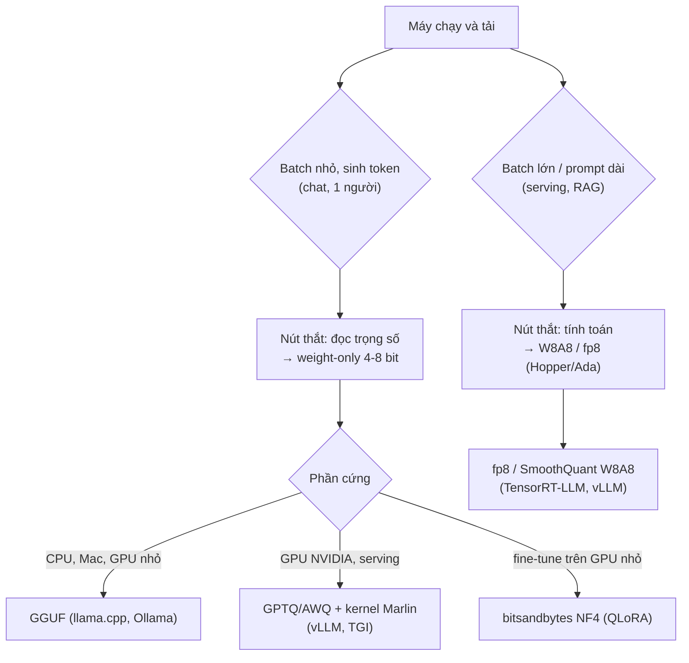
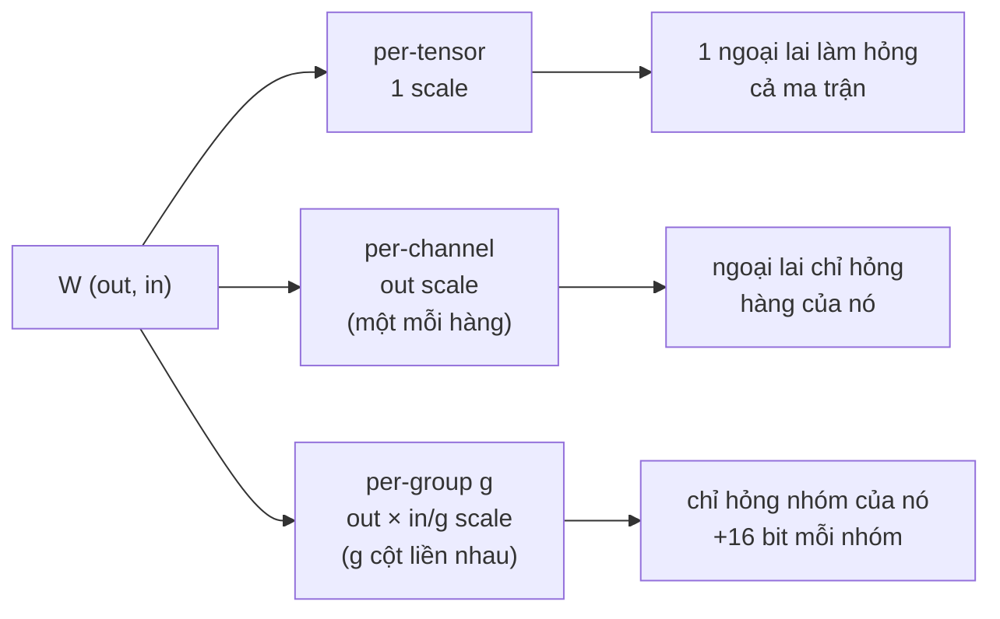
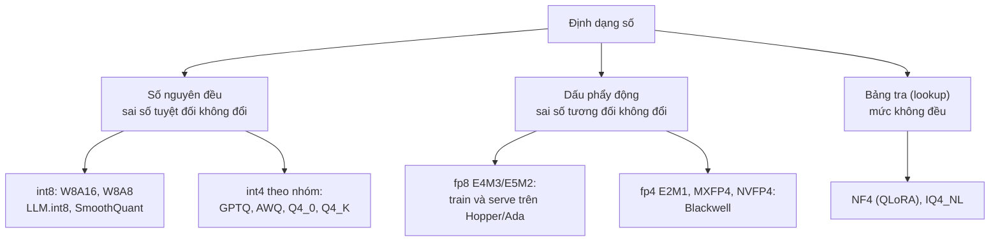
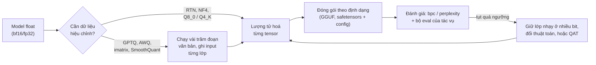
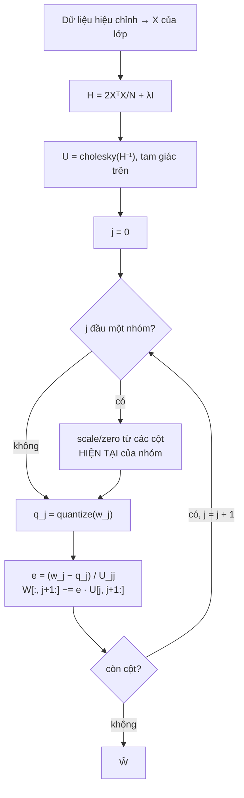
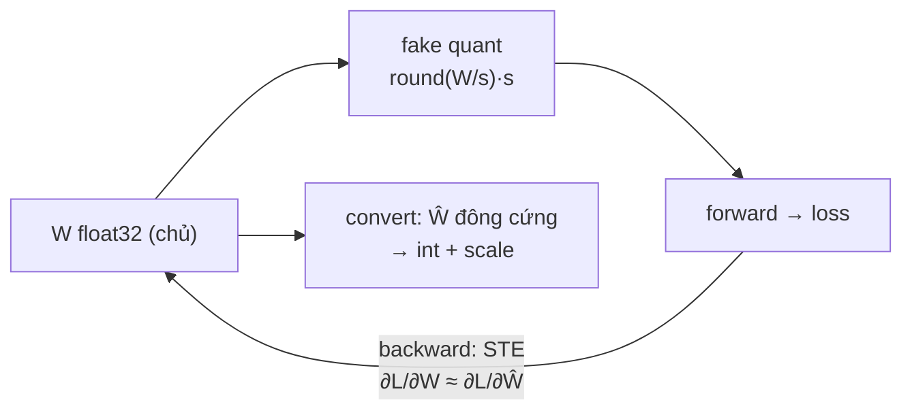
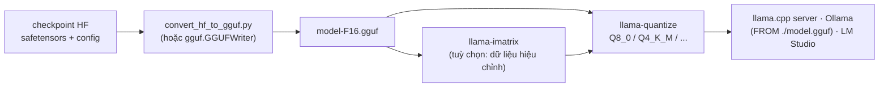

# Quantization

Module 09 đã cho bạn công thức "model có vừa máy không": bộ nhớ trọng số bằng số tham số nhân số byte mỗi tham số, và câu trả
lời thường là "chỉ vừa nếu quantize". Module này mở hộp đen đó. Bạn tự cài các phép lượng tử hoá từ số học cơ bản (absmax,
zero-point, per-channel, theo nhóm, đóng gói 4 bit, fp8 mô phỏng) tới các thuật toán mà mọi model mở 4 bit đang dùng (GPTQ, AWQ,
quantization-aware training), rồi mới dùng công cụ thật (bitsandbytes, GGUF/llama.cpp, Ollama) và **đo** cái giá: độ chính xác,
tốc độ, bộ nhớ, mỗi con số kèm điều kiện đo.

Hai model xuyên suốt: **GPT mini tiếng Việt** bạn pretrain ở [module 05](../05-transformers-llm-architecture/README.md) (bài
Advanced 01, định dạng `gpt-mini-v1`), được quantize và xuất GGUF trong các bài tập; và **Qwen2.5-0.5B-Instruct** (module 09),
model thật dùng cho mọi số đo trong phần lý thuyết này. Thước đo chất lượng là **bpc** (bits per character) trên đúng validation
100 bài Wikipedia tiếng Việt của module 04/05, định nghĩa như [module 05](../05-transformers-llm-architecture/README.md) (tổng
NLL trên cả chuỗi, chia số ký tự nhân $$\ln 2$$, cửa sổ trượt stride bằng nửa context). bpc không phụ thuộc tokenizer nên so được
Qwen với GPT mini. Tải dữ liệu:

```bash
uv run python data/download_dataset.py wikipedia-vi
```

Mọi số đo dưới đây là kết quả chạy thật ngày 2026-11-01 trên PC của track (RTX 3060 12 GB **dùng chung** với một server LLM
khác đang chạy, nên tốc độ GPU chỉ so được thô; CPU giới hạn 4 luồng, máy đang có người dùng). Qwen2.5-0.5B-Instruct đo bằng
Transformers 5.22, bitsandbytes 0.50.2, llama.cpp qua `llama-cpp-python` 0.3.36, Ollama 0.13.5. Validation dài 664 568 ký tự,
204 203 token Qwen, cửa sổ 1 024 token, stride 512. Số đo trên GPT mini là việc bạn tự làm trong bài tập.

Sau module này bạn sẽ:

- Tính được một trọng số thực sự tốn bao nhiêu bit trong mỗi định dạng, và vì sao sinh token nhanh lên khi đọc ít byte hơn.
- Tự cài absmax, zero-point, per-channel, theo nhóm, đóng gói int4, fp8 E4M3/E5M2, và chọn đúng mức chia scale.
- Giải thích ngoại lai trọng số và activation, vì sao W8A8 khó hơn W4A16, và các cách xử lý (LLM.int8, SmoothQuant).
- Tự cài GPTQ (bù sai số theo Hessian) và AWQ (scale theo activation), biết khi nào chúng thắng round-to-nearest.
- Làm quantization-aware training với STE, và thiết kế thí nghiệm đối chứng để biết QAT có thật sự giúp.
- Dùng bitsandbytes, xuất và đọc GGUF, quantize bằng llama.cpp, chạy bằng Ollama; đo bpc, token/giây, VRAM có điều kiện.

| Mức | Bài | Nội dung |
| --- | --- | --- |
| Basic | 01 absmax-zeropoint | absmax, zero-point, per-tensor/per-channel, SQNR |
| Basic | 02 int4-groupwise-packing | int4 theo nhóm, đóng gói 2 giá trị một byte, bit thực mỗi trọng số |
| Basic | 03 fp8-fake-quant-ste | fp8 E4M3/E5M2 mô phỏng, fake quantization, straight-through estimator |
| Intermediate | 01 ptq-gpt-mini | PTQ cho GPT mini: bit, mức chia, embedding, độ nhạy từng lớp |
| Intermediate | 02 gptq-awq | GPTQ và AWQ tự cài, so với RTN trên GPT mini |
| Intermediate | 03 qat | QAT với STE, đối chứng fine-tune float32 rồi PTQ |
| Advanced | 01 gpt-mini-gguf-portfolio | xuất GGUF, quantize bằng llama.cpp, bảng đánh đổi (portfolio) |
| Advanced | 02 qwen-quantization-deploy | chọn cấu hình cho laptop GPU 4 GB và server CPU bằng số đo |

## 1. Vì sao quantize: bộ nhớ, băng thông và cái giá

### Bộ nhớ

Công thức của module 09: trọng số chiếm $$N_{param}\cdot b_w$$ byte. Quantize là giảm $$b_w$$. Với Qwen2.5-0.5B (494 triệu tham số):

| Biểu diễn | Bit/trọng số | Trọng số Qwen2.5-0.5B (tính) |
| --- | --- | --- |
| fp32 | 32 | 1.84 GiB |
| bf16 / fp16 | 16 | 0.92 GiB |
| int8 per-channel | khoảng 8 | 0.46 GiB |
| int4 nhóm 128 (GPTQ/AWQ) | khoảng 4.16 | 0.24 GiB |
| `Q4_K` (llama.cpp) | 4.5 | 0.26 GiB |

Con số thật luôn lớn hơn một chút: tensor nhạy (embedding, norm) thường giữ nhiều bit hơn, và runtime cần thêm KV cache, buffer
activation, CUDA context (module 09, mục 7).

### Băng thông: vì sao ít bit thì sinh token nhanh hơn

Sinh một token với batch 1 nhân mỗi ma trận trọng số với **một** vector: mỗi trọng số được đọc từ bộ nhớ một lần cho khoảng hai phép
tính. GPU tính nhanh hơn đọc bộ nhớ hàng trăm lần, nên thời gian mỗi token bị chặn dưới bởi thời gian đọc trọng số:

$$
\text{token/giây} \lesssim \frac{\text{băng thông bộ nhớ}}{\text{byte trọng số phải đọc mỗi token}}
$$

RTX 3060 có băng thông khoảng 360 GB/s; Qwen2.5-0.5B ở bf16 là 0.99 GB, nên trần lý thuyết khoảng 360 token/giây. Ở 4 bit, theo
dung lượng tệp (`Q4_K_M` 398 MB so với `F16` 994 MB) trần lên khoảng 2.5 lần; đo thật bằng Ollama trên GPU chỉ tăng 1.7 lần
(226 lên 392 token/giây, mục 7). **Prefill** (xử lý prompt) thì khác: cả nghìn token nhân cùng một ma trận, mỗi trọng số đọc một lần dùng cho
nghìn phép tính, nút thắt là tính toán. Vì vậy:

- **Weight-only** (trọng số 4/8 bit, activation bf16) tăng tốc phần **decode** batch nhỏ, nhờ đọc ít byte hơn, nếu kernel giải
  lượng tử ngay trong lúc nhân.
- **Weight + activation** (W8A8, fp8) tăng tốc phần **tính toán** (prefill, serving batch lớn) nhờ tensor core int8/fp8.

### Cái giá, và "nhỏ hơn" không phải là "nhanh hơn"

Cái giá về chất lượng phải đo (bpc/perplexity, rồi bộ eval của chính tác vụ). Cái giá về tốc độ còn khó đoán hơn: model nhỏ hơn
chỉ nhanh hơn khi có kernel tốt cho đúng định dạng, đúng phần cứng, đúng batch. Đo trên Qwen2.5-0.5B (mục 7), Transformers bf16
chỉ đạt 26-31 token/giây trên GPU, rất xa trần 360: với model nhỏ, thời gian bị chi phối bởi hàng trăm kernel nhỏ và
vòng lặp Python của `generate`, không phải băng thông. Cùng model đó qua llama.cpp (Ollama, GPU lúc đó không có việc khác) đạt 226 token/giây ở
`F16` và 392 ở `Q4_K_M`. Và bitsandbytes int8 cho ra tệp nhỏ hơn bf16 nhưng sinh token chậm hơn nhiều lần.



## 2. Số học của quantization: scale, zero-point, làm tròn, kẹp

### Hai công thức nền

Mọi phép lượng tử hoá đều đều (uniform) là một phép biến đổi affine, làm tròn và kẹp:

$$
q = \mathrm{clamp}\!\left(\mathrm{round}\!\left(\frac{x}{s}\right) + z,\; q_{min},\; q_{max}\right), \qquad \hat x = s\,(q - z)
$$

| | Absmax (đối xứng) | Zero-point (bất đối xứng) |
| --- | --- | --- |
| Mã | $$[-(2^{b-1}-1),\, 2^{b-1}-1]$$ | $$[0,\, 2^b - 1]$$ |
| Scale | $$s = \max\lvert x\rvert / (2^{b-1}-1)$$ | $$s = (hi - lo)/(2^b - 1)$$ với $$lo = \min(x_{min}, 0)$$, $$hi = \max(x_{max}, 0)$$ |
| Zero-point | $$z = 0$$ | $$z = \mathrm{round}(-lo / s)$$, một số nguyên |
| Hợp với | trọng số (gần đối xứng quanh 0) | activation sau ReLU/GELU, dữ liệu lệch một phía |
| Số mức dùng được | $$2^b - 1$$ (bỏ một mã) | $$2^b$$ |

Hai chi tiết nhỏ có hậu quả lớn. Khoảng $$[lo, hi]$$ được nới để **chứa 0** và $$z$$ là số nguyên, để số 0 (padding, activation
sau ReLU, trọng số đã prune) được biểu diễn chính xác; nếu không, mọi số 0 thành một sai số nhỏ cùng dấu và cộng dồn có hệ
thống. Và phải **kẹp trước khi đổi kiểu**: giá trị 256 ép sang `uint8` thành 0, giá trị lớn nhất biến thành nhỏ nhất. Cả hai
lỗi đều không báo gì, model chỉ tệ đi.

### Sai số: làm tròn và cắt

Với bước $$s$$, sai số làm tròn của một giá trị không bị kẹp nằm trong $$[-s/2, s/2]$$; nếu xấp xỉ phân phối đều thì phương sai
là $$s^2/12$$. Mỗi bit thêm chia đôi $$s$$, chia 4 phương sai nhiễu, tức tăng khoảng 6.02 dB signal-to-quantization-noise ratio:

$$
\mathrm{SQNR} = 10\log_{10}\frac{\sum x^2}{\sum (x - \hat x)^2} \approx 6.02\,b + C
$$

Hằng số $$C$$ phụ thuộc phân phối: dữ liệu có đuôi dài làm $$\max\lvert x\rvert$$ lớn so với độ lệch chuẩn, $$s$$ lớn, mọi giá trị
nhỏ chịu sai số lớn. Đây là đánh đổi **cắt (clipping) và làm tròn**: chọn ngưỡng nhỏ hơn max thì giá trị thường được làm tròn mịn
hơn nhưng ngoại lai bị cắt. Absmax không cắt gì; nhiều phương pháp (percentile, MSE-optimal clipping, phần tìm clip của AWQ, các
phương pháp học scale như LSQ) tìm ngưỡng tốt hơn.

### Mức chia scale



Bit thực mỗi trọng số khi mỗi nhóm lưu một scale 16 bit (và tuỳ chọn một zero $$b_z$$ bit):

$$
\text{bpw} = b + \frac{16 + b_z}{g}
$$

int4 nhóm 128 là 4.125 bit, nhóm 32 là 4.5 bit. Đo trên Qwen2.5-0.5B, chỉ quantize các lớp tuyến tính trong khối Transformer
(embedding dùng chung với lớp output giữ bf16), RTN, đối xứng trừ khi ghi khác:

| Cấu hình | Bit/trọng số | bpc | Δbpc |
| --- | --- | --- | --- |
| bf16 (gốc) | 16 | 1.1846 | |
| int8 per-channel | khoảng 8 | 1.1858 | +0.0012 |
| int4 per-tensor | khoảng 4 | 7.7601 | +6.5755 |
| int4 per-channel | khoảng 4 | 1.7182 | +0.5336 |
| int4 nhóm 128 | 4.125 | 1.3878 | +0.2032 |
| int4 nhóm 128, zero-point | 4.25 | 1.3054 | +0.1208 |
| int4 nhóm 32 | 4.5 | 1.2921 | +0.1075 |
| int3 nhóm 128 | 3.125 | 3.1787 | +1.9941 |
| int3 nhóm 128, zero-point | 3.25 | 2.1113 | +0.9267 |

(Zero-point lưu 16 bit mỗi nhóm cho gọn phép tính bit; định dạng thật thường lưu 4-6 bit.)

Đọc bảng: ở 8 bit, per-channel gần như không mất gì. Ở 4 bit, một scale cho cả ma trận là thảm hoạ với model đã train thật
(trọng số có ngoại lai), per-channel đỡ rất nhiều, nhóm nhỏ đỡ thêm. Ở 3 bit, zero-point thắng đối xứng rõ rệt vì đối xứng chỉ
dùng 7 trên 8 mức. Đây là lý do mọi định dạng 4 bit phổ biến đều chia theo nhóm 32-256 và nhiều định dạng có zero/min riêng.

Cũng để ý độ lớn: RTN 4 bit nhóm 128, cấu hình "an toàn" trong nhiều bài viết, làm Qwen2.5-0.5B mất 0.2 bpc, nhiều hơn hẳn mức
bạn sẽ thấy trên GPT mini. Model nhỏ train trên rất nhiều token (Qwen2.5 được train trên khoảng 18 nghìn tỉ token) chứa nhiều thông
tin trên mỗi tham số hơn và khó lượng tử hoá hơn; Kumar và cộng sự (2024, "Scaling Laws for Precision") đo được xu hướng này một
cách có hệ thống. Không có con số "4 bit mất bao nhiêu" chung cho mọi model: phải đo trên model của bạn.

Ba bài Basic tự cài các mảnh này: bài 01 hai công thức nền và SQNR, bài 02 nhóm và đóng gói, bài 03 fp8 và fake quantization.

## 3. Định dạng số: int, fp8, NF4 và đóng gói

### Đóng gói và định dạng khối

Phần cứng không có kiểu 4 bit: hai mã 4 bit được gói vào một byte (bài Basic 02 dùng quy ước phần tử chẵn ở 4 bit thấp; GPTQ gói
8 mã vào một `int32`; `Q4_0` của llama.cpp đặt nửa đầu khối ở 4 bit thấp). Thứ tự bit là quy ước của từng định dạng, đọc sai
thì model vẫn chạy nhưng ra rác. Các định dạng thật đóng gói mã **cùng** scale theo khối để kernel đọc liền một mạch:

| Định dạng | Khối | Nội dung mỗi khối | Bit/trọng số |
| --- | --- | --- | --- |
| `Q8_0` (llama.cpp) | 32 | 32 mã int8, 1 scale fp16 | 8.5 |
| `Q4_0` | 32 | 32 mã 4 bit (trừ 8 khi giải), 1 scale fp16 | 4.5 |
| `Q4_1` | 32 | 32 mã 4 bit, scale và min fp16 | 5.0 |
| `Q4_K` (k-quant) | 256 = 8 × 32 | mã 4 bit, scale và min 6 bit cho mỗi khối con, scale fp16 cho siêu khối | 4.5 |
| `Q6_K` | 256 = 16 × 16 | mã 6 bit, scale 8 bit mỗi khối con | 6.5625 |
| GPTQ/AWQ int4 nhóm 128 | 128 | mã 4 bit, scale fp16, zero 4 bit | khoảng 4.16 |
| bitsandbytes NF4 + double quant | 64 | 16 mức NF4, scale absmax lượng tử 8 bit theo khối 256 | khoảng 4.127 |

### Số dấu phẩy động 8 bit

Số nguyên có **sai số tuyệt đối** không đổi trên cả dải; số dấu phẩy động có **sai số tương đối** gần như không đổi. Với dữ liệu
trải nhiều bậc độ lớn (activation có ngoại lai, gradient), fp8 giữ được cả giá trị nhỏ lẫn lớn mà không cần scale tinh vi.

| | E4M3 | E5M2 |
| --- | --- | --- |
| Bit mũ / mantissa, bias | 4 / 3, 7 | 5 / 2, 15 |
| Lớn nhất | 448 (không có inf, một mã NaN) | 57 344 (có inf/NaN như IEEE) |
| Nhỏ nhất (subnormal) | $$2^{-9}$$ | $$2^{-16}$$ |
| Sai số tương đối tối đa (vùng normal) | $$2^{-4}$$ | $$2^{-3}$$ |
| Dùng cho | trọng số, activation | gradient |

Trong một binade $$[2^e, 2^{e+1})$$, các số fp8 cách đều nhau một bước $$2^{e-m}$$ ($$m$$ bit mantissa); dưới số normal nhỏ nhất,
bước giữ nguyên (subnormal). Làm tròn fp8 vì vậy là làm tròn đều với bước phụ thuộc số mũ của từng phần tử, và bài Basic 03
dựng lại đúng từng bit của dtype fp8 của PyTorch theo cách đó.

| Kiến trúc GPU | int8 tensor core | fp8 tensor core | fp4 |
| --- | --- | --- | --- |
| Ampere (RTX 30xx, A100) | có | **không** (chỉ mô phỏng) | không |
| Ada (RTX 40xx, L40S) | có | có | không |
| Hopper (H100) | có | có | không |
| Blackwell (B200, RTX 50xx) | có | có | có (MXFP4, NVFP4) |

RTX 3060 của track là Ampere: mọi thứ fp8 trong module này là mô phỏng, đúng số học nhưng không nhanh hơn.

### NF4: mức không đều theo phân phối của trọng số

Trọng số đã train gần phân phối chuẩn, nên 16 mức đều của int4 bị dùng không đều: mức ở hai đầu hiếm khi có trọng số nào.
NF4 (QLoRA, 2023) đặt 16 mức tại các phân vị của phân phối chuẩn rồi chuẩn hoá về $$[-1, 1]$$, có đúng một mức bằng 0, scale
absmax theo khối 64. FP4 (E2M1) là lựa chọn 4 bit khác của bitsandbytes. Cả hai là định dạng **lưu trữ**: khi nhân, bitsandbytes
giải lượng tử về `bnb_4bit_compute_dtype`.



## 4. PTQ trên model thật: ngoại lai, lớp nhạy, weight-only hay cả activation

### Post-training quantization

PTQ lượng tử hoá một model **đã train**, không cần gradient, nhiều nhất chỉ cần vài trăm đoạn văn bản hiệu chỉnh. Đơn giản nhất
là round-to-nearest (RTN) như mục 2. Nó đủ tốt ở 8 bit và thường ở 4 bit nhóm 128; dưới đó cần thuật toán thông minh hơn (mục 5)
hoặc train lại (mục 6). Quy trình PTQ nào cũng có cùng khung:



### Ngoại lai trọng số và activation

Trọng số của một model đã train có đuôi dài hơn phân phối chuẩn: một số ít phần tử lớn gấp nhiều lần độ lệch chuẩn của lớp, và
chúng thường tập trung ở vài hàng hoặc vài cột. Đó là lý do per-tensor sụp ở 4 bit trong bảng mục 2. Activation còn khắc nghiệt
hơn: ở LLM vài tỉ tham số trở lên, một số ít **kênh** của hidden state lớn gấp hàng chục tới hàng trăm lần phần còn lại ở gần như
mọi token (Dettmers và cộng sự 2022 thấy hiện tượng này xuất hiện rõ từ khoảng 6.7 tỉ tham số). Đo trên Qwen2.5-0.5B bằng dữ
liệu hiệu chỉnh tiếng Việt, tỉ lệ giữa kênh input có trung bình $$\lvert x\rvert$$ lớn nhất và kênh trung vị:

| Lớp (input của lớp) | Trung vị qua 24 tầng | Lớn nhất (tầng) |
| --- | --- | --- |
| `q_proj`, `k_proj`, `v_proj` (sau RMSNorm) | 17.6 | 22.8 (tầng 22) |
| `o_proj` (đầu ra attention) | 7.8 | 40.5 (tầng 21) |
| `gate_proj`, `up_proj` (sau RMSNorm) | 15.4 | 21.3 (tầng 17) |
| `down_proj` (sau SwiGLU) | 15.9 | 153.9 (tầng 23) |

(32 đoạn 512 token từ tập train, bf16; nếu mọi kênh có cùng độ lớn, tỉ lệ là 1.) Một vài kênh mang độ lớn gấp hàng chục
lần, và ở lớp `down_proj` cuối cùng gấp hơn trăm lần: đúng hiện tượng mà AWQ và LLM.int8() nhắm tới.

Hệ quả cho thiết kế:

- **Weight-only** (W8A16, W4A16): activation giữ bf16, ngoại lai activation không thành vấn đề. Đây là chế độ của GPTQ, AWQ,
  GGUF, bitsandbytes 4 bit, và là chế độ hợp với sinh token batch nhỏ (nút thắt là đọc trọng số).
- **Weight + activation** (W8A8 int8, fp8): nhân ma trận bằng tensor core int8/fp8, nhanh hơn khi tính toán là nút thắt (prefill,
  serving batch lớn). Phải xử lý ngoại lai activation: **LLM.int8()** tách các kênh vượt ngưỡng (mặc định 6.0) ra nhân bằng fp16;
  **SmoothQuant** nhân kênh $$j$$ của activation với $$1/s_j$$ và **cột** $$j$$ tương ứng của trọng số (cùng kênh input, $$W$$ shape `(out, in)`) với $$s_j$$,
  $$s_j = \max\lvert X_j\rvert^{\alpha} / \max\lvert W_j\rvert^{1-\alpha}$$, chuyển một phần độ khó sang trọng số (dễ quantize hơn);
  **fp8** có dải động đủ rộng để thường chỉ cần scale per-tensor.

### Lớp nào nhạy, và embedding

Không phải lớp nào cũng chịu lượng tử như nhau. Cách kỹ sư làm: lượng tử hoá **từng lớp một** và đo độ tăng của loss (bài
Intermediate 01), rồi giữ vài lớp nhạy nhất ở nhiều bit hơn (mixed precision). llama.cpp làm điều này theo kinh nghiệm: `Q4_K_M`
giữ lớp output và một nửa số `attn_v`, `ffn_down` ở `Q6_K`. Embedding và lớp output đáng chú ý riêng: với model nhỏ vocab lớn chúng
chiếm phần lớn tham số (Qwen2.5-0.5B: 136 triệu trên 494 triệu, dùng chung một ma trận), nên lượng tử hoá chúng tiết kiệm nhiều,
nhưng lớp output quyết định trực tiếp phân phối token kế tiếp. GPT mini và Qwen2.5-0.5B đều dùng chung trọng số giữa `lm_head` và
embedding: lượng tử hoá một bên là lượng tử hoá cả hai.

## 5. GPTQ và AWQ

### GPTQ: bù sai số theo Hessian

RTN làm tròn từng trọng số độc lập. GPTQ (Frantar và cộng sự 2022) lượng tử hoá từng lớp tuyến tính sao cho **đầu ra** trên dữ
liệu hiệu chỉnh $$X$$ thay đổi ít nhất:

$$
\min_{\hat W}\; \lVert XW^\top - X\hat W^\top \rVert_F^2
$$

Mỗi hàng của $$W$$ là một bài toán bình phương độc lập với cùng Hessian $$H = 2X^\top X$$. Khung Optimal Brain Surgeon cho lời
giải từng bước: khi buộc trọng số $$w_j$$ thành $$q_j$$, thay đổi tối ưu của các trọng số còn tự do là

$$
\delta = -\frac{w_j - q_j}{[H^{-1}]_{jj}}\,[H^{-1}]_{:,j}
$$

rồi loại cột $$j$$ khỏi $$H^{-1}$$. Ba mẹo biến nó thành thuật toán chạy được trên model trăm tỉ tham số:

1. **Cùng thứ tự cột cho mọi hàng**: $$H^{-1}$$ cập nhật một lần cho cả ma trận thay vì mỗi hàng một lần.
2. **Cholesky**: các hàng của $$H^{-1}$$ sau khi đã loại các cột trước chính là các hàng của nhân tử Cholesky trên $$U$$ của
   $$H^{-1}$$ (chia cho phần tử đường chéo). Tính $$U$$ một lần; cộng **dampening** $$\lambda I$$ (1% trung bình đường chéo) để
   $$H$$ khả nghịch và ổn định số.
3. **Lazy batch**: cập nhật theo khối 128 cột để tận dụng GPU (bài tập dùng bản từng cột, cùng kết quả).



Hai tuỳ chọn hay gặp: `desc_act` (act-order) duyệt cột theo thứ tự đường chéo $$H$$ giảm dần, xử lý cột quan trọng trước khi còn
nhiều cột tự do để bù; `static_groups` tính scale nhóm trước để act-order không làm loạn thứ tự nhóm khi chạy kernel.

### AWQ: bảo vệ kênh có activation lớn

AWQ (Lin và cộng sự 2023) bắt đầu từ quan sát: giữ khoảng 1% trọng số, những trọng số gặp kênh activation lớn, ở fp16 là lấy lại
gần hết chất lượng. Nhưng trộn fp16 với int4 thì kernel xấu. Thay vào đó, nhân cột $$k$$ của $$W$$ với $$s_k > 1$$ và chia input kênh
$$k$$ cho $$s_k$$: đầu ra không đổi, nhưng sai số làm tròn tương đối của các trọng số đó nhỏ đi. Với activation đã chia, trọng số
hiệu dụng là $$Q(W\,\mathrm{diag}(s))\,\mathrm{diag}(s)^{-1}$$. Scale chọn theo $$s = \bar{\lvert x\rvert}^{\alpha}$$, $$\alpha$$ tìm trên
lưới 20 giá trị để sai số đầu ra nhỏ nhất. Phép chia activation được **gộp** vào lớp phía trước (trọng số LayerNorm/RMSNorm, hoặc
lớp tuyến tính trước đó), nên lúc chạy không tốn gì; với MLP dùng GELU (GPT-2, GPT mini) thì không gộp được qua hàm phi tuyến,
AutoAWQ chèn một phép chia riêng.

### So sánh trên Qwen2.5-0.5B

Cùng thuật toán với bài Intermediate 02 (GPTQ không act-order, AWQ lưới 20 giá trị, không tìm clip), nhưng bản tham chiếu cho Qwen
hiệu chỉnh **tuần tự** từng khối Transformer (input của khối sau lấy từ model đã lượng tử một phần); bài tập ghi input mọi lớp một lần
từ model float, đơn giản hơn. 32 đoạn 512 token Wikipedia tiếng Việt từ tập train, mọi lớp tuyến tính trong khối, đối xứng, nhóm 128:

| Phương pháp | int4 nhóm 128: bpc (Δ) | int3 nhóm 128: bpc (Δ) | Thời gian lượng tử hoá |
| --- | --- | --- | --- |
| bf16 (gốc) | 1.1846 | 1.1846 | |
| RTN | 1.3865 (+0.2019) | 3.1654 (+1.9808) | dưới 1 giây |
| AWQ (tự cài) | 1.3032 (+0.1186) | 2.4177 (+1.2331) | 33-48 giây (GPU dùng chung) |
| GPTQ (tự cài) | 1.2457 (+0.0611) | 1.6910 (+0.5064) | khoảng 20 phút |

Dòng RTN ở đây đến từ cùng lần chạy với GPTQ/AWQ (lượng tử hoá trên CPU); bảng mục 2 dùng một đường code khác (lượng tử hoá trên GPU)
và cho 1.3878 và 3.1787. Chênh 0.001 và 0.013 bpc chưa được tách nguyên nhân (nghi do làm tròn số thực khác nhau ở các điểm hoà); nó
nhỏ so với khoảng cách giữa các phương pháp. GPTQ tự cài chậm vì vòng lặp Python từng cột, float64 trên CPU 4 luồng; bản thật cập nhật theo khối trên GPU, quantize model 0.5B
trong vài phút. Độ lệch do chọn đoạn hiệu chỉnh khác (seed khác) nhỏ hơn nhiều so với khoảng cách giữa các phương pháp: trên GPT
mini, đổi seed hiệu chỉnh làm bpc của GPTQ lệch dưới 0.002.

Trên Qwen2.5-0.5B, model có kênh activation nổi trội (bảng mục 4), cả hai đều thắng RTN rõ: AWQ bớt khoảng 40% Δ ở 4 bit, GPTQ
bớt khoảng 70% và vẫn giữ model dùng được ở 3 bit khi RTN đã hỏng hẳn. Không có phép mầu ở đây: GPTQ dùng nhiều thông tin hơn
(cả ma trận $$X^\top X$$, không chỉ độ lớn từng kênh) và tốn nhiều tính toán hơn. Bài Intermediate 02 cho bạn chạy cùng phép so
sánh trên GPT mini và đặt cạnh thống kê activation của chính nó.

## 6. Quantization-aware training

### Fake quantization và STE

QAT đưa phép làm tròn vào ngay trong lúc train. Mỗi lớp giữ một bản trọng số float32 "chủ"; forward dùng bản đã quantize rồi
dequantize (fake quantization, vẫn là số float nên chạy trên phần cứng thường); backward cho gradient đi thẳng qua phép làm tròn:

$$
\hat w = s\cdot\mathrm{clamp}\!\left(\mathrm{round}(w/s), -q_{max}, q_{max}\right), \qquad
\frac{\partial L}{\partial w} \approx \frac{\partial L}{\partial \hat w}\cdot\mathbb{1}\!\left[\lvert w/s\rvert \le q_{max}\right]
$$

Đó là **straight-through estimator** (Bengio và cộng sự 2013): đạo hàm thật của `round` bằng 0 ở mọi nơi, STE coi nó là hàm đồng
nhất (trừ chỗ bị kẹp). Nhờ bản float32 chủ, các bước cập nhật nhỏ hơn một bước lượng tử vẫn tích luỹ được cho tới khi trọng số nhảy
sang mã kế bên: model học cách đặt trọng số hợp lưới, điều PTQ không làm được. Biến thể học luôn scale (LSQ, PACT) có công thức
gradient riêng cho $$s$$. Sau khi train, "chuyển đổi" (convert) thay mỗi lớp QAT bằng trọng số đã lượng tử đông cứng.



### Khi nào đáng

| | PTQ (RTN, GPTQ, AWQ) | QAT |
| --- | --- | --- |
| Dữ liệu | không có hoặc vài trăm đoạn hiệu chỉnh | dữ liệu train gần phân phối gốc |
| Chi phí | vài giây tới vài giờ | một lần fine-tune: bộ nhớ train, optimizer state |
| Rủi ro | mất chất lượng ở bit thấp | model trôi theo dữ liệu fine-tune, phải giữ bộ eval gốc |
| Hợp với | 8 bit, 4 bit nhóm; phát hành nhanh | 2-3 bit, phần cứng chỉ chạy int (điện thoại, NPU), bản phát hành chính thức |

Các hãng đã dùng QAT cho bản phát hành: Meta công bố Llama 3.2 1B/3B lượng tử hoá bằng QAT kết hợp LoRA (cùng một biến thể
SpinQuant), Google công bố bản QAT của Gemma 3. Câu hỏi bắt buộc khi đánh giá QAT: nó thắng **vì thấy lượng tử** hay chỉ vì được
train thêm? Bài Intermediate 03 trả lời bằng một đối chứng: fine-tune float32 cùng dữ liệu, cùng số bước, cùng learning rate rồi mới
PTQ.

## 7. Công cụ: bitsandbytes, GGUF/llama.cpp, Ollama, và cách đo

### bitsandbytes

Thư viện lượng tử hoá "một dòng" cho Transformers, chỉ chạy trên GPU (CUDA; các backend khác đang được bổ sung):

- `BitsAndBytesConfig(load_in_8bit=True)`: **LLM.int8()**, int8 per-row cho trọng số và activation per-token, kênh activation vượt
  ngưỡng `llm_int8_threshold` (6.0) tách ra nhân fp16. Chính xác, nhưng nhiều kernel nhỏ nên chậm.
- `load_in_4bit=True` với `bnb_4bit_quant_type="nf4"` hoặc `"fp4"`, `bnb_4bit_compute_dtype=torch.bfloat16`,
  `bnb_4bit_use_double_quant=True`: định dạng của **QLoRA** (module 14). Lưu 4 bit, giải lượng tử về bf16 khi nhân.

Lớp `lm_head` và embedding không bị lượng tử hoá theo mặc định. Đây là công cụ để **nạp được** model lớn vào GPU nhỏ và fine-tune,
không phải để phục vụ nhanh.

### GGUF và llama.cpp

GGUF là một tệp duy nhất: header, các cặp khoá-giá trị (kiến trúc, siêu tham số, tokenizer đầy đủ, chat template, giấy phép), rồi
các tensor có tên, mỗi tensor một kiểu (`F32`, `F16`, `Q8_0`, `Q4_K`...), căn lề để map thẳng vào bộ nhớ. Đường đi chuẩn của một
model mở:



- Kiểu legacy `Q4_0`, `Q8_0`: khối 32, một scale. K-quant `Q2_K`..`Q6_K`: siêu khối 256 với scale con, chất lượng tốt hơn ở cùng
  dung lượng. Hậu tố `_S/_M/_L` là hỗn hợp kiểu theo tensor. `IQ*` là các định dạng lưới lượng tử (vector quantization) cho 1-3 bit.
- **imatrix** (importance matrix) là thống kê $$\sum x^2$$ theo kênh input trên dữ liệu hiệu chỉnh, dùng để trọng số hoá sai số khi
  chọn scale: cùng ý tưởng "trọng số gặp activation lớn quan trọng hơn" của AWQ, nhẹ hơn GPTQ. Hiệu chỉnh bằng văn bản tiếng Việt
  khi model phục vụ người Việt.
- k-quant yêu cầu số cột của tensor chia hết cho 256; tensor không thoả được llama.cpp tự đổi sang kiểu dự phòng và in cảnh báo.
  Tên tệp chỉ là ý định: đọc kiểu thật bằng `gguf.GGUFReader`.
- Bài Advanced 01 xuất GPT mini (kiến trúc giống GPT-2, llama.cpp đã hỗ trợ sẵn) sang GGUF bằng `gguf.GGUFWriter`, quantize bằng
  `llama_cpp.llama_model_quantize` và chạy bằng `llama-cpp-python`.

`llama-cpp-python` nằm ở nhóm tuỳ chọn `uv sync --group llama`: build từ source khoảng 3-4 phút, cần gcc/g++, cmake được kéo từ
PyPI nếu máy chưa có (đã kiểm trên PC của track). Không build được thì dùng Ollama: `ollama create ten-model -f Modelfile` với
`FROM ./model.gguf`, hoặc `ollama create --quantize q4_K_M` từ một GGUF F16.

### GPTQ/AWQ khi phục vụ

Checkpoint GPTQ/AWQ là safetensors chứa mã đã đóng gói, scale, zero, kèm `quantization_config` trong `config.json`;
Transformers nạp được qua các backend tương ứng, còn phục vụ nhanh cần kernel chuyên dụng (Marlin, ExLlamaV2, Machete) trong vLLM,
TGI, SGLang. Hai thư viện quen thuộc AutoGPTQ và AutoAWQ đã ngừng phát triển (repo lưu trữ từ tháng 4 và tháng 5/2025); các công
cụ còn duy trì là GPTQModel và `llm-compressor` của vLLM (GPTQ, AWQ, SmoothQuant, fp8), kiểm trên GitHub ngày 2026-11-01. Tên
tham số vẫn như cũ: `bits`, `group_size`, `desc_act`, `damp_percent`, `sym`.

### Đo trên Qwen2.5-0.5B

GPU (RTX 3060 dùng chung: tiến trình khác chiếm khoảng 3.5-10.5 GB VRAM và một phần tính toán trong lúc đo; model của ta dùng dưới
2.5 GB). Bộ nhớ đo bằng `torch.cuda.max_memory_allocated`: "sau khi nạp" là trọng số, "đỉnh khi sinh" là sinh 128 token batch 1.
Tốc độ là trung vị 3 lần sinh 128 token, greedy, `generate` của Transformers. Dòng GGUF là trọng số của tệp Ollama giải lượng tử
bằng `gguf.quants.dequantize`, nạp vào Transformers: đo **chất lượng** của trọng số GGUF, không đo tốc độ của llama.cpp.

| Cấu hình | bpc (Δ) | VRAM sau khi nạp | Đỉnh khi sinh | Token/giây |
| --- | --- | --- | --- | --- |
| bf16 | 1.1846 | 950 MiB | 964 MiB | 26 |
| fp16 | 1.1845 (−0.0001) | 950 MiB | 964 MiB | 31 |
| bitsandbytes int8 (LLM.int8) | 1.1879 (+0.0033) | 602 MiB | 617 MiB | 5.8 |
| bitsandbytes NF4 | 1.2508 (+0.0662) | 452 MiB | 466 MiB | 20 |
| GGUF `Q8_0` (giải lượng tử) | 1.1850 (+0.0004) | | | |
| GGUF `Q4_K_M` (giải lượng tử) | 1.2106 (+0.0260) | | | |
| GGUF `q3_K_M` của Ollama (giải lượng tử) | 1.2310 (+0.0464) | | | |
| RTN int4 nhóm 128 (tự cài) | 1.3865 (+0.2019) | | | |
| GPTQ int4 nhóm 128 (tự cài) | 1.2457 (+0.0611) | | | |

Ô trống: dòng đó được nạp dưới dạng bf16 để đo chất lượng, bộ nhớ và tốc độ không có ý nghĩa. Bản GGUF `F16` giải lượng tử cho
đúng 1.1846, xác nhận đường đo. Kiểm chéo trên 5 bài validation đầu: giải lượng tử `F16` cho 1.1239 và `Q4_K_M` cho 1.1489 bpc;
chạy thẳng bằng llama.cpp trên CPU cho 1.1236 và 1.1506: Δ của `Q4_K_M` là 0.025 khi giải lượng tử và 0.027
khi chạy bằng kernel llama.cpp (kernel CPU còn lượng tử hoá activation sang 8 bit khi nhân).

CPU (4 luồng, `nice`, máy có người dùng). llama.cpp qua `llama-cpp-python` (sinh 128 token, trung vị 3 lần sau một lần khởi động;
xử lý prompt 512 token) và Transformers:

| Định dạng | Tệp | llama.cpp: sinh (token/giây) | llama.cpp: prompt 512 token (token/giây) | Ollama CPU: sinh | Ollama GPU: sinh |
| --- | --- | --- | --- | --- | --- |
| GGUF `F16` | 994 MB | 31 | 451 | 31 | 226 |
| GGUF `Q8_0` | 531 MB | 51 | 335 | 51 | 364 |
| GGUF `Q4_K_M` | 398 MB | 53 | 330 | 51 | 392 |
| GGUF `q3_K_M` (Ollama) | 355 MB | 65 | 443 | 52 | 417 |
| Transformers bf16, CPU | | 20 | | | |
| Transformers fp32, CPU | | 14 | | | |

(Ollama GPU đo khi GPU không có việc khác; trung vị 3 lần, mỗi lần 128 token, `eval_count/eval_duration` của Ollama.)

Đọc hai bảng như kỹ sư:

- **Chất lượng**: trên model 0.5B này, 8 bit (bitsandbytes int8, `Q8_0`) gần như không mất gì; 4 bit thì mất rõ và mức mất phụ
  thuộc định dạng: `Q4_K_M` (+0.026) tốt hơn NF4 (+0.066), NF4 tốt hơn nhiều so với RTN int4 nhóm 128 tự cài (+0.20), GPTQ tự cài
  nằm giữa (+0.061). Định dạng có scale tinh hơn (k-quant, khối 64 của NF4) hoặc có hiệu chỉnh (GPTQ) mới giữ được chất lượng.
- **Bộ nhớ**: bitsandbytes không lượng tử hoá embedding/`lm_head` (136 triệu tham số, 260 MiB ở bf16), nên NF4 vẫn chiếm 452 MiB
  chứ không phải một phần tư của 950.
- **Tốc độ không tỉ lệ với dung lượng.** bitsandbytes int8 nhỏ hơn bf16 mà sinh chậm hơn khoảng 5 lần; NF4 chậm hơn bf16. Trên CPU,
  `Q4_K_M` sinh nhanh hơn `F16` 1.7 lần nhưng gần như bằng `Q8_0`, và xử lý prompt (bài toán tính toán) lại **chậm hơn** `F16`: giải
  lượng tử tốn tính toán, chỉ lời khi nút thắt là đọc bộ nhớ. Ollama `F16` trên GPU nhanh gấp khoảng 7 lần Transformers fp16 trên cùng
  GPU (hai lần đo ở hai thời điểm GPU bận khác nhau, chỉ so thô): kernel và runtime quan trọng hơn số bit.
- **Lựa chọn hợp lý** cho máy yếu là GGUF qua llama.cpp/Ollama; bitsandbytes để nạp model lớn vào GPU nhỏ và fine-tune (module 14);
  GPTQ/AWQ với kernel Marlin khi phục vụ nhiều người trên GPU (module 20). Bài Advanced 02 đi hết quy trình chọn này bằng số.

## 8. Tài liệu tham khảo

Nền tảng và tổng quan:

- Jacob và cộng sự (2018), [Quantization and Training of Neural Networks for Efficient Integer-Arithmetic-Only Inference](https://arxiv.org/abs/1712.05877): scale, zero-point, fake quantization.
- Nagel và cộng sự (2021), [A White Paper on Neural Network Quantization](https://arxiv.org/abs/2106.08295): PTQ, QAT, mức chia, STE, tổng quan thực hành.
- Micikevicius và cộng sự (2022), [FP8 Formats for Deep Learning](https://arxiv.org/abs/2209.05433): E4M3 và E5M2.
- Bengio, Léonard, Courville (2013), [Estimating or Propagating Gradients Through Stochastic Neurons](https://arxiv.org/abs/1308.3432): straight-through estimator.
- Esser và cộng sự (2019), [Learned Step Size Quantization](https://arxiv.org/abs/1902.08153).

LLM:

- Dettmers và cộng sự (2022), [LLM.int8()](https://arxiv.org/abs/2208.07339): ngoại lai activation, phân tách mixed-precision.
- Xiao và cộng sự (2022), [SmoothQuant](https://arxiv.org/abs/2211.10438).
- Frantar và cộng sự (2022), [Optimal Brain Compression](https://arxiv.org/abs/2208.11580) (OBQ) và Frantar và cộng sự (2022), [GPTQ](https://arxiv.org/abs/2210.17323).
- Lin và cộng sự (2023), [AWQ: Activation-aware Weight Quantization](https://arxiv.org/abs/2306.00978).
- Dettmers và cộng sự (2023), [QLoRA](https://arxiv.org/abs/2305.14314): NF4, double quantization.
- Liu và cộng sự (2023), [LLM-QAT](https://arxiv.org/abs/2305.17888); Kumar và cộng sự (2024), [Scaling Laws for Precision](https://arxiv.org/abs/2411.04330).
- Qwen Team (2024), [Qwen2.5 Technical Report](https://arxiv.org/abs/2412.15115).
- Meta (2024), [Introducing quantized Llama models](https://ai.meta.com/blog/meta-llama-quantized-lightweight-models/); Google (2025), [Gemma 3 QAT](https://developers.googleblog.com/en/gemma-3-quantized-aware-trained-state-of-the-art-ai-to-consumer-gpus/).

Công cụ:

- [Đặc tả GGUF](https://github.com/ggml-org/ggml/blob/master/docs/gguf.md), [llama.cpp quantize](https://github.com/ggml-org/llama.cpp/blob/master/tools/quantize/README.md), [PR k-quants](https://github.com/ggml-org/llama.cpp/pull/1684).
- [bitsandbytes](https://huggingface.co/docs/bitsandbytes/main/en/index), [Transformers: quantization](https://huggingface.co/docs/transformers/main/en/quantization/overview).
- [GPTQModel](https://github.com/ModelCloud/GPTQModel), [llm-compressor](https://github.com/vllm-project/llm-compressor).
- [Ollama: qwen2.5](https://ollama.com/library/qwen2.5) (các tag `0.5b-instruct-q4_K_M`, `-q8_0`, `-fp16`, `-q3_K_M`).
