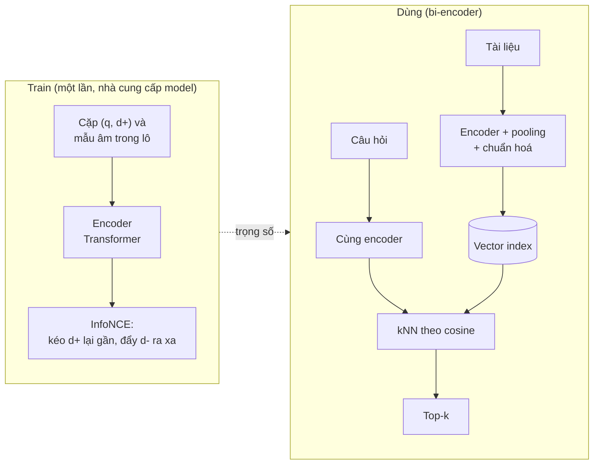
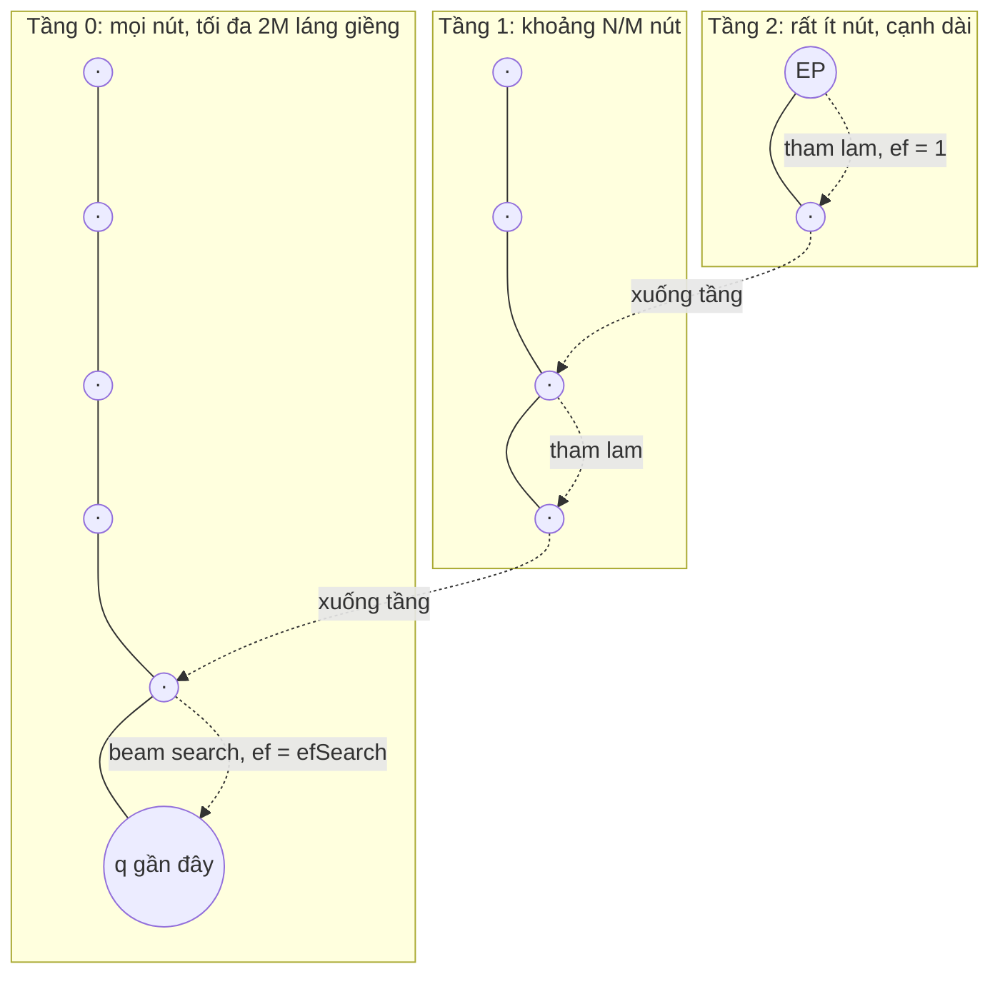
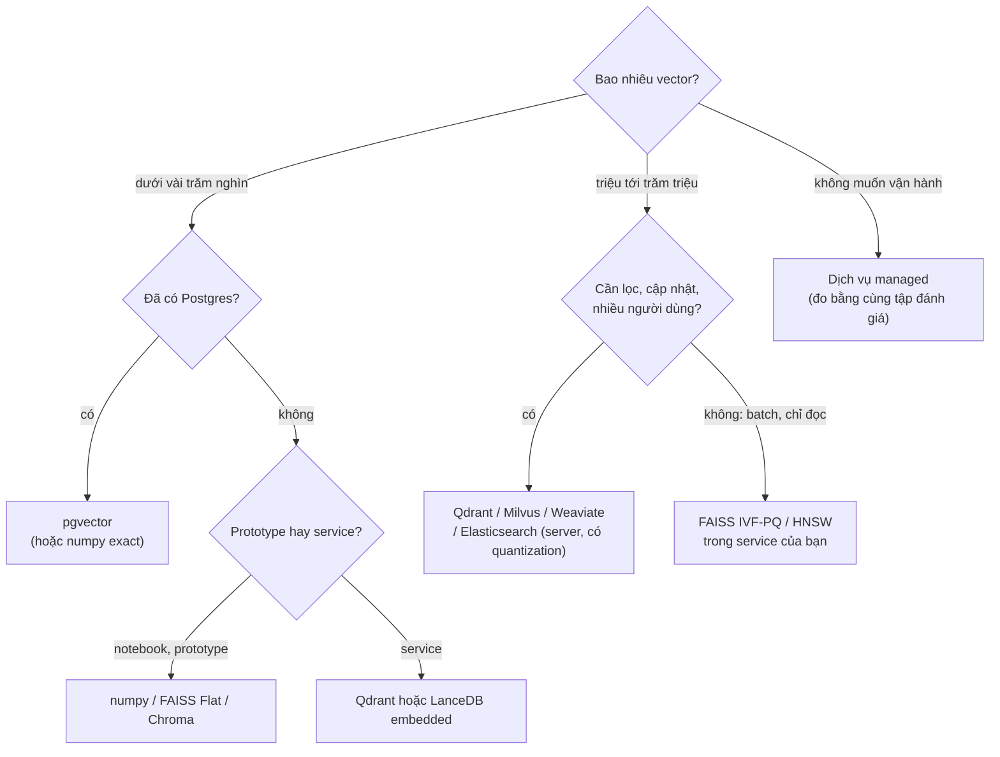
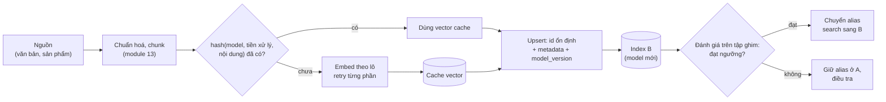

# Embeddings & Vector Database

Một **embedding** biến một đoạn văn bản (hay ảnh, âm thanh, sản phẩm, người dùng) thành một vector số thực sao cho những
thứ giống nhau về nghĩa nằm gần nhau. Có vector rồi, rất nhiều bài toán thành một câu hỏi duy nhất: "những vector nào gần
vector này nhất?". Semantic search, gợi ý, gom nhóm, phát hiện trùng lặp, phát hiện bất thường, phân loại với rất ít dữ
liệu, và tầng retrieval của RAG đều dựa trên câu hỏi đó. **Vector database** là hạ tầng trả lời nó nhanh trên hàng triệu
vector, kèm những thứ một cơ sở dữ liệu phải có: lưu bền, cập nhật, xoá, lọc theo metadata.

Module 04 đã cho bạn word2vec, embedding của từng từ. Module này đi tiếp lên embedding của cả câu và đoạn văn, cách lấy
chúng (API kiểu OpenAI, Ollama, sentence-transformers), các bẫy về độ đo và chuẩn hoá, bốn use case có số đo, rồi tự cài
các index ANN (IVF, HNSW, PQ) trước khi dùng FAISS, Chroma, Qdrant, LanceDB và pgvector. Module 13 dùng đúng nền này để dựng
retrieval cho RAG trên **Zalo AI Legal Text Retrieval** (61 425 điều luật Việt Nam, 3 298 câu hỏi có nhãn), và đây cũng là
dữ liệu của capstone [Trợ lý pháp luật tiếng Việt](../../capstone/README.md). Dữ liệu thứ hai là **UIT-VSFC** (phản hồi sinh
viên có nhãn cảm xúc và chủ đề) mà module 04 và 11 đã dùng. Tải:

```bash
uv run python data/download_dataset.py zalo-legal
uv run python data/download_dataset.py uit-vsfc
```

Các khối code chạy từ **gốc repo** (để `import llmkit` được), ví dụ dán vào `uv run python -`. Khối gọi embedding cần Ollama
với `bge-m3` và `nomic-embed-text`. Số liệu dưới đây đo trên PC của track (RTX 3060 12GB **dùng chung** với một job khác,
Ollama, numpy và FAISS giới hạn 4 luồng CPU), kiểm ngày 2026-11-01. Vector `bge-m3` của cả corpus Zalo Legal là
`title + "\n" + text` của từng điều, chuẩn hoá L2, cùng định dạng cache module 13 dùng; 300 câu hỏi ghim là 300 query-id đầu
của `qrels/test.jsonl` như module 13.

Sau module này bạn sẽ:

- Giải thích embedding được train thế nào, đọc được cosine 0.5 nghĩa là gì (và không nghĩa là gì) với một model cụ thể.
- Gọi embedding qua API kiểu OpenAI, Ollama, sentence-transformers; biết pooling, chuẩn hoá, tiền tố, cắt độ dài.
- Chọn đúng metric, không bao giờ để một vector store so L2 trên vector chưa chuẩn hoá mà không biết.
- Dùng embedding cho phân loại, trùng lặp, bất thường, gợi ý, và đo từng việc bằng một con số.
- Tự cài kNN, IVF, HNSW, PQ; đọc tham số `nprobe`, `M`, `ef` như đọc code của mình; đo recall của ANN theo độ trễ và bộ nhớ.
- Chọn giữa FAISS, Chroma, Qdrant, LanceDB, pgvector bằng số đo và theo yêu cầu vận hành (lọc, cập nhật, lưu bền).
- Thiết kế pipeline indexing: cache embedding, id ổn định, phiên bản model, migrate index khi đổi model.

| Mức | Bài | Nội dung |
| --- | --- | --- |
| Basic | 01 similarity-knn | chuẩn hoá L2, dot / cosine / L2, kNN chính xác, recall của ANN |
| Basic | 02 ivf-index | k-means, inverted lists, `nprobe` |
| Basic | 03 embedding-api | request/response `/v1/embeddings`, base64, chia lô, cache, Matryoshka |
| Intermediate | 01 hnsw-from-scratch | HNSW tự viết, so với IVF tự viết và FAISS trên vector Zalo Legal |
| Intermediate | 02 vector-dbs | FAISS, Chroma, Qdrant local, LanceDB sau một giao diện chung; lọc, xoá, lưu bền; pgvector tuỳ chọn |
| Intermediate | 03 embedding-use-cases | phân loại UIT-VSFC, trùng lặp và rò rỉ train/test, bất thường (AUROC), gợi ý |
| Advanced | 01 ann-benchmark-pq | PQ tự viết, bảng Pareto recall / độ trễ / bộ nhớ, chọn index cho ba kịch bản |
| Advanced | 02 embedding-model-migration | chọn model, nén int8 / nhị phân, kế hoạch migrate index không downtime |

## 1. Embedding là gì và đến từ đâu

### Từ embedding của từ tới embedding của câu

word2vec (module 04) cho mỗi **từ** một vector cố định: "bằng" trong "bằng lái" và "bằng văn bản" chung một vector.
Embedding của câu ngày nay đến từ một Transformer encoder (họ BERT, XLM-RoBERTa): mỗi token ra một vector **theo ngữ cảnh**,
rồi một bước **pooling** gộp chúng thành một vector cho cả đoạn:

- **CLS pooling**: lấy vector của token đặc biệt đầu chuỗi (`bge-m3` dùng cách này).
- **Mean pooling**: trung bình các token (bỏ padding); nhiều model sentence-transformers và `nomic-embed-text` dùng.
- Sau pooling thường có bước **chuẩn hoá L2** để vector có độ dài 1.

Pooling là một phần của model: dùng mean pooling cho một model train với CLS (hay ngược lại) vẫn ra vector, chỉ là vector
tệ hơn, không có lỗi nào báo. Đó là lý do nên lấy embedding qua thư viện đọc cấu hình của model (sentence-transformers,
Ollama) thay vì tự viết pooling.

### Train thế nào: contrastive learning

Encoder được train để đẩy cặp liên quan lại gần và đẩy cặp không liên quan ra xa. Với một lô gồm $$B$$ cặp (câu hỏi
$$q_i$$, đoạn đúng $$d_i$$), loss InfoNCE coi mọi $$d_j$$ khác trong lô là mẫu âm:

$$
\mathcal{L} = -\frac{1}{B}\sum_{i=1}^{B} \log \frac{\exp\big(\cos(q_i, d_i)/\tau\big)}{\sum_{j=1}^{B}\exp\big(\cos(q_i, d_j)/\tau\big)}
$$

với nhiệt độ $$\tau$$ cỡ 0.01 tới 0.05. Ba hệ quả thực tế:

- Model học **đúng loại "giống nhau"** của dữ liệu train (câu hỏi, đoạn trả lời; câu, câu dịch; tiêu đề, nội dung). Nó không
  tự biết phủ định hay sắc thái nếu dữ liệu train không ép phải phân biệt.
- Cosine được train để **xếp hạng**, không phải để là một xác suất: chỉ có thứ tự là đáng tin, giá trị tuyệt đối phụ thuộc
  model.
- Model đa ngôn ngữ train trên cặp câu dịch đặt "I love this course" và "Tôi rất thích môn học này" gần nhau: tìm xuyên ngôn
  ngữ miễn phí.



Mô hình **bi-encoder** này embed tài liệu một lần, trước khi biết câu hỏi, nên tìm được trong hàng triệu tài liệu bằng
một phép tìm láng giềng. Cái giá là mỗi tài liệu bị nén vào một vector; module 13 dạy cross-encoder (rerank) để lấy lại
độ chính xác ở tầng sau.

### Cosine bao nhiêu là "giống"?

Đo bằng `bge-m3` qua Ollama:

| Cặp câu | cosine |
| --- | --- |
| "Không mang theo giấy phép lái xe thì bị phạt bao nhiêu?" / "Người điều khiển xe mô tô không mang theo Giấy phép lái xe bị phạt tiền." | 0.774 |
| cùng câu hỏi / "Bằng lái xe hết hạn phải làm thủ tục cấp lại." | 0.561 |
| cùng câu hỏi / "Hàng năm trước mùa mưa lũ, Ủy ban nhân dân cấp xã tổ chức tuần tra đê." | 0.372 |
| "giảng viên dạy rất nhiệt tình" / "thầy giảng bài dễ hiểu và vui tính" | 0.805 |
| "giảng viên dạy rất nhiệt tình" / "giảng viên dạy **không** nhiệt tình" | 0.766 |
| "giảng viên dạy rất nhiệt tình" / "giảng viên dạy **hơi** nhiệt tình" | 0.950 |
| "I love this course" / "Tôi rất thích môn học này" | 0.870 |

Và trên các cặp **ngẫu nhiên** (400 mẫu mỗi bên, mọi cặp khác nhau):

| Model | 400 điều luật ngẫu nhiên: cosine trung bình (p5 tới p95) | 400 phản hồi sinh viên ngẫu nhiên | Điều luật với phản hồi |
| --- | --- | --- | --- |
| `bge-m3` | 0.498 (0.407 tới 0.602) | 0.574 (0.416 tới 0.787) | 0.344 |
| `nomic-embed-text` | 0.730 (0.618 tới 0.830) | 0.676 (0.527 tới 0.894) | 0.609 |

Đọc hai bảng như một kỹ sư:

- Hai điều luật **chẳng liên quan gì** vẫn có cosine trung bình 0.5 với `bge-m3`, 0.73 với `nomic-embed-text`. Embedding
  không trải đều trên mặt cầu mà dồn vào một "hình nón" hẹp (anisotropy). Cosine 0.5 không có nghĩa là "giống một nửa", và
  ngưỡng chọn cho model này vô nghĩa với model kia: mọi ngưỡng (trùng lặp, từ chối, bất thường) phải chọn lại từ phân phối
  điểm của chính model và dữ liệu đó.
- Câu phủ định ("không nhiệt tình", cosine 0.766) vẫn gần câu gốc hơn một câu khen khác chữ (0.805 là cùng nghĩa, nhưng
  0.766 vẫn cao hơn mọi cặp ngẫu nhiên): embedding chủ yếu bắt **chủ đề**, bắt cực tính yếu. Muốn phân loại cảm xúc, dùng
  embedding làm đặc trưng rồi train một lớp phân loại trên nhãn (mục 4), đừng đo cosine tới câu "tích cực".

### Model nào cho tiếng Việt: tokenizer quyết định trước tiên

Cùng ba câu trên với `nomic-embed-text` (137M tham số, train chủ yếu tiếng Anh):

| Cặp câu | `nomic-embed-text` | `bge-m3` |
| --- | --- | --- |
| "giảng viên dạy rất nhiệt tình" / "... **không** nhiệt tình" | **1.00000** | 0.76563 |
| "giảng viên dạy rất nhiệt tình" / "... **hơi** nhiệt tình" | **1.00000** | 0.95020 |
| cùng hai câu, **bỏ dấu**: "giang vien day rat nhiet tinh" / "... khong nhiet tinh" | 0.88250 | 0.87788 |
| "the lecturer is very enthusiastic" / "the lecturer is not enthusiastic" | 0.86430 | 0.83237 |

Cosine **đúng bằng 1** giữa "rất", "không", "hơi": với `nomic-embed-text`, ba câu cho cùng một vector. Bỏ dấu thì model
lại phân biệt được. Từ vựng tokenizer của model không có các âm tiết tiếng Việt có dấu này, nên chúng thành cùng một
token "không biết" và mọi khác biệt biến mất trước khi Transformer kịp nhìn thấy. Câu tiếng Anh tương ứng thì bình thường.
Bài học: kiểm tokenizer và một vài cặp câu tối thiểu **trong ngôn ngữ của bạn** trước khi đọc bảng xếp hạng chung. Bài
Advanced 02 đo hậu quả trên retrieval.

Tiêu chí chọn embedding model:

| Tiêu chí | Câu hỏi | Ví dụ |
| --- | --- | --- |
| Ngôn ngữ | Tokenizer và dữ liệu train có ngôn ngữ của bạn? | `bge-m3` (đa ngôn ngữ, 100+ ngôn ngữ) so với `nomic-embed-text` (tiếng Anh) |
| Độ dài tối đa | Văn bản dài hơn bị cắt im lặng hay báo lỗi? | `bge-m3` hỗ trợ 8 192 token, Ollama chạy với context 4 096 và **cắt im lặng** (module 13 mục 2); `nomic-embed-text` qua Ollama trả **HTTP 400** "the input length exceeds the context length" với điều luật dài |
| Số chiều | Bộ nhớ index tỉ lệ thuận với số chiều | 1 024 (`bge-m3`), 768 (`nomic-embed-text`); model Matryoshka cho cắt bớt chiều |
| Đối xứng | Câu hỏi và tài liệu có cần tiền tố khác nhau? | `nomic-embed-text`: `search_query: ` / `search_document: `; họ E5: `query: ` / `passage: `; `bge-m3`: không cần |
| Chất lượng | Trên **tập đánh giá của bạn**, không phải trên bảng chung | MTEB là điểm khởi đầu để chọn ứng viên, không phải để ra quyết định |
| Vận hành | Chạy ở đâu, giấy phép, giá, tốc độ, dữ liệu có được rời hạ tầng không | API đóng (OpenAI, Google, Cohere, Voyage) hay model mở tự host |

### Matryoshka: một vector, nhiều độ dài

Model train theo kiểu **Matryoshka Representation Learning** (Kusupati et al., 2022) cộng loss ở nhiều độ dài tiền tố
(64, 128, 256... chiều), nên $$k$$ chiều **đầu** của vector tự nó đã là một embedding tốt. Cắt bớt chiều rồi chuẩn hoá lại
giảm bộ nhớ và thời gian tìm tỉ lệ thuận. Tham số `dimensions` của API `/v1/embeddings` làm đúng việc này phía server. Với
model **không** train kiểu Matryoshka, cắt chiều vẫn chạy nhưng chất lượng tụt nhanh hơn; phải đo (bài Advanced 02).

## 2. Ba cách lấy embedding: API kiểu OpenAI, Ollama, sentence-transformers

### API kiểu OpenAI: `POST /v1/embeddings`

Định dạng này là chuẩn thực tế: OpenAI, Ollama, vLLM, LiteLLM, nhiều gateway đều nói được. Request:

```json
{"model": "nomic-embed-text", "input": ["luật đất đai", "giá vàng hôm nay"], "encoding_format": "float", "dimensions": 8}
```

Response thật của Ollama cho request trên (rút gọn số):

```json
{"object": "list",
 "data": [{"object": "embedding", "index": 0, "embedding": [-0.2528, 0.0927, "..."]},
          {"object": "embedding", "index": 1, "embedding": [0.1013, -0.0365, "..."]}],
 "model": "nomic-embed-text",
 "usage": {"prompt_tokens": 12, "total_tokens": 12}}
```

Những chi tiết mà client phải xử lý (bài Basic 03):

- `input` là một list: gửi theo **lô** để giảm số lần gọi mạng, nhưng có giới hạn số phần tử và tổng token mỗi request.
- Mỗi phần tử của `data` có `index`: xếp theo nó, đừng giả định thứ tự.
- `encoding_format: "base64"` trả mỗi vector là chuỗi base64 của các `float32` little-endian: response nhỏ hơn khoảng
  2 tới 3 lần so với số thập phân trong JSON.
- `dimensions` cắt vector phía server (model Matryoshka); không gửi khoá này cho model không hỗ trợ.
- `usage.prompt_tokens` là thứ bạn trả tiền với API đóng: chi phí embed một corpus là
  $$\text{tổng token} \times \text{giá mỗi triệu token} / 10^6$$, trả **một lần** lúc index (và lại một lần nữa mỗi khi đổi model).

### Ollama: `/api/embed` và `llmkit.embed`

`llmkit.embed(texts)` của track gọi `/api/embed` của Ollama (mặc định `bge-m3`) hoặc `/embeddings` của server tương thích
OpenAI, tuỳ `LLM_PROVIDER`, và trả `np.float32` shape `(n, dim)`. Cả `bge-m3` và `nomic-embed-text` qua Ollama trả vector
**đã chuẩn hoá** (chuẩn 1.0000), nhưng đừng dựa vào đó với nhà cung cấp khác: chuẩn hoá lại một lần lúc index không tốn gì.

### sentence-transformers và Hugging Face

`sentence-transformers` đọc cấu hình model từ Hugging Face Hub và dựng đúng chuỗi module. Với `BAAI/bge-m3`:

```text
SentenceTransformer(
  (0): Transformer(... 'architecture': 'XLMRobertaModel')
  (1): Pooling({'embedding_dimension': 1024, 'pooling_mode': 'cls', ...})
  (2): Normalize()
)
```

Tức là CLS pooling rồi chuẩn hoá L2, đúng như mục 1. `model.encode(texts, batch_size=..., normalize_embeddings=...)` trả
numpy; model có tiền tố thì truyền qua `prompt=` hoặc tự ghép chuỗi. Dùng thẳng `transformers` (`AutoModel`) thì bạn tự lo
tokenize, pooling (đúng loại), chuẩn hoá: chỉ đáng khi cần can thiệp (fine-tune, export ONNX).

Cùng model, hai đường chạy: 128 văn bản (64 phản hồi UIT-VSFC và 64 điều luật cắt 1 500 ký tự) qua sentence-transformers
`float32` trên CPU 4 luồng và qua Ollama (GGUF F16, GPU dùng chung):

| | sentence-transformers, CPU | Ollama `bge-m3`, GPU |
| --- | --- | --- |
| Tốc độ | 2.6 văn bản/giây | 27.6 văn bản/giây |
| cosine giữa hai vector của **cùng** văn bản | thấp nhất 0.99783, trung bình 0.99994 | |
| Chênh cosine giữa các cặp | lớn nhất 0.0135, trung bình 0.0008 | |
| Top-5 láng giềng trùng nhau | 99.5% | |

Hai đường gần như cùng không gian, nhưng **không giống hệt** (F16 so với F32, khác cài đặt): trộn vector của hai đường trong
một index làm thứ hạng xê dịch ở chữ số thứ hai. Quy tắc: corpus và câu hỏi đi qua **cùng** model, cùng đường chạy, cùng
tiền xử lý.

### Lấy embedding ở quy mô corpus

- **Batch**: 32 tới 64 văn bản mỗi lời gọi; văn bản dài thì giảm.
- **Cache theo nội dung**: khoá là hash của (model, phiên bản tiền xử lý, văn bản). Embed lại chỉ phần đổi.
- **Lỗi từng phần**: `bge-m3` qua Ollama thỉnh thoảng trả `NaN` cho một văn bản và server báo lỗi cho cả lô (module 13 mục
  2); code phải thử lại từng văn bản, ghi lại văn bản hỏng, không dừng cả lượt chạy dài.
- Thời gian thật: embed 61 425 điều Zalo Legal (`title + text`, lô 32) mất **khoảng 47 phút** trên PC của track (15 tới 28
  điều/giây, GPU chia với job khác) và 45 phút trên laptop GPU 4GB của track. Câu ngắn nhanh hơn nhiều: 16 175 câu UIT-VSFC
  mất khoảng 5 phút (khoảng 50 câu/giây).

## 3. Độ đo tương đồng và chuẩn hoá

### Ba độ đo

$$
\mathrm{dot}(q, x) = q^\top x, \qquad
\cos(q, x) = \frac{q^\top x}{\lVert q\rVert\,\lVert x\rVert}, \qquad
\lVert q - x\rVert^2 = \lVert q\rVert^2 + \lVert x\rVert^2 - 2\,q^\top x
$$

Với vector đơn vị ($$\lVert q\rVert = \lVert x\rVert = 1$$):

$$
\lVert q - x\rVert^2 = 2 - 2\cos(q, x), \qquad \mathrm{dot}(q, x) = \cos(q, x)
$$

nên **sau khi chuẩn hoá, ba độ đo cho cùng một thứ hạng**. Đó là cách làm mặc định: chuẩn hoá một lần lúc index và lúc query,
rồi dùng inner product (nhanh nhất, chỉ một phép nhân ma trận). Đẳng thức thứ nhất cũng là cách đổi "khoảng cách" mà một
vector store trả về sang cosine (bài Intermediate 02).

```python
import numpy as np

rng = np.random.default_rng(0)
a, b = rng.normal(size=(2, 1024))
a, b = a / np.linalg.norm(a), b / np.linalg.norm(b)
print(round(float(a @ b), 6), round(float(1 - ((a - b) ** 2).sum() / 2), 6))
```

Hai số in ra bằng nhau.

### Khi nào chúng khác nhau, và vì sao bạn phải quan tâm

Khi vector **chưa** chuẩn hoá: dot thưởng cho vector dài (một đoạn văn dài hoặc một sản phẩm phổ biến có thể có chuẩn lớn
hơn), L2 phạt vector dài, cosine chỉ xét hướng. Thí nghiệm: nhân mỗi vector `bge-m3` của corpus Zalo với một số ngẫu nhiên
trong $$[0.5, 2]$$ (mô phỏng một model không chuẩn hoá đầu ra) rồi tìm bằng dot product trên 300 câu ghim:
Recall@10 theo nhãn tụt từ **0.905** (cosine) xuống **0.193**, và chỉ 18% top-10 còn trùng với top-10 theo cosine. Cùng
vector, cùng hướng, chỉ khác độ dài: dot product đã xếp hạng theo độ dài nhiều hơn theo nghĩa. Chuẩn hoá lại một lần là
về 0.905.

Mỗi công cụ có metric mặc định và quy ước "khoảng cách" riêng, và đây là nguồn lỗi im lặng phổ biến nhất:

| Công cụ | Mặc định | Cách khai báo cosine | Trả về |
| --- | --- | --- | --- |
| FAISS | theo lớp index: `IndexFlatL2` là L2, `IndexFlatIP` là inner product | `IndexFlatIP` / `METRIC_INNER_PRODUCT` trên vector đã chuẩn hoá | L2 **bình phương**, hoặc inner product |
| Chroma | **L2** (`space: l2`) | `configuration={"hnsw": {"space": "cosine"}}` lúc tạo collection, không đổi được sau | cosine distance $$1 - \cos$$ |
| Qdrant | không có, bắt buộc khai báo | `Distance.COSINE` (Qdrant tự chuẩn hoá vector lúc lưu) | cosine similarity |
| LanceDB | **L2** | `.distance_type("cosine")` lúc tìm, `metric="cosine"` lúc tạo index | cosine distance $$1 - \cos$$ |
| pgvector | toán tử quyết định | `<=>` cosine distance, `vector_cosine_ops` cho index | `<->` L2, `<#>` **âm** inner product, `<=>` $$1 - \cos$$ |

Hai lỗi kinh điển: tạo collection Chroma không khai báo `space` rồi đưa vào vector chưa chuẩn hoá; và tạo index pgvector
bằng `vector_cosine_ops` nhưng truy vấn bằng `<->`: theo tài liệu pgvector, index chỉ dùng được khi toán tử khớp opclass,
nên Postgres quét tuần tự (đúng nhưng chậm, 344 ms so với 3 ms trong phép đo ở mục 6).

### Vài bẫy số học

- **Vector 0** (embed lỗi, văn bản rỗng): chia cho chuẩn 0 ra `NaN`, `NaN` lan vào mọi tích vô hướng, và `argsort` đẩy
  `NaN` xuống cuối mà không báo gì. Giữ vector 0 là 0 và đếm chúng.
- **Khai triển L2 trong `float32`**: hiệu của hai số lớn gần bằng nhau có thể ra số âm nhỏ hoặc sai số lớn khi vector có
  chuẩn lớn (bài Basic 01 đo). Với vector đơn vị thì không đáng kể.
- **`float16`** cho vector lưu trữ là đủ (sai số cosine cỡ `1e-3`), nhưng cộng dồn tích vô hướng nên làm ở `float32`.

## 4. Use case: search, phân loại, gom nhóm, gợi ý, trùng lặp, bất thường

Mọi use case dưới đây là cùng một phép tính (láng giềng gần theo cosine) đặt trong một khung khác:

| Use case | Cách làm với embedding | Đo bằng | Bẫy |
| --- | --- | --- | --- |
| **Semantic search** | kNN của câu hỏi trong corpus | Recall@k, MRR, nDCG (module 13) | Thiếu khớp chính xác (số hiệu, con số): thêm BM25, module 13 |
| **Phân loại** | Embedding làm đặc trưng + logistic regression ("linear probe"); hoặc kNN bỏ phiếu; hoặc centroid mỗi lớp | macro-F1 | Lớp hiếm; embedding bắt chủ đề tốt hơn cực tính |
| **Zero-shot** | So cosine với embedding của mô tả nhãn | macro-F1 | Rất nhạy với cách viết mô tả; thường thua linear probe xa |
| **Gom nhóm** | k-means / HDBSCAN trên vector, đặt tên cụm bằng LLM | silhouette, đọc mẫu | Số cụm; cụm theo văn phong thay vì nội dung |
| **Gợi ý** | Hồ sơ người dùng = trung bình vector mục đã thích; kNN của hồ sơ | precision@k, CTR | Bong bóng lọc (chỉ gợi ý thứ giống hệt); mục mới không có tương tác thì vẫn có vector |
| **Trùng lặp gần đúng** | Cặp có cosine trên ngưỡng | precision theo mẫu đọc tay | Ngưỡng theo model; $$n^2$$ cặp: dùng ANN hoặc theo lô |
| **Bất thường** | Khoảng cách tới $$k$$ láng giềng gần nhất trong tập "bình thường" | AUROC | "Bất thường" phải khác về **nội dung** thì embedding mới thấy |

Một thí nghiệm nhỏ trên UIT-VSFC (tập test 3 166 câu, vector `bge-m3`, macro-F1 ba lớp cảm xúc) cho thấy embedding cần nhãn
tới mức nào:

| Cách làm, không train mô hình nào | macro-F1 |
| --- | --- |
| Zero-shot: cosine tới embedding của ba từ "tiêu cực", "trung lập", "tích cực" | 0.546 |
| Zero-shot: cosine tới ba câu mô tả ("sinh viên phàn nàn, chê...", "... nhận xét trung lập...", "... khen ngợi...") | 0.620 |
| Centroid của **5 câu có nhãn** mỗi lớp, trung bình 10 lần lấy mẫu (thấp nhất 0.609, cao nhất 0.696) | 0.649 |

Cách viết nhãn đổi kết quả 0.07, và chỉ 15 câu có nhãn đã hơn mô tả viết tay tốt nhất; nhưng cả ba vẫn kém xa các mốc có
train của module 04 (TF-IDF + logistic regression 0.716). Bài Intermediate 03 đo phân loại có train trên embedding và ba
use case còn lại trên dữ liệu thật: so với TF-IDF và BiLSTM của module 04, prompting `qwen2.5:3b` của module 11, trùng lặp
giữa train và test, hai bài toán bất thường và gợi ý điều luật.

Một việc mọi dự án ML nên làm với embedding trước khi tin con số test: tìm câu test có **bản sao gần như y hệt** trong train.
Tập dữ liệu thu thập từ người thật (phản hồi, đánh giá, câu hỏi) có rất nhiều câu lặp lại gần đúng; nếu chúng nằm cả hai
phía, con số test đo một phần khả năng **nhớ**, không phải khả năng tổng quát.

## 5. Tìm láng giềng gần: exact kNN, IVF, HNSW, PQ

### Exact kNN và khi nào đủ

Tìm chính xác $$k$$ láng giềng của một query trong $$N$$ vector $$d$$ chiều tốn $$N \cdot d$$ phép nhân cộng. Với corpus Zalo
($$N$$ = 61 425, $$d$$ = 1 024, 252 MB `float32`), một lô 300 câu bằng một phép nhân ma trận numpy mất 4.7 ms mỗi
câu; FAISS `IndexFlatIP` gọi từng câu một mất 13.9 ms. Với vài trăm nghìn vector và lưu lượng vừa phải, **exact là
lựa chọn đúng**: không có tham số, không sai số, không thời gian dựng index. ANN chỉ cần khi $$N$$ lên hàng triệu, khi cần
độ trễ dưới mili giây ở lưu lượng lớn, hoặc khi vector không vừa RAM.

### Recall của ANN và Recall@k của retrieval

Index xấp xỉ được chấm bằng **recall của ANN**, so với kNN chính xác trên cùng vector:

$$
\mathrm{recall}_{\mathrm{ANN}}@k = \frac{1}{|Q|}\sum_{q \in Q}\frac{\left|\mathrm{ANN}_k(q) \cap \mathrm{kNN}_k(q)\right|}{k}
$$

Đừng lẫn với **Recall@k** của retrieval mà module 13 dùng (tỉ lệ tài liệu đúng theo nhãn lọt vào top-$$k$$). Recall của ANN
đo index; Recall@k đo cả hệ thống (embedding + index). Recall ANN 0.95 thường làm Recall@k theo nhãn tụt rất ít, vì láng
giềng bị sót hay là láng giềng ở hạng 8 tới 10, ít khi là đáp án. Bài Intermediate 02 đo chính xác bao nhiêu.

### IVF: chia không gian bằng k-means

**Inverted File** (Jégou et al., 2011; dùng trong FAISS `IndexIVF*`, pgvector `ivfflat`, Milvus): k-means chia các vector
thành $$n_{\text{list}}$$ cụm (ô Voronoi), mỗi cụm một danh sách. Lúc tìm, chỉ quét $$n_{\text{probe}}$$ cụm có centroid gần query
nhất. Chi phí mỗi query khoảng

$$
n_{\text{list}} + n_{\text{probe}} \cdot \frac{N}{n_{\text{list}}}
$$

phép tính khoảng cách. Sai số đến từ **biên ô**: láng giềng thật của một query nằm gần biên có thể thuộc ô bên cạnh không
được probe. Tăng $$n_{\text{probe}}$$ đổi tốc độ lấy recall một cách mượt mà. IVF cần **train** (k-means) trên dữ liệu đại diện;
dữ liệu đổi phân phối nhiều thì phải train lại. Bài Basic 02 cài từ đầu.

### HNSW: đồ thị nhiều tầng

**Hierarchical Navigable Small World** (Malkov & Yashunin, 2016) là index mặc định của Qdrant, Weaviate, Chroma, pgvector
(`hnsw`), Elasticsearch, OpenSearch. Ý tưởng: một đồ thị mà mỗi nút nối với vài láng giềng gần; tìm bằng cách đi tham lam
sang láng giềng gần query hơn. Để đi nhanh qua khoảng cách xa, đồ thị có nhiều tầng như skip list: tầng trên thưa, cạnh dài;
tầng 0 chứa mọi nút.



- Mỗi nút mới có tầng cao nhất $$\ell = \lfloor -\ln(u)\, m_L \rfloor$$ với $$m_L = 1/\ln M$$: tỉ lệ nút ở tầng $$\ge 1$$ là $$1/M$$.
- **`M`**: số láng giềng mỗi nút ở tầng trên ($$2M$$ ở tầng 0). Lớn hơn thì recall cao hơn ở cùng `ef`, tốn bộ nhớ hơn
  (mỗi nút khoảng $$2M$$ id ở tầng 0) và dựng chậm hơn. 16 tới 32 là thường gặp.
- **`efConstruction`**: độ rộng beam lúc chèn nút. Lớn hơn thì đồ thị tốt hơn, dựng chậm hơn.
- **`efSearch`** (hay `ef`): độ rộng beam lúc tìm ở tầng 0, $$\ge k$$. Đây là núm vặn recall theo độ trễ **lúc chạy**.
- **Heuristic chọn láng giềng**: không lấy $$M$$ ứng viên gần nhất mà giữ ứng viên chỉ khi nó gần nút gốc hơn gần mọi láng
  giềng đã chọn. Cách này giữ lại những cạnh "đi xa" nối các cụm với nhau; thiếu nó, dữ liệu có cụm (như embedding thật)
  làm đồ thị rời thành các đảo mà tăng `ef` cũng không qua được. Bài Intermediate 01 cài và đo cả hai.

HNSW cho recall rất cao ở độ trễ thấp và không cần train, nhưng: tốn bộ nhớ hơn IVF (vector gốc cộng đồ thị), dựng chậm,
và **xoá** khó (nút xoá thường chỉ được đánh dấu, đồ thị xấu dần, cần dựng lại định kỳ).

### Product Quantization: nén vector

**PQ** (Jégou, Douze, Schmid, 2011) chia vector thành $$m$$ đoạn, mỗi đoạn lượng tử hoá bằng một codebook 256 centroid, lưu
$$m$$ byte thay vì $$4d$$ byte: với $$d$$ = 1 024 và $$m$$ = 64, từ 4 096 byte còn 64 byte (64 lần). Khoảng cách từ query tới
vector nén tính bằng bảng tra ($$m \times 256$$ giá trị mỗi query). PQ mất chính xác, nên hệ thống thật ghép nó với IVF
(`IndexIVFPQ`) và **rescoring**: lấy vài trăm ứng viên bằng PQ rồi xếp lại bằng vector gốc đọc từ đĩa. Các lựa chọn rẻ hơn
PQ: **scalar quantization** int8 (4 lần, gần như không mất recall) và **nhị phân** (32 lần, cần rescoring).

### Đo trên corpus Zalo Legal

FAISS 1.15 trên 61 425 vector `bge-m3`, 300 câu ghim, gọi **từng câu một** (như một dịch vụ search thật), 4 luồng, PC dùng
chung; byte/vector là kích thước index serialize chia cho $$N$$:

| Index | Tham số | recall ANN@10 | Recall@10 (nhãn) | ms/câu | byte/vector | Dựng |
| --- | --- | --- | --- | --- | --- | --- |
| `IndexFlatIP` (exact) | | 0.998 | 0.905 | 13.9 | 4 096 | 0.1 s |
| `IndexHNSWFlat` M=32, efConstruction=200 | efSearch=16 | 0.950 | 0.878 | 0.28 | 4 368 | 25.6 s |
| | efSearch=32 | 0.986 | 0.902 | 0.29 | 4 368 | |
| | efSearch=128 | 0.997 | 0.905 | 1.16 | 4 368 | |
| `IndexIVFFlat` nlist=1024 | nprobe=8 | 0.900 | 0.878 | 0.52 | 4 172 | 5.4 s |
| | nprobe=64 | 0.981 | 0.902 | 1.53 | 4 172 | |
| `IndexIVFPQ` nlist=1024, m=64 | nprobe=16 | 0.632 | 0.863 | 0.44 | 157 | 16.0 s |
| | nprobe=64 | 0.636 | 0.867 | 0.90 | 157 | |
| `IndexScalarQuantizer` 8 bit (quét hết) | | 0.995 | 0.905 | 11.6 | 1 024 | 0.2 s |

Đọc bảng:

- **Exact không chậm như người ta nghĩ**: 13.9 ms một câu khi gọi lẻ, 4.7 ms khi gom cả lô. Recall ANN của
  `IndexFlatIP` là 0.998 chứ không phải 1 chỉ vì numpy và FAISS cộng dồn `float32` theo thứ tự khác, đổi chỗ vài láng giềng
  gần như bằng điểm ở hạng 10.
- **HNSW** nhanh hơn exact 50 lần ở recall 0.986 (efSearch=32), và Recall@10 theo nhãn gần như không đổi (0.902 so với
  0.905). Cái giá là bộ nhớ (thêm 272 byte mỗi vector cho đồ thị) và 25 giây dựng.
- **IVF** cần `nprobe` cao (64 trên 1 024 cụm) để tới recall 0.98, khi đó chậm hơn HNSW. Ở `nprobe = 8`, recall ANN 0.900
  làm Recall@10 theo nhãn mất 0.027.
- **IVF-PQ** nén 26 lần nhưng recall ANN dừng ở khoảng 0.63 dù tăng `nprobe`: trần là sai số lượng tử, không phải số cụm
  được quét. Recall@10 theo nhãn vẫn 0.86 vì láng giềng bị đảo chủ yếu là các điều gần nhau về nghĩa; muốn lấy lại phải
  rescoring bằng vector gốc (bài Advanced 01).
- **Int8 (SQ8)** giảm bộ nhớ 4 lần gần như miễn phí về recall; vẫn quét hết nên chỉ nhanh hơn exact chút ít.
- Recall ANN và Recall@10 theo nhãn **không tỉ lệ thuận**: mất 0.05 recall ANN chỉ mất 0.027 Recall@10 ở đây, vì đáp án
  thường nằm rất gần đầu danh sách. Luôn đo cả hai.

## 6. Vector database: hơn một index

### Thêm gì so với FAISS

FAISS là **thư viện index**: nhận ma trận, trả id số. Một vector database (Qdrant, Milvus, Weaviate, Chroma, LanceDB,
pgvector...) thêm những thứ một hệ thống phục vụ người dùng cần:

| Năng lực | Vì sao cần | Ghi chú |
| --- | --- | --- |
| Id tuỳ ý, payload / metadata | Trả về "điều 5 Nghị định 100/2019" chứ không phải dòng 40 213 | FAISS: tự giữ bảng id |
| **Lọc theo metadata** | Phân quyền, văn bản còn hiệu lực, ngôn ngữ, khách hàng | Khó nhất khi kết hợp với ANN, xem dưới |
| Upsert, xoá | Tài liệu đổi hằng ngày | HNSW xoá bằng đánh dấu; IVF thêm dễ, cụm lệch dần |
| Lưu bền, mở lại, snapshot | Không embed và dựng lại mỗi lần khởi động | |
| Hybrid (dense + sparse/BM25) | Văn bản chuyên ngành (module 13) | Qdrant, Weaviate, Milvus, Elasticsearch, Postgres có full-text |
| Nhân bản, phân mảnh, multi-tenancy | Quy mô và sẵn sàng cao | Server mode, không phải embedded mode |

### Lọc: pre-filter, post-filter, lọc trong lúc duyệt

- **Post-filter**: tìm top-$$k'$$ rồi bỏ kết quả không khớp. Đơn giản, nhưng bộ lọc càng chặt càng hay trả **ít hơn $$k$$** kết
  quả, hoặc không gì cả. Tăng $$k'$$ chỉ đẩy vấn đề ra xa.
- **Pre-filter**: lọc trước rồi tìm chính xác trong tập con. Đúng, nhanh khi tập con nhỏ, chậm khi tập con lớn.
- **Lọc trong lúc duyệt** đồ thị hoặc danh sách (Qdrant với payload index, Weaviate, pgvector 0.8 `iterative_scan`, FAISS
  `IDSelector`): chỉ nhận nút khớp vào kết quả nhưng vẫn đi qua nút không khớp. Với bộ lọc rất chặt, đồ thị HNSW "nhìn qua
  bộ lọc" bị đứt, nên các hệ thống tự chuyển sang quét phẳng tập con khi ước lượng tập khớp nhỏ.

Bài Intermediate 02 đo post-filter so với lọc trong truy vấn trên chính câu hỏi "chỉ tìm trong một văn bản luật".

### So sánh công cụ

| | FAISS | Chroma | Qdrant | LanceDB | pgvector | Milvus / Weaviate / Elasticsearch | Pinecone và dịch vụ managed |
| --- | --- | --- | --- | --- | --- | --- | --- |
| Loại | Thư viện C++ | Embedded hoặc server | Server Rust (có local mode Python) | Embedded, tệp Lance (cột) | Extension Postgres | Server phân tán | Dịch vụ |
| Index | Mọi loại (Flat, IVF, HNSW, PQ, GPU) | HNSW | HNSW, quantization | IVF-PQ, IVF-HNSW, quét phẳng | HNSW, IVFFlat | HNSW, IVF, DiskANN... | Ẩn |
| Lọc | Tự làm (`IDSelector`) | `where` đơn giản | Mạnh, payload index | SQL | SQL đầy đủ | Mạnh | Có |
| Hợp với | Nghiên cứu, batch, nhúng vào service | Prototype, notebook | Production cỡ vừa tới lớn | Dữ liệu đa phương thức, data lake, embedded | Đã có Postgres, cần transaction và join | Quy mô rất lớn | Không muốn vận hành |



### pgvector: một mốc đo

pgvector 0.8 trong container `pgvector/pgvector:pg17` riêng (không đụng Postgres khác trên máy), cùng 61 425 vector, 300
câu ghim, gọi từng câu qua `psycopg` (container giới hạn 4 CPU):

| | Kết quả |
| --- | --- |
| `COPY` 61 425 dòng (định dạng nhị phân) | 5.3 s |
| Không index (quét tuần tự, exact) | recall ANN@10 1.000, p50 344 ms, p95 390 ms |
| `CREATE INDEX ... USING hnsw (embedding vector_cosine_ops) WITH (m = 16, ef_construction = 100)` | 62.9 s; bảng + index 806 MB |
| `hnsw.ef_search = 40` (mặc định) | recall ANN@10 0.988, p50 2.9 ms, p95 6.0 ms |
| `hnsw.ef_search = 100` | recall ANN@10 0.992, p50 4.4 ms, p95 6.6 ms |

Quét tuần tự trong Postgres chậm hơn numpy hàng chục lần (đọc từng dòng, giải mã kiểu `vector`); có index HNSW thì
một truy vấn SQL kèm `WHERE` bất kỳ chỉ còn vài mili giây, cùng transaction và join với dữ liệu nghiệp vụ. Đó là lý do
pgvector thường là lựa chọn đầu tiên khi hệ thống đã có Postgres. Bài Intermediate 02 có cell tuỳ chọn để bạn tự đo.

## 7. Indexing trong production



- **Id ổn định**: id của bản ghi suy ra từ nguồn (`số hiệu + điều + khoản`, hoặc UUID5 của chuỗi đó), để upsert thay bản cũ
  thay vì nhân bản, và để xoá được theo nguồn.
- **Phiên bản model trong metadata và trong tên index**. Vector của hai model khác nhau không so được với nhau (khác cả số
  chiều: 1 024 so với 768), và ngay cả cùng model, đổi tiền xử lý hay tiền tố cũng đổi vector. Không bao giờ trộn.
- **Đổi model là migrate**: dựng index B song song (ghi kép cho dữ liệu mới, backfill dữ liệu cũ), đánh giá B trên tập ghim
  và trên lưu lượng thật (shadow read), chuyển alias, giữ A để rollback. Thời gian backfill tính từ throughput đo được: 61 425
  điều mất khoảng 45 phút, 10 triệu chunk ở 25 đoạn/giây là khoảng 4.6 ngày trên một GPU như của track. Bài Advanced 02.
- **Ước lượng bộ nhớ** trước khi chọn index:

$$
\text{RAM} \approx N \cdot \big(\underbrace{b_{\text{vec}}}_{4d\ \text{(float32)},\ d\ \text{(int8)},\ m\ \text{(PQ)}} + \underbrace{b_{\text{index}}}_{\approx 8M\ \text{(HNSW, id 4 byte)}}\big)
$$

  10 triệu vector 1 024 chiều `float32` là 41 GB chỉ riêng vector; int8 còn 10 GB; PQ 64 byte còn 0.64 GB (cộng vector gốc
  trên đĩa nếu rescoring).
- **Giám sát**: recall ANN trên một mẫu query so với exact (chạy định kỳ, vì index xấu dần sau nhiều lần xoá), p95 độ trễ, độ
  tươi của index (tài liệu mới nhất đã searchable chưa), số vector 0 hoặc lỗi embed, phân phối cosine của top-1 (tụt bất
  thường là dấu hiệu dữ liệu hoặc model đổi).

Lỗi hay gặp:

- Index bằng một model, query bằng model khác (hoặc cùng model nhưng quên tiền tố `search_query: `).
- Để vector store dùng metric mặc định (L2) trên vector chưa chuẩn hoá.
- Post-filter rồi ngạc nhiên vì kết quả rỗng với người dùng có quyền hẹp.
- Đo ANN bằng "ms/câu" trên lô lớn rồi hứa độ trễ từng request; đo độ trễ khi máy đang chạy việc khác mà không ghi.
- Chọn HNSW cho 50 000 vector chỉ đọc khi numpy exact đã dưới 5 ms.
- Không có tập đánh giá cố định nên không biết đổi index, đổi model làm tụt bao nhiêu.

## 8. Tài liệu tham khảo

Roadmap và dữ liệu:

- [roadmap.sh: AI Engineer](https://roadmap.sh/ai-engineer), các nhóm **Embeddings** (Semantic Search, Data
  Classification, Recommendation Systems, Anomaly Detection, Open AI Embeddings API, Sentence Transformers, Hugging Face),
  **Vector Databases** (Chroma, Pinecone, Weaviate, FAISS, LanceDB, Qdrant, Supabase, MongoDB Atlas), **Indexing Embeddings**,
  **Performing Similarity Search**.
- Zalo AI Legal Text Retrieval, bản mirror
  [GreenNode/zalo-ai-legal-text-retrieval-vn](https://huggingface.co/datasets/GreenNode/zalo-ai-legal-text-retrieval-vn);
  [UIT-VSFC](https://huggingface.co/datasets/uitnlp/vietnamese_students_feedback). Chi tiết: [data/README.md](../../../../data/README.md).

Paper:

- Reimers & Gurevych. [Sentence-BERT](https://arxiv.org/abs/1908.10084) (2019).
- Oord, Li, Vinyals. [Representation Learning with Contrastive Predictive Coding](https://arxiv.org/abs/1807.03748) (2018), InfoNCE.
- Chen et al. [BGE M3-Embedding](https://arxiv.org/abs/2402.03216) (2024).
- Nussbaum et al. [Nomic Embed: Training a Reproducible Long Context Text Embedder](https://arxiv.org/abs/2402.01613) (2024).
- Kusupati et al. [Matryoshka Representation Learning](https://arxiv.org/abs/2205.13147) (2022).
- Ethayarajh. [How Contextual are Contextualized Word Representations?](https://arxiv.org/abs/1909.00512) (2019), anisotropy.
- Muennighoff et al. [MTEB: Massive Text Embedding Benchmark](https://arxiv.org/abs/2210.07316) (2022).
- Malkov & Yashunin. [Efficient and robust approximate nearest neighbor search using Hierarchical Navigable Small World graphs](https://arxiv.org/abs/1603.09320) (2016).
- Jégou, Douze, Schmid. [Product Quantization for Nearest Neighbor Search](https://ieeexplore.ieee.org/document/5432202) (TPAMI 2011).
- Johnson, Douze, Jégou. [Billion-scale similarity search with GPUs](https://arxiv.org/abs/1702.08734) (2017), FAISS;
  Douze et al. [The Faiss library](https://arxiv.org/abs/2401.08281) (2024).
- Aumüller, Bernhardsson, Faithfull. [ANN-Benchmarks](https://arxiv.org/abs/1807.05614) (2018); [ann-benchmarks.com](https://ann-benchmarks.com/).

Tài liệu công cụ:

- [OpenAI: Embeddings API reference](https://platform.openai.com/docs/api-reference/embeddings),
  [Ollama API](https://github.com/ollama/ollama/blob/main/docs/api.md), [Sentence Transformers](https://sbert.net/).
- [FAISS wiki](https://github.com/facebookresearch/faiss/wiki) (chọn index: "Guidelines to choose an index").
- [Chroma docs](https://docs.trychroma.com/), [Qdrant docs](https://qdrant.tech/documentation/) (local mode, filtering,
  quantization), [LanceDB docs](https://lancedb.github.io/lancedb/), [pgvector](https://github.com/pgvector/pgvector).
- [MTEB leaderboard](https://huggingface.co/spaces/mteb/leaderboard).
