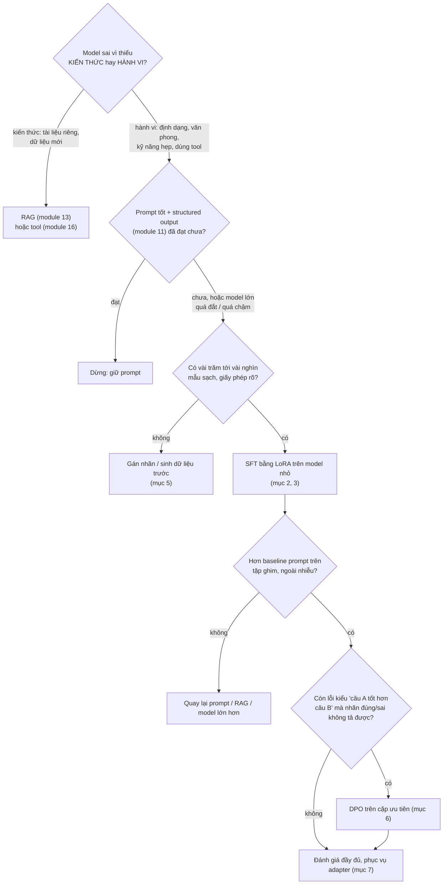
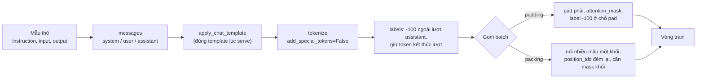
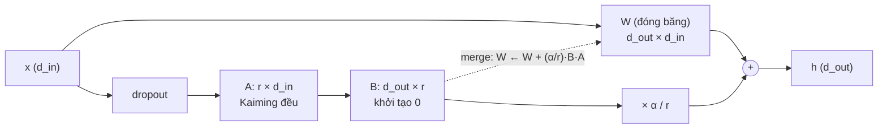
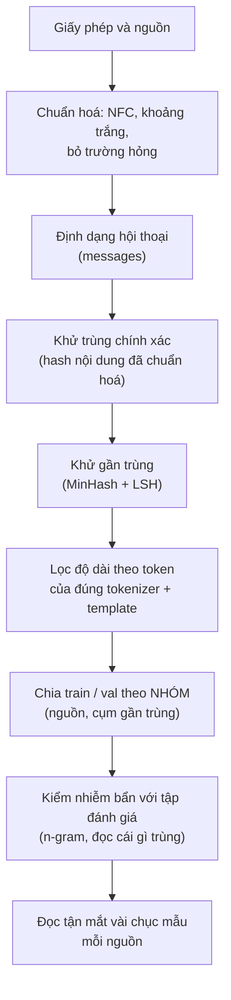

# Fine-tuning LLM

Prompt tốt (module 11) và RAG (module 13) giải được phần lớn bài toán. Phần còn lại là những lúc model **biết đủ** nhưng
**làm sai cách**: không trả đúng định dạng dù đã dặn, văn phong lệch, gọi tool sai, hoặc model lớn làm được mà quá đắt và
chậm. Fine-tuning sửa **hành vi** đó bằng cách tiếp tục train model trên dữ liệu của bạn. Module này đi từ bên trong ra:
tự viết LoRA trên `nn.Linear`, tự dựng label cho SFT, tự viết loss của DPO, rồi mới dùng PEFT, TRL và bitsandbytes như
một kỹ sư dùng hằng ngày, và đo trước/sau bằng thước đo kiểm được bằng code.

Module này dựa trên: vòng train và perplexity của [module 05](../05-transformers-llm-architecture/README.md), RLHF và nghiệm
đóng của [module 07](../07-reinforcement-learning/README.md), chat template và tính VRAM của
[module 09](../09-llms-and-open-models/README.md), NF4 và bitsandbytes của [module 10](../10-quantization/README.md),
baseline prompt của [module 11](../11-llm-apis-prompting/README.md) và phần "RAG vs fine-tuning" của
[module 13](../13-rag/README.md). Model chính là `Qwen2.5-0.5B-Instruct` (vừa GPU 4GB của laptop), bài Advanced dùng
`Qwen2.5-7B-Instruct` bằng QLoRA trên GPU 12GB. Mọi con số dưới đây đo trên PC của track (RTX 3060 12GB, PyTorch 2.14,
Transformers 5.22, PEFT 0.21.2, TRL 1.17, bitsandbytes 0.50.2), ghi rõ khi GPU đang được việc khác dùng chung.

Sau module này bạn sẽ:

- Quyết định có nên fine-tune không, bằng số đo so với prompt và RAG, không bằng cảm giác.
- Dựng dữ liệu SFT đúng: chat template, chỉ tính loss trên phần trả lời, padding và packing không lỗi im lặng.
- Hiểu LoRA tới từng phép nhân: hạng, $$\alpha / r$$, khởi tạo, merge; chọn lớp đích và hạng có lý do.
- Ước lượng và đo VRAM của full fine-tune, LoRA, QLoRA; fine-tune model 7B trên GPU 12GB.
- Chuẩn bị bộ instruction: giấy phép, khử trùng lặp, lọc độ dài, chia theo nhóm, kiểm nhiễm bẩn.
- Viết DPO từ nghiệm đóng của RLHF, dựng cặp ưu tiên tái lập được, biết giới hạn của nó.
- Đánh giá trung thực (loss trên tập giữ lại, thước đo tác vụ không cần LLM chấm), phục vụ adapter, và biết khi nào
  fine-tune **không** thắng.

| Mức | Bài | Nội dung |
| --- | --- | --- |
| Basic | 01 lora-from-scratch | `LoRALinear`: khởi tạo, $$\alpha / r$$, merge/unmerge, gắn vào Qwen2, so số tham số với PEFT |
| Basic | 02 sft-data | label chỉ cho assistant theo chat template, padding, packing, tỉ lệ token thật |
| Basic | 03 dpo-loss | log-prob của câu, DPO loss, một bước train với reference đóng băng |
| Intermediate | 01 instruction-data | OpenOrca-Viet: giấy phép, chuẩn hoá, khử trùng lặp, MinHash + LSH, chia theo nhóm, nhiễm bẩn |
| Intermediate | 02 sft-instruction | vòng SFT tự viết + LoRA của PEFT trên Qwen2.5-0.5B, loss và exact-match trước/sau, so model 3B |
| Intermediate | 03 sft-dpo-feedback | UIT-VSFC ra JSON: SFT bằng TRL rồi DPO trên lỗi của chính model, so prompt của module 11 |
| Advanced | 01 qlora-7b | QLoRA Qwen2.5-7B (NF4, double quant, optimizer phân trang): VRAM, thời gian, có đáng không |
| Advanced | 02 finetune-vs-rag | fine-tune để "nhớ" luật Zalo Legal so với BM25 của module 13, bước đệm cho capstone |

## 1. Khi nào fine-tune, khi nào không

### Ba câu hỏi trước khi train

Module 13 mục 1 đã đặt câu hỏi gốc: thiếu **kiến thức** hay thiếu **hành vi**? Fine-tune đổi hành vi (định dạng, văn phong,
kỹ năng hẹp, cách dùng tool, độ dài câu trả lời) rất hiệu quả, và đổi kiến thức rất kém: kiến thức nạp qua fine-tune không
trích nguồn được, lỗi thời khi dữ liệu đổi, và model vẫn bịa ở chỗ nhớ không chắc. Hai câu hỏi tiếp theo:

- **Prompt đã hết cách chưa?** Đo baseline prompt trên tập ghim trước (module 11 mục 7). Nhiều đội fine-tune để sửa một
  lỗi mà một ví dụ few-shot hay JSON Schema đã sửa được.
- **Có dữ liệu không?** Vài trăm tới vài nghìn mẫu sạch, đúng phân phối lúc dùng thật, có giấy phép rõ. Không có thì
  phải sinh hoặc gán nhãn, và đó thường là phần tốn nhất của dự án.



### Các kiểu fine-tune

| Kiểu | Dữ liệu | Đổi gì | Dùng khi |
| --- | --- | --- | --- |
| Continued pretraining | văn bản thô của miền (luật, y khoa) | phân phối từ vựng, kiến thức nền | ngôn ngữ/miền mà model gần như không biết; tốn GPU nhất |
| SFT (instruction tuning) | cặp (hội thoại, câu trả lời mẫu) | cách trả lời, định dạng, kỹ năng | phần lớn dự án fine-tune trong sản phẩm |
| Preference tuning (RLHF/PPO, DPO và họ hàng) | cặp (câu tốt hơn, câu kém hơn) | chọn giữa các câu trả lời đều "hợp lệ" | văn phong, an toàn, giảm lỗi mà nhãn đúng/sai không tả được |
| RL với reward kiểm được (GRPO, module 15) | bài có đáp án kiểm bằng code | kỹ năng suy luận nhiều bước | toán, code, bài có checker |
| Fine-tune embedding / reranker | cặp (câu hỏi, đoạn đúng) | retrieval của RAG | RAG tìm sai đoạn (capstone milestone 5) |

Theo cách cập nhật trọng số: **full fine-tune** (mọi tham số, cần bộ nhớ gấp nhiều lần model) và **PEFT**
(parameter-efficient: chỉ train một phần nhỏ, LoRA là phổ biến nhất). Trong sản phẩm, gần như mọi dự án fine-tune LLM mở
cỡ vài tỉ tham số trên một GPU dùng LoRA hoặc QLoRA.

### Fine-tune thắng ở đâu, thua ở đâu: ba thí nghiệm của module

Ba bài đặt fine-tune cạnh phương án khác trên cùng thước đo kiểm được bằng code; bạn tự đo, kết quả chi tiết ở lời giải:

| Bài | Bài toán | Fine-tune đấu với | Câu hỏi bạn trả lời bằng số |
| --- | --- | --- | --- |
| Intermediate 03 | phân loại phản hồi UIT-VSFC thành JSON | `qwen2.5:3b` chỉ prompt (module 11), chính model 0.5B chỉ prompt | tác vụ hẹp, nhãn nhiều: fine-tune model nhỏ hơn 6 lần có đuổi kịp model lớn dùng prompt không, ở trường nào? DPO trên lỗi của model sau SFT thêm được gì? |
| Intermediate 02 | trả lời instruction chung, đo bằng exact-match trắc nghiệm | Qwen2.5-3B không fine-tune | loss validation giảm có nghĩa là model trả lời đúng hơn không? |
| Advanced 02 | trích dẫn điều luật cho câu hỏi chưa thấy | BM25 (module 13) | fine-tune có "nạp" được kiến thức luật để trả lời câu mới không? |

Bài học chung (module 13 đã lập luận, ở đây bạn đo): fine-tune là công cụ cho **hành vi trên phân phối hẹp**, không phải
cho kiến thức hay năng lực mà model nền chưa có. Trước mỗi dự án, đặt câu hỏi "baseline nào phải đánh bại" và đo baseline đó
trước.

## 2. SFT: mục tiêu, chat template, chỉ học phần trả lời

### Mục tiêu

SFT vẫn là bài toán đoán token tiếp theo của module 05, chỉ khác dữ liệu và chỗ tính loss. Với hội thoại $$x$$ (system, user)
và câu trả lời $$y = (y_1, \ldots, y_T)$$:

$$
\mathcal L_{\text{SFT}}(\theta) = -\frac{1}{\sum_i T_i}\sum_i \sum_{t=1}^{T_i} \log \pi_\theta\big(y^{(i)}_t \mid x^{(i)}, y^{(i)}_{<t}\big)
$$

Hai chi tiết trong công thức là hai nguồn lỗi phổ biến nhất: tổng chỉ chạy trên token của **câu trả lời** (không trên
prompt), và mẫu số là **tổng số token có label** của cả batch (Hugging Face làm vậy khi bạn đưa `labels` có `-100`).

### Chat template quyết định model thấy gì

Module 09 mục 4 đã cho thấy model instruct nhận một chuỗi có thẻ đặc biệt. Khi fine-tune, bạn phải dùng **đúng** template
mà bạn sẽ dùng lúc serve, và label phải trùng đúng đoạn của assistant:

```python
from transformers import AutoTokenizer

tok = AutoTokenizer.from_pretrained("Qwen/Qwen2.5-0.5B-Instruct")
chat = [{"role": "user", "content": "Phòng học nóng quá."},
        {"role": "assistant", "content": '{"sentiment": "negative", "topic": "facility"}'}]
full = tok.apply_chat_template(chat, tokenize=False)
prompt = tok.apply_chat_template(chat[:1], tokenize=False, add_generation_prompt=True)
print(repr(full[len(prompt):]))
ids = tok(full, add_special_tokens=False)["input_ids"]
print(len(ids), "token, trong đó", len(ids) - len(tok(prompt, add_special_tokens=False)["input_ids"]), "token là phần trả lời")
```

Kết quả: phần sau prompt là `'{"sentiment": "negative", "topic": "facility"}<|im_end|>\n'`, và chỉ 15 trong 50
token của hội thoại thuộc phần trả lời (template tự chèn system mặc định 21 token). Với bài phân loại ngắn như thế, tính
loss trên **cả chuỗi** nghĩa là phần lớn gradient đến từ việc học thuộc system prompt và câu hỏi. Ba quy tắc:

- Label là `-100` ở mọi token không thuộc lượt assistant; **giữ** `<|im_end|>` của lượt đó trong label để model học dừng.
- Không tự dịch label: model của Hugging Face so `logits[:, :-1]` với `labels[:, 1:]`.
- Tokenize **chuỗi đã dựng bằng template** với `add_special_tokens=False`, không tokenize từng message rồi nối.

Bài Basic 02 cho bạn viết hàm dựng label theo cách tổng quát (so tiền tố của template) và test bắt đúng các lỗi trên.
TRL làm cùng việc khi dữ liệu ở dạng prompt-completion (`completion_only_loss`) hoặc với template có thẻ ``
(`assistant_only_loss`).



### Padding, batch theo độ dài và packing

Độ dài mẫu instruction lệch rất mạnh (bài Intermediate 01 đo phân phối trên OpenOrca-Viet). Padding mỗi batch tới mẫu dài
nhất thì phần lớn phép tính là trên token pad. Ba cách giảm:

| Cách | Làm gì | Giá |
| --- | --- | --- |
| Batch theo độ dài (ngân sách token) | xếp mẫu theo độ dài, gom tới khi `số mẫu × dài nhất` chạm ngân sách, trộn thứ tự batch | batch có kích thước thay đổi; mẫu cùng độ dài đi cùng nhau |
| Packing | nối nhiều mẫu vào một khối dài cố định | mẫu sau **nhìn thấy** mẫu trước nếu không có mask khối |
| Padding-free (varlen) | nối mọi mẫu thành một chuỗi, kernel attention biết ranh giới | cần FlashAttention hoặc kernel tương đương |

Bài Intermediate 02 đo batch theo ngân sách token trên dữ liệu thật. Bẫy của packing đáng nói kỹ: đặt `position_ids` đếm lại
từ 0 ở đầu mỗi mẫu **không** chặn attention giữa các mẫu với attention `sdpa` hay `eager` của Transformers. Đo trên
`Qwen2.5-0.5B-Instruct` (fp32), loss trên phần trả lời của một hội thoại ngắn:

| Cách đưa vào model | Loss phần trả lời của mẫu sau |
| --- | --- |
| Đứng một mình | 2.079 |
| Nối sau một mẫu khác, `position_ids` đếm lại | 2.659 |
| Nối sau một mẫu khác, không `position_ids` | 1.898 |
| Nối, `position_ids` đếm lại, mask khối chéo | 2.079 |

Chỉ mask khối chéo (hoặc kernel varlen như `padding_free` của TRL với FlashAttention) mới cho đúng số của mẫu đứng một
mình. Với dữ liệu ngắn, khác biệt nhỏ và nhiều đội chấp nhận; với dữ liệu mà mẫu trước có thể "mách bài" cho mẫu sau
(cùng câu hỏi, khác đáp án), đó là rò rỉ.

## 3. LoRA: cập nhật hạng thấp

### Ý tưởng

Fine-tune đầy đủ học một ma trận cập nhật $$\Delta W$$ cùng kích thước với $$W$$. Hu và cộng sự (2021) giả định cập nhật
khi thích nghi model đã pretrain có **hạng nội tại thấp**, nên viết

$$
W' = W + \Delta W = W + \frac{\alpha}{r}\, B A, \qquad B \in \mathbb R^{d_{out} \times r},\; A \in \mathbb R^{r \times d_{in}},\; r \ll \min(d_{in}, d_{out})
$$

với $$W$$ đóng băng. Lượt forward của một lớp tuyến tính thành $$h = W x + \frac{\alpha}{r} B (A x)$$: thêm hai phép nhân
qua chiều $$r$$ nhỏ.



Từng lựa chọn có lý do:

- **$$B = 0$$, $$A$$ ngẫu nhiên.** $$\Delta W = 0$$ lúc đầu nên model sau khi gắn LoRA cho đúng output cũ, train bắt đầu từ
  model đã tốt. Ở bước đầu chỉ $$B$$ nhận gradient (gradient của $$A$$ tỉ lệ với $$B$$); cả hai bằng 0 thì không bao giờ học.
- **Hệ số $$\alpha / r$$.** Giữ độ lớn cập nhật gần như không đổi khi đổi $$r$$, để không phải dò lại learning rate. Quy
  ước phổ biến $$\alpha = 2r$$ hoặc $$\alpha = r$$. rsLoRA (Kalajdzievski, 2023) chỉ ra với $$r$$ lớn nên dùng
  $$\alpha / \sqrt r$$ để học ổn định (`use_rslora=True` trong PEFT).
- **Merge.** Sau train, $$W \leftarrow W + \frac{\alpha}{r} B A$$: model có đúng kiến trúc gốc, phục vụ không thêm độ trễ.
  Không merge thì giữ được một model gốc và nhiều adapter nhỏ đổi qua lại (mục 7).

Bài Basic 01 cho bạn viết `LoRALinear`, gắn vào Qwen2 theo tên lớp và so số tham số với PEFT.

### Đếm tham số

Mỗi lớp $$d_{in} \to d_{out}$$ thêm $$r(d_{in} + d_{out})$$ tham số. Với cấu hình của Qwen2.5 (đếm bằng PEFT trên model
dựng từ `config.json`):

| Model (tổng tham số) | `q_proj`, `v_proj`, r = 8 | 7 lớp tuyến tính, r = 8 | 7 lớp, r = 16 | 7 lớp, r = 64 |
| --- | --- | --- | --- | --- |
| Qwen2.5-0.5B (494 032 768) | 540 672 | 4 399 104 | 8 798 208 (1.78%) | 35 192 832 |
| Qwen2.5-7B (7 615 616 512) | 2 523 136 | 20 185 088 | 40 370 176 (0.53%) | 161 480 704 |

Paper gốc chủ yếu gắn vào $$W_q$$, $$W_v$$ và thấy trong cùng ngân sách tham số, gắn vào nhiều ma trận với $$r$$ nhỏ tốt hơn
gắn vào một ma trận với $$r$$ lớn. Paper QLoRA (Dettmers và cộng sự, 2023) đi xa hơn: phải gắn vào **mọi** lớp tuyến tính
(attention và MLP) mới khớp được full fine-tune, còn $$r$$ ít quan trọng hơn. PEFT gọi cấu hình đó là
`target_modules="all-linear"`.

### Chọn siêu tham số

| Tham số | Điểm xuất phát | Ghi chú |
| --- | --- | --- |
| `r` | 8 tới 16 | tăng khi tác vụ xa dữ liệu pretrain (ngôn ngữ mới, định dạng lạ) và có nhiều dữ liệu |
| `lora_alpha` | `r` hoặc `2r` | đổi cùng learning rate; đổi `r` mà giữ `alpha` là đổi cường độ cập nhật |
| `target_modules` | mọi lớp tuyến tính | chỉ attention thì rẻ hơn, thường kém hơn |
| learning rate | 1e-4 tới 2e-4 (LoRA) | thường cao hơn hẳn learning rate của full fine-tune (cỡ 1e-5) |
| dropout | 0 tới 0.1 | dữ liệu ít thì có ích |
| epoch | 1 tới 3 | nhiều hơn dễ học thuộc; theo dõi loss validation |

Các biến thể đáng biết: **DoRA** (tách độ lớn và hướng của trọng số, train hướng bằng LoRA), **LoRA+** (learning rate
riêng cho $$B$$ lớn hơn $$A$$), **PiSSA** (khởi tạo $$A, B$$ từ SVD của $$W$$). Chúng thường hơn LoRA chút ít; đổi khi đã có
bộ đánh giá đủ nhạy để thấy.

## 4. QLoRA và bộ nhớ khi train

### Bộ nhớ đi đâu

Train một model $$N$$ tham số bằng AdamW có bốn khoản:

| Khoản | Full fine-tune (trọng số bf16) | LoRA | QLoRA |
| --- | --- | --- | --- |
| Trọng số | $$2N$$ byte | $$2N$$ byte (đóng băng) | khoảng $$0.52N$$ byte cho lớp tuyến tính (NF4 + double quant, 4.127 bit) + embedding bf16 |
| Gradient | $$2N$$ | chỉ tham số LoRA | chỉ tham số LoRA |
| Optimizer (AdamW: 2 trạng thái) | $$4N$$ ở bf16, $$8N$$ ở fp32 | 8 byte × tham số LoRA | 2 byte × tham số LoRA (8 bit) |
| Activation | tỉ lệ với batch × độ dài × số tầng | như full | như full |

Với 7B: full fine-tune cần khoảng 15 GB chỉ cho trọng số, cộng gradient và optimizer là hơn 60 GB, ngoài tầm một GPU tiêu dùng.
LoRA bỏ hai khoản giữa; QLoRA nén cả khoản đầu. Activation thì gradient checkpointing giảm: chỉ lưu đầu vào mỗi tầng, tính
lại phần bên trong khi backward, đổi khoảng một lượt forward lấy bộ nhớ.

### QLoRA

QLoRA (Dettmers và cộng sự, 2023) ghép ba thứ:

- **NF4**: lưu trọng số đóng băng ở 4 bit với 16 mức đặt theo phân vị phân phối chuẩn, scale absmax theo khối 64 (định
  nghĩa và đo chất lượng ở [module 10 mục 3](../10-quantization/README.md#3-định-dạng-số-int-fp8-nf4-và-đóng-gói)).
  Khi nhân, bitsandbytes giải lượng tử từng khối về `bnb_4bit_compute_dtype` (bf16); gradient chảy **qua** trọng số 4 bit
  tới adapter LoRA bf16, còn trọng số 4 bit không bao giờ được cập nhật.
- **Double quantization**: chính các scale fp32 của từng khối 64 cũng được lượng tử hoá 8 bit theo khối 256, bớt khoảng
  0.37 bit mỗi tham số (từ 0.5 xuống khoảng 0.127 bit chi phí scale).
- **Paged optimizer**: trạng thái optimizer nằm ở bộ nhớ "unified" của CUDA, tự trang ra RAM khi GPU hết chỗ thay vì OOM;
  dùng với bản 8 bit (`paged_adamw_8bit`).

Kết quả của paper: QLoRA trên LLaMA 65B chạy trên một GPU 48 GB và khớp chất lượng của fine-tune 16 bit trên các
benchmark họ đo. Cái giá: chậm hơn LoRA bf16 vì phải giải lượng tử ở mọi lượt nhân, và model sau train là "4 bit + adapter":
merge adapter vào trọng số 4 bit làm mất chính xác, nên thường merge vào bản bf16 gốc rồi mới quantize lại để phục vụ.

### Đo trên PC

Một bước train (forward, backward, AdamW) với batch 4 × 512 token ngẫu nhiên, LoRA r = 16 trên mọi lớp tuyến tính,
PC RTX 3060 12GB (một tiến trình khác giữ khoảng 1 GB VRAM lúc đo):

| Qwen2.5-0.5B | Gradient checkpointing | Tham số train | VRAM đỉnh (cấp phát) | Giây / bước | Token / giây |
| --- | --- | --- | --- | --- | --- |
| Full fine-tune, AdamW | không | 494 032 768 | không vừa phần VRAM còn trống (khoảng 10 GiB) | | |
| Full fine-tune, AdamW | có | 494 032 768 | 6.37 GiB | 0.57 | 3 568 |
| LoRA bf16 | không | 8 798 208 | 8.29 GiB | 0.48 | 4 256 |
| LoRA bf16 | có | 8 798 208 | 4.61 GiB | 0.65 | 3 164 |
| QLoRA (NF4, double quant, `paged_adamw_8bit`) | có | 8 798 208 | 4.40 GiB | 0.97 | 2 107 |

Qwen2.5-7B bằng QLoRA trên bài thật của Advanced 01 (chuỗi ngắn, batch 4): xem lời giải bài đó.

Đọc bảng:

- **Với model nhỏ, activation chứ không phải trọng số quyết định VRAM.** LoRA không checkpointing (8.29 GiB) còn tốn hơn
  full fine-tune có checkpointing (6.37 GiB): 4 × 512 token qua 24 tầng, cộng logits fp32 cỡ 4 × 512 × 151 936 × 4 byte
  (khoảng 1.2 GB, và gradient của nó), lớn hơn hẳn 0.9 GiB trọng số bf16. Gradient checkpointing gần như chia đôi VRAM, đổi
  lại chậm hơn khoảng 35%.
- **QLoRA gần như không tiết kiệm gì ở 0.5B** (4.40 so với 4.61 GiB) mà chậm hơn khoảng 50%: trọng số tuyến tính chỉ
  khoảng 0.7 GiB ở bf16, và embedding 136 triệu tham số không bị lượng tử hoá. QLoRA đáng giá khi **trọng số** là khoản lớn
  nhất, tức với model 7B trở lên.
- Full fine-tune 0.5B vẫn vừa GPU 12GB nhờ checkpointing; trên GPU 4GB của laptop chỉ LoRA (hoặc QLoRA) với chuỗi ngắn hơn,
  batch nhỏ hơn mới vừa: các bài Intermediate giới hạn số token mỗi batch để đỉnh nằm dưới 4 GiB. Lưu ý `SFTConfig` và
  `DPOConfig` của TRL 1.17 bật gradient checkpointing **mặc định**; vòng train tự viết thì phải tự bật.

Ước lượng cho máy của bạn: dùng công thức của module 09 mục 7 cho trọng số, cộng tham số LoRA × (4 + 4 + 8) byte (PEFT giữ adapter ở fp32), cộng
activation (đo một bước như trên là cách nhanh nhất). Bài Advanced 01 cho bạn viết bộ ước lượng và so với số đo.

## 5. Chuẩn bị dữ liệu

### Giấy phép trước, dữ liệu sau

Bộ instruction công khai có ba tầng quyền: giấy phép của **bộ dữ liệu** (thẻ Hugging Face), điều khoản của **model đã sinh
ra câu trả lời** (nhiều bộ được sinh bằng GPT-4, Claude, Gemini), và quyền của **nguồn gốc** câu hỏi (các bộ được gộp
vào). `OpenOrca-Viet` của module này ghi Apache-2.0 trên thẻ, nhưng câu trả lời do GPT-4/PaLM-2/Claude sinh từ vi-FLAN
(xem [data/README.md](../../../../data/README.md)): dùng học tập, nghiên cứu được; dùng thương mại phải đọc điều khoản của
các nhà cung cấp đó. Ghi rõ nguồn và giấy phép vào model card của model bạn fine-tune.

### Quy trình



- **Chuẩn hoá và trường hỏng.** Dữ liệu dịch máy có lỗi hệ thống: trong OpenOrca-Viet, hơn mười nghìn mẫu có system prompt
  chỉ là một dấu `"`. Một mẫu lỗi lặp lại hàng nghìn lần là thứ model học rất nhanh.
- **Khử trùng chính xác** bằng hash của nội dung đã chuẩn hoá (chữ thường, khoảng trắng), không gồm phần không quan trọng
  (system prompt). **Khử gần trùng** bằng MinHash: chữ ký $$k$$ thành phần, mỗi thành phần là giá trị nhỏ nhất của một hàm
  hash trên tập shingle, và $$\Pr[\text{hai chữ ký trùng ở một thành phần}] = J$$ (Jaccard của hai tập). LSH chia chữ ký thành
  $$b$$ band, mỗi band $$r$$ hàng; hai văn bản Jaccard $$s$$ thành ứng viên với xác suất $$1 - (1 - s^r)^b$$, một đường cong chữ S
  quanh ngưỡng $$(1/b)^{1/r}$$. Luôn kiểm lại ước lượng Jaccard của ứng viên trước khi gộp: văn bản ngắn cùng khuôn chạm nhau
  rất dễ, và gộp bắc cầu không kiểm sẽ nuốt cả bộ dữ liệu vào một nhóm (bài Intermediate 01 cho bạn thấy).
- **Lọc độ dài theo token** của đúng tokenizer và template sẽ dùng. Bỏ mẫu quá dài thay vì cắt cụt: cắt mất đuôi câu trả
  lời và token kết thúc lượt.
- **Chia theo nhóm.** Bản gần trùng rơi vào cả train và validation làm loss validation lạc quan; chia theo nguồn hoặc theo
  cụm gần trùng (hash của mã nhóm, không random từng mẫu) chặn chuyện đó.
- **Nhiễm bẩn (contamination).** Tập đánh giá lọt vào dữ liệu train thì mọi con số đều vô nghĩa. Cách phổ biến: tỉ lệ
  n-gram (GPT-3 dùng 13-gram) của mẫu đánh giá có mặt trong train. Bộ instruction sinh từ khuôn (FLAN) có rất nhiều n-gram
  dùng chung không mang nội dung, nên phải đọc **cái gì** trùng chứ không chỉ đếm.
- **Chất lượng hơn số lượng.** LIMA (Zhou và cộng sự, 2023) fine-tune với 1 000 mẫu chọn kỹ cho kết quả cạnh tranh với
  bộ lớn hơn nhiều lần. Một nghìn mẫu đúng phân phối thật của sản phẩm thường giá trị hơn một trăm nghìn mẫu tổng quát.

### Dữ liệu cho DPO

Cặp ưu tiên $$(x, y_w, y_l)$$ cần một nguồn **tái lập được** và nói rõ giới hạn. Các nguồn thường gặp:

| Nguồn | $$y_w$$ | $$y_l$$ | Giới hạn |
| --- | --- | --- | --- |
| Người gán nhãn so hai câu | câu được chọn | câu bị loại | đắt, cần hướng dẫn và đo độ đồng thuận |
| Đáp án mẫu + lỗi của chính model (on-policy) | câu trả lời đúng/nhãn vàng | output sai của model sau SFT | chỉ dạy những lỗi model đang mắc; cần checker để biết sai |
| Đáp án mẫu + bản làm hỏng | câu đúng | câu bị cố ý làm sai (đổi nhãn, phá định dạng) | lỗi nhân tạo có thể khác lỗi thật; model học phân biệt kiểu hỏng dễ |
| LLM-as-judge chấm hai câu | câu điểm cao | câu điểm thấp | thừa hưởng thiên vị của judge (độ dài, giọng tự tin) |

Bài Intermediate 03 dùng nguồn thứ hai: chạy model sau SFT trên một tập chưa dùng để train, mọi output sai theo checker JSON
thành $$y_l$$, nhãn vàng thành $$y_w$$.

## 6. DPO: học từ cặp ưu tiên

### Từ nghiệm đóng của RLHF tới một loss supervised

Module 07 mục 7 đã dẫn: bài toán RLHF tối đa hoá reward trừ $$\beta \cdot \mathrm{KL}$$ tới reference có nghiệm đóng
$$\pi^*(y \mid x) \propto \pi_{\text{ref}}(y \mid x)\exp\big(r(x, y)/\beta\big)$$. DPO (Rafailov và cộng sự, 2023) đảo nghiệm đó để viết
reward theo policy:

$$
r(x, y) = \beta \log\frac{\pi^*(y \mid x)}{\pi_{\text{ref}}(y \mid x)} + \beta \log Z(x)
$$

rồi thế vào mô hình Bradley-Terry $$P(y_w \succ y_l) = \sigma\big(r(x, y_w) - r(x, y_l)\big)$$. Hằng $$\log Z(x)$$ chỉ phụ thuộc prompt
nên triệt tiêu trong hiệu, còn lại một loss chỉ cần policy và reference:

$$
\mathcal L_{\text{DPO}}(\theta) = -\mathbb E_{(x, y_w, y_l)}\left[\log\sigma\left(\beta\log\frac{\pi_\theta(y_w \mid x)}{\pi_{\text{ref}}(y_w \mid x)} - \beta\log\frac{\pi_\theta(y_l \mid x)}{\pi_{\text{ref}}(y_l \mid x)}\right)\right]
$$

Không reward model riêng, không sinh văn bản trong vòng train, không PPO: chỉ hai lượt forward (chosen, rejected) qua
policy và hai qua reference. $$\log\pi(y \mid x)$$ là **tổng** log-prob các token của câu trả lời (cùng cách dựng label ở mục 2).

### Gradient nói gì

Đặt $$h$$ là hiệu hai log-ratio trong ngoặc (chưa nhân $$\beta$$). Gradient là

$$
\nabla_\theta \mathcal L = -\beta\,\mathbb E\Big[\sigma(-\beta h)\,\big(\nabla_\theta\log\pi_\theta(y_w \mid x) - \nabla_\theta\log\pi_\theta(y_l \mid x)\big)\Big]
$$

Mỗi cặp đẩy log-prob của câu tốt lên và câu kém xuống, nặng nhẹ theo $$\sigma(-\beta h)$$: cặp mà policy đang **xếp sai** so
với reference được đẩy mạnh, cặp đã đúng xa thì gần như không. Lúc bắt đầu policy trùng reference nên $$h = 0$$ và loss
đúng bằng $$\log 2 \approx 0.693$$; TRL in ra `rewards/chosen` $$= \beta(\log\pi_\theta(y_w) - \log\pi_{\text{ref}}(y_w))$$, `rewards/margins`
và `rewards/accuracies` (tỉ lệ cặp có margin dương). Bài Basic 03 cho bạn viết đúng các đại lượng đó.

### Kiểm trên bài toán đồ chơi

Một prompt, 6 câu trả lời có reward thật, reference là softmax ngẫu nhiên. Lấy 3 000 cặp từ reference, nhãn theo
Bradley-Terry trên reward thật, rồi tối ưu loss DPO trên policy dạng bảng (6 logit) bằng gradient descent:

```python
import numpy as np

rng = np.random.default_rng(0)
r_true = np.array([1.0, 0.5, 0.0, -0.5, 2.0, -1.0])
logits_ref = rng.normal(size=6)
pi_ref = np.exp(logits_ref) / np.exp(logits_ref).sum()
a = rng.choice(6, size=3000, p=pi_ref)
b = rng.choice(6, size=3000, p=pi_ref)
a, b = a[a != b], b[a != b]
first_wins = rng.random(len(a)) < 1 / (1 + np.exp(-(r_true[a] - r_true[b])))
w, l = np.where(first_wins, a, b), np.where(first_wins, b, a)

for beta in (1.0, 0.5):
    theta = logits_ref.copy()
    for _ in range(3000):
        logp = theta - np.log(np.exp(theta).sum())
        h = (logp[w] - np.log(pi_ref[w])) - (logp[l] - np.log(pi_ref[l]))
        g = -beta / (1 + np.exp(beta * h))
        theta -= (np.bincount(w, g, 6) - np.bincount(l, g, 6)) / len(w)
    pi = np.exp(theta) / np.exp(theta).sum()
    target = pi_ref * np.exp(r_true / beta)
    target /= target.sum()
    print(f"beta={beta}: DPO {np.round(pi, 3)}")
    print(f"          pi*  {np.round(target, 3)}  KL(pi* || DPO) = {np.sum(target * np.log(target / pi)):.4f}")
print("pi_ref       ", np.round(pi_ref, 3))
```

Kết quả:

| | câu 0 | câu 1 | câu 2 | câu 3 | câu 4 | câu 5 | KL(π* ‖ DPO) |
| --- | --- | --- | --- | --- | --- | --- | --- |
| reward thật | 1.0 | 0.5 | 0.0 | -0.5 | 2.0 | -1.0 | |
| π_ref | 0.161 | 0.124 | 0.270 | 0.158 | 0.083 | 0.204 | |
| β = 1: DPO | 0.243 | 0.104 | 0.184 | 0.058 | 0.360 | 0.051 | 0.0040 |
| β = 1: nghiệm đóng π* | 0.258 | 0.121 | 0.159 | 0.056 | 0.362 | 0.044 | |
| β = 0.5: DPO | 0.169 | 0.040 | 0.058 | 0.010 | 0.718 | 0.006 | 0.0054 |
| β = 0.5: nghiệm đóng π* | 0.185 | 0.053 | 0.042 | 0.009 | 0.707 | 0.004 | |

Policy học được bằng DPO trùng nghiệm đóng $$\pi^* \propto \pi_{\text{ref}}\exp(r/\beta)$$ tới sai số lấy mẫu, dù không bao giờ thấy
reward. $$\beta$$ nhỏ thì policy rời reference xa hơn và dồn xác suất vào câu reward cao nhất; module 07 đã cho thấy cái giá
khi reward là một proxy có thiên vị. Hai giới hạn thấy ngay từ thí nghiệm này: DPO chỉ học được trên những câu **có mặt
trong cặp** (câu không bao giờ được lấy mẫu không có tín hiệu), và nó tối ưu **xác suất tương đối** so với reference, nên
log-prob của cả câu tốt cũng có thể giảm miễn là câu kém giảm nhanh hơn.

### Họ hàng của DPO

| Phương pháp | Khác DPO ở đâu | Khi nào thử |
| --- | --- | --- |
| IPO (Azar và cộng sự, 2023) | loss bình phương quanh một margin cố định thay cho log-sigmoid | DPO overfit khi nhãn gần tất định |
| KTO (Ethayarajh và cộng sự, 2024) | chỉ cần nhãn tốt/xấu cho từng câu, không cần cặp | có thumbs up/down, không có cặp |
| ORPO (Hong và cộng sự, 2024) | gộp SFT và ưu tiên trong một loss, không cần reference | muốn một bước, ít bộ nhớ |
| SimPO (Meng và cộng sự, 2024) | reward là log-prob **trung bình** theo độ dài, không reference | giảm thiên vị độ dài |

TRL có tất cả dưới dạng `loss_type` của `DPOConfig` hoặc trainer riêng.

### Quyết định thực tế

- DPO đặt **sau** SFT: reference là model SFT. DPO trên model chưa SFT thì reference và policy đều chưa biết định dạng.
- Bắt đầu với $$\beta = 0.1$$, learning rate nhỏ hơn SFT nhiều lần, 1 tới 3 epoch. Theo dõi `rewards/margins` cùng một thước
  đo **độc lập** của tác vụ: margin tăng không đồng nghĩa với model tốt hơn.
- Với LoRA, không cần nạp reference thứ hai: model khi **tắt adapter** chính là reference (TRL làm vậy khi bạn truyền
  `peft_config`), nên merge adapter SFT vào trọng số trước khi DPO.
- Đối chứng công bằng: DPO trên $$n$$ cặp so với **SFT thêm trên cùng dữ liệu**. Bài Intermediate 03 cho bạn làm đúng đối chứng đó.

## 7. Đánh giá, phục vụ và vận hành

### Đánh giá trung thực

| Thước đo | Đo gì | Bẫy |
| --- | --- | --- |
| Loss / perplexity trên validation giữ lại (chia theo nhóm) | model khớp phân phối dữ liệu tới đâu | giảm loss không có nghĩa là tốt hơn ở tác vụ; validation lọt bản gần trùng thì lạc quan |
| Thước đo tác vụ kiểm bằng code | định dạng đúng, exact-match, F1 trên nhãn | chọn thước đo **trước** khi train, giữ nguyên tập ghim |
| Trước / sau trên cùng tập, cùng tham số sinh | fine-tune đổi được gì | so model sau train với baseline prompt yếu là tự lừa mình |
| Hồi quy năng lực chung | model có quên gì không (catastrophic forgetting) | chạy lại vài bộ đo cũ của sản phẩm |
| LLM-as-judge (tuỳ chọn) | câu trả lời tự do | thiên vị độ dài, vị trí; judge qua router (`auto/...`) đổi model phía sau mà không báo; hiệu chỉnh với người (module 13 mục 6, module 20) |

Perplexity là $$\exp$$ của loss trung bình **theo token** (module 05): cộng tổng NLL của mọi token có label rồi chia tổng số
token, không lấy trung bình của trung bình từng batch.

### Phục vụ adapter

- **Merge** (`merge_and_unload`): một model duy nhất, không thêm độ trễ; mỗi adapter là một bản sao đầy đủ của model.
- **Giữ adapter riêng**: một model gốc trong VRAM, nhiều adapter vài chục MB đổi theo request. vLLM và các server khác hỗ
  trợ multi-LoRA; Ollama nhận adapter qua `ADAPTER` trong Modelfile (module 09 mục 6).
- **Quantize sau khi merge**: merge vào bản bf16 rồi quantize (GGUF, AWQ, module 10) để phục vụ trên máy nhỏ. Đo lại chất
  lượng sau quantize: thứ fine-tune dạy (định dạng chính xác) có khi là thứ mất đầu tiên.

### Vận hành

- Ghim mọi thứ: commit của dữ liệu, chat template, phiên bản thư viện, seed, siêu tham số. Lưu adapter kèm model card
  (nguồn dữ liệu, giấy phép, kết quả đánh giá).
- Khi model gốc ra bản mới, adapter **không** dùng lại được: train lại và đo lại. Chi phí sở hữu một model fine-tune là chi
  phí của cả quy trình đó, không chỉ một lần train.
- Capstone [milestone 5](../../capstone/README.md) fine-tune một embedding model hoặc LLM trên dữ liệu pháp luật và báo cáo
  trước/sau: dùng đúng quy trình của mục 5 (chia theo câu hỏi, không để điều luật của tập đánh giá lọt vào train) và của
  mục này.

## 8. Tài liệu tham khảo

Roadmap:

- [roadmap.sh: AI Engineer](https://roadmap.sh/ai-engineer), nhóm **Fine-tuning** (Fine-tuning, LoRA, QLoRA, Data
  Preparation) và "RAG vs Fine-tuning".

Paper:

- Hu et al. [LoRA: Low-Rank Adaptation of Large Language Models](https://arxiv.org/abs/2106.09685) (2021).
- Dettmers et al. [QLoRA: Efficient Finetuning of Quantized LLMs](https://arxiv.org/abs/2305.14314) (2023).
- Rafailov et al. [Direct Preference Optimization: Your Language Model is Secretly a Reward Model](https://arxiv.org/abs/2305.18290) (2023).
- Ouyang et al. [Training language models to follow instructions with human feedback (InstructGPT)](https://arxiv.org/abs/2203.02155) (2022).
- Zhou et al. [LIMA: Less Is More for Alignment](https://arxiv.org/abs/2305.11206) (2023).
- Mukherjee et al. [Orca: Progressive Learning from Complex Explanation Traces of GPT-4](https://arxiv.org/abs/2306.02707) (2023), nguồn của OpenOrca.
- Kalajdzievski. [A Rank Stabilization Scaling Factor for Fine-Tuning with LoRA (rsLoRA)](https://arxiv.org/abs/2312.03732) (2023).
- Liu et al. [DoRA: Weight-Decomposed Low-Rank Adaptation](https://arxiv.org/abs/2402.09353) (2024).
- Azar et al. [A General Theoretical Paradigm to Understand Learning from Human Preferences (IPO)](https://arxiv.org/abs/2310.12036) (2023);
  Ethayarajh et al. [KTO: Model Alignment as Prospect Theoretic Optimization](https://arxiv.org/abs/2402.01306) (2024);
  Hong et al. [ORPO: Monolithic Preference Optimization without Reference Model](https://arxiv.org/abs/2403.07691) (2024);
  Meng et al. [SimPO: Simple Preference Optimization with a Reference-Free Reward](https://arxiv.org/abs/2405.14734) (2024).
- Broder. [On the resemblance and containment of documents](https://doi.org/10.1109/SEQUEN.1997.666900) (1997), MinHash;
  Lee et al. [Deduplicating Training Data Makes Language Models Better](https://arxiv.org/abs/2107.06499) (2021).
- Brown et al. [Language Models are Few-Shot Learners (GPT-3)](https://arxiv.org/abs/2005.14165) (2020), phụ lục về kiểm
  nhiễm bẩn 13-gram.

Thư viện và tài liệu:

- [PEFT](https://huggingface.co/docs/peft/index) (`LoraConfig`, `get_peft_model`, `merge_and_unload`),
  [TRL](https://huggingface.co/docs/trl/index) (`SFTTrainer`, `DPOTrainer`),
  [bitsandbytes](https://huggingface.co/docs/bitsandbytes/main/en/index),
  [Transformers: chat templates](https://huggingface.co/docs/transformers/main/en/chat_templating).
- Dữ liệu: [vilm/OpenOrca-Viet](https://huggingface.co/datasets/vilm/OpenOrca-Viet),
  [uitnlp/vietnamese_students_feedback](https://huggingface.co/datasets/uitnlp/vietnamese_students_feedback),
  Zalo Legal ([module 13](../13-rag/README.md)); model [Qwen2.5](https://huggingface.co/collections/Qwen/qwen25-66e81a666513e518adb90d9e).
