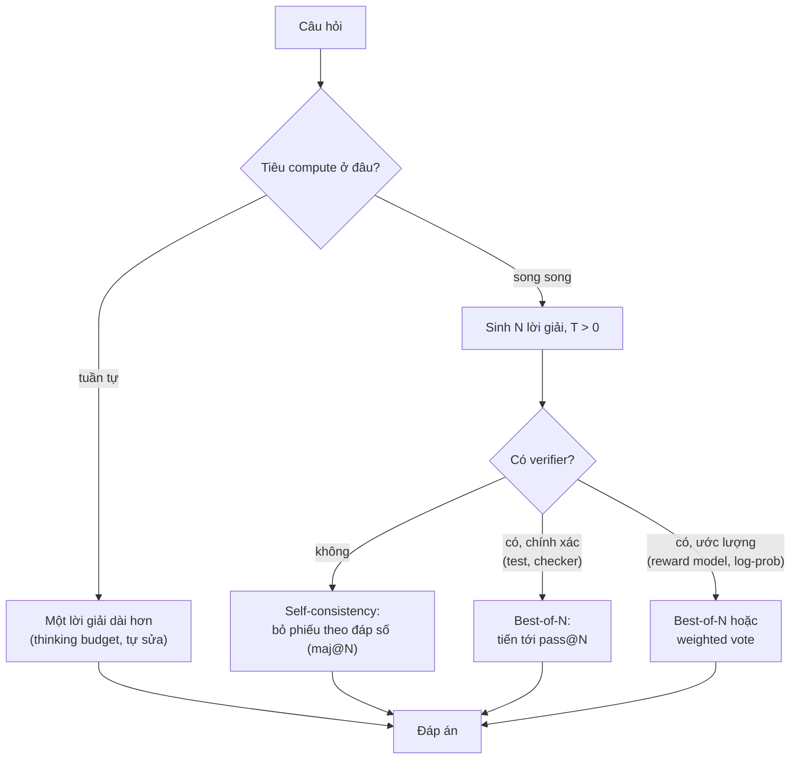
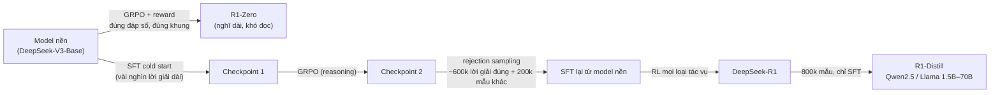
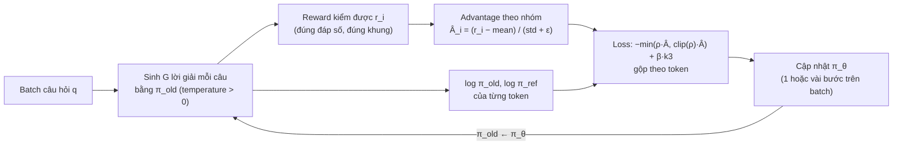
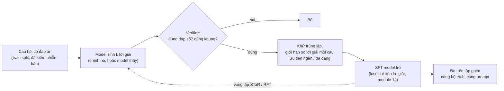
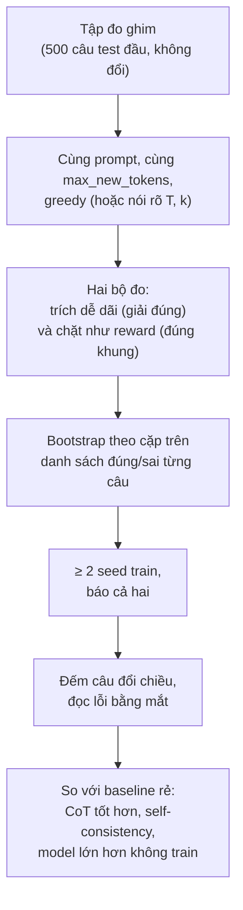

# Reasoning Models

Từ cuối 2024, phần lớn tiến bộ của LLM trên toán, code và bài toán nhiều bước không đến từ model to hơn mà từ việc cho
model **nghĩ lâu hơn**: viết lời giải dài trước khi trả lời, sinh nhiều lời giải rồi chọn, và train bằng reinforcement
learning với phần thưởng kiểm được để model tự học cách nghĩ đó (OpenAI o1, DeepSeek-R1 và mọi "thinking mode" sau này).
Module này đi từ bên trong ra như phần A của track: tự viết bộ trích đáp số và reward, tự viết bỏ phiếu và pass@k, tự viết
objective của GRPO rồi cả vòng train GRPO trên một LLM thật, rồi mới dùng `GRPOTrainer` của TRL; cuối cùng so ba cách làm
model nhỏ giỏi toán hơn (RL, distillation từ model lớn, tự học từ lời giải đúng của chính nó) bằng số đo có khoảng tin cậy.

Module này dựa trên: KV cache và chi phí decode của [module 05](../05-transformers-llm-architecture/README.md), sampling của
[module 09](../09-llms-and-open-models/README.md), policy gradient, PPO và RLHF của
[module 07](../07-reinforcement-learning/README.md) (mục 5 tới 7), đánh giá prompt có bootstrap theo cặp của
[module 11](../11-llm-apis-prompting/README.md) (mục 7), SFT, LoRA và DPO của [module 14](../14-fine-tuning-llm/README.md).
Dữ liệu là **GSM8K** (MIT). Tải:

```bash
uv run python data/download_dataset.py gsm8k
```

Model: `Qwen2.5-0.5B-Instruct` qua Transformers (vừa GPU 4GB, khoảng 1 GB trọng số bf16) cho mọi thí nghiệm train, và
`qwen2.5:3b` qua Ollama cho thí nghiệm prompt. Mọi con số dưới đây đo ngày 2026-11-01 trên PC của track (Xeon E5-2696 v3,
RTX 3060 12GB, có lúc dùng chung với một job Ollama khác; PyTorch 2.14, Transformers 5.22, PEFT 0.21.2, TRL 1.17).
Thông tin về model và API đóng kiểm trên tài liệu chính thức cùng ngày, ghi nguồn tại chỗ.

Sau module này bạn sẽ:

- Giải thích vì sao chain-of-thought giúp, đo nó, và đọc đáp số từ văn bản tự do mà không làm sai thước đo.
- Tiêu compute lúc inference có chủ đích: self-consistency, best-of-N với verifier, đường cong accuracy theo token,
  pass@k so với maj@k.
- Hiểu reasoning model được train thế nào (RLVR, long CoT, "aha moment", distill), và dùng thinking budget của các API.
- Viết GRPO từ công thức: advantage theo nhóm, clipped ratio, KL k3, cách gộp loss theo token; viết reward kiểm được
  không lách được; train bằng vòng tự viết rồi bằng TRL.
- Dựng pipeline synthetic data cho reasoning (rejection sampling, distill), kiểm nhiễm bẩn.
- Báo cáo mức tăng reasoning trung thực: tập ghim, khoảng tin cậy, nhiều seed, tách định dạng khỏi năng lực.

| Mức | Bài | Nội dung |
| --- | --- | --- |
| Basic | 01 answer-extraction | trích đáp số có ưu tiên, so chính xác bằng `Fraction`, reward đúng đáp số và đúng khung |
| Basic | 02 voting-pass-at-k | majority vote, weighted vote, best-of-N, pass@k không chệch, maj@k |
| Basic | 03 grpo-objective | advantage theo nhóm, KL k3, clipped objective, gộp loss theo chuỗi và theo token |
| Intermediate | 01 test-time-compute | direct so với CoT (`qwen2.5:3b`), self-consistency và best-of-N (0.5B), đường cong theo token |
| Intermediate | 02 grpo-from-scratch | vòng GRPO tự viết với LoRA trên Qwen2.5-0.5B, log và đo trước/sau |
| Intermediate | 03 rejection-sampling-sft | model tự sinh, lọc đúng, kiểm nhiễm bẩn, SFT bằng TRL |
| Advanced | 01 grpo-reasoning-mini | GRPO bằng TRL, 2 seed, khoảng tin cậy, độ phủ, phân tích lỗi (portfolio) |
| Advanced | 02 distill-vs-grpo | distill từ model thầy, so với GRPO và tự học trên cùng tập đo |

## 1. Chain-of-thought: model nghĩ bằng token

### Vì sao viết ra lời giải lại giúp

Một lượt forward của Transformer (module 05) đi qua một số tầng cố định rồi phải nhả một token. Lượng tính toán **nối tiếp**
trước token đó là có hạn, bất kể bài toán khó cỡ nào. Bài GSM8K cần 2 tới 8 phép tính nối nhau; bắt model nhả đáp số ngay là
bắt nó làm cả chuỗi đó trong một lượt. Khi model viết lời giải ra (chain-of-thought, Wei và cộng sự 2022; "Let's think step
by step" của Kojima và cộng sự 2022), mỗi kết quả trung gian thành token, và token đó là input của các lượt sau: văn bản của
chính model là bộ nhớ nháp, tổng compute tăng tuyến tính theo số token viết ra.

Cái giá nằm ở decode. Mục 5 module 05 cho thấy mỗi token sinh ra là một lượt forward đọc toàn bộ trọng số và KV cache: độ trễ
và tiền gần như tỉ lệ với số **token ra**. CoT đổi độ chính xác lấy token.

### GSM8K và thí nghiệm của module

GSM8K (Cobbe và cộng sự, 2021): 7 473 bài train và 1 319 bài test, toán chữ cấp tiểu học, đáp số là số nguyên; cột
`answer` là lời giải mẫu có chú thích máy tính `<<16-3-4=9>>` và đáp số sau `####`. Module dùng hai model: `Qwen2.5-0.5B-Instruct`
(Transformers, vừa GPU 4GB, đủ yếu để mọi kỹ thuật còn chỗ cải thiện) và `qwen2.5:3b` (Ollama). Prompt CoT là prompt toán
Qwen khuyến nghị: "Please reason step by step, and put your final answer within \boxed{}."

Đo trên 200 câu test đầu, `Qwen2.5-0.5B-Instruct` greedy, bf16, PC của track (RTX 3060 12GB):

| Prompt | Accuracy | Token ra trung bình | Thời gian 200 câu (batch 64) |
| --- | --- | --- | --- |
| "Answer with only the final number" (tối đa 32 token) | 0.010 | 8 | 8 giây |
| CoT, `\boxed{}` (tối đa 512 token) | 0.430 | 304 | 95 giây |

Model 0.5B gần như không làm được phép tính nhiều bước "trong đầu"; viết ra thì gần một nửa số câu đúng, đổi lại gấp khoảng
40 lần token và 12 lần thời gian. Bài Intermediate 01 đo cùng phép so với `qwen2.5:3b` kèm khoảng tin cậy.

CoT không phải lúc nào cũng đáng: với tác vụ một bước (phân loại cảm xúc ở module 11 mục 7) nó chỉ hơn trong mức nhiễu mà
tốn gấp nhiều lần token. Quyết định bằng số đo trên tập của bạn.

### Đọc đáp số: một phần của thước đo

Câu trả lời CoT là văn bản tự do: "The answer is \boxed{18}.", "$18.00", "1,600 dollars", "#### 18", hay một đáp số rồi tự
sửa. Bộ trích đáp số quyết định con số bạn báo cáo. Bài Basic 01 viết một bộ trích có thứ tự ưu tiên (thẻ `<answer>`,
`\boxed{}`, `####`, "answer is", số cuối cùng) và so **giá trị chính xác** bằng `Fraction` (`2.50`, `5/2`, `$2.50` là một),
cùng các bẫy: phẩy hàng nghìn (93 đáp án gold của GSM8K có phẩy), số âm khác dấu gạch nối của khoảng `3-4`, số đầu tiên
thường là dữ kiện đề bài chứ không phải đáp số.

Cùng câu trả lời greedy CoT trên 200 câu test đầu, chỉ đổi bộ trích:

| Bộ trích | Qwen2.5-0.5B | `qwen2.5:3b` |
| --- | --- | --- |
| số đầu tiên trong câu trả lời | 0.005 | 0.005 |
| số cuối cùng, regex ngây thơ (không hiểu phẩy hàng nghìn, `$`) | 0.415 | 0.745 |
| bộ trích có ưu tiên của bài Basic 01 | 0.430 | 0.775 |
| chặt như reward: nội dung `\boxed{}` cuối là đúng một số và đúng | 0.415 | 0.765 |
| (tỉ lệ câu trả lời đúng khung đầy đủ của `format_reward`) | 0.69 | 0.54 |

Bộ trích sai cách (số đầu tiên, thường là dữ kiện đề bài) cho gần 0; giữa các bộ trích hợp lý vẫn lệch 1.5 tới 3 điểm, cỡ
mức tăng của nhiều kỹ thuật ở mục sau. Hàng cuối cho thấy model 3B **giải** đúng nhiều hơn nhưng **viết đúng khung chặt**
ít hơn 0.5B (hay viết thêm đơn vị hoặc câu kết sau hộp): khi train bằng reward định dạng, hai thứ đó phải đo riêng (mục 4, 7).

## 2. Test-time compute: sinh nhiều lời giải, bỏ phiếu, verifier

### Hai trục: song song và tuần tự

Có hai cách tiêu thêm compute cho một câu hỏi lúc inference:

- **Song song**: sinh N lời giải độc lập (temperature > 0) rồi gộp. Tăng chi phí gấp N nhưng độ trễ tăng ít nếu batch được.
- **Tuần tự**: cho model nghĩ dài hơn trong một lời giải (reasoning model, budget forcing), hoặc tự sửa nhiều vòng. Độ
  trễ tăng tuyến tính theo token.



### Gộp N lời giải

**Self-consistency** (Wang và cộng sự, 2022): trích đáp số của từng lời giải, lấy đáp số xuất hiện nhiều nhất. Lý do nó hoạt
động: các đường lập luận sai thường sai **khác nhau**, còn đường đúng hội tụ về một đáp số. Nó thất bại khi model sai một cách
nhất quán (cùng một hiểu nhầm đề bài), và không dùng được khi đầu ra không so bằng nhau được (văn bản tự do).

**Best-of-N với verifier**: chấm từng lời giải, lấy điểm cao nhất. Cobbe và cộng sự (2021, chính paper GSM8K) train một
verifier dự đoán lời giải có đúng không; chọn trong 100 lời giải bằng verifier mang lại mức tăng tương đương tăng cỡ model khoảng 30 lần. Verifier
có nhiều mức:

| Verifier | Ví dụ | Đặc điểm |
| --- | --- | --- |
| Chính xác | chạy unit test (code), so đáp số (khi biết đáp án), checker của bài | best-of-N đạt đúng pass@N; chỉ có trong lúc train hoặc với tác vụ tự kiểm được |
| Outcome reward model (ORM) | model học chấm "lời giải này đúng không" | tổng quát; bị khai thác khi N lớn (best-of-N tối ưu chính chỗ sai của nó) |
| Process reward model (PRM) | chấm từng bước (Lightman và cộng sự, 2023, "Let's Verify Step by Step") | bắt lỗi giữa chừng, cần nhãn từng bước |
| Tự tin của chính model | log-prob trung bình mỗi token | miễn phí, thường yếu: model tự tin cả khi sai |

**Weighted vote** cộng điểm verifier theo đáp số: kết hợp tính ổn định của bỏ phiếu với thông tin của verifier.

### Thước đo: maj@k và pass@k

- **maj@k**: độ chính xác của bỏ phiếu trên k lời giải: thứ hệ thống thật đạt được không cần oracle.
- **pass@k**: xác suất có ít nhất một lời giải đúng trong k. Với n ≥ k lời giải mẫu có c lời giải đúng, ước lượng không chệch
  của Chen và cộng sự (2021):

$$
\text{pass@}k = 1 - \frac{\binom{n-c}{k}}{\binom{n}{k}}
$$

Dùng $$1 - (1 - c/n)^k$$ là coi k lần rút là có hoàn lại: chệch xuống, nhiều nhất khi k gần n. pass@k là trần của mọi cách
chọn; khoảng cách pass@k − maj@k là giá trị tối đa một verifier tốt hơn mang lại. Bài Basic 02 cài cả hai, bài
Intermediate 01 vẽ chúng theo số token trên Qwen2.5-0.5B, cùng best-of-N theo log-prob của chính model.

### Đường cong theo compute

Snell và cộng sự (2024) đo trên bài toán MATH: với câu dễ và trung bình, phân bổ compute lúc inference tối ưu theo độ khó
(chọn giữa lấy mẫu song song và tự sửa tuần tự) cho model nhỏ đuổi kịp model lớn hơn khoảng 14 lần cùng FLOPs; với câu khó
thì model lớn vẫn thắng. Hình dạng chung của mọi đường cong: tăng nhanh ở vài mẫu đầu rồi phẳng dần theo log của compute.
Hai hệ quả vận hành:

- Đặt ngân sách theo **request**: câu dễ một mẫu, câu khó nhiều mẫu hoặc model mạnh hơn. Router theo độ khó thường đáng giá
  hơn một N cố định.
- Luôn so với **một model lớn hơn không tiêu thêm compute**: 16 mẫu của model 0.5B tốn token gấp 16 lần, và model 3B có thể
  rẻ hơn mà đúng hơn. Bài Intermediate 01 đặt hai con số đó cạnh nhau.

Mẫu ở temperature > 0 thường kém greedy **từng mẫu một** (mẫu tệ hơn nhưng đa dạng); self-consistency phải thắng greedy, không
chỉ thắng một mẫu. Và thêm token không phải lúc nào cũng tốt: Chen và cộng sự (2024, "Do NOT Think That Much for 2+3=?") cho
thấy reasoning model tiêu hàng trăm token cho câu một bước ("overthinking").

## 3. Reasoning model: từ o1, R1 tới thinking budget

### Model "nghĩ" trước khi trả lời

Mục 1 và 2 tiêu compute lúc inference bằng **prompt** (CoT) và **vòng ngoài** (lấy mẫu nhiều lần). Reasoning model đưa
việc đó vào trong model: nó được train để tự viết một đoạn suy nghĩ dài (thử, kiểm, quay lại, đổi hướng) trước câu trả
lời, và đoạn đó càng dài thì càng giải được bài khó. Mốc chính (theo công bố của các hãng):

| Thời điểm | Model | Điều mới |
| --- | --- | --- |
| 9/2024 | OpenAI o1-preview | accuracy tăng đều theo cả compute lúc train RL lẫn compute lúc nghĩ; suy nghĩ thô bị ẩn |
| 1/2025 | DeepSeek-R1, R1-Zero (trọng số mở, MIT) | công thức RL công khai: GRPO + reward kiểm được; R1-Zero không cần SFT trước |
| 1/2025 | s1 (Muennighoff và cộng sự) | 1 000 ví dụ SFT + "budget forcing" đã cho đường cong theo độ dài suy nghĩ |
| 2/2025 trở đi | Claude 3.7 Sonnet, Gemini 2.5, Qwen3 | một model hai chế độ (nghĩ / không nghĩ), người dùng đặt ngân sách |
| 8/2025 | gpt-oss (trọng số mở, Apache-2.0) | mức `reasoning_effort` low/medium/high ngay trong model mở |

Từ đó tới nay (11/2026) hầu hết model lớn của các hãng đều có chế độ nghĩ; khác nhau ở cách bật và cách tính tiền (mục
dưới).

### Công thức R1: RL với phần thưởng kiểm được

Báo cáo DeepSeek-R1 (2025) mô tả hai model:

- **R1-Zero**: từ model nền DeepSeek-V3-Base, chạy thẳng GRPO (mục 4) trên bài toán và code có đáp án kiểm được. Reward
  chỉ gồm **độ chính xác** (đáp số đúng, code qua test) và **định dạng** (suy nghĩ nằm trong `<think>`), không reward
  model học từ người (để tránh reward hacking ở quy mô lớn). Template chỉ nói "suy nghĩ trong `<think>`, trả lời trong
  `<answer>`". Trong lúc train, độ dài câu trả lời tăng dần từ vài trăm tới hàng nghìn token, và model tự xuất hiện hành
  vi kiểm lại, thử cách khác; báo cáo gọi một đoạn model viết "Wait, wait. That's an aha moment" là **"aha moment"**.
  Nhược điểm: đọc khó, trộn ngôn ngữ.
- **R1**: thêm **cold start** (vài nghìn lời giải dài, dễ đọc để SFT trước), rồi RL, rồi **rejection sampling** sinh
  khoảng 600 nghìn lời giải đúng từ chính model + 200 nghìn mẫu không phải reasoning để SFT lại, rồi RL lần nữa cho mọi
  loại tác vụ.
- **Distill**: dùng 800 nghìn mẫu đó SFT các model Qwen2.5 và Llama nhỏ (1.5B tới 70B). Báo cáo so trên Qwen2.5-32B: distill từ
  R1 hơn hẳn chạy RL kiểu R1-Zero quy mô lớn trực tiếp trên chính model đó. RL tìm ra hành vi, distill truyền nó đi rẻ hơn.



Hai lời cảnh báo khi đọc câu chuyện "aha":

- Liu và cộng sự (2025, "Understanding R1-Zero-Like Training", đi kèm Dr. GRPO) thấy model nền (kể cả Qwen2.5 không qua
  RL) đã có sẵn câu tự kiểm lại; RL làm hành vi đó **thường xuyên hơn**, không tạo ra từ hư không. Họ cũng chỉ ra một phần
  độ dài tăng đến từ cách chuẩn hoá loss của GRPO (mục 4), không chỉ từ "nghĩ sâu hơn".
- Yue và cộng sự (2025, "Does Reinforcement Learning Really Incentivize Reasoning Capacity...") đo pass@k với k lớn: model
  sau RLVR thắng ở pass@1 nhưng model nền **đuổi kịp hoặc vượt** ở pass@k với k vài trăm. RL chủ yếu dồn xác suất vào lời
  giải đúng mà model đã sinh được, thu hẹp độ phủ. Đúng phân biệt maj@k / pass@k ở mục 2; bài Advanced 01 đo nó ở quy mô
  nhỏ.

### Thinking budget và API (kiểm ngày 2026-11-01)

Với reasoning model qua API, "nghĩ bao nhiêu" là một tham số, và token suy nghĩ tính tiền như token ra dù bạn không thấy
chúng:

| Nhà cung cấp | Điều khiển | Thấy được gì | Nguồn |
| --- | --- | --- | --- |
| OpenAI | `reasoning.effort` (Responses API) hoặc `reasoning_effort` (Chat Completions); giá trị tuỳ model, trong các mức `none`, `minimal`, `low`, `medium`, `high`, `xhigh`, `max` | không thấy token suy nghĩ thô; bản tóm tắt khi bật `summary` | trang "Reasoning models" |
| Anthropic | `thinking: {type: "adaptive"}` cộng `output_config: {effort: ...}`; kiểu cũ `{type: "enabled", budget_tokens: N}` (tối thiểu 1 024) đã deprecated và bị các model từ Claude 4.7 trở đi từ chối | thinking dạng tóm tắt; số token ở `usage.output_tokens_details.thinking_tokens` | trang "Extended thinking" |
| Google Gemini | `thinking_level` (`minimal`/`low`/`medium`/`high`, tuỳ model), mặc định tự điều chỉnh | tóm tắt khi bật `thinking_summaries` | trang "Gemini thinking" |
| Model mở | Qwen3: bật tắt chế độ nghĩ trong chat template; gpt-oss: mức effort trong system prompt; mọi model: budget forcing | thấy toàn bộ | model card |

Tên tham số và danh sách model đổi nhanh: đọc lại tài liệu trước khi dùng. Ba quyết định không đổi:

- **Đo đường cong của bạn.** Accuracy theo effort/ngân sách trên tập ghim của tác vụ; thường phẳng sớm với câu dễ.
- **Tính cả token ẩn.** Một câu trả lời 50 token có thể kèm vài nghìn token suy nghĩ đã tính tiền; theo dõi trường usage tương ứng.
- **Độ trễ.** Suy nghĩ là tuần tự: p95 độ trễ tăng theo ngân sách. Request cần trả lời nhanh đặt effort thấp hoặc tắt.

**Budget forcing** (s1): với model mở, khi suy nghĩ chạm ngân sách thì chèn chuỗi kết thúc suy nghĩ để buộc trả lời; muốn
nghĩ thêm thì xoá token kết thúc và chèn "Wait". Đơn giản, nhưng đủ để vẽ đường cong accuracy theo độ dài suy nghĩ.

### Khi nào dùng reasoning model

| Nên | Không nên |
| --- | --- |
| toán, code nhiều bước, lập kế hoạch, phân tích có ràng buộc chặt | phân loại, trích xuất, trả lời tra cứu một bước |
| sai một câu đắt hơn chờ vài giây | cần độ trễ thấp (chat thời gian thực, autocomplete) |
| có verifier để kiểm đáp án (khi đó cả best-of-N model thường cũng mạnh) | chi phí theo token là ràng buộc chính và model thường đã đạt |

## 4. GRPO: PPO không critic, advantage theo nhóm

### Từ PPO tới GRPO

Mục 7 module 07 cài RLHF bằng PPO: mỗi token là một action, critic ước lượng giá trị từng tiền tố, GAE cho advantage từng
token. Với reasoning có reward kiểm được, reward chỉ có ở **cuối** chuỗi và gần như nhị phân (đúng/sai): critic phải học
từ tín hiệu rất thưa, cùng cỡ policy, tốn gần gấp đôi bộ nhớ. GRPO (Group Relative Policy Optimization, Shao và cộng sự,
DeepSeekMath 2024) thay critic bằng một baseline rẻ: **so với các lời giải khác của cùng câu hỏi**.



Với câu hỏi $$q$$, lấy mẫu $$G$$ lời giải $$o_1, \ldots, o_G \sim \pi_{\theta_{\text{old}}}(\cdot \mid q)$$, chấm reward $$r_i$$. Advantage của mọi
token trong lời giải $$i$$ là:

$$
\hat A_{i} = \frac{r_i - \operatorname{mean}(r_1, \ldots, r_G)}{\operatorname{std}(r_1, \ldots, r_G) + \varepsilon}
$$

Objective (cần tăng), với ratio từng token $$\rho_{i,t} = \pi_\theta(o_{i,t} \mid q, o_{i,<t}) / \pi_{\theta_{\text{old}}}(o_{i,t} \mid q, o_{i,<t})$$:

$$
\mathcal J(\theta) = \frac{1}{G}\sum_{i=1}^{G}\frac{1}{|o_i|}\sum_{t=1}^{|o_i|}\Big[\min\big(\rho_{i,t}\hat A_i,\ \mathrm{clip}(\rho_{i,t}, 1-\epsilon, 1+\epsilon)\hat A_i\big) - \beta\, \mathbb D_{\text{KL}}^{(t)}\Big]
$$

Ba khác biệt so với PPO-RLHF:

- **Không critic, không GAE.** Mọi token của một lời giải cùng một advantage. Phép trừ trung bình nhóm làm baseline:
  câu dễ (mọi lời giải đúng) và câu khó (mọi lời giải sai) đều cho advantage 0, chỉ câu "vừa sức" tạo gradient.
- **KL nằm trong loss**, không trừ vào reward, và dùng ước lượng k3 theo từng token:
  $$\mathbb D_{\text{KL}}^{(t)} = \frac{\pi_{\text{ref}}(o_{i,t})}{\pi_\theta(o_{i,t})} - \log\frac{\pi_{\text{ref}}(o_{i,t})}{\pi_\theta(o_{i,t})} - 1 \ \ge 0$$,
  không chệch cho $$\mathrm{KL}(\pi_\theta \| \pi_{\text{ref}})$$ khi token lấy mẫu từ $$\pi_\theta$$ (bài Basic 03 kiểm bằng Monte Carlo).
- **Reward kiểm được** (RLVR) thay cho reward model: không có mạng nào để model khai thác, nhưng reward vẫn hack được nếu
  viết lỏng (phần "Thiết kế reward" bên dưới).

### Một ví dụ số

Nhóm G = 4 lời giải cho một câu, reward = đúng đáp số + 0.2 × đúng khung:

| Lời giải | Đúng đáp số | Đúng khung | $$r_i$$ | $$r_i - \bar r$$ | $$\hat A_i$$ (std Bessel 0.589) |
| --- | --- | --- | --- | --- | --- |
| 1 | có | có | 1.2 | +0.6 | +1.02 |
| 2 | không | có | 0.2 | −0.4 | −0.68 |
| 3 | có | không | 1.0 | +0.4 | +0.68 |
| 4 | không | không | 0.0 | −0.6 | −1.02 |

Trung bình $$\bar r = 0.6$$. Lời giải 3 (đúng đáp số nhưng có chữ thừa sau hộp) vẫn được đẩy lên, lời giải 2 (đúng khung
nhưng sai đáp số) vẫn bị đẩy xuống: trọng số 0.2 của khung nhỏ so với 1.0 của đáp số là quyết định có chủ đích, để model
không thể "ăn điểm" chỉ bằng khung. Nếu cả bốn cùng đúng và đúng khung, $$\hat A = 0$$ cho cả nhóm.

### Các biến thể đáng biết (2025)

| Biến thể | Thay đổi | Lý do |
| --- | --- | --- |
| Dr. GRPO (Liu và cộng sự) | bỏ chia $$\lvert o_i\rvert$$ (chia hằng số), bỏ chia std | chia theo độ dài làm lời giải sai và dài bị phạt nhẹ trên từng token; chia std ưu tiên câu quá dễ/khó (std nhỏ) |
| DAPO (ByteDance Seed) | loss gộp theo **token** trên cả batch; clip-higher $$\epsilon_{\text{high}} = 0.28$$; dynamic sampling bỏ nhóm std = 0; phạt mềm lời giải quá dài; bỏ KL | ổn định train dài, giữ entropy (khám phá) |
| GSPO (Qwen) | ratio ở mức **chuỗi** (trung bình log-ratio) thay vì từng token | ratio từng token nhiễu, nhất là với MoE |

TRL 1.17 đi theo hướng đó: mặc định `loss_type="dapo"`, `beta=0.0` (không nạp reference), `scale_rewards="group"`,
`epsilon=0.2`, `num_generations=8`, `temperature=1.0`, `num_iterations=1`. Với `num_iterations=1` mỗi batch chỉ dùng một
bước gradient, ratio luôn bằng 1 ở bước đó và phép cắt không bao giờ kích hoạt: clip chỉ có tác dụng khi dùng lại batch
(μ > 1) hoặc khi lượt sinh và lượt train lệch nhau.

### Thiết kế reward và vấn đề cold start

GRPO chỉ học được từ nhóm có reward **khác nhau**. Nếu reward định dạng quá xa thói quen của model, mọi lời giải đều 0
điểm, mọi nhóm có std = 0, và không có gradient nào cả. R1-Zero tránh được vì model nền 671B đủ mạnh để thỉnh thoảng làm
đúng khung `<think>`/`<answer>`; model nhỏ thì không. Đo trên 64 câu test đầu với `Qwen2.5-0.5B-Instruct`, 512 token tối đa:

| Khung yêu cầu | Cách nhắc | Greedy: đúng khung | Lấy mẫu T = 0.7, 4 lời giải mỗi câu: đúng khung | Nhóm 4 lời giải std = 0 (reward đúng-trong-khung) |
| --- | --- | --- | --- | --- |
| `<think>…</think><answer>…</answer>` | system prompt | 0% (3% có thẻ `<answer>`) | | |
| như trên | system prompt + một ví dụ mẫu | 0% | 0.4% | |
| như trên | điền sẵn `<think>` đầu câu trả lời | 0% | 1.2% | 100% |
| `\boxed{}` (khung Qwen2.5 được train; ở đây "đúng khung" là đúng một hộp chứa một số) | system prompt Qwen khuyến nghị | 87.5% | 77.3% | 61% |

Với khung thẻ, không nhóm nào có tín hiệu: train GRPO chỉ tốn GPU. Ba lối ra: (1) chọn khung model đã biết (`\boxed`, cách
module này làm), (2) **cold start** bằng SFT vài trăm lời giải đúng khung trước khi RL (cách R1 làm), (3) reward định dạng
từng phần (cộng điểm cho từng thẻ đúng chỗ), chấp nhận rủi ro model học "ăn điểm thẻ". Hàng cuối cũng cho thấy: kể cả với
khung quen, hơn một nửa nhóm 4 lời giải không có tín hiệu vì câu quá dễ hoặc quá khó với model; G = 8 giảm tỉ lệ đó.
`temperature` cũng là một phần của thiết kế: ở 1.0 (mặc định của `GRPOConfig`) cùng model chỉ 45% lời giải lấy mẫu đúng
khung và 24% đúng đáp số (so với 77% và 39% ở 0.7), nhiều lời giải thành chuỗi từ vô nghĩa; các bài của module lấy mẫu ở 0.7.

Nguyên tắc viết reward kiểm được:

- **Chặt khi dạy, dễ dãi khi đo.** Reward chỉ chấm nội dung hộp **cuối** và chỉ khi trong hộp là đúng một số; bộ trích để
  đo (bài Basic 01) đọc mọi kiểu câu trả lời. Khoảng cách giữa hai thước đo là phần "định dạng" của mức tăng.
- **Đáp số là phần lớn reward.** Trọng số khung nhỏ (0.2) để không thể thắng nhóm chỉ bằng khung.
- **Nghĩ cách lách trước khi train**: liệt kê nhiều đáp số, chép số trong đề, câu trả lời rỗng có hộp, hộp ở giữa rồi
  viết tiếp. Viết test cho từng cách (bài Basic 01 có những test như vậy).
- **Đọc mẫu** mỗi vài chục bước. Reward tăng mà độ chính xác trên tập giữ lại (đo bằng bộ trích độc lập) đứng yên là dấu
  hiệu hacking, như mục 7 module 07.

## 5. GRPO trong thực tế: TRL, thời gian, bộ nhớ, đọc log

### Một bước GRPO tiêu thời gian vào đâu

Một bước có ba pha: **sinh** G lời giải cho mỗi câu (tự hồi quy, tuần tự theo token), **chấm** (reward bằng code, gần như
miễn phí), **cập nhật** (một lượt forward/backward trên chuỗi đã sinh, như SFT). Trên PC của track (RTX 3060), một bước
`GRPOTrainer` với 64 completion tối đa 384 token của Qwen2.5-0.5B mất khoảng 40 giây (`step_time` trong log). Riêng phần
sinh, đo độc lập ở bài Intermediate 01: 3 200 lời giải tối đa 512 token mất 1 129 giây với batch 64, tức khoảng 23 giây cho
một batch 64 lời giải. Phần sinh là khoản lớn nhất, và nó tuần tự theo token: thêm GPU cho phần train không làm nó nhanh hơn.

Vì vậy mọi framework RL cho LLM dồn sức vào phần sinh: TRL hỗ trợ sinh bằng vLLM (`use_vllm=True`, chế độ chung GPU hoặc
server riêng), OpenRLHF và veRL tách hẳn máy sinh và máy train. Env của repo không có vLLM (xung đột phiên bản, xem module
20), nên mọi bài sinh bằng `model.generate` của Transformers.

### Bộ nhớ

Policy và reference là cùng một model khi dùng LoRA: tắt adapter (`model.disable_adapter()`) là ra reference, không cần bản
thứ hai trong bộ nhớ (TRL làm vậy tự động khi `beta > 0` với `peft_config`). Ba khoản lớn còn lại: KV cache khi sinh
(tỉ lệ với số lời giải × độ dài, module 05 mục 5), activation khi backward (gradient checkpointing chia đôi, module 14
mục 4), và **logits**: vocab của Qwen2.5 là 151 936, nên logits fp32 của 64 chuỗi × 400 token là khoảng 15.6 GB. Chỉ tính
logits cho phần completion (`logits_to_keep`), chia micro-batch, và lấy log-prob bằng `gather` trừ `logsumexp` thay vì
log-softmax cả ma trận: bài Intermediate 02 làm cả ba để vừa GPU 4GB.

### `GRPOTrainer` của TRL

```python
import torch
from trl import GRPOConfig

config = GRPOConfig(
    output_dir="runs/grpo",
    num_generations=8,                 # G
    per_device_train_batch_size=4,     # số completion mỗi micro-batch (không phải số prompt)
    gradient_accumulation_steps=16,    # 4 × 16 = 64 completion = 8 prompt × 8 lời giải mỗi bước
    max_completion_length=384,
    temperature=0.7,
    learning_rate=4e-5,
    beta=0.0,                          # mặc định TRL 1.17: không KL, không nạp reference
    loss_type="dapo",                  # mặc định: gộp theo token
    reward_weights=[1.0, 0.2],         # đúng đáp số, đúng khung
    logging_steps=1,
    report_to="none",
    bf16=torch.cuda.is_available(),
)
print(config.scale_rewards, config.epsilon, config.num_iterations, config.top_k, config.generation_batch_size)
```

Kết quả: `group 0.2 1 0 64` (chạy được cả ở env gốc lẫn `ai-gpu`): chuẩn hoá theo nhóm, cắt ở 0.2, một bước gradient mỗi
batch, không lọc top-k, và 64 completion được sinh một lần cho cả bước. Dataset có cột `prompt` (list message) và các cột khác (`answer`) được truyền vào reward function dưới
dạng keyword; mỗi reward function nhận `completions` (với dữ liệu hội thoại, mỗi phần tử là một list message) và trả một list
`float`. Bài Advanced 01 viết hai hàm đó và chạy cấu hình trên.

### Đọc log

| Khoá trong `log_history` (TRL 1.17) | Ý nghĩa | Dấu hiệu xấu |
| --- | --- | --- |
| `reward`, `rewards/<hàm>/mean` | reward trung bình, từng phần | tăng mà accuracy giữ lại đứng yên: hacking; chỉ phần khung tăng: học định dạng |
| `frac_reward_zero_std` | tỉ lệ nhóm không có tín hiệu | gần 1: câu quá dễ/khó hoặc reward quá chặt (cold start) |
| `completions/mean_length`, `completions/clipped_ratio` | độ dài, tỉ lệ bị cắt ở `max_completion_length` | dài dần và bị cắt nhiều: lời giải lan man, tín hiệu nhiễu |
| `kl` (khi `beta > 0`) | KL k3 tới reference | tăng vọt: lr quá lớn, policy trôi |
| `clip_ratio/*` | tỉ lệ token bị cắt | luôn 0 với `num_iterations=1` |
| `entropy` | độ ngẫu nhiên của policy | rơi về gần 0 sớm: hết khám phá, nhóm đồng nhất |

## 6. Distillation và synthetic data cho reasoning

### Dữ liệu reasoning lấy từ đâu

Lời giải từng bước do người viết thì đắt (GSM8K: 8 500 bài, thuê người viết). Mọi công thức hiện đại dùng **model sinh,
verifier lọc**:



| Cách | Model sinh | Verifier | Nguồn |
| --- | --- | --- | --- |
| STaR (Zelikman và cộng sự 2022) | chính model, lặp nhiều vòng; câu sai thì cho model xem đáp án rồi "hợp lý hoá" | đáp án | lặp lại SFT từ model gốc mỗi vòng |
| RFT (Yuan và cộng sự 2023) | chính model SFT, k mẫu mỗi câu | đáp án | giữ lời giải đúng **khác nhau** về các bước tính; nhiều cách giải khác nhau giúp hơn nhiều lời giải giống nhau |
| Distill từ model thầy | model lớn hơn hoặc reasoning model | đáp án, test | DeepSeek-R1 distill 800 nghìn mẫu vào Qwen2.5 1.5B tới 32B; s1 chỉ 1 000 mẫu chọn kỹ |
| Rejection sampling trong pipeline RL | checkpoint RL | đáp án + reward model cho phần không kiểm được | bước "SFT lại" của R1 |

### Vì sao distill thường thắng RL ở model nhỏ

Báo cáo R1: SFT Qwen2.5-32B bằng dữ liệu của R1 hơn hẳn chạy RL kiểu R1-Zero quy mô lớn trực tiếp trên Qwen2.5-32B.
Trực giác: RL chỉ khuếch đại hành vi mà model **đã** sinh được với xác suất đủ lớn (mục 3, Yue và cộng sự); model thầy đưa
vào lời giải mà model trò **chưa** sinh được. Ngược lại, tự học (STaR, RFT) bị giới hạn bởi chính model: câu nó không bao giờ
giải đúng thì không bao giờ có trong dữ liệu. Bài Intermediate 03 và Advanced 02 đo ba nhánh này ở quy mô 0.5B.

### Bẫy của synthetic data

- **Nhiễm bẩn.** Sinh lời giải cho câu train là an toàn; sinh **câu hỏi mới** bằng LLM thì dễ chép lại câu test mà model
  đã thấy lúc pretrain. Kiểm trùng n-gram với tập đo (13-gram là mức GPT-3 dùng); n nhỏ (8) bắt cả cụm từ chung của đề toán
  ("what was the original price of"), bài Intermediate 03 cho bạn so hai mức.
- **Đúng đáp số, sai lập luận.** Verifier đáp số giữ cả lời giải đúng nhờ may (hai lỗi triệt tiêu). Model học theo. PRM
  (process reward model, Lightman và cộng sự 2023) chấm từng bước để giảm việc này, đổi lại phải có nhãn từng bước.
- **Thu hẹp phong cách.** Lọc "ngắn nhất" dạy model viết ngắn, có thể bỏ bước kiểm lại; lọc "dài nhất" dạy model dài dòng.
  Ghi rõ tiêu chí chọn và đo độ dài trước/sau.
- **Model collapse.** Train lặp đi lặp lại trên dữ liệu của chính mình, không có dữ liệu thật hay verifier, làm phân phối hẹp
  dần (Shumailov và cộng sự, Nature 2024). Verifier và câu hỏi thật là cái neo.
- **Giấy phép.** Điều khoản của nhiều API đóng cấm dùng output để train model cạnh tranh; model mở có giấy phép riêng
  (Qwen2.5 3B dùng giấy phép Qwen Research, khác Apache-2.0 của bản 0.5B và 7B: đọc model card trước khi phát hành
  model trò). Ghi nguồn dữ liệu tổng hợp như ghi nguồn dữ liệu thật (module 14 mục 5).

## 7. Đánh giá reasoning cho trung thực

Mức tăng của reasoning thường vài điểm phần trăm: nhỏ hơn nhiễu nếu đo cẩu thả. Quy tắc của module, cũng là của mọi báo cáo
reasoning nghiêm túc:



- **Kích thước nhiễu.** Với 500 câu và accuracy quanh 40%, sai số chuẩn của một accuracy là $$\sqrt{0.4 \cdot 0.6 / 500} \approx 0.022$$,
  khoảng tin cậy 95% khoảng ±4.3 điểm. Hiệu của hai model trên **cùng** câu hẹp hơn (bootstrap theo cặp, module 11 mục 7),
  vì câu khó thì khó với cả hai: đó là lý do luôn so theo cặp.
- **Cấu hình sinh là một phần của thước đo.** Cùng `Qwen2.5-0.5B-Instruct`, cùng 500 câu, cùng greedy, chỉ đổi batch sinh từ
  64 sang 128: accuracy 0.430 thành 0.436, và 51 câu đổi kết quả (đo ở bản tham chiếu của module). Greedy với bf16 không tất
  định theo cấu hình batch; trước và sau phải đo bằng cùng một hàm sinh, cùng batch.
- **Seed.** RL trên LLM có phương sai giữa các lần train lớn (như module 07 mục 6). Một seed tốt hơn là một giai thoại.
- **Bộ trích là một phần của thước đo.** Mục 1 cho thấy trên cùng câu trả lời, bộ trích sai cách cho gần 0 và các bộ trích
  hợp lý vẫn lệch nhau vài điểm. Ghi bộ trích, và báo cả thước đo chặt lẫn dễ dãi khi có train định dạng.
- **Cùng ngân sách token.** So một model nghĩ 600 token với một model nghĩ 200 token là so hai mức compute. Báo token ra trung
  bình, hoặc vẽ accuracy theo token như bài Intermediate 01.
- **Nhiễm bẩn và học thuộc.** GSM8K công bố từ 2021, có mặt khắp Internet; điểm cao có thể là nhớ. GSM-Symbolic (Mirzadeh và
  cộng sự, 2024) đổi tên và số trong câu GSM8K và thấy nhiều model tụt điểm, tụt mạnh hơn khi thêm một mệnh đề không liên quan.
  Với dữ liệu tự sinh, kiểm n-gram (mục 6).
- **Cắt cụt.** Đếm lời giải chạm `max_new_tokens`: câu bị cắt gần như chắc sai, và một thay đổi làm lời giải dài hơn có thể
  "tụt điểm" chỉ vì giới hạn độ dài.

## 8. Tài liệu tham khảo

Chain-of-thought và test-time compute:

- Wei et al. [Chain-of-Thought Prompting Elicits Reasoning in Large Language Models](https://arxiv.org/abs/2201.11903) (2022);
  Kojima et al. [Large Language Models are Zero-Shot Reasoners](https://arxiv.org/abs/2205.11916) (2022); Nye et al.
  [Show Your Work: Scratchpads for Intermediate Computation](https://arxiv.org/abs/2112.00114) (2021).
- Wang et al. [Self-Consistency Improves Chain of Thought Reasoning](https://arxiv.org/abs/2203.11171) (2022).
- Cobbe et al. [Training Verifiers to Solve Math Word Problems](https://arxiv.org/abs/2110.14168) (2021), GSM8K;
  [bộ dữ liệu trên Hugging Face](https://huggingface.co/datasets/openai/gsm8k).
- Lightman et al. [Let's Verify Step by Step](https://arxiv.org/abs/2305.20050) (2023), process reward model.
- Chen et al. [Evaluating Large Language Models Trained on Code](https://arxiv.org/abs/2107.03374) (2021), pass@k không chệch.
- Snell et al. [Scaling LLM Test-Time Compute Optimally can be More Effective than Scaling Model Parameters](https://arxiv.org/abs/2408.03314) (2024).
- Chen et al. [Do NOT Think That Much for 2+3=? On the Overthinking of o1-Like LLMs](https://arxiv.org/abs/2412.21187) (2024).
- Mirzadeh et al. [GSM-Symbolic](https://arxiv.org/abs/2410.05229) (2024).

Reasoning model và RL với reward kiểm được:

- OpenAI. [OpenAI o1 System Card](https://arxiv.org/abs/2412.16720) (2024); [gpt-oss-120b & gpt-oss-20b Model Card](https://arxiv.org/abs/2508.10925) (2025).
- DeepSeek-AI. [DeepSeek-R1](https://arxiv.org/abs/2501.12948) (2025), bản bình duyệt
  [trên Nature](https://www.nature.com/articles/s41586-025-09422-z) (2025).
- Shao et al. [DeepSeekMath](https://arxiv.org/abs/2402.03300) (2024), GRPO.
- Liu et al. [Understanding R1-Zero-Like Training: A Critical Perspective](https://arxiv.org/abs/2503.20783) (2025), Dr. GRPO.
- Yu et al. [DAPO: An Open-Source LLM Reinforcement Learning System at Scale](https://arxiv.org/abs/2503.14476) (2025).
- Zheng et al. [Group Sequence Policy Optimization](https://arxiv.org/abs/2507.18071) (2025), GSPO.
- Yue et al. [Does Reinforcement Learning Really Incentivize Reasoning Capacity in LLMs Beyond the Base Model?](https://arxiv.org/abs/2504.13837) (2025).
- Muennighoff et al. [s1: Simple test-time scaling](https://arxiv.org/abs/2501.19393) (2025), budget forcing.
- John Schulman. [Approximating KL Divergence](http://joschu.net/blog/kl-approx.html) (2020), ước lượng k1, k2, k3.

Distillation và synthetic data:

- Zelikman et al. [STaR: Bootstrapping Reasoning With Reasoning](https://arxiv.org/abs/2203.14465) (2022).
- Yuan et al. [Scaling Relationship on Learning Mathematical Reasoning with Large Language Models](https://arxiv.org/abs/2308.01825) (2023), RFT.
- Shumailov et al. [AI models collapse when trained on recursively generated data](https://www.nature.com/articles/s41586-024-07566-y) (Nature 2024).
- Qwen Team. [Qwen2.5 Technical Report](https://arxiv.org/abs/2412.15115) (2024).

Tài liệu API và thư viện (kiểm ngày 2026-11-01):

- [TRL GRPO Trainer](https://huggingface.co/docs/trl/grpo_trainer).
- OpenAI [Reasoning models](https://developers.openai.com/api/docs/guides/reasoning); Anthropic
  [Extended thinking](https://platform.claude.com/docs/en/build-with-claude/extended-thinking); Google
  [Gemini thinking](https://ai.google.dev/gemini-api/docs/thinking).

Roadmap:

- [roadmap.sh: AI Engineer](https://roadmap.sh/ai-engineer). Module này là phần mở rộng ★ của track; bài portfolio reasoning model
  mini nằm trong bảng portfolio của [README track](../../README.md).
