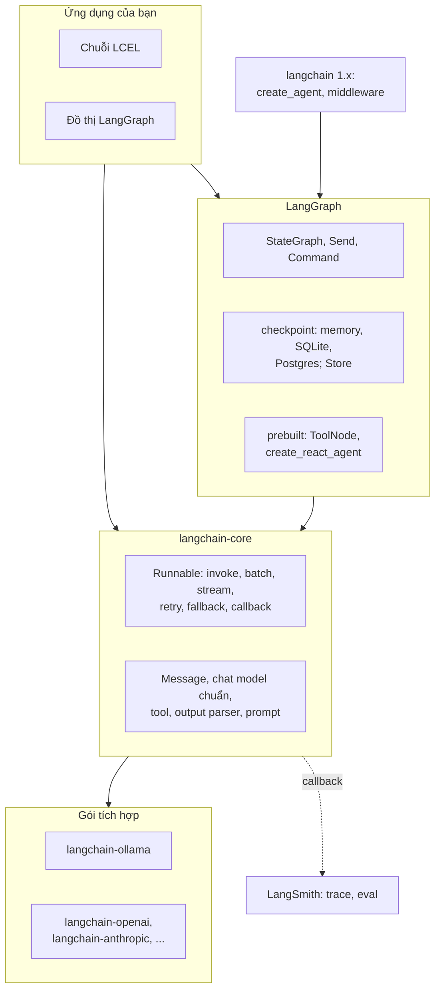
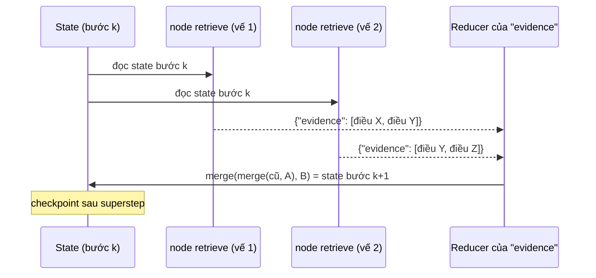
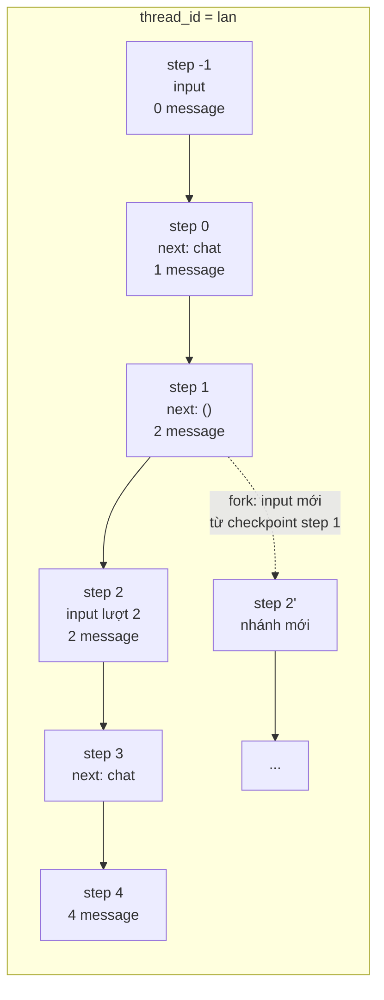
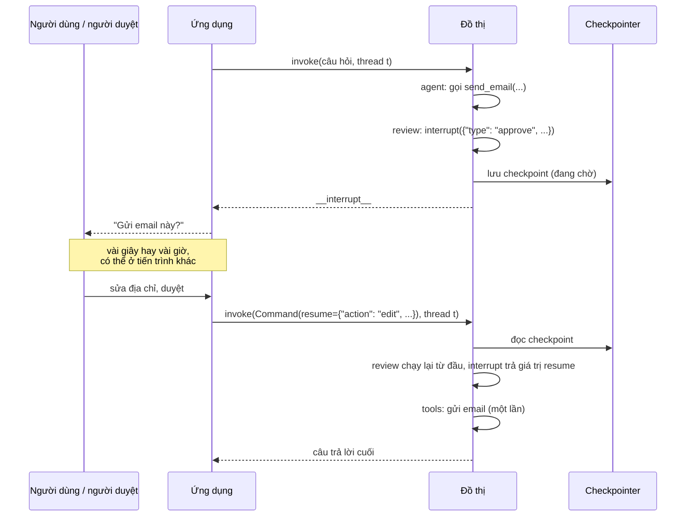
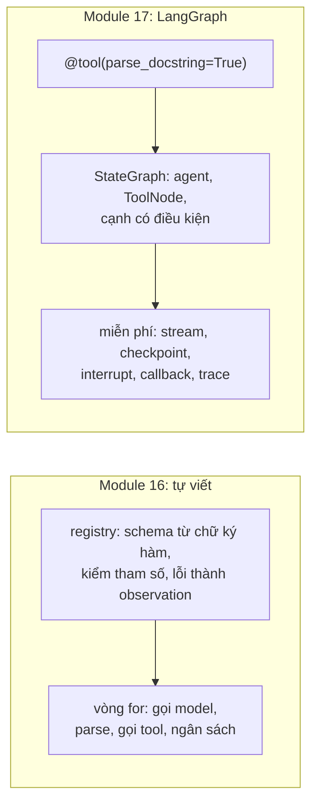
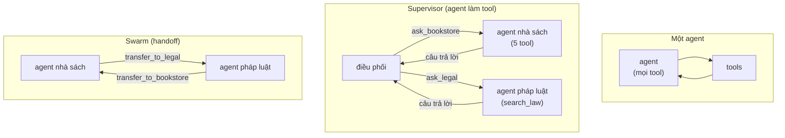
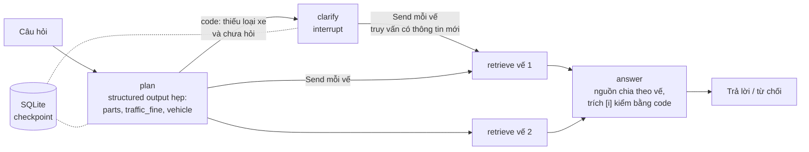

# LangChain & LangGraph

Module 16 viết agent **không framework**: vòng ReAct, tool registry, quản lý context, memory đều là code của bạn. Module
13 đã so gọi SDK trực tiếp, LangChain và LlamaIndex cho một pipeline RAG. Module này học hai framework được dùng nhiều
nhất để dựng ứng dụng LLM và agent bằng Python, **LangChain** (cụ thể là lõi `langchain-core` và cách ghép LCEL) và
**LangGraph** (đồ thị có state, checkpoint, human-in-the-loop, multi-agent), theo một hướng: mỗi abstraction được đặt
cạnh bản tự viết của module 16, đo cái nó cho và cái nó lấy đi, rồi dùng nó để dựng agent pháp luật mà capstone
milestone 6 cần (tách câu hỏi, tra nhiều bước, hỏi lại khi thiếu thông tin).

Các khối code chạy từ **gốc repo** (ví dụ dán vào `uv run python -`) và không cần Ollama trừ khi ghi rõ. Phiên bản đã
kiểm (ngày 2026-11-01): `langchain-core` 1.6.12, `langgraph` 1.2.16, `langgraph-prebuilt` 1.1.1,
`langgraph-checkpoint-sqlite` 3.1.2, `langchain-ollama` 1.1.0. Hai thư viện này đổi API nhanh: mọi hành vi mặc định nói
tới dưới đây (kể cả lỗi) là của **đúng các phiên bản đó**. Số đo là chạy thật trên PC của track (Xeon E5-2696 v3,
RTX 3060 12GB **dùng chung** với phiên khác, Ollama 0.13.5, `qwen2.5:3b` Q4_K_M, `temperature` 0, `seed` 0); số đo
bằng fake model chỉ dùng CPU. Log nằm ở `.superpowers/scratch/logs/` của nhánh phát triển module.

Sau module này bạn sẽ:

- Đọc và viết LCEL: `Runnable`, `|`, `RunnableParallel`, `RunnablePassthrough`, batch, stream, async, retry, fallback,
  structured output, callback; biết ba cách structured output hỏng.
- Dựng `StateGraph` với state có kiểu và reducer, cạnh có điều kiện, vòng lặp có ngân sách, fan-out bằng `Send`; giải
  thích superstep và vì sao reducer phải giao hoán.
- Dùng checkpoint (bộ nhớ, SQLite), thread, time travel; biết checkpoint tốn bao nhiêu và chứa gì.
- Đưa người vào vòng lặp bằng `interrupt`: hỏi lại, duyệt, sửa, từ chối; tránh bẫy node chạy lại khi resume.
- So agent LangGraph (dựng tay và prebuilt) với vòng lặp tự viết của module 16 bằng số: tỉ lệ đúng, độ trễ, số dòng code.
- Dựng multi-agent kiểu supervisor và swarm (handoff), subgraph; biết khi nào không nên.
- Test mọi thứ trên bằng fake chat model của LangChain, không cần LLM thật.

| Mức | Bài | Nội dung |
| --- | --- | --- |
| Basic | 01 lcel | chuỗi phân tích câu hỏi: structured output, retry đúng loại lỗi, fallback, nhánh song song, batch, callback |
| Basic | 02 state-reducers | `StateGraph` tra nhiều vế: reducer, `Send`, cạnh có điều kiện, vòng lặp có ngân sách |
| Basic | 03 checkpoint-time-travel | thread, cửa sổ message, SQLite, dòng thời gian, rẽ nhánh, xoá thread |
| Intermediate | 01 langgraph-react | agent ReAct bằng LangGraph (dựng tay, prebuilt) trên 24 task của module 16 |
| Intermediate | 02 human-in-the-loop | `interrupt`: hỏi lại, duyệt / sửa / từ chối tool có tác dụng phụ |
| Intermediate | 03 legal-agent | agent pháp luật trên Zalo Legal: kế hoạch, hỏi lại, tra song song, đo với RAG một lượt |
| Advanced | 01 multi-agent | một agent, supervisor, swarm trên trợ lý nhà sách luật, 52 task (portfolio) |
| Advanced | 02 corrective-rag | Corrective RAG, đo cả bộ chấm LLM với qrels (portfolio) |

## 1. Hệ sinh thái LangChain và LCEL

### Các tầng

"LangChain" năm 2026 là một họ gói, không phải một thư viện:



- **`langchain-core`**: các giao diện chuẩn (chat model, message, tool, retriever, prompt, output parser) và
  `Runnable`. Mọi gói khác dựa vào nó; module này dùng chủ yếu tầng này.
- **Gói tích hợp** (`langchain-ollama`, `langchain-openai`...): mỗi nhà cung cấp một gói, cài theo nhu cầu.
  `ChatOllama` gọi `/api/chat` của Ollama, có `bind_tools` và `with_structured_output`.
- **LangGraph**: điều phối tầng thấp cho ứng dụng có state và vòng lặp (agent), kèm checkpoint và human-in-the-loop.
- **`langchain`** 1.x (gói "chính"): các agent dựng sẵn trên LangGraph (`create_agent`, middleware). Môi trường của
  track **không** cài gói này; module dùng `langgraph.prebuilt` và tự dựng đồ thị.
- **LangSmith**: dịch vụ trace và đánh giá (module 20). Bật bằng biến môi trường; không bắt buộc.

### `Runnable` và toán tử `|`

Mọi thành phần cài một giao diện: `invoke`, `batch`, `stream` và bản async `ainvoke`, `abatch`, `astream`. Ghép chúng là
viết LCEL:

| Viết | Tạo ra | Ngữ nghĩa |
| --- | --- | --- |
| `a \| b` | `RunnableSequence` | output của `a` là input của `b` |
| `{"x": a, "y": b}` trong chuỗi, hoặc `RunnableParallel(x=a, y=b)` | `RunnableParallel` | chạy `a`, `b` trên **cùng** input, trả dict |
| `RunnablePassthrough()` | | trả nguyên input |
| `RunnablePassthrough.assign(k=r)` | `RunnableAssign` | chạy `r` trên dict đầu vào, trả dict đó **cộng** khoá `k` |
| `RunnableLambda(f)` | | bọc hàm Python thường thành `Runnable` |
| `r.batch(xs, config={"max_concurrency": n})` | | chạy `r` trên nhiều input bằng thread pool, giữ thứ tự |
| `r.with_retry(retry_if_exception_type=..., stop_after_attempt=n)` | `RunnableRetry` | thử lại khi gặp đúng loại lỗi |
| `r.with_fallbacks([b])` | `RunnableWithFallbacks` | `r` lỗi thì chạy `b` trên **cùng** input |
| `r.with_config(callbacks=[...], tags=[...])` | `RunnableBinding` | gắn cấu hình cho mọi lần chạy |

Một ví dụ không phải lời giải của bài nào, ghép bằng hàm thường để chạy không cần model:

```python
from langchain_core.runnables import RunnableLambda, RunnablePassthrough

tokenize = RunnableLambda(lambda d: d["text"].lower().split())
chain = RunnablePassthrough.assign(tokens=tokenize) | RunnablePassthrough.assign(n=lambda d: len(d["tokens"]))
print(chain.invoke({"text": "Mức phạt quay đầu xe", "id": 7}))
print(chain.batch([{"text": "a b"}, {"text": "c"}], config={"max_concurrency": 2}))
```

In ra dict giữ `text`, `id` và thêm `tokens`, `n` (5); `batch` trả hai kết quả theo đúng thứ tự đầu vào. Song song trong
LCEL là thread pool: nó giúp khi bước chậm là I/O (gọi API, retriever), và tốc độ thật khi gọi model còn phụ thuộc server
có xử lý song song không (Ollama: biến `OLLAMA_NUM_PARALLEL`); trên một GPU dùng chung, gửi song song có thể chỉ xếp hàng.

### Overhead

Đo bằng fake chat model (chỉ CPU, trên PC của track, log `theory_bench.log`):

| Gọi | ms mỗi lần |
| --- | --- |
| Fake model, gọi thẳng hàm sinh | 0.010 |
| `model.invoke` (qua callback manager, run tree) | 0.171 |
| `prompt \| model \| parser` | 0.570 |
| 10 `RunnableLambda` nối bằng `\|` | 1.639 (hàm Python thuần: 0.001) |

Với LLM thật, mỗi lượt là hàng trăm tới hàng nghìn mili giây, nên overhead của LCEL **không** là lý do chọn hay bỏ nó.
Nó chỉ thành vấn đề khi bạn bọc rất nhiều hàm nhỏ chạy trong vòng lặp nóng: khi đó viết hàm Python thường.

### Chat model chuẩn, tool, structured output

Mọi chat model có `invoke(messages) -> AIMessage`, `bind_tools(tools)` (gửi schema tool theo định dạng của nhà cung
cấp, đọc `AIMessage.tool_calls` chuẩn hoá) và `with_structured_output(schema, method=...)`:

| `method` | Cách làm | Ghi chú |
| --- | --- | --- |
| `function_calling` | Biến schema thành một tool, bắt model gọi nó, đọc tham số | Mặc định của `BaseChatModel`; cần model gọi tool tốt |
| `json_schema` | Gửi JSON Schema cho server, server ép output bằng constrained decoding (module 11 mục 5) | Mặc định của `ChatOllama` |
| `json_mode` | Chỉ ép "là JSON", schema nằm trong prompt | Yếu nhất |

Với cách `function_calling`, structured output hỏng theo **ba** cách khác nhau, và một trong số đó không báo lỗi:

| Model trả | Kết quả |
| --- | --- |
| Tool call đúng tên, tham số sai kiểu | `ValidationError` của Pydantic |
| Tool call tên lạ | `OutputParserException` |
| Chữ thường, không gọi tool | **`None`**, không exception |

Hệ quả cho retry và fallback: lỗi output với `temperature` 0 thì gửi lại đúng prompt cũ cho cùng model gần như chắc chắn
cho cùng kết quả, nên **retry chỉ dành cho lỗi tạm thời** (mất kết nối, timeout, 429); lỗi output cần **fallback** sang
một cách khác. Lồng retry ở trong, fallback ở ngoài: đảo lại thì fallback chạy ngay lần lỗi đầu. Bài Basic 01 viết đúng
các quyết định này và chạy chúng trên fake model.

Chọn `method` là việc phải đo, không đoán. Ở bài Intermediate 03, bước lập kế hoạch với `qwen2.5:3b` cho kết quả rất khác
nhau giữa `function_calling` và `json_schema`, và giữa một trường chữ tự do với các trường bị ràng buộc (`bool`,
`Literal`); bạn sẽ tự đọc bảng dò trong lời giải bài đó.

### Một lỗi thật của framework

Trong `langchain-core` 1.6.12, `batch(..., return_exceptions=True)` của một chain bọc `with_retry` **xếp nhầm kết quả**:
sau lượt thử cuối, phần tử còn lỗi nhận kết quả của một phần tử khác đã thành công ở lượt đó, không có exception nào. Tái
hiện với `RunnableLambda` (log `retry_batch_bug.log`): hàm `x * 10` lỗi ở `x = 1`, `stop_after_attempt=1`, batch
`[0, 1, 2]` trả `[0, 0, 20]` thay vì `[0, ConnectionError, 20]`. Không có test với fake model thì lỗi kiểu này nằm im
trong bảng đánh giá của bạn. Bài Basic 01 có test bắt nó.

## 2. LangGraph: state, reducer, superstep, vòng lặp

### Vì sao cần đồ thị

LCEL mô tả một **DAG không state**: dữ liệu đi một chiều. Một agent cần vòng lặp (gọi model, chạy tool, quay lại),
**state** chung được nhiều bước đọc ghi theo quy tắc rõ, và đường đi quyết định lúc chạy. Module 16 viết những thứ đó
thành một vòng `for` và một list message. LangGraph biến chúng thành dữ liệu: một `StateGraph` gồm state có kiểu, node là
hàm `state -> cập nhật`, cạnh thường, cạnh có điều kiện; và vì đồ thị là dữ liệu, framework chèn được checkpoint, stream,
interrupt vào giữa mọi bước.

### Superstep và reducer

LangGraph chạy theo mô hình **Pregel / Bulk Synchronous Parallel** (Malewicz et al., 2010): mỗi **superstep**, mọi node
được kích hoạt chạy **song song** trên cùng một bản state, rồi các cập nhật được áp vào state ở cuối bước qua **reducer**
của từng khoá; checkpoint được ghi sau mỗi superstep.



Với khoá có reducer $$\oplus$$, state sau bước là

$$
s_{k+1}[\text{khoá}] = s_k[\text{khoá}] \oplus u_1 \oplus u_2 \oplus \dots \oplus u_m
$$

với $$u_i$$ là cập nhật của các node chạy trong bước $$k$$. Ở LangGraph 1.2.16 thứ tự áp các $$u_i$$ là **tất định**:
`apply_writes` sắp các task theo đường dẫn (tên node, chỉ số của `Send`) trước khi áp, nên thread nào xong trước không
quan trọng. Nhưng đó là chi tiết cài đặt không có trong tài liệu và có thể đổi giữa các phiên bản; và với một
$$\oplus$$ không giao hoán, kết quả vẫn phụ thuộc những thứ không mang nghĩa như tên node hay thứ tự các vế trong câu
hỏi. Vì vậy $$\oplus$$ vẫn phải kết hợp và giao hoán trên các cập nhật đó. Khoá **không** có reducer thì là ghi đè, và hai node cùng ghi
nó trong một bước làm LangGraph ném `InvalidUpdateError: At key 'x': Can receive only one value per step`.

| Reducer | Dùng cho |
| --- | --- |
| không khai báo | ghi đè: kế hoạch, câu trả lời cuối |
| `operator.add` | cộng số (đếm lượt), nối list (khi trùng lặp không sao) |
| `add_messages` (`MessagesState`) | message: nối thêm, **thay** message cùng `id`, xoá bằng `RemoveMessage(id=...)` |
| hàm của bạn | gộp evidence theo uid giữ điểm cao (bài Basic 02) |
| `Overwrite(v)` trong cập nhật | bỏ qua reducer một lần, ghi đè bằng `v` |

```python
import operator
from typing import Annotated, TypedDict

from langgraph.graph import END, START, StateGraph
from langgraph.types import Overwrite


class S(TypedDict):
    seen: Annotated[list, operator.add]


g = StateGraph(S)
g.add_node("a", lambda s: {"seen": ["a"]})
g.add_node("b", lambda s: {"seen": ["b"]})
g.add_node("reset", lambda s: {"seen": Overwrite(["chỉ còn cái này"])})
g.add_edge(START, "a")
g.add_edge(START, "b")
g.add_edge(["a", "b"], "reset")
g.add_edge("reset", END)
app = g.compile()
for step in app.stream({"seen": []}, stream_mode="values"):
    print(step)
```

Bước đầu `a`, `b` chạy song song và `operator.add` nối cả hai (ra `['a', 'b']` theo thứ tự tên node ở bản này, không phải
một cam kết của API); `reset` chạy khi
**cả hai** xong (`add_edge([...], "reset")` là cạnh chờ nhiều nguồn) và ghi đè.

### Cạnh có điều kiện, `Send`, `Command`, vòng lặp

| Công cụ | Làm gì |
| --- | --- |
| `add_conditional_edges(nguồn, f, [đích])` | `f(state)` trả tên node (hoặc list tên) để đi tiếp |
| `Send("node", arg)` (trả từ `f`) | chạy `node` với **input riêng** `arg`; trả nhiều `Send` là fan-out số nhánh chỉ biết lúc chạy (map-reduce) |
| Node trả `Command(update=..., goto=...)` | cập nhật state và chọn bước tiếp trong cùng một chỗ; khai báo `destinations` khi `add_node` |
| `Command(..., graph=Command.PARENT)` | từ trong subgraph, đi tới node của đồ thị **cha** (handoff giữa agent, mục 6) |
| Cạnh quay lại node trước | vòng lặp; dừng nhờ điều kiện trong state |

Vòng lặp cần **điều kiện dừng nằm trong state** (đếm lượt, cờ `stopped`), như `max_steps` của module 16. Lưới an toàn
thứ hai là `recursion_limit` (số superstep tối đa một lần chạy), và mặc định của nó đã đổi: ở LangGraph 1.2.16 là
**10 007** (đọc từ biến môi trường `LANGGRAPH_DEFAULT_RECURSION_LIMIT`), không còn là 25 như các bản cũ hơn. Một đồ thị
lặp vô hạn bằng hàm Python mất 3.2 giây mới chạm giới hạn đó trên PC của track; một agent gọi LLM thì đó là hàng nghìn
lượt gọi model. Đặt `recursion_limit` tường minh trong config.

### Prebuilt: `ToolNode`, `tools_condition`, `create_react_agent`

`ToolNode(tools)` chạy mọi tool call của `AIMessage` cuối (song song) và trả `ToolMessage`; `tools_condition` định tuyến
"có tool call thì sang `tools`, không thì kết thúc"; `create_react_agent(model, tools, prompt=...)` dựng cả vòng ReAct.
Hai điều cần biết ở đúng phiên bản của track:

- `ToolNode` mặc định (`langgraph-prebuilt` 1.1.1) chỉ biến lỗi **tham số** (`ToolInvocationError`) thành observation.
  Exception khi tool **chạy** (ví dụ `ValueError("không có sách mã 'DTNT'")`) bị ném lại và làm hỏng cả lần chạy, khác
  hẳn quy ước "lỗi là observation" của module 16. Muốn hành vi đó: `ToolNode(tools, handle_tool_errors=True)` hoặc một
  hàm định dạng lỗi.
- `create_react_agent` phát `LangGraphDeprecatedSinceV10`: đã chuyển sang `langchain.agents.create_agent` (gói
  `langchain` 1.x), sẽ bị bỏ ở LangGraph 2.0. API prebuilt đổi nhanh hơn API lõi.

Một vòng ReAct native tự dựng bằng `StateGraph` (node gọi model đã `bind_tools`, `ToolNode`, một hàm định tuyến có ngân
sách) dài khoảng 30 dòng; bài Intermediate 01 viết nó và đo với prebuilt.

### Streaming và overhead

`stream(..., stream_mode=...)`: `values` (state đầy đủ sau mỗi bước), `updates` (cập nhật của từng node), `messages`
(từng token của chat model kèm metadata node), `custom` (dữ liệu node tự đẩy ra), `checkpoints`, `tasks`, `debug`. Có thể
truyền list để nhận nhiều loại cùng lúc. `get_graph().draw_mermaid()` in sơ đồ của đồ thị đã compile.

Overhead đo bằng fake model (đồ thị một node lặp 10 bước, log `theory_bench.log`): 0.66 ms mỗi bước không checkpoint,
1.41 ms với `InMemorySaver`, 3.86 ms với `SqliteSaver` trên tệp. Nhỏ so với một lượt LLM, nhưng SQLite ghi đĩa mỗi bước,
nên đồ thị nhiều bước nhỏ không gọi LLM (xử lý dữ liệu) trả giá rõ hơn.

## 3. Persistence: checkpoint, thread, time travel

### Checkpointer và thread

Compile với một checkpointer (`graph.compile(checkpointer=...)`) và gọi với `config={"configurable": {"thread_id": ...}}`:
sau mỗi superstep, LangGraph ghi một **checkpoint** (snapshot đầy đủ của state, cộng các write đang chờ) vào thread đó.
Lượt sau trên cùng thread bắt đầu từ checkpoint mới nhất, nên hội thoại "nhớ" mà không phải truyền lại lịch sử.



`app.get_state(config)` trả `StateSnapshot`: `values`, `next` (node sẽ chạy), `config` (có `checkpoint_id`),
`parent_config`, `metadata` (`step`, `source`), `interrupts`. `get_state_history(config)` liệt kê mọi checkpoint mới
nhất trước, **kể cả các nhánh đã rẽ**; muốn đúng nhánh hiện tại thì đi ngược theo `parent_config`.

| Checkpointer | Dùng khi |
| --- | --- |
| `InMemorySaver` | test, notebook; mất khi tiến trình dừng |
| `SqliteSaver` (`langgraph-checkpoint-sqlite`) | một máy, ứng dụng nhỏ; kết nối `sqlite3` cần `check_same_thread=False` vì node chạy trên thread pool; `AsyncSqliteSaver` cho code async |
| `PostgresSaver` (`langgraph-checkpoint-postgres`, không cài trong track) | nhiều tiến trình, production |

### Time travel

- **Replay**: `invoke(None, {"configurable": {"thread_id": t, "checkpoint_id": c}})` chạy lại các node sau checkpoint
  `c`. Node gọi LLM sẽ gọi lại thật.
- **Fork**: gửi input mới với config có `checkpoint_id`, hoặc `update_state(config_cũ, values)` rồi chạy tiếp. Checkpoint
  mới có `parent_config` là checkpoint cũ; đầu thread chuyển sang nhánh mới; nhánh cũ vẫn đọc được.

Dùng để debug agent (quay về bước nó bắt đầu đi sai, sửa một observation, xem nó làm gì khác), cho người dùng "sửa câu
hỏi trước", hay so hai prompt trên cùng một trạng thái giữa chừng. Bài Basic 03 viết `timeline` và `fork`.

### Chạy bền (durable execution)

Vì state nằm trong checkpointer, một lần chạy bị dừng giữa chừng (tiến trình chết, máy khởi động lại, chờ người) đi tiếp
được từ checkpoint cuối bằng một tiến trình khác với kết nối mới tới cùng kho. Tham số `durability` của `invoke`
(`"sync"`, `"async"`, `"exit"`) chọn ghi checkpoint đồng bộ mỗi bước, bất đồng bộ, hay chỉ khi kết thúc: đánh đổi giữa độ
an toàn và độ trễ. Bài Intermediate 03 có cell dừng ở câu hỏi lại, mở một kết nối SQLite mới như sau khi khởi động lại, và
đi tiếp.

### Checkpoint tốn bao nhiêu

Mỗi checkpoint là **state đầy đủ**, không phải phần chênh. Đo bằng fake model, mỗi lượt khoảng 1.3 KB chữ (log
`theory_bench.log`): sau 10 lượt tổng blob checkpoint trong SQLite là 0.21 MB, sau 100 lượt 19.4 MB (300 checkpoint, blob
cuối 128 KB). Gấp 10 số lượt, gấp khoảng 90 lần dung lượng: tăng theo bình phương. Hội thoại dài cần cắt state
(`RemoveMessage`, tóm tắt), dọn checkpoint cũ, hoặc không giữ lịch sử checkpoint nếu không cần time travel.

### Trí nhớ ngắn hạn, dài hạn, và dữ liệu cá nhân

Checkpoint là trí nhớ **trong một thread** (working và episodic gần, theo khung CoALA ở mục 5 module 16). Trí nhớ **qua
nhiều thread** (sở thích của người dùng, thông tin đã cập nhật) nằm ở `Store` của LangGraph (`InMemoryStore`,
`PostgresStore`): kho key-value theo namespace, có tìm kiếm theo embedding khi cấu hình, truyền vào `compile(store=...)`
và đọc trong node. Chính sách ghi, đọc, quên vẫn là của bạn, như bài Intermediate 03 module 16; framework chỉ cho chỗ lưu.

Cả hai đều là **dữ liệu cá nhân**: checkpoint chứa nguyên văn hội thoại, kể cả thứ người dùng nhờ quên. Cần thời hạn lưu,
phân quyền, và một đường xoá được kiểm thử (`checkpointer.delete_thread(thread_id)` xoá mọi checkpoint và write của
thread). Module 19 đi sâu.

## 4. Human-in-the-loop

### `interrupt` và `Command(resume=...)`

`interrupt(value)` gọi trong một node: LangGraph lưu checkpoint, dừng, trả `value` cho người gọi (trong
`snapshot.interrupts`, hoặc khoá `__interrupt__` của dict kết quả; với `invoke(..., version="v2")` là
`GraphOutput(value, interrupts)`). Người dùng trả lời bằng `invoke(Command(resume=x), config)`: LangGraph chạy lại **node
đó từ dòng đầu**, và lần này `interrupt` trả `x`.



Bốn điều phải nhớ:

1. **Node chạy lại từ đầu khi resume.** Code trước `interrupt` chạy mỗi lần resume. Tác dụng phụ (gửi email, ghi
   database) đặt ở node **sau** điểm dừng, hoặc phải idempotent.
2. **Nhiều `interrupt` trong một node** khớp giá trị resume theo **thứ tự gọi**. Đừng gọi `interrupt` có điều kiện thay
   đổi giữa các lần chạy lại.
3. **Bắt buộc có checkpointer.** State lúc dừng phải nằm đâu đó.
4. **Resume khi không có gì đang chờ** không báo lỗi rõ ràng: trên thread đã xong, LangGraph 1.2.16 trả lại state cũ;
   trên thread chưa có thì ném một `KeyError` khó hiểu. Kiểm `snapshot.interrupts` ở tầng của bạn.

Ngoài `interrupt` động còn `interrupt_before` / `interrupt_after` (danh sách tên node, đặt khi compile hoặc khi gọi):
dừng trước hay sau một node cố định, hợp cho debug từng bước hơn là cho luồng sản phẩm.

### Các mẫu

| Mẫu | Làm gì | Bài |
| --- | --- | --- |
| Hỏi lại (ask-back) | model gọi tool `ask_user`, hoặc bước lập kế hoạch thấy thiếu dữ kiện, rồi `interrupt` với câu hỏi | Intermediate 02, 03 |
| Duyệt tool call | mọi tool nhạy cảm đi qua node `review`: approve / edit / reject | Intermediate 02 |
| Sửa state | người sửa kế hoạch, sửa một observation sai rồi chạy tiếp (`update_state` + resume) | |
| Duyệt đầu ra | dừng trước khi gửi câu trả lời cuối cho khách hàng | |

Chọn cái gì cần người bằng **code** (danh sách tool nhạy cảm, hạn mức), không bằng prompt: code không bị prompt lừa,
đúng ý "guard bằng code" ở mục 6 module 16. Khi người duyệt **sửa** tham số, thay chính `AIMessage` cũ (cùng `id`,
`add_messages` thay thế) để state ghi cái đã thực thi thật; khi **từ chối**, trả một `ToolMessage` lỗi cho đúng tool call
đó, vì API kiểu OpenAI từ chối lịch sử có tool call không được trả lời hoặc `ToolMessage` mồ côi.

## 5. Framework hay tự viết: cùng agent, cùng 24 task

### Cùng một vòng, hai cách viết

Bài Intermediate 01 dựng lại agent native của module 16 bằng LangGraph: `tool(fn, parse_docstring=True)` thay cho
registry tự sinh JSON Schema, một node gọi model đã `bind_tools`, `ToolNode` có `handle_tool_errors`, một hàm định tuyến
đọc ngân sách bước trong state. Rồi chạy nó, agent prebuilt `create_react_agent`, và **chạy lại cùng ngày** hai vòng tự
viết của module 16 trên cùng 24 task hiệu sách, cùng `qwen2.5:3b`, cùng system prompt, cùng bộ chấm.



| | Tự viết (module 16) | LangGraph (bài Intermediate 01) |
| --- | --- | --- |
| Số dòng (không trống, không chú thích, bỏ docstring) | registry 114 + vòng native 24 | 34 |
| Thời gian ngoài lượt gọi model | vài ms mỗi lượt | vài ms mỗi lượt |
| Streaming, checkpoint, human-in-the-loop | tự viết thêm | có sẵn, cắm vào đồ thị |
| Đọc lỗi | stack trace của bạn | stack trace qua nhiều lớp framework |
| Đổi giao thức gọi tool | sửa vòng lặp | đổi node `agent` |
| Rủi ro | lỗi của bạn | mặc định và lỗi của framework, API đổi giữa các bản |

### Cái framework không đổi được

Module 16 đo trên bộ task này: ReAct văn bản 17/24, native 10/24 (mục 2 module 16). Bài Intermediate 01 cho bạn đo ba
agent native (dựng tay, prebuilt, vòng tự viết chạy lại) và vòng ReAct văn bản trên cùng điều kiện, với khoảng tin cậy và
so theo cặp. Câu hỏi cần trả lời bằng số của bạn: khác biệt lớn nằm giữa các **framework** hay giữa các **giao thức** gọi
tool? Framework chỉ là cách viết vòng lặp; model và giao thức thì nó không đổi. Muốn
ReAct văn bản trong LangGraph thì đặt parser của module 16 vào node `agent`: đồ thị không quan tâm model nói chuyện thế
nào.

Bài học thứ hai đến từ mặc định: agent prebuilt với `ToolNode` mặc định **sập** ở các task mà model đoán sai mã sách,
vì lỗi lúc tool chạy không còn là observation (mục 2). Bạn sẽ tự đếm bao nhiêu task.

### Khi nào dùng cái gì

| Tình huống | Chọn |
| --- | --- |
| Một lượt LLM, vài bước cố định (RAG một lượt, phân loại, trích xuất) | Code thường hoặc SDK; LCEL nếu muốn batch, retry, fallback, stream có sẵn |
| Vòng agent đơn giản, không cần dừng chờ người hay sống qua khởi động lại | Tự viết (module 16) hoặc LangGraph, tuỳ đội; đo cả hai không khác nhau về chất lượng |
| Cần checkpoint, resume, human-in-the-loop, time travel, streaming theo bước | LangGraph |
| Nhiều agent, nhiều bước song song, đồ thị phức tạp | LangGraph (subgraph, `Send`, `Command`) |
| Cần chạy trong ngôn ngữ, runtime khác Python | SDK trực tiếp hoặc framework của runtime đó |

Hai cách giữ an toàn khi dùng framework: **ghim phiên bản** và đọc changelog khi nâng (`recursion_limit` mặc định đổi
từ 25 sang 10 007, `create_react_agent` chuyển gói là hai thay đổi giữa các bản; mặc định xử lý lỗi của `ToolNode` là thứ
phải kiểm lại mỗi lần nâng); và **test với fake model** mọi phần bạn dựa vào (mục 7).

## 6. Subgraph và multi-agent

### Subgraph

Một đồ thị đã compile là một `Runnable`, nên nó làm được node của đồ thị khác. Hai cách nối:

- **Chung khoá state**: thêm thẳng `g.add_node("legal", legal_graph)`; các khoá trùng tên được truyền vào và cập nhật
  ra theo reducer của đồ thị cha.
- **Khác schema**: gọi subgraph trong một hàm node, tự đổi state cha thành input con và output con thành cập nhật cha.
  Dùng khi đồ thị con có state riêng (một agent con không cần thấy cả lịch sử của cha).

Checkpoint của subgraph nằm trong cùng thread, phân biệt bằng `checkpoint_ns`; `interrupt` trong subgraph dừng cả đồ thị
cha. Từ trong subgraph, `Command(goto="node_cha", graph=Command.PARENT)` chuyển quyền điều khiển lên đồ thị cha.

### Ba kiến trúc



| | Một agent | Supervisor | Swarm / handoff |
| --- | --- | --- | --- |
| Ai quyết định ai làm | model duy nhất chọn tool | điều phối viên | agent đang giữ quyền tự chuyển |
| Context mỗi agent thấy | mọi tool, mọi lịch sử | agent con chỉ thấy yêu cầu được giao | lịch sử chung (tuỳ cách cài) |
| Lượt LLM thêm | không | điều phối trước và sau mỗi lần giao | một lượt gọi handoff mỗi lần chuyển |
| Hỏng kiểu gì | chọn nhầm tool khi có nhiều tool | tự trả lời thay vì giao; mất chi tiết khi tóm yêu cầu | không chuyển khi cần; chuyển qua lại |
| Thư viện | `create_react_agent`, tự dựng | `langgraph-supervisor`, agent làm tool | `langgraph-swarm`, tool handoff tự viết |

Handoff là một tool mà kết quả không phải chữ mà là một lệnh điều khiển: khi model gọi `transfer_to_legal`, tool yêu
cầu đồ thị **cha** chuyển sang node của agent pháp luật và ghi lại agent nào đang giữ quyền. Hai chi tiết quyết định nó
chạy đúng: lịch sử gửi lên đồ thị cha phải đủ, gồm cả lời gọi handoff và một câu trả lời cho đúng lời gọi đó (không thì có
tool call bỏ lửng hoặc câu trả lời mồ côi); và những gì tool cần biết về state hay về lời gọi hiện tại phải do framework
cung cấp lúc chạy, không phải để model điền. Bài Advanced 01 viết tool này có test.

### Khi nào đáng

Anthropic báo hệ nghiên cứu multi-agent của họ (một agent dẫn, nhiều agent con tìm song song) hơn một agent đơn 90.2%
trên bộ đánh giá nội bộ, đổi lại dùng khoảng 15 lần token so với chat (agent đơn khoảng 4 lần) ("How we built our
multi-agent research system", 2025). Cognition lập luận ngược: với việc mà các bước phụ thuộc chặt vào nhau (viết code),
chia cho nhiều agent làm mất ngữ cảnh ở mỗi lần chuyển giao và các quyết định ngầm mâu thuẫn nhau ("Don't build
multi-agents", 2025). Hai bài không mâu thuẫn: multi-agent đáng khi việc con **tách được, song song được** và giá trị của
việc đủ cao để trả token; không đáng khi các bước nối chặt, khi model nhỏ (mỗi lần giao là thêm một chỗ hỏng), hoặc
khi một agent với ít tool hơn và context gọn hơn đã đủ. Bài Advanced 01 đo ba kiến trúc trên cùng 52 task với
`qwen2.5:3b`; con số của bạn, không phải sơ đồ, quyết định.

## 7. Agent pháp luật cho capstone, test và vận hành

### Thiết kế

Capstone milestone 6 cần một agent tách câu hỏi, tra nhiều bước, hỏi lại khi thiếu thông tin. Bài Intermediate 03 dựng
bản thu nhỏ của nó, ghép mọi thứ của module này:



Ba quyết định đến từ số đo chứ không từ sơ đồ:

- **Ép không gian output, để code quyết định.** Một trường `missing: list[str]` tự do cho model 3B điền thì kết quả gần
  như ngược (hỏi lại câu đã đủ, bỏ qua câu thiếu). Thay bằng `traffic_fine: bool` và `vehicle: Literal[...]` rồi để code
  suy ra "thiếu loại xe" thì dùng được, dù model vẫn bịa loại xe ở một số câu. Đó cũng là bài học của module 16: chuyển
  phần quyết định sang code khi code làm được.
- **Không lập kế hoạch lại sau khi hỏi.** Lập kế hoạch lại tốn thêm một lượt LLM và model nhỏ hay biến câu trả lời của
  người dùng thành một "câu hỏi con" rác; ghép thông tin mới vào truy vấn bằng code thì rẻ và ổn định.
- **Ghép thông tin bổ sung theo văn phong của văn bản luật.** Cùng 10 câu thiếu loại xe, cùng `bge-m3`, chỉ đổi cách
  ghép câu trả lời "xe máy" / "ô tô" vào truy vấn: dạng `"<câu hỏi> (xe máy)"` tìm được điều đúng trong top-5 ở 14/20
  trường hợp, dạng `"<câu hỏi> đối với người điều khiển xe máy?"` ở 19/20, câu hỏi không có loại xe ở 8/20 (log
  `i03_query_variants.log`). Embedding nhạy với văn phong; viết truy vấn giống cách điều luật viết.

Bài Intermediate 03 đo agent này với RAG một lượt kiểu module 13 trên ba bộ câu (100 câu thường của tập ghim, 50 câu
hai vế ghép từ tập ghim, 10 câu thiếu loại xe cùng bản đủ thông tin của chúng) bằng bộ chấm không dùng LLM: điều đúng có
trong nguồn không, trích có trúng không, có hỏi lại không, có hỏi thừa không, tốn bao nhiêu lượt LLM và giây. Bạn sẽ thấy
agent đáng tiền ở loại câu nào và không ở loại nào, và vì sao "nguồn có điều đúng" vẫn chưa phải "câu trả lời đúng": lỗi
đơn vị nguồn ở mục 5 module 13 không biến mất khi thêm đồ thị.

### Corrective RAG và các biến thể "agentic RAG"

Mục 7 module 13 liệt kê các biến thể RAG nâng cao. Viết bằng LangGraph, chúng là các đồ thị nhỏ có vòng lặp:
**Corrective RAG** (Yan et al., 2024) chấm các nguồn tìm được, viết lại truy vấn và tìm lại khi không nguồn nào đạt, hoặc
tìm thêm ở nguồn khác; **Self-RAG** (Asai et al., 2023) để model tự quyết khi nào tìm và tự chấm câu trả lời; **Adaptive
RAG** định tuyến câu hỏi theo độ khó (không tìm, tìm một lượt, tìm nhiều bước). Mỗi vòng thêm lượt LLM, và mỗi bước
"tự chấm" chỉ tốt bằng bộ chấm của nó. Bài Advanced 02 dựng CRAG trên Zalo Legal và đo **cả** bộ chấm LLM với qrels.

### Test

| Tầng | Cách | Ví dụ trong module |
| --- | --- | --- |
| Hàm thuần | unit test thường; kiểm tính giao hoán của reducer bằng nhiều thứ tự ngẫu nhiên | `merge_evidence`, `select_sources`, `search_query` |
| Đồ thị | fake chat model của `langchain-core` (`GenericFakeChatModel` subclass thêm `bind_tools`, trả `AIMessage` có `tool_calls` theo kịch bản, ghi lại messages); tool thật thay bằng hàm có đếm lời gọi | định tuyến, ngân sách, interrupt và resume, tác dụng phụ đúng một lần, cô lập thread, giao thức tool call |
| Chất lượng | bộ task ghim, chấm tự động, khoảng tin cậy, so theo cặp | 24 task hiệu sách, ba bộ câu hỏi Zalo |

`GenericFakeChatModel` gốc ném `NotImplementedError` ở `bind_tools` và `with_structured_output`; subclass cho `bind_tools`
trả chính nó là đủ để `with_structured_output` mặc định (dựa trên tool calling) chạy với `AIMessage` có tool call tên
đúng schema. Viết thêm vài **mutant** (bỏ reducer, quên `start_on`, chạy tool trong node có `interrupt`, dùng `ToolNode`
mặc định) và chắc test bắt được; mọi bài của module này được kiểm như vậy.

### Vận hành

- **Trace**: callback và LangSmith (bật bằng biến môi trường) hoặc OpenTelemetry (module 20) ghi mỗi node, mỗi lượt LLM,
  token, độ trễ; trace là thứ duy nhất cho biết agent vì sao sai.
- **Phiên bản state**: schema của state là **dữ liệu đã lưu** trong checkpoint. Đổi tên hay đổi kiểu một khoá thì thread
  cũ đọc sai; thêm khoá mới có giá trị mặc định, và có đường migrate hoặc xoá thread cũ.
- **Triển khai**: LangGraph chạy được trong bất kỳ server Python nào (FastAPI, worker hàng đợi) với checkpointer
  Postgres; LangGraph Platform / Server là lựa chọn được quản lý của LangChain (hàng đợi, cron, API cho thread và
  interrupt). Module 20 bàn serving và chi phí.
- **Giới hạn cứng**: `recursion_limit` tường minh, ngân sách bước trong state, timeout cho mỗi tool và mỗi lượt LLM, hạn
  mức cho tool có tác dụng phụ.

## 8. Tài liệu tham khảo

Roadmap:

- [roadmap.sh: AI Engineer](https://roadmap.sh/ai-engineer), nhóm **AI Agents** (Building AI Agents) và các mục
  framework (LangChain, Llama Index) của nhóm RAG.

Tài liệu chính thức (kiểm ngày 2026-11-01):

- LangChain. [LCEL (Runnable interface)](https://python.langchain.com/docs/concepts/lcel/).
- LangGraph: [tổng quan](https://docs.langchain.com/oss/python/langgraph/overview),
  [Graph API](https://docs.langchain.com/oss/python/langgraph/graph-api),
  [persistence](https://docs.langchain.com/oss/python/langgraph/persistence),
  [durable execution](https://docs.langchain.com/oss/python/langgraph/durable-execution),
  [interrupts](https://docs.langchain.com/oss/python/langgraph/interrupts),
  [time travel](https://docs.langchain.com/oss/python/langgraph/use-time-travel),
  [streaming](https://docs.langchain.com/oss/python/langgraph/streaming),
  [memory](https://docs.langchain.com/oss/python/langgraph/add-memory),
  [test](https://docs.langchain.com/oss/python/langgraph/test).
- LangChain. [Multi-agent](https://docs.langchain.com/oss/python/langchain/multi-agent);
  [langgraph-supervisor](https://github.com/langchain-ai/langgraph-supervisor-py),
  [langgraph-swarm](https://github.com/langchain-ai/langgraph-swarm-py).
- LangChain. [LangChain and LangGraph 1.0](https://blog.langchain.com/langchain-langgraph-1dot0/) (2025).
- Mã nguồn: [langchain](https://github.com/langchain-ai/langchain), [langgraph](https://github.com/langchain-ai/langgraph).

Paper và bài viết:

- Malewicz et al. [Pregel: A System for Large-Scale Graph Processing](https://doi.org/10.1145/1807167.1807184) (SIGMOD
  2010), mô hình superstep mà LangGraph mượn tên.
- Yan et al. [Corrective Retrieval Augmented Generation](https://arxiv.org/abs/2401.15884) (2024).
- Asai et al. [Self-RAG](https://arxiv.org/abs/2310.11511) (2023).
- Wu et al. [AutoGen: Enabling Next-Gen LLM Applications via Multi-Agent Conversation](https://arxiv.org/abs/2308.08155)
  (2023).
- Anthropic. [Building effective agents](https://www.anthropic.com/engineering/building-effective-agents) (2024).
- Anthropic. [How we built our multi-agent research system](https://www.anthropic.com/engineering/multi-agent-research-system) (2025).
- Cognition. [Don't Build Multi-Agents](https://cognition.ai/blog/dont-build-multi-agents) (2025).
- Module trước: [module 13 RAG](../13-rag/README.md), [module 16 AI Agents](../16-ai-agents/README.md); capstone:
  [Trợ lý pháp luật tiếng Việt](../../capstone/README.md).

