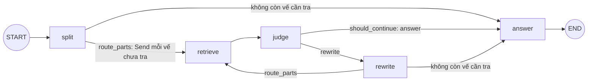

## Mục tiêu

Dựng khung "tách câu hỏi, tra từng vế song song, tra lại vế còn yếu" của agent pháp luật bằng `StateGraph`: hiểu
state có kiểu, reducer quyết định cách gộp các cập nhật song song, `Send` để fan-out số nhánh chỉ biết lúc chạy, cạnh
có điều kiện và một vòng lặp có ngân sách. Mọi bước là hàm Python truyền vào, nên đồ thị chạy và test được mà không
cần LLM; bài Intermediate 03 thay chúng bằng LLM và retriever thật.

## Đề bài

**Phần cứng:** CPU · ~60 phút

Đồ thị cần dựng:

| Node | Đọc | Ghi |
| --- | --- | --- |
| `split` | `question` | `parts = split_fn(question)`, rỗng thì `[question]` |
| `retrieve` (một bản cho mỗi `Send`, input riêng `PartState`) | `part` | `evidence`: mỗi `(uid, score)` của `search_fn(part)` thành `{"uid", "score", "part"}` |
| `judge` | | `attempts` cộng thêm 1 |
| `rewrite` | `parts`, `evidence` | `parts`: mỗi vế yếu `p` thay bằng `rewrite_fn(p)`, vế khác giữ nguyên |
| `answer` | `question`, `evidence` | `answer = answer_fn(question, evidence)` |

Trong `starter/graph.py`:

1. `merge_evidence(left, right)`: reducer, quy tắc trong docstring. Các nhánh `retrieve` xong theo thứ tự bất kỳ; kết
   quả gộp **không được** phụ thuộc thứ tự đó.
2. `ResearchState`: thêm reducer cho các khoá cần cộng dồn (`evidence` dùng `merge_evidence`, `attempts` cộng số).
   Khoá nào **ghi đè** mỗi lần thì giữ không reducer.
3. `route_parts`, `weak_parts`, `should_continue` theo docstring.
4. `build_graph(split_fn, search_fn, rewrite_fn, answer_fn, *, min_score, max_attempts)`: 5 node và các cạnh như sơ
   đồ, trả đồ thị đã `compile()`.

## Tiêu chí đạt

- Reducer: hợp theo uid, giữ điểm cao, quy tắc bằng điểm, sắp xếp, không sửa đầu vào, chịu `None`; 20 thứ tự gộp khác
  nhau cho cùng một kết quả.
- `ResearchState` khai báo đúng reducer cho `evidence` và `attempts`, không cho `parts`.
- Đồ thị: hai vế tra song song không lỗi cập nhật, mỗi vế tra đúng một lần; vòng `rewrite` chỉ tra lại vế còn yếu;
  dừng đúng ở `max_attempts`; viết lại mà không đổi gì thì đi thẳng tới `answer`; 6 thứ tự hoàn thành ngẫu nhiên cho
  cùng một câu trả lời.

## Gợi ý

### Gợi ý 1

Reducer là hàm `(giá_trị_cũ, cập_nhật) -> giá_trị_mới`, khai báo bằng `Annotated[kiểu, hàm]` trong `TypedDict`. Thử bỏ
reducer của `evidence` rồi chạy đồ thị với hai vế để thấy lỗi LangGraph báo khi hai node cùng ghi một khoá trong một
bước. Một quy tắc gộp không phụ thuộc thứ tự thì phải giao hoán: so sánh bằng một khoá đầy đủ, kể cả khi bằng điểm.

### Gợi ý 2

`add_conditional_edges(nguồn, hàm_định_tuyến, [các_node_đích])`: hàm định tuyến trả tên node hoặc một list `Send`.
`Send("retrieve", {"part": p})` chạy node `retrieve` với **input riêng** đó, không phải state chung; cập nhật nó trả về
vẫn đi qua reducer của state chung. Cạnh thường `retrieve -> judge` chỉ chạy `judge` **một lần** sau khi mọi nhánh của
bước đó xong. Dùng `functools.partial` để gắn `min_score`, `max_attempts` vào `should_continue`.
