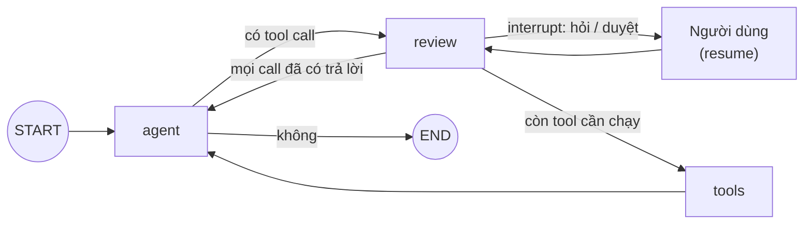

## Mục tiêu

Đưa con người vào vòng lặp agent bằng `interrupt` của LangGraph: agent **hỏi lại** người dùng khi thiếu dữ kiện (hành
vi capstone milestone 6 yêu cầu), và **dừng chờ duyệt** trước tool có tác dụng phụ, người duyệt chấp nhận, sửa tham số
hoặc từ chối kèm lý do. Đồ thị dừng giữa chừng, lưu state vào checkpointer, rồi chạy tiếp khi có câu trả lời, có thể
vài giờ sau và ở một tiến trình khác. Phần khó không nằm ở API mà ở ba chỗ: node bị **chạy lại từ đầu** khi resume, mỗi
tool call phải có đúng một câu trả lời, và state phải ghi đúng cái đã thực thi chứ không phải bản nháp.

## Đề bài

**Phần cứng:** CPU · ~90 phút

Agent tra luật có ba tool: `search_law` (an toàn), `send_email` (tác dụng phụ, cần duyệt), `ask_user` (không bao giờ
chạy như tool thường: nó là cách model xin hỏi người dùng).

Trong `starter/hitl.py`, viết 6 hàm theo docstring: `route_after_agent`, `make_review`, `make_tool_runner`,
`build_app`, `start`, `resume`. `build_app` nhận `checkpointer` (test dùng `InMemorySaver`; ứng dụng thật dùng SQLite
hay Postgres như bài Basic 03). Test dùng fake chat model của LangChain có `bind_tools`, không cần Ollama.

Khi test xanh, đọc `test_approval_then_question_side_effect_once` và tự trả lời: nếu chạy `send_email` ngay trong
`review` sau khi được duyệt, email được gửi mấy lần, và vì sao?

## Tiêu chí đạt

- Không tool call: trả lời luôn. Tool an toàn: chạy không hỏi.
- Hỏi lại: `start` trả `(None, [{"type": "ask", ...}])`; `resume` với câu trả lời đưa nó tới model như kết quả của
  đúng tool call đó; model không bị gọi lại cho lượt đã có.
- Duyệt: chưa duyệt thì chưa gửi; duyệt thì gửi đúng một lần; sửa thì gửi bằng tham số đã sửa và state ghi tham số đó
  (không có AIMessage trùng); từ chối thì không gửi và model nhận `REJECTED: <lý do>`.
- Nhiều interrupt trong một lượt (hỏi, rồi duyệt; hoặc duyệt, rồi hỏi): resume lần lượt, tác dụng phụ chạy đúng một lần.
- Lỗi tool thành observation `ERROR...`; mọi tool call có đúng một `ToolMessage`, không có `ToolMessage` mồ côi.
- Thread độc lập; `resume` khi không có gì đang chờ ném `ValueError`.

## Gợi ý

### Gợi ý 1

`interrupt(value)` lần đầu dừng đồ thị và trả `value` cho người gọi (trong `snapshot.interrupts` hoặc khoá
`__interrupt__` của kết quả `invoke`); `invoke(Command(resume=x), config)` chạy lại node đó **từ dòng đầu**, và lần này
`interrupt` trả `x`. Một node có nhiều `interrupt` thì các giá trị resume được khớp theo thứ tự gọi. Node trả
`Command(goto=..., update=...)` thì khai báo `destinations` khi `add_node` để đồ thị biết các cạnh.

### Gợi ý 2

`add_messages` (reducer của `MessagesState`) **thay** message có cùng `id` thay vì nối thêm: dùng nó để sửa tham số
của tool call trong state. Không dùng `ToolNode` cho bài này: nó chạy mọi tool call của AIMessage cuối, kể cả cái đã
bị từ chối. Mọi thứ trước `interrupt` trong một node sẽ chạy lại mỗi lần resume, nên tác dụng phụ phải nằm ở node khác.
