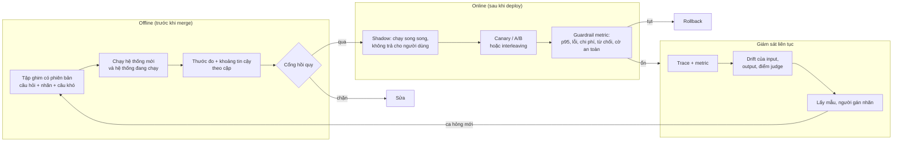
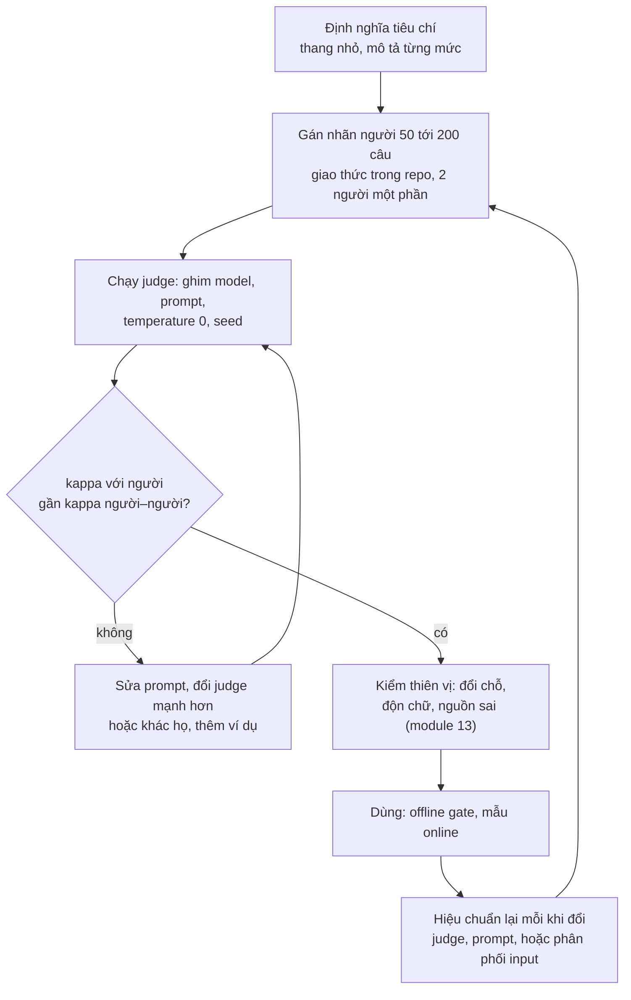
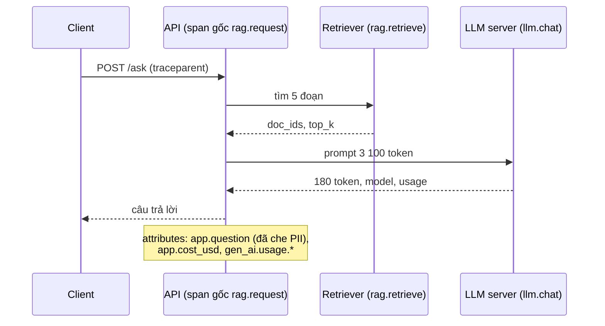
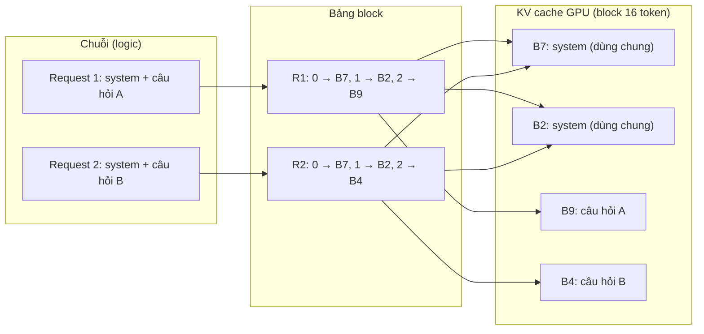
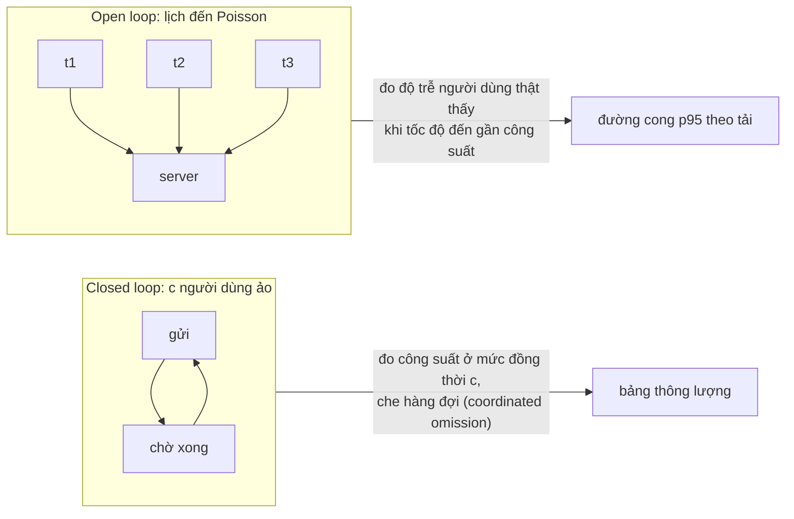

# Evaluation & Production

Một demo LLM chạy được trên ba câu thử là việc của một buổi chiều. Đưa nó cho nghìn người dùng mỗi ngày thì khác: bạn
phải biết chất lượng có tụt sau mỗi thay đổi không (**eval**), máy chấm tự động có đáng tin không (**LLM-as-judge**), một
request chậm hay sai thì chậm ở đâu, sai ở đâu (**observability**), server chịu được bao nhiêu người và tốn bao nhiêu
(**serving, chi phí, độ trễ**). Module này dựng lớp production đó trên những gì các module trước đã dạy.

Các module trước đã có phần nền, module này **không định nghĩa lại** mà trỏ tới:

| Đã học ở | Nội dung | Module này thêm |
| --- | --- | --- |
| [05](../05-transformers-llm-architecture/README.md) mục 5 | prefill, decode, KV cache | vì sao batching và speculative decoding nhanh hơn |
| [09](../09-llms-and-open-models/README.md) mục 5, 6 | sampling, Ollama REST, stream | đo server dưới tải |
| [10](../10-quantization/README.md) mục 7 | GGUF, llama.cpp, tốc độ theo định dạng | llama.cpp server |
| [11](../11-llm-apis-prompting/README.md) mục 3, 7 | giá theo token, prompt caching trên Ollama, eval prompt có bootstrap theo cặp và sàn nhiễu | cache ở server, chi phí mỗi 1 000 request, cổng hồi quy |
| [12](../12-embeddings-vector-db/README.md), [13](../13-rag/README.md) mục 6 | recall@k, MRR, nDCG, faithfulness, judge và giới hạn | hiệu chuẩn judge với nhãn người, eval online |
| [16](../16-ai-agents/README.md) mục 7 | đo agent, khoảng Wilson, pass^k | trace cho agent |
| [19](../19-ai-safety-security/README.md) mục 3, 7 | PII, guardrail và độ trễ của chúng | PII trong trace, guardrail metric khi chạy online |
| [21](../21-ai-system-design/README.md) mục 4, 5 | TTFT, E2E, định luật Little, số GPU, gateway | đo thật: load test, SLO, error budget |

Dữ liệu: **Zalo AI Legal Text Retrieval** (module 13; tập ghim 300 câu đầu của `qrels/test.jsonl`) và **UIT-VSFC**
(module 04, 11; tập ghim 150 câu của module 11). Các khối code chạy từ gốc repo (`uv run python -`). Mọi con số dưới đây
đo trên PC của track (RTX 3060 12GB **dùng chung** với một job train khác, CPU chạy `nice` ở 4 luồng trong khi người
dùng vẫn làm việc trên máy, kiểm ngày 2026-11-01 và 2026-11-02); số tuyệt đối sẽ khác trên máy bạn, tỉ lệ và hình dạng
đường cong mới là bài học.

Sau module này bạn sẽ:

- Dựng bộ eval offline có tập ghim, cổng hồi quy và đủ **statistical power**; biết khi nào cần eval online (A/B,
  interleaving) và theo dõi drift.
- Tự viết LLM judge pointwise và pairwise, **hiệu chuẩn** nó với nhãn người bằng Cohen's kappa và độ tin cậy xác suất,
  đo thiên vị vị trí và độ dài.
- Nối OpenTelemetry vào pipeline: span cho retrieval, LLM, tool; token, chi phí, độ trễ; lấy mẫu; không để PII lọt vào
  trace. Biết Langfuse và các backend khác nhận gì.
- Đo một LLM server dưới tải: thông lượng theo số request đồng thời, TTFT, inter-token latency, tách hàng đợi khỏi thời
  gian phục vụ; hiểu continuous batching và PagedAttention của vLLM.
- Cài speculative decoding greedy, đo tỉ lệ nhận và tăng tốc thật, kể cả khi nó làm chậm đi.
- Báo p50/p95/p99 có khoảng tin cậy, chi phí mỗi 1 000 request có tính token cache, thiết kế SLO và error budget.
- Đánh giá một AI code editor bằng số đo của chính bạn thay vì quảng cáo.

| Mức | Bài | Nội dung |
| --- | --- | --- |
| Basic | 01 latency-slo | breakdown hàng đợi/phục vụ, bootstrap cho p95, phân vị từ histogram, chi phí mỗi 1 000 request, SLO và burn rate |
| Basic | 02 judge-agreement | Cohen's kappa, false pass/false fail, gộp verdict khi đổi chỗ, thiên vị vị trí |
| Basic | 03 otel-tracing | TracerProvider có lấy mẫu theo trace, span RAG với thuộc tính GenAI, exporter JSON Lines, che PII |
| Intermediate | 01 judge-calibration | judge `qwen2.5:3b`/`7b` trên UIT-VSFC và Zalo Legal: kappa, ECE, ngưỡng, đổi chỗ, độn chữ |
| Intermediate | 02 serving-load-test | load generator async, llama.cpp server và Ollama, open/closed loop, prefix cache |
| Intermediate | 03 speculative-decoding | greedy draft-verify, prompt lookup, Qwen2.5-0.5B (và 3B) trên CPU |
| Advanced | 01 online-eval | A/B và interleaving trên Zalo Legal với người dùng mô phỏng, statistical power, drift |
| Advanced | 02 production-service | portfolio: dịch vụ RAG có trace, load test, SLO, chi phí, báo cáo vận hành |

## 1. Eval offline và online

### Ba vòng eval



**Offline** chạy trên tập cố định, nhanh, tái lập được, và là nơi chặn phần lớn lỗi. Module 11 mục 7 đã xây phần lõi:
tập ghim, bootstrap theo cặp, sàn nhiễu (chạy lại y hệt trên phần cứng khác vẫn đổi 5% nhãn), và cổng hồi quy (bài
Advanced 01 của module 11). Ba điều module đó chưa nói:

- **Tập ghim có phiên bản và có ngày.** Tập eval là dữ liệu: lưu trong repo hoặc kho dữ liệu có hash, mỗi lần đổi tập
  là một phiên bản mới, và bảng kết quả ghi phiên bản tập. So số trên hai phiên bản tập khác nhau là so táo với cam.
- **Câu khó được thêm dần, không thay tập cũ.** Mỗi sự cố production thành một ca trong tập "regression" riêng; tập
  "đại diện" giữ nguyên phân phối để con số tổng còn so được qua thời gian.
- **Dữ liệu không được rò vào prompt hay fine-tune.** Một ví dụ few-shot lấy từ tập test, hay một lượt fine-tune trên
  log có chứa câu test, làm điểm offline đẹp giả.

### Statistical power: tập eval cần bao nhiêu câu

Câu hỏi đúng không phải "hệ thống B có tốt hơn không" mà "nếu B tốt hơn $$\delta$$ thì tập này có thấy không". Với hai
tỉ lệ (tỉ lệ đúng, tỉ lệ thành công) và hai nhóm độc lập, số mẫu mỗi nhóm để phát hiện chênh lệch $$\delta = p_A - p_B$$ với
mức ý nghĩa $$\alpha$$ (hai phía) và power $$1-\beta$$ là

$$
n \approx \frac{\left(z_{1-\alpha/2}\sqrt{2\bar p(1-\bar p)} + z_{1-\beta}\sqrt{p_A(1-p_A) + p_B(1-p_B)}\right)^2}{\delta^2},
\qquad \bar p = \frac{p_A + p_B}{2}
$$

Số mẫu tăng theo $$1/\delta^2$$: muốn thấy chênh lệch nhỏ đi một nửa phải có gấp bốn lần câu.

```python
from statsmodels.stats.power import NormalIndPower
from statsmodels.stats.proportion import proportion_effectsize

for pa, pb in [(0.80, 0.70), (0.80, 0.75), (0.80, 0.78)]:
    n = NormalIndPower().solve_power(proportion_effectsize(pa, pb), alpha=0.05, power=0.8)
    print(f"{pa:.2f} so với {pb:.2f}: khoảng {n:,.0f} mẫu mỗi nhóm")
```

Kết quả: khoảng **292**, **1 092** và **6 507** mẫu mỗi nhóm (statsmodels dùng biến đổi arcsin, gần đúng như công thức
trên). Đọc ngược lại cho hai nhóm 150 câu độc lập: chỉ phát hiện được chênh lệch cỡ 14 điểm phần trăm, cùng cỡ với khoảng
tin cậy ±0.07 của macro-F1 ở module 11.

Eval offline có lợi thế lớn: **cùng câu cho cả hai hệ thống**, nên so theo cặp loại được độ khó của từng câu. Trên 300
câu ghim của Zalo Legal, retriever dense `bge-m3` đầy đủ có MRR@10 **0.708**; một bản lỗi cắt câu hỏi ở 15 từ đầu (lỗi
cấu hình kiểu `max_length` hay gặp) có MRR@10 **0.665**. Hiệu 0.043, bootstrap theo cặp 2 000 lần cho khoảng 95%
**[0.017, 0.073]**: không chứa 0, dù chỉ 65 trên 300 câu có thứ hạng đổi (44 câu tệ đi, 21 câu tốt lên). Câu ngắn hơn 15
từ không đổi gì, nên so theo cặp tập trung đúng vào phần khác biệt; so hai trung bình độc lập sẽ lẫn nó vào phương sai
của cả 300 câu.

### Online: A/B test và interleaving

Offline không đo được thứ chỉ người dùng thật cho: câu hỏi ngoài tập, hành vi (bấm nguồn, hỏi lại, bỏ đi), và hệ thống
xung quanh. Hai cách đo online phổ biến:

| | A/B test | Interleaving (team-draft) |
| --- | --- | --- |
| Cách làm | chia người dùng hai nhóm, mỗi nhóm thấy một hệ thống | mỗi người dùng thấy **một** danh sách trộn từ hai hệ thống, mỗi kết quả được gắn "đội" |
| Tín hiệu | thước đo nhóm (tỉ lệ thành công, thời gian, giữ chân) | đội nào nhận nhiều click hơn trong cùng một lượt |
| Phương sai | lớn: khác biệt giữa người dùng và câu hỏi nằm trong nhiễu | nhỏ: cùng người, cùng câu hỏi, so ngay trong lượt |
| Đo được | mọi thứ, kể cả chi phí, độ trễ, an toàn | chỉ **thứ tự ưu tiên** giữa hai bảng xếp hạng |
| Dùng cho | quyết định ra mắt, đo tác động kinh doanh | lọc nhanh nhiều ứng viên ranker trước khi A/B |

Interleaving (Joachims 2002; team-draft của Radlinski et al. 2008) cần ít người dùng hơn để thấy cùng một khác biệt thứ
hạng; mức lợi phụ thuộc phương sai giữa người dùng và số câu mà hai hệ thống trả khác nhau. Bài Advanced 01 đo nó trên Zalo
Legal với người dùng mô phỏng. Nó không thay A/B: interleaving
không nói gì về độ trễ hay chi phí, và chỉ áp dụng khi output là danh sách.

Với hệ thống LLM sinh chữ (không phải danh sách), tín hiệu online thường là: người dùng bấm thích/không thích (thưa và
lệch: người bực mới bấm), hỏi lại cùng ý trong vài phút, copy câu trả lời, mở nguồn trích dẫn, chuyển cho người thật, và
**điểm judge trên mẫu ngẫu nhiên** của lưu lượng thật (mục 2). Bên cạnh thước đo chính luôn có **guardrail metric**: chỉ
số không được tệ đi dù thước đo chính tốt lên (p95 độ trễ, tỉ lệ lỗi, chi phí mỗi request, tỉ lệ từ chối, cờ của
moderation ở module 19). Một prompt mới tăng 2% hài lòng mà gấp đôi chi phí hay tăng tỉ lệ bị gắn cờ thì không qua.

### Drift: khi input không còn giống tập eval

Tập eval đại diện cho người dùng **lúc bạn tạo nó**. Ví dụ thật trên tập ghim: cùng 300 câu hỏi Zalo Legal, gõ **không
dấu** (như nhiều người gõ trên điện thoại), retriever `bge-m3` tụt từ MRR@10 0.708 xuống **0.076**. Không model nào đổi,
không dòng code nào đổi; chỉ phân phối input đổi. Eval offline trên tập có dấu không bao giờ thấy chuyện này.

Theo dõi drift ở ba tầng: **input** (độ dài, ngôn ngữ, tỉ lệ có dấu, chủ đề, embedding), **output** (độ dài, tỉ lệ từ
chối, tỉ lệ trích dẫn) và **chất lượng** (điểm judge trên mẫu, phản hồi người dùng). Một thước đo đơn giản cho một đặc
trưng là Population Stability Index giữa phân phối tham chiếu $$e$$ và phân phối hiện tại $$a$$ trên cùng các bin:

$$
\mathrm{PSI} = \sum_{b} (a_b - e_b)\,\ln\frac{a_b}{e_b}
$$

Quy ước kinh nghiệm hay dùng: dưới 0.1 là ổn, 0.1 tới 0.25 đáng xem, trên 0.25 là drift lớn. Ngưỡng này chỉ là thói
quen của ngành tín dụng, không phải định lý; đặt ngưỡng của bạn bằng cách xem PSI dao động bao nhiêu giữa các tuần
"bình thường". Với embedding, một cách mạnh hơn là train một classifier phân biệt "tuần trước" với "tuần này": AUC gần 0.5
là không drift.

## 2. LLM-as-judge và hiệu chuẩn với nhãn người

### Ba kiểu judge

| Kiểu | Judge thấy | Output | Hợp với |
| --- | --- | --- | --- |
| Pointwise | một câu trả lời (và nguồn, câu hỏi) | điểm 1..5, có/không | theo dõi tuyệt đối theo thời gian, faithfulness (module 13) |
| Pairwise | hai câu trả lời cho cùng câu hỏi | A, B, hoà | so hai prompt/model; tài liệu thấy thường nhất quán hơn chấm điểm tuyệt đối, nhưng chỉ khi judge không thiên vị vị trí (phải chấm hai thứ tự, bài Intermediate 01 đo) |
| Có đáp án mẫu | câu trả lời và đáp án tham chiếu | đúng/sai, khớp ý | khi có nhãn nhưng câu trả lời tự do, không so chuỗi được |

Thiên vị đã biết (Zheng et al., 2023; Wang et al., 2023): **vị trí** (thích câu đứng trước, hoặc đứng sau), **độ dài**
(thích câu dài, chi tiết hơn dù không đúng hơn), **tự ưu ái** (judge chấm cao câu do chính nó hoặc cùng họ sinh ra;
Panickssery et al., 2024 cho thấy model nhận ra được chữ của chính mình), và **không ổn định** giữa các lần gọi.

### Đo độ khớp với người: Cohen's kappa

Accuracy của judge so với nhãn người bị đánh lừa khi một lớp chiếm đa số: judge luôn nói "đạt" trên tập 90% câu đạt có
accuracy 0.9 mà không phân biệt được gì. Cohen's kappa trừ đi phần khớp do may rủi:

$$
\kappa = \frac{p_o - p_e}{1 - p_e}, \qquad p_e = \sum_{c} p_{\text{judge}}(c)\, p_{\text{người}}(c)
$$

với $$p_o$$ là tỉ lệ khớp quan sát được, $$p_e$$ là tỉ lệ khớp nếu hai bên chọn nhãn độc lập theo tần suất riêng.
$$\kappa = 0$$ là ngang may rủi, 1 là khớp hoàn toàn. Thang Landis & Koch (1977) hay được trích (0.41 tới 0.60 "vừa",
0.61 tới 0.80 "đáng kể") nhưng chỉ là quy ước; cách đọc tốt hơn là so kappa của judge với kappa **giữa hai người chấm**
trên cùng tập: judge khớp với người ngang người khớp với người là trần thực tế.

Kappa một con số chưa đủ: cần biết judge sai **theo hướng nào**. Judge **dễ dãi** (false pass cao: cho qua câu người
chấm là sai) làm hệ thống trông tốt hơn thật; judge **khắt khe** (false fail cao) làm bạn bỏ những thay đổi tốt. Với
judge dùng để chặn hồi quy, false pass nguy hiểm hơn.

### Nhãn người lấy ở đâu cho tái lập được

Hiệu chuẩn cần nhãn người, và nhãn phải đủ (vài chục tới vài trăm câu) và tái lập được. Ba nguồn trong track:

- **Nhãn có sẵn của bộ dữ liệu**: UIT-VSFC có nhãn cảm xúc do người gán. Biến nó thành bài toán judge: đưa cho judge câu
  phản hồi kèm một nhãn "hệ thống gán", một nửa bị đổi sai có chủ đích, và hỏi nhãn đó đúng không. Đáp án thật đã biết.
- **qrels**: Zalo Legal cho biết điều luật đúng của mỗi câu hỏi; ghép với một điều luật gần nghĩa nhưng sai (hard
  negative từ dense retrieval), judge pairwise phải chọn đúng điều luật.
- **Tự gán nhãn có giao thức**: 30 tới 50 câu trả lời tự do, ghi giao thức (định nghĩa từng mức, ví dụ biên, ai gán,
  ngày gán) vào repo, nhãn để ở chỗ có kiểm soát. Hai người gán độc lập một phần để đo kappa giữa người với người.

Bài Intermediate 01 làm hai nguồn đầu với `qwen2.5:3b` và `qwen2.5:7b`. Không có con số nào ở đây: bạn sẽ tự đo, và
thấy judge sai ở đâu là bài học chính.

### Xác suất của judge: calibration

Judge trả "yes" với log-probability của token. Một judge **được hiệu chỉnh tốt** nói "yes với xác suất 0.8" thì đúng
khoảng 80% số lần. Expected calibration error chia $$[0, 1]$$ thành các khoảng và lấy trung bình có trọng số của độ lệch
giữa xác suất trung bình và tỉ lệ đúng thật trong từng khoảng:

$$
\mathrm{ECE} = \sum_{b} \frac{|B_b|}{N} \left| \overline{p}_{B_b} - \overline{y}_{B_b} \right|
$$

LLM sau RLHF thường **quá tự tin** (Kadavath et al., 2022 bàn về model tự đánh giá; xác suất của model chat thường dồn
về gần 0 và 1). Hệ quả thực tế: đừng dùng ngưỡng 0.5 mặc định. Chọn ngưỡng trên một nửa tập có nhãn, báo kết quả trên
nửa còn lại, và chấp nhận rằng với vài chục câu, ngưỡng "tối ưu" nhiễu gần bằng lợi ích của nó.

### Quy trình dùng judge có trách nhiệm



- **Ghim judge.** Id model phải trỏ tới đúng một model. Gateway kiểu router (OmniRoute dùng chung của track với id
  `auto/...`) có thể đổi model phía sau mà không báo: điểm judge hôm nay và tháng sau không so được với nhau, và không
  được ghi kết quả là "của model X". Track dùng judge local `qwen2.5:3b`/`7b` cho số liệu chính vì lý do đó.
- **Pairwise luôn chạy hai thứ tự** và gộp: hai lần khác nhau thì coi là hoà, không lấy lần đầu.
- **Judge khác họ hoặc mạnh hơn** model được chấm; nếu buộc dùng cùng model, nói rõ giới hạn tự ưu ái.
- **Báo kèm** kappa, false pass, false fail, số câu không đọc được verdict; điểm judge không kèm mấy số này thì không
  ai nên tin.

## 3. Observability: trace với OpenTelemetry

### Log, metric, trace

| Tín hiệu | Trả lời | Ví dụ cho dịch vụ LLM |
| --- | --- | --- |
| **Metric** | hệ thống có khoẻ không, theo thời gian | request/giây, p95 TTFT, tỉ lệ lỗi, token/phút, chi phí/giờ (histogram, counter) |
| **Log** | chuyện gì xảy ra ở một điểm | "guardrail chặn request 81f3 vì PII" |
| **Trace** | một request đi qua những bước nào, mỗi bước bao lâu | span retrieval 140 ms, span LLM 2.1 s với 3 100 token vào |

Với LLM, trace quan trọng hơn ở dịch vụ thường vì một request là **chuỗi bước không tất định**: viết lại câu hỏi,
retrieval, rerank, một hay nhiều lần gọi model, tool call, guardrail. Cây debug ở module 13 mục 6 ("retrieval hay
generation?") chỉ đi được khi có trace của từng request.

### Mô hình dữ liệu của OpenTelemetry

Một **trace** là cây các **span** cùng `trace_id` (128 bit); mỗi span có `span_id` (64 bit), `parent_span_id`, tên, thời
điểm bắt đầu và kết thúc, **attributes** (khoá-giá trị), **events** (ví dụ exception), **status**. **Resource** mô tả
tiến trình phát ra span (`service.name`, phiên bản). Context được truyền qua ranh giới tiến trình bằng header
`traceparent` (W3C Trace Context), nên một trace đi được từ frontend qua gateway tới server model.



OpenTelemetry có **semantic conventions cho GenAI**: tên thuộc tính chuẩn như `gen_ai.operation.name`,
`gen_ai.request.model`, `gen_ai.usage.input_tokens`, `gen_ai.usage.output_tokens` (đối chiếu với gói
`opentelemetry-semantic-conventions` 0.66b1 của môi trường track, ứng với semantic conventions 1.44.0, kiểm ngày 2026-11-01:
các thuộc tính GenAI nằm ở nhóm `_incubating`, tức chưa ổn định). Bộ quy ước này còn đang thay đổi (xem trang chính thức ở
mục 8 trước khi dùng); lợi ích của việc theo nó là mọi backend hiểu cùng một trace. Thuộc tính riêng
của bạn đặt dưới tiền tố riêng (`app.*`, `rag.*`).

### Lấy mẫu, chi phí, PII

- **Head sampling**: quyết định giữ hay bỏ ngay ở span gốc, theo `trace_id` (`TraceIdRatioBased`), span con theo quyết
  định của cha (`ParentBased`) để không có trace cụt. Rẻ, nhưng bỏ ngẫu nhiên cả request lỗi hiếm.
- **Tail sampling**: OpenTelemetry Collector đợi trace hoàn tất rồi mới quyết định (giữ mọi trace lỗi, mọi trace chậm
  hơn p99, và 1% còn lại). Giữ đúng thứ cần debug, đổi lại collector phải giữ trace trong bộ nhớ.
- **Chi phí CPU**: đo với lời giải bài Basic 03, một request ba span (Python, 4 luồng, máy dùng chung): không trace 14 µs,
  trace bị lấy mẫu bỏ 29 µs, ghi vào bộ nhớ 126 µs, ghi tệp JSON Lines đồng bộ 314 µs, qua `BatchSpanProcessor` 185 µs.
  So với một lần gọi LLM cỡ giây, trace gần như miễn phí. Nhưng trong vòng lặp dồn dập, `BatchSpanProcessor` báo "Queue
  full, dropping Span": hàng đợi đầy thì span bị **bỏ**, không chặn request. Đó là lựa chọn đúng cho production, và là lý
  do phải giám sát chính số span bị bỏ.
- **PII**: trace mặc định lưu nguyên prompt và câu trả lời ở nhiều công cụ. Che PII **trước** khi gắn vào span (module 19
  mục 3), giới hạn ai đọc được trace, đặt hạn lưu, và cân nhắc chỉ lưu độ dài thay vì nội dung ở lưu lượng thường, nội
  dung đầy đủ chỉ ở mẫu đã che.

### Langfuse và các backend (tham khảo)

Module không thêm dependency hay dịch vụ ngoài: bài Basic 03 dùng `opentelemetry-sdk` có sẵn và xuất span ra tệp JSON
Lines để đọc bằng pandas. Ở production, span được gửi qua OTLP tới một backend. Nhóm công cụ chuyên cho LLM (kiểm ngày
2026-11-01, đọc tài liệu hiện hành trước khi chọn):

| Công cụ | Ghi chú |
| --- | --- |
| **Langfuse** | mã nguồn mở, tự host được; trace, quản lý prompt có phiên bản, dataset và chạy eval, LLM-as-judge; theo tài liệu của Langfuse, nhận trace qua endpoint OpenTelemetry |
| **Arize Phoenix** | mã nguồn mở, dựa trên OpenTelemetry và OpenInference; mạnh về phân tích eval |
| **LangSmith** | của LangChain; tích hợp sâu với LangChain/LangGraph (module 17) |
| **Jaeger, Grafana Tempo** | backend trace tổng quát; không có màn hình riêng cho prompt, token |

Chọn công cụ sau khi biết mình cần gì: nếu trace đã theo OpenTelemetry, đổi backend chỉ là đổi exporter.

## 4. Serving: llama.cpp server, Ollama, vLLM

### Từ một request tới nhiều request

Module 21 mục 4 cho trần decode khi batch 1: $$r_{\text{decode}} \le B_{\text{mem}} / M_{\text{weights}}$$. Mỗi bước decode
đọc toàn bộ trọng số để sinh **một** token cho **một** chuỗi. Nếu cùng bước đó phục vụ $$b$$ chuỗi, trọng số chỉ đọc một
lần cho cả $$b$$ token: thông lượng tổng tăng gần $$b$$ lần cho tới khi phép tính hoặc bộ nhớ KV trở thành nút thắt. Đo
bằng `generate` của Transformers trên CPU (Qwen2.5-0.5B float32, 4 luồng, 64 token mỗi chuỗi, cùng prompt ngắn):

| Batch | Token/giây (tổng) | Giây cho cả batch |
| --- | --- | --- |
| 1 | 13.4 | 4.78 |
| 4 | 40.2 | 6.37 |
| 16 | 105.5 | 9.71 |

Batch 16 cho gần 8 lần thông lượng của batch 1, trong khi mỗi chuỗi chỉ chậm khoảng 2 lần (9.7 so với 4.8 giây cho 64
token): trên CPU, model 0.5B cũng phần lớn bị chặn bởi việc đọc trọng số. Server phải gom request để có batch. **Static batching** đợi đủ $$b$$ request rồi chạy tới khi chuỗi dài nhất xong: chuỗi
ngắn ngồi chờ, request mới chờ cả batch. **Continuous batching** (Orca, Yu et al., 2022; còn gọi iteration-level
scheduling) xếp lịch **mỗi bước decode**: chuỗi xong thì rời batch ngay, request mới vào ngay ở bước kế tiếp. Đây là
khác biệt lớn nhất giữa một server production và một vòng `generate`.

### vLLM: PagedAttention và continuous batching

Batch lớn cần KV cache lớn (module 05 mục 5, module 21 mục 4). Cấp phát KV liền khối theo độ dài tối đa phí phần lớn bộ
nhớ cho chỗ chưa dùng. **PagedAttention** (Kwon et al., 2023) chia KV cache thành các block cố định (ví dụ 16 token), cấp
phát theo nhu cầu như bộ nhớ ảo phân trang; một bảng block ánh xạ vị trí logic sang block vật lý. Hệ quả: gần như không phí
bộ nhớ, nhiều chuỗi hơn trong batch, và **chia sẻ** block giữa các chuỗi có cùng prefix (prompt caching tự động, beam
search, nhiều mẫu cho cùng prompt) bằng copy-on-write.



Các server production khác dùng cùng ý tưởng: **SGLang** (RadixAttention: cây prefix để tái dùng KV giữa request),
**TGI** của Hugging Face, **TensorRT-LLM** của NVIDIA, và **llama.cpp server** (`llama-server`, có `--parallel` cho nhiều
slot, continuous batching, `cache_prompt` để tái dùng prefix của slot, và model nháp cho speculative decoding).

vLLM **không chạy** trong track: ở thời điểm dựng track (2026-10-30), bản vLLM 0.31 đòi `transformers<5.18` trong khi môi
trường dùng chung cần `transformers>=5.22`, và vLLM chủ yếu nhắm GPU NVIDIA lớn hơn laptop 4GB của track. Trên PC có thể
cài vLLM trong một môi trường riêng; khái niệm và cách đo trong module này áp dụng nguyên vẹn (`vllm bench serve` là
một load generator như bài Intermediate 02).

### Đo thật: llama.cpp server và Ollama dưới tải

Bài Intermediate 02 viết load generator và đo hai server với Qwen2.5-0.5B Q4_K_M: `llama_cpp.server` của
`llama-cpp-python` 0.3.36 (CPU, 4 luồng) và Ollama 0.13.5 (GPU dùng chung, cấu hình mặc định). Server của
`llama-cpp-python` giữ một context duy nhất nên xử lý **từng request một**; Ollama ở cấu hình mặc định của máy track cũng
chạy một request mỗi model (log server ghi `Parallel:1`). Kết quả closed loop của llama.cpp server (16 request mỗi mức,
`max_tokens` 64, cờ `--interrupt_requests false`):

| Đồng thời | Request/giây | TTFT p50 (s) | TTFT p95 (s) | Inter-token p50 (s) |
| --- | --- | --- | --- | --- |
| 1 | 0.90 | 0.20 | 0.34 | 0.020 |
| 2 | 0.87 | 1.24 | 1.92 | 0.020 |
| 4 | 0.87 | 3.28 | 4.56 | 0.020 |
| 8 | 0.83 | 7.96 | 9.15 | 0.020 |

Thông lượng **không tăng** theo số request đồng thời; TTFT tăng gần tuyến tính vì request đứng chờ **bên trong server**;
inter-token latency đứng yên vì mỗi lúc chỉ một chuỗi được decode. Load generator phía client không thấy hàng đợi đó: nó
gửi ngay, và chỉ thấy TTFT dài ra. Một server có continuous batching sẽ cho đường thông lượng đi lên, và inter-token
latency tăng dần theo batch. Cách đọc cho capacity planning: với SLO TTFT p95 dưới 2 giây, server này chỉ chịu được 2
người dùng đồng thời liên tục.

Chi tiết vận hành nhỏ mà đắt: với cấu hình mặc định của một server, hãy kiểm số request **thành công** ở mức đồng thời 2
trước khi tin bất kỳ con số thông lượng nào. Bài Intermediate 02 cho bạn tự thấy vì sao.

### Prompt caching ở server

Prompt caching ở API (module 11 mục 3) là KV cache của prefix được giữ lại phía nhà cung cấp. Ở server tự host, cùng cơ chế
có ba mức:

| Mức | Cơ chế | Khi nào trúng |
| --- | --- | --- |
| Slot giữ KV của request trước | `llama-cpp-python`, Ollama, `cache_prompt` của `llama-server` | request kế tiếp **trên cùng slot** có cùng prefix |
| Cache trạng thái theo prefix | `--cache` (RAM/đĩa) của `llama_cpp.server` | prefix đã gặp trước đó, kể cả xen kẽ nhiều prefix |
| Chia sẻ block | PagedAttention prefix caching (vLLM), RadixAttention (SGLang) | mọi request đang chạy hay vừa chạy có cùng prefix, không cần cùng slot |

Bài Intermediate 02 đo hai mức đầu trên llama.cpp server với system prompt khoảng 1 700 token (một điều luật dài), gồm cả
trường hợp xen kẽ hai tài liệu và thêm một dấu cách ở đầu. Quy tắc thiết kế giữ nguyên như module 11: phần cố định trước,
phần đổi theo request sau, không có gì đổi theo request (ngày giờ, id) trong phần cố định; ở server tự host còn thêm
**định tuyến theo prefix** (request cùng tài liệu về cùng replica/slot) khi có nhiều replica.

## 5. Speculative decoding

### Ý tưởng

Decode bị chặn bởi băng thông: một forward cho 1 token tốn gần bằng một forward cho vài token (trọng số đọc một lần). Nếu
đoán trước được $$k$$ token bằng cách rẻ, model lớn (target) kiểm cả khối trong **một** forward: nhận phần đầu khớp, sửa token
sai đầu tiên, bỏ phần sau. Với greedy, output **trùng từng token** với target chạy một mình; với sampling, quy tắc nhận
$$\min\!\left(1, \frac{p(x)}{q(x)}\right)$$ và lấy mẫu lại từ $$\max(0, p - q)$$ khi từ chối giữ đúng phân phối của target
(Leviathan et al., 2023; Chen et al., 2023).

```mermaid
sequenceDiagram
    participant D as Hàm đoán (model nháp / prompt lookup)
    participant T as Target
    Note over T: đã chắc chắn: "... phạt tiền từ"
    D->>D: đoán k = 4: "800", ".", "000", "đến"
    D->>T: kiểm 1 + 4 token trong một forward
    T-->>T: argmax ở 5 vị trí: "800", ".", "000", "đồng", "đến"
    Note over T: nhận "800", ".", "000"; sai ở vị trí 4 → lấy "đồng" của target
    T->>T: cắt KV cache về độ dài đã nhận
```

### Tăng tốc kỳ vọng

Giả sử mỗi token đoán được nhận độc lập với xác suất $$\alpha$$. Một lượt kiểm sinh trung bình

$$
\mathbb{E}[\text{token mỗi lượt}] = \frac{1 - \alpha^{k+1}}{1 - \alpha}
$$

token (gồm token sửa hoặc token thưởng). Nếu một lượt đoán $$k$$ token tốn $$c$$ lần chi phí một forward target cho mỗi
token đoán, và forward target cho $$k+1$$ token tốn $$v_k$$ lần forward cho 1 token, tăng tốc là

$$
S = \frac{1 - \alpha^{k+1}}{(1 - \alpha)\,(k c + v_k)}
$$

Lý thuyết gốc giả định $$v_k \approx 1$$ (GPU, model lớn, decode bị chặn bởi băng thông). Trên CPU thì không: đo trên PC
của track (hai lần đo, mỗi lần một forward sau khi làm nóng), Qwen2.5-3B float32 trên CPU 4 luồng forward 8 token mất 0.72
tới 0.74 s so với 0.32 tới 0.36 s cho 1 token ($$v \approx 2$$); với Qwen2.5-0.5B là 0.098 tới 0.106 s so với 0.068 tới 0.072 s
($$v \approx 1.5$$).

```python
def speedup(alpha, k, c, v):
    return (1 - alpha ** (k + 1)) / ((1 - alpha) * (k * c + v))


for alpha in (0.4, 0.7, 0.9):
    print(alpha, [round(speedup(alpha, k, c=0.2, v=2.0), 2) for k in (2, 4, 8)],
          [round(speedup(alpha, k, c=0.0, v=1.2), 2) for k in (2, 4, 8)])
```

Cột trái là model nháp tốn 20% target với $$v = 2$$ (gần trường hợp 0.5B đoán cho 3B trên CPU): $$\alpha = 0.4$$ cho dưới 1,
tức **chậm hơn**, và $$\alpha = 0.7$$ vẫn chưa tới 1; $$\alpha = 0.9$$ mới được 1.1 tới 1.7 lần tuỳ $$k$$. Cột phải là prompt lookup (đoán gần như miễn phí, $$c = 0$$)
với $$v = 1.2$$: nhanh hơn ở mọi $$\alpha$$ trong bảng, và lợi nhiều khi $$\alpha$$ cao.

### Cách đoán

| Cách | Đoán bằng | Hợp khi |
| --- | --- | --- |
| **Model nháp** | model nhỏ cùng tokenizer (Qwen2.5-0.5B cho Qwen2.5-3B/7B) | target lớn, GPU, model nháp đủ giống target |
| **Prompt lookup** / n-gram | token đứng sau cùng n-gram trong prompt (Saxena, 2023) | output chép từ input: trích dẫn, sửa code, RAG trích nguyên văn |
| **Medusa** (Cai et al., 2024) | thêm nhiều head dự đoán token $$t+2, t+3, \dots$$ vào chính target | không muốn chạy model thứ hai; cần train head |
| **EAGLE** (Li et al., 2024) | một lớp nhỏ đoán ở mức feature của target | tỉ lệ nhận cao hơn model nháp; cần train cho từng target |

### Đo thật: khi nó không giúp

Trên PC của track, CPU 4 luồng, Qwen2.5-3B Q4_K_M qua `llama-cpp-python` 0.3.36 với `LlamaPromptLookupDecoding`
(10 token đoán), sinh 128 token cho ba điều luật Zalo, mỗi điều hai tác vụ (chép nguyên văn khoản 2; giải thích bằng lời của mình):

| Tác vụ | Tăng tốc phần decode | Output trùng bản không đoán |
| --- | --- | --- |
| Chép nguyên văn | 1.13, 1.03, 0.93 | 2 / 3 |
| Giải thích tự do | 0.29, 0.36, 0.35 | 0 / 3 |

Ở bản này, prompt lookup làm decode **chậm gấp ba** khi đoán sai nhiều, và gần như không lợi khi đoán đúng nhiều. Hai lý do
khả dĩ, đọc từ mã nguồn chứ chưa đo tách riêng: bật model nháp buộc `logits_all=True` (chép toàn bộ logits 151 936 chiều của mọi vị trí ra numpy, cả
lúc prefill), và mỗi lượt kiểm 11 token trên CPU tốn gấp nhiều lần một token. Cũng phải tự đặt `logits_all=True` khi tạo
`Llama` có `draft_model`, nếu không prompt dài báo lỗi lệch kích thước mảng (lỗi của bản 0.3.36). Output khác bản không
đoán ở 4 trên 6 tác vụ. Nhiều khả năng do kiểm một khối token đi qua phép nhân ma trận có kích thước khác, thứ tự cộng số
thực khác, và chỉ cần một argmax đổi hạng là cả đuôi câu khác (cùng hiện tượng ở module 09 mục 6); nhưng hai lượt chạy còn
khác nhau ở một điểm nữa (bản không đoán chạy `logits_all=False`, bản đoán `logits_all=True`), nên thí nghiệm này không tách
được nguyên nhân. "Speculative decoding không đổi output" đúng về
toán, không đúng về số học dấu phẩy động.

Model nháp Qwen2.5-0.5B cho target Qwen2.5-3B (cài đặt của bài Intermediate 03, Transformers, float32, CPU, $$k = 4$$, 64
token, hai điều luật): tỉ lệ nhận 0.89 tới 0.91 ở tác vụ chép nhưng chỉ tăng tốc 1.17 tới 1.22 lần; tác vụ tự do tỉ lệ
nhận 0.39 tới 0.42 và **chậm hơn** (0.81 tới 0.90 lần). Output trùng greedy ở cả bốn lần. Đúng như công thức: trên CPU,
$$v$$ cỡ 2 và model nháp không rẻ, nên chỉ tỉ lệ nhận rất cao mới bù được. Trên GPU với target 7B trở lên, cùng thuật
toán thường cho 2 tới 3 lần theo các bài báo; bài Intermediate 03 cho bạn đo prompt lookup trên Qwen2.5-0.5B và tự kết luận.

Bài học vận hành: speculative decoding là tối ưu **theo tác vụ và phần cứng**. Bật nó cho dịch vụ chép-sửa (code
editor, trích dẫn) trên GPU; đo tỉ lệ nhận trên lưu lượng thật trước khi bật cho chat tự do; và nó giảm độ trễ **một**
request, còn ở batch lớn (GPU đã bận tính) lợi ích giảm dần.

## 6. Độ trễ, chi phí, SLO và load test

### p50, p95, p99 có khoảng tin cậy

Module 21 mục 4 định nghĩa TTFT, TPOT, E2E. Thêm vào đó:

- **Inter-token latency** (ITL) là khoảng cách giữa hai token liên tiếp phía client; TPOT là trung bình của nó trong một
  request. Báo phân vị của ITL **gộp** mọi token mới thấy các lần khựng (stall) mà trung bình che mất.
- **Phân vị cao cần nhiều mẫu.** p99 trên 40 request là gần như request chậm nhất: một mẫu quyết định cả con số. Đặt
  khoảng tin cậy bằng bootstrap: lấy mẫu lại có hoàn lại, tính phân vị mỗi lần, lấy phân vị 2.5 và 97.5 của các giá trị đó.

Ví dụ trên một lượt đo thử 40 request open loop của llama.cpp server (rate 0.8 request/giây, cùng thiết lập bài
Intermediate 02, notebook dùng 30 request mỗi mức), E2E: p50
**4.08** s [2.91, 6.45], p95 **9.44** s [7.71, 9.97], p99 **9.78** s [8.94, 9.97]. Cận trên của p95 và p99 bằng nhau và bằng
request chậm nhất: 40 mẫu không đủ để nói gì về p99. Bootstrap phân vị cũng chệch ở đuôi với mẫu nhỏ; muốn biết p99 thì
cần cỡ vài nghìn request.

### Phân vị từ histogram

Hệ thống metric (Prometheus, OpenTelemetry metrics) không lưu từng request mà lưu **histogram** với các bucket cố định, rồi
ước lượng phân vị bằng nội suy tuyến tính trong bucket chứa nó (`histogram_quantile`). Trên 120 request của lượt đo thử
đó (ba mức tải) với bucket 0.25, 0.5, 1, 2.5, 5, 10 giây: p50 ước lượng 2.24 s (thật 2.17), p95 8.42 s (thật **7.71**), p99
9.68 s (thật 9.47). Sai số do bucket rộng ở đuôi: chọn ranh giới bucket **quanh ngưỡng SLO** (nếu SLO là 2 s thì cần
bucket 1.5, 2, 2.5), không chia đều.

### Chi phí mỗi 1 000 request

Công thức của module 11 mục 3 cho một request. Một báo cáo vận hành cần chi phí **mỗi 1 000 request** trên phân phối thật
của token (không phải một request trung bình đẹp), có tính token đọc từ cache. Ví dụ một request RAG: 2 000 token vào,
trong đó 1 500 token system + tài liệu cố định được cache, 200 token ra. Theo bảng giá module 11 (kiểm ngày 2026-11-01):

| Model | Không cache (USD/1 000 request) | Có cache 1 500 token (USD/1 000 request) |
| --- | --- | --- |
| Claude Haiku 5.5 | 0.30 | 0.17 |
| Gemini 3.8 Flash | 2.25 | 1.24 |
| gpt-6.1-terra | 3.00 | 1.58 |
| Claude Sonnet 5.5 | 6.00 | 3.15 |

Tính: Haiku không cache $$(2000 \times 0.10 + 200 \times 0.50)/10^6 \times 1000 = 0.30$$; có cache
$$(500 \times 0.10 + 1500 \times 0.01 + 200 \times 0.50)/10^6 \times 1000 = 0.165$$. Bảng chưa tính phí ghi cache của
Anthropic (1.25 lần giá vào cho lần ghi đầu, module 11) và giả định cache luôn trúng; lưu lượng thưa hơn thời gian sống
của cache thì không đạt được cột phải. Self-host không có giá theo token: chi phí là giờ GPU chia cho số request phục vụ
được **ở mức SLO**, nên phụ thuộc trực tiếp vào load test ở mục 4.

### SLO, error budget, burn rate

**SLI** là thước đo (tỉ lệ request "tốt"), **SLO** là mục tiêu cho SLI trong một cửa sổ (99% request trong 28 ngày có TTFT
dưới 2 giây và không lỗi), **SLA** là cam kết hợp đồng có phạt, thường lỏng hơn SLO. Phần còn lại $$1 - \text{SLO}$$ là
**error budget**: 1% request được phép xấu. **Burn rate** là tốc độ tiêu ngân sách:

$$
\text{burn rate} = \frac{\text{tỉ lệ request xấu trong cửa sổ đo}}{1 - \text{SLO}}
$$

Burn rate 1 tiêu hết ngân sách đúng vào cuối cửa sổ SLO; burn rate 14.4 trong 1 giờ tiêu 2% ngân sách 30 ngày. Google SRE
Workbook khuyên cảnh báo **nhiều cửa sổ** (ví dụ burn rate trên 14.4 ở cả cửa sổ 1 giờ và 5 phút thì gọi người trực;
burn rate trên 1 trong 3 ngày thì mở ticket) để vừa nhanh vừa ít báo động giả.

SLO cho dịch vụ LLM nên tách: **TTFT** (chat stream: người dùng thấy chữ), **E2E** (tác vụ nền, agent), **tỉ lệ lỗi**
(gồm timeout và output hỏng không đọc được), và một SLO **chất lượng** đo trên mẫu (điểm judge đã hiệu chuẩn, tỉ lệ từ
chối) vì một dịch vụ trả lời nhanh mà sai vẫn là hỏng.

### Load test cho đúng



- **Closed loop** đo công suất nhưng mắc **coordinated omission** (Gil Tene): khi server chậm, load generator tự gửi chậm
  lại, nên độ trễ đo được tốt hơn độ trễ người dùng thật gặp. **Open loop** gửi theo lịch không phụ thuộc server, đúng với
  người dùng thật.
- **Tách hàng đợi khỏi thời gian phục vụ.** Đặt hàng đợi ở chỗ đo được (giới hạn đồng thời phía client hoặc gateway), hoặc
  lấy thời gian phục vụ từ server (Ollama trả `prompt_eval_duration`, `eval_duration`; module 00 bài Intermediate 02). Khi
  tải tăng mà thời gian phục vụ đứng yên, mọi phần tăng thêm của p95 là hàng đợi: cần thêm replica hay batching, không
  phải tối ưu model.
- **Dùng phân phối độ dài thật**: prompt và output ngắn cho số đẹp; một request RAG 3 000 token đổi hẳn bức tranh.
- **Ghi điều kiện**: phần cứng, ai khác đang dùng máy, phiên bản server, cờ cấu hình, model và định dạng. Mọi số ở module
  này đo trên máy dùng chung và ghi rõ như vậy.

## 7. AI code editors: dùng và đánh giá

Kiểm ngày 2026-11-01. Nhóm công cụ này đổi tên, giá và tính năng theo tháng; bảng dưới chỉ phân loại, không xếp hạng.

| Nhóm | Ví dụ | Đặc điểm |
| --- | --- | --- |
| Gợi ý trong IDE | GitHub Copilot, tính năng AI của JetBrains, Cursor (tab completion) | hoàn thành dòng/khối khi gõ, độ trễ thấp, ngữ cảnh là file đang mở và các file gần |
| Editor có agent | Cursor, Windsurf, chế độ agent của Copilot | đọc, sửa nhiều file, chạy lệnh trong editor; người dùng duyệt từng thay đổi |
| Agent dòng lệnh | Claude Code, OpenAI Codex CLI, Gemini CLI, Aider | chạy trong terminal của repo, đọc/sửa file, chạy test, commit; hợp với tác vụ nhiều bước |
| Mở nguồn, tự chọn model | Continue, Cline, Aider | cắm được model local (Ollama, llama.cpp) hoặc API của bạn |

Tất cả là biến thể của **coding agent** ở module 16 mục 7: vòng lặp đọc ngữ cảnh, đề xuất sửa, chạy tool (test, lint),
lặp lại. Khác nhau ở cách lấy ngữ cảnh (index cả repo, tìm theo symbol, đọc theo yêu cầu), quyền được làm gì không cần
hỏi, và model phía sau.

### Đánh giá cho chính đội của bạn

Benchmark công khai như SWE-bench Verified (500 issue Python có test, OpenAI và tác giả SWE-bench lọc lại năm 2024) cho
một mốc, nhưng: nó chỉ có Python, repo nổi tiếng mà model có thể đã thấy khi train, và đo "test pass" chứ không đo
"reviewer chấp nhận". Một nghiên cứu có đối chứng ngẫu nhiên của METR (công bố 7/2025, 16 lập trình viên giàu kinh nghiệm
làm 246 việc thật trên repo mã nguồn mở của chính họ, công cụ đầu 2025) thấy họ **chậm hơn 19%** khi được dùng AI, trong
khi chính họ ước mình nhanh hơn khoảng 20%. Kết luận của nghiên cứu hẹp (người rất quen repo, công cụ thời điểm đó), nhưng
bài học tổng quát: **cảm giác năng suất không phải số đo**.

Cách đo cho đội của bạn, cùng tinh thần module 16 bài Advanced 01:

1. **Bộ task từ repo thật**: 20 tới 50 việc đã làm xong gần đây (sửa lỗi, thêm tính năng nhỏ, viết test), mỗi việc có test
   ẩn hoặc tiêu chí review. Giữ bí mật bộ task để không ai "dạy" công cụ theo nó.
2. **Đo nhiều chiều**: tỉ lệ pass test ẩn (kèm khoảng Wilson), thời gian tới khi merge được, số vòng người phải sửa, token
   hoặc tiền mỗi task, số thay đổi ngoài phạm vi (file không liên quan, test bị sửa cho pass).
3. **So theo cặp**: cùng task, có và không có công cụ (hoặc hai công cụ); người làm không biết task nào được chấm.
4. **An toàn**: agent đọc file trong repo, nên README, issue hay comment có thể chứa prompt injection (module 19 mục 2);
   kiểm agent có chạy lệnh nguy hiểm, đọc `.env`, gửi mã ra ngoài không; đọc chính sách dữ liệu của nhà cung cấp (mã có
   được dùng để train không, lưu ở đâu).
5. **Đo lại định kỳ**: model phía sau đổi theo tháng; con số quý trước không còn đúng.

## 8. Tài liệu tham khảo

Roadmap:

- [roadmap.sh: AI Engineer](https://roadmap.sh/ai-engineer), các nhóm Evals, Observability, Serving, Prompt Caching, AI
  Code Editors.

Eval, judge, thống kê:

- Zheng et al. [Judging LLM-as-a-Judge with MT-Bench and Chatbot Arena](https://arxiv.org/abs/2306.05685) (2023).
- Wang et al. [Large Language Models are not Fair Evaluators](https://arxiv.org/abs/2305.17926) (2023), thiên vị vị trí.
- Panickssery, Bowman, Feng. [LLM Evaluators Recognize and Favor Their Own Generations](https://arxiv.org/abs/2404.13076) (2024).
- Kadavath et al. [Language Models (Mostly) Know What They Know](https://arxiv.org/abs/2207.05221) (2022).
- Cohen. [A Coefficient of Agreement for Nominal Scales](https://doi.org/10.1177/001316446002000104) (1960);
  Landis & Koch. [The Measurement of Observer Agreement for Categorical Data](https://doi.org/10.2307/2529310) (1977).
- Guo et al. [On Calibration of Modern Neural Networks](https://arxiv.org/abs/1706.04599) (2017), ECE.
- Joachims. [Optimizing Search Engines using Clickthrough Data](https://doi.org/10.1145/775047.775067) (KDD 2002);
  Radlinski, Kurup, Joachims. [How Does Clickthrough Data Reflect Retrieval Quality?](https://doi.org/10.1145/1458082.1458092) (CIKM 2008), team-draft interleaving.
- Kohavi, Tang, Xu. [Trustworthy Online Controlled Experiments](https://experimentguide.com/) (Cambridge University Press, 2020).
- Efron & Tibshirani. An Introduction to the Bootstrap (Chapman & Hall, 1993).

Observability:

- [OpenTelemetry: Traces](https://opentelemetry.io/docs/concepts/signals/traces/),
  [Sampling](https://opentelemetry.io/docs/concepts/sampling/),
  [Semantic conventions for generative AI](https://opentelemetry.io/docs/specs/semconv/gen-ai/),
  [Python SDK](https://opentelemetry-python.readthedocs.io/).
- [W3C Trace Context](https://www.w3.org/TR/trace-context/).
- [Langfuse docs](https://langfuse.com/docs), [Arize Phoenix](https://docs.arize.com/phoenix),
  [LangSmith](https://docs.smith.langchain.com/).

Serving và speculative decoding:

- Kwon et al. [Efficient Memory Management for Large Language Model Serving with PagedAttention](https://arxiv.org/abs/2309.06180) (SOSP 2023); [vLLM docs](https://docs.vllm.ai/).
- Yu et al. [Orca: A Distributed Serving System for Transformer-Based Generative Models](https://www.usenix.org/conference/osdi22/presentation/yu) (OSDI 2022).
- Zheng et al. [SGLang: Efficient Execution of Structured Language Model Programs](https://arxiv.org/abs/2312.07104) (2023), RadixAttention.
- [llama.cpp server README](https://github.com/ggml-org/llama.cpp/blob/master/tools/server/README.md);
  [llama-cpp-python server](https://llama-cpp-python.readthedocs.io/en/latest/server/).
- Leviathan, Kalman, Matias. [Fast Inference from Transformers via Speculative Decoding](https://arxiv.org/abs/2211.17192) (ICML 2023);
  Chen et al. [Accelerating Large Language Model Decoding with Speculative Sampling](https://arxiv.org/abs/2302.01318) (2023).
- Saxena. [Prompt Lookup Decoding](https://github.com/apoorvumang/prompt-lookup-decoding) (2023).
- Cai et al. [Medusa](https://arxiv.org/abs/2401.10774) (2024); Li et al. [EAGLE](https://arxiv.org/abs/2401.15077) (2024).

Độ trễ, SLO, load test:

- Beyer et al. [Site Reliability Engineering](https://sre.google/sre-book/service-level-objectives/), chương Service Level
  Objectives; [The Site Reliability Workbook: Alerting on SLOs](https://sre.google/workbook/alerting-on-slos/).
- [Prometheus: Histograms and summaries](https://prometheus.io/docs/practices/histograms/).
- Gil Tene. [How NOT to Measure Latency](https://www.youtube.com/watch?v=lJ8ydIuPFeU) (coordinated omission).

AI code editors:

- Jimenez et al. [SWE-bench](https://arxiv.org/abs/2310.06770) (2023); OpenAI. [Introducing SWE-bench Verified](https://openai.com/index/introducing-swe-bench-verified/) (2024).
- METR. [Measuring the Impact of Early-2025 AI on Experienced Open-Source Developer Productivity](https://metr.org/blog/2025-07-10-early-2025-ai-experienced-os-dev-study/) (2025).
