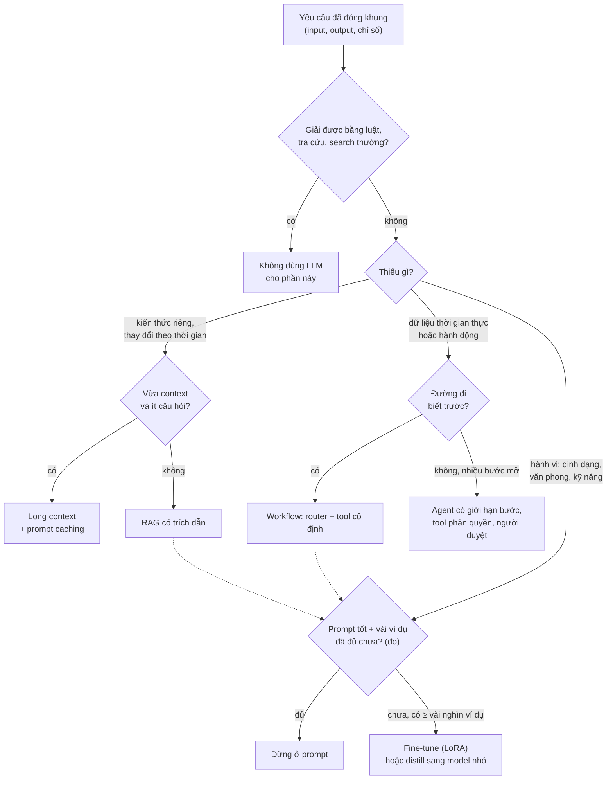
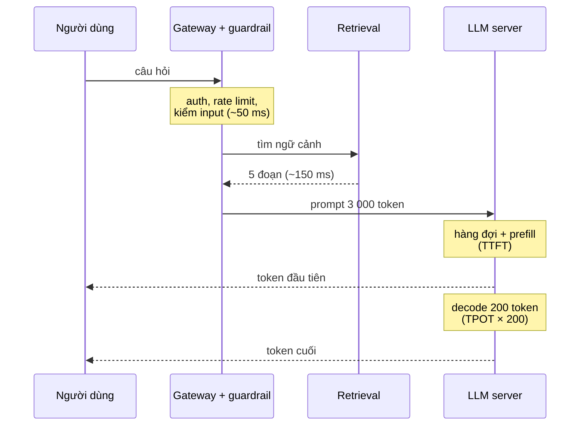
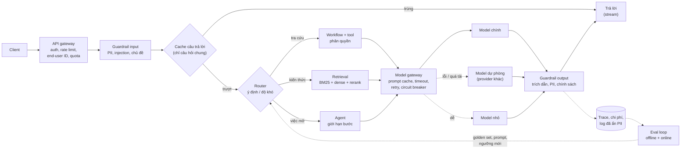
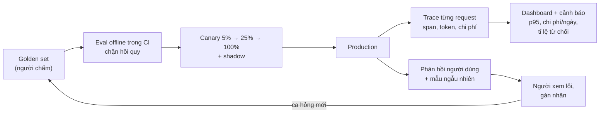
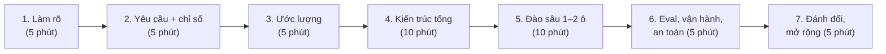

# AI System Design

Tới module này bạn đã biết từng viên gạch: model mở và Ollama ([09](../09-llms-and-open-models/README.md)),
quantization ([10](../10-quantization/README.md)), gọi LLM và đếm token ([11](../11-llm-apis-prompting/README.md)),
embedding và vector DB ([12](../12-embeddings-vector-db/README.md)), RAG ([13](../13-rag/README.md)), fine-tuning
([14](../14-fine-tuning-llm/README.md)), agent ([16](../16-ai-agents/README.md), [17](../17-langchain-langgraph/README.md)),
safety ([19](../19-ai-safety-security/README.md)), evaluation và serving ([20](../20-evaluation-production/README.md)). Câu hỏi còn lại là câu mà phỏng vấn vị trí
AI Engineer từ mid-level trở lên luôn hỏi, và công việc thật bắt đầu bằng nó: **cho một bài toán mơ hồ, bạn ghép các
viên gạch thành hệ thống nào, tốn bao nhiêu, chạy nhanh tới đâu, hỏng thì sao, và làm sao biết nó tốt?**

System design cho AI khác system design truyền thống ở ba chỗ. Thứ nhất, thành phần trung tâm **không tất định**: cùng
input có thể ra output khác, và "đúng" thường phải đo bằng thống kê chứ không bằng unit test. Thứ hai, **chi phí tỉ lệ
với token**, nên một quyết định prompt (thêm 2 000 token ngữ cảnh) là một quyết định ngân sách. Thứ ba, độ trễ bị chặn
bởi **vật lý của GPU** (băng thông bộ nhớ, KV cache), không chỉ bởi số máy. Module này không có thư viện mới. Nó dạy một
cách nghĩ, một bộ công thức ước lượng nhanh, một kiến trúc tham chiếu, và luyện trên các case phỏng vấn.

Giá API và thông số model đổi rất nhanh. Mọi giá trong module được kiểm trên trang chính thức ngày **2026-10-30** và ghi
rõ; con số nào là giả định (giá thuê GPU, benchmark thông lượng) đều ghi GIẢ ĐỊNH. Trước khi dùng cho quyết định thật,
kiểm lại.

Sau module này bạn sẽ:

- Đóng khung một yêu cầu mơ hồ thành bài toán có người dùng, chỉ số thành công ba tầng và ràng buộc đo được.
- Chọn giữa prompt, RAG, fine-tune, workflow và agent cho từng loại yêu cầu, nói được phương án bị loại và vì sao.
- Ước lượng trên giấy chi phí mỗi 1 000 request, bộ nhớ GPU cho trọng số và KV cache, số request đồng thời, số GPU.
- Vẽ kiến trúc tham chiếu (gateway, cache, router, fallback, guardrails, eval loop, observability) và biết thành phần
  nào cần cho bài toán nào.
- Trả lời một case system design 45 phút theo khung, và review design doc của người khác.

| Mức | Bài | Nội dung |
| --- | --- | --- |
| Basic | 01 token-cost | chi phí request, mỗi 1 000 request, mỗi tháng; prompt caching; vòng agent |
| Basic | 02 gpu-memory | trọng số, KV cache từ `config.json` thật, số chuỗi đồng thời, context tối đa |
| Basic | 03 latency-budget | TTFT, decode, trần băng thông, percentile của pipeline |
| Intermediate | 01 capacity-planner | từ benchmark và SLO ra số GPU, điểm hoà vốn self-host với API |
| Intermediate | 02 gateway-simulator | mô phỏng cache, cascade, fallback, circuit breaker trên trace |
| Advanced | 01 design-doc-shopping-assistant | design doc hoàn chỉnh có bảng ước lượng sinh từ code, chấm rubric |
| Advanced | 02 design-review | review một design doc có lỗi, kiểm lại số liệu bằng code |

Module không có notebook: mọi bài là code `.py` có test hoặc tài liệu chấm theo rubric. Tất cả chạy trên CPU.

## 1. Đóng khung bài toán AI

Sai lầm đắt nhất trong dự án AI không nằm ở model mà ở chỗ giải sai bài toán. "Làm chatbot cho ngân hàng" chưa phải bài
toán; nó là một mong muốn. Đóng khung (problem framing) là biến mong muốn thành thứ đo được.

### Bốn câu hỏi trước khi vẽ bất kỳ ô nào

1. **Ai dùng, để làm gì, hiện tại họ làm thế nào?** Khách hàng cá nhân hỏi số dư lúc nửa đêm, hay nhân viên tổng đài
   tra quy trình khi đang nghe máy? Hai nhóm này cần độ trễ, giọng điệu, quyền dữ liệu khác hẳn nhau. Cách làm hiện tại
   là **baseline** mà hệ thống AI phải thắng.
2. **Input và output là gì, cụ thể tới từng trường?** Một câu hỏi tự do và câu trả lời văn bản? Một email và một hành
   động (hoàn tiền)? Output có tác dụng phụ (gọi API, ghi DB) đổi hẳn mức rủi ro.
3. **Thế nào là thành công, đo bằng gì?** Ba tầng chỉ số ở dưới.
4. **Ràng buộc nào là cứng?** Độ trễ, ngân sách, dữ liệu được rời khỏi hạ tầng không, quy định ngành, lưu lượng và
   đỉnh, ngôn ngữ, đội ngũ có ai vận hành GPU không.

Và một câu hỏi phụ quan trọng: **có cần AI không?** Một bảng tra cứu, một bộ lọc theo luật, hay full-text search có
thể giải 80% yêu cầu với chi phí và rủi ro bằng không. Phỏng vấn viên đánh giá cao ứng viên nói được "phần này không
cần LLM".

### Chỉ số ba tầng

| Tầng | Trả lời câu hỏi | Ví dụ (chatbot CSKH) | Ai quan tâm |
| --- | --- | --- | --- |
| Kinh doanh | Có đáng tiền không? | ticket tổng đài giảm, chi phí mỗi lượt hỗ trợ, doanh thu không giảm | ban giám đốc |
| Sản phẩm | Người dùng có được giúp không? | tỉ lệ tự giải quyết (deflection), CSAT, tỉ lệ chuyển nhân viên, tỉ lệ hỏi lại | product |
| Hệ thống / model | Hệ thống có làm đúng việc không? | độ đúng trên golden set, recall@k, tỉ lệ bịa, TTFT p95, chi phí mỗi 1 000 request | kỹ sư |

Ba tầng phải nối được với nhau: "faithfulness tăng 5 điểm" chỉ có ý nghĩa nếu nó kéo theo deflection hay CSAT. Và
mỗi tầng có **ngưỡng ship** (đạt bao nhiêu thì được ra mắt) cùng ít nhất một chỉ số **không được xấu đi** (guardrail
metric), ví dụ tỉ lệ khiếu nại hay tỉ lệ chuyển đổi của phiên có trợ lý.

### Chi phí của lỗi không đối xứng

Mọi hệ thống AI đều sai một phần. Câu hỏi thiết kế là **sai kiểu nào thì chấp nhận được**. Trợ lý pháp luật từ chối
một câu đáng lẽ trả lời được thì phiền; bịa một điều luật thì nguy hiểm. Hệ thống kiểm duyệt nội dung bỏ lọt một bài
bạo lực khác chi phí với chặn nhầm một bài bình thường. Viết rõ bảng này ngay từ đầu, vì nó quyết định ngưỡng từ chối,
có cần người duyệt hay không, và precision hay recall được ưu tiên.

### Yêu cầu phi chức năng

| Nhóm | Câu hỏi | Ví dụ con số |
| --- | --- | --- |
| Lưu lượng | Bao nhiêu request mỗi ngày, đỉnh gấp mấy lần trung bình, có mùa vụ không? | 600 000/ngày, đỉnh ×3, flash sale ×10 |
| Độ trễ | Người dùng chờ được bao lâu, có stream không? | TTFT p95 ≤ 1.5 s; tóm tắt cuộc gọi chạy batch trong 10 phút |
| Chất lượng | Độ đúng tối thiểu, lỗi nào không được phép? | ≥ 92% đúng chính sách, 0 câu bịa điều khoản |
| Chi phí | Trần mỗi request, mỗi tháng? | ≤ 1 USD / 1 000 request |
| Dữ liệu | PII, dữ liệu được rời hạ tầng không, lưu bao lâu? | ẩn PII trước khi gọi API, log 30 ngày |
| Độ sẵn sàng | Hỏng thì sao, chế độ suy giảm là gì? | 99.5%/tháng, mất LLM thì trả FAQ tĩnh |

Mỗi dòng trong bảng sẽ biến thành một con số trong mục ước lượng (mục 3, 4) và một thành phần trong kiến trúc (mục 5).

## 2. Chọn kiến trúc: prompt, RAG, fine-tune, workflow, agent

Có năm công cụ chính, xếp theo độ phức tạp tăng dần. Nguyên tắc: **bắt đầu từ bậc thấp nhất giải được bài toán, leo
lên chỉ khi có số đo cho thấy bậc hiện tại không đủ.**

| Bậc | Công cụ | Thay đổi cái gì | Chi phí xây | Chi phí mỗi request | Kiểm soát |
| --- | --- | --- | --- | --- | --- |
| 1 | Prompt (zero/few-shot, structured output) | cách diễn đạt yêu cầu | giờ | thấp | cao |
| 2 | Prompt + tool / API cố định | thêm dữ liệu thời gian thực | ngày | thấp | cao |
| 3 | RAG (module 13) | **kiến thức** đưa vào lúc hỏi | tuần | trung bình (ngữ cảnh dài) | cao, trích dẫn được |
| 4 | Fine-tune (module 14) | **hành vi**: định dạng, văn phong, kỹ năng, thuật ngữ | tuần, cần dữ liệu | thấp (prompt ngắn đi) | trung bình |
| 5 | Workflow nhiều bước / agent (module 16, 17) | **quy trình** nhiều bước, chọn công cụ | tuần tới tháng | cao, khó đoán | thấp (agent) tới cao (workflow) |

### Workflow hay agent

Anthropic ("Building effective agents", 2024) tách hai loại hệ thống: **workflow** là LLM và tool được nối theo đường
đi viết sẵn trong code (chuỗi bước, rẽ nhánh theo router, song song rồi gộp); **agent** là LLM tự quyết định bước tiếp
theo và tool nào cần gọi, lặp tới khi xong. Agent linh hoạt hơn nhưng đắt hơn (mỗi bước đọc lại toàn bộ lịch sử: số
token input tăng theo bình phương số bước, bài Basic 01), chậm hơn, khó test và khó dự đoán. Phần lớn yêu cầu trong
sản phẩm có đường đi biết trước: "tra trạng thái đơn" là phân loại ý định → gọi một tool → trả lời theo template, không
cần agent. Dành agent cho việc mở thật sự: sửa một bug trong codebase lạ, nghiên cứu nhiều nguồn.

### Cây quyết định



Một sản phẩm thật thường là **nhiều nhánh** của cây này cùng lúc, ngăn bởi một router: chatbot ngân hàng dùng RAG cho
câu hỏi chính sách, workflow cho tra số dư, và không dùng LLM cho đổi mã PIN (chuyển thẳng sang luồng có xác thực).

### Fine-tune khi nào thật sự đáng

Fine-tune có lợi khi: (1) cần định dạng hoặc văn phong ổn định mà prompt không giữ được; (2) cần **giảm chi phí và độ
trễ** bằng cách dạy một model nhỏ làm việc mà model lớn đang làm bằng prompt dài (distillation); (3) cần kỹ năng chuyên
biệt có nhiều dữ liệu (phân loại ticket theo 200 nhãn nội bộ); (4) fine-tune **embedding model** cho retrieval chuyên
ngành. Fine-tune để "nhồi kiến thức" thay đổi theo tuần là lựa chọn sai gần như mọi lúc: không trích nguồn được, lỗi
thời ngay, và model bịa tự tin ở chỗ nhớ không chắc (module 13, mục 1).

### Chọn model

Không có "model tốt nhất", chỉ có model rẻ nhất đạt ngưỡng chất lượng trên **bộ eval của bạn**. Quy trình: dựng golden
set trước, chạy model lớn nhất để biết trần chất lượng, rồi thử dần model nhỏ hơn và dừng ở model rẻ nhất còn đạt
ngưỡng. Các trục khác: API hay self-host (mục 4), giấy phép model mở, hỗ trợ tiếng Việt (đo, đừng tin bảng xếp hạng
tiếng Anh), context length, structured output và tool calling, data residency.

## 3. Ước lượng chi phí

Chi phí API tính theo token, giá công bố theo **USD cho 1 triệu token (MTok)**, giá output đắt hơn input 4–5 lần.
Chi phí một request

$$
c = \frac{T_{\text{in}} p_{\text{in}} + T_{\text{cache}} p_{\text{cache}} + T_{\text{write}} p_{\text{write}} + T_{\text{out}} p_{\text{out}}}{10^6}
$$

với $$T_{\text{in}}$$ là token input thường, $$T_{\text{cache}}$$ token đọc từ prompt cache, $$T_{\text{write}}$$ token ghi vào
cache, $$T_{\text{out}}$$ token output (gồm cả reasoning token nếu model "nghĩ"). Chi phí mỗi 1 000 request là
$$1000c$$, mỗi tháng là $$c \times$$ request mỗi ngày $$\times 30$$. Bài Basic 01 cho bạn tự viết máy tính này.

### Đếm token cho tiếng Việt

Token không phải từ hay ký tự, và tiếng Việt tốn token hơn tiếng Anh cho cùng nội dung. Đo thật trên laptop của track
(kiểm 2026-10-30), dùng tokenizer của Qwen2.5 (tải `tokenizer.json` từ Hugging Face) và `o200k_base` (tokenizer của
họ GPT-4o, thư viện `tiktoken`):

| Văn bản | Qwen2.5: ký tự / token | `o200k_base`: ký tự / token |
| --- | --- | --- |
| 1 268 câu TED tiếng Anh (IWSLT'15 `tst2013.en`) | 4.46 | 4.51 |
| Cùng 1 268 câu dịch tiếng Việt (`tst2013.vi`) | 3.56 | 3.49 |
| 2 000 điều luật đầu của Zalo Legal | 3.49 | 3.47 |

Cùng nội dung, bản tiếng Việt tốn **1.34 lần** token (Qwen2.5) và **1.38 lần** (`o200k_base`) so với bản tiếng Anh. Ước
lượng nhanh: tiếng Việt khoảng **3.5 ký tự một token**, khoảng 1.1 token một âm tiết. Một điều luật Zalo trung bình 345
token. Tokenizer khác nhau cho số khác nhau: trang giá của Anthropic ghi rõ tokenizer mới của Claude từ bản 4.7 sinh
"khoảng 30% token nhiều hơn" cho cùng văn bản. Khi ước lượng cho một provider cụ thể, đếm bằng API đếm token của
chính provider đó.

### Giá đã kiểm (2026-10-30)

Từ trang giá chính thức ([Anthropic](https://platform.claude.com/docs/en/about-claude/pricing),
[Google Gemini API](https://ai.google.dev/gemini-api/docs/pricing)), USD mỗi triệu token:

| Model | Input | Output | Đọc từ cache | Ghi chú |
| --- | --- | --- | --- | --- |
| Claude Haiku 5.5 | 0.10 | 0.50 | 0.01 | giá cho prompt ≤ 100 000 token |
| Claude Sonnet 5.5 | 2 | 10 | 0.10 | ghi cache 5 phút 2.50 |
| Claude Opus 5.5 | 4 | 20 | 0.20 | ghi cache 5 phút 5 |
| Gemini 2.5 Flash-Lite | 0.10 | 0.40 | 0.01 | cache tính thêm phí lưu theo giờ |
| Gemini 3.8 Flash | 0.75 | 3.75 | 0.075 | giá tới 31/12/2026; từ 1/1/2027 là 1.50 / 7.50 / 0.15 |

Batch API của cả hai hãng giảm 50% cho việc không cần trả lời ngay (tóm tắt cuộc gọi qua đêm, chấm eval). Dòng cuối
là ví dụ sống về việc giá đổi: cùng một model, giá gấp đôi sau hai tháng.

### Ví dụ: chatbot CSKH ngân hàng

Mỗi request 3 000 token input (system prompt và hướng dẫn 2 000 token cố định, lịch sử và ngữ cảnh RAG 1 000), 200
token output, 600 000 request mỗi ngày. Tính bằng máy tính của bài Basic 01:

| Model | USD / 1 000 request, không cache | Có prompt caching 2 000 token | USD / tháng (có cache) |
| --- | --- | --- | --- |
| Claude Haiku 5.5 | 0.40 | 0.22 | 3 960 |
| Gemini 2.5 Flash-Lite | 0.38 | 0.20 | 3 600 |
| Gemini 3.8 Flash (giá 2026) | 3.00 | 1.65 | 29 700 |
| Claude Sonnet 5.5 | 8.00 | 4.20 | 75 600 |
| Claude Opus 5.5 | 16.00 | 8.40 | 151 200 |

Ba điều rút ra: chênh lệch giữa model rẻ nhất và đắt nhất là **40 lần**, nên chọn model (mục 2) là quyết định chi phí
lớn nhất; prompt caching gần như **giảm một nửa** khi phần cố định chiếm đa số prompt; và với model lớn, input chiếm
phần lớn hoá đơn dù output đắt hơn mỗi token. (Bảng bỏ qua phí ghi cache: với lưu lượng cao, prefix được đọc lại liên
tục nên số lần ghi không đáng kể.)

### Chi phí ẩn

- **Vòng agent**: bước $$i$$ gửi lại cả lịch sử, tổng input của $$n$$ bước là
  $$n T_0 + \Delta \frac{n(n-1)}{2}$$ với $$T_0$$ là prompt ban đầu và $$\Delta$$ là phần thêm mỗi bước. Agent 10 bước tốn
  không phải 10 lần mà khoảng 30 lần một câu hỏi đơn (bài Basic 01).
- **Reasoning token** tính là output, có thể gấp nhiều lần phần trả lời nhìn thấy.
- **Retry, fallback, cascade**: request lỗi rồi gọi lại, request đi qua hai model.
- **Ngoài LLM**: embedding lại kho tài liệu khi đổi model embedding, vector DB, observability, chạy eval (LLM-as-judge
  cũng tốn token), người chấm golden set, và lương người vận hành. Trong nhiều hệ thống, LLM không phải dòng chi phí lớn
  nhất.

## 4. Ước lượng capacity và độ trễ

### Giải phẫu độ trễ

Một request LLM có ba pha: **chờ** (mạng, hàng đợi, guardrail, retrieval), **prefill** (xử lý toàn bộ prompt song song,
sinh token đầu), **decode** (sinh từng token một). Hai chỉ số người dùng cảm nhận:

$$
\text{TTFT} = t_{\text{wait}} + \frac{T_{\text{in}}}{r_{\text{prefill}}}, \qquad
\text{E2E} = \text{TTFT} + \frac{T_{\text{out}}}{r_{\text{decode}}}
$$

với $$t_{\text{wait}}$$ là phần chờ và $$r$$ là tốc độ (token/giây). TPOT (time per output token) là $$1/r_{\text{decode}}$$. Khi stream, người dùng thấy
chữ sau TTFT, nên SLO cho chat thường đặt trên TTFT p95; E2E quan trọng cho việc chạy nền và cho capacity.



### Vì sao decode chậm: băng thông bộ nhớ

Prefill nhân ma trận lớn cho cả prompt một lúc, bị chặn bởi FLOPs (cỡ $$2N$$ phép tính cho mỗi token với $$N$$ tham
số). Decode sinh một token cần đọc **toàn bộ trọng số** từ bộ nhớ GPU một lần mà chỉ tính rất ít, nên bị chặn bởi băng
thông. Trần tốc độ decode khi batch 1:

$$
r_{\text{decode}} \le \frac{B_{\text{mem}}}{M_{\text{weights}}}
$$

với $$B_{\text{mem}}$$ là băng thông bộ nhớ GPU và $$M_{\text{weights}}$$ là số byte trọng số. Ví dụ: `qwen2.5:3b` của Ollama (Q4_K_M, tệp 1 929 912 432 byte) trên một GPU giả định băng thông 192 GB/s không thể
decode nhanh hơn khoảng 99.5 token/giây, dù còn thừa sức tính. Qwen2.5-7B bf16 (15.2 GB) trên 360 GB/s: tối đa khoảng
23.6 token/giây. Hệ quả thiết kế: quantize (module 10) tăng tốc decode gần tỉ lệ với số byte giảm; và **batching** cho
nhiều request dùng chung một lần đọc trọng số, nên thông lượng tổng tăng gần tuyến tính theo batch cho tới khi chạm
giới hạn tính toán hay bộ nhớ KV. Đó là lý do vLLM với continuous batching phục vụ nhiều người dùng trên một GPU hiệu
quả hơn hẳn chạy từng request.

### Đo thật: phần chờ thường lớn hơn phần tính

Lần đo trên laptop của track (RTX 3050 Laptop 4GB, Ollama, `qwen2.5:3b`, `temperature 0`, 128 token output, kiểm
2026-10-30) **trong lúc ba tác vụ khác dùng chung GPU và cùng Ollama server**: model bị đẩy một phần sang CPU (Ollama
báo 1.88 GB trên GPU của 2.65 GB), prefill đo được 100–276 token/giây, decode chỉ 1.4–1.9 token/giây. Thời gian xử lý
thật của mỗi request (prefill + decode theo số liệu Ollama trả về) là 43–97 giây, nhưng thời gian chờ phía client là
82–261 giây: phần còn lại là **hàng đợi** sau request của tác vụ khác. Đây là con số xấu, và là bài học thật: trên tài
nguyên dùng chung, độ trễ do hàng đợi quyết định chứ không do tốc độ model. Benchmark luôn phải ghi điều kiện đo
(phần cứng, ai khác đang chạy, batch, độ dài prompt và output).

Cách lấy các số này từ API của Ollama (chạy từ gốc repo khi Ollama đang chạy):

```python
import json
import time
import urllib.request

body = {"model": "qwen2.5:3b", "prompt": "Giải thích định luật Little trong 3 câu.", "stream": False,
        "options": {"num_predict": 64, "temperature": 0}}
req = urllib.request.Request("http://localhost:11434/api/generate", json.dumps(body).encode(),
                             {"Content-Type": "application/json"})
t0 = time.perf_counter()
r = json.load(urllib.request.urlopen(req, timeout=600))
wall = time.perf_counter() - t0
prefill_s, decode_s = r["prompt_eval_duration"] / 1e9, r["eval_duration"] / 1e9
print(f"prompt {r['prompt_eval_count']} token, prefill {r['prompt_eval_count'] / prefill_s:.0f} tok/s")
print(f"output {r['eval_count']} token, decode {r['eval_count'] / decode_s:.1f} tok/s")
print(f"wall {wall:.1f} s, trong đó chờ ngoài model {wall - prefill_s - decode_s:.1f} s")
```

### Bộ nhớ GPU: trọng số và KV cache

Bộ nhớ khi serve gồm trọng số, **KV cache** (key và value của mọi token đã thấy, ở mọi layer, để không tính lại khi
decode, module 05), activation và phần dự phòng của framework:

$$
M_{\text{weights}} = \frac{N \cdot b}{8}, \qquad
M_{\text{KV}} = 2 \cdot L \cdot n_{kv} \cdot d_{\text{head}} \cdot \frac{b_{kv}}{8} \cdot T \cdot \text{batch}
$$

với $$N$$ tham số, $$b$$ bit mỗi trọng số, $$L$$ layer, $$n_{kv}$$ số KV head (GQA), $$d_{\text{head}}$$ kích thước mỗi head,
$$T$$ số token mỗi chuỗi. Số 2 là K và V. Từ `config.json` thật trên Hugging Face (kiểm 2026-10-30):

| Model | $$L$$ | KV head / attention head | $$d_{\text{head}}$$ | KV mỗi token (bf16) | Một chuỗi 32k |
| --- | --- | --- | --- | --- | --- |
| Qwen2.5-3B-Instruct | 36 | 2 / 16 | 128 | 36 KiB | 1.12 GiB |
| Qwen2.5-7B-Instruct | 28 | 4 / 28 | 128 | 56 KiB | 1.75 GiB |
| Qwen2.5-72B-Instruct | 80 | 8 / 64 | 128 | 320 KiB | 10 GiB |

Nhờ GQA, Qwen2.5-7B chỉ cần 56 KiB mỗi token; nếu là multi-head attention đầy đủ (28 KV head) thì 392 KiB, gấp 7 lần.
Ví dụ định cỡ: Qwen2.5-7B quantize 4.5 bit (3.99 GiB trọng số) trên GPU 12 GiB, chừa 1.5 GiB dự phòng, còn khoảng
6.5 GiB cho KV: đủ **14 chuỗi** 8 192 token cùng lúc, hoặc 3 chuỗi 32k. Context dài ăn trực tiếp vào số người dùng
đồng thời. Bài Basic 02 cho bạn tự tính từ config.

### Từ lưu lượng tới số GPU

**Định luật Little**: trong hệ thống ổn định, số request đang xử lý trung bình $$L = \lambda W$$ (tốc độ đến nhân thời
gian mỗi request). 20 request/giây, mỗi request 6 giây, nghĩa là trung bình 120 request đang chạy cùng lúc. Đảo lại,
một GPU giữ $$c$$ request đồng thời, mỗi cái mất $$W(c)$$ giây, phục vụ $$c / W(c)$$ request/giây. $$W(c)$$ tăng theo $$c$$
(batch lớn thì mỗi request chậm hơn), nên thông lượng mỗi GPU phụ thuộc SLO:

$$
n_{\text{GPU}} = \left\lceil \frac{\lambda_{\text{peak}} (1 + h)}{\max_{c:\ W(c) \le \text{SLO}} \dfrac{c}{W(c)}} \right\rceil + \text{spare}
$$

với $$h$$ là headroom và spare là số GPU dự phòng (N+1). $$W(c)$$ phải lấy từ **benchmark** đúng phân phối độ dài prompt và output của bạn (ví dụ
`vllm bench serve`), không phải từ công thức. Hai ràng buộc riêng: bộ nhớ (đủ KV cho $$c$$ chuỗi) và thông lượng (đạt
SLO); số GPU là số lớn hơn. Bài Intermediate 01 cho thấy nới SLO E2E từ 6 lên 10 giây có thể giảm một nửa số GPU.

### API hay self-host

| Tiêu chí | API | Self-host (vLLM, llama.cpp, module 20) |
| --- | --- | --- |
| Chi phí | biến đổi, theo token | cố định theo giờ GPU, cộng người vận hành |
| Lưu lượng thấp hoặc thất thường | rẻ hơn hẳn | GPU ngồi không |
| Lưu lượng lớn, đều | đắt dần | rẻ hơn sau điểm hoà vốn |
| Chất lượng | model mạnh nhất | model mở, thường nhỏ hơn |
| Dữ liệu | rời hạ tầng (cần hợp đồng, ẩn PII) | ở lại hạ tầng của bạn |
| Model fine-tune riêng | tuỳ provider hỗ trợ | tự do |
| Vận hành | rate limit, provider sự cố | tự lo scale, cập nhật, GPU hỏng |

Điểm hoà vốn mỗi tháng là $$\frac{C_{\text{GPU}}}{c_{\text{API}} - c_{\text{self}}}$$ request, với $$C_{\text{GPU}}$$ là chi phí GPU cố định
mỗi tháng, $$c_{\text{API}}$$ và $$c_{\text{self}}$$ là chi phí biến đổi mỗi request của API và của self-host. Với model
nhỏ giá rẻ như bảng ở mục 3, điểm này thường là hàng chục triệu request mỗi tháng; lý do self-host hay gặp hơn là dữ
liệu và model riêng, không phải tiền.

## 5. Kiến trúc tham chiếu

Hầu hết hệ thống LLM production có cùng một bộ khung. Không phải hệ thống nào cũng cần mọi ô; biết vì sao từng ô tồn
tại giúp bạn chọn.



### Gateway

API gateway ở cửa: xác thực, rate limit theo người dùng, gắn **end-user ID** vào mọi request (để truy vết lạm dụng và
để provider chặn đúng người, module 19), quota chi phí theo khách hàng hay theo tính năng. Model gateway (LiteLLM,
Portkey, OpenRouter, hay tự viết) đứng trước các provider: một interface cho nhiều model, đổi model bằng cấu hình,
đếm token và chi phí, timeout, retry, fallback.

### Cache

| Loại | Khoá | Lợi | Rủi ro |
| --- | --- | --- | --- |
| Prompt caching của provider | prefix của prompt | giảm chi phí input và TTFT cho phần cố định | phí ghi cache; prefix phải giống từng byte |
| Exact cache câu trả lời | hash câu hỏi đã chuẩn hoá (+ phiên bản dữ liệu) | 0 token, vài ms | câu trả lời cũ khi dữ liệu đổi; lộ dữ liệu nếu khoá thiếu user |
| Semantic cache | embedding câu hỏi, ngưỡng cosine | trúng cả câu diễn đạt khác | trả lời nhầm câu gần giống mà khác nghĩa ("đổi vé" và "huỷ vé"), khó kiểm |

Quy tắc an toàn: chỉ cache dùng chung cho câu trả lời **không phụ thuộc người hỏi**, khoá kèm phiên bản dữ liệu nguồn,
và xoá khi nguồn đổi. Bài Intermediate 02 đo bằng số một cache khoá sai làm lộ dữ liệu khách hàng ra sao.

### Router và cascade

Router gửi mỗi request tới nhánh rẻ nhất làm được: phân loại ý định (quyết định workflow hay RAG), hoặc phân độ khó
(model nhỏ cho câu dễ). **Cascade** gọi model nhỏ trước, chỉ chuyển lên model lớn khi model nhỏ không chắc. Chi phí kỳ
vọng với tỉ lệ chuyển lên $$e$$:

$$
\mathbb{E}[c] = c_{\text{small}} + e \cdot c_{\text{large}}
$$

nên cascade chỉ lợi khi $$e$$ đủ nhỏ, và nó **tăng độ trễ đuôi** của các request bị chuyển. Ngưỡng "không chắc" phải
chọn bằng eval có nhãn, vì độ tự tin LLM tự báo thường hiệu chuẩn kém.

### Độ tin cậy: timeout, retry, fallback, circuit breaker

- **Timeout** theo phân phối độ trễ thật (ví dụ p99 cộng biên), không phải số tròn; timeout quá dài bắt mọi request
  trong lúc provider sự cố chờ đủ thời gian đó, kéo p95 lên theo.
- **Retry** một hai lần với exponential backoff và jitter; retry ngay nhiều lần khi provider quá tải là tự tạo
  retry storm.
- **Fallback** sang model của provider khác (khác hạ tầng, khác sự cố). Fallback phải được eval như model chính: câu trả
  lời của nó cũng tới tay người dùng.
- **Circuit breaker**: sau $$k$$ lỗi liên tiếp, ngừng gọi model chính một khoảng thời gian, đi thẳng fallback, khỏi chờ
  timeout cho từng request.
- **Chế độ suy giảm**: khi mọi thứ hỏng, trả FAQ tĩnh, hẹn liên hệ lại, chứ không trả lỗi trắng.

Độ sẵn sàng của chuỗi thành phần nối tiếp là tích của chúng; hai provider độc lập song song cho
$$1 - (1 - a_1)(1 - a_2)$$. Hai provider 99.9% độc lập cho lý thuyết 99.9999%, nhưng sự cố thật thường tương quan
(cùng đám mây, cùng thư viện client), nên con số thật thấp hơn.

### Guardrails

Hai lớp, chi tiết ở module 19: **input** (phát hiện prompt injection, PII, chủ đề ngoài phạm vi, lạm dụng) và **output**
(trích dẫn có trong ngữ cảnh không, có PII không, có hứa điều chính sách cấm không, link có trỏ đúng domain không).
Nguyên tắc quan trọng nhất không nằm ở guardrail mà ở **phân quyền**: tool chỉ làm được những gì người dùng hiện tại
được phép làm, định danh lấy từ phiên đăng nhập chứ không từ chữ LLM sinh ra, và hành động không đảo ngược được (tiền,
xoá dữ liệu) cần người duyệt.

### Eval loop và observability



Mọi thay đổi (prompt, model, chunking, ngưỡng) đi qua cùng một vòng: chạy golden set offline, so với bản đang chạy, ra
dần qua canary với tiêu chí dừng rõ ràng. LLM-as-judge giúp chấm nhanh nhưng phải hiệu chuẩn với nhãn người trước khi
tin (module 20). Observability cho LLM là trace mỗi request với span cho từng bước (retrieval, từng lần gọi model, tool,
guardrail), kèm token, chi phí, độ trễ, phiên bản prompt; log đã ẩn PII và có thời hạn lưu. Thiếu trace thì không trả
lời được câu "vì sao hôm qua chi phí tăng gấp đôi".

## 6. Làm một case system design

### Khung 45 phút



1. **Làm rõ.** Hỏi người dùng, input/output, lưu lượng, ràng buộc dữ liệu. Nói ra giả định khi người phỏng vấn để bạn
   tự chọn.
2. **Yêu cầu và chỉ số.** Ba tầng chỉ số, chi phí của từng loại lỗi, SLO.
3. **Ước lượng.** Token mỗi request, chi phí mỗi 1 000 request và mỗi tháng, peak request/giây, request đồng thời. Làm
   tròn mạnh tay, nói to phép tính. Mục đích là tìm ra nút thắt (tiền, độ trễ, GPU hay dữ liệu), không phải con số
   chính xác.
4. **Kiến trúc tổng.** Vẽ đường đi của một request qua các ô ở mục 5, chỉ những ô bài toán cần. Nói rõ chọn prompt,
   RAG, fine-tune, workflow hay agent cho từng loại yêu cầu.
5. **Đào sâu.** Chọn một hai ô rủi ro nhất (thường là retrieval, hoặc tool có tác dụng phụ) và đi vào chi tiết: dữ
   liệu, chunking, ngưỡng, prompt, cách xử lý khi sai.
6. **Eval, vận hành, an toàn.** Golden set, eval online, canary, trace, prompt injection, PII, phân quyền.
7. **Đánh đổi và mở rộng.** Rủi ro lớn nhất, điều gì làm bạn đổi quyết định, lưu lượng gấp 10 thì sao.

Lỗi hay gặp: vẽ kiến trúc trước khi hỏi yêu cầu; nói "dùng GPT/Claude" mà không có lý do; không có con số nào; agent cho
mọi thứ; quên eval; quên rằng dữ liệu cá nhân và hành động có tác dụng phụ là chỗ hệ thống AI gây hại thật.

### Ví dụ rút gọn: trợ lý pháp luật tiếng Việt (capstone)

Đây là hệ thống bạn xây trong [capstone](../../capstone/README.md); milestone 9 yêu cầu viết design doc đầy đủ của nó.
Bản rút gọn theo khung:

1. **Làm rõ.** Người dùng là người dân và nhân viên pháp chế hỏi về quy định hiện hành. Output là câu trả lời ngắn kèm
   trích dẫn điều, khoản cụ thể; không tư vấn vụ việc cá nhân. Chạy local (yêu cầu của dự án), không gửi câu hỏi ra API.
2. **Chỉ số.** Hệ thống: recall@10 retrieval trên qrels test, tỉ lệ trích dẫn đúng, tỉ lệ câu có khẳng định không có
   căn cứ (mục tiêu gần 0), tỉ lệ từ chối đúng khi không có điều luật phù hợp. Sản phẩm: tỉ lệ người dùng mở nguồn trích
   dẫn, phản hồi "hữu ích". Lỗi bịa điều luật đắt hơn nhiều lần lỗi từ chối, nên ngưỡng nghiêng về từ chối.
3. **Ước lượng.** Corpus 61 425 điều, trung bình 345 token Qwen2.5 mỗi điều (đo trên 2 000 điều đầu, mục 3), tổng cỡ 20 triệu token:
   long context loại ngay, RAG là bắt buộc. Prompt khoảng 2 000 token (5 đoạn nguồn) cộng 300 token trả lời. Trên laptop
   4GB với `qwen2.5:3b`, decode bị chặn bởi băng thông và hàng đợi (mục 4): phục vụ một người một lúc, độ trễ vài chục
   giây là thực tế; trên GPU 12GB với Qwen2.5-7B 4-bit, KV cache 56 KiB mỗi token cho phép vài chục chuỗi 2–4k token.
4. **Kiến trúc.** Router đơn giản (câu hỏi pháp luật hay ngoài phạm vi), hybrid retrieval BM25 + `bge-m3` + RRF, rerank,
   ngưỡng từ chối, LLM local sinh câu trả lời có trích dẫn, kiểm trích dẫn bằng code. Agent LangGraph chỉ cho câu hỏi
   nhiều vế (tách câu hỏi, tra nhiều lần), không cho mọi câu.
5. **Đào sâu.** Chunk theo Khoản/Điểm có tiêu đề Điều; metadata hiệu lực văn bản (luật sửa đổi, hết hiệu lực) là rủi ro
   lớn nhất của miền này.
6. **Eval và an toàn.** Tập test ghim từ qrels, LLM-as-judge cho faithfulness kèm kiểm tay 30–50 câu; red-team prompt
   injection qua câu hỏi và qua nội dung văn bản; luôn kèm cảnh báo "không thay thế tư vấn pháp lý".
7. **Đánh đổi.** Model 3B local kém hơn model API lớn về diễn đạt nhưng giữ dữ liệu tại chỗ và miễn phí; fine-tune
   embedding trên cặp (câu hỏi, điều luật) của split train là cải tiến đầu tiên nên thử, đo trước/sau.

Năm case còn lại (chatbot CSKH ngân hàng, RAG nội bộ một triệu tài liệu, coding assistant, tóm tắt cuộc gọi, kiểm
duyệt nội dung) có lời giải mẫu trong `interview.md`.

## 7. Tài liệu tham khảo

Roadmap:

- [roadmap.sh: AI Engineer](https://roadmap.sh/ai-engineer): module này mở rộng phần roadmap không có (system design,
  ước lượng chi phí/capacity), nối các nhóm Pricing, RAG vs Fine-tuning, AI Agents, Safety, Evaluation thành một quy
  trình thiết kế.

Sách và bài viết:

- Chip Huyen. [AI Engineering](https://github.com/chiphuyen/aie-book) (O'Reilly, 2025; trang sách kèm tài nguyên),
  chương 1 (lập kế hoạch ứng dụng AI), 9 (tối ưu inference) và 10 (kiến trúc và phản hồi người dùng).
- Chip Huyen. [Designing Machine Learning Systems](https://github.com/chiphuyen/dmls-book) (O'Reilly, 2022), chương 2 (đóng khung bài toán ML).
- Anthropic. [Building effective agents](https://www.anthropic.com/engineering/building-effective-agents) (2024): workflow và agent.
- Eugene Yan. [Patterns for Building LLM-based Systems & Products](https://eugeneyan.com/writing/llm-patterns/) (2023): evals, RAG, caching, guardrails, phản hồi người dùng.
- Databricks. [LLM Inference Performance Engineering: Best Practices](https://www.databricks.com/blog/llm-inference-performance-engineering-best-practices) (2023): TTFT, TPOT, băng thông bộ nhớ, batching.
- kipply. [Transformer Inference Arithmetic](https://kipp.ly/transformer-inference-arithmetic/) (2022): ước lượng FLOPs, bộ nhớ, KV cache.
- Google. [Site Reliability Engineering](https://sre.google/sre-book/table-of-contents/), chương "Service Level Objectives" và "Handling Overload".
- Marc Brooker (AWS). [Timeouts, retries, and backoff with jitter](https://aws.amazon.com/builders-library/timeouts-retries-and-backoff-with-jitter/).

Paper:

- Kwon et al. [Efficient Memory Management for Large Language Model Serving with PagedAttention](https://arxiv.org/abs/2309.06180) (SOSP 2023), vLLM.
- Yu et al. [Orca: A Distributed Serving System for Transformer-Based Generative Models](https://www.usenix.org/conference/osdi22/presentation/yu) (OSDI 2022), continuous batching.
- Ainslie et al. [GQA: Training Generalized Multi-Query Transformer Models from Multi-Head Checkpoints](https://arxiv.org/abs/2305.13245) (2023).
- Chen, Zaharia, Zou. [FrugalGPT: How to Use Large Language Models While Reducing Cost and Improving Performance](https://arxiv.org/abs/2305.05176) (2023), cascade.
- Little. [A Proof for the Queuing Formula: L = λW](https://doi.org/10.1287/opre.9.3.383) (Operations Research, 1961).

Giá, model, công cụ (kiểm 2026-10-30):

- Giá: [Anthropic](https://platform.claude.com/docs/en/about-claude/pricing), [Gemini API](https://ai.google.dev/gemini-api/docs/pricing), [OpenAI](https://developers.openai.com/api/docs/pricing).
- Prompt caching: [Anthropic](https://platform.claude.com/docs/en/build-with-claude/prompt-caching), [OpenAI](https://developers.openai.com/api/docs/guides/prompt-caching).
- Config model: [Qwen2.5-7B-Instruct](https://huggingface.co/Qwen/Qwen2.5-7B-Instruct), [Qwen2.5-72B-Instruct](https://huggingface.co/Qwen/Qwen2.5-72B-Instruct).
- Serving và benchmark: [vLLM docs](https://docs.vllm.ai/), [`vllm bench serve`](https://docs.vllm.ai/en/latest/cli/bench/serve.html), [Ollama API](https://github.com/ollama/ollama/blob/main/docs/api.md).
- Model gateway: [LiteLLM](https://docs.litellm.ai/).
