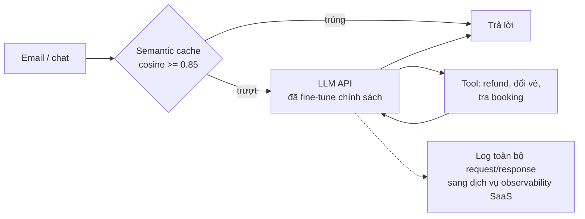

# Design doc: Trợ lý AI trả lời email và chat cho hãng bay VietSky

Tác giả: nhóm Customer Experience · Trạng thái: chờ duyệt để triển khai

> Tài liệu hư cấu, viết cho bài review của module 21. Hãng bay, số liệu và quyết định đều là giả định. Đừng sửa tệp
> này: ghi nhận xét của bạn trong `REVIEW.md`.

## 1. Bối cảnh

VietSky nhận khoảng **600 000 lượt liên hệ mỗi ngày** qua email và chat trên app: hỏi hành lý, đổi vé, hoàn tiền,
tình trạng chuyến bay, xuất hoá đơn. Tổng đài có 350 nhân viên, thời gian phản hồi email trung bình 19 giờ. Mục tiêu:
một trợ lý AI tự trả lời và **tự xử lý** phần lớn yêu cầu, để giảm tải tổng đài.

## 2. Yêu cầu

- Trả lời đúng chính sách hành lý, đổi vé, hoàn tiền hiện hành.
- Tự xử lý hoàn tiền cho các trường hợp đủ điều kiện, không cần nhân viên.
- **Độ chính xác 95%.**
- Độ trễ trung bình dưới 6 giây.
- Chi phí vận hành dưới 150 000 USD/tháng.

## 3. Kiến trúc

### 3.1 Model và kiến thức chính sách

Chúng tôi **fine-tune** model của nhà cung cấp API trên toàn bộ tài liệu chính sách (hành lý, đổi vé, hoàn tiền,
khoảng 1 200 trang) và 50 000 email cũ đã được nhân viên trả lời. Chính sách thay đổi khoảng **mỗi tuần một lần**
(giá hành lý, điều kiện khuyến mãi); chúng tôi sẽ fine-tune lại **mỗi tháng**. Như vậy không cần hệ thống tìm kiếm
tài liệu, đơn giản hơn RAG.

### 3.2 Agent xử lý yêu cầu

Model được cấp ba tool: `lookup_booking(booking_code)`, `change_flight(booking_code, new_flight)` và
`issue_refund(booking_code, amount_vnd)`. Agent đọc email của khách, tự quyết định gọi tool nào. Để tối đa tỉ lệ tự
động, `issue_refund` được phép hoàn **tới 12 000 000 VND** mà không cần nhân viên duyệt. Nội dung email được đưa
nguyên văn vào prompt để model hiểu đầy đủ ngữ cảnh.

### 3.3 Semantic cache

Nhiều khách hỏi giống nhau, nên mọi câu trả lời được lưu vào một semantic cache dùng chung: câu hỏi mới có embedding
cosine ≥ 0.85 với một câu đã trả lời thì trả lại câu trả lời cũ. Cache giữ 24 giờ. Theo thử nghiệm nội bộ, tỉ lệ
trúng khoảng 40%, giúp giảm mạnh chi phí.

### 3.4 Độ tin cậy

Chúng tôi dùng một nhà cung cấp API duy nhất (SLA 99.9%). Khi gọi lỗi, hệ thống **thử lại ngay tối đa 5 lần**.
Phương án dự phòng dài hạn: tự host Qwen2.5-7B nếu nhà cung cấp tăng giá.

## 4. Ước lượng

**Chi phí API.** Mỗi request trung bình 3 000 token input (system prompt, lịch sử, email) và 400 token output. Giá
model: 2 USD / 1 triệu token input, 10 USD / 1 triệu token output. Chi phí là (3 000 + 400) × 2 / 1 000 000 =
0.0068 USD/request, tức **6.80 USD / 1 000 request**. Một tháng: 0.0068 × 600 000 × 30 = **122 400 USD**, dưới ngân
sách.

**Độ trễ.** Ba bước nối tiếp: semantic cache p95 = 0.3 s, gọi tool p95 = 1.2 s, LLM p95 = 4.0 s. Vậy p95 end-to-end
= 0.3 + 1.2 + 4.0 = **5.5 s**, đạt yêu cầu trung bình dưới 6 s.

**Đồng thời.** Cao điểm 15 request/giây, mỗi request 8 giây, nên số request đồng thời là 15 / 8 ≈ **1.9**. Hàng đợi
gần như không có, không cần giới hạn concurrency với nhà cung cấp.

**Dự phòng self-host.** Qwen2.5-7B (7.6 tỉ tham số, 28 layer, 28 attention head, 4 KV head, head_dim 128).
Trọng số 4-bit: 7.6 × 10⁹ × 4 / 8 = **3.8 GB**. KV cache bf16 mỗi token: 2 × 28 × 28 × 128 × 2 = **401 408 byte**
(khoảng 392 KiB), nên một chuỗi 8 192 token cần 3.1 GiB KV cache: GPU 24 GB chỉ chạy được khoảng 6 chuỗi cùng lúc.
Benchmark của nhà cung cấp GPU cho thấy mỗi GPU phục vụ 2.5 request/giây đạt SLO, nên cần 15 / 2.5 = **6 GPU** cho
giờ cao điểm.

## 5. Đánh giá

Chúng tôi dùng chính model đã fine-tune làm LLM-as-judge, chấm 500 email ngẫu nhiên theo thang 1–5. Điểm trung bình
4.6/5, tương đương độ chính xác 95%, đạt yêu cầu.

## 6. Vận hành

- Toàn bộ request và response (gồm nội dung email, mã đặt chỗ, số hộ chiếu khách gửi kèm) được gửi sang dịch vụ
  observability SaaS ở nước ngoài để tiện debug, lưu không thời hạn.
- Triển khai cho 100% khách hàng cùng lúc vào đầu tháng tới, để đo tác động rõ nhất.
