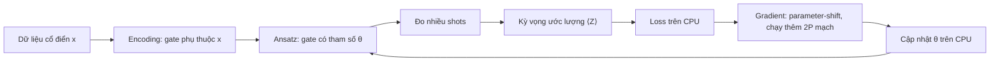
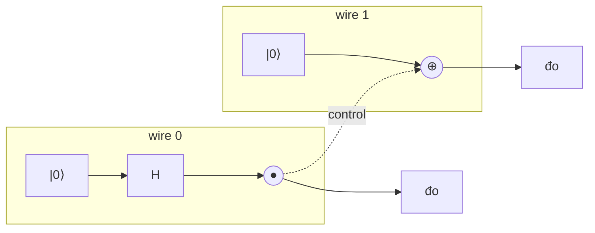
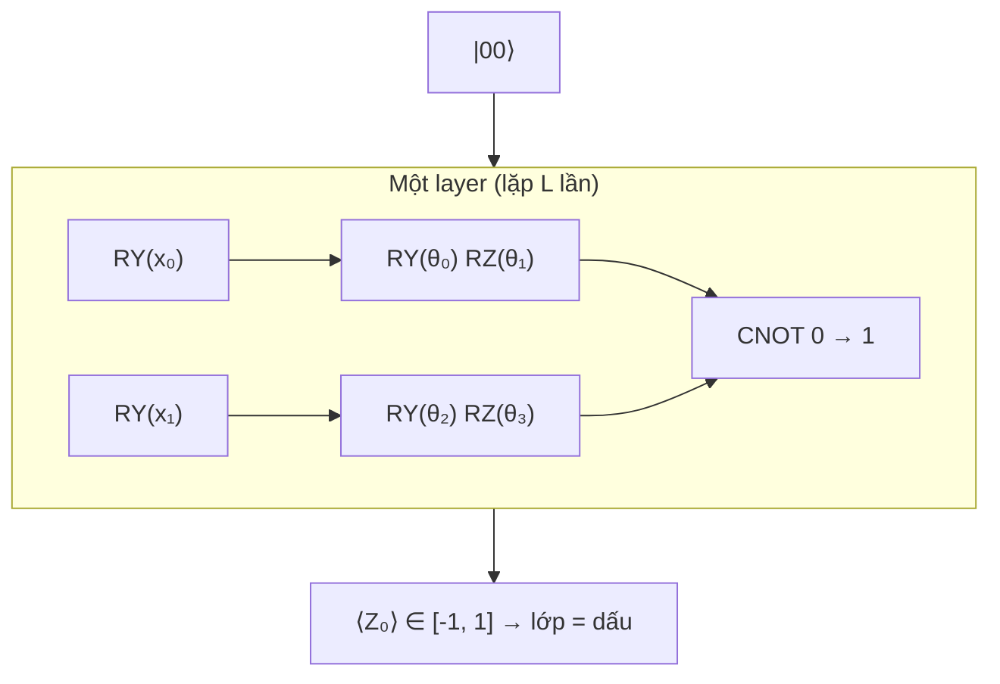
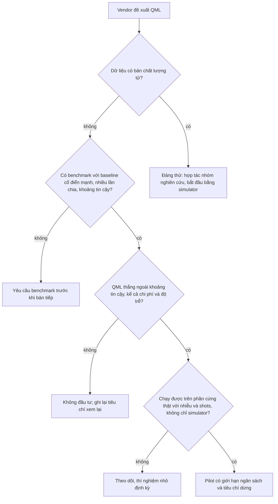

# Quantum Machine Learning

> **Module mở rộng, cập nhật dần.** Lĩnh vực này đổi nhanh hơn mọi module khác của track: phần cứng, thuật toán và
> cả những khẳng định "lợi thế lượng tử" được công bố rồi bị bác bỏ theo từng năm. Nội dung dưới đây đúng tại thời điểm
> kiểm (2026-10-30); mục 7 ghi rõ điều gì nên theo dõi để cập nhật.

Mỗi năm lại có một vendor nói "quantum AI" sẽ thay đổi bài toán phân loại, dự báo, tối ưu của công ty bạn. Một AI
Engineer lão luyện không cần là nhà vật lý, nhưng phải trả lời được câu hỏi của CTO bằng **số đo**: mạch lượng tử
tính cái gì, train thế nào, tốn bao nhiêu, và trên bài toán của mình nó thua hay thắng một SVM chạy 2 mili giây. Module
này dạy đủ để làm việc đó.

Bạn không cần nền vật lý. Toàn bộ quantum computing ở mức dùng cho ML là **đại số tuyến tính trên số phức**: trạng thái
là vector đơn vị, gate là ma trận unitary, nhiều qubit là tích Kronecker, đo là bình phương độ lớn. Vector, ma trận,
tích vô hướng, trị riêng và SVD đã có ở [module 01 track DS](../../../data-science/modules/01-math-for-ml/README.md).
Kernel và SVM ở module DS về học có giám sát; gradient descent và gradient check ở
[module 01](../01-nn-from-scratch/README.md). Cách làm giống phần A của track: **tự viết simulator statevector bằng
numpy** trước, rồi mới dùng [PennyLane](https://docs.pennylane.ai/en/stable/) (0.45.1, đã có trong môi trường).

Mọi số liệu dưới đây là kết quả chạy thật trên laptop của track (CPU, `OMP_NUM_THREADS=4`, numpy 2.5.4, PennyLane
0.45.1, scikit-learn 1.9.1, kiểm ngày 2026-10-30). Dữ liệu là Iris, breast cancer (có sẵn trong scikit-learn) và
`make_moons`, không cần tải. Thời gian chạy phụ thuộc máy và tải lúc đo, chỉ nên đọc theo bậc độ lớn.

Sau module này bạn sẽ:

- Giải thích qubit, superposition, đo và shots bằng vector và xác suất, không cần ẩn dụ "vừa 0 vừa 1".
- Tự viết simulator statevector: gate một qubit, CNOT, mạch nhiều qubit, lấy mẫu; biết vì sao nó tốn $$2^n$$.
- Đo entanglement bằng SVD (hệ số Schmidt) và hiểu vì sao nó không truyền thông tin.
- Train một variational quantum circuit bằng parameter-shift rule tự viết, và biết mỗi bước tốn bao nhiêu mạch trên
  phần cứng thật.
- Dựng quantum kernel, chỉnh bandwidth, thấy kernel concentration và tác động của shots.
- So sánh trung thực với baseline cổ điển mạnh, đánh giá hiện trạng (NISQ, noise, barren plateau, dequantization) và
  nói được khi nào **không** nên dùng QML.

| Mức | Bài | Nội dung |
| --- | --- | --- |
| Basic | 01 statevector-simulator | Pauli, H, CNOT, RX/RY/RZ, áp gate lên wire bất kỳ, xác suất, lấy mẫu shots |
| Basic | 02 entanglement-shots | Bell state, hệ số Schmidt, entropy entanglement, phân phối biên, ước lượng từ shots |
| Intermediate | 01 variational-classifier | parameter-shift tự viết, VQC data re-uploading trên moons, so với 4 baseline |
| Intermediate | 02 quantum-kernel | kernel ZZ, alignment, bandwidth, concentration theo số qubit, shots |
| Advanced | 01 honest-benchmark | barren plateau, dequantization, benchmark có khoảng tin cậy, nhiễu + shots, memo cho CTO |

## 1. Quantum computing nhìn từ phía AI Engineer

Máy tính lượng tử không phải "máy tính cổ điển nhanh hơn". Nó là một mô hình tính toán khác: trạng thái của $$n$$ qubit
là một vector $$2^n$$ chiều, mỗi gate biến đổi tuyến tính cả vector đó một lúc, nhưng cuối cùng bạn chỉ **đọc** được một
chuỗi $$n$$ bit ngẫu nhiên mỗi lần đo. Mọi thuật toán lượng tử hữu ích đều phải sắp xếp giao thoa sao cho chuỗi bit đọc
ra mang thông tin cần thiết với xác suất cao. Việc này làm được cho vài bài toán có cấu trúc đặc biệt, không phải cho mọi
bài toán.

| Thuật toán | Bài toán | Tăng tốc so với cổ điển tốt nhất | Cần phần cứng gì |
| --- | --- | --- | --- |
| Shor (1994) | phân tích thừa số, logarit rời rạc | siêu đa thức (hàm mũ thành đa thức) | hàng nghìn qubit logic đã sửa lỗi |
| Grover (1996) | tìm kiếm không cấu trúc | căn bậc hai: $$O(\sqrt{N})$$ thay vì $$O(N)$$ | qubit sửa lỗi, mạch rất sâu |
| Mô phỏng hệ lượng tử | hoá học, vật liệu | hàm mũ với nhiều hệ | lĩnh vực có triển vọng gần nhất |
| HHL (2009) | hệ phương trình tuyến tính | hàm mũ **có điều kiện**: nạp dữ liệu, đọc kết quả, condition number | qubit sửa lỗi, QRAM |
| **Variational / kernel QML** | phân loại, hồi quy | **chưa có bằng chứng** trên dữ liệu cổ điển thực tế | chạy được trên phần cứng nhiễu hôm nay |

Hàng cuối là chủ đề module này. Nó được chú ý vì là thứ chạy được ngay trên phần cứng hiện có (gọi là **NISQ**, Noisy
Intermediate-Scale Quantum, theo Preskill 2018: vài chục tới vài trăm qubit, có nhiễu, chưa sửa lỗi). Nó cũng là nơi
nhiều khẳng định quá đà nhất. Vai trò của AI Engineer ở đây giống với mọi công nghệ mới: hiểu đủ sâu để tự dựng bản nhỏ,
đo trên bài toán của mình với baseline mạnh, và viết khuyến nghị có số.



Mô hình QML phổ biến là **lai** (hybrid): máy lượng tử chỉ làm phần "chạy mạch, đo", mọi thứ còn lại (loss, optimizer,
tiền xử lý, quyết định) nằm trên CPU. Trong module này, cả phần lượng tử cũng chạy trên CPU bằng simulator, nên mọi
con số là "kết quả tốt nhất có thể": không nhiễu (trừ khi cố ý thêm), không giới hạn shots, không xếp hàng chờ máy.

## 2. Qubit, superposition, đo và shots

### Qubit là một vector đơn vị trong $$\mathbb{C}^2$$

Một bit cổ điển là 0 hoặc 1. Một **qubit** là vector

$$
|\psi\rangle = \alpha\lvert 0\rangle + \beta\lvert 1\rangle = \begin{pmatrix}\alpha \\ \beta\end{pmatrix}, \qquad \alpha, \beta \in \mathbb{C}, \quad |\alpha|^2 + |\beta|^2 = 1
$$

với $$|0\rangle = (1, 0)^\top$$, $$|1\rangle = (0, 1)^\top$$ là cơ sở chuẩn (**computational basis**). Ký hiệu $$|\cdot\rangle$$ (ket) chỉ là cách
viết vector cột; $$\langle\psi|$$ (bra) là vector hàng liên hợp, nên $$\langle\phi|\psi\rangle$$ là tích vô hướng phức
$$\sum_k \overline{\phi_k}\psi_k$$. **Superposition** nghĩa là cả $$\alpha$$ và $$\beta$$ khác 0, không hơn. "Qubit vừa là 0 vừa là 1"
là ẩn dụ dễ gây hiểu nhầm; chính xác hơn: trạng thái là một vector, và vector đó quyết định phân phối xác suất của kết
quả đo.

### Đo: Born rule

Đo qubit trong computational basis cho kết quả 0 với xác suất $$|\alpha|^2$$ và 1 với xác suất $$|\beta|^2$$ (**Born rule**).
Sau khi đo, trạng thái **sụp** về $$|0\rangle$$ hoặc $$|1\rangle$$ tương ứng: bạn không đo lại được $$\alpha, \beta$$ từ cùng một
qubit. Muốn biết phân phối, phải chuẩn bị lại cùng mạch và đo nhiều lần; mỗi lần là một **shot**.

Hai trạng thái chỉ khác nhau một **pha toàn cục** $$e^{i\varphi}|\psi\rangle$$ cho cùng mọi xác suất đo, nên được coi là một.
Pha **tương đối** giữa $$\alpha$$ và $$\beta$$ thì quan trọng: $$\frac{1}{\sqrt 2}(|0\rangle + |1\rangle)$$ và $$\frac{1}{\sqrt 2}(|0\rangle - |1\rangle)$$ đo trực
tiếp cho cùng phân phối 50/50, nhưng sau một gate Hadamard thì thành $$|0\rangle$$ và $$|1\rangle$$, phân biệt chắc chắn. Giao thoa
của các pha này là nguồn sức mạnh của thuật toán lượng tử. (Trạng thái một qubit có thể vẽ thành một điểm trên
**Bloch sphere**: bỏ pha toàn cục, còn hai góc. Hình này tiện cho một qubit nhưng không mở rộng được cho nhiều qubit,
nên module này làm việc thẳng với vector.)

```python
import numpy as np

ket0 = np.array([1, 0], dtype=complex)
H = np.array([[1, 1], [1, -1]], dtype=complex) / np.sqrt(2)
psi = H @ ket0                       # (|0> + |1>) / sqrt(2)
probs = np.abs(psi) ** 2
print("biên độ:", np.round(psi, 4), "| xác suất:", probs)

rng = np.random.default_rng(0)
for shots in (100, 10_000):
    ones = rng.binomial(shots, probs[1])
    print(f"{shots:6d} shots: tỉ lệ ra 1 = {ones / shots:.4f}")
```

```
biên độ: [0.7071+0.j 0.7071+0.j] | xác suất: [0.5 0.5]
   100 shots: tỉ lệ ra 1 = 0.5100
 10000 shots: tỉ lệ ra 1 = 0.5009
```

### Kỳ vọng và sai số do shots

Thứ ML dùng thường không phải một chuỗi bit mà là **kỳ vọng** của một observable, phổ biến nhất là
$$\langle Z \rangle = P(0) - P(1) \in [-1, 1]$$ (giá trị riêng của Pauli Z là $$+1$$ cho $$|0\rangle$$ và $$-1$$ cho $$|1\rangle$$). Với $$S$$ shots,
mỗi shot là biến ngẫu nhiên $$\pm 1$$ có phương sai $$1 - \langle Z\rangle^2$$, nên ước lượng có độ lệch chuẩn

$$
\sigma = \sqrt{\frac{1 - \langle Z \rangle^2}{S}} \le \frac{1}{\sqrt{S}}
$$

Muốn sai số nhỏ đi 10 lần cần **100 lần** shots: 1% cần khoảng 10 000 shots, 0.1% cần 1 000 000. Đây là chi phí ẩn của
mọi thuật toán QML trên phần cứng thật, và là lý do sai phân hữu hạn không dùng được để lấy gradient (mục 5). Bài
Basic 02 cho bạn tự viết công thức này.

## 3. Gate là ma trận unitary; mạch nhiều qubit và simulator statevector

### Gate một qubit

Mọi phép biến đổi hợp lệ lên trạng thái là một ma trận **unitary** $$U$$ ($$U^\dagger U = I$$, giữ độ dài vector, nên tổng xác
suất vẫn bằng 1, và luôn đảo ngược được). Các gate một qubit cơ bản:

| Gate | Ma trận | Tác dụng lên cơ sở |
| --- | --- | --- |
| Pauli X (NOT) | $$\begin{pmatrix}0 & 1\\ 1 & 0\end{pmatrix}$$ | $$\lvert 0\rangle \leftrightarrow \lvert 1\rangle$$ |
| Pauli Y | $$\begin{pmatrix}0 & -i\\ i & 0\end{pmatrix}$$ | $$\lvert 0\rangle \to i\lvert 1\rangle$$, $$\lvert 1\rangle \to -i\lvert 0\rangle$$ |
| Pauli Z | $$\begin{pmatrix}1 & 0\\ 0 & -1\end{pmatrix}$$ | đổi dấu pha của $$\lvert 1\rangle$$ |
| Hadamard H | $$\frac{1}{\sqrt 2}\begin{pmatrix}1 & 1\\ 1 & -1\end{pmatrix}$$ | $$\lvert 0\rangle \to \frac{\lvert 0\rangle + \lvert 1\rangle}{\sqrt 2}$$, $$\lvert 1\rangle \to \frac{\lvert 0\rangle - \lvert 1\rangle}{\sqrt 2}$$ |

Gate **có tham số** là các phép quay quanh trục Pauli:

$$
R_P(\theta) = e^{-i\theta P/2} = \cos\frac{\theta}{2}\, I - i \sin\frac{\theta}{2}\, P, \qquad P \in \{X, Y, Z\}
$$

Đẳng thức thứ hai đúng vì $$P^2 = I$$ (khai triển Taylor của hàm mũ, gom số hạng chẵn và lẻ). Để ý **góc chia đôi**:
$$R_X(\pi) = -iX$$, tức là X nhân một pha toàn cục, và phải quay $$4\pi$$ mới về đúng $$I$$. Ví dụ
$$R_Y(\theta)|0\rangle = \cos\frac{\theta}{2}|0\rangle + \sin\frac{\theta}{2}|1\rangle$$ nên $$\langle Z\rangle = \cos^2\frac{\theta}{2} - \sin^2\frac{\theta}{2} = \cos\theta$$. Đây là cách dữ liệu
cổ điển vào mạch: đặt $$\theta = x$$ (**angle encoding**).

### Nhiều qubit: tích Kronecker

Trạng thái $$n$$ qubit là vector đơn vị trong $$\mathbb{C}^{2^n}$$. Hai qubit độc lập $$|a\rangle$$ và $$|b\rangle$$ ghép thành $$|a\rangle \otimes |b\rangle$$
(**tensor product**, với numpy là `np.kron`). Cơ sở là $$|00\rangle, |01\rangle, |10\rangle, |11\rangle$$, chỉ số của $$|b_0 b_1 \dots\rangle$$ là số nhị
phân $$b_0 b_1\dots$$. Module này theo quy ước của PennyLane: **wire 0 là bit trái nhất** (quan trọng nhất). Qiskit dùng
quy ước ngược lại (qubit 0 là bit phải), nguồn của rất nhiều bug khi chuyển code giữa hai thư viện.

Gate $$U$$ trên wire $$k$$ của $$n$$ qubit là $$I \otimes \dots \otimes U \otimes \dots \otimes I$$. Gate hai qubit quan trọng nhất là **CNOT**
(controlled-NOT): lật bit target khi bit control là 1, ma trận $$4 \times 4$$ trong cơ sở $$|00\rangle, |01\rangle, |10\rangle, |11\rangle$$ (control là
bit trái):

$$
\mathrm{CNOT} = \begin{pmatrix}1&0&0&0\\0&1&0&0\\0&0&0&1\\0&0&1&0\end{pmatrix}
$$

Một **mạch** (circuit) là dãy gate; trạng thái cuối là tích các ma trận áp lần lượt vào $$|0\dots0\rangle$$. Với một tập gate
nhỏ (ví dụ H, T, CNOT) có thể xấp xỉ mọi unitary tuỳ ý (**universal gate set**), giống như NAND đủ cho mọi mạch logic.



### Simulator statevector và bức tường $$2^n$$

Simulator **statevector** lưu toàn bộ $$2^n$$ biên độ phức và áp từng gate. Cách ngây thơ là dựng ma trận
$$2^n \times 2^n$$ bằng `np.kron` rồi nhân: với 20 qubit ma trận đó có $$2^{40}$$ phần tử, 16 TB. Cách đúng (bài Basic 01) là coi
vector như một tensor $$2 \times 2 \times \dots \times 2$$ và chỉ nhân ma trận $$2 \times 2$$ (hoặc $$4 \times 4$$) vào trục của các wire liên quan,
chi phí $$O(2^n)$$ mỗi gate. Nhưng bộ nhớ thì không tránh được:

| Số qubit | Bộ nhớ statevector (complex128) | Thời gian một gate H, simulator numpy của bài Basic 01 |
| --- | --- | --- |
| 10 | 16 KB | khoảng 1 ms |
| 20 | 16 MB | khoảng 26 ms |
| 24 | 256 MB | khoảng 0.6 s |
| 26 | 1 GB | khoảng 1.4 s |
| 30 | 16 GB | (không chạy trên laptop) |
| 50 | 16 PB | (không chạy trên siêu máy tính nào dưới dạng statevector) |

Đây vừa là lý do máy lượng tử có thể mạnh (vector $$2^{50}$$ chiều có sẵn trong 50 qubit vật lý), vừa là lý do bạn **không
đọc ra** được vector đó: mỗi lần đo chỉ cho $$n$$ bit. Simulator thông minh hơn (tensor network, Clifford, MPS) mô phỏng
được một số mạch rất nhiều qubit khi entanglement thấp; nhiều khẳng định "lợi thế lượng tử" đã bị bác bỏ chính bằng các
simulator như vậy.

## 4. Đo nhiều qubit và entanglement

Hadamard trên wire 0 rồi CNOT(0 → 1) biến $$|00\rangle$$ thành **Bell state**
$$|\Phi^+\rangle = \frac{1}{\sqrt 2}(|00\rangle + |11\rangle)$$:

```python
import numpy as np

H = np.array([[1, 1], [1, -1]], dtype=complex) / np.sqrt(2)
I2 = np.eye(2)
CNOT = np.array([[1, 0, 0, 0], [0, 1, 0, 0], [0, 0, 0, 1], [0, 0, 1, 0]], dtype=complex)

psi = np.zeros(4, dtype=complex); psi[0] = 1      # |00>
psi = CNOT @ np.kron(H, I2) @ psi                  # H trên wire 0 rồi CNOT(0 -> 1)
print("Bell:", np.round(psi, 4))

rng = np.random.default_rng(0)
outcomes = rng.choice(["00", "01", "10", "11"], size=1000, p=np.abs(psi) ** 2)
print({b: int((outcomes == b).sum()) for b in ["00", "01", "10", "11"]})
```

```
Bell: [0.7071+0.j 0.    +0.j 0.    +0.j 0.7071+0.j]
{'00': 473, '01': 0, '10': 0, '11': 527}
```

Mỗi qubit riêng lẻ ra 0 hay 1 với xác suất 1/2, nhưng hai qubit **luôn giống nhau**. Không có cách viết trạng thái này
thành $$|a\rangle \otimes |b\rangle$$: đó là định nghĩa của **entanglement**.

### Đo entanglement bằng SVD

Chia $$n$$ qubit thành nhóm A ($$n_A$$ wire đầu) và B. Xếp $$2^n$$ biên độ thành ma trận hệ số $$M$$ cỡ $$2^{n_A} \times 2^{n - n_A}$$,
$$M_{ij} = \psi_{(i, j)}$$. Trạng thái là tích $$|a\rangle \otimes |b\rangle$$ khi và chỉ khi $$M = a\, b^\top$$ có hạng 1. Tổng quát, SVD của $$M$$ cho
**Schmidt decomposition**

$$
|\psi\rangle = \sum_k \lambda_k\, |u_k\rangle_A \otimes |v_k\rangle_B, \qquad \lambda_1 \ge \lambda_2 \ge \dots > 0, \quad \sum_k \lambda_k^2 = 1
$$

Các singular value $$\lambda_k$$ là **hệ số Schmidt**; số hệ số khác 0 là **Schmidt rank**. Rank 1 là trạng thái tích, rank lớn
hơn là entangled. Đo mức độ bằng **entanglement entropy** $$S = -\sum_k \lambda_k^2 \log_2 \lambda_k^2$$ (bit): 0 cho trạng thái
tích, 1 cho Bell state, tối đa $$\min(n_A, n - n_A)$$. Đây cũng chính là lý do simulator tensor network rẻ khi entanglement
thấp: rank nhỏ thì nén được.

### Entanglement không phải "truyền tin tức thời"

Phân phối biên của từng qubit trong Bell state là 50/50 bất kể bên kia đo gì, nên không bên nào gửi được thông tin cho
bên kia qua entanglement; tương quan chỉ hiện ra khi so hai bảng kết quả, việc cần một kênh cổ điển. Một hệ quả khác
của tính tuyến tính: không có mạch nào sao chép được một trạng thái tuỳ ý (**no-cloning**), nên "đọc trạng thái ra rồi
dùng lại" không làm được như với biến trong RAM. Với ML, entanglement là thứ làm mô hình lượng tử **có thể** khác mô
hình cổ điển; một mạch không có gate hai qubit (mọi qubit độc lập) mô phỏng được bằng $$n$$ phép tính $$2 \times 2$$, và mục 6, 7 cho
thấy hệ quả của điều này với quantum kernel.

## 5. Variational quantum circuit và parameter-shift rule

### Từ mạch tới mô hình

Một **variational quantum circuit** (VQC, còn gọi parameterized quantum circuit) là mạch có hai loại gate: gate phụ thuộc
input $$x$$ (**encoding**) và gate có tham số học được $$\theta$$ (**ansatz**). Output là một kỳ vọng
$$f_\theta(x) = \langle 0|U(x, \theta)^\dagger\, Z_0\, U(x, \theta)|0\rangle \in [-1, 1]$$. Train như mọi mô hình: chọn loss, lấy gradient, gradient descent.
Nó giống một mạng nơ-ron mà mỗi "layer" là một ma trận unitary, nhưng có ba khác biệt quan trọng:

- **Tuyến tính tới tận lúc đo.** Phi tuyến chỉ đến từ việc dữ liệu nằm trong góc quay ($$\cos$$, $$\sin$$) và từ bình phương
  độ lớn khi đo.
- **Hàm biểu diễn được là chuỗi Fourier của $$x$$.** Mỗi lần nạp $$x$$ bằng một gate $$e^{-ixP/2}$$ thêm tần số $$\pm 1$$; nạp $$L$$ lần
  (**data re-uploading**, Pérez-Salinas et al. 2020) cho phổ tới tần số $$L$$ (Schuld, Sweke, Meyer 2021). Một lần nạp chỉ
  cho $$a + b\cos x + c\sin x$$: số lần nạp quyết định độ phức tạp, giống độ rộng của mạng.
- **Không đọc được trạng thái trung gian**, nên không có backprop trên phần cứng thật.

### Parameter-shift rule

Với gate $$e^{-i\theta P/2}$$, cố định mọi tham số khác thì kỳ vọng là hàm $$f(\theta) = a + b\cos\theta + c\sin\theta$$ (biên độ là tổ hợp
của $$\cos\frac\theta2$$ và $$\sin\frac\theta2$$, kỳ vọng là bậc hai theo biên độ, công thức nhân đôi góc cho tần số 1). Với mọi $$s$$
không là bội của $$\pi$$:

$$
f(\theta + s) - f(\theta - s) = 2\sin s\,\big(c\cos\theta - b\sin\theta\big) = 2\sin s \cdot f'(\theta)
\quad\Longrightarrow\quad
f'(\theta) = \frac{f(\theta + s) - f(\theta - s)}{2\sin s}
$$

Đây là **parameter-shift rule** (Mitarai et al. 2018, Schuld et al. 2019). Với $$s = \pi/2$$ mẫu số bằng 2. Nó khác sai phân hữu
hạn ở hai điểm: **chính xác** (không có sai số cắt cụt), và hai điểm đo cách nhau xa nên **chịu được nhiễu shot**.

```python
import numpy as np

# f(θ) = <Z> sau RY(θ)|0> = cos θ. Vẽ lại parameter-shift bằng tay tại θ = 0.8
f = np.cos
theta, s = 0.8, np.pi / 2
print("đạo hàm thật     :", -np.sin(theta))
print("parameter-shift  :", (f(theta + s) - f(theta - s)) / (2 * np.sin(s)))
print("sai phân eps=0.1 :", (f(theta + 0.1) - f(theta - 0.1)) / 0.2)
```

```
đạo hàm thật     : -0.7173560908995228
parameter-shift  : -0.7173560908995227
sai phân eps=0.1 : -0.71616109506912
```

Khác biệt thật sự hiện ra khi đo bằng shots. Bài Intermediate 01 lặp 200 lần, mỗi kỳ vọng ước lượng từ 1000 shots:
parameter-shift cho trung bình $$-0.715$$, độ lệch chuẩn $$0.015$$; sai phân trung tâm với $$\varepsilon = 10^{-2}$$ cho trung bình $$-0.960$$,
độ lệch chuẩn $$1.650$$. Nhiễu shot cỡ $$0.03$$ chia cho $$2\varepsilon = 0.02$$ thành nhiễu cỡ 1.5 trên gradient.

**Chi phí.** Gradient của $$P$$ tham số cần $$2P$$ lần chạy mạch (cộng 1 cho giá trị loss), **mỗi mẫu dữ liệu**, mỗi lần nhiều
shots. Backprop trên mạng nơ-ron cổ điển tốn cỡ 2–3 lần một forward bất kể $$P$$. Trên simulator, PennyLane có thể backprop
qua statevector (`diff_method="backprop"`): bài Intermediate 01 đo được gradient khớp parameter-shift tới $$5.6 \times 10^{-16}$$
mà nhanh hơn khoảng 10 lần; trên phần cứng thì không có lựa chọn đó.



### Kết quả trên moons

Bài Intermediate 01 dùng mạch trên (2 qubit, $$L$$ layer, 4 tham số mỗi layer), `make_moons` 300 điểm `noise=0.2`, chia
200 train / 100 test, input scale về $$[0, \pi]$$, loss MSE với nhãn $$\pm 1$$, gradient descent full batch lr 0.3, 100 bước, gradient
bằng parameter-shift:

| L | Tham số | Loss đầu → cuối | Train acc | Test acc | Lần chạy QNode (mỗi lần cả batch 200) |
| --- | --- | --- | --- | --- | --- |
| 1 | 4 | 1.976 → 0.687 | 0.680 | 0.620 | 900 |
| 2 | 8 | 1.079 → 0.605 | 0.735 | 0.660 | 1 700 |
| 3 | 12 | 0.744 → 0.239 | 0.930 | 0.910 | 2 500 |
| 4 | 16 | 1.956 → 0.169 | 0.985 | 0.980 | 3 300 |

Với $$L = 1$$, đầu ra $$\langle Z_0\rangle$$ không phụ thuộc gì vào wire 1: CNOT có control là wire 0 nên giao hoán với $$Z_0$$, mọi gate trên
wire 1 nằm ngoài "light cone" của phép đo. Mô hình chỉ thấy $$x_0$$, nên dừng ở 0.62. Cũng vì thế, ở layer cuối của mọi
mạch này có 3 trên 4 tham số **luôn** có gradient bằng 0 (chỉ RY trên wire 0 còn ảnh hưởng): đo được trong notebook.

Lần chia đầu tiên (seed 0), VQC $$L = 4$$ đạt 0.98, SVM RBF 0.96. Một bài blog sẽ dừng ở đây. Lặp lại trên **5 lần chia**:

| Model | Test acc (5 lần chia) | Thời gian fit một lần |
| --- | --- | --- |
| VQC 2 qubit, L = 4 (16 tham số) | 0.946 ± 0.022 | vài giây (backprop simulator), 15–25 s (parameter-shift); đo lúc máy bận có thể gấp đôi |
| Logistic regression | 0.834 ± 0.021 | vài ms |
| SVM RBF (mặc định) | 0.968 ± 0.016 | khoảng 2 ms |
| MLP 16 neuron, siêu tham số mặc định | 0.812 ± 0.031 | khoảng 0.3 s |
| MLP 32-32 | 0.968 ± 0.017 | khoảng 0.6–0.8 s |

VQC thua SVM RBF trung bình 2 điểm, chậm hơn khoảng ba bậc độ lớn, và thắng ở lần chia đầu chỉ vì 100 điểm test có dao
động cỡ 2 điểm. Hàng MLP 16 cho thấy cách dễ nhất để "chứng minh" quantum thắng: chọn baseline yếu. Trên phần cứng thật,
mỗi bước train của VQC $$L = 4$$ cần $$33 \times 200 = 6\,600$$ mạch, mỗi mạch khoảng 1000 shots, tức 6.6 triệu lần đo cho **một** bước
gradient.

## 6. Quantum kernel

### Kernel từ một feature map lượng tử

Thay vì train tham số trong mạch, có thể dùng mạch làm **feature map** cố định $$x \mapsto |\varphi(x)\rangle$$ trong không gian $$2^n$$
chiều, rồi định nghĩa kernel

$$
k(x, x') = |\langle \varphi(x) | \varphi(x') \rangle|^2
$$

(**fidelity kernel**). Nó là một kernel hợp lệ (ma trận Gram nửa xác định dương, đường chéo bằng 1), nên đưa thẳng vào
SVM với `kernel="precomputed"`. Toàn bộ phần học là SVM cổ điển, bài toán lồi, không có barren plateau. Schuld (2021)
chỉ ra rằng nhiều mô hình VQC thực chất là mô hình kernel, nên kernel là cách nhìn gọn nhất về QML có giám sát.

Trên phần cứng, $$k(x, x')$$ ước lượng bằng mạch **compute-uncompute** $$U(x')^\dagger U(x)$$ trên $$|0\dots0\rangle$$: xác suất đo ra toàn số 0
chính là $$|\langle 0|U(x')^\dagger U(x)|0\rangle|^2$$. Mỗi cặp điểm là một mạch, nên ma trận train $$N \times N$$ cần $$N(N-1)/2$$ mạch, mỗi mạch
nhiều shots; thêm $$N_{test} \times N$$ mạch để dự đoán. Một fold Iris (120 train, 30 test) là 10 740 mạch, 10.7 triệu lần đo với
1000 shots. SVM RBF tính cùng ma trận đó trong chưa tới một mili giây.

Bài Intermediate 02 dùng feature map **ZZ** (rút gọn từ Havlíček et al. 2019): lặp 2 lần [H và $$R_Z(x_w)$$ trên từng wire, rồi
$$e^{-i x_w x_{w+1} Z_w Z_{w+1}/2}$$ trên từng cặp kề nhau]. Gate hai qubit làm kernel phụ thuộc **tích** các feature, và tạo entanglement.

### Bandwidth: kernel lượng tử cũng phải chỉnh như RBF

Input chuẩn hoá rồi nhân với `scale`. `scale` nhỏ thì mọi trạng thái gần nhau (kernel gần toàn 1, underfit); lớn thì gần
trực giao (kernel gần ma trận đơn vị, SVM thuộc lòng train). Đây là $$\gamma$$ của RBF dưới tên khác (Shaydulin & Wild 2022).
5-fold CV, SVM `C=1`:

| Iris (4 qubit) | Train | Test | Centered alignment | Trung bình ngoài đường chéo |
| --- | --- | --- | --- | --- |
| scale 0.1 | 0.868 | 0.860 ± 0.025 | 0.674 | 0.980 |
| scale 0.3 | 0.950 | 0.953 ± 0.034 | 0.711 | 0.845 |
| scale 0.5 | 0.968 | 0.953 ± 0.027 | 0.723 | 0.648 |
| scale 1.0 | 0.978 | 0.927 ± 0.013 | 0.484 | 0.295 |
| scale 2.0 | 0.958 | 0.787 ± 0.045 | 0.322 | 0.098 |
| scale 4.0 | 0.902 | 0.400 ± 0.082 | 0.115 | 0.082 |
| SVM RBF | | 0.953 ± 0.016 | | |
| Logistic regression | | 0.960 ± 0.013 | | |

Trên Iris, kernel ZZ ở scale tốt nhất **ngang** SVM RBF và thua nhẹ logistic regression. Trên moons (2 qubit), tốt nhất
chỉ đạt 0.843 (scale 0.3), ngang logistic regression (0.847), còn SVM RBF đạt 0.970: feature map ZZ không hợp với hình dạng
dữ liệu này, và không có lý do gì để nó hợp. **Centered kernel-target alignment** (Cortes et al. 2012) chọn được vùng
scale tốt mà không cần train SVM (đỉnh ở 0.5 trên Iris, ở 0.1 trên moons), nhưng không chọn đúng từng điểm.

### Concentration: thêm qubit thì kernel co về ma trận đơn vị

Breast cancer (569 mẫu), giảm còn $$n$$ thành phần PCA cho $$n$$ qubit, scale 1.0:

| n qubit | Train | Test | Trung bình ngoài đường chéo | SVM RBF (cùng n chiều PCA) |
| --- | --- | --- | --- | --- |
| 2 | 0.899 | 0.888 | 0.546 | 0.931 |
| 4 | 0.919 | 0.874 | 0.283 | 0.958 |
| 6 | 0.967 | 0.851 | 0.155 | 0.958 |
| 8 | 0.984 | 0.851 | 0.091 | 0.963 |
| 10 | 0.993 | 0.819 | 0.058 | 0.961 |

Thêm qubit làm hai điểm bất kỳ gần như trực giao trong không gian $$2^n$$ chiều: kernel co về ma trận đơn vị, train tăng tới
0.993 còn test tụt còn 0.819. Đây là **exponential concentration** (Thanasilp et al. 2022): với feature map đủ "biểu cảm",
các giá trị kernel tập trung quanh một hằng số với độ lệch giảm theo hàm mũ của $$n$$. Giảm scale về 0.3 cứu được (test 0.951
ở 10 qubit), nhưng khi đó kernel gần với một kernel trơn mà phương pháp cổ điển cũng làm được. Trên phần cứng, phần tệ nhất
là ở chỗ khác: phân biệt các giá trị kernel cỡ $$10^{-2}$$ cần số shots tăng theo bình phương nghịch đảo của chúng.

### Shots

Thay kernel chính xác bằng ước lượng từ shots (nhị thức) trên Iris scale 0.5: 10 shots cho test 0.900, 100 shots 0.940,
1000 shots 0.967 (chênh với bản chính xác 0.953 nằm trong độ lệch chuẩn giữa fold). Kernel nhỏ và kernel co cụm cần
nhiều shots hơn để giữ thứ tự.

### Dequantization: không phải mạch lượng tử nào cũng khó mô phỏng

Nếu feature map chỉ có gate một qubit (ví dụ angle embedding $$\bigotimes_w R_Y(x_w)|0\rangle$$), trạng thái là tích, và tích vô hướng của
hai trạng thái tích là tích các tích vô hướng một qubit. Kernel đó tính được bằng $$O(N^2 d)$$ phép tính cổ điển, không cần
vector $$2^d$$ chiều nào: nó là một kernel cổ điển viết dưới dạng mạch. Bài Advanced cho bạn tự suy công thức đóng và đo nó
khớp simulator tới $$10^{-15}$$, trong khi simulator chậm dần theo $$2^d$$ (khoảng 9 giây với 16 qubit, 300 điểm, so với khoảng
40 ms của công thức đóng). Rộng hơn, Tang (2019) "dequantize" thuật toán recommendation lượng tử được cho là tăng tốc hàm
mũ, bằng một thuật toán cổ điển dùng lấy mẫu; nhiều thuật toán QML dựa trên đại số tuyến tính chịu chung số phận.

## 7. Đánh giá thẳng thắn hiện trạng: khi nào không nên dùng

### Năm rào cản

| Rào cản | Nội dung | Con số trong module |
| --- | --- | --- |
| **Nhiễu (NISQ)** | gate hai qubit hiện tốt nhất sai cỡ $$10^{-3}$$ mỗi lần; qubit mất trạng thái sau một khoảng thời gian; mạch sâu tích luỹ lỗi. Sửa lỗi (error correction) cần nhiều qubit vật lý cho một qubit logic; Google (2024) lần đầu cho thấy lỗi logic giảm khi tăng kích thước mã surface code, còn rất xa quy mô cho ML | depolarizing $$p = 0.05$$ sau mỗi gate làm độ tương phản kernel 2 qubit (đường chéo trừ ngoài đường chéo) giảm từ 0.080 còn 0.036 |
| **Barren plateau** | phương sai gradient giảm theo hàm mũ của số qubit với ansatz ngẫu nhiên đủ sâu, hoặc với cost global (McClean et al. 2018; Cerezo et al. 2021); nhiễu tự nó cũng gây plateau (Wang et al. 2021) | cost global: phương sai $$2.4\times10^{-1}$$ ở 2 qubit còn $$7.6 \times 10^{-4}$$ ở 10 qubit, giảm khoảng một nửa mỗi qubit |
| **Shots và nạp dữ liệu** | mọi kỳ vọng là ước lượng có sai số $$1/\sqrt{S}$$; mỗi mẫu dữ liệu phải nạp lại bằng gate cho từng mạch; không có QRAM thực tế | 6.6 triệu lần đo cho một bước gradient VQC trên 200 mẫu |
| **Dequantization và mô phỏng cổ điển** | mạch ít entanglement, kernel tích, nhiều thuật toán đại số tuyến tính có bản cổ điển tương đương; Cerezo et al. (2023) lập luận rằng nhiều mô hình được **chứng minh** không có barren plateau thì cũng mô phỏng cổ điển hiệu quả được | angle kernel 16 qubit: công thức đóng nhanh hơn simulator khoảng 200 lần, sai lệch $$10^{-15}$$ |
| **Benchmark yếu** | Bowles, Ahmed, Schuld (2024) chạy lại 12 mô hình QML phổ biến trên 160 bộ dữ liệu: baseline cổ điển out-of-the-box thường tốt hơn, và bỏ entanglement khỏi mô hình lượng tử thường **không** làm kém đi | VQC thắng SVM ở một lần chia, thua sau 5 lần chia; MLP mặc định thua mọi thứ |

### Khi nào **không** nên dùng QML (gần như mọi trường hợp production hôm nay)

- Dữ liệu là bảng, ảnh, văn bản, chuỗi thời gian cổ điển, và mục tiêu là accuracy, độ trễ hay chi phí: chưa có bằng chứng
  thực nghiệm nào cho thấy QML thắng một baseline cổ điển được tuning tử tế trên bài toán như vậy.
- Bạn không có baseline mạnh, cross-validation và khoảng tin cậy: khi đó mọi "kết quả quantum" chỉ là nhiễu của lần chia.
- Mô hình cần chạy nhiều lần mỗi giây hoặc cần giải thích, kiểm toán, tái lập: máy lượng tử qua cloud có hàng đợi, nhiễu
  thay đổi theo ngày hiệu chuẩn, và kết quả có tính ngẫu nhiên.

### Khi nào **đáng** theo dõi hoặc thử

- Dữ liệu **vốn là lượng tử** (kết quả mô phỏng hoặc đo của hệ lượng tử, hoá học lượng tử, vật liệu): đây là nơi có lập luận
  lý thuyết mạnh nhất cho lợi thế.
- Nghiên cứu hoặc R&D có ngân sách khám phá, với tiêu chí dừng rõ ràng (một thí nghiệm nhỏ mỗi năm, so với baseline cố định).
- Bài toán có cấu trúc đại số mà thuật toán lượng tử đã chứng minh tăng tốc (ví dụ phân tích thừa số với hệ quả cho mật mã:
  việc của team bảo mật là lên kế hoạch post-quantum cryptography, không phải chờ QML).



### Theo dõi gì để cập nhật module này

Số qubit logic (đã sửa lỗi) chứ không phải qubit vật lý; tỉ lệ lỗi gate hai qubit; các kết quả "lợi thế" có chạy lại độc
lập và có baseline cổ điển mạnh nhất (tensor network, thuật toán lấy mẫu) hay không; benchmark QML mở kiểu Bowles et al.
Câu hỏi đúng không phải "quantum có tốt không" mà là "trên bài toán này, so với baseline cổ điển tốt nhất, với chi phí thật,
nó có tốt hơn không" (Schuld & Killoran 2022 bàn kỹ vì sao "lợi thế lượng tử" có thể không phải mục tiêu đúng cho QML).

## 8. Tài liệu tham khảo

- M. Nielsen, I. Chuang, [Quantum Computation and Quantum Information](https://www.cambridge.org/highereducation/books/quantum-computation-and-quantum-information/01E10196D0A682A6AEFFEA52D53BE9AE), Cambridge (sách gốc, chương 1, 2, 4).
- A. Matuschak, M. Nielsen, [Quantum Computing for the Very Curious](https://quantum.country/qcvc) (nhập môn bằng đại số tuyến tính, có thẻ ôn).
- M. Schuld, F. Petruccione, [Machine Learning with Quantum Computers](https://link.springer.com/book/10.1007/978-3-030-83098-4), Springer 2021.
- [Tài liệu PennyLane](https://docs.pennylane.ai/en/stable/); [parameter-shift rule](https://pennylane.ai/qml/glossary/parameter_shift); [data re-uploading classifier](https://pennylane.ai/qml/demos/tutorial_data_reuploading_classifier); [kernel-based training](https://pennylane.ai/qml/demos/tutorial_kernels_module).
- J. Preskill, [Quantum Computing in the NISQ era and beyond](https://arxiv.org/abs/1801.00862), 2018.
- K. Mitarai et al., M. Schuld et al., [Evaluating analytic gradients on quantum hardware](https://arxiv.org/abs/1811.11184), 2019.
- A. Pérez-Salinas et al., [Data re-uploading for a universal quantum classifier](https://arxiv.org/abs/1907.02085), 2020.
- M. Schuld, R. Sweke, J. J. Meyer, [The effect of data encoding on the expressive power of variational quantum machine learning models](https://arxiv.org/abs/2008.08605), 2021.
- M. Schuld, [Supervised quantum machine learning models are kernel methods](https://arxiv.org/abs/2101.11020), 2021.
- V. Havlíček et al., [Supervised learning with quantum enhanced feature spaces](https://arxiv.org/abs/1804.11326), Nature 2019.
- C. Cortes, M. Mohri, A. Rostamizadeh, [Algorithms for Learning Kernels Based on Centered Alignment](https://jmlr.org/papers/v13/cortes12a.html), JMLR 2012.
- R. Shaydulin, S. Wild, [Importance of Kernel Bandwidth in Quantum Machine Learning](https://arxiv.org/abs/2111.05451), 2022.
- S. Thanasilp et al., [Exponential concentration in quantum kernel methods](https://arxiv.org/abs/2208.11060), 2022.
- J. McClean et al., [Barren plateaus in quantum neural network training landscapes](https://arxiv.org/abs/1803.11173), 2018.
- M. Cerezo et al., [Cost function dependent barren plateaus in shallow parametrized quantum circuits](https://arxiv.org/abs/2001.00550), 2021.
- S. Wang et al., [Noise-induced barren plateaus in variational quantum algorithms](https://arxiv.org/abs/2007.14384), 2021.
- M. Cerezo et al., [Does provable absence of barren plateaus imply classical simulability?](https://arxiv.org/abs/2312.09121), 2023.
- E. Tang, [A quantum-inspired classical algorithm for recommendation systems](https://arxiv.org/abs/1807.04271), 2019.
- J. Bowles, S. Ahmed, M. Schuld, [Better than classical? The subtle art of benchmarking quantum machine learning models](https://arxiv.org/abs/2403.07059), 2024.
- M. Schuld, N. Killoran, [Is quantum advantage the right goal for quantum machine learning?](https://arxiv.org/abs/2203.01340), 2022.
- Google Quantum AI, [Quantum error correction below the surface code threshold](https://arxiv.org/abs/2408.13687), 2024.
