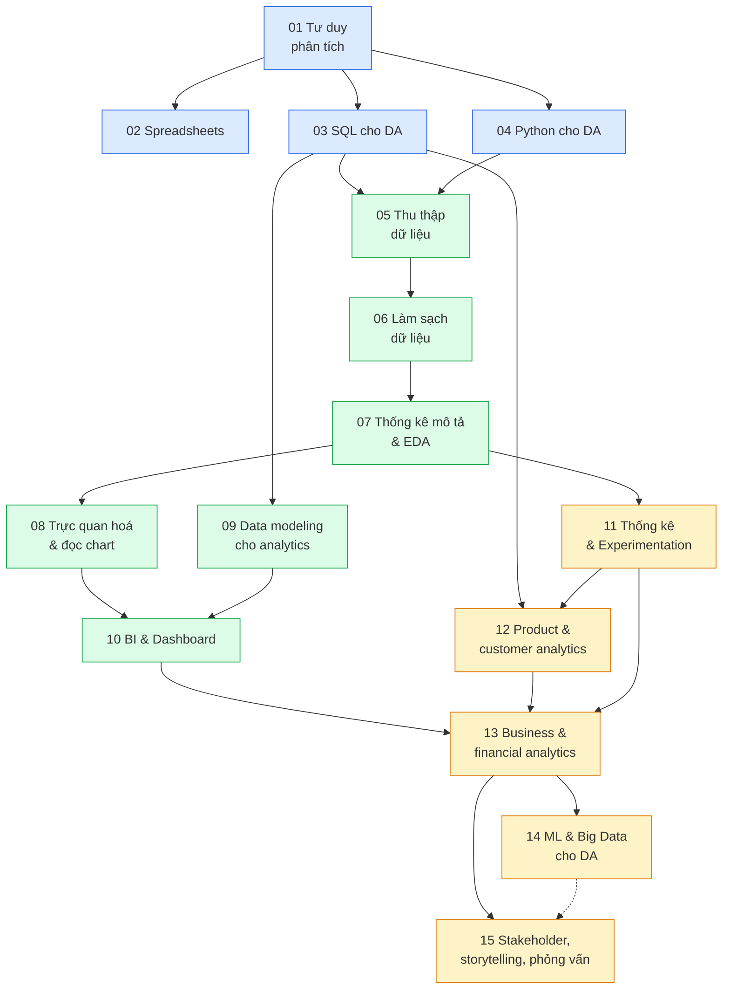
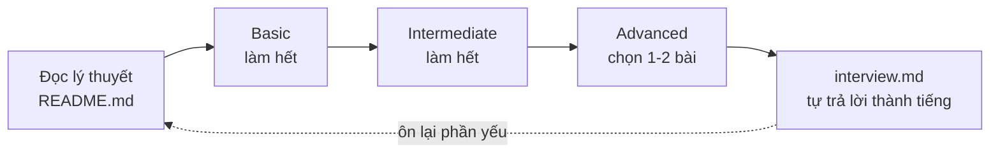

# Lộ trình Data Analyst

Lộ trình bám theo [roadmap.sh/data-analyst](https://roadmap.sh/data-analyst) (bản PDF ở
`roadmap/data-analyst.pdf`), bổ sung những phần một Data Analyst **senior** cần mà roadmap gốc thiếu
(data modeling cho analytics, product/customer analytics, business & financial analytics,
stakeholder và storytelling). Các phần thêm có dấu ★ trong bảng dưới.

Track này dành cho người đã học track Data Engineer và Data Science, muốn làm được việc của DA và
đi phỏng vấn vị trí DA tới mức senior. Vì vậy:

- **Kiến thức trùng track cũ chỉ nhắc lại ngắn** (một phần `## 1. Nhắc lại nhanh` có link về module gốc).
  Track này **chủ yếu là bài tập**.
- **Bài tập đặt trong bối cảnh công việc DA**: có câu hỏi business từ stakeholder, trả lời bằng số liệu,
  bảng, chart và khuyến nghị, khác với bài xây model của track DS.
- Hai kỹ năng chạy xuyên suốt: **chọn đúng công cụ cho việc** (mỗi module có bảng so sánh và bài "chọn
  công cụ") và **đọc, phân tích biểu đồ**.

## Sơ đồ lộ trình



**Xanh dương** là nền tảng và công cụ (Excel, SQL, Python). **Xanh lá** là vòng đời dữ liệu: thu thập,
làm sạch, EDA, trực quan hoá, modeling, BI. **Vàng** là phân tích để ra quyết định kinh doanh. Module
02, 03, 04 học song song được; module 14 ngắn, phần lớn nhắc lại. Module 08 là **trọng tâm** của track
(chọn chart, bắt chart gây hiểu nhầm, đọc chart ra insight).

## Các module

15 module, **108 bài tập** (12 module có 7 bài: 3 Basic, 2 Intermediate, 2 Advanced; module 02, 08 và 12 có 8 bài vì thêm một bài Intermediate), cộng capstone 7 milestone.

| # | Module | Mục roadmap gốc | Kỹ năng chính | Bài tập |
| --- | --- | --- | --- | --- |
| 01 | Vai trò DA & tư duy phân tích | Introduction, Key Concepts | 4 loại analytics, câu hỏi business, KPI, metric tree, bản đồ công cụ | 7 |
| 02 | Excel / Spreadsheet | Excel (IF, DATEDIF, VLOOKUP/HLOOKUP, REPLACE/SUBSTITUTE, UPPER/LOWER/PROPER, CONCAT, TRIM, AVERAGE, COUNT, SUM, MIN/MAX), Charting | Công thức, XLOOKUP, pivot table, chart | 8 |
| 03 | SQL cho DA | Learn SQL | YoY/MoM, running total, top-N, cohort, funnel bằng SQL | 7 |
| 04 | Python cho DA | Programming (pandas, matplotlib, seaborn), R | Phân tích bằng pandas, R đối chiếu, git, project tái lập ★ | 7 |
| 05 | Thu thập dữ liệu | Data Collection (databases, CSV, APIs, web scraping) | Đọc từ DB, API, scraping có đạo đức | 7 |
| 06 | Làm sạch dữ liệu | Data Cleaning | Missing, duplicates, outliers, transformation, nghi ngờ dữ liệu | 7 |
| 07 | Thống kê mô tả & EDA | Statistical Analysis, Exploration | Central tendency, dispersion, distribution, EDA | 7 |
| 08 | Trực quan hoá & đọc biểu đồ | Data Visualization (chart types, thư viện) | Chọn chart, chart gây hiểu nhầm, đọc chart ra insight | 8 |
| 09 | Data modeling cho analytics ★ | (thêm) | Star schema, grain, dbt, semantic layer, định nghĩa metric | 7 |
| 10 | BI & Dashboard | Tools (Tableau, Power BI) | Metabase, Superset, Streamlit, thiết kế KPI dashboard | 7 |
| 11 | Thống kê & Experimentation | Hypothesis Testing, Correlation, Regression | A/B test từ phía DA, guardrail, sample size, DiD nhanh ★ | 7 |
| 12 | Product & customer analytics ★ | (thêm) | Funnel, cohort, retention, LTV, CAC, RFM, market basket, tracking plan | 8 |
| 13 | Business & financial analytics ★ | (thêm) | Root cause, P&L, margin, unit economics, giá/khuyến mãi, dự báo, giám sát KPI | 7 |
| 14 | ML & Big Data cho DA | Advanced Topics (ML, Deep Learning, Big Data) | Thuật toán roadmap, đánh giá model, Hadoop/Spark ở mức khái niệm | 7 |
| 15 | Stakeholder, storytelling & phỏng vấn ★ | Final steps (portfolio, Kaggle, networking) | Scoping, memo, AI khi phân tích, take-home, case interview | 7 |

## Bản đồ công cụ

Bảng tổng quan; mỗi module đi sâu hơn vào các công cụ nó đụng tới. Cột "Thực hành" cho biết track có bài
làm trên công cụ đó hay chỉ dạy khái niệm.

| Công cụ | Dùng khi | Mạnh | Yếu | Thực hành |
| --- | --- | --- | --- | --- |
| Excel / Google Sheets | Dữ liệu nhỏ (dưới ~1 triệu dòng), việc ad-hoc, chia sẻ với người không biết code, mô hình tài chính nhỏ | Ai cũng mở được, xem kết quả tức thì, pivot nhanh | Khó tái lập và review, dễ sai công thức không ai thấy, chậm khi dữ liệu lớn | Module 02 (LibreOffice thay Excel) |
| SQL | Dữ liệu nằm trong database/warehouse, tổng hợp lớn, câu hỏi lặp lại | Chạy gần dữ liệu, mở rộng được, ngôn ngữ chung của mọi đội dữ liệu | Vẽ chart và thống kê sâu không tiện, mỗi dialect một chút khác | Module 03 trở đi |
| Python (pandas) | Làm sạch phức tạp, EDA, thống kê, tự động hoá, kết hợp API và ML | Linh hoạt, tái lập, hệ sinh thái lớn | Cần code, dữ liệu lớn hơn RAM thì phải chuyển sang DuckDB/Spark | Module 04 trở đi |
| R | Môi trường học thuật, thống kê chuyên sâu, ggplot2 | Thống kê và biểu đồ rất mạnh, cú pháp tidyverse gọn | Ít gặp ở công ty ưu tiên Python, thêm một ngôn ngữ để duy trì | Chỉ giới thiệu, đối chiếu ở module 04 |
| Metabase | Team nhỏ cần dashboard và câu hỏi self-serve nhanh trên SQL database | Cài nhanh, người ít kỹ thuật tự hỏi được, mã nguồn mở | Tuỳ biến và semantic layer hạn chế so với công cụ lớn | Module 10 (Docker) |
| Apache Superset | Cần BI mã nguồn mở, nhiều loại chart, kiểm soát hạ tầng | Nhiều chart, SQL Lab, mở rộng được | Cài đặt và vận hành nặng hơn, giao diện phức tạp | Module 10 (Docker) |
| Power BI | Công ty dùng hệ sinh thái Microsoft, báo cáo cho doanh nghiệp | Data model và DAX mạnh, tích hợp Excel/Azure, giá thấp | Desktop chỉ chạy Windows, dễ khoá vào Microsoft | Chỉ khái niệm (measure, DAX), module 10 |
| Tableau | Khám phá trực quan, dashboard đẹp, đội chuyên về visualization | Trực quan hoá tương tác rất mạnh, kéo thả | Giá cao, quản lý logic nằm trong workbook khó review | Chỉ khái niệm, module 10 |
| Looker | Công ty có warehouse tập trung, cần định nghĩa metric dùng chung | LookML là semantic layer có version control, một nguồn sự thật cho metric | Cần người viết LookML, giá cao, ít tự do khám phá | Chỉ khái niệm (LookML), module 09-10 |
| Streamlit | Ứng dụng phân tích tuỳ biến, công cụ nội bộ, demo model, dashboard cần logic riêng | Viết bằng Python thuần, tuỳ biến tối đa | Không phải công cụ BI self-serve, tự lo hosting, phân quyền | Module 10 (chấm bằng AppTest) |

Không có công cụ "tốt nhất": câu hỏi đúng là **ai dùng, dữ liệu lớn cỡ nào, cần tái lập không, cần chia
sẻ cho ai**. Các module có bài "chọn công cụ" theo tình huống để luyện câu hỏi đó.

## Dữ liệu

Track này dùng **dữ liệu thật**, mỗi module chọn bộ hợp chủ đề (retail, thuê xe, web, tài chính…).
Danh sách bộ, nguồn, giấy phép và lệnh tải ở [`data/README.md`](../../data/README.md).

```bash
uv sync                                                          # môi trường Python (xem setup/SETUP.md)
uv run python data/download_dataset.py --list                    # các bộ có sẵn
uv run python data/download_dataset.py bike-sharing-uci          # module 08
uv run python data/download_dataset.py online-retail-ii
uv run python data/download_dataset.py dunnhumby-complete-journey # capstone, cần Kaggle token
```

Kaggle token: Kaggle → Settings → API → "Generate New Token", ghi vào `setup/.env` dạng
`KAGGLE_API_TOKEN=KGAT_...`. Dữ liệu tải về `data/raw/<tên>/`, không commit. Test chấm bài trên dữ liệu
thật tự skip khi bạn chưa tải; test còn lại chạy không cần mạng hay Docker.

## Cách làm bài

Mỗi module có `README.md` (lý thuyết), `interview.md` và bài tập 3 mức Basic, Intermediate, Advanced.



Có ba dạng bài chính, app hiển thị tương ứng:

- **Bài `.py`** (thuần logic): điền `# TODO`, chạy `uv run pytest <thư mục bài> -q`.
- **Bài notebook** (phân tích trên dữ liệu thật): mở `starter/*.ipynb` bằng `uv run jupyter lab` hoặc VS Code.
  Cell chấm điểm chỉ định nghĩa hàm hoặc hằng; cell gắn tag `explore` là nơi bạn đọc dữ liệu, vẽ chart, thử nghiệm
  (test bỏ qua). Cell đọc dữ liệu thật hoặc vẽ chart **phải** có tag `explore`. Chấm: `uv run pytest <thư mục bài> -q`.
  Bài có dữ liệu thật thường kèm **trắc nghiệm** trong app (đọc chart, diễn giải kết quả).
- **Bài quiz-only** (ví dụ "chọn công cụ", đọc chart): thư mục bài chỉ có `README.md` (frontmatter `files: []`,
  `run: []`) và `quiz.yaml`; không có starter code, không có test để chạy. Mở bài trong app, làm trắc nghiệm,
  nộp để xem kết quả; giải thích chi tiết ở lời giải (SOLUTION.md). Lời giải nằm ở `SOLUTION.md` và `quiz-answers.yaml`.

Bài Advanced không có đáp án duy nhất, chỉ có `SOLUTION.md` với hướng làm và rubric để tự chấm.
Xem lời giải mẫu: `SOLUTION=1 uv run pytest <thư mục bài> -q`. Khi nào kẹt mới xem, vì phần lớn giá trị
nằm ở việc tự đưa ra kết luận từ số liệu.

## Dự án capstone

**Dunnhumby "The Complete Journey"**: dữ liệu thật của một chuỗi siêu thị, 2 500 hộ trong hai năm. Bạn
đóng vai DA trả lời ban điều hành về doanh thu, khách hàng và hiệu quả marketing qua 7 milestone, từ nạp
và làm sạch dữ liệu tới memo cuối. Xem [`capstone/README.md`](capstone/README.md).

## Ngoài phạm vi track này

- **R**: chỉ giới thiệu, đối chiếu dplyr/ggplot2 với pandas/seaborn ở module 04. Không có bài tập R bắt buộc.
- **Power BI, Tableau, Looker**: chỉ dạy khái niệm (data model, measure/DAX, LookML) và so sánh. Không có bài
  thực hành bắt buộc vì Power BI Desktop không chạy trên Linux và cả ba là phần mềm thương mại.
- **Deep Learning, Big Data**: chỉ giới thiệu ở module 14, trỏ về track Data Science và Data Engineer.
- **Dạy lại từ đầu những gì track DE/DS đã dạy**: không; phần trùng chỉ nhắc ngắn và có link về module gốc.
