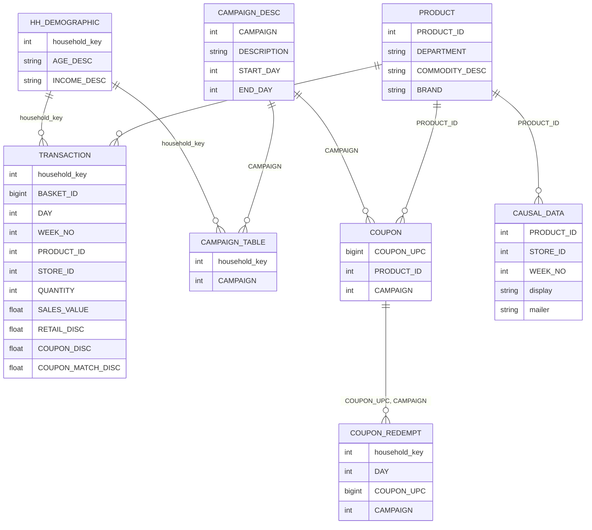
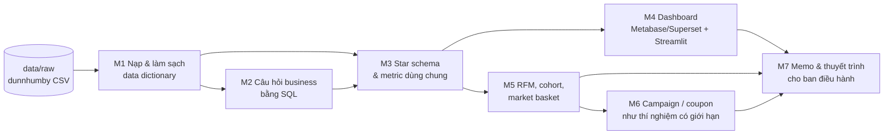

# Dunnhumby: The Complete Journey

Dự án capstone xuyên suốt lộ trình Data Analyst. Bạn đóng vai Data Analyst của một chuỗi siêu thị
(grocery/FMCG) ở Mỹ, trả lời ban điều hành ba nhóm câu hỏi: **doanh thu đang đến từ đâu, khách hàng nào
tạo ra nó, và các chương trình marketing (campaign, coupon) có hiệu quả không**. Bảy milestone đi từ nạp và
làm sạch dữ liệu, SQL, star schema, dashboard, phân khúc khách hàng, đánh giá campaign tới memo cho ban điều hành.

Dữ liệu là **dữ liệu thật** do dunnhumby công bố: các giao dịch của 2 500 hộ gia đình có thẻ khách hàng
trong khoảng hai năm. Vì là dữ liệu thật nên có chỗ "khó chịu" mà bạn phải tự phát hiện và nói rõ cách
xử lý (xem phần Cạm bẫy).

## Mục tiêu dự án

- Một **câu chuyện liền mạch** từ dữ liệu tới quyết định: mỗi con số trong memo cuối truy được về một
  notebook, câu SQL hoặc dashboard chạy lại được.
- Thể hiện kỹ năng nhà tuyển dụng hỏi ở vị trí Data Analyst senior: định nghĩa metric, SQL, data modeling,
  dashboard, RFM/cohort, đọc kết quả thí nghiệm có giới hạn và giao tiếp với stakeholder.
- Trung thực: "chưa đủ bằng chứng để kết luận campaign có hiệu quả" là kết luận tốt nếu dữ liệu nói vậy.

## Dữ liệu

```bash
uv run python data/download_dataset.py dunnhumby-complete-journey   # cần Kaggle token, ghi vào data/raw/dunnhumby-complete-journey/
```

Nguồn: [Kaggle `frtgnn/dunnhumby-the-complete-journey`](https://www.kaggle.com/datasets/frtgnn/dunnhumby-the-complete-journey),
giấy phép Open Database License (DbCL v1.0). Không commit dữ liệu thô. `causal_data.csv` rất lớn (~696 MB,
36,8 triệu dòng): đọc bằng DuckDB hoặc `usecols`/`chunksize`, không `read_csv` cả tệp bằng pandas.

### Schema 8 bảng

| Tệp | Số dòng | Một dòng là | Cột chính |
| --- | --- | --- | --- |
| `transaction_data.csv` | 2 595 732 | một mặt hàng trong một giỏ | `household_key`, `BASKET_ID`, `DAY`, `WEEK_NO`, `PRODUCT_ID`, `STORE_ID`, `QUANTITY`, `SALES_VALUE`, `RETAIL_DISC`, `COUPON_DISC`, `COUPON_MATCH_DISC`, `TRANS_TIME` |
| `product.csv` | 92 353 | một sản phẩm | `PRODUCT_ID`, `DEPARTMENT`, `COMMODITY_DESC`, `SUB_COMMODITY_DESC`, `BRAND`, `MANUFACTURER`, `CURR_SIZE_OF_PRODUCT` |
| `hh_demographic.csv` | 801 | một hộ có thông tin nhân khẩu | `household_key`, `AGE_DESC`, `INCOME_DESC`, `HOMEOWNER_DESC`, `HH_COMP_DESC`, `HOUSEHOLD_SIZE_DESC`, `KID_CATEGORY_DESC`, `MARITAL_STATUS_CODE` |
| `campaign_desc.csv` | 30 | một campaign | `CAMPAIGN`, `DESCRIPTION` (TypeA/B/C), `START_DAY`, `END_DAY` |
| `campaign_table.csv` | 7 208 | một hộ được gán vào một campaign | `household_key`, `CAMPAIGN`, `DESCRIPTION` |
| `coupon.csv` | 124 548 | một sản phẩm thuộc một coupon của một campaign | `COUPON_UPC`, `PRODUCT_ID`, `CAMPAIGN` |
| `coupon_redempt.csv` | 2 318 | một lần hộ dùng coupon | `household_key`, `DAY`, `COUPON_UPC`, `CAMPAIGN` |
| `causal_data.csv` | 36 786 524 | một sản phẩm tại một cửa hàng trong một tuần | `PRODUCT_ID`, `STORE_ID`, `WEEK_NO`, `display`, `mailer` |



`hh_demographic` chỉ có **801 trong 2 500 hộ** (32%): phân tích theo nhân khẩu học chỉ áp dụng cho nhóm này
và nhóm đó có thể không đại diện. `DAY` đếm từ 1 là ngày đầu của dữ liệu, không phải ngày lịch; bộ dữ liệu
**không có ngày lịch thật và không có địa lý** (chỉ có `STORE_ID`).

## Định nghĩa dùng chung

Mọi milestone dùng **cùng** các định nghĩa dưới đây. Đổi định nghĩa nào thì ghi rõ trong báo cáo và lý do.

| Khái niệm | Định nghĩa |
| --- | --- |
| Doanh thu ròng | `SUM(SALES_VALUE)`: số tiền cửa hàng thực nhận sau khi trừ giảm giá thẻ (`RETAIL_DISC`) và phần cửa hàng khớp coupon (`COUPON_MATCH_DISC`) |
| Doanh thu trước giảm giá (giá niêm yết) | `SALES_VALUE - RETAIL_DISC - COUPON_MATCH_DISC` (hai cột giảm giá là số âm) |
| Tỷ lệ giảm giá | `-(RETAIL_DISC + COUPON_MATCH_DISC + COUPON_DISC) / doanh thu trước giảm giá`; `COUPON_DISC` là coupon của nhà sản xuất, được thêm vào để đo tổng ưu đãi khách nhận |
| Basket (giỏ hàng) | một giá trị `BASKET_ID`; giá trị basket = tổng `SALES_VALUE` của các dòng cùng `BASKET_ID` |
| AOV | doanh thu ròng chia số basket |
| Kích thước basket | số dòng (mặt hàng) hoặc tổng `QUANTITY` trong một basket; nói rõ dùng cái nào |
| Hộ (khách hàng) | `household_key`, không có khái niệm cá nhân |
| Repeat vs one-time | hộ có từ 2 basket trở lên (khác `BASKET_ID`) trong dữ liệu là repeat, đúng 1 basket là one-time |
| Dòng hợp lệ để tính doanh thu | `SALES_VALUE > 0` và `QUANTITY > 0` (xem Cạm bẫy: dòng trả hàng/điều chỉnh) |
| Thời gian | `DAY` (1..711) và `WEEK_NO` (1..102); báo cáo theo tuần hoặc theo "tháng" = 4 tuần liên tiếp, ghi rõ quy ước |

### Về định nghĩa doanh thu

Tôi không kiểm được tài liệu hướng dẫn chính thức của dunnhumby (không truy cập được khi biên soạn), nên
định nghĩa trên dựa trên **kiểm tra trực tiếp trên dữ liệu**, chưa phải tài liệu chính thức: với các dòng
có `COUPON_MATCH_DISC < 0`, giá `SALES_VALUE - RETAIL_DISC - COUPON_MATCH_DISC` chia số lượng cho ra mức giá
niêm yết "tròn" hợp lý (2,19; 2,99; 2,29), còn `SALES_VALUE` đơn lẻ thì là số lẻ (1,10; 2,05). Suy ra
`SALES_VALUE` đã **net** của `RETAIL_DISC` và `COUPON_MATCH_DISC`. `COUPON_DISC` là phần nhà sản xuất chi trả cho coupon, nên **không** trừ vào doanh thu ròng của cửa hàng.
Nếu bạn tìm được tài liệu chính thức khác với kết luận này, hãy sửa bảng định nghĩa và ghi lại. Đây cũng là
ví dụ của một kỹ năng DA senior: kiểm định nghĩa cột bằng dữ liệu trước khi tin tên cột.

## Con số tham chiếu

Tính bằng DuckDB trực tiếp trên tệp CSV đã tải (không lọc), để bạn đối chiếu kết quả của mình:

| Đại lượng | Giá trị |
| --- | --- |
| Số dòng `transaction_data` | 2 595 732 |
| Số hộ có giao dịch | 2 500 |
| Số basket (`BASKET_ID` khác nhau) | 276 484 |
| Số sản phẩm có bán / số sản phẩm trong `product` | 92 339 / 92 353 |
| Số cửa hàng (`STORE_ID`) | 582 |
| Khoảng `DAY` | 1 .. 711 (711 ngày khác nhau, không bị hổng ngày) |
| Khoảng `WEEK_NO` | 1 .. 102 |
| Tổng `SALES_VALUE` | 8 057 463,08 |
| Tổng `RETAIL_DISC` / `COUPON_MATCH_DISC` / `COUPON_DISC` | -1 398 334,84 / -7 575,81 / -42 611,54 |
| Doanh thu trước giảm giá (`SALES_VALUE - RETAIL_DISC - COUPON_MATCH_DISC`) | 9 463 373,73 |
| Giá trị basket trung bình / trung vị | 29,14 / 17,07 |
| Số dòng mỗi basket, trung vị | 5 |
| Dòng có `SALES_VALUE <= 0` hoặc `QUANTITY <= 0` | 18 917 (trong đó 18 850 dòng `SALES_VALUE = 0`) |
| Số hộ trong `hh_demographic` | 801 |
| Số hộ trong `campaign_table` / số campaign | 1 584 / 30 |
| Số hộ dùng coupon (`coupon_redempt`) | 434 |
| Số ngành hàng (`DEPARTMENT`) | 44 |
| `causal_data`: số sản phẩm / số tuần | 68 377 / 93 |

## Cạm bẫy của dữ liệu thật

- **Dòng có `SALES_VALUE = 0`** (18 850 dòng): hàng tặng, khuyến mãi tặng kèm hoặc điều chỉnh. Giữ hay bỏ
  khi đếm số mặt hàng, đếm basket? Nói rõ lựa chọn. Tổng `SALES_VALUE` của dòng `> 0` trùng tổng toàn bộ
  tới sai số làm tròn, nghĩa là **không có dòng âm đáng kể**; vẫn cần tự kiểm lại sau khi lọc.
- **Chỉ 32% hộ có nhân khẩu học**, và `campaign_table` chỉ phủ 1 584/2 500 hộ.
- **`DAY` không phải ngày lịch**: không có tháng, mùa vụ thật; nếu cần "tháng" phải tự quy ước (4 tuần).
- **Dữ liệu cắt ở hai đầu**: tuần đầu và tuần cuối có thể thiếu ngày; đừng kết luận tăng/giảm từ chúng.
- **Hộ có thẻ khách hàng không phải toàn bộ khách của cửa hàng**: kết quả nói về nhóm hộ này.
- **Coupon redemption chỉ có 2 318 dòng** trên 434 hộ: mẫu nhỏ, đọc kết quả campaign phải cẩn thận.

## Câu hỏi xuyên suốt và 5 tình huống

Capstone phủ 5 tình huống phân tích lấy từ đề bài thực hành "Sales of FMCG Stores", chuyển sang dữ liệu thật.
Bộ dữ liệu không có địa lý, nên tình huống địa lý được thay bằng phân tích theo nhóm nhân khẩu học.

| # | Tình huống | Bảng dùng | Ghi chú |
| --- | --- | --- | --- |
| 1 | Doanh thu theo thời gian (tuần/"tháng"), xu hướng, mùa vụ | `transaction_data` | Quy ước tuần/tháng, chú ý hai đầu bị cắt |
| 2 | Tỷ trọng doanh thu theo ngành hàng (`DEPARTMENT`, `COMMODITY_DESC`) | `transaction_data`, `product` | Pareto, ngành hàng chiếm bao nhiêu % |
| 3 | Xếp hạng sản phẩm, thương hiệu (top-N theo doanh thu và theo số basket) | `transaction_data`, `product` | Top theo doanh thu khác top theo số lượng |
| 4 | Phân khúc khách hàng: repeat vs one-time, AOV, basket size, RFM | `transaction_data` | Dùng định nghĩa chung ở trên |
| 5 | Phân tích theo nhóm nhân khẩu học (thay cho địa lý): tuổi, thu nhập, quy mô hộ, có con | `transaction_data`, `hh_demographic` | Chỉ 801 hộ, nêu rõ giới hạn |

Hai phần thêm so với đề gốc: **hiệu quả campaign/coupon** (`campaign_*`, `coupon*`, `causal_data`) và
**market basket**.

## Bức tranh tổng thể



## Milestone

Mỗi milestone được gắn với module mà nó cần (`after`), nên chỉ đòi kiến thức các module trước đó. Các tệp
milestone sẽ được thêm cùng nội dung module; hiện mới có danh sách gợi ý dưới đây.

| # | Milestone | Sau module | Nội dung chính |
| --- | --- | --- | --- |
| 1 | Nạp dữ liệu, làm sạch, data dictionary | 06 | Nạp 8 bảng (causal bằng DuckDB), kiểm khoá và tính toàn vẹn, xử lý dòng `SALES_VALUE = 0`, viết data dictionary |
| 2 | Trả lời câu hỏi business bằng SQL | 03 và 07 | Tình huống 1 đến 4: doanh thu theo thời gian, tỷ trọng ngành hàng, top sản phẩm, repeat vs one-time, AOV; kèm EDA |
| 3 | Star schema và định nghĩa metric dùng chung | 09 | `fact_sales`, `dim_product`, `dim_household`, `dim_date`; khai báo grain, kiểm chất lượng, ghi `METRICS.md` |
| 4 | Dashboard | 10 | Một dashboard trên Metabase hoặc Superset, một trên Streamlit; cùng số, so sánh hai công cụ |
| 5 | Phân khúc RFM, cohort retention, market basket | 12 | Tình huống 4 và 5: RFM, cohort theo tuần đầu mua, luật kết hợp, nhóm nhân khẩu học |
| 6 | Hiệu quả campaign/coupon | 11 và 13 | Đọc như một thí nghiệm có giới hạn: nhóm được gán vs không, hạn chế chọn mẫu, kết luận thận trọng |
| 7 | Memo và thuyết trình cho ban điều hành | 15 | Một trang memo, 5 slide, khuyến nghị có số liệu, nêu rõ giả định và giới hạn |
