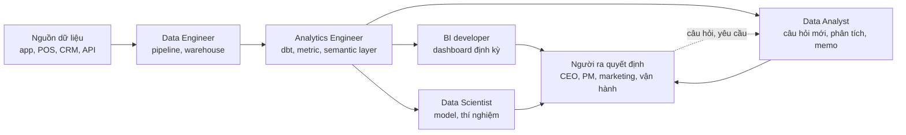
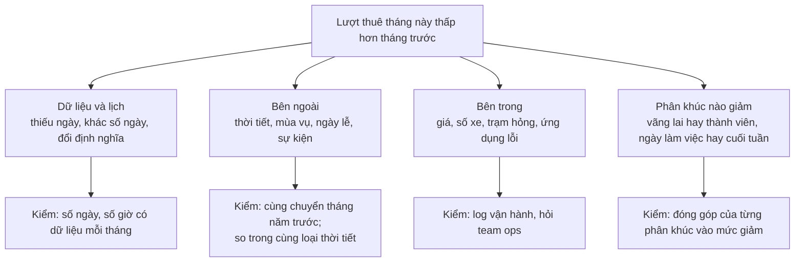
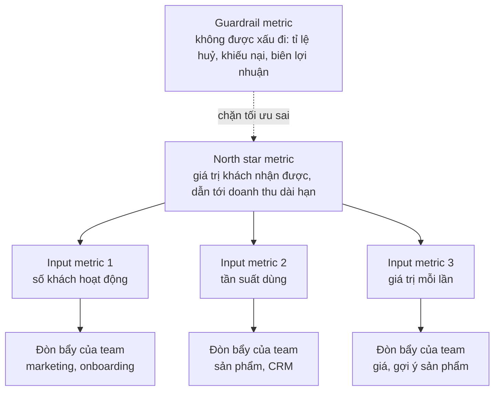
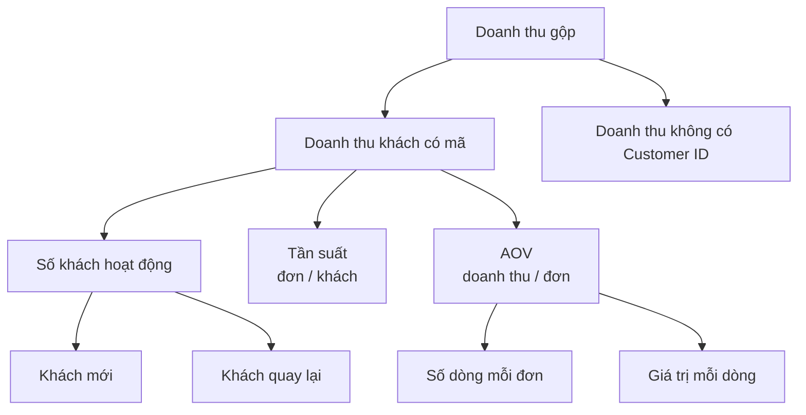
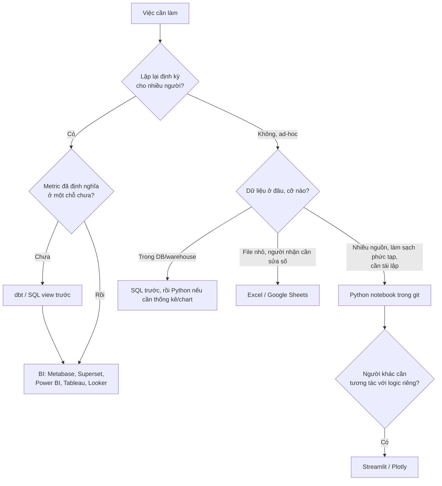
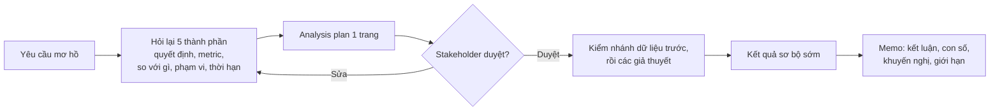

# Vai trò DA & tư duy phân tích

Module mở đầu track không dạy công cụ nào mới. Nó dạy thứ khiến hai người cùng biết SQL và pandas cho
ra hai kết quả rất khác nhau: **hỏi đúng câu hỏi, chọn đúng con số để theo dõi, và biết một phân tích
dừng ở đâu thì đủ để ra quyết định**. Một DA junior nhận yêu cầu "kéo giúp số doanh thu tháng này" và
trả về một con số. Một DA senior hỏi lại "số này dùng để quyết định gì?", trả về con số kèm so sánh
công bằng, phân rã thay đổi thành các thành phần, và một câu "nên làm gì tiếp".

Module dùng hai bộ dữ liệu thật đã gặp ở module 08:

- **Online Retail II (UCI)**: giao dịch của một cửa hàng quà tặng online ở Anh, sheet `Year 2010-2011`
  (541 910 dòng, 2010-12-01 tới 2011-12-09, tháng 12/2011 chưa đủ). Dùng cho metric tree doanh thu.
- **Bike Sharing (UCI)**: Capital Bikeshare (Washington DC) 2011–2012, `day.csv` 731 ngày, `hour.csv`
  17 379 giờ. Dùng cho bốn loại analytics và chỉ số dẫn trước (leading indicator).

```bash
uv run python data/download_dataset.py online-retail-ii
uv run python data/download_dataset.py bike-sharing-uci
```

Mọi đoạn code chạy từ thư mục gốc repo. Quy ước làm sạch Online Retail II dùng chung cả track: bỏ hoá
đơn bắt đầu bằng `C`, bỏ dòng `Quantity <= 0` hoặc `Price <= 0`, doanh thu = `Quantity * Price` (doanh
thu gộp, GBP); khách hàng là dòng có `Customer ID`.

Sau module này bạn sẽ:

- Phân biệt việc của DA với DS, DE, BI developer, Analytics Engineer, và biết một DA senior được đánh
  giá bằng gì.
- Xếp một câu hỏi vào đúng một trong bốn loại analytics (descriptive, diagnostic, predictive,
  prescriptive) và biết mỗi loại cần dữ liệu, phương pháp, độ chắc chắn gì.
- Biến yêu cầu mơ hồ thành câu hỏi đóng khung được (quyết định, metric, so với gì, phạm vi) và một cây
  giả thuyết MECE.
- Thiết kế KPI: north star, input metric, guardrail, leading vs lagging; dựng metric tree và phân rã
  thay đổi của KPI thành đóng góp của từng thành phần.
- Đọc bản đồ công cụ của DA và chọn công cụ theo việc, không theo thói quen.

## 1. Nhắc lại nhanh: DA đứng ở đâu giữa DS, DE, BI

Bảng so sánh DA, DS, DE trên cùng một câu hỏi Olist đã có ở track Data Engineer, module
[Giới thiệu Data Engineering](../../../data-engineer/modules/00-introduction/README.md) phần 1. Tóm tắt:
DE làm cho dữ liệu **có sẵn và đúng**, DS xây **model** dự đoán hoặc đo nhân quả, DA biến dữ liệu thành
**câu trả lời cho một quyết định**. Phần này thêm góc nhìn từ phía DA: các vai trò sát cạnh mà bạn làm
việc hằng ngày, và một DA được đánh giá bằng gì.

| Vai trò | Câu hỏi chính | Sản phẩm | Công cụ hằng ngày | Ranh giới với DA |
| --- | --- | --- | --- | --- |
| **Data Analyst** | Chuyện gì đã xảy ra, vì sao, nên làm gì | Phân tích ad-hoc, báo cáo, dashboard, memo | SQL, Excel, Python, BI | Là vai trò của track này |
| **BI Analyst / BI Developer** | Dashboard nào cho ai, số có khớp không | Dashboard, data model trong BI, báo cáo định kỳ | Power BI/Tableau/Looker, SQL, DAX/LookML | Nghiêng về sản phẩm báo cáo lặp lại; DA nghiêng về câu hỏi mới. Nhiều công ty gộp làm một |
| **Analytics Engineer** | Bảng nào, grain nào, metric định nghĩa ở đâu | Mô hình dbt, semantic layer, test dữ liệu | dbt, SQL, git, warehouse | Viết tầng transform mà DA đọc; DA senior thường tự viết một phần (module 09) |
| **Data Scientist** | Dự đoán được không, tác động nhân quả bao nhiêu | Model, thí nghiệm, phân tích thống kê sâu | Python, scikit-learn, statsmodels | DA dùng thống kê để mô tả và kiểm định đơn giản; DS xây model đưa vào sản phẩm |
| **Data Engineer** | Dữ liệu có đúng, đủ, kịp không | Pipeline, warehouse, data contract | Airflow, Spark, Kafka, dbt, cloud | DA là khách hàng của DE: báo lỗi dữ liệu, đặt yêu cầu bảng |
| **Product Analyst** | Người dùng làm gì trong sản phẩm, tính năng có hiệu quả không | Funnel, cohort, A/B readout | SQL, Amplitude/Mixpanel, Python | Một DA chuyên về sản phẩm số (module 11, 12) |

Ranh giới thực tế mờ: startup 30 người có một "data person" làm cả DE lẫn DA; ngân hàng lớn tách BI,
DA, AE, DS thành các phòng khác nhau. Câu cần hỏi khi đọc JD không phải tên chức danh mà là **sản phẩm
đầu ra** (dashboard, memo, model, pipeline) và **ai là người đọc**.

### DA junior, mid, senior khác nhau ở đâu

| Cấp | Nhận việc | Làm | Đầu ra |
| --- | --- | --- | --- |
| Junior | Câu hỏi đã rõ, bảng đã có | Viết đúng SQL/pivot, kiểm số | Con số, bảng, chart |
| Mid | Câu hỏi hơi mơ hồ | Tự làm rõ, chọn so sánh công bằng, phân rã | Phân tích có kết luận |
| Senior | Vấn đề kinh doanh ("khách đang bỏ đi") | Đóng khung, ưu tiên, chọn metric, nói "không" với phân tích vô ích | Khuyến nghị có tác động ước tính, thay đổi quyết định |

Một DA senior được đánh giá bằng **quyết định đã thay đổi nhờ phân tích**, không phải số dashboard đã
dựng hay số dòng SQL đã viết. Cả track này luyện bước nhảy từ cột "Con số" sang cột "Khuyến nghị".



## 2. Vòng đời phân tích và Key Concepts of Data

Roadmap gọi sáu khái niệm nền là *Key Concepts of Data*: **collection, cleanup, exploration,
visualisation, statistical analysis, machine learning**. Đọc chúng như sáu bước của một vòng phân tích,
có thêm hai bước mà roadmap không ghi nhưng chiếm nhiều thời gian nhất của DA senior: **đặt câu hỏi** ở
đầu và **ra quyết định** ở cuối.


| Khái niệm | DA làm gì ở bước này | Lỗi hay gặp | Module |
| --- | --- | --- | --- |
| **Collection** | Lấy dữ liệu từ database, CSV, API, scraping; ghi lại nguồn và thời điểm | Lấy nhầm bảng, nhầm múi giờ, không biết bảng bị lọc sẵn | 03, 05 |
| **Cleanup** | Xử lý missing, trùng, outlier, chuẩn hoá kiểu và đơn vị; ghi log bước nào loại bao nhiêu dòng | Xoá dòng "xấu" mà không đếm, làm doanh thu lệch không ai biết | 06 |
| **Exploration** | Hỏi dữ liệu: phân phối, xu hướng, nhóm, điểm lạ | Vẽ mọi thứ không có câu hỏi, chìm trong chart | 07 |
| **Visualisation** | Chọn chart theo câu hỏi, headline là kết luận | Chart đúng nhưng trả lời câu hỏi khác | 08, 10 |
| **Statistical analysis** | So sánh có độ bất định, kiểm định, tương quan, hồi quy giải thích | Thấy chênh lệch là kết luận, quên cỡ mẫu và nhiễu | 11 |
| **Machine learning** | Dùng model khi cần dự đoán hoặc phân nhóm, đọc kết quả cho business | Dùng ML cho câu hỏi một phép `groupby` trả lời được | 14 |

Thời gian thực tế của một phân tích ad-hoc thường dồn vào collection và cleanup (lấy đúng dữ liệu,
hiểu định nghĩa cột) chứ không vào phần "phân tích". Đừng kế hoạch theo kiểu "1 ngày làm sạch, 4 ngày
phân tích": làm ngược lại thường đúng hơn với dữ liệu mới.

## 3. Bốn loại analytics

Mỗi câu hỏi business thuộc một trong bốn loại, xếp theo độ khó và giá trị (mô hình *analytics
ascendancy* của Gartner):

| Loại | Câu hỏi | Phương pháp điển hình | Độ chắc chắn | Ví dụ Bike Sharing |
| --- | --- | --- | --- | --- |
| **Descriptive** | Chuyện gì đã xảy ra? | Tổng hợp, so sánh kỳ, dashboard, KPI | Cao (nếu dữ liệu đúng) | Lượt thuê 2012 so với 2011 |
| **Diagnostic** | Vì sao nó xảy ra? | Phân rã, drill-down, so sánh nhóm, giả thuyết | Trung bình: nhiều giải thích có thể đúng cùng lúc | Vì sao vài ngày năm 2012 gần như không ai thuê |
| **Predictive** | Chuyện gì sẽ xảy ra? | Dự báo, model, chỉ số dẫn trước | Thấp hơn, phải báo sai số | Tháng 12/2012 sẽ có bao nhiêu lượt |
| **Prescriptive** | Nên làm gì? | Kịch bản what-if, tối ưu, quy tắc ra quyết định, thí nghiệm | Phụ thuộc giả định | Bảo trì xe vào giờ nào để mất ít lượt nhất |

Ba điều hay bị hiểu sai:

- **Bốn loại không phải bốn cấp "trình độ"** mà DA phải leo lên. Phần lớn giá trị của DA nằm ở
  descriptive và diagnostic làm **đúng**: một con số so sánh công bằng thay đổi quyết định nhiều hơn một
  model dự báo không ai tin.
- **Cách hỏi quyết định loại, không phải công cụ.** "Doanh thu tháng sau bao nhiêu?" là predictive dù
  bạn trả lời bằng Excel. "Vì sao doanh thu giảm?" là diagnostic dù bạn dùng ML để tìm.
- **Prescriptive cần mục tiêu và ràng buộc.** "Nên làm gì" vô nghĩa khi chưa biết tối ưu cái gì (doanh
  thu, lợi nhuận, số khách) và giới hạn ở đâu (ngân sách, nhân lực). Đó là việc phải hỏi stakeholder.

Đoạn code dưới trả lời một câu mỗi loại trên Bike Sharing, mỗi câu chỉ vài dòng: độ khó của từng loại
nằm ở chỗ chọn so sánh và giả định, không nằm ở code.

```python
import sys
from pathlib import Path

import numpy as np
import pandas as pd

ROOT = next(p for p in [Path.cwd(), *Path.cwd().parents] if (p / "pyproject.toml").exists())
sys.path.insert(0, str(ROOT))
from data.download_dataset import ensure  # noqa: E402

BIKE = ensure("bike-sharing-uci")
day = pd.read_csv(BIKE / "day.csv", parse_dates=["dteday"])
hour = pd.read_csv(BIKE / "hour.csv", parse_dates=["dteday"])

# 1. Descriptive: chuyện gì đã xảy ra?
by_year = day.groupby(day.dteday.dt.year).cnt.sum()
print("lượt thuê theo năm:", by_year.to_dict(), f"→ {by_year[2012] / by_year[2011] - 1:+.1%}")

# 2. Diagnostic: 10 ngày thấp nhất năm 2012 có điểm gì chung?
low = day[day.dteday.dt.year == 2012].nsmallest(10, "cnt")
print(low[["dteday", "cnt", "weathersit", "holiday"]].to_string(index=False))
print("mưa/tuyết (weathersit 3):", int((low.weathersit == 3).sum()),
      "| nằm trong 24-31/12:", int(low.dteday.between("2012-12-24", "2012-12-31").sum()))

# 3. Predictive: dự báo tháng 12/2012 = tháng 12/2011 x tăng trưởng 11 tháng đầu năm, rồi kiểm lại
jan_nov = day[day.dteday.dt.month < 12].groupby(day.dteday.dt.year).cnt.sum()
dec = day[day.dteday.dt.month == 12].groupby(day.dteday.dt.year).cnt.sum()
forecast = dec[2011] * jan_nov[2012] / jan_nov[2011]
print(f"dự báo 12/2012: {forecast:,.0f}; thực tế {dec[2012]:,}; sai {forecast / dec[2012] - 1:+.1%}")

# 4. Prescriptive: bảo trì 1 giờ mỗi ngày làm việc, chọn giờ mất ít lượt thuê nhất
by_hr = hour[hour.workingday == 1].groupby("hr").cnt.mean()
print(f"giờ vắng nhất: {by_hr.idxmin()}h ({by_hr.min():.1f} lượt/giờ); "
      f"giờ đông nhất: {by_hr.idxmax()}h ({by_hr.max():.1f} lượt/giờ)")
```

Đọc kết quả:

- **Descriptive**: 1 243 103 lượt năm 2011, 2 049 576 năm 2012, **+64.9%**. Câu trả lời đúng, nhưng
  chưa nói gì về vì sao hay nên làm gì.
- **Diagnostic**: trong 10 ngày thấp nhất năm 2012, 3 ngày mưa/tuyết (`weathersit = 3`), gồm 29/10/2012
  chỉ có 22 lượt (bão Sandy đổ bộ), và 4 ngày nằm trong tuần Giáng sinh 24–31/12 (26/12 thuộc cả hai
  nhóm; chỉ 25/12 được đánh dấu `holiday`). Hai giả thuyết (thời tiết cực đoan, mùa lễ) cùng đúng, phần
  lớn trên các ngày khác nhau, và vẫn còn vài ngày thấp mà cả hai không giải thích: diagnostic hiếm khi
  có một nguyên nhân duy nhất.
- **Predictive**: nhân tháng 12/2011 với tăng trưởng 11 tháng đầu (+66.6%) cho 145 505 lượt, thực tế
  123 713: **dự báo cao hơn 17.6%**, vì tăng trưởng đang chậm lại cuối năm (tháng 12 chỉ +41.7% so với
  cùng kỳ). Dự báo luôn đi kèm sai số và giả định; báo một con số không có khoảng là báo thiếu.
- **Prescriptive**: ngày làm việc vắng nhất lúc 3h sáng (4.9 lượt/giờ), đông nhất 17h (525.3). Khuyến
  nghị "bảo trì 3–4h sáng" là prescriptive vì có mục tiêu (mất ít lượt nhất) và ràng buộc (một giờ mỗi
  ngày làm việc). Đổi mục tiêu (ví dụ nhân viên chỉ làm ca ngày) thì đáp án đổi.

## 4. Đặt câu hỏi business: đóng khung và giả thuyết

### Từ yêu cầu mơ hồ tới câu hỏi trả lời được

Stakeholder hiếm khi đưa câu hỏi phân tích được. Họ đưa **triệu chứng** ("doanh thu có vẻ chững"),
**giải pháp** ("làm giúp dashboard khách hàng") hoặc **ý kiến** ("chắc do khuyến mãi"). Việc đầu tiên
của DA là đóng khung (framing) thành câu hỏi có năm thành phần:

| Thành phần | Câu hỏi để hỏi lại | Ví dụ "doanh thu có vẻ chững" |
| --- | --- | --- |
| **Quyết định** | Có số này rồi anh/chị sẽ làm gì khác? | Có tăng ngân sách quảng cáo quý tới không |
| **Metric** | Đo bằng gì, định nghĩa chính xác? | Doanh thu gộp đã bỏ đơn huỷ, GBP, theo tháng lịch |
| **So với gì** | Chững so với kỳ trước, cùng kỳ năm trước, hay kế hoạch? | Cùng kỳ năm trước, vì có mùa vụ cuối năm |
| **Phạm vi** | Thị trường, sản phẩm, kênh, khoảng thời gian nào? | Toàn bộ, 12 tháng gần nhất, tách UK và ngoài UK |
| **Khi nào cần, chính xác cỡ nào** | Họp thứ Hai cần con số hay cần nguyên nhân? | Thứ Hai cần hướng; nguyên nhân chi tiết tuần sau |

Viết lại thành một câu: *"Doanh thu gộp 3 tháng gần nhất so với cùng kỳ năm trước tăng hay giảm, ở thị
trường nào, và phần thay đổi đến từ số khách, tần suất mua hay giá trị đơn, để quyết định ngân sách quảng
cáo quý tới."* Câu dài, nhưng mỗi cụm trong đó loại bỏ một tuần làm việc vô ích.

Ba bẫy khi đóng khung:

- **Nhận giải pháp thay vì vấn đề.** "Làm dashboard khách hàng" là giải pháp; vấn đề có thể chỉ cần một
  con số mỗi quý. Hỏi "dashboard này giúp anh/chị quyết định gì, bao lâu một lần?".
- **Câu hỏi không có quyết định đi kèm.** "Tò mò xem khách mua gì" là hợp lệ khi khám phá, nhưng phải
  có giới hạn thời gian; không thì nó chiếm cả tuần.
- **Câu hỏi đã chứa câu trả lời.** "Chứng minh khuyến mãi làm tăng doanh thu" ép DA tìm bằng chứng một
  chiều. Đổi thành "khuyến mãi có làm tăng doanh thu không, bao nhiêu, so với không chạy".

### Cây giả thuyết MECE

Khi câu hỏi là diagnostic ("vì sao"), đừng mở dữ liệu ra tìm ngẫu nhiên. Viết **cây giả thuyết** trước:
mỗi nhánh là một lời giải thích có thể kiểm bằng một con số, và các nhánh **MECE** (mutually exclusive,
collectively exhaustive: không chồng nhau, cộng lại phủ hết khả năng). Ví dụ cho câu "lượt thuê tháng
này thấp hơn tháng trước":



Quy tắc làm việc với cây:

1. **Nhánh dữ liệu luôn kiểm trước**: rẻ nhất và hay đúng nhất (kỳ chưa đủ ngày, pipeline lỗi, đổi định
   nghĩa). Module 08 có ví dụ "doanh thu tháng 12 giảm 58%" chỉ vì tháng chưa hết.
2. **Mỗi nhánh có một con số kiểm và một ngưỡng**, viết trước khi nhìn dữ liệu: "nếu cùng chuyển tháng
   năm ngoái cũng giảm 5–10% thì mùa vụ giải thích phần lớn". Viết trước để tránh tự thuyết phục sau.
3. **Ưu tiên theo khả năng đúng × chi phí kiểm**, không theo thứ tự trên giấy.
4. **Dừng khi đủ để quyết định**, không phải khi đã giải thích được 100%. Phần dư không giải thích được
   là bình thường; ghi nó ra như một giới hạn.

Bài Intermediate 02 áp dụng đúng cây này lên một tháng giảm thật của Bike Sharing.

## 5. KPI, metric tree, north star

### KPI khác metric

Metric là mọi thứ đo được (số phiên, số đơn, thời gian tải trang). **KPI** (key performance indicator)
là số ít metric được chọn để theo dõi việc đạt mục tiêu, có **chủ sở hữu**, **mục tiêu** và **nhịp xem**
(hằng ngày, tuần, quý). Một team có 40 metric trên dashboard nhưng chỉ nên có 3–5 KPI. KPI tốt có bốn
đặc điểm: gắn với mục tiêu kinh doanh, **hành động được** (team tác động được), dễ hiểu một câu, và khó
"chơi gian" (game) mà không thật sự cải thiện kết quả.

### North star, input metric, guardrail



- **North star metric** là một con số thể hiện giá trị khách hàng nhận được, mà khi nó tăng bền vững thì
  doanh thu dài hạn tăng theo. Ví dụ phổ biến: Airbnb dùng số đêm đặt phòng, Spotify dùng thời gian nghe,
  một sàn thương mại điện tử dùng số đơn được giao thành công. Không phải doanh thu, vì doanh thu là **kết
  quả** đến chậm và có thể tăng ngắn hạn bằng cách làm hại khách (tăng giá, ép bán).
- **Input metric** là các thành phần mà team tác động trực tiếp, thường là các nhánh của metric tree.
- **Guardrail metric** là chỉ số không được xấu đi khi tối ưu north star: tỉ lệ hoàn/huỷ đơn, thời gian
  giao, khiếu nại, biên lợi nhuận. Không có guardrail, team sẽ "đạt KPI" bằng cách giảm giá sâu.

| Mô hình kinh doanh | North star hợp lý | Guardrail |
| --- | --- | --- |
| Bán lẻ online (Online Retail II) | Số đơn hợp lệ của khách quay lại mỗi tháng | Tỉ lệ đơn huỷ, biên lợi nhuận gộp |
| Cho thuê xe đạp (Bike Sharing) | Số lượt thuê của thành viên mỗi tuần | Tỉ lệ xe hỏng, thời gian chờ xe ở trạm |
| SaaS B2B | Số tài khoản dùng tính năng chính hằng tuần | Churn, ticket hỗ trợ |
| Ứng dụng giao đồ ăn | Số đơn giao thành công mỗi tuần | Thời gian giao, tỉ lệ đơn bị huỷ |

### Leading vs lagging

**Lagging indicator** đo kết quả sau khi đã xảy ra (doanh thu tháng, churn quý): chính xác nhưng đến
muộn, không còn kịp sửa. **Leading indicator** thay đổi **trước** kết quả và dự báo được nó (số khách
thêm hàng vào giỏ hôm nay, lượt thuê buổi sáng): đến sớm nhưng nhiễu hơn và phải được kiểm là thật sự
dự báo được. Một bộ KPI tốt ghép cặp: mỗi KPI lagging có ít nhất một leading đi kèm để team kịp hành động.

Ví dụ trên Bike Sharing: đội vận hành cần biết sớm trong ngày hôm nay sẽ đông hay vắng để điều xe. Lượt
thuê trước 10h sáng là một ứng viên leading indicator cho tổng lượt cả ngày. Đoạn code dùng lại `day`,
`hour` ở phần 3.

```python
morning = hour[hour.hr < 10].groupby("dteday").cnt.sum().reindex(day.dteday, fill_value=0)
sig = pd.DataFrame({"morning": morning.values, "total": day.cnt.values, "workingday": day.workingday.values})
print(f"tương quan sáng–cả ngày, gộp mọi ngày: {sig.morning.corr(sig.total):.3f}")
for wd, g in sig.groupby("workingday"):
    label = "ngày làm việc" if wd else "cuối tuần/lễ"
    print(f"  {label}: tương quan {g.morning.corr(g.total):.3f}, "
          f"trước 10h chiếm {g.morning.sum() / g.total.sum():.1%} lượt cả ngày")
```

Gộp mọi ngày, tương quan là 0.788; tách theo loại ngày thì **0.943** cho ngày làm việc và **0.889** cho
cuối tuần/lễ. Lý do: trước 10h chiếm 26.1% lượt cả ngày ở ngày làm việc (người đi làm) nhưng chỉ 13.7% ở
cuối tuần, nên gộp hai loại ngày làm tín hiệu nhiễu đi. Bài học về leading indicator: **kiểm khả năng dự
báo theo từng phân khúc**, và dùng tỉ lệ đúng phân khúc khi biến tín hiệu thành dự báo. Bài Basic 03 biến
tín hiệu này thành dự báo và đo sai số.

### Metric tree

Metric tree phân rã một KPI thành các thành phần nhân hoặc cộng với nhau, tới mức mỗi lá có một team chịu
trách nhiệm. Cây kinh điển của bán lẻ:

$$
\text{Doanh thu} = \text{Số khách} \times \frac{\text{Số đơn}}{\text{Số khách}} \times \frac{\text{Doanh thu}}{\text{Số đơn}} = \text{Khách} \times \text{Tần suất} \times \text{AOV}
$$

AOV (average order value) là giá trị trung bình mỗi đơn. Trên Online Retail II còn một nhánh hay bị quên:
khoảng một phần sáu doanh thu không có `Customer ID` (khách vãng lai hoặc đơn nhập tay), nên cây đầy đủ là
**doanh thu = doanh thu khách có mã + doanh thu không mã**, và chỉ nhánh có mã mới tách được thành khách ×
tần suất × AOV.



Cây có ích nhất khi **phân rã thay đổi**: doanh thu tháng này tăng 300 nghìn GBP thì bao nhiêu do thêm
khách, bao nhiêu do khách mua nhiều đơn hơn, bao nhiêu do đơn to hơn? Với cây nhân, cách phân rã chính xác
và không phụ thuộc thứ tự là **phân rã log** (LMDI, logarithmic mean Divisia index). Với doanh thu R = C ×
F × A ở kỳ 0 và kỳ 1:

$$
\Delta R = L \ln\frac{C_1}{C_0} + L \ln\frac{F_1}{F_0} + L \ln\frac{A_1}{A_0}, \qquad L = \frac{R_1 - R_0}{\ln R_1 - \ln R_0}
$$

Ba số hạng cộng lại **đúng bằng** mức thay đổi, vì tổng ba log bằng log của tỉ số doanh thu. Cách "thay
lần lượt từng thành phần" (thay số khách trước, rồi tần suất, rồi AOV) cũng cộng đúng, nhưng kết quả đổi
theo thứ tự thay: hai DA làm hai thứ tự sẽ báo hai con số khác nhau.

```python
RETAIL = ensure("online-retail-ii")
raw = pd.read_excel(RETAIL / "online_retail_II.xlsx", sheet_name="Year 2010-2011")  # xlsx: 30-60 giây
raw["Invoice"] = raw["Invoice"].astype(str)
sales = raw[~raw.Invoice.str.startswith("C") & (raw.Quantity > 0) & (raw.Price > 0)].copy()
sales["revenue"] = sales.Quantity * sales.Price
sales["month"] = sales.InvoiceDate.dt.to_period("M").dt.to_timestamp()

known = sales.dropna(subset=["Customer ID"])
tree = known.groupby("month").agg(revenue=("revenue", "sum"), customers=("Customer ID", "nunique"),
                                  orders=("Invoice", "nunique"))
tree["frequency"] = tree.orders / tree.customers
tree["aov"] = tree.revenue / tree.orders
tree["guest_revenue"] = sales.groupby("month").revenue.sum() - tree.revenue
print(f"doanh thu gộp {sales.revenue.sum():,.0f} GBP; có Customer ID {known.revenue.sum() / sales.revenue.sum():.1%}")


def lmdi(t0: pd.Series, t1: pd.Series) -> pd.Series:
    """Đóng góp (GBP) của số khách, tần suất, AOV vào thay đổi doanh thu khách có mã."""
    w = (t1.revenue - t0.revenue) / (np.log(t1.revenue) - np.log(t0.revenue))
    return pd.Series({k: w * np.log(t1[k] / t0[k]) for k in ["customers", "frequency", "aov"]})


aug, sep = tree.loc["2011-08-01"], tree.loc["2011-09-01"]
parts = lmdi(aug, sep)
print(tree.loc["2011-08-01":"2011-09-01", ["revenue", "customers", "orders", "frequency", "aov", "guest_revenue"]].round(2))
print("đóng góp (GBP):", parts.round(0).to_dict(), "| tổng", round(parts.sum()), "| Δ thật", round(sep.revenue - aug.revenue))
print("thay đổi %:", {k: f"{sep[k] / aug[k] - 1:+.1%}" for k in ["revenue", "customers", "frequency", "aov"]})
```

Đọc kết quả (tháng 8 → tháng 9/2011):

- 83.5% doanh thu gộp (10.67 triệu GBP) đến từ khách có mã. Phần không mã không phân rã được theo khách,
  nhưng vẫn phải theo dõi như một nhánh riêng: nhánh này tăng vọt ở tháng nào là câu hỏi đáng hỏi (bài
  Intermediate 01).
- Doanh thu khách có mã tăng từ 645 344 lên 952 838 GBP (**+307 494 GBP, +47.6%**). Số khách tăng 35.4%
  (935 → 1 266), tần suất +1.3%, AOV +7.7%. Phân rã log: **+239 163 GBP do thêm khách**, +9 894 do tần
  suất, +58 438 do AOV; ba phần cộng lại đúng bằng mức tăng.
- Câu cho stakeholder: "Doanh thu tháng 9 tăng gần một nửa, **78% mức tăng đến từ thêm khách**; mỗi khách
  không mua thường xuyên hơn". Câu tiếp theo cần hỏi nằm ngay dưới nhánh: khách thêm là khách mới hay
  khách cũ quay lại (mùa đặt hàng Giáng sinh)?

## 6. Bản đồ công cụ của DA

Không có công cụ "tốt nhất"; có công cụ hợp với **cỡ dữ liệu, người dùng kết quả, tần suất lặp lại và
yêu cầu tái lập**. Bảng dưới là bản đồ mọi công cụ track này đụng tới; mỗi module đi sâu vào phần của nó.

| Công cụ | Dùng khi | Mạnh | Yếu | Loại công ty hay dùng | Module |
| --- | --- | --- | --- | --- | --- |
| **Excel / Google Sheets / LibreOffice** | Dữ liệu nhỏ, phân tích một lần, người nhận cần tự sửa số, mô hình tài chính | Ai cũng mở được, pivot nhanh, kết quả thấy ngay | Khó tái lập và review, giới hạn khoảng 1 triệu dòng (Excel), lỗi công thức âm thầm | Mọi công ty; tài chính, kinh doanh, SME | 02 |
| **SQL** (Postgres, DuckDB, BigQuery, Snowflake) | Dữ liệu nằm trong database/warehouse, tổng hợp lớn, câu hỏi lặp lại | Chạy sát dữ liệu, mở rộng được, ngôn ngữ chung | Thống kê và chart không tiện, khác dialect | Mọi công ty có warehouse | 03, 09 |
| **Python** (pandas, matplotlib, seaborn) | Làm sạch phức tạp, thống kê, tự động hoá, API, ML | Linh hoạt, tái lập (notebook, git), hệ sinh thái lớn | Cần biết code; dữ liệu lớn hơn RAM phải sang DuckDB/Spark | Tech, startup, data team trưởng thành | 04–08, 11–14 |
| **R** (dplyr, ggplot2) | Thống kê chuyên sâu, học thuật, y sinh | Thống kê và ggplot2 rất mạnh | Ít gặp ở công ty ưu tiên Python | Nghiên cứu, dược, y tế, một số ngân hàng | 04 (giới thiệu) |
| **BI tự host** (Metabase, Superset) | Nhiều người cần tự xem số hằng ngày, SQL-first | Miễn phí, kết nối warehouse, phân quyền | Ít tuỳ biến, semantic layer hạn chế | Startup, SME, công ty tech tự vận hành | 10 |
| **BI thương mại** (Power BI, Tableau, Looker) | Dashboard doanh nghiệp, data model chung, row-level security | Data model và chart mạnh, hỗ trợ doanh nghiệp | License đắt, khoá vào hệ sinh thái | Enterprise: ngân hàng, bán lẻ, tập đoàn | 08, 10 (khái niệm) |
| **dbt** | Định nghĩa bảng và metric dùng chung, có test, có version | Một nguồn sự thật cho metric, review được | Cần warehouse, cần kỷ luật git | Công ty có data team từ vài người trở lên | 09 |
| **Streamlit / Plotly** | Ứng dụng phân tích tuỳ biến, công cụ nội bộ có logic riêng | Viết bằng Python thuần, tương tác | Tự lo hosting và phân quyền, không phải BI self-serve | Startup, data team Python | 10 |
| **Product analytics** (Amplitude, Mixpanel, GA4) | Funnel, retention trên event của app/web | Funnel, cohort sẵn, PM tự dùng | Chỉ thấy dữ liệu event, khó join dữ liệu khác | Công ty sản phẩm số | 12 (khái niệm) |
| **Notebook + LLM** | Viết nháp SQL/pandas, giải thích code, gợi ý giả thuyết | Nhanh cho phần lặp lại | Sai tự tin; không gửi dữ liệu nhạy cảm; phải kiểm lại | Ngày càng phổ biến | 15 |



Bốn câu hỏi chọn công cụ, dùng ở mọi bài "chọn công cụ" của track:

1. **Ai dùng kết quả và bao lâu một lần?** Một lần trong slide khác hẳn hằng ngày trên dashboard.
2. **Dữ liệu ở đâu và lớn cỡ nào?** Đưa tính toán tới gần dữ liệu (SQL) trước khi kéo dữ liệu về máy.
3. **Có cần tái lập và review không?** Số dùng cho quyết định lớn phải sinh từ code trong git, không từ
   một workbook chỉ một người hiểu.
4. **Công ty đang dùng gì?** Công cụ "kém hơn" nhưng mọi người đã dùng thường thắng công cụ "tốt hơn"
   không ai mở. Chọn khác hệ sinh thái cần lý do đủ mạnh.

## 7. Từ yêu cầu tới analysis plan

Trước khi viết dòng SQL đầu tiên cho một phân tích lớn hơn nửa ngày, DA senior viết một **analysis plan**
một trang và gửi stakeholder duyệt. Mười phút đọc của họ tiết kiệm nhiều ngày làm sai hướng.

| Mục | Nội dung | Câu hỏi kiểm |
| --- | --- | --- |
| Bối cảnh và quyết định | Ai hỏi, quyết định gì, khi nào | Không có quyết định thì có nên làm không? |
| Câu hỏi đã đóng khung | Một câu: metric, so với gì, phạm vi | Hai người đọc có hiểu giống nhau không? |
| Giả thuyết | Cây MECE, mỗi nhánh một con số kiểm và ngưỡng | Có nhánh "dữ liệu sai" chưa? |
| Metric và định nghĩa | Công thức, nguồn bảng, bộ lọc | Có khớp định nghĩa đang dùng ở dashboard chính thức? |
| Dữ liệu và giới hạn | Bảng nào, kỳ nào, thiếu gì | Kỳ cuối đủ chưa? Dữ liệu có bị cắt đầu (left-censoring) không? |
| Phương pháp | Phân rã, so sánh nhóm, kiểm định, dự báo | Đơn giản nhất mà vẫn trả lời được? |
| Đầu ra và thời hạn | Memo, chart, bảng; mốc thời gian | Cái gì nộp trước để stakeholder phản hồi sớm? |
| Ngoài phạm vi | Những gì sẽ **không** làm | Stakeholder đã đồng ý chưa? |



Các lỗi tư duy hay gặp ở DA, kể cả người có kinh nghiệm:

- **Trả lời câu hỏi được hỏi, không phải câu hỏi cần trả lời.** Stakeholder hỏi "doanh thu tháng này",
  điều họ cần là "có đạt kế hoạch quý không".
- **So sánh không công bằng**: kỳ chưa đủ ngày, khác số ngày làm việc, khác mùa vụ, khác cơ cấu (mix).
- **Một con số không có tham chiếu**: "AOV 534 GBP" không nói gì nếu không có kỳ trước hoặc mục tiêu.
- **Nhầm tương quan với nhân quả**: tháng chạy khuyến mãi có doanh thu cao không chứng minh khuyến mãi
  gây ra doanh thu (có thể chọn tháng cao điểm để chạy).
- **Phân tích quá mức**: làm model khi một bảng tổng hợp trả lời được; giải thích 100% biến động khi 80%
  đã đủ để quyết định.
- **Định nghĩa trôi**: "khách hàng mới" ở báo cáo marketing khác "khách hàng mới" ở báo cáo tài chính.
  Track này dùng một bộ định nghĩa chung (dòng hợp lệ, khách mới, cohort, retention) cho mọi module.

## 8. Tài liệu tham khảo

Roadmap gốc (mục Introduction, Types of Data Analytics, Key Concepts of Data; bản PDF ở
`roadmap/data-analyst.pdf`):

- [roadmap.sh: Data Analyst](https://roadmap.sh/data-analyst)
- [Google Data Analytics Professional Certificate](https://www.coursera.org/professional-certificates/google-data-analytics):
  khoá nhập môn DA, phần "Ask questions to make data-driven decisions" về đóng khung câu hỏi.

KPI, north star, metric tree:

- [Amplitude: The North Star Playbook](https://amplitude.com/books/north-star): north star, input metric,
  cách chọn và kiểm north star.
- [Mixpanel: What is a North Star Metric](https://mixpanel.com/blog/north-star-metric/).
- B. W. Ang. [LMDI decomposition approach: A guide for implementation](https://doi.org/10.1016/j.enpol.2015.07.007)
  (Energy Policy, 2015): phân rã log của tích nhiều thành phần.
- [Wikipedia: MECE principle](https://en.wikipedia.org/wiki/MECE_principle) và
  [Performance indicator](https://en.wikipedia.org/wiki/Performance_indicator).

Vai trò và công cụ:

- [dbt Labs: What is analytics engineering?](https://www.getdbt.com/what-is-analytics-engineering)
- Joe Reis & Matt Housley. *Fundamentals of Data Engineering* (O'Reilly, 2022), chương 1–2 về vai trò
  quanh dữ liệu.

Sách:

- Alistair Croll & Benjamin Yoskovitz. *Lean Analytics* (O'Reilly, 2013). Chọn "one metric that
  matters" theo giai đoạn công ty, metric tốt và metric phù phiếm (vanity metric).
- Barbara Minto. *The Pyramid Principle* (1987). Cây vấn đề MECE, kết luận trước.
- Cole Nussbaumer Knaflic. *Storytelling with Data* (Wiley, 2015). Chương 1 về bối cảnh: ai, cái gì,
  thế nào, trước khi phân tích.

Dữ liệu:

- Daqing Chen. [Online Retail II (UCI)](https://archive.ics.uci.edu/dataset/502/online+retail+ii), CC BY 4.0.
- Fanaee-T & Gama. [Bike Sharing Dataset (UCI)](https://archive.ics.uci.edu/dataset/275/bike+sharing+dataset), CC BY 4.0.
