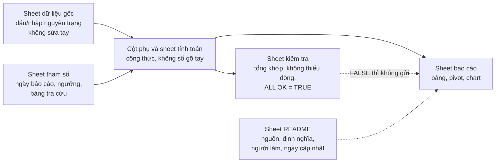
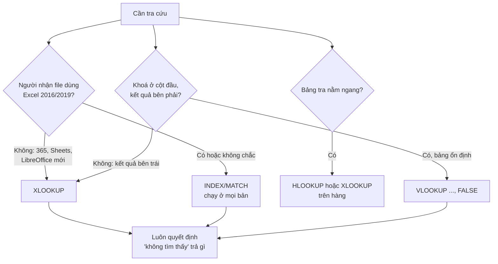
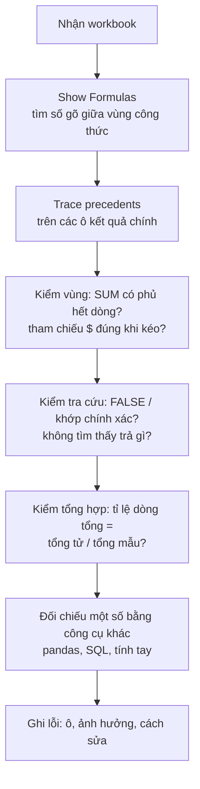
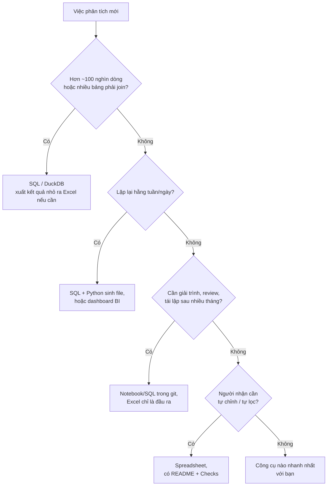

# Excel / Spreadsheet

Spreadsheet là công cụ phân tích được dùng nhiều nhất thế giới, và là nơi phần lớn kết quả của DA
được **tiêu thụ**: CFO mở file Excel, team sales lọc Google Sheets, ops dán bảng vào email. Một DA
giỏi SQL và Python nhưng dựng workbook cẩu thả sẽ bị đánh giá qua cái workbook đó. Ngược lại, một
DA dùng spreadsheet cho mọi thứ sẽ có ngày gửi một con số sai cho CEO vì một ô bị gõ đè.

Module này dạy spreadsheet theo cách một DA senior dùng nó: hàm cốt lõi của roadmap (IF, DATEDIF,
VLOOKUP/HLOOKUP, REPLACE/SUBSTITUTE, UPPER/LOWER/PROPER, CONCAT, TRIM, AVERAGE, COUNT, SUM,
MIN/MAX), tra cứu hiện đại (XLOOKUP, INDEX/MATCH), tổng hợp có điều kiện (SUMIFS/COUNTIFS), pivot
table và chart; rồi tới phần ít khoá học dạy: **làm sao để workbook đúng, kiểm được, và biết lúc
nào phải bỏ spreadsheet sang SQL/Python**.

Bài tập làm trong **LibreOffice Calc** (miễn phí, chạy trên Linux/macOS/Windows), lưu dạng `.xlsx`
để Excel và Google Sheets cũng mở được. Test đọc **công thức** trong ô (gõ cứng số là FAIL) và
**giá trị** do LibreOffice tính lại. Bản LibreOffice của repo là 25.2, có sẵn `XLOOKUP` (từ 24.8);
bản cũ hơn thì dùng `INDEX/MATCH` thay thế, test chấp nhận cả hai.

Dữ liệu là trích mẫu thật đóng vào workbook (giấy phép CC BY 4.0 cho phép phân phối lại, nguồn ghi
trong sheet `README` của mỗi workbook):

- **Online Retail II (UCI)**: giao dịch cửa hàng quà tặng online ở Anh, 01/12/2009–09/12/2011, hai
  sheet `Year 2009-2010` và `Year 2010-2011`.
- **Bike Sharing (UCI)**: Capital Bikeshare 2011–2012, `day.csv` 731 ngày.

```bash
uv run python data/download_dataset.py online-retail-ii
uv run python data/download_dataset.py bike-sharing-uci
```

Định nghĩa dùng chung của track: dòng Online Retail II hợp lệ là dòng có `Invoice` không bắt đầu
bằng `C`, `Quantity > 0` và `Price > 0`; doanh thu = `Quantity * Price` trên dòng hợp lệ (doanh thu
gộp, GBP).

Sau module này bạn sẽ:

- Tổ chức workbook theo lớp dữ liệu gốc → tính toán → báo cáo, dùng tham chiếu tương đối/tuyệt đối
  đúng, nhận ra số lưu dạng text và ngày là số.
- Dùng thành thạo hàm văn bản, ngày, logic và tổng hợp của roadmap, biết các bẫy của từng hàm
  (PROPER viết hoa sau dấu nháy, TRIM không bỏ khoảng trắng không ngắt, DATEDIF đếm tháng tròn).
- Chọn đúng hàm tra cứu (VLOOKUP, HLOOKUP, XLOOKUP, INDEX/MATCH), luôn khớp chính xác và xử lý
  "không tìm thấy" có chủ đích.
- Dựng báo cáo bằng SUMIFS/COUNTIFS, pivot table, chart; thêm data validation, conditional
  formatting và ô kiểm tra để workbook tự báo khi sai.
- So sánh Excel, Google Sheets, LibreOffice và quyết định khi nào chuyển sang SQL/Python.

## 1. Spreadsheet trong công việc của DA

### Dùng spreadsheet cho việc gì

| Việc | Spreadsheet hợp vì | Ví dụ |
| --- | --- | --- |
| Phân tích ad-hoc trên dữ liệu nhỏ | Nhìn thấy từng dòng, lọc/sắp xếp/pivot trong vài giây | Kiểm 300 dòng giao dịch bị khách khiếu nại |
| Giao kết quả cho người không code | Ai cũng mở được, tự lọc được | File doanh thu theo vùng gửi Head of Sales |
| Mô hình what-if nhỏ | Đổi một ô giả định, mọi thứ tính lại ngay | Kịch bản giá: tăng 5% giá thì doanh thu ra sao |
| Bảng tra cứu do business nắm | Business tự sửa mà không cần DA | Bảng mapping SKU → category, chỉ tiêu tháng |
| Kiểm tra (reconcile) số từ hệ thống khác | Đặt hai nguồn cạnh nhau, trừ nhau | So doanh thu dashboard với báo cáo kế toán |

Spreadsheet không hợp khi dữ liệu lớn (hàng trăm nghìn dòng trở lên), khi việc lặp lại hằng ngày,
khi nhiều người cùng sửa logic, hoặc khi con số phải giải trình được sau nhiều tháng. Phần 7 bàn chi
tiết.

### Spreadsheet sai có giá thật

- **Public Health England, 10/2020**: 15 841 ca COVID-19 dương tính không được báo cáo kịp thời vì
  dữ liệu được ghép qua định dạng `.xls` cũ, giới hạn 65 536 dòng, phần thừa bị cắt im lặng.
- **Reinhart & Rogoff (2010)**: bài báo kinh tế được dẫn để biện minh chính sách thắt lưng buộc
  bụng; năm 2013 Herndon, Ash và Pollin chỉ ra một công thức trung bình trong Excel bỏ sót 5 quốc
  gia, cùng các lựa chọn trọng số gây tranh cãi.

Cả hai lỗi đều không phải "Excel tính sai". Excel tính đúng thứ người ta bảo nó tính; lỗi nằm ở
**cách dựng workbook không có kiểm tra**. Module này dạy dựng workbook để lỗi như vậy lộ ra.

### Giải phẫu một workbook tốt



Quy tắc đi kèm: dữ liệu gốc không bao giờ bị sửa tay (làm sạch bằng cột phụ bên cạnh); mọi số trên
báo cáo truy ngược được tới công thức; giả định (ngày báo cáo, ngưỡng 90 ngày) nằm trong một ô có
tên, không chôn trong công thức; mỗi workbook gửi đi có sheet `README` nói nguồn và định nghĩa.

## 2. Nền tảng: tham chiếu, kiểu dữ liệu, công thức đọc được

### Tham chiếu tương đối, tuyệt đối, hỗn hợp

Khi kéo công thức xuống/sang phải, tham chiếu **tương đối** (`A2`) trượt theo, tham chiếu **tuyệt
đối** (`$A$2`) đứng yên, **hỗn hợp** (`$A2`, `A$2`) khoá cột hoặc hàng. Phím F4 (Excel) hoặc
Shift+F4 (LibreOffice) xoay vòng bốn dạng.

| Muốn | Viết | Ví dụ |
| --- | --- | --- |
| Mỗi dòng dùng ô cùng dòng | `A2` | `=D2*F2` (doanh thu dòng) |
| Mọi dòng dùng một ô tham số | `$L$1` | `=DATEDIF(C2,$L$1,"d")` (ngày báo cáo) |
| Bảng hai chiều: khoá cột nhãn hàng, khoá hàng nhãn cột | `$A3`, `B$2` | `=SUMIFS(J:J,H:H,$A3,K:K,B$2)` |
| Vùng tra cứu cố định | `Catalog!$B$2:$C$4102` | `=VLOOKUP(D2,Catalog!$B$2:$C$4102,2,FALSE)` |

Lỗi kinh điển: `=B14/$B$2-1` để tính tăng trưởng cùng kỳ rồi kéo xuống, mọi tháng đều so với tháng
1 năm trước (bài advanced 02 có đúng lỗi này).

### Kiểu dữ liệu: số, text, ngày

- **Ngày là số**: Excel và LibreOffice lưu ngày là số ngày kể từ mốc (1 = 1900-01-01 trong Excel),
  giờ là phần thập phân. Vì vậy cộng trừ ngày được (`=C2-B2` ra số ngày), và `MIN`/`MAX` dùng được
  trên ngày. Một ô "ngày" căn trái thường là **text**, không tính được.
- **Số lưu dạng text**: mã hàng `85123` trong một bảng là số, trong bảng kia là text `"85123"` thì
  VLOOKUP trả `#N/A` dù nhìn giống hệt. SUM bỏ qua text im lặng, nên tổng thiếu mà không báo lỗi.
  Kiểm bằng `ISNUMBER`, `ISTEXT`; chuyển bằng `VALUE()` hoặc `TEXT()`.
- **Lỗi là giá trị**: `#N/A` (không tìm thấy), `#DIV/0!`, `#VALUE!` (sai kiểu), `#NAME?` (tên hàm
  sai hoặc phần mềm không có hàm đó), `#REF!` (tham chiếu bị xoá). Một ô lỗi làm SUM của cả cột lỗi
  theo, điều tốt: lỗi không bị giấu.

### Công thức đọc được

- Dùng **Table** (Excel: Ctrl+T) hoặc **named range** cho vùng dữ liệu: `=SUMIFS(Sales[Revenue], ...)`
  dễ review hơn `=SUMIFS(Data!$J$2:$J$6811, ...)` và tự mở rộng khi thêm dòng.
- Một công thức một việc. Công thức lồng 5 tầng thì tách thành cột phụ có tên.
- Bật **Show Formulas** (Ctrl+` trong Excel, View > Show Formula trong LibreOffice) trước khi gửi
  file: số gõ cứng giữa vùng công thức hiện ra ngay.

## 3. Hàm cốt lõi: logic, tổng hợp, văn bản, ngày

### Bảng hàm của roadmap

| Nhóm | Hàm | Làm gì | Bẫy hay gặp |
| --- | --- | --- | --- |
| Logic | `IF`, `AND`, `OR`, `IFERROR`, `IFNA` | Rẽ nhánh theo điều kiện | IF lồng nhiều tầng khó đọc (dùng `IFS` hoặc bảng tra); `IFERROR` nuốt mọi lỗi, kể cả lỗi bạn cần thấy |
| Tổng hợp | `SUM`, `AVERAGE`, `COUNT`, `COUNTA`, `MIN`, `MAX` | Cộng, trung bình, đếm, nhỏ/lớn nhất | `COUNT` chỉ đếm **số** (đếm dòng có `Customer ID`), `COUNTA` đếm ô không trống; `AVERAGE` bỏ qua ô trống nhưng tính ô 0 |
| Văn bản | `TRIM`, `UPPER`, `LOWER`, `PROPER` | Chuẩn hoá khoảng trắng, chữ hoa/thường | `TRIM` không bỏ ký tự 160 (non-breaking space từ web); `PROPER("POPPY'S")` ra `Poppy'S` |
| Văn bản | `SUBSTITUTE`, `REPLACE` | Thay theo **nội dung** / theo **vị trí** | `SUBSTITUTE` phân biệt hoa thường; `REPLACE` trên số tự đổi số thành text |
| Văn bản | `CONCAT` (cũ: `CONCATENATE`), `&`, `LEFT`, `RIGHT`, `MID`, `LEN` | Ghép, cắt chuỗi | Ghép số mất định dạng (`TEXT(E2,"yyyy-mm-dd")` để giữ) |
| Ngày | `DATEDIF`, `YEAR`, `MONTH`, `WEEKDAY`, `EOMONTH`, `TODAY` | Khoảng cách ngày, trích phần ngày | `DATEDIF` không có trong danh sách gợi ý của Excel, ngày đầu lớn hơn ngày cuối thì `#NUM!`; `TODAY()` làm báo cáo đổi mỗi lần mở |

### Văn bản thật bẩn thế nào

Sheet `Year 2010-2011` của Online Retail II có 4 223 mô tả sản phẩm khác nhau; 885 mô tả thay đổi
sau khi TRIM (dấu cách ở cuối, hai dấu cách liền nhau), và chỉ còn 4 203 mô tả khác nhau. Mã hàng
còn tệ hơn: 4 070 mã khác nhau, viết HOA hết thì còn 3 958, vì 112 mã xuất hiện ở cả hai dạng
(`15056BL` 326 dòng và `15056bl` 62 dòng là cùng một sản phẩm). Excel không phân biệt hoa thường khi
tra cứu và so sánh `=`, nhưng SQL `JOIN` và pandas `merge` có phân biệt: cùng một bảng, Excel đếm
một sản phẩm còn pipeline đếm hai.

```python
import sys
from pathlib import Path

import pandas as pd

ROOT = next(p for p in [Path.cwd(), *Path.cwd().parents] if (p / "pyproject.toml").exists())
sys.path.insert(0, str(ROOT))
from data.download_dataset import ensure  # noqa: E402

RETAIL = ensure("online-retail-ii")
raw = pd.read_excel(RETAIL / "online_retail_II.xlsx", sheet_name="Year 2010-2011")  # 20–60 giây
raw["Invoice"] = raw["Invoice"].astype(str)
raw["StockCode"] = raw["StockCode"].astype(str)


def excel_trim(s: str) -> str:
    """TRIM của Excel/LibreOffice: bỏ dấu cách hai đầu, gộp dấu cách liền nhau."""
    return " ".join(part for part in s.split(" ") if part)


desc = pd.Series(raw["Description"].dropna().astype(str).unique())
print(f"mô tả khác nhau: {len(desc):,}; đổi sau TRIM: {(desc != desc.map(excel_trim)).sum():,}; "
      f"còn lại sau TRIM: {desc.map(excel_trim).nunique():,}")
codes = pd.Series(raw["StockCode"].unique())
print(f"mã hàng: {len(codes):,}; sau UPPER: {codes.str.upper().nunique():,}")
print(raw[raw["StockCode"].str.upper() == "15056BL"].groupby("StockCode").size().to_dict())
print("PROPER kiểu Python:", "POPPY'S PLAYHOUSE".title(), "| nbsp có bị TRIM bỏ?", excel_trim("A\xa0") == "A")
```

Bài học: chuẩn hoá khoá (mã hàng, mã khách, email) **trước** khi tra cứu hay ghép bảng, và giữ cột gốc
bên cạnh cột sạch để người review đối chiếu được. Bài basic 01 làm đúng việc này trên 300 dòng.

### SUBSTITUTE khác REPLACE

`SUBSTITUTE(text, cũ, mới)` thay **mọi lần xuất hiện của một chuỗi**: đổi `EIRE` thành `Ireland`.
`REPLACE(text, vị trí, số ký tự, mới)` thay **theo vị trí**, không cần biết nội dung: che ký tự 3–4
của mã khách `13085` thành `13**5` trước khi gửi file ra ngoài công ty. Dùng nhầm thì SUBSTITUTE đổi
cả những chỗ bạn không định đổi (thay `"USA"` cũng đổi `"JERUSALEM"` nếu có).

### DATEDIF và các phép tính ngày

`DATEDIF(ngày_đầu, ngày_cuối, đơn_vị)` với đơn vị `"d"` (ngày), `"m"` (tháng **tròn**), `"y"`
(năm tròn), `"ym"`, `"md"`, `"yd"` (phần dư). Ba điều cần nhớ:

1. Tháng tròn: từ 12/11/2010 tới 03/11/2011 là 11 tháng, không phải 12, vì ngày 3 chưa tới ngày 12.
2. Ngày đầu phải nhỏ hơn hoặc bằng ngày cuối, nếu không ra `#NUM!`. Với dữ liệu có thể đảo (ngày
   giao trước ngày đặt do lỗi nhập), bọc bằng `IF(B2>C2,"lỗi ngày",DATEDIF(...))` thay vì giấu bằng
   `IFERROR`.
3. Microsoft khuyên tránh đơn vị `"md"` vì có thể ra số âm hoặc sai ở cuối tháng.

Với "số ngày" đơn thuần, `=C2-B2` đủ và rõ hơn. DATEDIF đáng dùng cho tháng/năm tròn: tuổi khách
hàng (tenure), tuổi nhân viên, thời gian từ lần mua cuối (recency) để phân nhóm khách.

## 4. Tra cứu: VLOOKUP, HLOOKUP, XLOOKUP, INDEX/MATCH

Tra cứu là việc DA làm trên spreadsheet nhiều nhất: gắn giá niêm yết vào dòng bán, gắn vùng vào quốc
gia, gắn tên vào mã. Bốn cách:

| Hàm | Cú pháp | Mạnh | Yếu |
| --- | --- | --- | --- |
| `VLOOKUP` | `VLOOKUP(khoá, bảng, cột_số, FALSE)` | Có ở mọi nơi, ai cũng đọc được | Khoá phải ở cột **đầu** bảng (không tra sang trái); `cột_số` gõ cứng hỏng khi chèn cột; mặc định là khớp **gần đúng** |
| `HLOOKUP` | `HLOOKUP(khoá, bảng, hàng_số, FALSE)` | Bảng nằm ngang (tháng ở hàng tiêu đề, bảng copy từ slide) | Cùng các yếu điểm của VLOOKUP |
| `XLOOKUP` | `XLOOKUP(khoá, cột_khoá, cột_kết_quả, nếu_không_thấy)` | Tra mọi hướng, khớp chính xác mặc định, có tham số "không tìm thấy", tìm từ dưới lên | Excel 2021/365, Google Sheets, LibreOffice ≥ 24.8; Excel 2016/2019 không có (`#NAME?`) |
| `INDEX/MATCH` | `INDEX(cột_kết_quả, MATCH(khoá, cột_khoá, 0))` | Có ở mọi phiên bản, tra mọi hướng, tra hai chiều `INDEX(bảng, MATCH(hàng), MATCH(cột))` | Hai hàm lồng nhau, khó đọc hơn với người mới |



### Ba lỗi tra cứu gây sai số liệu

1. **Quên `FALSE` (khớp gần đúng)**. `VLOOKUP(D2, Catalog!B:C, 2)` mặc định giả định cột khoá đã
   sắp xếp tăng dần và trả về dòng "gần nhất nhỏ hơn". Trên bảng chưa sắp xếp, nó trả **giá của mã
   khác** mà không báo lỗi: trên Catalog của bài basic 02, chỉ 65 trong 1 078 dòng ra đúng giá, và 438
   trong 440 mã mới (đáng ra "không tìm thấy") được gán một giá. Khớp gần đúng chỉ dùng cho bảng bậc thang có chủ đích (thuế suất theo bậc
   thu nhập, chiết khấu theo bậc số lượng).
2. **Không quyết định "không tìm thấy"**. Trong bài basic 02, 440 trên 1 518 dòng bán của khách ngoài
   Anh tháng 12/2011 (29%) là mã hàng mới, không có trong danh mục giá năm trước; chúng mang 17 298 trên
   46 189 GBP doanh thu (37%). Bọc `IFERROR(...,0)` sẽ biến 37% doanh thu thành "giá niêm yết 0". Trả
   một nhãn rõ (`"NOT IN CATALOG"`) rồi đếm nó trên báo cáo.
3. **Khoá không khớp kiểu hoặc khoảng trắng**: `"85123A "` khác `"85123A"`, số `85123` khác text
   `"85123"`. Chuẩn hoá khoá (phần 3) trước khi tra.

Trên cùng dữ liệu đó, so giá bán tháng 12/2011 với giá phổ biến nhất năm trước: 260 dòng bán thấp
hơn (trung vị thấp hơn 69%), 112 dòng cao hơn. Đây là **quan sát**; trước khi gọi là "chiết khấu",
cần hỏi team pricing có đổi bảng giá hoặc xả hàng cuối năm không. Danh mục năm trước là một ảnh chụp
đã cũ, một bẫy hay gặp khi tra cứu vào bảng tham chiếu không có ngày hiệu lực.

## 5. Tổng hợp có điều kiện, pivot table và chart

### SUMIFS, COUNTIFS, AVERAGEIFS

`SUMIFS(cột_cộng, cột_điều_kiện_1, điều_kiện_1, cột_điều_kiện_2, điều_kiện_2, ...)` là `GROUP BY`
của spreadsheet. Một bảng báo cáo quốc gia × tháng là một công thức kéo ra cả bảng nhờ tham chiếu hỗn
hợp: `=SUMIFS(Data!$J:$J, Data!$H:$H, $A3, Data!$K:$K, B$2)`. Các hàm cùng họ: `COUNTIFS`,
`AVERAGEIFS`, `MINIFS`, `MAXIFS` (ngày mua đầu/cuối của từng khách).

Hai kỹ thuật cột phụ hay dùng:

- **Cờ hợp lệ**: `Valid = IF(AND(LEFT(A2,1)<>"C", D2>0, F2>0), 1, 0)` rồi `Revenue = IF(Valid=1, D2*F2, 0)`.
  Định nghĩa nằm ở **một** cột, mọi SUMIFS dùng chung.
- **Đếm hoá đơn khác nhau** bằng cờ "dòng đầu của hoá đơn" khi dữ liệu đã sắp theo hoá đơn:
  `=IF(AND(A2<>A1, LEFT(A2,1)<>"C"), 1, 0)`, rồi `SUMIFS`/`COUNTIFS` trên cờ đó. Cờ phụ thuộc thứ tự
  sắp xếp: ai sắp lại dữ liệu là cờ sai, nên ghi rõ điều kiện này ở sheet README.

Đoạn code dưới tính lại bằng pandas đúng bảng báo cáo của bài basic 03 (Germany, France, 9–11/2011):
SUMIFS tương đương `groupby().sum()`, COUNTIFS trên cờ dòng đầu tương đương `nunique()`.

```python
sub = raw[(raw.InvoiceDate >= "2011-09-01") & (raw.InvoiceDate < "2011-12-01") & raw.Country.isin(["Germany", "France"])]
valid = sub[~sub.Invoice.str.startswith("C") & (sub.Quantity > 0) & (sub.Price > 0)].copy()
valid["Revenue"] = valid.Quantity * valid.Price
valid["Month"] = valid.InvoiceDate.dt.year * 100 + valid.InvoiceDate.dt.month
rev = valid.pivot_table(index="Country", columns="Month", values="Revenue", aggfunc="sum")
orders = valid.pivot_table(index="Country", columns="Month", values="Invoice", aggfunc="nunique")
print(f"{len(sub):,} dòng, {len(valid):,} hợp lệ")
print(rev.round(2))
print(orders)
aov = rev / orders
print((aov).round(1))
print(f"AOV gộp đúng = {rev.values.sum() / orders.values.sum():.2f}; trung bình 6 ô AOV = {aov.values.mean():.2f}")
top = valid[(valid.Country == "France") & (valid.Month == 201110)].groupby("Invoice").Revenue.sum().nlargest(1)
print("hoá đơn lớn nhất France 10/2011:", top.to_dict())
```

France tháng 10/2011 có AOV 956.73 GBP, gần gấp đôi các tháng khác, vì một hoá đơn 8 895.76 GBP
(61 dòng hàng). AOV gộp hai nước ba tháng là 535.13 GBP; lấy trung bình sáu ô AOV ra 562.08, sai vì
mỗi ô có số đơn khác nhau. Đây là lỗi **trung bình của trung bình**, hay gặp nhất trên dòng "Tổng"
của báo cáo spreadsheet: dòng tổng của một tỉ lệ phải là tổng tử số chia tổng mẫu số.

### Pivot table

Pivot table là SUMIFS kéo thả: chọn trường vào **Rows**, **Columns**, **Values** (Sum, Count,
Average), **Filters**. Ưu điểm: dựng trong 10 giây, đổi chiều phân tích tức thì, drill-down bằng
double-click. Nhược điểm cần biết:

- Pivot **không tự cập nhật** khi dữ liệu đổi (Refresh; Excel: Data > Refresh All; LibreOffice: Data
  > Pivot Table > Refresh). Báo cáo gửi đi với pivot chưa refresh là lỗi hay gặp.
- Vùng nguồn cố định: thêm dòng dưới vùng thì pivot không thấy. Dùng Table làm nguồn.
- "Count of" đếm dòng, không đếm khách hay hoá đơn khác nhau (Excel có "Distinct Count" khi thêm vào
  Data Model; LibreOffice không có).
- Công thức tham chiếu ô trong pivot (`=B5`) vỡ khi pivot đổi bố cục; dùng `GETPIVOTDATA` hoặc tính
  bằng SUMIFS ở sheet riêng.

Trên Bike Sharing, pivot `mnth` × `Year` với Sum of `cnt` cho thấy 2012 cao hơn 2011 ở **mọi** tháng
(tổng 2 049 576 so với 1 243 103 lượt, +64.9%), tăng mạnh nhất tháng 3 (+157.4%) và ít nhất tháng 6
(+41.3%). Bài intermediate 02 dựng pivot này, đối chiếu với bảng SUMIFS và vẽ chart.

### Chart trong spreadsheet

Nguyên tắc chọn và vẽ chart (bar từ 0, line cho xu hướng, không 3D, không pie nhiều lát) đã có ở
module [08 Trực quan hoá](../08-visualization-chart-reading/README.md). Riêng với spreadsheet:

- Chart mặc định của Excel/LibreOffice thường có legend thừa, lưới đậm, tiêu đề "Chart Title": sửa
  trước khi gửi, đổi tiêu đề thành kết luận.
- Chart vẽ từ pivot (**pivot chart**) đổi theo filter của pivot; chart vẽ từ vùng ô cố định thì không
  tự mở rộng khi thêm tháng mới.
- Sparkline (chart mini trong một ô) hợp cho bảng KPI nhiều dòng.

## 6. Workbook đáng tin: data validation, conditional formatting, kiểm tra

### Data validation

Data validation giới hạn thứ người dùng được nhập: danh sách (dropdown), khoảng số, ngày, độ dài
text. Dùng cho **ô đầu vào** mà người khác sẽ chỉnh: chọn segment, chọn quốc gia, nhập giả định %
tăng giá. Dropdown chặn lỗi gõ `"At-risk"` hay `"At risk "` (thừa dấu cách) thay vì `"At risk"`: COUNTIF không phân biệt hoa thường nhưng phân biệt dấu gạch và khoảng trắng, nên trả 0 mà không báo gì.

### Conditional formatting

Tô màu theo điều kiện để mắt thấy ngay ngoại lệ: khách `Lost`, tăng trưởng âm, ô kiểm tra `FALSE`.
Dùng ít: một bảng tô năm màu thì không còn gì nổi bật. Color scale (thang màu) cho ma trận lớn như
heatmap; quy tắc theo công thức (`=$G2>180`) để tô cả dòng.

### Ô kiểm tra và ALL OK

Mỗi báo cáo spreadsheet nghiêm túc có một sheet `Checks`:

| Kiểm tra | Công thức mẫu | Bắt được lỗi gì |
| --- | --- | --- |
| Tổng báo cáo = tổng dữ liệu | `=ABS(Weekly!B7-SUM(Data!J:J))<0.01` | Dòng bị bỏ sót, SUM thiếu vùng, tuần thiếu |
| Số đơn khớp | `=Weekly!C7=SUM(Data!L:L)` | Đếm trùng, cờ sai do sắp lại dữ liệu |
| Dữ liệu trong kỳ | `=COUNTIFS(Data!E:E,">="&start,Data!E:E,"<"&end)=COUNTA(Data!A:A)-1` | Dán nhầm dữ liệu kỳ khác |
| Không ô lỗi | `=SUMPRODUCT(--ISERROR(Report!B2:G25))=0` | `#N/A` từ tra cứu |
| Gộp | `=AND(B2:B5)` | Một ô duy nhất để nhìn trước khi gửi |

Kiểm tra phải so **hai đường tính độc lập** (báo cáo với dữ liệu gốc), không so một ô với chính nó
hoặc với một con số gõ tay.

### Quy trình review workbook



Bài advanced 02 đưa một workbook có 6 lỗi cài sẵn theo đúng các loại trên. Sửa xong, tăng trưởng
2012 so với 2011 đổi từ 53.1% thành 64.9%.

## 7. Excel, Google Sheets, LibreOffice và khi nào chuyển sang SQL/Python

### So sánh công cụ

| Công cụ | Dùng khi nào | Loại công ty hay dùng | Mạnh | Yếu |
| --- | --- | --- | --- | --- |
| **Microsoft Excel** (365) | Báo cáo tài chính, mô hình, file gửi cho lãnh đạo và đối tác | Hầu hết doanh nghiệp, đặc biệt tài chính, ngân hàng, kiểm toán, tập đoàn dùng Microsoft 365 | Đủ hàm nhất (XLOOKUP, LET, LAMBDA, dynamic array), Power Query, Power Pivot / Data Model, VBA | Bản quyền; 1 048 576 dòng mỗi sheet; cộng tác kém hơn Sheets khi không dùng OneDrive/SharePoint |
| **Google Sheets** | Cộng tác thời gian thực, bảng nhỏ chia sẻ nội bộ, form → sheet | Startup, công ty dùng Google Workspace, team marketing/ops | Nhiều người sửa cùng lúc, lịch sử phiên bản, `QUERY`, `IMPORTRANGE`, kết nối BigQuery (Connected Sheets) | Giới hạn 10 triệu ô mỗi file; chậm từ vài chục nghìn dòng có công thức; vài hàm Excel không có hoặc khác cú pháp |
| **LibreOffice Calc** | Không có license Microsoft, máy Linux, xử lý file offline, tự động hoá headless | Cơ quan nhà nước và tổ chức dùng phần mềm nguồn mở, cá nhân, máy chủ chuyển đổi file | Miễn phí, mở/lưu `.xlsx`, chạy headless (`soffice --convert-to`) để tính lại công thức trong pipeline | Giao diện và tên menu khác Excel; không có Power Query, không có Data Model (distinct count trong pivot); macro VBA chỉ chạy một phần |
| **SQL** (DuckDB, Postgres, BigQuery) | Dữ liệu lớn, logic lặp lại, nguồn sự thật dùng chung | Mọi công ty có data warehouse | Không giới hạn dòng thực tế, review được (text), tái lập | Người không code không tự sửa được |
| **Python** (pandas) | Làm sạch phức tạp, tự động hoá, thống kê, sinh file Excel cho người nhận | Team data có kỹ sư, công ty có pipeline | Tái lập, test được, git, đọc/ghi mọi định dạng | Người nhận không mở được notebook; cần môi trường |

Khác biệt hàm thực tế khi chuyển file:

- `XLOOKUP` có ở Excel 365/2021, Google Sheets, LibreOffice ≥ 24.8. File `.xlsx` lưu nó dưới tên
  `_xlfn.XLOOKUP`; mở bằng Excel 2016 sẽ thấy `#NAME?`. Gửi file cho đối tác dùng bản cũ thì viết
  `INDEX/MATCH`.
- Google Sheets có `QUERY` (cú pháp gần SQL), `ARRAYFORMULA`, `IMPORTRANGE`, Excel không có. Excel có
  Power Query, LET, LAMBDA, Sheets thì có LAMBDA nhưng không có Power Query.
- `DATEDIF` có ở cả ba nhưng Excel không gợi ý khi gõ.
- Tham số boolean: LibreOffice lưu `FALSE` thành `FALSE()` trong `.xlsx`; Excel đọc bình thường.

### Giới hạn dòng: con số thật

Excel và LibreOffice (từ 7.4) cho tối đa 1 048 576 dòng × 16 384 cột mỗi sheet. Bộ Online Retail II
được phát hành thành **hai sheet** chính vì lý do này: tổng hai năm vượt giới hạn một sheet.

```python
import openpyxl

book = openpyxl.load_workbook(RETAIL / "online_retail_II.xlsx", read_only=True)
rows = {ws.title: ws.max_row - 1 for ws in book.worksheets}  # trừ dòng tiêu đề
book.close()
print(rows, "tổng:", f"{sum(rows.values()):,}", "| giới hạn một sheet:", f"{2**20 - 1:,} dòng dữ liệu")
```

1 067 371 dòng không vừa một sheet (1 048 575 dòng dữ liệu). Ngay cả khi vừa, một workbook vài trăm
nghìn dòng với SUMIFS/COUNTIFS sẽ tính lại hàng chục giây mỗi lần sửa một ô.

### Khi nào bỏ spreadsheet



Mẫu kết hợp phổ biến nhất ở công ty có team data: **SQL tính, Python ghi file Excel, người nhận mở
Excel**. Python ghi được cả công thức, data validation và conditional formatting, nên file gửi đi vẫn
"sống" (người nhận đổi ô đầu vào thì số đổi theo) mà logic nặng nằm trong code có review:

```python
import tempfile

from openpyxl import Workbook
from openpyxl.formatting.rule import CellIsRule
from openpyxl.styles import PatternFill
from openpyxl.worksheet.datavalidation import DataValidation

out = Path(tempfile.gettempdir()) / "da-m02-report.xlsx"
wb = Workbook()
ws = wb.active
ws.title = "Report"
ws.append(["Country", "Month", "Revenue"])
for (country, month), value in rev.stack().items():
    ws.append([country, int(month), round(float(value), 2)])
last = ws.max_row
ws["E1"], ws["E2"] = "Chọn nước", "France"
ws["E3"] = f'=SUMIFS(C2:C{last},A2:A{last},E2)'  # người nhận đổi E2, E3 tự tính lại
dv = DataValidation(type="list", formula1='"Germany,France"')
ws.add_data_validation(dv)
dv.add("E2")
ws.conditional_formatting.add(f"C2:C{last}", CellIsRule(operator="lessThan", formula=["25000"],
                                                         fill=PatternFill("solid", fgColor="FFC7CE")))
wb.save(out)
print("đã ghi", out, "| E3 =", ws["E3"].value, "| France 3 tháng (pandas):", round(rev.loc["France"].sum(), 2))
```

openpyxl ghi công thức nhưng không tính nó; Excel/LibreOffice tính khi mở file. Muốn có giá trị đã
tính ngay trong pipeline (để kiểm), chạy `soffice --headless --convert-to xlsx` như testkit của repo
làm khi chấm bài.

## 8. Tài liệu tham khảo

Roadmap gốc (mục Excel: IF, DATEDIF, VLOOKUP/HLOOKUP, REPLACE/SUBSTITUTE, UPPER/LOWER/PROPER, CONCAT,
TRIM, AVERAGE, COUNT, SUM, MIN/MAX, Charting; bản PDF ở `roadmap/data-analyst.pdf`):

- [roadmap.sh: Data Analyst](https://roadmap.sh/data-analyst)

Tài liệu hàm chính thức:

- Microsoft: [XLOOKUP](https://support.microsoft.com/en-us/office/xlookup-function-b7fd680e-6d10-43e6-84f9-88eae8bf5929),
  [VLOOKUP](https://support.microsoft.com/en-us/office/vlookup-function-0bbc8083-26fe-4963-8ab8-93a18ad188a1),
  [DATEDIF](https://support.microsoft.com/en-us/office/datedif-function-25dba1a4-2812-480b-84dd-8b32a451b35c),
  [SUMIFS](https://support.microsoft.com/en-us/office/sumifs-function-c9e748f5-7ea7-455d-9406-611cebce642b),
  [Excel specifications and limits](https://support.microsoft.com/en-us/office/excel-specifications-and-limits-1672b34d-7043-467e-8e27-269d656771c3)
- Google: [Files you can store in Google Drive](https://support.google.com/drive/answer/37603) (giới hạn ô của Sheets),
  [Google Sheets function list](https://support.google.com/docs/table/25273)
- LibreOffice: [XLOOKUP trong Calc](https://help.libreoffice.org/latest/en-US/text/scalc/01/func_xlookup.html),
  [Pivot Table](https://help.libreoffice.org/latest/en-US/text/scalc/guide/datapilot.html)
- [openpyxl](https://openpyxl.readthedocs.io/en/stable/): đọc/ghi `.xlsx` từ Python.

Rủi ro spreadsheet:

- [European Spreadsheet Risks Interest Group (EuSpRIG)](https://eusprig.org/): tuyển tập lỗi spreadsheet có thật và cách phòng.
- The Guardian. [How Excel may have caused loss of 16,000 Covid tests in England](https://www.theguardian.com/politics/2020/oct/05/how-excel-may-have-caused-loss-of-16000-covid-tests-in-england) (10/2020).
- Herndon, Ash & Pollin. [Does High Public Debt Consistently Stifle Economic Growth? A Critique of Reinhart and Rogoff](https://peri.umass.edu/publication/item/526-does-high-public-debt-consistently-stifle-economic-growth-a-critique-of-reinhart-and-rogoff) (PERI working paper 2013; bản chính thức trên Cambridge Journal of Economics, 2014).

Dữ liệu:

- Daqing Chen. [Online Retail II (UCI)](https://archive.ics.uci.edu/dataset/502/online+retail+ii), CC BY 4.0.
- Fanaee-T & Gama. [Bike Sharing Dataset (UCI)](https://archive.ics.uci.edu/dataset/275/bike+sharing+dataset), CC BY 4.0.
