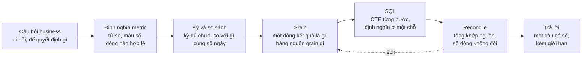
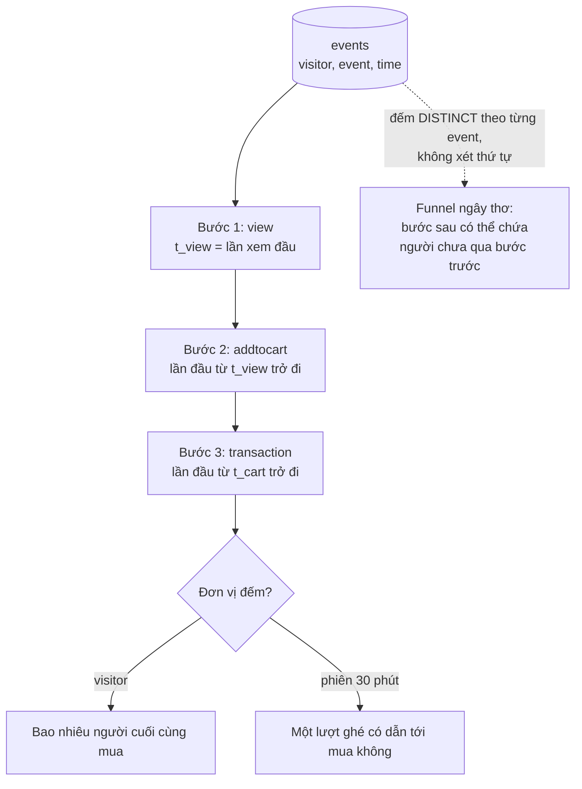
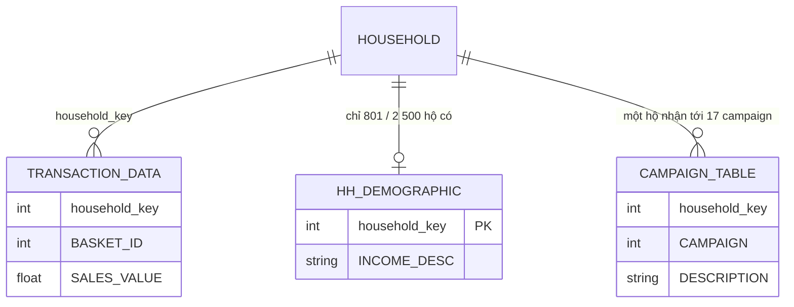

# SQL cho Data Analyst

Ở track Data Engineer, SQL là công cụ dựng pipeline: bảng nào nạp vào đâu, incremental thế nào, chạy lại có
idempotent không. Với một Data Analyst, SQL là **ngôn ngữ để trả lời câu hỏi**: phần lớn câu hỏi của CEO, PM,
marketing ("tháng này bán thế nào?", "khách mới có quay lại không?", "thị trường nào đáng đầu tư?") được trả lời
bằng một câu `SELECT` chạy trên warehouse, rồi mới tới chart và memo. Module này không dạy lại cú pháp mà dạy
**dịch câu hỏi business thành SQL đúng**: chọn kỳ so sánh, định nghĩa metric, grain, và kiểm con số trước khi gửi.

Module dùng ba bộ dữ liệu thật, chạy bằng DuckDB ngay trên file, không cần dựng database:

- **Online Retail II (UCI)**: giao dịch của một cửa hàng quà tặng online ở Anh, cả hai sheet (01/12/2009 tới
  09/12/2011 12:50, 1 044 848 dòng sau khi bỏ phần trùng 01-09/12/2010 giữa hai sheet). Là bộ chính của module.
- **dunnhumby The Complete Journey**: 2 500 hộ có thẻ thành viên của một chuỗi siêu thị Mỹ; module dùng bảng
  giao dịch cùng các bảng nhỏ `hh_demographic`, `campaign_table` để luyện join và NULL.
- **Retailrocket events** (`ecommerce-events`): 2.76 triệu sự kiện view / addtocart / transaction cho funnel. Giấy
  phép gốc CC BY-NC-SA 4.0: chỉ dùng để học, không đưa trích mẫu lên repo.

```bash
uv run python data/download_dataset.py online-retail-ii
uv run python data/download_dataset.py dunnhumby-complete-journey   # cần Kaggle token
uv run python data/download_dataset.py ecommerce-events             # cần Kaggle token
```

Mọi đoạn code chạy từ thư mục gốc repo, theo thứ tự (đoạn sau dùng lại `con` và `q` của đoạn đầu). Định nghĩa
dùng chung của track: dòng hợp lệ của Online Retail II là hoá đơn không bắt đầu bằng `C`, `quantity > 0`,
`price > 0`; doanh thu = `quantity * price` (doanh thu gộp); khách là `Customer ID` khác NULL; dữ liệu kết thúc
09/12/2011 nên tháng 12/2011 chưa đủ.

Sau module này bạn sẽ:

- Biến một câu hỏi business thành định nghĩa metric, kỳ so sánh, grain, rồi mới thành SQL.
- Viết các mẫu truy vấn DA dùng hằng ngày: MoM/YoY có spine, luỹ kế, so sánh cùng số ngày khi kỳ chưa đủ, top-N
  theo nhóm, Pareto, cohort retention, funnel có thứ tự.
- Nhận ra ba nguồn sai số lặng lẽ: NULL, join nhân bản dòng (fan-out), join làm rơi dòng; và viết truy vấn
  reconcile để chứng minh con số khớp với nguồn.
- Chọn nơi chạy SQL: DuckDB, SQLite, Postgres, warehouse đám mây, spreadsheet hay pandas.

## 1. Nhắc lại SQL nâng cao

Phần cú pháp đã có ở track Data Engineer, module
[Nền tảng](../../../data-engineer/modules/01-foundations/README.md) (mục 2: thứ tự thực thi, window function,
CTE, CTE đệ quy, gaps and islands) và module
[Warehouse & Lakehouse](../../../data-engineer/modules/04-warehouse-lakehouse/README.md) (OLAP, `ROLLUP`,
columnar). Tóm tắt những gì module này dùng liên tục:

| Khái niệm | Điều cần nhớ khi phân tích |
| --- | --- |
| Thứ tự thực thi logic | `FROM/JOIN → WHERE → GROUP BY → HAVING → WINDOW → QUALIFY → SELECT → ORDER BY → LIMIT`. Vì vậy window function không đặt trong `WHERE` được: lọc ở `QUALIFY` (DuckDB, Snowflake, BigQuery) hoặc ở truy vấn ngoài |
| Window function | `f() OVER (PARTITION BY nhóm ORDER BY thứ tự frame)`. Không gộp dòng như `GROUP BY`: mỗi dòng giữ nguyên và nhận thêm một giá trị tính trên "cửa sổ" của nó |
| Hàm hay dùng | Xếp hạng `row_number`, `rank`, `dense_rank`; dịch dòng `lag`, `lead`; tổng hợp `sum`, `avg`, `count` có frame; `first_value`, `ntile` |
| Frame | Có `ORDER BY` mà không ghi frame thì mặc định là `RANGE BETWEEN UNBOUNDED PRECEDING AND CURRENT ROW`: các dòng ngang giá trị được tính cùng lúc. Luỹ kế từng dòng thì ghi rõ `ROWS` |
| CTE (`WITH`) | Mỗi CTE một bước có tên: `valid` → `by_month` → `final`. Đọc như một pipeline nhỏ, dễ kiểm từng bước |
| `FILTER` | `count(*) FILTER (WHERE ...)`: pivot có điều kiện trong một lần quét, gọn hơn `sum(CASE WHEN ...)` |

Phần còn lại của module giả định bạn đọc được các cấu trúc này và tập trung vào **dùng chúng để trả lời câu hỏi**.

## 2. Từ câu hỏi business tới câu SQL

### Năm bước trước khi gõ SELECT

Một câu hỏi như "tháng này bán thế nào?" có ít nhất bốn chỗ mơ hồ: "bán" là doanh thu gộp, ròng hay số đơn? "Tháng
này" đã hết chưa? So với cái gì? Tính cả khách vãng lai không? DA senior chốt các chỗ đó trước, vì SQL sai định
nghĩa vẫn chạy và vẫn ra một con số rất tự tin.



1. **Câu hỏi**: ai hỏi, để quyết định gì. "Doanh thu tháng này" của CFO (đối soát) khác của Head of Sales (theo dõi
   nhịp bán).
2. **Định nghĩa metric**: viết ra tử số, mẫu số, điều kiện lọc. Đặt định nghĩa ở **một chỗ** (một CTE, một view,
   một model dbt), không chép điều kiện lọc vào năm truy vấn.
3. **Kỳ và so sánh**: kỳ đã đủ dữ liệu chưa; so với kỳ trước, cùng kỳ năm trước hay target.
4. **Grain**: một dòng kết quả là gì (một tháng, một nước × một sản phẩm, một cohort × một tháng tuổi), và grain của
   mỗi bảng nguồn. Hầu hết lỗi join bắt đầu từ việc không biết grain.
5. **Reconcile** trước khi gửi: tổng các nhóm bằng tổng chung, số dòng không đổi sau `LEFT JOIN` bảng thuộc tính,
   con số khớp với một nguồn độc lập (dashboard tài chính, báo cáo tháng trước).

### Nạp dữ liệu và định nghĩa ở một chỗ

DuckDB đọc thẳng xlsx bằng extension `excel` (tự cài lần đầu, cần mạng), CSV và Parquet bằng `read_csv`,
`read_parquet`. Đoạn dưới nạp cả hai sheet Online Retail II vào một bảng (khoảng 8 giây, so với khoảng 50-90 giây nếu
đọc bằng pandas), rồi tạo view `valid` chứa định nghĩa dòng hợp lệ dùng cho cả module.

**Máy offline** (không cài được extension `excel`): đoạn dưới báo lỗi ở `read_xlsx`. Test và `starter/run_query.py`
của các bài tự chuyển sang đọc bằng pandas, nên **lần đầu** chậm (60-90 giây); sau đó bảng đã nạp được lưu cache
parquet trong thư mục tạm của hệ điều hành (`<tmp>/da-cache/`, khoá theo thời điểm sửa và kích thước tệp xlsx), các
lần sau, ở mọi bài, đọc cache trong khoảng 1 giây. Cache không nằm trong `data/raw`; xoá thư mục `da-cache` là nạp lại.

```python
import sys
from pathlib import Path

import duckdb

ROOT = next(p for p in [Path.cwd(), *Path.cwd().parents] if (p / "pyproject.toml").exists())
sys.path.insert(0, str(ROOT))
from data.download_dataset import ensure  # noqa: E402

XLSX = ensure("online-retail-ii") / "online_retail_II.xlsx"
con = duckdb.connect()
con.execute("SET enable_progress_bar = false")


def sheet(name: str) -> str:
    # all_varchar: cột Invoice trộn số và chữ ('C536379'); ngày trong xlsx là số ngày kể từ 1899-12-30
    return f"""
        SELECT Invoice AS invoice, StockCode AS stock_code, Description AS description,
               CAST(CAST(Quantity AS DOUBLE) AS INTEGER) AS quantity,
               TIMESTAMP '1899-12-30' + to_seconds(CAST(round(CAST(InvoiceDate AS DOUBLE) * 86400) AS BIGINT))
                   AS invoice_date,
               CAST(Price AS DOUBLE) AS price,
               CAST(CAST("Customer ID" AS DOUBLE) AS INTEGER) AS customer_id,
               Country AS country
        FROM read_xlsx('{XLSX}', sheet = '{name}', all_varchar = true)"""


con.execute(f"""
    CREATE TABLE online_retail AS
    SELECT * FROM ({sheet('Year 2009-2010')}) WHERE invoice_date < TIMESTAMP '2010-12-01'  -- bỏ phần trùng
    UNION ALL {sheet('Year 2010-2011')}""")
con.execute("""
    CREATE VIEW valid AS                          -- định nghĩa dùng chung: một chỗ duy nhất
    SELECT *, quantity * price AS revenue
    FROM online_retail
    WHERE invoice NOT LIKE 'C%' AND quantity > 0 AND price > 0""")


def q(sql: str, rows: int = 15) -> None:
    print(con.sql(sql).df().head(rows).to_string(), end="\n\n")


q("""SELECT count(*) AS rows, min(invoice_date) AS first, max(invoice_date) AS last,
            count(DISTINCT invoice) AS invoices, count(customer_id) AS rows_with_customer,
            count(DISTINCT customer_id) AS customers
     FROM online_retail""")
q("SELECT count(*) AS valid_rows, round(sum(revenue), 2) AS revenue FROM valid")
```

1 044 848 dòng, 53 628 hoá đơn, 5 942 khách; 809 561 dòng (77%) có mã khách. Sau khi lọc còn 1 019 654 dòng hợp lệ,
doanh thu gộp 20 533 741.92 GBP trong 25 tháng. Ghi lại các con số nền này ngay từ đầu: mọi truy vấn sau phải
cộng lại khớp với chúng.

## 3. Xu hướng theo thời gian: MoM, YoY, luỹ kế và kỳ chưa đủ

### Spine trước, LAG sau

`GROUP BY month` chỉ trả tháng **có** dữ liệu. Tháng không có giao dịch biến mất, và `lag(x)` lặng lẽ so với tháng
cách hai tháng, `lag(x, 12)` lệch một tháng. Cách chuẩn: sinh "xương sống" (spine) mọi tháng bằng
`generate_series`, `LEFT JOIN` số liệu vào và `coalesce(..., 0)`. Chia an toàn bằng `NULLIF(mẫu, 0)`: trong DuckDB
`x / 0` trả `inf`, PostgreSQL báo lỗi; `NULL` mới đúng nghĩa "không xác định".

Đoạn dưới tính số khách có mã hoạt động mỗi tháng với MoM, YoY, số khách luỹ kế (tổng chạy của khách mới) và cờ
tháng đủ dữ liệu.

```python
# Khách active theo tháng: spine + LAG + YoY + luỹ kế khách mới
q("""
WITH bounds AS (
    SELECT date_trunc('month', min(invoice_date))::DATE AS m0, date_trunc('month', max(invoice_date))::DATE AS m1,
           max(invoice_date)::DATE AS last_date
    FROM valid
),
spine AS (
    SELECT CAST(m AS DATE) AS month FROM bounds, generate_series(m0, m1, INTERVAL 1 MONTH) t(m)
),
active AS (
    SELECT date_trunc('month', invoice_date)::DATE AS month, count(DISTINCT customer_id) AS customers
    FROM valid GROUP BY 1
),
first_buy AS (               -- tháng mua đầu của từng khách
    SELECT customer_id, date_trunc('month', min(invoice_date))::DATE AS month
    FROM valid WHERE customer_id IS NOT NULL GROUP BY 1
),
new_by_month AS (SELECT month, count(*) AS new_customers FROM first_buy GROUP BY 1)
SELECT s.month,
       coalesce(a.customers, 0) AS customers,
       round(coalesce(a.customers, 0) / NULLIF(lag(coalesce(a.customers, 0)) OVER (ORDER BY s.month), 0) - 1, 3) AS mom,
       round(coalesce(a.customers, 0) / NULLIF(lag(coalesce(a.customers, 0), 12) OVER (ORDER BY s.month), 0) - 1, 3) AS yoy,
       sum(coalesce(n.new_customers, 0)) OVER (ORDER BY s.month) AS cumulative_customers,
       last_day(s.month) <= b.last_date AS complete
FROM spine s CROSS JOIN bounds b
LEFT JOIN active a USING (month) LEFT JOIN new_by_month n USING (month)
ORDER BY s.month
""", rows=30)
```

Đọc kết quả:

- **MoM dao động theo mùa vụ**: tháng 12/2010 -44.9%, tháng 1/2011 -16.3%, rồi tháng 9/2011 +35.4%. Với một doanh
  nghiệp quà tặng, MoM chủ yếu đo lịch, không đo sức khoẻ. **YoY** (cùng tháng năm trước) trừ được mùa vụ: khách
  hoạt động tháng 11/2011 cao hơn 11/2010 3.5%, tháng 10/2011 thấp hơn 10/2010 8.9%.
- **Tháng 12/2011**: MoM -63%, YoY -30.5%, nhưng `complete = False`. Con số đúng về số học, sai về ý nghĩa.
- **Luỹ kế** là `sum(...) OVER (ORDER BY month)`: tới 11/2011 có 5 850 khách từng mua, cộng 28 khách mua lần đầu
  trong 1-9/12/2011 thành 5 878. Muốn luỹ kế reset mỗi năm (YTD), thêm `PARTITION BY year(month)`.

### So sánh cùng số ngày khi kỳ chưa đủ

Kỳ hiện tại chưa hết là tình huống hằng ngày của DA (dashboard xem vào ngày 10 của tháng). Ba cách so công bằng:

| Cách | Khi nào dùng | Lưu ý |
| --- | --- | --- |
| Cùng ngày tháng trước (MTD vs MTD) | Theo dõi nhịp trong tháng | Không trừ mùa vụ; ngày trong tuần có thể lệch |
| Cùng ngày năm trước | Mùa vụ mạnh (bán lẻ, du lịch) | Lệch thứ trong tuần; sự kiện đặc biệt (lễ, khuyến mãi) có thể rơi vào kỳ khác |
| Luỹ kế năm (YTD vs YTD cùng ngày) | Câu hỏi cấp năm | Ít nhạy với một tháng dở dang nhất |

Bảng kỳ so sánh nên **dựng từ dữ liệu** (`max(invoice_date)`), không gõ cứng ngày: truy vấn chạy đúng cả ngày mai.

```python
# So cùng số ngày: số đơn 1-9 của tháng 12/2011 với cùng ngày tháng trước và năm trước
q("""
WITH cut AS (SELECT max(invoice_date)::DATE AS d FROM valid),
periods(label, start_date, end_date) AS (
    SELECT 'tháng này, tới ngày cuối', date_trunc('month', d)::DATE, d FROM cut
    UNION ALL SELECT 'cùng ngày tháng trước', (date_trunc('month', d) - INTERVAL 1 MONTH)::DATE,
                     (d - INTERVAL 1 MONTH)::DATE FROM cut
    UNION ALL SELECT 'cùng ngày năm trước', (date_trunc('month', d) - INTERVAL 1 YEAR)::DATE,
                     (d - INTERVAL 1 YEAR)::DATE FROM cut
    UNION ALL SELECT 'cả tháng trước', (date_trunc('month', d) - INTERVAL 1 MONTH)::DATE,
                     (date_trunc('month', d) - INTERVAL 1 DAY)::DATE FROM cut
)
SELECT p.label, p.start_date, p.end_date, count(DISTINCT v.invoice) AS orders,
       count(DISTINCT v.invoice_date::DATE) AS selling_days
FROM periods p LEFT JOIN valid v ON v.invoice_date::DATE BETWEEN p.start_date AND p.end_date
GROUP BY ALL ORDER BY p.start_date DESC, p.end_date
""")
```

Chín ngày đầu tháng 12/2011 (8 ngày bán, vì cửa hàng không giao dịch thứ Bảy) có 819 đơn: so với cả tháng 11
(2 769 đơn) là "giảm 70%", nhưng so với cùng 9 ngày tháng 11 (781 đơn) là **tăng 4.9%**, và gần bằng cùng kỳ năm
trước (834 đơn, -1.8%). `DATE - INTERVAL 1 MONTH` trong DuckDB tự kẹp về ngày cuối tháng (30/03 thành 28/02), nên
"cùng ngày tháng trước" không bao giờ tràn sang tháng sau. Bài Basic 01 làm điều tương tự cho doanh thu.

## 4. Xếp hạng và tỉ trọng: top-N theo nhóm, Pareto

### Ba hàm xếp hạng, ba câu trả lời khác nhau

| Hàm | Hai dòng hoà ở hạng 2 | Kết quả "top 3" | Dùng khi |
| --- | --- | --- | --- |
| `row_number()` | 2 và 3 (tuỳ khoá phụ) | đúng 3 dòng | cần đúng N slot; thêm khoá phụ để thứ tự xác định |
| `rank()` | 2, 2, rồi 4 | có thể > 3 dòng | không muốn bỏ sót ai ngang hạng |
| `dense_rank()` | 2, 2, rồi 3 | có thể nhiều hơn nữa | xếp theo **mức** giá trị |

Tỉ trọng trong nhóm (`revenue / sum(revenue) OVER (PARTITION BY country)`) phải tính **trước** khi lọc top N; tính
sau thì tỉ trọng của N dòng luôn cộng bằng 100%.

```python
# Top 3 khách theo doanh thu ở mỗi nước, 12 tháng gần nhất đủ dữ liệu; so ba hàm xếp hạng
q("""
WITH by_customer AS (
    SELECT country, customer_id, sum(revenue) AS revenue
    FROM valid
    WHERE customer_id IS NOT NULL
      AND invoice_date >= DATE '2010-12-01' AND invoice_date < DATE '2011-12-01'
    GROUP BY 1, 2
)
SELECT country, customer_id, round(revenue, 2) AS revenue,
       row_number() OVER w AS row_num, rank() OVER w AS rnk, dense_rank() OVER w AS dense_rnk,
       round(revenue / sum(revenue) OVER (PARTITION BY country), 3) AS share_of_country
FROM by_customer
WHERE country IN ('Germany', 'Netherlands', 'Australia')
WINDOW w AS (PARTITION BY country ORDER BY revenue DESC)
QUALIFY row_number() OVER w <= 3
ORDER BY country, row_num
""")
# Mã không phải hàng hoá: doanh thu "gộp" của chúng trong 12 tháng
q("""
SELECT stock_code, any_value(description) AS description, count(*) AS rows, round(sum(revenue), 2) AS revenue
FROM valid
WHERE NOT regexp_matches(stock_code, '^[0-9]{5}')
  AND invoice_date >= DATE '2010-12-01' AND invoice_date < DATE '2011-12-01'
GROUP BY 1 ORDER BY revenue DESC LIMIT 6
""")
```

Hai bài học từ dữ liệu thật:

- **Độ tập trung nói nhiều hơn xếp hạng**. Khách số 1 ở Netherlands chiếm **98.1%** doanh thu có mã khách của cả
  nước, ở Australia **90.2%**; ở Germany chỉ 8.0%. "Netherlands là thị trường lớn thứ hai ngoài UK" thật ra là
  "chúng ta có một khách sỉ lớn ở Hà Lan". Báo xếp hạng thị trường luôn kèm số khách và tỉ trọng khách lớn nhất.
- **Không phải mã nào cũng là sản phẩm**. `DOT` (phí dotcom, 186 nghìn GBP), `M` (điều chỉnh tay), `POST` (phí
  gửi), `AMAZONFEE`, `B` (điều chỉnh nợ xấu), `C2` (vận chuyển) nằm chung cột `stock_code`. Không lọc, "sản phẩm
  bán chạy nhất" ở 18 trên 38 nước là một khoản phí (bài Basic 02). Quy tắc của module: hàng hoá là mã bắt đầu bằng
  5 chữ số.

### Pareto và luỹ kế

Phân tích Pareto (ABC) trả lời "bao nhiêu mặt hàng làm ra 80% doanh thu": sắp giảm dần, tính tỉ trọng luỹ kế bằng
`sum(revenue) OVER (ORDER BY revenue DESC ROWS BETWEEN UNBOUNDED PRECEDING AND CURRENT ROW) / sum(revenue) OVER ()`.
Trên 12 tháng 12/2010 - 11/2011, 834 trên 3 897 mặt hàng (21%) làm ra 80% doanh thu hàng hoá, gần đúng "luật
80/20". Ghi `ROWS` rõ ràng: frame mặc định `RANGE` cho các mặt hàng cùng doanh thu cùng một giá trị luỹ kế.

## 5. Cohort retention và funnel bằng SQL

### Cohort: hai CTE nền

Mọi phân tích cohort bằng SQL dựa trên hai CTE: `first_month` (tháng mua đầu của mỗi khách, tính trên **toàn bộ**
lịch sử) và bảng hoạt động ở grain "một khách × một tháng". Từ đó đếm khách (customer retention, bài Intermediate
01) hoặc cộng doanh thu (revenue retention). Đoạn dưới tính revenue retention: doanh thu tháng k của cohort chia
doanh thu tháng đầu của chính cohort đó.

```python
# Revenue retention theo cohort: doanh thu tháng k của cohort / doanh thu tháng 0 của chính cohort đó
q("""
WITH first_month AS (
    SELECT customer_id, date_trunc('month', min(invoice_date))::DATE AS cohort_month
    FROM valid WHERE customer_id IS NOT NULL GROUP BY 1
),
cohort_revenue AS (
    SELECT f.cohort_month,
           date_diff('month', f.cohort_month, date_trunc('month', v.invoice_date)::DATE) AS k,
           sum(v.revenue) AS revenue
    FROM valid v JOIN first_month f USING (customer_id)
    WHERE v.invoice_date < DATE '2011-12-01'                  -- bỏ tháng chưa đủ
    GROUP BY 1, 2
)
SELECT cohort_month,
       round(sum(revenue) FILTER (WHERE k = 0)) AS revenue_m0,
       round(sum(revenue) FILTER (WHERE k = 1) / sum(revenue) FILTER (WHERE k = 0), 3) AS rr_m1,
       round(sum(revenue) FILTER (WHERE k = 3) / sum(revenue) FILTER (WHERE k = 0), 3) AS rr_m3,
       round(sum(revenue) FILTER (WHERE k = 6) / sum(revenue) FILTER (WHERE k = 0), 3) AS rr_m6
FROM cohort_revenue
WHERE cohort_month BETWEEN DATE '2011-01-01' AND DATE '2011-05-01'
GROUP BY 1 ORDER BY 1
""")
```

Revenue retention dao động mạnh hơn customer retention: cohort 01/2011 có doanh thu tháng 3 bằng 52% tháng đầu
nhưng tháng 1 chỉ 7.4%, vì vài khách sỉ đặt hàng theo quý. Với khách sỉ, nhìn cả hai loại retention, và báo cỡ
cohort (doanh thu tháng 0 ở đây chỉ 41-78 nghìn GBP, một khách đổi lịch là đổi cả con số).

Ba bẫy của cohort trên dữ liệu thật:

- **Cắt trái**: dữ liệu bắt đầu 12/2009 nên mọi khách mua tháng 12/2009 đều là "mới"; cohort đầu chứa cả khách lâu
  năm (955 khách so với 76 ở cohort 12/2010).
- **Kỳ chưa đủ**: đưa tháng 12/2011 vào thì cột cuối của mọi cohort tụt xuống như thể khách bỏ đi hàng loạt.
- **NULL khác 0**: ô "chưa quan sát được" phải là NULL (để trống trên heatmap), ô "quan sát rồi, không ai quay lại"
  mới là 0.

### Funnel: có thứ tự hay không



Funnel ngây thơ đếm `count(DISTINCT visitor_id)` ở mỗi loại sự kiện. Nó sai vì bước sau có thể chứa người **chưa**
đi qua bước trước:

```python
# Funnel KHÔNG theo thứ tự trên log sự kiện: đếm visitor khác nhau ở mỗi loại sự kiện
EVENTS = ensure("ecommerce-events") / "clean_events.csv"
con.execute(f"""
    CREATE TABLE events AS
    SELECT visitorid AS visitor_id, event, itemid AS item_id,
           make_timestamp("timestamp" * 1000) AS event_time       -- epoch mili giây -> TIMESTAMP UTC
    FROM read_csv('{EVENTS}', header = true, types = {{'transactionid': 'VARCHAR'}})""")
q("""
SELECT event, count(*) AS events, count(DISTINCT visitor_id) AS visitors
FROM events GROUP BY 1 ORDER BY visitors DESC
""")
q("""
WITH firsts AS (
    SELECT visitor_id,
           min(event_time) FILTER (WHERE event = 'view') AS first_view,
           min(event_time) FILTER (WHERE event = 'addtocart') AS first_cart
    FROM events GROUP BY 1
)
SELECT count(*) FILTER (WHERE first_cart IS NOT NULL) AS visitors_with_cart,
       count(*) FILTER (WHERE first_cart < first_view) AS cart_before_first_view,
       count(*) FILTER (WHERE first_cart IS NOT NULL AND first_view IS NULL) AS cart_without_view
FROM firsts
""")
```

1 404 179 visitor có xem, 37 722 có thêm giỏ, 11 719 có mua. Nhưng 3 321 visitor thêm giỏ mà **không có lần xem
nào** trong dữ liệu (xem trước khi kỳ dữ liệu bắt đầu, hoặc thêm từ trang danh sách), và 2 129 visitor thêm giỏ lần
đầu **trước** lần xem đầu. Funnel có thứ tự dùng mốc thời gian của từng bước: CTE `v` giữ `min(event_time)` của
`view`; CTE `c` join `events` với điều kiện `event = 'addtocart' AND event_time >= t_view`; CTE `p` tương tự từ `c`.
Thêm một bước chia phiên (`lag` + tổng luỹ kế cờ "cách hơn 30 phút") là có funnel theo phiên. Cả hai là bài Advanced
02.

## 6. NULL, join nhân bản dòng và reconcile

### NULL: các hành vi hay làm sai số

```python
# NULL: các hành vi hay làm sai số
q("""
SELECT count(*) AS n_rows, count(x) AS n_values, avg(x) AS avg_ignore_null, avg(coalesce(x, 0)) AS avg_null_as_0,
       count(*) FILTER (WHERE x <> 1) AS not_1, count(*) FILTER (WHERE x IS DISTINCT FROM 1) AS distinct_from_1
FROM (VALUES (1), (3), (NULL)) t(x)
""")
# Join nhân bản: "bảng sản phẩm" dựng từ dữ liệu có nhiều mô tả cho một stock_code
q("""
WITH products AS (SELECT DISTINCT stock_code, description FROM online_retail WHERE description IS NOT NULL)
SELECT (SELECT count(*) FROM products) AS product_rows,
       (SELECT count(DISTINCT stock_code) FROM products) AS stock_codes,
       (SELECT round(sum(revenue)) FROM valid) AS revenue_true,
       (SELECT round(sum(v.revenue)) FROM valid v JOIN products p USING (stock_code)) AS revenue_after_join
""")
# Reconcile: tổng theo nước phải bằng tổng chung; số dòng sau LEFT JOIN thuộc tính phải bằng số dòng trước
q("""
WITH by_country AS (SELECT country, sum(revenue) AS revenue FROM valid GROUP BY 1),
one_desc AS (SELECT stock_code, min(description) AS description FROM online_retail GROUP BY 1)
SELECT 'revenue_by_country' AS check_name, round((SELECT sum(revenue) FROM valid), 2) AS expected,
       round((SELECT sum(revenue) FROM by_country), 2) AS actual
UNION ALL
SELECT 'rows_after_left_join', (SELECT count(*) FROM valid),
       (SELECT count(*) FROM valid v LEFT JOIN one_desc d USING (stock_code))
""")
```

| Biểu thức | Kết quả | Hệ quả |
| --- | --- | --- |
| `count(*)` vs `count(x)` | 3 vs 2 | "Số khách" bằng `count(*)` là số dòng; `count(customer_id)` là số dòng có mã, chưa phải số khách khác nhau |
| `avg(x)` vs `avg(coalesce(x, 0))` | 2.0 vs 1.33 | NULL nghĩa là 0 hay "không biết"? Hỏi trước khi `coalesce` |
| `x <> 1` | bỏ dòng NULL | `WHERE country <> 'UK'` âm thầm bỏ dòng thiếu nước; dùng `IS DISTINCT FROM` |
| `x NOT IN (subquery có NULL)` | không trả dòng nào | Dùng `NOT EXISTS` |
| `LEFT JOIN ... WHERE b.col = ...` | thành `INNER JOIN` | Điều kiện của bảng bên phải đặt trong `ON` |

### Join nhân bản (fan-out) và join làm rơi dòng



Hai bảng cùng nối với hộ theo `household_key` nhưng có grain khác nhau, và mỗi bảng gây một loại lỗi khác:

- `hh_demographic` **duy nhất** theo hộ nhưng chỉ có 801 hộ: `INNER JOIN` làm rơi 68% số hộ và 44% doanh thu.
- `campaign_table` **không duy nhất** (7 208 dòng, 1 584 hộ): join thẳng nhân mỗi dòng giao dịch thành vài dòng,
  doanh thu từ 8.06 triệu thành 43.8 triệu (bài Intermediate 02).

Cùng hiện tượng xảy ra ngay trong Online Retail II khi dựng "bảng sản phẩm" bằng `SELECT DISTINCT stock_code,
description`: một mã có nhiều cách viết mô tả (tới 9), nên bảng có 6 570 dòng cho 4 950 mã, và join vào làm doanh thu
20.5 triệu thành **37.5 triệu**. Kiểm grain trước mỗi join:

```python
# dunnhumby: kiểm grain trước khi join
DH = ensure("dunnhumby-complete-journey")
for table in ["transaction_data", "hh_demographic", "campaign_table"]:
    con.execute(f"CREATE TABLE {table} AS SELECT * FROM read_csv('{DH / (table + '.csv')}', header = true)")
q("""
SELECT 'transaction_data' AS t, count(*) AS rows, count(DISTINCT household_key) AS households FROM transaction_data
UNION ALL SELECT 'hh_demographic', count(*), count(DISTINCT household_key) FROM hh_demographic
UNION ALL SELECT 'campaign_table', count(*), count(DISTINCT household_key) FROM campaign_table
""")
```

`count(*) = count(DISTINCT key)` ở bảng bên kia thì join không nhân bản. Không bằng thì gom bảng đó về đúng grain
trước (`GROUP BY`, `DISTINCT` trên đúng khoá, `min(description)`), hoặc dùng `EXISTS` khi chỉ cần biết "có hay
không". Đừng sửa bằng `SELECT DISTINCT` ở cuối: hai dòng mua thật giống hệt nhau sẽ bị gộp làm một.

### Reconcile: chứng minh con số trước khi gửi

Truy vấn reconcile là một bảng nhỏ, mỗi dòng một phép kiểm với `expected` lấy từ nguồn và `actual` lấy từ cách tính
của báo cáo (đoạn code mục NULL ở trên có hai phép kiểm, cả hai khớp). Danh sách tối thiểu:

1. **Tổng khớp**: tổng các nhóm = tổng chung (trừ khi nhóm chồng lấn, khi đó ghi rõ "không cộng dọc").
2. **Số dòng giữ nguyên** sau `LEFT JOIN` bảng thuộc tính; số dòng mất đi sau `INNER JOIN` được báo ra.
3. **Khớp nguồn độc lập**: số tháng trước trong báo cáo đã gửi, số của tài chính, số trên dashboard.
4. **Biên**: kỳ đầu, kỳ cuối, giá trị NULL, giá trị âm có được xử lý như định nghĩa không.

Trong dbt, các phép kiểm này thành test (`unique`, `not_null`, `relationships`, so sánh tổng) chạy mỗi lần build;
module 09 sẽ làm điều đó.

## 7. Chọn nơi chạy SQL

| Công cụ | Dùng khi nào | Mạnh | Yếu | Loại công ty hay dùng |
| --- | --- | --- | --- | --- |
| **DuckDB** | File CSV/Parquet/xlsx vài MB tới vài chục GB trên laptop; phân tích ad-hoc; notebook | Không cần server, đọc thẳng file, rất nhanh (columnar, song song), cú pháp hiện đại (`QUALIFY`, `FILTER`, `GROUP BY ALL`) | Một tiến trình ghi một lúc; không phải nơi lưu dữ liệu dùng chung; không phân quyền | Mọi cỡ, nhất là startup và team chưa có warehouse; DA dùng cạnh warehouse để thử nhanh |
| **SQLite** | Dữ liệu nhỏ gói trong một file cho ứng dụng hoặc bài tập; mobile | Có ở mọi nơi, một file, ổn định | Lưu theo dòng, chậm với truy vấn phân tích lớn; kiểu dữ liệu lỏng; ít hàm phân tích | Ứng dụng nhúng; hiếm khi là nguồn phân tích chính |
| **PostgreSQL** | Database của ứng dụng; warehouse nhỏ (vài chục GB); nguồn cho Metabase/Superset | Chuẩn SQL đầy đủ, window function, extension, nhiều người dùng, phân quyền | Lưu theo dòng: quét bảng lớn chậm hơn warehouse columnar; chạy phân tích nặng lên DB production ảnh hưởng ứng dụng | Startup, SME; thường là bước trước khi có warehouse |
| **Warehouse đám mây** (BigQuery, Snowflake, Redshift, Databricks SQL) | Dữ liệu dùng chung của công ty, từ GB tới PB; BI và dbt chạy trên đó | Mở rộng gần như vô hạn, phân quyền, chia sẻ, tách tính toán và lưu trữ | Tốn tiền theo dữ liệu quét hoặc thời gian chạy; mỗi hãng một phương ngữ SQL | Công ty vừa và lớn, công ty có team data riêng |
| **Spreadsheet** (Excel + Power Query, Google Sheets `QUERY`) | Dữ liệu đã thu nhỏ, người nhận cần tự sửa giả định | Ai cũng dùng được; tương tác, kịch bản what-if | Giới hạn dòng (Excel 1 048 576 dòng mỗi sheet, Google Sheets 10 triệu ô); khó tái lập, khó review | Mọi công ty, ở đầu ra của phân tích |
| **pandas / polars** | Sau khi SQL đã thu nhỏ dữ liệu: chart, kiểm định, mô hình, logic khó viết bằng SQL | Hệ sinh thái Python, linh hoạt | Kéo dữ liệu lớn về máy tốn bộ nhớ và phí egress; logic nằm rải trong notebook khó dùng chung | Mọi công ty có DA/DS dùng Python |

Bốn câu hỏi chọn công cụ:

1. **Dữ liệu đang nằm ở đâu và lớn cỡ nào?** Đưa tính toán tới gần dữ liệu: dữ liệu trong warehouse thì tổng hợp ở
   đó, chỉ kéo về bảng đã thu nhỏ; dữ liệu là file trên máy thì DuckDB.
2. **Có ảnh hưởng hệ thống khác không?** Không chạy truy vấn phân tích nặng lên database production; dùng bản sao
   (warehouse, read replica).
3. **Bao nhiêu người cần, bao lâu một lần?** Một lần cho mình: DuckDB/notebook. Lặp lại cho nhiều người: view/model
   trong warehouse + dashboard (module 10).
4. **Có cần tái lập và review không?** SQL trong tệp `.sql` nằm trong git review được; công thức rải trong 20 ô
   spreadsheet thì không.

Về phương ngữ: SQL của DuckDB gần PostgreSQL. Khi chuyển sang warehouse khác, các chỗ hay khác là hàm ngày
(`date_trunc`, `date_diff`, `INTERVAL`), `QUALIFY` (có ở DuckDB, Snowflake, BigQuery, Databricks; không có ở
PostgreSQL), `FILTER` (BigQuery không có, thay bằng `COUNTIF` hoặc `SUM(CASE ...)`), và chia số nguyên (PostgreSQL
`5 / 2 = 2`, DuckDB `5 / 2 = 2.5`).

## 8. Tài liệu tham khảo

- [roadmap.sh: Data Analyst](https://roadmap.sh/data-analyst) và [roadmap.sh: SQL](https://roadmap.sh/sql)
  (lộ trình gốc của track, phần "Learn SQL").
- Cathy Tanimura. *SQL for Data Analysis* (O'Reilly, 2021), code và dữ liệu của sách:
  [cathytanimura/sql_book](https://github.com/cathytanimura/sql_book). Time series, cohort, text, experiment bằng
  SQL: sát nhất với module này.
- DuckDB: [Window Functions](https://duckdb.org/docs/stable/sql/functions/window_functions),
  [QUALIFY](https://duckdb.org/docs/stable/sql/query_syntax/qualify),
  [FILTER](https://duckdb.org/docs/stable/sql/query_syntax/filter),
  [Excel extension](https://duckdb.org/docs/stable/core_extensions/excel).
- PostgreSQL: [Window Functions tutorial](https://www.postgresql.org/docs/current/tutorial-window.html) và
  [Window Function Calls](https://www.postgresql.org/docs/current/sql-expressions.html#SYNTAX-WINDOW-FUNCTIONS)
  (frame `ROWS`/`RANGE`).
- Markus Winand. [Modern SQL: FILTER](https://modern-sql.com/feature/filter) và
  [NULL in SQL](https://modern-sql.com/concept/null): hành vi của từng database.
- [Select Star SQL](https://selectstarsql.com/): sách tương tác miễn phí, luyện đọc và viết truy vấn.
- Daqing Chen. [Online Retail II (UCI)](https://archive.ics.uci.edu/dataset/502/online+retail+ii), CC BY 4.0.
- [dunnhumby The Complete Journey (Kaggle)](https://www.kaggle.com/datasets/frtgnn/dunnhumby-the-complete-journey).
- [Retail Rocket cleaned events (Kaggle)](https://www.kaggle.com/datasets/cianaellington/retail-rocket-cleaned-events-dataset),
  bản làm sạch của [Retailrocket recommender system dataset](https://www.kaggle.com/datasets/retailrocket/ecommerce-dataset).
