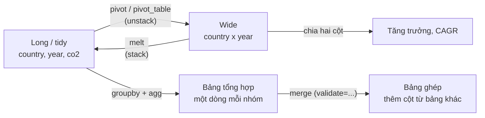
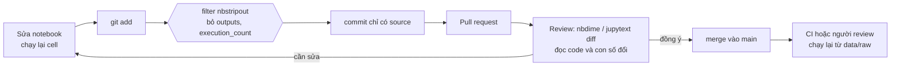
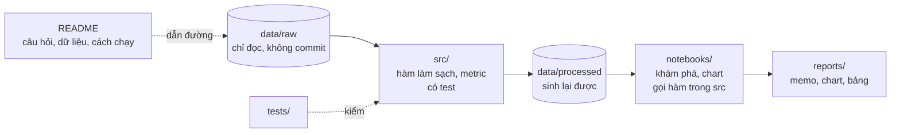

# Python cho DA

Spreadsheet và SQL trả lời được phần lớn câu hỏi hằng ngày. Python vào cuộc khi câu hỏi cần **nhiều bước biến
đổi nối nhau** (làm sạch, ghép, đổi hình dạng bảng, chuỗi thời gian), khi phân tích phải **chạy lại mỗi tháng** mà
không ai bấm tay, hoặc khi kết quả cần **review được** như code. Module này không dạy Python từ đầu (track Data
Engineer và Data Science đã có) mà dạy cách một DA dùng pandas, matplotlib và seaborn để trả lời câu hỏi business,
đọc được code R của đồng nghiệp, và tổ chức phân tích sao cho người khác (hoặc chính bạn ba tháng sau) chạy lại ra
đúng con số.

Module dùng ba bộ dữ liệu thật:

- **OWID CO2** (Our World in Data): phát thải CO2 theo quốc gia-năm, 50 411 dòng, 79 cột, 1750–2024, ghim ở commit
  `382ee6c`. Dữ liệu dạng long chuẩn (mỗi dòng một cặp `country`, `year`), lẫn cả dòng tổng (World, châu lục, nhóm
  thu nhập): rất hợp để luyện reshape và bẫy cộng trùng.
- **Online Retail II (UCI)**: giao dịch cửa hàng quà tặng online ở Anh, sheet `Year 2010-2011` (541 910 dòng,
  2010-12-01 tới 2011-12-09, tháng 12/2011 chưa đủ). Dùng cho chuỗi thời gian theo ngày và hàm báo cáo tái dùng.
- **Bike Sharing (UCI)**: `hour.csv` 17 379 giờ của Capital Bikeshare 2011–2012, dùng cho ví dụ resample.

```bash
uv run python data/download_dataset.py owid-co2
uv run python data/download_dataset.py online-retail-ii
uv run python data/download_dataset.py bike-sharing-uci
```

Mọi đoạn code chạy từ thư mục gốc repo. Quy ước làm sạch Online Retail II dùng chung cả track: `Invoice` ép `str`,
bỏ hoá đơn bắt đầu bằng `C`, bỏ dòng `Quantity <= 0` hoặc `Price <= 0`; doanh thu = `Quantity * Price` (doanh thu
gộp, GBP).

Sau module này bạn sẽ:

- Chọn giữa Excel, SQL, pandas, polars, DuckDB và R cho một việc phân tích cụ thể.
- Dùng pandas theo kiểu DA: `groupby` có tên cột, `merge` có `validate`, `pivot`/`melt` giữa wide và long, tỉ lệ
  tăng trưởng và CAGR theo nhóm, và nhận ra bảng trộn dòng tổng.
- Làm chuỗi thời gian với `resample`, `asfreq`, `rolling`, `shift`; phát hiện kỳ thiếu dữ liệu và ngày không bán.
- Vẽ nhanh bằng seaborn (dữ liệu long, small multiples) và chỉnh chart cho slide bằng matplotlib.
- Đọc code R (dplyr, tidyr, ggplot2) và viết lại bằng pandas/seaborn.
- Dùng git cho notebook và SQL (nbstripout, review diff), dựng project phân tích tái lập được.

## 1. Python trong ngày làm việc của DA (nhắc lại và chọn công cụ)

Kiến thức Python nền đã có ở hai track khác, module này không nhắc lại:

- Python cơ bản, generator, đọc file theo lô, gọi API: track Data Engineer, module
  [Foundations](../../../data-engineer/modules/01-foundations/README.md) phần 1; git workflow nhóm (nhánh, PR,
  rebase/merge) ở phần 4 của cùng module.
- pandas tốc độ cao (vector hoá, dtype, Copy-on-Write) và polars/DuckDB: track Data Science, module
  [Coding cho DS](../../../data-science/modules/08-coding-for-ds/README.md) phần 6–7.

Phần còn lại của module nhìn từ phía DA: không phải "viết pandas nhanh nhất" mà là "trả lời đúng câu hỏi, ai cũng
chạy lại được". Một ngày điển hình của DA dùng ba bốn công cụ cùng lúc, mỗi công cụ ở chỗ nó mạnh:

| Công cụ | Dùng khi nào | Mạnh | Yếu | Loại công ty hay dùng |
| --- | --- | --- | --- | --- |
| **Excel / Google Sheets** | Bảng nhỏ, người nhận tự sửa giả định, dùng một lần | Ai cũng mở được, thấy ngay | Không tái lập, ~1 triệu dòng, công thức khó review | Mọi nơi, nhất là tài chính, vận hành |
| **SQL trên warehouse** | Dữ liệu đã nằm trong database, tổng hợp lớn | Tính gần dữ liệu, chuẩn, cả team đọc được | Reshape, chuỗi thời gian, vẽ thì vụng | Mọi công ty có warehouse |
| **pandas** | Nhiều bước biến đổi, reshape, time series, vẽ, thống kê | Hệ sinh thái lớn nhất (matplotlib, seaborn, statsmodels) | Một luồng, tốn RAM; API rộng, dễ viết sai lặng lẽ | Startup, tech, công ty có team data dùng Python |
| **polars** | Bảng vài chục triệu dòng trên laptop, pipeline nhiều bước | Nhanh, đa luồng, lazy | Hệ sinh thái vẽ/thống kê nhỏ hơn, đồng nghiệp ít quen | Team data mới, ưa hiệu năng |
| **DuckDB** | Muốn SQL trên file CSV/Parquet/Excel ngay trên máy | SQL chuẩn, nhanh, không cần server | Không thay được warehouse dùng chung | Team quen SQL, phân tích ad-hoc trên file |
| **R (tidyverse)** | Team nghiên cứu, thống kê, dịch tễ, kinh tế lượng | dplyr/ggplot2 gọn, thống kê sâu | Ít dùng trong production và team kỹ thuật | Học thuật, y tế, dược, ngân hàng trung ương, tư vấn |

Quy tắc chọn nhanh: **tổng hợp ở nơi dữ liệu nằm** (SQL), kéo về phần đã thu nhỏ; làm phần biến đổi phức tạp và
vẽ ở pandas; đưa kết quả cuối cho người nhận ở dạng họ dùng được (bảng Excel, chart trong slide, dashboard). Đổi sang
polars hay DuckDB chỉ khi thời gian hoặc RAM là nút thắt thật.

## 2. pandas cho DA: groupby, merge, reshape

### Hình dạng dữ liệu: long và wide

Cùng một thông tin có hai hình dạng:

- **Long (tidy)**: mỗi dòng một quan sát, mỗi cột một biến (`country`, `year`, `co2`). Dạng này để **tính toán và
  vẽ**: `groupby`, `merge`, seaborn, SQL đều muốn long.
- **Wide**: mỗi dòng một thực thể, mỗi cột một kỳ (`country`, `2014`, `2024`). Dạng này để **đọc và so sánh**:
  bảng trong slide, pivot trong Excel, tính tăng trưởng giữa hai cột.



| pandas | Làm gì | Bẫy |
| --- | --- | --- |
| `pivot(index, columns, values)` | long → wide, mỗi ô đúng một giá trị | Khoá trùng thì báo lỗi (tốt: lỗi đó báo dữ liệu bẩn) |
| `pivot_table(..., aggfunc="sum")` | long → wide có tổng hợp | Khoá trùng bị cộng âm thầm |
| `melt(id_vars, var_name, value_name)` | wide → long | Cột năm thành chuỗi hoặc số tuỳ nguồn: ép `int` |
| `groupby(...).agg(ten=("cot", "ham"))` | Tổng hợp có tên cột rõ | `count` đếm giá trị khác null, `size` đếm dòng, `nunique` đếm khác nhau |
| `groupby(...).transform("sum")` | Gắn tổng nhóm vào từng dòng (tỉ trọng) | Không dùng `apply` cho việc này |
| `merge(..., validate="many_to_one")` | Ghép bảng, báo lỗi khi khoá bên phải trùng | Không `validate` thì join nhân dòng lặng lẽ |
| `merge(..., how="outer", indicator=True)` | So hai kỳ, thấy nhóm chỉ có ở một bên | Nhóm mới/mất có giá trị `NaN`, phải quyết định điền 0 hay để trống |

### Bẫy số một: bảng trộn dòng tổng

Nhiều nguồn công khai (OWID, World Bank, báo cáo tài chính có dòng "Tổng") để dòng tổng cùng bảng với dòng chi tiết.
Cộng cả cột là cộng trùng. Đoạn code dưới đọc OWID, bỏ dòng tổng, rồi trả lời câu hỏi kiểu ban ESG hay hỏi: "10
nước phát thải lớn nhất, ai giảm, ai tăng trong 10 năm?".

```python
import sys
from pathlib import Path

import pandas as pd

ROOT = next(p for p in [Path.cwd(), *Path.cwd().parents] if (p / "pyproject.toml").exists())
sys.path.insert(0, str(ROOT))
from data.download_dataset import ensure  # noqa: E402

co2 = pd.read_csv(ensure("owid-co2") / "owid-co2-data.csv")
print(co2.shape, co2.duplicated(["country", "year"]).sum(), "dòng trùng khoá (country, year)")

# 1. Bẫy tổng: bảng trộn quốc gia với World, châu lục, nhóm thu nhập (iso_code rỗng)
y24 = co2[co2.year == 2024]
countries = co2[co2.iso_code.notna()]
print(f"cộng mọi dòng 2024: {y24.co2.sum():,.0f} Mt | dòng World: "
      f"{y24.loc[y24.country == 'World', 'co2'].item():,.0f} Mt | cộng {countries.country.nunique()} nước: "
      f"{countries.loc[countries.year == 2024, 'co2'].sum():,.0f} Mt")

# 2. groupby + agg có tên: 10 nước phát thải lớn nhất 2024
top10 = (countries[countries.year == 2024]
         .groupby("country")
         .agg(co2=("co2", "sum"), per_capita=("co2_per_capita", "first"))
         .nlargest(10, "co2"))
print(top10.round(1).head(5))

# 3. long -> wide: mỗi nước một dòng, mỗi năm một cột
wide = countries.pivot(index="country", columns="year", values="co2").loc[top10.index, [2014, 2024]]
wide["pct_10y"] = wide[2024] / wide[2014] - 1
wide["cagr"] = (wide[2024] / wide[2014]) ** (1 / 10) - 1
print(wide.sort_values("pct_10y").round(3))

# 4. wide -> long: quay lại dạng tidy để vẽ bằng seaborn
long = wide[[2014, 2024]].reset_index().melt(id_vars="country", var_name="year", value_name="co2")
print(long.shape, long.columns.tolist())
```

Đọc kết quả:

- Cộng mọi dòng năm 2024 ra **245 672 Mt**, gấp 6.4 lần dòng `World` (**38 599 Mt**): mỗi tấn bị đếm ở nước, châu lục,
  nhóm thu nhập, World. 218 dòng có `iso_code` cộng ra 37 398 Mt; phần chênh với World chủ yếu là hàng không và hàng
  hải quốc tế (569 + 623 Mt) không thuộc nước nào. Chú ý `Kosovo` không có `iso_code` trong bộ này nên cũng bị loại:
  mọi bộ lọc đều có ngoại lệ, ghi lại khi dùng.
- Trong 10 nước lớn nhất, 4 nước giảm trong 10 năm (Đức −27.8%, Nhật −23.7%, Mỹ −11.3%, Hàn Quốc −7.3%), Indonesia
  tăng nhanh nhất (+63.1%), Ấn Độ +48.7%, Trung Quốc +23.2%.
- **CAGR** (tăng trưởng kép hằng năm) là con số so sánh được giữa các kỳ dài khác nhau:

$$
\text{CAGR} = \left(\frac{V_{\text{cuối}}}{V_{\text{đầu}}}\right)^{1/n} - 1
$$

  Indonesia +63.1% trong 10 năm là **5.0%/năm**, không phải 6.3%/năm (chia đều bỏ qua lãi kép).

### merge: ghép bảng không nhân dòng

`merge` là nơi số liệu sai lặng lẽ nhiều nhất: khoá bên phải trùng thì mỗi dòng bên trái nhân lên, tổng doanh thu
tăng mà không có lỗi nào. Ba thói quen:

- Luôn truyền `validate=` (`"one_to_one"`, `"many_to_one"`): pandas báo `MergeError` ngay khi khoá trùng.
- So số dòng và tổng trước/sau khi ghép (reconcile). Join trái đúng thì số dòng không đổi.
- So hai kỳ bằng `how="outer", indicator=True`: thấy nhóm chỉ có ở một kỳ (khách mới, quốc gia mất) thay vì để
  `inner` âm thầm bỏ chúng.

Ví dụ thật ở bài Intermediate 01: so doanh thu theo quốc gia quý 3 với quý 2 năm 2011, 30 nước có đơn quý 3 và 32 nước
có đơn quý 2. Merge `inner` cho 29 nước và làm mất Bahrain, Brazil, Mỹ (chỉ có quý 2) cùng UAE (chỉ có quý 3).

### Tăng trưởng theo nhóm trên dữ liệu long

`df.groupby("country")["co2"].pct_change()` tính tăng trưởng so với **dòng trước** trong nhóm, không phải năm trước.
Nếu một nước thiếu vài năm (OWID có 105 chỗ hở như vậy ở cột `co2` của các dòng quốc gia, phần lớn trước 1950, nhưng
cả Eritrea nhảy từ 1944 sang 1994), "tăng trưởng năm" thực ra là tăng trưởng qua nhiều năm. Cách an toàn: pivot sang wide với cột là năm liên tục (`reindex` đủ năm) rồi chia cột,
hoặc `shift` theo khoá năm (`merge` bảng với chính nó, `year + 1`). Bài Basic 01 luyện đúng chỗ này.

## 3. Chuỗi thời gian: resample, lưới thời gian, kỳ chưa đủ

Câu hỏi DA về thời gian ("tuần này so với tuần trước", "trung bình mỗi ngày", "cùng kỳ năm ngoái") hỏng nhiều nhất ở
chỗ **lưới thời gian**: dữ liệu giao dịch chỉ có dòng cho ngày/giờ có sự kiện. Ngày không có dòng là ngày bán 0,
ngày nghỉ, hay ngày mất dữ liệu? pandas không biết; bạn phải quyết định.

| pandas | Làm gì | Ghi chú |
| --- | --- | --- |
| `s.asfreq("h")` | Đặt lên lưới đều, chỗ thiếu thành `NaN` | Dùng để **đếm** chỗ thiếu |
| `s.resample("D").sum()` | Gộp lên tần suất thấp hơn | Ngày không có dòng ra **0**, không phải `NaN` |
| `resample(...).agg(["sum", "count"])` | Kèm số bản ghi mỗi kỳ | Kỳ có `count` thấp là kỳ thiếu dữ liệu |
| `resample("W-SUN")` | Tuần kết thúc Chủ nhật, nhãn là ngày cuối tuần | Tuần đầu, tuần cuối thường không đủ 7 ngày |
| `rolling(7).mean()` | Trung bình trượt | Trên chuỗi ngày đã đủ lưới, không phải trên dòng giao dịch |
| `s / s.shift(364) - 1` | So cùng kỳ năm trước, cùng thứ trong tuần | 364 = 52 tuần; `shift(365)` lệch thứ |

```python
import sys
from pathlib import Path

import pandas as pd

ROOT = next(p for p in [Path.cwd(), *Path.cwd().parents] if (p / "pyproject.toml").exists())
sys.path.insert(0, str(ROOT))
from data.download_dataset import ensure  # noqa: E402

hour = pd.read_csv(ensure("bike-sharing-uci") / "hour.csv", parse_dates=["dteday"])
hour["ts"] = hour.dteday + pd.to_timedelta(hour.hr, unit="h")
s = hour.set_index("ts")["cnt"]

# 1. Lưới thời gian đầy đủ: giờ nào không có dòng?
full = s.asfreq("h")
missing = full[full.isna()]
print(f"{len(s):,} dòng / {len(full):,} giờ lịch -> thiếu {len(missing)} giờ")
print(missing.groupby(missing.index.date).size().sort_values(ascending=False).head(3))

# 2. resample: giờ -> ngày -> tuần; đếm số giờ có dữ liệu để biết kỳ nào thiếu
daily = s.resample("D").agg(["sum", "count"])
print(daily.loc["2012-10-29":"2012-10-30"])
weekly = s.resample("W-SUN").sum()
print("tuần đầu:", weekly.index[0].date(), f"{weekly.iloc[0]:,}", "| tuần cuối:", weekly.index[-1].date(), f"{weekly.iloc[-1]:,}")

# 3. rolling 7 ngày và so cùng kỳ năm trước bằng shift theo nhãn thời gian
d = daily["sum"]
trend = d.rolling(7).mean()
yoy = d / d.shift(364) - 1      # 364 ngày = 52 tuần: cùng thứ trong tuần
print(f"TB 7 ngày tới 2012-06-30: {trend['2012-06-30']:,.0f} lượt/ngày; "
      f"so cùng thứ năm trước: {yoy['2012-06-30']:+.1%}")
```

Đọc kết quả:

- 17 379 dòng trên 17 544 giờ lịch: **thiếu 165 giờ**. Nhiều nhất là 29/10/2012 (thiếu 23 giờ, ngày bão Sandy: cả
  ngày chỉ có 1 giờ dữ liệu, 22 lượt) và 30/10/2012 (thiếu 13 giờ). Không đếm `count` thì 29/10 trông như "ngày tệ
  nhất lịch sử", trong khi thật ra là ngày gần như không có dữ liệu.
- `resample("W-SUN")` cho tuần đầu kết thúc 02/01/2011 chỉ gồm hai ngày (1 786 lượt) và tuần cuối kết thúc 06/01/2013
  chỉ gồm 31/12/2012 (2 729 lượt). Vẽ chuỗi tuần mà không đánh dấu hai điểm này là có hai "cú sập" giả ở hai đầu.
- Trung bình 7 ngày tới 30/06/2012 là 6 639 lượt/ngày; ngày 30/06/2012 cao hơn ngày cùng thứ năm trước 11.1%.

Bài Basic 03 làm việc tương tự trên Online Retail II, nơi "ngày không có dòng" có ba nghĩa khác nhau: thứ Bảy (cửa
hàng không nhận đơn), nghỉ lễ, và ngày sau cùng của dữ liệu.

## 4. Vẽ nhanh: matplotlib và seaborn

Nguyên tắc chọn chart, headline là kết luận, chart gây hiểu nhầm: module
[08. Trực quan hoá & đọc biểu đồ](../08-visualization-chart-reading/README.md). Phần này chỉ về **cách viết** cho
nhanh và lặp lại được.

- **seaborn** cho khám phá: nhận dữ liệu long, một lệnh ra chart có nhóm màu (`hue`) hoặc small multiples (`col`,
  `row`). `relplot` (line, scatter), `catplot` (bar, box), `displot` (histogram) là ba hàm figure-level hay dùng nhất.
- **matplotlib API hướng đối tượng** (`fig, ax = plt.subplots()`) cho chart đưa người khác: chú thích, màu nhấn, bỏ
  khung, tiêu đề là kết luận. Tránh `plt.plot` kiểu state-machine trong code dùng lại, vì nó vẽ vào "chart hiện tại"
  không ai kiểm soát.
- Mọi seaborn chart là matplotlib bên dưới: `g.figure`, `g.axes` (figure-level) hoặc `ax` (axes-level) cho phép chỉnh
  tiếp bằng matplotlib.

```python
import sys
from pathlib import Path

import matplotlib.pyplot as plt
import pandas as pd
import seaborn as sns

ROOT = next(p for p in [Path.cwd(), *Path.cwd().parents] if (p / "pyproject.toml").exists())
sys.path.insert(0, str(ROOT))
from data.download_dataset import ensure  # noqa: E402

co2 = pd.read_csv(ensure("owid-co2") / "owid-co2-data.csv")
five = ["China", "United States", "India", "Germany", "Vietnam"]
recent = co2[co2.country.isin(five) & co2.year.between(1990, 2024)]
print(recent.pivot(index="year", columns="country", values="co2_per_capita").loc[[1990, 2024]].round(2))

# seaborn: dữ liệu long, một lệnh cho small multiples (mỗi nước một ô, trục y riêng)
g = sns.relplot(data=recent, x="year", y="co2_per_capita", col="country", col_wrap=5,
                kind="line", height=2.2, aspect=1.1, facet_kws={"sharey": False})
g.set_titles("{col_name}")
g.set_axis_labels("", "tấn CO2 / người")
g.figure.suptitle("Phát thải đầu người 1990-2024: Mỹ và Đức giảm, Việt Nam tăng nhanh nhất", x=0.01, ha="left", y=1.05)

# matplotlib (API hướng đối tượng): kiểm soát từng chi tiết của một chart cho slide
vn = recent[recent.country == "Vietnam"].set_index("year")["co2_per_capita"]
fig, ax = plt.subplots(figsize=(7, 3))
ax.plot(vn.index, vn.values, color="#4c78a8")
ax.annotate(f"{vn[2024]:.1f} t/người (2024)", xy=(2024, vn[2024]), xytext=(2003, vn[2024]),
            arrowprops={"arrowstyle": "->"})
ax.set_ylim(0, None)
ax.spines[["top", "right"]].set_visible(False)
ax.set_title("Việt Nam: phát thải CO2 đầu người", loc="left")
plt.show()
```

Từ 1990 tới 2024, phát thải đầu người của Việt Nam tăng từ 0.32 lên 3.67 tấn (khoảng 11 lần), Trung Quốc từ 2.15 lên
8.66, Ấn Độ từ 0.67 lên 2.20; Mỹ giảm từ 20.25 xuống 14.20, Đức từ 13.23 xuống 6.77. `sharey=False` là quyết định
có chủ đích: chung trục y thì đường Việt Nam và Ấn Độ nằm bẹp dưới đáy; riêng trục y thì người đọc phải nhìn số trên
trục, nên tiêu đề phải nói rõ chart so **xu hướng**, không so mức.

| Thư viện | Dùng khi nào | Mạnh | Yếu |
| --- | --- | --- | --- |
| matplotlib | Chart cho slide/báo cáo, cần chỉnh từng chi tiết | Kiểm soát hoàn toàn, nền của mọi thư viện khác | Dài dòng cho chart nhóm |
| seaborn | EDA, small multiples, chart thống kê (box, violin, CI) | Một lệnh trên dữ liệu long | Chỉnh sâu phải xuống matplotlib |
| plotly | Chart tương tác, Streamlit, chia sẻ HTML | Hover, zoom, không cần BI | Khó in ra slide tĩnh đẹp |
| ggplot2 (R) | Team R, chart thống kê | Ngữ pháp đồ hoạ gọn và nhất quán | Phải dùng R |

## 5. R giới thiệu: đọc dplyr và ggplot2 bằng mắt pandas

Roadmap DA ghi "Python **hoặc** R". Bạn không cần viết R để làm DA ở phần lớn công ty Việt Nam, nhưng sẽ gặp R khi làm
với team nghiên cứu, y tế, ngân hàng trung ương, tư vấn, hay khi đọc code trong bài báo và khoá học thống kê. Mục tiêu
của phần này: **đọc được** một đoạn tidyverse và viết lại bằng pandas. Module không có bài R bắt buộc và không yêu cầu
cài R.

### Tidyverse trong một đoạn

- `|>` (hoặc `%>%` của gói magrittr) là **pipe**: lấy kết quả bên trái làm đối số đầu của hàm bên phải. Tương đương
  với method chaining của pandas (`df.query(...).groupby(...).agg(...)`).
- dplyr có năm động từ chính: `filter` (lọc dòng), `select` (chọn cột), `mutate` (thêm cột), `arrange` (sắp xếp),
  `summarise` (tổng hợp), cộng `group_by` để làm theo nhóm.
- R dùng `NA` cho thiếu dữ liệu, và **mặc định không bỏ qua `NA`**: `mean(x)` có một `NA` thì ra `NA`, phải viết
  `mean(x, na.rm = TRUE)`. pandas thì ngược lại: `mean()` mặc định bỏ `NaN` (`skipna=True`).
- R đánh chỉ số từ 1; `head(df, 3)` và `slice(df, 1:3)` lấy ba dòng đầu.

```r
library(dplyr)
library(tidyr)
library(ggplot2)

co2 <- readr::read_csv("data/raw/owid-co2/owid-co2-data.csv")

top10 <- co2 |>
  filter(!is.na(iso_code), year == 2024) |>
  group_by(country) |>
  summarise(co2 = sum(co2, na.rm = TRUE), .groups = "drop") |>
  arrange(desc(co2)) |>
  slice_head(n = 10)

growth <- co2 |>
  filter(country %in% top10[["country"]], year %in% c(2014, 2024)) |>
  select(country, year, co2) |>
  pivot_wider(names_from = year, values_from = co2, names_prefix = "y") |>
  mutate(pct_10y = y2024 / y2014 - 1)

ggplot(filter(co2, country %in% c("Vietnam", "India")), aes(year, co2_per_capita, colour = country)) +
  geom_line() +
  facet_wrap(~country, scales = "free_y")
```

Viết lại bằng pandas (đoạn này giống hệt khối code ở phần 2):

```python
import pandas as pd
import seaborn as sns

co2 = pd.read_csv("data/raw/owid-co2/owid-co2-data.csv")
top10 = (co2[co2.iso_code.notna() & (co2.year == 2024)]
         .groupby("country", as_index=False)
         .agg(co2=("co2", "sum"))
         .sort_values("co2", ascending=False)
         .head(10))
growth = (co2[co2.country.isin(top10.country) & co2.year.isin([2014, 2024])]
          .pivot(index="country", columns="year", values="co2")
          .add_prefix("y")
          .assign(pct_10y=lambda d: d.y2024 / d.y2014 - 1))
print(growth.sort_values("pct_10y").round(3).head(3))
sns.relplot(data=co2[co2.country.isin(["Vietnam", "India"])], x="year", y="co2_per_capita",
            hue="country", col="country", kind="line", facet_kws={"sharey": False})
```

### Bảng đối chiếu dplyr / tidyr ↔ pandas

| R (dplyr / tidyr) | pandas | Ghi chú |
| --- | --- | --- |
| `filter(df, x > 0, !is.na(y))` | `df[(df.x > 0) & df.y.notna()]` hoặc `df.query("x > 0 and y.notna()")` | Dấu phẩy trong `filter` là AND |
| `select(df, a, b)` | `df[["a", "b"]]` | `select(-a)` là `df.drop(columns="a")` |
| `mutate(df, r = q * p)` | `df.assign(r=df.q * df.p)` | `assign` nhận lambda để dùng cột vừa tạo |
| `arrange(df, desc(x))` | `df.sort_values("x", ascending=False)` | |
| `group_by(g) \|> summarise(n = n(), s = sum(x))` | `groupby("g").agg(n=("x", "size"), s=("x", "sum"))` | `n()` đếm dòng như `size`; `n_distinct` là `nunique` |
| `group_by(g) \|> mutate(share = x / sum(x))` | `df.x / df.groupby("g").x.transform("sum")` | Gắn tổng nhóm vào từng dòng |
| `lag(x)` trong `group_by` | `df.groupby("g").x.shift()` | Cả hai đều là "dòng trước", không phải "năm trước" |
| `left_join(a, b, by = "k")` | `a.merge(b, on="k", how="left")` | dplyr 1.1 có `relationship = "many-to-one"` giống `validate` |
| `count(df, g)` | `df.value_counts("g")` hoặc `df.groupby("g").size()` | |
| `pivot_longer(cols, names_to, values_to)` | `melt(id_vars, var_name, value_name)` | wide → long |
| `pivot_wider(names_from, values_from)` | `pivot(index, columns, values)` | long → wide. Khoá trùng: R cảnh báo và tạo cột list, pandas `pivot` báo lỗi; không bên nào cộng lặng lẽ như `pivot_table(aggfunc="sum")` |
| `mean(x, na.rm = TRUE)` | `x.mean()` | Mặc định NA khác nhau |
| `slice_max(x, n = 3)` | `nlargest(3, "x")` | `slice_max` mặc định giữ mọi dòng hoà điểm (`with_ties = TRUE`), `nlargest` thì không (trừ khi `keep="all"`) |

### Bảng đối chiếu ggplot2 ↔ seaborn / matplotlib

| ggplot2 | seaborn / matplotlib |
| --- | --- |
| `ggplot(df, aes(x, y)) + geom_point()` | `sns.scatterplot(data=df, x="x", y="y")` |
| `aes(colour = g)` | `hue="g"` |
| `geom_line()` | `sns.lineplot(...)` hoặc `relplot(kind="line")` |
| `geom_col()` (giá trị có sẵn) | `sns.barplot(..., estimator="sum", errorbar=None)` hoặc `ax.bar` |
| `geom_histogram(bins = 30)` | `sns.histplot(..., bins=30)` |
| `geom_boxplot()` | `sns.boxplot(...)` |
| `facet_wrap(~g, scales = "free_y")` | `relplot(..., col="g", col_wrap=..., facet_kws={"sharey": False})` |
| `labs(title = "...")` | `ax.set_title("...")` / `g.figure.suptitle("...")` |
| `scale_y_log10()` | `ax.set_yscale("log")` |
| `theme_minimal()` | `sns.set_theme(style="whitegrid")` |

Khác biệt cần nhớ khi dịch: `geom_bar()` trong ggplot2 **đếm dòng** (giống `countplot`), `geom_col()` mới vẽ giá trị
có sẵn; `sns.barplot` mặc định vẽ **trung bình** kèm khoảng tin cậy, không phải tổng. Dịch máy móc `geom_col` sang
`barplot` không truyền `estimator="sum"` là sai số liệu trên chart mà không báo lỗi gì.

## 6. Git cho notebook và SQL

Git workflow chung (nhánh, PR, rebase, commit message) ở track DE module Foundations phần 4. Với DA, hai thứ khó là
**notebook** và **review phân tích**.

### Vì sao notebook khó với git

File `.ipynb` là JSON: mỗi cell có `source`, `outputs` (ảnh base64, bảng HTML), `execution_count`, metadata. Chạy lại
notebook mà không sửa một dòng code nào cũng đổi `execution_count` và output, nên diff có hàng trăm dòng rác; ảnh
chart base64 làm repo phình to; output có thể chứa **dữ liệu khách hàng** (bảng `head()`) bị đẩy lên git mãi mãi.



| Công cụ | Làm gì | Khi nào chọn |
| --- | --- | --- |
| **nbstripout** | Git filter: bỏ output và `execution_count` lúc `git add`, file trên máy vẫn giữ output | Mặc định cho mọi repo có notebook |
| **jupytext** | Ghép notebook với một file `.py` (dạng `# %%`) hoặc `.md`; review và merge trên file text | Team review nhiều, muốn diff như code |
| **nbdime** | `nbdiff`/`nbmerge` hiểu cấu trúc notebook, hiện diff theo cell, có giao diện web | Review notebook có output, giải conflict merge |
| `pre-commit` | Chạy nbstripout, ruff, sqlfluff trước mỗi commit | Ép cả team cùng chuẩn |

```bash
uv add --dev nbstripout          # hoặc: pipx install nbstripout
nbstripout --install             # gắn filter vào repo hiện tại (.git/config + .gitattributes)
cat .gitattributes               # *.ipynb filter=nbstripout ...
git diff --stat                  # notebook chỉ đổi source mới hiện trong diff
nbstripout notebooks/*.ipynb && git diff --exit-code     # CI: báo lỗi nếu ai đó commit notebook còn output
```

### Review phân tích, không chỉ review code

Một PR phân tích có thể đúng cú pháp mà sai con số. Khi review notebook hoặc SQL của đồng nghiệp, đọc theo thứ tự:

1. **Định nghĩa**: bộ lọc làm sạch, khoá join, cách đếm (`nunique` hay `count`), kỳ thời gian. Mỗi thay đổi ở đây đổi
   con số.
2. **Dữ liệu đầu vào**: đường dẫn tuyệt đối (`/home/minh/...`), file chỉ có trên máy người viết, dữ liệu ghép từ hai
   nguồn chồng nhau.
3. **Con số trước/sau**: yêu cầu PR ghi số quan trọng thay đổi bao nhiêu và vì sao. Số đổi mà không giải thích được
   là dấu hiệu lỗi.
4. **Phần còn lại** (tên biến, style chart): góp ý không chặn merge.

SQL cũng vậy: để query trong file `.sql` trong repo (không chỉ nằm trong BI tool), format bằng `sqlfluff`, và mỗi
query quan trọng có một con số kiểm (tổng doanh thu, số dòng) ghi trong comment hoặc test. Bài Advanced 02 là một
review PR notebook thật trên Online Retail II.

## 7. Project phân tích tái lập được

"Tái lập" (reproducible) nghĩa là người khác clone repo, tải dữ liệu theo README, chạy một lệnh, và ra **đúng** con số
trong báo cáo. Notebook `Untitled_final_v3.ipynb` đọc file từ `~/Downloads`, chạy cell theo thứ tự không ai nhớ và
sửa dữ liệu gốc tại chỗ thì không đạt.



```
retail-report/
├── README.md              # câu hỏi, nguồn dữ liệu + giấy phép, cách tải, cách chạy, kết quả chính
├── pyproject.toml, uv.lock  # môi trường ghim phiên bản
├── .gitignore             # data/raw/, data/processed/, .ipynb_checkpoints/, .env
├── .gitattributes         # *.ipynb filter=nbstripout
├── data/
│   ├── raw/               # dữ liệu gốc, KHÔNG sửa, KHÔNG commit (tải bằng script)
│   └── processed/         # sinh ra từ raw bằng code, có thể xoá và tạo lại
├── notebooks/
│   └── 01_country_monthly.ipynb   # đánh số theo thứ tự đọc; import từ src
├── src/retail_report/
│   ├── clean.py           # clean_transactions(): quy tắc làm sạch ở MỘT chỗ
│   ├── metrics.py         # định nghĩa metric
│   └── pipeline.py        # build(): raw -> processed, chạy lại cho cùng kết quả
├── tests/                 # pytest cho clean, metrics trên dữ liệu nhỏ
└── reports/               # memo, chart cuối
```

Checklist trước khi gửi một phân tích:

- [ ] Dữ liệu gốc nằm ở `data/raw`, không bị code ghi đè; nguồn, phiên bản (ngày tải, commit, URL) ghi trong README.
- [ ] Đường dẫn tính từ gốc project (`Path`), không có `/Users/...`, `C:\...`, `~/Downloads`.
- [ ] Quy tắc làm sạch và định nghĩa metric nằm trong **một** hàm ở `src/`, notebook gọi hàm đó (không copy-paste
      bộ lọc vào năm cell).
- [ ] "Restart kernel and run all" chạy từ đầu tới cuối không lỗi; không cell nào phụ thuộc biến tạo ở cell phía dưới.
- [ ] Môi trường ghim (`uv.lock`, `requirements.txt` có phiên bản); seed ngẫu nhiên cố định nếu có lấy mẫu.
- [ ] Có test cho hàm làm sạch và metric chính; có ít nhất một con số kiểm (reconcile) với nguồn khác.
- [ ] Notebook commit không có output; không có dữ liệu cá nhân trong output, log hay ảnh.

Đánh đổi: không phải phân tích nào cũng cần cả cấu trúc này. Câu trả lời một lần trong 30 phút thì một notebook sạch
là đủ. Nhưng ngay khi câu hỏi **lặp lại** (báo cáo tháng), có **người thứ hai** đọc code, hoặc con số đi vào quyết định
lớn, hãy tách `src/` và viết test: chi phí ban đầu vài giờ, đổi lại không phải giải thích "sao tháng này ra số khác"
lần nào nữa. Bài Advanced 01 tổ chức lại một notebook rối thành project như trên.

## 8. Tài liệu tham khảo

Roadmap gốc (mục Programming Languages: Python, R; Libraries: Pandas, Dplyr, Matplotlib, Ggplot2, Seaborn; bản PDF ở
`roadmap/data-analyst.pdf`):

- [roadmap.sh: Data Analyst](https://roadmap.sh/data-analyst)
- [pandas User Guide](https://pandas.pydata.org/docs/user_guide/index.html), đặc biệt
  [Reshaping and pivot tables](https://pandas.pydata.org/docs/user_guide/reshaping.html),
  [Group by](https://pandas.pydata.org/docs/user_guide/groupby.html),
  [Merge, join, concatenate](https://pandas.pydata.org/docs/user_guide/merging.html),
  [Time series](https://pandas.pydata.org/docs/user_guide/timeseries.html).
- [pandas: Comparison with R / R libraries](https://pandas.pydata.org/docs/getting_started/comparison/comparison_with_r.html):
  bảng đối chiếu chính thức dplyr, tidyr ↔ pandas.
- [matplotlib: Quick start guide](https://matplotlib.org/stable/users/explain/quick_start.html) (API hướng đối tượng),
  [seaborn tutorial](https://seaborn.pydata.org/tutorial.html) (figure-level vs axes-level).
- [dplyr](https://dplyr.tidyverse.org/), [tidyr](https://tidyr.tidyverse.org/), [ggplot2](https://ggplot2.tidyverse.org/).

Sách:

- Wes McKinney. [Python for Data Analysis, 3rd ed.](https://wesmckinney.com/book/) (O'Reilly, 2022, đọc miễn phí
  online). Tác giả pandas; chương 8 (reshape), 10 (groupby), 11 (time series).
- Hadley Wickham, Mine Çetinkaya-Rundel, Garrett Grolemund. [R for Data Science, 2nd ed.](https://r4ds.hadley.nz/)
  (O'Reilly, 2023, đọc miễn phí). Tidy data, dplyr, ggplot2.

Git, notebook và tái lập:

- [nbstripout](https://github.com/kynan/nbstripout), [jupytext](https://jupytext.readthedocs.io/),
  [nbdime](https://nbdime.readthedocs.io/).
- [Cookiecutter Data Science](https://cookiecutter-data-science.drivendata.org/): cấu trúc thư mục chuẩn cho project
  phân tích và lý do của từng thư mục.
- Greg Wilson et al. [Good enough practices in scientific computing](https://doi.org/10.1371/journal.pcbi.1005510)
  (PLOS Computational Biology, 2017).
- [The Turing Way: Guide for Reproducible Research](https://book.the-turing-way.org/reproducible-research/reproducible-research).
- Hadley Wickham. [Tidy Data](https://doi.org/10.18637/jss.v059.i10) (Journal of Statistical Software, 2014): định
  nghĩa long/tidy.

Dữ liệu:

- Our World in Data. [CO2 and Greenhouse Gas Emissions dataset](https://github.com/owid/co2-data), CC BY 4.0.
- Daqing Chen. [Online Retail II (UCI)](https://archive.ics.uci.edu/dataset/502/online+retail+ii), CC BY 4.0.
- Fanaee-T & Gama. [Bike Sharing Dataset (UCI)](https://archive.ics.uci.edu/dataset/275/bike+sharing+dataset), CC BY 4.0.
