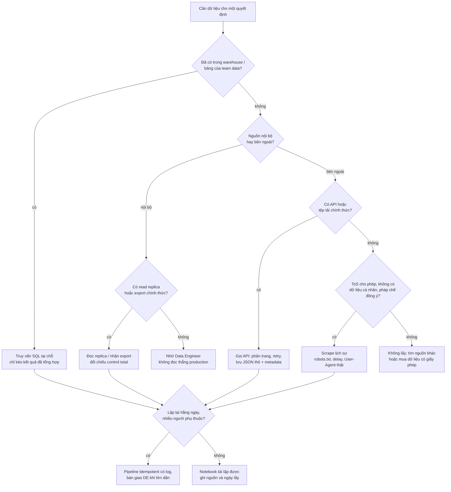
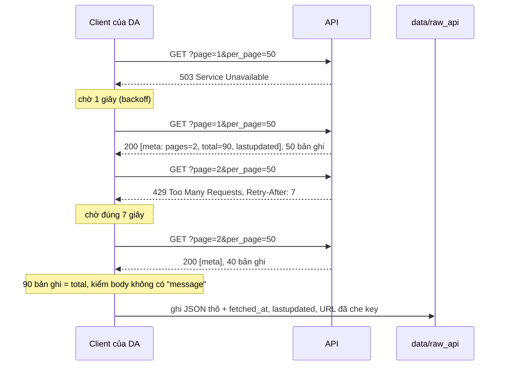
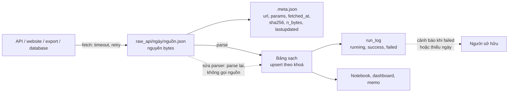

# Thu thập dữ liệu

Câu hỏi business hay nhất cũng vô ích nếu dữ liệu trả lời nó bị lấy sai: thiếu trang API, đọc nhầm dấu thập phân,
nhân đôi một đoạn trùng, hay scrape một website không cho phép. Module này dạy phần việc chiếm nhiều thời gian nhất của
một phân tích ad-hoc mà ít ai dạy: **lấy dữ liệu về đúng, đủ, hợp pháp, và lấy lại được**. Bốn nguồn theo roadmap:
**database**, **file CSV/export**, **API**, **web scraping**, cộng một thói quen chung cho cả bốn: **lưu dữ liệu thô kèm
metadata** trước khi biến đổi.

Module dùng dữ liệu thật:

- **Online Retail II (UCI, CC BY 4.0)**: giao dịch cửa hàng quà tặng online ở Anh, hai sheet `Year 2009-2010` (525 461
  dòng) và `Year 2010-2011` (541 910 dòng), trùng nhau 01–09/12/2010. Một trích mẫu thật (1 580 dòng khách Pháp tháng
  11/2011) được xuất lại theo định dạng ERP kiểu Pháp để luyện đọc CSV "bẩn"; tệp nằm trong bài Basic 02 và được các ví
  dụ dưới đây dùng lại.
- **World Bank Indicators API** (CC BY 4.0, không cần key): dân số, GDP/người, tỉ lệ dùng internet.
- **Open-Meteo Historical Weather API** (CC BY 4.0, không cần key): thời tiết theo ngày.
- **books.toscrape.com**: nhà sách giả do Zyte dựng để luyện scraping (giá, số sao là dữ liệu giả).

```bash
uv run python data/download_dataset.py online-retail-ii
```

Mọi đoạn code chạy từ thư mục gốc repo, không cần mạng. Quy ước làm sạch Online Retail II dùng chung cả track: bỏ hoá
đơn bắt đầu bằng `C`, bỏ dòng `Quantity <= 0` hoặc `Price <= 0`, doanh thu = `Quantity * Price` (doanh thu gộp, GBP).

Sau module này bạn sẽ:

- Chọn cách lấy dữ liệu (database, export, API, scraping, nhờ Data Engineer) theo câu hỏi, chủ sở hữu nguồn, tải lên hệ
  thống nguồn và rủi ro pháp lý.
- Đọc database bằng SQLAlchemy: engine, transaction, bind parameter, đẩy tính toán về database, SQL chạy được trên cả
  SQLite và Postgres.
- Đọc file export không tin được: encoding, delimiter, dấu thập phân, kiểu cột mã, ngày dd/mm, dòng thừa, control total.
- Viết client API: phân trang, rate limit, retry đúng loại lỗi, lỗi nằm trong HTTP 200, giữ API key ngoài code.
- Scrape có trách nhiệm: `robots.txt`, điều khoản sử dụng, dữ liệu cá nhân, crawl lịch sự, parse HTML bằng BeautifulSoup.
- Lưu raw kèm metadata, nạp idempotent và atomic, có run log, để số trên báo cáo truy ngược được về nguồn.

## 1. Nhắc lại nhanh: nguồn dữ liệu và bốn câu hỏi trước khi lấy

Các loại nguồn (database ứng dụng, file, API, event, web), cách chúng sinh ra dữ liệu và các câu hỏi DE đặt ra trước khi
thu thập đã có ở track Data Engineer, module [Giới thiệu Data Engineering](../../../data-engineer/modules/00-introduction/README.md)
phần 4 và 5. Ở đó góc nhìn là dựng pipeline lâu dài; ở đây là góc nhìn của DA cần **số cho một quyết định**, thường trong
vài ngày, đôi khi chỉ một lần. Trước khi lấy, trả lời bốn câu:

1. **Dữ liệu dùng cho quyết định gì**, cần chính xác tới đâu, lấy một lần hay lặp lại?
2. **Ai sở hữu nguồn**, có cách lấy chính thức không (bảng trong warehouse, API, export có control total)?
3. **Lấy có ảnh hưởng tới hệ thống nguồn không** (truy vấn nặng trên production, rate limit, tải lên website người khác)?
4. **Có được phép không**: điều khoản sử dụng, dữ liệu cá nhân, bản quyền; bí mật (mật khẩu, API key) giữ ở đâu?



Thứ tự ưu tiên trên sơ đồ phản ánh **chi phí kiểm số**: dữ liệu càng gần nguồn đã được kiểm (warehouse) thì càng ít việc;
đi xuống mỗi bậc (export, API, scraping) là nhận thêm phần kiểm và thêm rủi ro.

## 2. Databases: đọc từ nơi dữ liệu nằm

Phần lớn dữ liệu của một công ty nằm trong database: database của ứng dụng (Postgres, MySQL, SQL Server) và warehouse
(BigQuery, Snowflake, Redshift). Cú pháp SQL cho phân tích ở module 03; phần này nói cách **kết nối và kéo dữ liệu** từ
Python cho đúng.

**Nguyên tắc 1: đưa tính toán tới gần dữ liệu.** `SELECT *` một bảng 50 triệu dòng về pandas để `groupby` vừa chậm vừa
đè tải lên database. Viết câu SQL tổng hợp và chỉ kéo về bảng kết quả. Dữ liệu cần nhiều dòng (ví dụ để vẽ phân phối)
thì kéo theo chunk hoặc lấy mẫu trong SQL.

**Nguyên tắc 2: không đọc production của ứng dụng.** Truy vấn phân tích (quét cả bảng, join lớn) làm chậm hệ thống đang
phục vụ khách hàng. Đọc từ **read replica** (bản sao chỉ đọc, trễ vài giây) hoặc warehouse. Tài khoản của DA chỉ nên có
quyền đọc.

**Nguyên tắc 3: mọi giá trị đi qua bind parameter.** Ghép chuỗi (`f"... WHERE date >= '{start}'"`) hỏng ngay khi giá trị
có dấu nháy, và là lỗ hổng SQL injection khi giá trị đến từ người dùng (filter trên dashboard, app nội bộ). SQLAlchemy:
`text("... WHERE date >= :start")` cùng `{"start": start}`.

SQLAlchemy cho một lớp kết nối chung: **engine** (biết cách kết nối, giữ pool), **connection** (một phiên), **transaction**
(`engine.begin()`: commit khi khối kết thúc, rollback khi có lỗi). Đổi database chỉ là đổi URL:

| Database | URL SQLAlchemy | Ghi chú cho DA |
| --- | --- | --- |
| SQLite | `sqlite:///data/clean/retail.sqlite` (`sqlite://` là trong bộ nhớ) | Một tệp, không cần server; một người ghi |
| Postgres | `postgresql+psycopg://user:pw@host:5432/db` | Database phổ biến nhất cho ứng dụng và BI tự host |
| MySQL | `mysql+pymysql://user:pw@host:3306/db` | Nhiều ứng dụng web, thương mại điện tử |
| SQL Server | `mssql+pyodbc://...` | Doanh nghiệp dùng hệ Microsoft |
| BigQuery, Snowflake | `bigquery://project`, `snowflake://...` (gói riêng) | Warehouse; tính tiền theo dữ liệu quét, chọn cột thay vì `*` |

Ví dụ: nạp trích mẫu thật (khách Pháp tháng 11/2011) vào SQLite, rồi hỏi "3 khách mua nhiều nhất tháng 11" bằng SQL có
bind parameter. Cùng code chạy trên Postgres nếu đổi URL.

```python
from pathlib import Path

import pandas as pd
import sqlalchemy as sa
from sqlalchemy import text

ROOT = next(p for p in [Path.cwd(), *Path.cwd().parents] if (p / "pyproject.toml").exists())
EXPORT = (ROOT / "tracks/data-analyst/modules/05-data-collection/exercises/basic/02-messy-erp-export"
          / "tests/fixtures/ventes_france_2011-11.csv")

# Đọc export (cách đọc giải thích ở phần 3), đổi tên cột sang snake_case
sales = pd.read_csv(EXPORT, encoding="cp1252", sep=";", decimal=",", skiprows=2, skipfooter=1, engine="python",
                    dtype={"Facture": str, "Code article": str, "N° client": "Int64"})
sales.columns = ["invoice", "stock_code", "description", "quantity", "invoice_date", "price", "customer_id",
                 "country"]
sales["invoice_date"] = pd.to_datetime(sales["invoice_date"], format="%d/%m/%Y %H:%M")

engine = sa.create_engine("sqlite://")  # SQLite trong bộ nhớ; Postgres: "postgresql+psycopg://user:pw@host:port/db"
with engine.begin() as conn:  # một transaction: lỗi giữa chừng thì không ghi gì
    sales.to_sql("sales", conn, index=False)

TOP_CUSTOMERS = text("""
SELECT customer_id,
       COUNT(DISTINCT invoice)         AS invoices,
       ROUND(SUM(quantity * price), 2) AS revenue
FROM sales
WHERE invoice NOT LIKE 'C%' AND quantity > 0 AND price > 0 AND customer_id IS NOT NULL
  AND invoice_date >= :start AND invoice_date < :end
GROUP BY customer_id
ORDER BY revenue DESC
LIMIT :n
""")
with engine.connect() as conn:
    top = pd.read_sql(TOP_CUSTOMERS, conn, params={"start": "2011-11-01", "end": "2011-12-01", "n": 3})
    sizes = [len(chunk) for chunk in pd.read_sql(text("SELECT * FROM sales"), conn, chunksize=500)]
print(top.to_string(index=False))
print("đọc theo chunk 500 dòng:", sizes)
```

Ba khách lớn nhất (14277, 12681, 12682) mỗi người khoảng 2 400–2 600 GBP trên tổng 31 758.71 GBP. `chunksize` trả về
từng phần 500 dòng (500, 500, 500, 80): cách kéo bảng lớn mà không đầy bộ nhớ.

Hai điểm hay vấp khi viết SQL dùng cho nhiều database: **hàm ngày khác nhau** (SQLite `strftime`, Postgres `date_trunc`,
BigQuery `DATE_TRUNC` với thứ tự tham số khác), nên hoặc viết SQL di động (`substr(CAST(invoice_date AS TEXT), 1, 7)`),
hoặc dùng `sqlalchemy.func` / tách SQL theo `engine.dialect.name`; và **kiểu dữ liệu**: SQLite lưu timestamp dạng chuỗi
ISO, so với chuỗi `'2011-11-01'` đúng vì thứ tự chữ trùng thứ tự thời gian; Postgres ép kiểu chuỗi sang timestamp.

## 3. CSV và file export: đọc đúng trước khi tính

File export (CSV từ ERP, Excel từ đối tác, tệp tải từ cổng thống kê) là nguồn phổ biến nhất của DA và cũng là nguồn
**sai âm thầm** nhiều nhất. CSV không có chuẩn duy nhất: mỗi hệ thống chọn encoding, dấu phân cách, dấu thập phân, định
dạng ngày theo thói quen của nó.

| Vấn đề | Dấu hiệu | Hậu quả nếu bỏ qua | Cách đọc đúng |
| --- | --- | --- | --- |
| **Encoding** | `UnicodeDecodeError`, hoặc `é` thay cho `é` | Lỗi ngay (tốt), hoặc chữ hỏng âm thầm | Thử UTF-8 (có BOM thì `utf-8-sig`), rồi `cp1252`/`latin-1`; ghi rõ `encoding=` |
| **Delimiter** | Bảng chỉ 1 cột | Không lỗi, mọi phép tính sau đó vô nghĩa | Nhìn dòng tiêu đề, `sep=";"`; kiểm `df.shape` |
| **Dấu thập phân** | Cột giá là chuỗi `"2,55"` | Phép nhân lặp chuỗi, tổng ghép chuỗi, không lỗi | `decimal=","` (thường đi cùng `sep=";"`) |
| **Mã có số 0 đầu, mã lẫn chữ** | `02113` thành `2113`, `C573868` làm cột thành chuỗi | Join lệch, mất mã | `dtype={"mã": str}` |
| **Số nguyên có ô trống** | `12674.0` | Join với bảng khác lệch kiểu | `dtype="Int64"` |
| **Ngày dd/mm** | `01/11/2011` | Đọc thành 11 tháng 1; ngày > 12 lỗi hoặc `NaT` | `format="%d/%m/%Y"`, đừng để pandas đoán |
| **Dòng mở đầu, dòng tổng** | Dòng "Export ..." trên tiêu đề, "Total" ở cuối | Tiêu đề sai, dòng tổng thành dữ liệu | `skiprows`, `skipfooter`, hoặc lọc dòng trước khi đọc |
| **Excel đã mở và lưu lại** | Mã dài thành `1.23E+11`, ngày đổi định dạng | Mất dữ liệu không lấy lại được | Xin tệp gốc từ hệ thống, không qua Excel |

Trên trích mẫu ERP của khách Pháp, mỗi cách đọc "nhanh" hỏng một kiểu, và chỉ cách thứ nhất báo lỗi:

```python
from pathlib import Path

import pandas as pd
from charset_normalizer import from_bytes

ROOT = next(p for p in [Path.cwd(), *Path.cwd().parents] if (p / "pyproject.toml").exists())
EXPORT = (ROOT / "tracks/data-analyst/modules/05-data-collection/exercises/basic/02-messy-erp-export"
          / "tests/fixtures/ventes_france_2011-11.csv")
raw = EXPORT.read_bytes()
print("đoán encoding:", from_bytes(raw).best().encoding)

try:
    pd.read_csv(EXPORT)
except UnicodeDecodeError as exc:
    print("1) mặc định UTF-8:", exc.reason, "ở byte", exc.start)

one_col = pd.read_csv(EXPORT, encoding="cp1252")
print("2) quên sep:", one_col.shape)

no_decimal = pd.read_csv(EXPORT, encoding="cp1252", sep=";", skiprows=2, skipfooter=1, engine="python")
line_value = no_decimal["Prix unitaire"] * no_decimal["Quantité"]  # chuỗi x số nguyên: lặp chuỗi, không lỗi
print("3) quên decimal:", no_decimal["Prix unitaire"].dtype, "| giá x số lượng dòng đầu:",
      repr(line_value.iloc[0][:24]), "...")
print("   N° client:", no_decimal["N° client"].dtype, no_decimal["N° client"].iloc[0])

ok = pd.read_csv(EXPORT, encoding="cp1252", sep=";", decimal=",", skiprows=2, skipfooter=1, engine="python",
                 dtype={"Facture": str, "Code article": str, "N° client": "Int64"})
dates = pd.to_datetime(ok["Date facture"], format="%d/%m/%Y %H:%M")
print("4) đọc đúng:", ok.shape, "| giá:", ok["Prix unitaire"].dtype, "| ngày:", dates.min(), "->", dates.max())
```

Bốn điều đáng nhớ từ output: công cụ đoán encoding (`charset_normalizer`) trả `cp1250` (Trung Âu) chứ không phải
`cp1252`: với tệp này hai bảng mã giải ra cùng chữ, nhưng **đoán là đoán**, hãy hỏi hệ thống nguồn hoặc kiểm vài dòng có
dấu. Quên `sep` cho bảng 1 583 dòng × 1 cột, không lỗi. Quên `decimal` làm giá thành chuỗi và `giá * số lượng` thành
chuỗi lặp, không lỗi. Đọc ngày kiểu tháng trước (`%m/%d/%Y`) thì 685 dòng parse "được" nhưng sai tháng (trừ 117 dòng
ngày 11/11 trùng hợp đúng), 895 dòng thành `NaT`.

Sau khi đọc, **đối chiếu** trước khi tính: số dòng với control total của hệ thống nguồn (dòng `Total lignes;1580` ở cuối
tệp), khoảng ngày, vài tổng quen thuộc. Một tệp đọc ra 1 580 dòng, ngày từ 01/11 tới 30/11/2011, khớp control total, là
tệp có thể tính.

Khi được chọn định dạng, xin **Parquet** thay cho CSV: có kiểu dữ liệu, có nén, không có chuyện dấu thập phân hay encoding.
CSV vẫn là định dạng trao đổi phổ biến nhất vì ai cũng mở được, nên kỹ năng đọc CSV khó tính vẫn cần.

## 4. APIs: REST, phân trang, rate limit, retry, API key an toàn

API (thường là REST trả JSON) là cách chính thức để lấy dữ liệu từ hệ thống khác: số liệu vĩ mô (World Bank), thời tiết
(Open-Meteo), dữ liệu quảng cáo (Google Ads, Meta), CRM, cổng thanh toán. Một request gồm **endpoint** (URL), **tham số**
(query string), **header** (xác thực, định dạng); response gồm **status code** và **body**.

**Phân trang.** API không trả hàng triệu bản ghi một lần. Bốn kiểu hay gặp:

| Kiểu | Cách đi trang | Dừng khi | Bẫy |
| --- | --- | --- | --- |
| Page number | `page=1, 2, ...`, `per_page` | `page >= pages` trong metadata | Dữ liệu thay đổi giữa hai trang làm trùng hoặc sót |
| Offset/limit | `offset=0, 1000, ...` | Trang ngắn hơn `limit` | Offset lớn chậm; một số API tính offset từ 1 |
| Cursor/token | Lấy `next_cursor` từ response trước | Không còn cursor | Không nhảy trang được; cursor hết hạn |
| Link header | Theo URL `rel="next"` trong header | Không còn link | Phải đọc header, không phải body |

Dù kiểu nào: **đếm số bản ghi nhận được và so với `total`** khi API có trường đó. Thiếu trang không gây lỗi.

**Rate limit và retry.** API giới hạn số request (ví dụ 600/phút); vượt thì trả **429 Too Many Requests**, thường kèm
header `Retry-After` (số giây phải chờ). Quy tắc thử lại:

- **Thử lại**: lỗi mạng, timeout, 429, 500, 502, 503, 504. Chờ theo `Retry-After` nếu có, không thì backoff mũ (1, 2, 4,
  8 giây), có giới hạn số lần.
- **Không thử lại**: 400 (tham số sai), 401/403 (sai hoặc thiếu quyền), 404. Gửi lại request sai vẫn sai.
- **Lỗi trong HTTP 200**: một số API báo lỗi trong body với status 200. World Bank trả `[{"message": [{"key": "Invalid
  value"}]}]` khi tên chỉ số sai. Client phải kiểm cấu trúc body, không chỉ status.

Ví dụ chạy không cần mạng: một API giả (`httpx.MockTransport`) trả 7 bản ghi, 3 bản ghi mỗi trang, request đầu tiên gặp
503:

```python
import httpx

# API giả 7 bản ghi, 3 bản ghi mỗi trang, trả [metadata, bản_ghi] như World Bank; lần gọi đầu bị 503
RECORDS = [{"year": y, "value": 100 + y} for y in range(2017, 2024)]
calls = []


def handler(request: httpx.Request) -> httpx.Response:
    calls.append(str(request.url))
    if len(calls) == 1:
        return httpx.Response(503)
    page, per_page = int(request.url.params["page"]), int(request.url.params["per_page"])
    pages = -(-len(RECORDS) // per_page)
    meta = {"page": page, "pages": pages, "per_page": per_page, "total": len(RECORDS)}
    return httpx.Response(200, json=[meta, RECORDS[(page - 1) * per_page: page * per_page]])


client = httpx.Client(base_url="https://api.example.com", transport=httpx.MockTransport(handler))


def get_page(page: int, retries: int = 3) -> list:
    for attempt in range(retries + 1):
        resp = client.get("/indicator", params={"page": page, "per_page": 3})
        if resp.status_code in {429, 500, 502, 503, 504} and attempt < retries:
            continue  # code thật: time.sleep(Retry-After hoặc 2 ** attempt) trước khi thử lại
        resp.raise_for_status()
        return resp.json()


records, page = [], 1
while True:
    meta, data = get_page(page)
    records += data or []
    if page >= meta["pages"]:
        break
    page += 1
assert len(records) == meta["total"], "thiếu bản ghi"
print(f"{len(records)} bản ghi sau {len(calls)} request")
for url in calls:
    print(" ", url)
```

Bốn request cho 3 trang: một lần thử lại sau 503, rồi đi đủ ba trang theo `pages`, và `assert` so với `total`. Kỹ thuật
`MockTransport` (thay tầng mạng của client bằng một hàm) cũng là cách các bài tập trong module test client API mà không
gọi mạng.



**API key an toàn.** Key là mật khẩu. Không viết trong code hay notebook (xoá output không xoá source; lịch sử git giữ
key mãi), không dán vào chat. Đọc từ biến môi trường, đặt trong tệp `.env` nằm trong `.gitignore` (repo này đã bỏ qua
`.env`). Ưu tiên gửi key qua header (`Authorization: Bearer ...`) thay vì query string, vì URL hay bị ghi vào log; nếu API
chỉ nhận key trong URL, **che key** trước khi log hay lưu metadata. Key lộ ra thì thu hồi và cấp key mới, không chỉ xoá
commit.

## 5. Web scraping: kỹ thuật và giới hạn

Scraping là đọc HTML của một trang web để lấy dữ liệu hiển thị trên đó. Nó là **phương án cuối**: dùng khi không có API,
không có tệp tải, không mua được dữ liệu, và việc lấy là được phép. Trường hợp DA hay gặp: theo dõi giá đối thủ, danh mục
sản phẩm công khai, bảng số liệu công bố trên web không có bản tải.

**Được phép không?** Ba lớp, không lớp nào thay được lớp khác:

- **`robots.txt`** (chuẩn [RFC 9309](https://www.rfc-editor.org/rfc/rfc9309.html)): website nói bot nào được tải đường
  dẫn nào. Không có tệp (HTTP 4xx) nghĩa là không giới hạn; lỗi 5xx nên coi như cấm. Đây là quy ước kỹ thuật, **không
  phải giấy phép**.
- **Điều khoản sử dụng (ToS)**: có thể cấm thu thập tự động; vi phạm có rủi ro hợp đồng và pháp lý. Vụ hiQ Labs với
  LinkedIn ở Mỹ kéo dài nhiều năm và kết thúc với việc hiQ bị xử vi phạm thoả thuận người dùng, dù dữ liệu là công khai.
- **Dữ liệu cá nhân và bản quyền**: tên, số điện thoại, email, ảnh của người dùng là dữ liệu cá nhân. Ở Việt Nam là Luật Bảo vệ
  dữ liệu cá nhân 2025 (hiệu lực từ 01/01/2026, trước đó là Nghị định 13/2023/NĐ-CP); ở châu Âu là GDPR. "Công khai trên
  mạng" không có nghĩa là được thu thập cho mục đích khác. Nội dung (bài viết, ảnh, mô tả sản phẩm) có bản quyền.

Câu hỏi về pháp lý không có đáp án kỹ thuật: khi có nghi ngờ, hỏi pháp chế trước khi chạy.

**Crawl lịch sự.** User-Agent thật có thông tin liên hệ (không giả trình duyệt), nghỉ giữa các request (tôn trọng
`Crawl-delay` nếu có), chạy giờ thấp điểm, cache trang đã tải, giới hạn số trang, dừng khi gặp lại URL đã tải, dừng hẳn
khi bị chặn (403, 429 liên tục) thay vì đổi IP để lách.

**Parse HTML.** Mở "View source" để thấy cấu trúc, chọn phần tử bằng CSS selector (`article.product_pod h3 a`), đọc
**thuộc tính** khi chữ hiển thị bị cắt, ghép URL tương đối bằng `urljoin`. Ví dụ trên trang danh mục đã lưu của
books.toscrape.com:

```python
from pathlib import Path
from urllib.parse import urljoin
from urllib.robotparser import RobotFileParser

from bs4 import BeautifulSoup

ROOT = next(p for p in [Path.cwd(), *Path.cwd().parents] if (p / "pyproject.toml").exists())
PAGE = (ROOT / "tracks/data-analyst/modules/05-data-collection/exercises/basic/03-books-scraper"
        / "tests/fixtures/page-1.html")
url = "https://books.toscrape.com/catalogue/page-1.html"

soup = BeautifulSoup(PAGE.read_bytes(), "lxml")  # bytes: BeautifulSoup tự đọc <meta charset>
for pod in soup.select("article.product_pod")[:3]:
    link = pod.select_one("h3 a")
    print(f"{link['title'][:40]:<40} | chữ hiển thị: {link.get_text()[:22]:<22} | "
          f"{pod.select_one('p.price_color').get_text()} | {urljoin(url, link['href'])}")

robots = RobotFileParser()
robots.parse("User-agent: *\nDisallow: /checkout/\nCrawl-delay: 2".splitlines())
print("được tải /catalogue/?", robots.can_fetch("my-bot", "https://shop.example/catalogue/page-1.html"))
print("được tải /checkout/?", robots.can_fetch("my-bot", "https://shop.example/checkout/cart"))
print("crawl-delay:", robots.crawl_delay("my-bot"))
```

Chữ hiển thị `A Light in the ...` bị cắt, tên đầy đủ nằm trong thuộc tính `title`. Truyền **bytes** cho BeautifulSoup
để nó đọc thẻ `<meta charset>`: server của trang này không gửi charset trong header, nên `requests` đoán ISO-8859-1 và
`r.text` biến `£51.77` thành `£51.77`.

**Trang dựng bằng JavaScript** (nội dung không có trong HTML ban đầu): xem tab Network của trình duyệt, thường trang gọi
một API JSON nội bộ, và gọi thẳng API đó (nếu được phép) ổn định hơn dựng trình duyệt. Chỉ khi không có cách khác mới dùng
trình duyệt tự động (Playwright, Selenium): chậm, tốn tài nguyên, dễ vỡ.

Scraper **dễ vỡ**: website đổi một class là parser trả rỗng. Kiểm số bản ghi mỗi lần chạy (một trang danh mục phải có 20
sản phẩm), báo lỗi to khi bằng 0, và lưu HTML thô để parse lại khi sửa parser.

## 6. Lưu dữ liệu thô có metadata, nạp idempotent

Mọi nguồn ở trên dùng chung một nếp làm việc: **lưu nguyên bản thứ nguồn trả về** (JSON, HTML, CSV) kèm metadata, rồi
mới parse và làm sạch. Lớp raw là nhật ký bất biến "nguồn trả gì, lúc nào"; mọi bảng phía sau dựng lại được từ nó.



| Metadata | Trả lời câu hỏi |
| --- | --- |
| `url`, `params` (đã che key) | Lấy lại đúng dữ liệu này thế nào? |
| `fetched_at` | Số trên slide là số của lúc nào? |
| `lastupdated` / phiên bản nguồn | Nguồn đã sửa số kể từ lần tải trước chưa? |
| `sha256`, `n_bytes` | Hai lần tải có khác nhau không, tệp có bị cắt không? |
| Giấy phép, điều khoản | Có được dùng/chia sẻ dữ liệu này không? |

**Idempotent**: chạy lại cùng một lần nạp cho cùng kết quả, không nhân đôi. Hai cách: **xoá rồi ghi theo phân vùng**
(batch, ngày) trong một transaction, hoặc **upsert theo khoá** (`INSERT ... ON CONFLICT (khoá) DO UPDATE`). Nguồn hay sửa
số gần đây (World Bank, Open-Meteo đều sửa) thì mỗi lần chạy lấy lại vài ngày gần nhất (**lookback**) và upsert để nhận
bản sửa. **Atomic**: ghi tệp qua tệp tạm rồi `os.replace`; ghi bảng trong một transaction; lỗi giữa chừng không để lại
trạng thái nửa vời.

```python
import hashlib
import json
import os
import sqlite3
import tempfile
from datetime import datetime, timezone
from pathlib import Path

ROOT = next(p for p in [Path.cwd(), *Path.cwd().parents] if (p / "pyproject.toml").exists())
body = (ROOT / "tracks/data-analyst/modules/05-data-collection/exercises/advanced/01-daily-weather-pipeline"
        / "tests/fixtures/hcmc_2026-10-20.json").read_bytes()  # response thật của Open-Meteo


def write_atomic(path: Path, data: bytes) -> None:
    fd, tmp = tempfile.mkstemp(dir=path.parent, suffix=".tmp")
    with os.fdopen(fd, "wb") as fh:
        fh.write(data)
    os.replace(tmp, path)  # người đọc chỉ thấy tệp cũ hoặc tệp mới, không thấy tệp ghi dở


raw_dir = Path(tempfile.mkdtemp()) / "2026-10-20"
raw_dir.mkdir(parents=True)
write_atomic(raw_dir / "hcmc.json", body)
meta = {"url": "https://archive-api.open-meteo.com/v1/archive", "params": {"latitude": 10.82, "longitude": 106.63},
        "fetched_at": datetime.now(timezone.utc).isoformat(timespec="seconds"),
        "sha256": hashlib.sha256(body).hexdigest(), "n_bytes": len(body)}
write_atomic(raw_dir / "hcmc.meta.json", json.dumps(meta).encode())
print(sorted(p.name for p in raw_dir.iterdir()), meta["sha256"][:12], meta["n_bytes"], "byte")

daily = json.loads(body)["daily"]
row = {"city": "hcmc", "date": daily["time"][0], "tmax": daily["temperature_2m_max"][0]}
db = sqlite3.connect(":memory:")
db.execute("CREATE TABLE weather (city TEXT, date TEXT, tmax REAL, PRIMARY KEY (city, date))")
UPSERT = ("INSERT INTO weather VALUES (:city, :date, :tmax) "
          "ON CONFLICT (city, date) DO UPDATE SET tmax = excluded.tmax")
for tmax in [row["tmax"], 33.0]:  # chạy lần 2 với số đã được nguồn sửa
    with db:
        db.execute(UPSERT, {**row, "tmax": tmax})
print(db.execute("SELECT * FROM weather").fetchall())
```

Chạy upsert hai lần (lần hai với số đã được nguồn sửa) vẫn còn một dòng, mang giá trị mới. Bài Advanced 01 dựng đủ các
mảnh này thành một job hằng ngày có run log và backfill.

## 7. Chọn công cụ thu thập

| Công cụ | Dùng khi nào | Mạnh | Yếu | Loại công ty hay dùng |
| --- | --- | --- | --- | --- |
| **SQL client** (DBeaver, DataGrip, console của warehouse) | Khám phá bảng, truy vấn ad-hoc | Nhanh, không cần code | Khó tái lập, kết quả nằm trong máy | Mọi nơi có database |
| **pandas + SQLAlchemy** | Kéo kết quả SQL vào phân tích Python, nạp bảng nhỏ | Một lớp kết nối cho mọi database, transaction, bind parameter | Chậm với hàng chục triệu dòng | Team DA/DS dùng Python |
| **pandas `read_csv` / `read_excel`** | File export vài trăm MB trở xuống | Nhiều tham số cho file khó tính | `read_excel` chậm (XML nén); tốn bộ nhớ | Mọi nơi |
| **DuckDB, Polars** | File CSV/Parquet lớn trên máy, SQL trên file | Rất nhanh, ít bộ nhớ, đọc thẳng nhiều tệp | Ít tuỳ chọn cho CSV "bẩn" hơn pandas | Startup, team data hiện đại |
| **Excel / Power Query** | Người nhận là business, nguồn nhỏ, làm lại vài lần | Giao diện, ai cũng mở được | Dễ làm hỏng dữ liệu (mã, ngày), khó review | Doanh nghiệp truyền thống, tài chính |
| **httpx / requests** | Gọi API trong script, notebook | Đơn giản; httpx có timeout mặc định, HTTP/2, `MockTransport` để test | Phải tự viết phân trang, retry | Mọi nơi |
| **Postman / Bruno** | Thử API trước khi viết code | Xem request/response trực quan | Không phải chỗ chạy thu thập định kỳ | Team tích hợp, kỹ thuật |
| **BeautifulSoup + lxml** | Scrape vài chục tới vài nghìn trang tĩnh | Dễ học, chịu được HTML lỗi | Không chạy JavaScript; tự lo crawl | DA, nghiên cứu, team nhỏ |
| **Scrapy** | Crawl lớn, nhiều trang, chạy định kỳ | Có sẵn hàng đợi, giới hạn tốc độ, retry, pipeline | Học lâu hơn; quá nặng cho việc nhỏ | Công ty dữ liệu, e-commerce intelligence |
| **Playwright / Selenium** | Trang chỉ hiện nội dung sau JavaScript | Làm được như người dùng thật | Chậm, tốn tài nguyên, dễ vỡ | Khi không còn cách khác |
| **Airbyte / Fivetran / Stitch** | Kéo định kỳ từ SaaS (CRM, quảng cáo, thanh toán) vào warehouse | Hàng trăm connector có sẵn, tự xử lý phân trang và thay đổi schema | Tốn phí (Fivetran) hoặc phải vận hành (Airbyte); thường do DE quản | Công ty có warehouse, nhiều nguồn SaaS |

Cách chọn nhanh: **việc làm một lần** thì công cụ ngắn nhất mà vẫn tái lập được (SQL tại chỗ, notebook có ghi nguồn);
**việc lặp lại** thì code có test, idempotent, có log; **việc nhiều người phụ thuộc, nhiều nguồn** thì không còn là việc
của một DA: dùng connector có sẵn hoặc nhờ Data Engineer đưa vào pipeline chung. Một DA senior biết lúc nào dừng tự viết
và chuyển giao.

## 8. Tài liệu tham khảo

Roadmap gốc (mục Data Collection: Databases, CSV Files, APIs, Web Scraping; bản PDF ở `roadmap/data-analyst.pdf`):

- [roadmap.sh: Data Analyst](https://roadmap.sh/data-analyst)

Databases và file:

- [SQLAlchemy Unified Tutorial](https://docs.sqlalchemy.org/en/20/tutorial/index.html): engine, connection,
  transaction, `text()` và bind parameter.
- [pandas: `read_csv`](https://pandas.pydata.org/docs/reference/api/pandas.read_csv.html) và
  [`DataFrame.to_sql`](https://pandas.pydata.org/docs/reference/api/pandas.DataFrame.to_sql.html).
- [SQLite: Appropriate Uses For SQLite](https://www.sqlite.org/whentouse.html) và
  [UPSERT](https://www.sqlite.org/lang_upsert.html).
- [Python `csv` module](https://docs.python.org/3/library/csv.html) và
  [Standard Encodings](https://docs.python.org/3/library/codecs.html#standard-encodings).

APIs:

- [HTTPX](https://www.python-httpx.org/) (gồm [Transports / MockTransport](https://www.python-httpx.org/advanced/transports/)).
- [MDN: 429 Too Many Requests](https://developer.mozilla.org/en-US/docs/Web/HTTP/Status/429) và
  [Retry-After](https://developer.mozilla.org/en-US/docs/Web/HTTP/Headers/Retry-After).
- [World Bank: API Basic Call Structures](https://datahelpdesk.worldbank.org/knowledgebase/articles/898581) và
  [Indicators API Queries](https://datahelpdesk.worldbank.org/knowledgebase/articles/898599).
- [Open-Meteo Historical Weather API](https://open-meteo.com/en/docs/historical-weather-api).
- [The Twelve-Factor App: Config](https://12factor.net/config): cấu hình và bí mật trong biến môi trường.

Web scraping:

- [Beautiful Soup Documentation](https://www.crummy.com/software/BeautifulSoup/bs4/doc/).
- [RFC 9309: Robots Exclusion Protocol](https://www.rfc-editor.org/rfc/rfc9309.html).
- [Wikipedia: hiQ Labs v. LinkedIn](https://en.wikipedia.org/wiki/HiQ_Labs_v._LinkedIn).
- [Scrapy documentation](https://docs.scrapy.org/en/latest/) và [Playwright for Python](https://playwright.dev/python/).
- Ryan Mitchell. *Web Scraping with Python*, 3rd ed. (O'Reilly, 2024): kỹ thuật, crawl lịch sự, khía cạnh pháp lý.

Sách:

- Joe Reis & Matt Housley. *Fundamentals of Data Engineering* (O'Reilly, 2022), chương 5 (Data Generation in Source
  Systems) và chương 7 (Ingestion).

Dữ liệu:

- Daqing Chen. [Online Retail II (UCI)](https://archive.ics.uci.edu/dataset/502/online+retail+ii), CC BY 4.0.
- [World Bank Open Data](https://data.worldbank.org/), CC BY 4.0.
- [Open-Meteo](https://open-meteo.com/), CC BY 4.0.
- [Books to Scrape](https://books.toscrape.com/): sandbox luyện scraping của Zyte.
