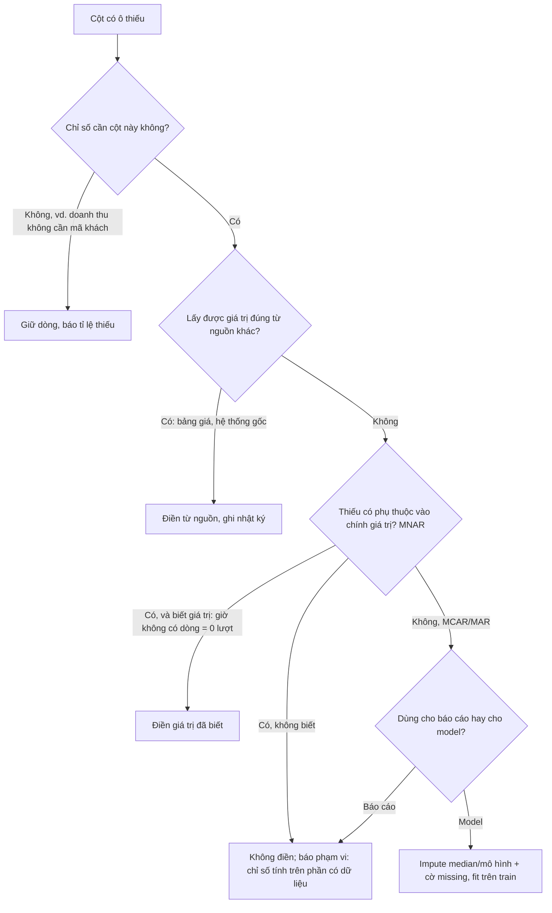
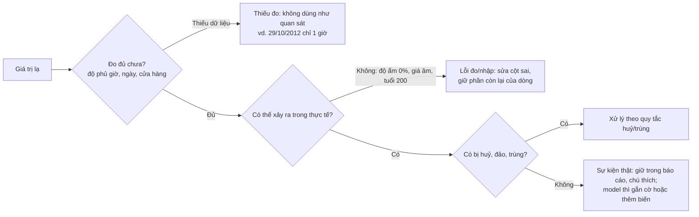
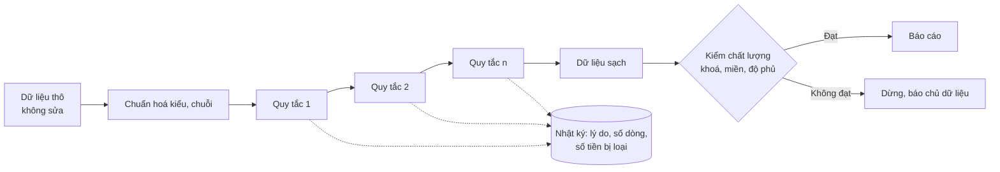
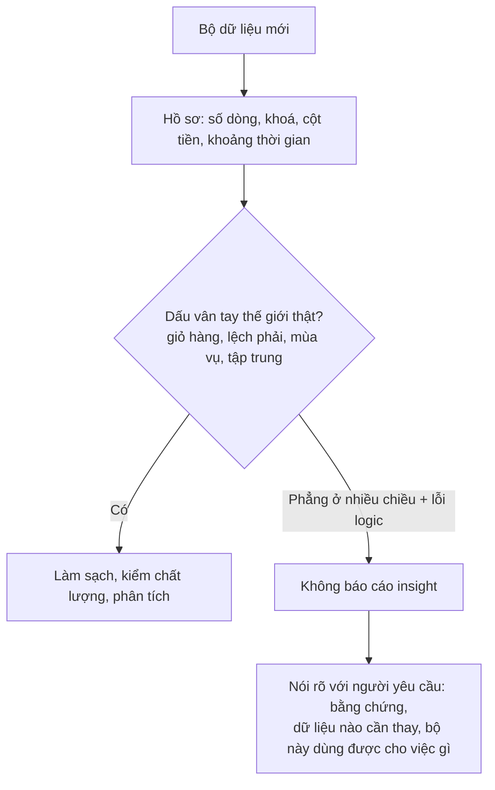

# Làm sạch dữ liệu

Phần lớn thời gian của một Data Analyst không nằm ở chart hay model mà ở câu hỏi "con số này có đúng không?". Dữ
liệu thật luôn có ô trống, dòng trùng, giá trị lạ, kiểu lẫn lộn; đôi khi cả bộ dữ liệu không mô tả thế giới thật.
Module này không dạy "chạy `dropna()` rồi đi tiếp". Nó dạy ba kỹ năng của DA senior: **hỏi vì sao** dữ liệu bẩn
trước khi sửa, **chọn cách xử lý theo chỉ số** sẽ báo cáo (cùng một ô trống có thể giữ cho doanh thu nhưng bỏ cho tỉ
lệ quay lại), và **để lại nhật ký** để người khác đối soát được từ số thô tới số cuối.

Module dùng bốn bộ dữ liệu:

- **Online Retail II (UCI)**: giao dịch cửa hàng quà tặng online ở Anh. Lý thuyết đọc sheet `Year 2010-2011`
  (541 910 dòng); bài tập dùng cả hai sheet. Nhiều loại bẩn thật: hoá đơn huỷ, giá 0 và âm, mã phí, mã hàng hoa thường
  lẫn lộn, 25% dòng thiếu mã khách.
- **Bike Sharing (UCI)**: lượt thuê xe đạp Washington DC 2011-2012 theo ngày và giờ; thiếu 165 giờ, có ngày bão.
- **Rossmann store sales** (`store-sales`): doanh số ngày của 1 115 cửa hàng, dùng cho bài data quality report.
- **Grocery Sales** (`grocery-sales-synthetic`): bộ siêu thị **sinh giả** 6.76 triệu dòng, dùng cho bài nghi ngờ dữ
  liệu. Không rõ giấy phép: chỉ dùng cục bộ, không trích mẫu.

```bash
uv run python data/download_dataset.py online-retail-ii
uv run python data/download_dataset.py bike-sharing-uci
uv run python data/download_dataset.py store-sales
uv run python data/download_dataset.py grocery-sales-synthetic
```

Mọi đoạn code chạy từ thư mục gốc repo, theo thứ tự (đoạn sau dùng lại biến của đoạn trước). Online Retail II là
xlsx, đọc mất 30-60 giây; đoạn đầu lưu một bản parquet vào thư mục tạm của hệ điều hành để các lần sau chỉ mất vài
giây.

Sau module này bạn sẽ:

- Phân biệt MCAR, MAR, MNAR bằng bằng chứng trên dữ liệu, và chọn bỏ / điền / giữ theo từng chỉ số.
- Tìm dòng trùng chính xác, trùng theo khoá và trùng "gần đúng" (fuzzy), biết khi nào **không** được gộp.
- Phát hiện outlier bằng IQR, z-score, robust z và quy tắc nghiệp vụ; phân loại thành lỗi đo, sự kiện thật hay
  thiếu dữ liệu.
- Chuẩn hoá kiểu, chuỗi, ngày, đơn vị; viết bộ kiểm chất lượng khai báo được và nhật ký làm sạch đối soát được.
- Nhận ra một bộ dữ liệu không đáng tin và nói "không báo cáo" có bằng chứng.

## 1. Nhắc lại nhanh

Bạn đã gặp các mảnh của chủ đề này ở hai track khác:

- Track Data Science, [EDA & Data Storytelling, phần 2 "Kiểm tra chất lượng dữ liệu"](../../../data-science/modules/09-eda-storytelling/README.md):
  hồ sơ dữ liệu (`missing_rate`, số giá trị khác nhau, khoảng giá trị) trước khi phân tích.
- Track Data Science, [Feature Engineering, phần 3](../../../data-science/modules/10-feature-engineering/README.md):
  điền missing value **cho model** (median, cờ "đã điền", fit trên tập train để tránh leakage).
- Track Data Engineer, [Batch pipelines, phần 7 "Độ tin cậy: retry, data contract và data quality"](../../../data-engineer/modules/05-batch-pipelines/README.md):
  check chất lượng chạy trong pipeline (schema, số dòng, freshness) với pandera, Great Expectations, dbt tests.

Khác biệt của DA: mục tiêu không phải một model hay một pipeline, mà một **con số trong báo cáo** mà người khác sẽ
hành động theo. Vì vậy câu hỏi luôn là "cách xử lý này làm chỉ số nào sai, sai theo hướng nào, ai cần biết".

## 2. Dữ liệu thiếu: cơ chế trước, cách xử lý sau

### Ba cơ chế thiếu

Rubin (1976) chia dữ liệu thiếu theo **lý do** một ô bị thiếu:

| Cơ chế | Định nghĩa | Ví dụ | Hệ quả khi bỏ dòng thiếu |
| --- | --- | --- | --- |
| **MCAR** (Missing Completely At Random) | Khả năng thiếu không phụ thuộc vào biến nào | Máy quét kẹt giấy ngẫu nhiên; một tỉ lệ dòng bị "đục lỗ" đều | Ít dữ liệu hơn, nhưng không lệch |
| **MAR** (Missing At Random) | Khả năng thiếu phụ thuộc vào biến **quan sát được** | Đơn từ app cũ không gửi mã vùng; đơn web thì có | Lệch, nhưng sửa được nếu tính theo nhóm của biến đó |
| **MNAR** (Missing Not At Random) | Khả năng thiếu phụ thuộc vào **chính giá trị bị thiếu** | Khách rất không hài lòng ít trả lời khảo sát; giờ không ai thuê xe thì không có dòng | Lệch và không sửa được bằng dữ liệu có sẵn |

Bạn không chứng minh được cơ chế từ dữ liệu (đặc biệt MNAR), nhưng **bác bỏ được MCAR**: nếu tỉ lệ thiếu khác hẳn
nhau giữa các nhóm (quốc gia, giờ, kênh), thiếu không ngẫu nhiên hoàn toàn.

### Ví dụ thật: mã khách và giờ thiếu

```python
import os
import sys
import tempfile
from pathlib import Path

import pandas as pd

ROOT = next(p for p in [Path.cwd(), *Path.cwd().parents] if (p / "pyproject.toml").exists())
sys.path.insert(0, str(ROOT))
from data.download_dataset import ensure  # noqa: E402


def read_sheet(sheet: str) -> pd.DataFrame:
    """Đọc một sheet Online Retail II; lần đầu lưu parquet vào thư mục tạm (xlsx mất 30-60 giây)."""
    src = ensure("online-retail-ii") / "online_retail_II.xlsx"
    st = src.stat()
    cache = Path(tempfile.gettempdir()) / "da-cache" / f"online_retail_II-{sheet.replace(' ', '_')}-{st.st_size}-{st.st_mtime_ns}.parquet"
    if not cache.exists():
        df = pd.read_excel(src, sheet_name=sheet, dtype={"Invoice": str, "StockCode": str, "Description": str})
        cache.parent.mkdir(parents=True, exist_ok=True)
        tmp = cache.with_name(f"{cache.name}.{os.getpid()}.tmp")
        df.to_parquet(tmp, index=False)
        os.replace(tmp, cache)  # ghi atomic
    return pd.read_parquet(cache)


tx = read_sheet("Year 2010-2011")
print(f"{len(tx):,} dòng; thiếu theo cột:", tx.isna().sum()[lambda s: s > 0].to_dict())

valid = tx[~tx["Invoice"].str.startswith("C") & (tx["Quantity"] > 0) & (tx["Price"] > 0)]
by_country = (valid.assign(missing=valid["Customer ID"].isna())
              .groupby("Country")["missing"].agg(rows="size", missing_rate="mean")
              .sort_values("rows", ascending=False))
print(by_country.head(5).round(3))
print(f"tỉ lệ thiếu mã khách toàn bộ dòng hợp lệ: {valid['Customer ID'].isna().mean():.1%}")

bike = pd.read_csv(ensure("bike-sharing-uci") / "hour.csv", parse_dates=["dteday"])
expected = pd.date_range("2011-01-01", "2012-12-31 23:00", freq="h")
seen = bike["dteday"] + pd.to_timedelta(bike["hr"], unit="h")
missing_hours = expected.difference(seen)
print(f"Bike Sharing: thiếu {len(missing_hours)} giờ; ngày thiếu nhiều nhất:",
      pd.Series(missing_hours.strftime("%Y-%m-%d")).value_counts().head(3).to_dict())
print("giờ trong ngày của các giờ thiếu:", pd.Series(missing_hours.hour).value_counts().head(5).to_dict())
```

Kết quả: 24.9% dòng hợp lệ không có `Customer ID`, nhưng tỉ lệ đó là 27.0% ở UK và 0% ở Đức, Tây Ban Nha. Không phải
MCAR. Bài Advanced 02 đào sâu câu hỏi này: thiếu ở mức hoá đơn hay mức dòng, và nó làm chỉ số khách hàng lệch thế nào.

Bike Sharing thiếu 165 giờ, tập trung ở 2-5 giờ sáng (34 giờ lúc 3h, 34 giờ lúc 4h): đó là những giờ **không ai thuê
xe**, hệ thống không ghi dòng có `cnt = 0`. Thiếu vì chính giá trị bằng 0: MNAR, và cách điền đúng là **0**, không
phải trung bình. Nhưng 29/10/2012 thiếu 23 giờ vì bão Sandy làm hệ thống ngừng: điền 0 ở đây nói "không ai thuê"
trong khi sự thật là "không đo". Hai lý do khác nhau trong cùng một cột.

### Bỏ, điền hay giữ: quyết định theo chỉ số



| Cách | Khi nào | Nguy cơ |
| --- | --- | --- |
| Bỏ dòng (`dropna`) | Chỉ số thật sự cần cột đó, và nói rõ phạm vi ("khách có tài khoản") | Bỏ toàn bảng làm sai mọi chỉ số không cần cột đó |
| Giữ, nhãn "Không rõ" | Chiều phân tích (vùng, kênh) thiếu một phần | Người đọc bỏ qua nhóm "Không rõ" nếu không báo tỉ lệ |
| Điền từ nguồn | Có hệ thống gốc, bảng tra (giá theo ngày, mã vùng theo cửa hàng) | Ghép sai khoá, sai thời điểm hiệu lực |
| Điền giá trị đã biết | Thiếu mang nghĩa xác định (không có dòng = 0) | Lẫn với thiếu vì hệ thống ngừng |
| Impute thống kê (median, KNN, MICE) | Biến đầu vào cho model; luôn kèm cờ đã điền | Dùng cho tiền hoặc khoá định danh trong báo cáo là bịa số |

Hai luật cho báo cáo: **không điền khoá định danh** (mã khách, mã đơn), và **không điền tiền bằng trung bình**.

## 3. Dòng trùng: chính xác, theo khoá, gần đúng

### Grain trước, dedupe sau

Câu hỏi đầu tiên không phải "có dòng trùng không" mà "**một dòng của bảng này là gì?**" (grain). Online Retail II:
một dòng là một mặt hàng trong một hoá đơn, nên cùng hoá đơn, cùng mã hàng xuất hiện hai lần **có thể** hợp lệ (quét
hai lần). Bảng event: một dòng là một sự kiện, trùng `event_id` là retry gửi lại. Ba loại trùng:

| Loại | Cách tìm | Ví dụ | Xử lý |
| --- | --- | --- | --- |
| Trùng chính xác | `df.duplicated()` trên mọi cột | Hai dòng giống hệt, cùng giây | Hỏi nguồn có tạo hai dòng thật không; nếu không, giữ một |
| Trùng theo khoá | `df.duplicated(subset=khoá, keep=False)` | Hai dòng cùng `(Store, Date)` khác doanh số | Là lỗi khoá: tìm bản đúng (mới nhất, từ nguồn chính), không lấy đại |
| Trùng gần đúng (fuzzy) | Chuẩn hoá chuỗi, rồi đo similarity | `RETRO LEAVES` / `RETO LEAVES` | Ứng viên cho người duyệt, không gộp tự động |

### Ví dụ thật trên Online Retail II

```python
import difflib

# tx: sheet Year 2010-2011 từ đoạn code ở phần 2
exact = tx.duplicated(keep="first")
print(f"dòng trùng hoàn toàn (giữ dòng đầu): {exact.sum():,}; mọi dòng thuộc nhóm trùng: {tx.duplicated(keep=False).sum():,}")

code = tx["StockCode"].str.strip()
print(f"mã hàng: {code.nunique():,} → sau khi viết hoa: {code.str.upper().nunique():,}")
print("ví dụ cùng sản phẩm, khác hoa thường:", sorted(code[code.str.upper() == "85123A"].unique()))

per_code = (tx.assign(code=code.str.upper(), desc=tx["Description"].str.strip().str.upper())
            .dropna(subset=["desc"]).groupby("code")["desc"].nunique())
print(f"mã có hơn một mô tả (chưa chuẩn hoá dấu câu): {(per_code > 1).sum()}")

pairs = [("RETRO LEAVES MAGNETIC NOTEPAD", "RETO LEAVES MAGNETIC NOTEPAD"),
         ("PINK CHRISTMAS TREE 30CM", "PINK CHRISTMAS TREE 60CM"),
         ("LETTER A BLING KEY RING", "LETTER B BLING KEY RING")]
for a, b in pairs:
    print(f"{difflib.SequenceMatcher(None, a, b).ratio():.3f}  {a}  |  {b}")
```

Viết hoa mã hàng gộp 112 mã (4 070 → 3 958): `85123a` và `85123A` là một sản phẩm, gom theo mã gốc sẽ tách doanh thu
của nó thành hai dòng. 5 268 dòng trùng hoàn toàn (10 147 dòng thuộc các nhóm trùng): chưa chắc là lỗi, vì grain
cho phép quét hai lần.

Ba cặp tên cuối cho thấy cái bẫy của fuzzy matching: `RETRO` / `RETO` (lỗi chính tả, 0.982) và `30CM` / `60CM` (hai
sản phẩm, 0.958) có similarity gần như nhau. Similarity đo **ký tự**, không đo **nghĩa**. Quy trình đúng:

1. Chuẩn hoá trước (viết hoa, bỏ dấu câu, gộp khoảng trắng): rẻ và bắt được phần lớn.
2. **Blocking**: chỉ so các tên cùng khối (cùng từ đầu, cùng danh mục), giảm hàng triệu cặp xuống vài chục nghìn.
   Đánh đổi: lỗi ở chính khoá block bị bỏ sót.
3. Lọc ứng viên bằng quy tắc nghiệp vụ (khác số, khác cỡ, khác màu thì không phải trùng).
4. Người duyệt; lưu bảng ánh xạ (mã cũ → mã chuẩn) để lần sau dùng lại.

## 4. Outlier: thống kê và nghiệp vụ

### Ba quy tắc thống kê

- **IQR** (Tukey): ngoài khoảng

$$[Q_1 - 1.5\,\mathrm{IQR},\ Q_3 + 1.5\,\mathrm{IQR}]$$

  với IQR là khoảng tứ phân vị. Không giả định phân phối chuẩn, nhưng một ngưỡng chung cho cả chuỗi có mùa vụ.
- **z-score**: $$z = (x - \bar{x}) / s$$ vượt 3. Giả định gần chuẩn; bị **masking**: một điểm cực lớn làm `s`
  phình ra, điểm lớn thứ hai thoát.
- **Robust z** (Iglewicz-Hoaglin): thay mean bằng median, std bằng MAD (median of absolute deviations), ngưỡng 3.5:

$$z_{\text{robust}} = \frac{0.6745\,(x - \mathrm{median})}{\mathrm{MAD}}$$

### Ví dụ thật: những ngày lạ của Bike Sharing

```python
import numpy as np

day = pd.read_csv(ensure("bike-sharing-uci") / "day.csv", parse_dates=["dteday"])
# bike: hour.csv từ đoạn code ở phần 2


def iqr_flags(s, k=1.5):
    q1, q3 = s.quantile(0.25), s.quantile(0.75)
    return (s < q1 - k * (q3 - q1)) | (s > q3 + k * (q3 - q1))


def robust_z(s):
    mad = (s - s.median()).abs().median()
    return 0.6745 * (s - s.median()) / mad


cnt = day["cnt"]
print(f"theo ngày: IQR {iqr_flags(cnt).sum()} ngày, z>3 {(((cnt - cnt.mean()) / cnt.std()).abs() > 3).sum()} ngày, "
      f"robust z>3.5 {(robust_z(cnt).abs() > 3.5).sum()} ngày")
low = day.loc[cnt.idxmin()]
print(f"ngày thấp nhất {low.dteday:%Y-%m-%d}: {low.cnt} lượt, z = {(low.cnt - cnt.mean()) / cnt.std():.2f}")

h = iqr_flags(bike["cnt"])
print(f"theo giờ: IQR đánh dấu {h.sum()} giờ; giờ hay bị đánh dấu nhất:", bike.loc[h, "hr"].value_counts().head(3).to_dict())

ratio = cnt / cnt.rolling(29, center=True, min_periods=15).median()
print(f"ngày dưới 40% trung vị trượt 29 ngày: {(ratio < 0.4).sum()}; thấp nhất:",
      day.loc[ratio.nsmallest(3).index, "dteday"].dt.strftime("%Y-%m-%d").tolist())
print("ngày có độ ẩm 0%:", day.loc[day["hum"] == 0, "dteday"].dt.strftime("%Y-%m-%d").tolist())
```

Cả ba quy tắc thống kê đều **không** đánh dấu ngày nào trên lượt thuê theo ngày, kể cả 29/10/2012 với 22 lượt: lượt
thuê dao động theo mùa từ khoảng 1 000 tới 8 700, nên 22 chỉ cách trung bình 2.3 độ lệch chuẩn. Ngược lại, IQR trên
lượt thuê theo **giờ** đánh dấu 505 giờ, phần lớn là 17h, 18h, 8h: giờ cao điểm đi làm, tín hiệu chính chứ không phải
lỗi. So mỗi ngày với **trung vị trượt** 29 ngày quanh nó (mốc so sánh theo mùa) mới thấy 17 ngày lạ: bão Sandy, bão
tuyết 29/10/2011, Giáng sinh. Độ ẩm 0% ngày 10/03/2011 (trời mưa) là lỗi cảm biến.

### Outlier là câu hỏi nghiệp vụ



Quy tắc thống kê chỉ cho **ứng viên**. Quyết định bỏ, sửa, giữ hay gắn cờ phụ thuộc mục đích: báo cáo doanh thu tháng
giữ ngày bão (nó đã xảy ra); model dự báo ngày thường loại hoặc gắn cờ. Winsorize (cắt ở p1/p99) hợp cho trực quan hoá
hoặc model nhạy outlier, không hợp cho tổng tiền.

## 5. Transformation: kiểu, chuỗi, ngày, đơn vị

Phần lớn lỗi "số không khớp" không đến từ dữ liệu sai mà từ **kiểu** sai:

| Vấn đề | Ví dụ thật | Cách sửa |
| --- | --- | --- |
| Cột trộn số và chuỗi | `Invoice` của Online Retail: `489434` (int) và `C489449` (str) | Ép `str` ngay khi đọc (`dtype=`), rồi mới xét tiền tố |
| Số nguyên có ô thiếu thành `float` | `Customer ID` = `13085.0` | `astype("Int64")` (nullable) |
| Mã có số 0 đầu bị mất | Mã bưu chính, mã cửa hàng `00123` | Đọc là chuỗi, không bao giờ đọc mã là số |
| Chuỗi bẩn | khoảng trắng thừa, hoa thường, dấu câu | `.str.strip()`, `.str.upper()`, `.str.replace(regex)` |
| Ngày nhiều định dạng | `2011-12-09`, `09/12/2011`, số serial Excel | `pd.to_datetime(format=..., errors="coerce")`, đếm `NaT` |
| Đơn vị lẫn lộn | GBP và EUR, kg và lb trong cùng cột | Cột đơn vị riêng, quy đổi về một đơn vị trước khi cộng |
| Mã danh mục không thống nhất | `0` (số) và `"0"` (chuỗi) cho "không phải ngày lễ" | Khai báo `dtype`, ánh xạ về một tập giá trị cho phép |

```python
store_path = ensure("store-sales") / "train.csv"
raw = pd.read_csv(store_path, usecols=["StateHoliday"])  # không khai báo dtype
print("StateHoliday đọc mặc định:", raw["StateHoliday"].map(type).value_counts().to_dict())
print("giá trị khác nhau:", sorted(map(repr, raw["StateHoliday"].unique())))
fixed = pd.read_csv(store_path, usecols=["StateHoliday"], dtype={"StateHoliday": str})
print("khai báo dtype=str:", fixed["StateHoliday"].value_counts().to_dict())

# Excel lưu ngày là số ngày kể từ 1899-12-30; chuỗi lạ thì errors="coerce" thành NaT để đếm, không âm thầm bỏ
serial = pd.Series([40513.3125, 40886.5, None])
print(pd.to_datetime(serial, unit="D", origin="1899-12-30").tolist())
dates = pd.Series(["2011-12-09", "09/12/2011", "không rõ"])
parsed = pd.to_datetime(dates, format="%Y-%m-%d", errors="coerce")
print(f"{parsed.isna().sum()} / {len(dates)} chuỗi ngày không đúng định dạng ISO:", dates[parsed.isna()].tolist())
```

Đọc mặc định, pandas đoán kiểu theo từng khúc của tệp: 131 072 dòng `StateHoliday` thành số `0`, 886 137 dòng thành
chuỗi `"0"`. `df[df.StateHoliday == "0"]` bỏ sót 13% số dòng mà không báo lỗi. Khai báo `dtype` khi đọc là thói quen
rẻ nhất. Với ngày: `errors="coerce"` biến chuỗi lạ thành `NaT`; luôn **đếm** số `NaT` trước khi đi tiếp, vì `NaT`
âm thầm rơi khỏi `groupby` theo tháng.

## 6. Thư viện, data quality check và nhật ký làm sạch

### pandas và dplyr: cùng thao tác

Roadmap nhắc hai thư viện làm sạch: pandas (Python) và dplyr (R, họ tidyverse). Bảng đối chiếu để đọc được code của
đồng nghiệp dùng R:

| Việc | pandas | dplyr / tidyr (R) |
| --- | --- | --- |
| Đếm ô thiếu | `df.isna().sum()` | `summarise(across(everything(), ~ sum(is.na(.x))))` |
| Bỏ dòng thiếu cột | `df.dropna(subset=["x"])` | `drop_na(x)` |
| Điền giá trị | `df["x"].fillna(0)` | `mutate(x = replace_na(x, 0))` hoặc `coalesce(x, 0)` |
| Bỏ trùng | `df.drop_duplicates()` | `distinct()` |
| Bỏ trùng theo khoá, giữ dòng đầu | `df.drop_duplicates("k")` | `distinct(k, .keep_all = TRUE)` |
| Lọc dòng | `df[df.q > 0]` hoặc `df.query("q > 0")` | `filter(q > 0)` |
| Chuẩn hoá chuỗi | `df.s.str.strip().str.upper()` | `mutate(s = str_to_upper(str_trim(s)))` (stringr) |
| Đổi kiểu | `df.x.astype("Int64")` | `mutate(x = as.integer(x))` |
| Chuỗi thao tác | `df.pipe(f).pipe(g)` hoặc method chaining | `df %>% f() %>% g()` |

### Chọn công cụ

| Công cụ | Dùng khi | Mạnh | Yếu | Hay gặp ở |
| --- | --- | --- | --- | --- |
| Excel / Power Query | File nhỏ, người nhận dùng Excel, làm sạch lặp lại đơn giản | Ai cũng mở được; Power Query ghi lại các bước | Giới hạn 1 048 576 dòng; khó review, khó test | Doanh nghiệp vừa, tài chính, vận hành |
| OpenRefine | Làm sạch một lần có người duyệt: gộp tên lệch (clustering), tách cột | Clustering mạnh, lịch sử thao tác | Không hợp cho pipeline lặp lại | Báo chí dữ liệu, nghiên cứu, team nhỏ |
| pandas | Làm sạch lặp lại, logic phức tạp, cần test | Linh hoạt, hệ sinh thái lớn, chạy trong notebook | Tốn RAM với dữ liệu lớn | Hầu hết team DA dùng Python |
| polars | Như pandas nhưng dữ liệu vài GB trên một máy | Nhanh, lazy, ít RAM | Ít tài liệu cho DA hơn pandas | Startup, team dữ liệu mới |
| SQL / DuckDB | Dữ liệu đã ở database hoặc file lớn (CSV, parquet) | Xử lý ngoài RAM, gần nguồn | Fuzzy matching và logic chuỗi phức tạp khó viết | Mọi công ty có warehouse; DuckDB cho laptop |
| dplyr (R) | Team phân tích dùng R | Cú pháp đọc như câu, tidyverse đồng bộ | Ít dùng trong production pipeline | Nghiên cứu, y tế, thống kê, học thuật |
| pandera / Great Expectations | Kiểm chất lượng trong code Python, mỗi lần chạy | Khai báo schema, báo lỗi rõ | Thêm một lớp phải bảo trì | Team có pipeline Python |
| dbt tests | Kiểm trong warehouse mỗi lần build | `unique`, `not_null`, `accepted_values`, `relationships` chạy cùng model | Chỉ cho dữ liệu trong warehouse | Công ty dùng modern data stack |

Quy tắc chọn: một lần, có người duyệt bằng mắt → OpenRefine hoặc Excel; lặp lại, cần review → code trong git; dữ liệu
lớn hơn RAM → SQL/DuckDB; kiểm mỗi lần nạp → test chạy cùng pipeline.

### Sáu chiều chất lượng và nhật ký làm sạch

Một bộ kiểm chất lượng nên phủ sáu chiều: **completeness** (thiếu), **uniqueness** (khoá duy nhất), **validity** (giá
trị thuộc miền cho phép), **consistency** (nhất quán giữa cột, giữa bảng), **timeliness** (dữ liệu mới tới đâu, có kỳ
nào thiếu) và **accuracy** (khớp với nguồn sự thật, vd. sổ kế toán). Chiều dễ quên nhất là **độ phủ theo thời gian**:
check theo dòng không bao giờ thấy được dòng **vắng mặt**.



Nhật ký làm sạch là bảng nhỏ: mỗi bước một dòng, lý do, số dòng bị loại, số dòng còn lại (thêm số tiền nếu là dữ liệu
tài chính). Mỗi dòng chỉ bị loại cho **lý do đầu tiên** nó vi phạm, nên nhật ký cộng lại khớp:

```python
def step(df, log, reason, mask):
    """Bỏ các dòng mask, ghi một dòng nhật ký."""
    log.append({"reason": reason, "rows_removed": int(mask.sum()), "rows_left": int((~mask).sum())})
    return df[~mask]


log = []
df = tx.assign(StockCode=tx["StockCode"].str.strip().str.upper())
df = step(df, log, "cancelled", df["Invoice"].str.startswith("C"))
df = step(df, log, "non_positive_quantity", df["Quantity"] <= 0)
df = step(df, log, "non_positive_price", df["Price"] <= 0)
df = step(df, log, "exact_duplicate", df.duplicated())
print(pd.DataFrame(log).to_string(index=False))
print(f"còn {len(df):,} / {len(tx):,} dòng; thiếu mã khách vẫn giữ: {df['Customer ID'].isna().sum():,} dòng")
```

Hai nguyên tắc: không bao giờ sửa tệp thô (làm sạch là một hàm từ thô ra sạch, chạy lại được), và dữ liệu thiếu mã
khách **không** bị loại ở đây vì báo cáo doanh thu không cần nó.

## 7. Nghi ngờ dữ liệu: khi nào không nên báo cáo

Làm sạch giả định dữ liệu **mô tả thế giới thật, chỉ bị bẩn**. Đôi khi giả định đó sai: dữ liệu sinh giả (synthetic)
để demo, export lỗi làm mọi dòng giống nhau, bảng test bị đẩy lên production. Không có bước làm sạch nào sửa được
chuyện đó. DA senior kiểm "dấu vân tay" của thế giới thật trước khi tìm insight:

| Thế giới thật thường có | Dấu hiệu đáng ngờ |
| --- | --- |
| Giỏ hàng nhiều món, phân phối số món lệch phải | Mỗi giao dịch đúng một dòng |
| Số lượng mỗi dòng dồn ở 1-2 | Số lượng phân phối đều trên một khoảng |
| Mùa vụ theo giờ, ngày trong tuần, lễ | Mọi giờ, mọi ngày bằng nhau trong sai số ngẫu nhiên |
| Phân phối lệch mạnh: vài sản phẩm, vài khách chiếm phần lớn | Mọi sản phẩm, khách, nhân viên gần bằng nhau |
| Cột tiền khớp số lượng × giá | Cột tiền toàn 0, hoặc không liên quan số lượng |
| Danh mục, địa lý hợp lý | Rượu vang trong danh mục "ốc", mã quốc gia sai |

Hai công cụ thống kê đo "phẳng bất thường": **kiểm định chi-square độ phù hợp** so số đếm theo nhóm với phân phối đều
(dữ liệu thật hàng triệu dòng hầu như luôn có p-value gần 0, vì chỉ cần lệch nhỏ là bị bắt), và **chỉ số phân tán**
(phương sai / trung bình) của số đếm theo ngày: đếm ngẫu nhiên độc lập (Poisson) cho khoảng 1, doanh số thật có mùa vụ
cho hàng chục tới hàng trăm. Một kiểm định đơn lẻ có thể trùng hợp; nhiều chiều độc lập cùng phẳng, cộng lỗi logic ở
bảng chiều, là bằng chứng.

```python
import duckdb
from scipy import stats

grocery = ensure("grocery-sales-synthetic")
con = duckdb.connect()
con.execute("SET memory_limit = '1GB'")  # chạy được trên laptop 4 GB: DuckDB quét CSV theo khúc
con.execute(f"""CREATE VIEW sales AS SELECT * FROM read_csv('{grocery / "sales.csv"}', header = true,
    columns = {{'SalesID': 'BIGINT', 'SalesPersonID': 'INTEGER', 'CustomerID': 'INTEGER', 'ProductID': 'INTEGER',
               'Quantity': 'INTEGER', 'Discount': 'DOUBLE', 'TotalPrice': 'DOUBLE', 'SalesDate': 'TIMESTAMP',
               'TransactionNumber': 'VARCHAR'}})""")
print(con.sql("""SELECT count(*) AS rows, count(DISTINCT TransactionNumber) AS transactions,
                        avg(CASE WHEN TotalPrice = 0 THEN 1.0 ELSE 0.0 END) AS total_price_zero,
                        min(SalesDate) AS first, max(SalesDate) AS last FROM sales""").df().to_string(index=False))
print(con.sql("SELECT Discount, round(count(*) / sum(count(*)) OVER (), 3) AS share FROM sales GROUP BY 1 ORDER BY 1").df().to_string(index=False))

products = pd.read_csv(grocery / "products.csv").merge(pd.read_csv(grocery / "categories.csv"), on="CategoryID")
price01 = (products["Price"] - products["Price"].min()) / (products["Price"].max() - products["Price"].min())
print(f"giá {products['Price'].min():.2f}-{products['Price'].max():.2f}; KS so với phân phối đều: p = {stats.kstest(price01, 'uniform').pvalue:.2f}")
print(products.loc[products["ProductName"].str.startswith(("Wine", "Halibut")), ["ProductName", "CategoryName"]].head(4).to_string(index=False))
```

Chỉ một câu SQL đã thấy: 6 758 125 dòng là 6 758 125 giao dịch (mỗi giao dịch một dòng, không có giỏ hàng),
`TotalPrice` bằng 0 ở 100% dòng, chiết khấu đúng 80% / 10% / 10%, giá sản phẩm rải đều từ 0.04 tới 99.88 (KS p = 0.42),
rượu vang nằm trong danh mục "Grain", "Snails". Bài Intermediate 02 đi tiếp với kiểm định cho số lượng, giờ, ngày,
nhân viên, sản phẩm, khách, và so với một siêu thị thật.



Kết luận "không báo cáo" là một sản phẩm phân tích hợp lệ, không phải thất bại. Sai lầm đắt nhất là giao dashboard
"giờ cao điểm" vẽ trên dữ liệu phẳng: vẫn có một giờ cao nhất, và ai đó sẽ xếp ca theo nó.

## 8. Tài liệu tham khảo

Roadmap gốc (mục Data Cleanup, Removing Duplicates, Finding Outliers, Data Transformation, Using Libraries for
Cleanup: Pandas, Dplyr; bản PDF ở `roadmap/data-analyst.pdf`):

- [roadmap.sh: Data Analyst](https://roadmap.sh/data-analyst)
- [pandas: Working with missing data](https://pandas.pydata.org/docs/user_guide/missing_data.html),
  [`DataFrame.drop_duplicates`](https://pandas.pydata.org/docs/reference/api/pandas.DataFrame.drop_duplicates.html),
  [Working with text data](https://pandas.pydata.org/docs/user_guide/text.html)
- [dplyr](https://dplyr.tidyverse.org/) và Hadley Wickham, Mine Çetinkaya-Rundel, Garrett Grolemund.
  [R for Data Science (2e)](https://r4ds.hadley.nz/), các chương data tidying, missing values, strings.

Sách và bài viết:

- Donald B. Rubin. "Inference and missing data". *Biometrika* 63(3), 1976. Định nghĩa MCAR, MAR, MNAR.
- Stef van Buuren. [Flexible Imputation of Missing Data (2e)](https://stefvanbuuren.name/fimd/), đọc miễn phí. Cơ chế
  thiếu, khi nào impute, multiple imputation.
- Hadley Wickham. [Tidy Data](https://www.jstatsoft.org/article/view/v059i10). *Journal of Statistical Software*,
  2014. Cấu trúc dữ liệu "sạch" là gì.
- NIST/SEMATECH e-Handbook. [Detection of Outliers](https://www.itl.nist.gov/div898/handbook/eda/section3/eda35h.htm):
  robust z-score (Iglewicz-Hoaglin), masking.
- [Index of dispersion](https://en.wikipedia.org/wiki/Index_of_dispersion) và
  [`scipy.stats.chisquare`](https://docs.scipy.org/doc/scipy/reference/generated/scipy.stats.chisquare.html).

Công cụ:

- [OpenRefine](https://openrefine.org/docs), [Power Query](https://learn.microsoft.com/en-us/power-query/power-query-what-is-power-query),
  [polars](https://docs.pola.rs/), [DuckDB: đọc CSV](https://duckdb.org/docs/data/csv/overview).
- [pandera](https://pandera.readthedocs.io/), [Great Expectations](https://docs.greatexpectations.io/docs/),
  [dbt data tests](https://docs.getdbt.com/docs/build/data-tests).
- [difflib](https://docs.python.org/3/library/difflib.html) (thư viện chuẩn), [RapidFuzz](https://rapidfuzz.github.io/RapidFuzz/)
  (fuzzy matching nhanh).

Dữ liệu:

- Daqing Chen. [Online Retail II (UCI)](https://archive.ics.uci.edu/dataset/502/online+retail+ii), CC BY 4.0.
- Fanaee-T & Gama. [Bike Sharing Dataset (UCI)](https://archive.ics.uci.edu/dataset/275/bike+sharing+dataset), CC BY 4.0.
- [Rossmann Store Sales (Kaggle)](https://www.kaggle.com/datasets/pratyushakar/rossmann-store-sales), giấy phép không ghi rõ.
- Grocery Sales (sinh giả), [thư mục Google Drive](https://drive.google.com/drive/folders/1rtawsOtllVE3FUwRZx7slywGLLU7mvol),
  giấy phép không rõ: chỉ dùng cục bộ.
- [dunnhumby The Complete Journey (Kaggle)](https://www.kaggle.com/datasets/frtgnn/dunnhumby-the-complete-journey):
  siêu thị thật dùng để so trong bài Intermediate 02.
