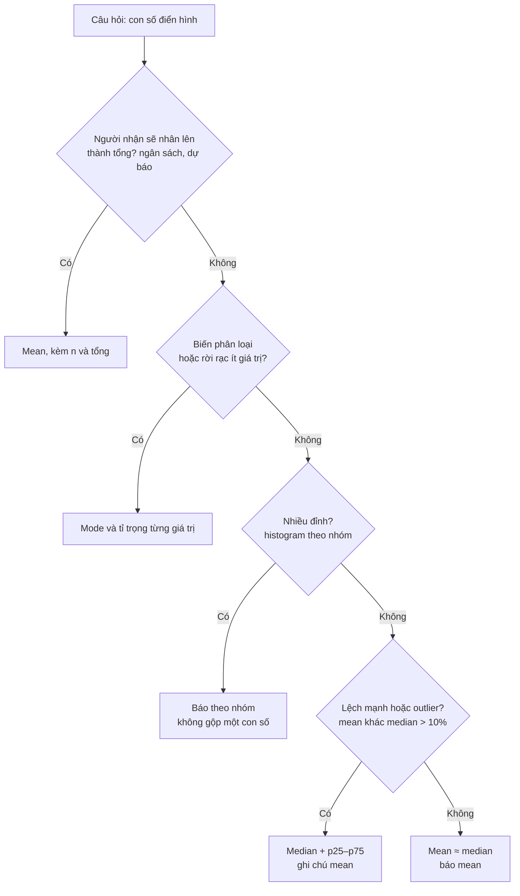
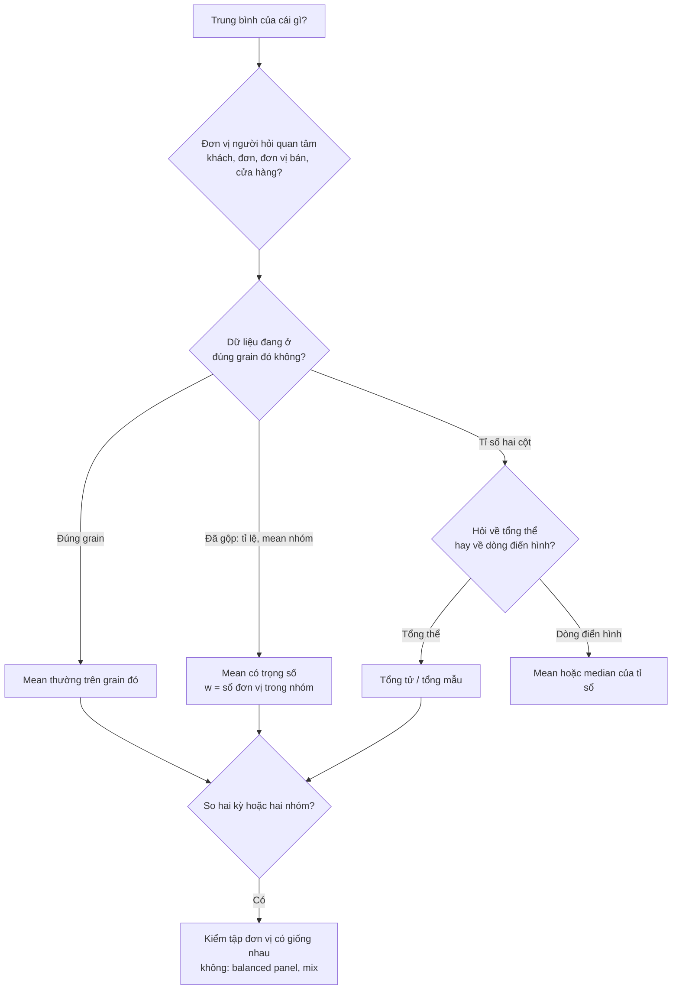
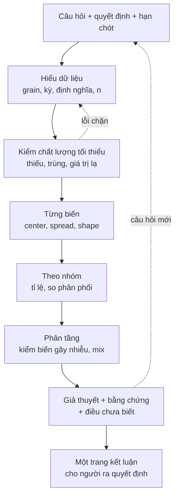

# Thống kê mô tả & EDA

Câu hỏi DA nhận nhiều nhất không phải "dự báo tháng sau" mà là "**trung bình** bao nhiêu?", "**thường**
thì thế nào?", "nhóm này **khác** nhóm kia ra sao?". Trả lời sai những câu này không cần mô hình phức
tạp: chỉ cần chọn nhầm trung bình của cái gì, quên những ngày cửa hàng đóng cửa, hoặc lấy trung bình của
các tỉ lệ. Module này dạy thống kê mô tả theo cách DA dùng hằng ngày: chọn con số đại diện, đo độ
phân tán, đọc hình dạng phân phối, tính trung bình có trọng số cho đúng, rồi gói tất cả vào một vòng
**EDA có câu hỏi** thay vì "vẽ hết mọi cột".

Module dùng ba bộ dữ liệu thật:

- **Telco Customer Churn (IBM, Kaggle)**: 7 043 khách viễn thông, 21 cột: hợp đồng, dịch vụ, cước
  tháng (`MonthlyCharges`), số tháng gắn bó (`tenure`), nhãn rời bỏ `Churn` (26.5% rời bỏ).
- **Rossmann Store Sales (Kaggle)**: doanh số ngày của 1 115 cửa hàng dược mỹ phẩm Rossmann ở Đức,
  01/01/2013 tới 31/07/2015, `train.csv` 1 017 209 dòng (mỗi dòng một cửa hàng một ngày, kể cả ngày
  đóng cửa) và `store.csv` (loại cửa hàng, mặt hàng, khoảng cách tới đối thủ). Thư mục bộ dữ liệu là
  `store-sales`.
- **Online Retail II (UCI)**: chỉ ở phần 5, sheet `Year 2010-2011`, dòng hợp lệ theo định nghĩa dùng
  chung của track (bỏ hoá đơn `C...`, bỏ dòng `Quantity <= 0` hoặc `Price <= 0`).

```bash
uv run python data/download_dataset.py telco-churn
uv run python data/download_dataset.py store-sales
uv run python data/download_dataset.py online-retail-ii
```

Hai bộ Kaggle không ghi rõ giấy phép: chỉ đọc từ `data/raw/`, không trích mẫu vào repo. Mọi đoạn code
chạy từ thư mục gốc repo theo thứ tự (đoạn sau dùng lại biến của đoạn trước), ảnh lưu vào thư mục tạm
của hệ điều hành. Chạy không có màn hình thì đặt `MPLBACKEND=Agg`.

Sau module này bạn sẽ:

- Chọn đúng con số "điển hình" (mean, median, mode, trimmed mean) theo hình dạng dữ liệu và câu hỏi,
  và nói được "trung bình" trong câu của stakeholder là trung bình của cái gì.
- Đo độ phân tán bằng range, variance, standard deviation, IQR, CV; biết vì sao pandas, numpy, Excel
  và SQL cho ra độ lệch chuẩn khác nhau.
- Đọc skewness, kurtosis và nhận ra phân phối nhiều đỉnh, nơi mean không đại diện cho ai.
- Tính trung bình có trọng số, tránh bẫy **trung bình của trung bình** và tổng thể thay đổi giữa hai kỳ.
- Sinh thống kê mô tả bằng pandas, SQL (DuckDB) và Excel, và chạy một vòng EDA bắt đầu từ câu hỏi
  kinh doanh, kết thúc bằng một trang kết luận.

## 1. Nhắc lại nhanh

Bạn đã có ở track Data Science, module
[Xác suất & Thống kê](../../../data-science/modules/02-probability-statistics/README.md) (tổng thể và
mẫu, phân phối, CLT, khoảng tin cậy, bootstrap) và module
[EDA & Data Storytelling](../../../data-science/modules/09-eda-storytelling/README.md) (quy trình EDA,
kiểm tra chất lượng dữ liệu, thang log cho đuôi dài, Freedman–Diaconis, Simpson's paradox). Module 08
của track này đã dùng histogram, boxplot, ECDF trên giá trị hoá đơn Online Retail.

Ba điều cần nhớ từ đó:

- **Thống kê mô tả** tóm tắt dữ liệu bạn **có**; **thống kê suy luận** nói về tổng thể bạn **không
  có** (kèm độ bất định). Phần lớn báo cáo DA là mô tả, nhưng ngay khi bạn nói "khách hàng *nói chung*
  thích..." là bạn đã suy luận.
- Phân phối đuôi phải dài (doanh thu, giá trị đơn) có mean lớn hơn median; đó là đặc điểm của dữ liệu,
  không phải lỗi.
- Một con số không có **n** (cỡ mẫu) và **định nghĩa** (lọc gì, kỳ nào) thì chưa phải con số báo cáo.

Phần dưới không lặp lại lý thuyết xác suất; nó tập trung vào những quyết định DA phải đưa ra mỗi khi
viết chữ "trung bình" vào báo cáo.

## 2. Central tendency: mean, median, mode và chữ "average"

### Bốn con số "ở giữa"

| Thước đo | Định nghĩa | Dùng khi | Bị lừa khi |
| --- | --- | --- | --- |
| **Mean** (trung bình cộng) | Tổng chia số quan sát | Cần cộng lại được (tổng = mean × n): ngân sách, dự báo tổng, doanh thu | Đuôi dài, outlier, nhiều đỉnh |
| **Median** (trung vị) | Giá trị ở giữa sau khi sắp xếp | Hỏi "điển hình", "một khách bình thường" trên dữ liệu lệch | Cần cộng lại thành tổng; dữ liệu rời rạc ít giá trị |
| **Mode** (yếu vị) | Giá trị hay gặp nhất | Biến phân loại (gói cước phổ biến nhất), dữ liệu rời rạc | Biến liên tục (mỗi giá trị gặp một lần) |
| **Trimmed mean** | Mean sau khi bỏ p% hai đầu | Muốn ổn định như median nhưng vẫn dùng nhiều thông tin | Ngưỡng cắt tuỳ ý, khó giải thích với stakeholder |

Công thức mean và mean có trọng số (phần 5 dùng lại):

$$
\bar x = \frac{1}{n}\sum_{i=1}^{n} x_i, \qquad \bar x_w = \frac{\sum_i w_i x_i}{\sum_i w_i}
$$

**"Average"** trong câu của stakeholder không phải tên một công thức. "Doanh số trung bình một cửa hàng"
có thể là mean theo cửa hàng-ngày, mean của mean từng cửa hàng, tổng chia số cửa hàng, có hoặc không tính
ngày đóng cửa. Việc đầu tiên khi nhận câu hỏi có chữ "trung bình" là viết lại nó thành công thức với
**tử số, mẫu số và tập dòng được tính**, rồi xác nhận với người hỏi.

### Khi mean không đại diện cho ai

Cước tháng của Telco có mean 64.76 USD, median 70.35, mode 20.05. Ba con số chênh nhau vì dữ liệu có
**ba nhóm** khách: không dùng internet (1 526 khách, mean 21.08), DSL (2 421, mean 58.10) và cáp quang
(3 096, mean 91.50). Chỉ 7.6% khách có cước trong khoảng mean ± 5 USD: "khách trung bình trả 65 USD"
mô tả một người gần như không tồn tại. Với dữ liệu nhiều đỉnh, báo cáo theo nhóm, không phải một con số.

Rossmann cho một bẫy khác: **tập dòng được tính**. `train.csv` có một dòng cho mỗi cửa hàng mỗi ngày, kể
cả 172 817 dòng đóng cửa (`Open = 0`, doanh số 0) và 54 dòng ghi mở cửa nhưng doanh số 0. Mean trên mọi
dòng là 5 774 EUR, trên ngày mở cửa có bán là 6 956 EUR: chênh 20% chỉ vì định nghĩa "một ngày". Câu hỏi
về **hiệu suất bán hàng** dùng ngày mở cửa; câu hỏi về **doanh thu cả tháng** thì tổng mọi ngày.

```python
import sys
import tempfile
from pathlib import Path

import numpy as np
import pandas as pd

ROOT = next(p for p in [Path.cwd(), *Path.cwd().parents] if (p / "pyproject.toml").exists())
sys.path.insert(0, str(ROOT))
from data.download_dataset import ensure  # noqa: E402

OUT = Path(tempfile.gettempdir()) / "da-m07"
OUT.mkdir(exist_ok=True)

telco = pd.read_csv(ensure("telco-churn") / "WA_Fn-UseC_-Telco-Customer-Churn.csv")
STORE = ensure("store-sales")
train = pd.read_csv(STORE / "train.csv", dtype={"StateHoliday": str}, parse_dates=["Date"])
stores = pd.read_csv(STORE / "store.csv")
open_ = train[(train.Open == 1) & (train.Sales > 0)]  # ngày mở cửa có bán

mc = telco.MonthlyCharges
print(f"MonthlyCharges: mean {mc.mean():.2f}, median {mc.median():.2f}, mode {mc.mode().iat[0]:.2f}")
print(telco.groupby("InternetService").MonthlyCharges.agg(["size", "mean", "median"]).round(2))
near = mc.between(mc.mean() - 5, mc.mean() + 5).mean()
print(f"khách có cước trong mean ± 5 USD: {near:.1%}")

print(f"Rossmann: {len(train):,} dòng, {train.Store.nunique()} cửa hàng, {train.Date.min():%Y-%m-%d} → {train.Date.max():%Y-%m-%d}")
print(f"dòng đóng cửa: {(train.Open == 0).sum():,}; mở cửa nhưng doanh số 0: {((train.Open == 1) & (train.Sales == 0)).sum()}")
print(f"doanh số TB/ngày: mọi dòng {train.Sales.mean():,.0f}, ngày mở cửa {open_.Sales.mean():,.0f} "
      f"(median {open_.Sales.median():,.0f})")
```

### Chọn con số nào để báo



Lỗi hay gặp: dùng median cho câu hỏi cộng dồn. Median doanh số ngày nhân 30 **không** ra doanh số tháng;
ngân sách, dự báo, unit economics luôn cần mean (hoặc tổng), dù phân phối lệch.

## 3. Dispersion: range, variance, standard deviation, IQR

### Các thước đo độ phân tán

| Thước đo | Công thức / cách tính | Đơn vị | Nhạy với outlier | Dùng khi |
| --- | --- | --- | --- | --- |
| **Range** | max − min | như dữ liệu | Rất nhạy (chỉ hai điểm) | Kiểm tra miền giá trị, phát hiện lỗi nhập |
| **Variance** | trung bình bình phương độ lệch | bình phương đơn vị | Nhạy | Tính toán (cộng được giữa biến độc lập), ít dùng để báo cáo |
| **Standard deviation (SD)** | căn bậc hai variance | như dữ liệu | Nhạy | Dữ liệu gần đối xứng; "biến động thường quanh mean" |
| **IQR** | p75 − p25 | như dữ liệu | Không | Dữ liệu lệch; boxplot; ngưỡng outlier 1.5 IQR |
| **MAD** | median của độ lệch tuyệt đối khỏi median | như dữ liệu | Không | Phát hiện outlier ổn định |
| **CV** (coefficient of variation) | SD / mean | không đơn vị | Nhạy | So độ biến động giữa nhóm khác quy mô (cửa hàng lớn và nhỏ) |

Variance tổng thể (population) chia cho n; variance mẫu (sample) chia cho n − 1 (Bessel's correction) để
ước lượng không chệch variance của tổng thể:

$$
\sigma^2 = \frac{1}{n}\sum_{i=1}^{n}(x_i - \mu)^2, \qquad s^2 = \frac{1}{n-1}\sum_{i=1}^{n}(x_i - \bar x)^2
$$

### Cùng một chữ "độ lệch chuẩn", bốn công cụ, hai đáp án

| Công cụ | Mặc định | Muốn bản kia |
| --- | --- | --- |
| pandas `Series.std()` | mẫu (`ddof=1`) | `std(ddof=0)` |
| numpy `np.std()` | tổng thể (`ddof=0`) | `np.std(x, ddof=1)` |
| Excel / Google Sheets | `STDEV.S` (mẫu), `STDEV.P` (tổng thể); `STDEV` cũ là mẫu | |
| SQL | Postgres, DuckDB: `stddev` = `stddev_samp`; `stddev_pop` riêng | SQL Server: `STDEV`, `STDEVP` |

Với n lớn, hai bản gần như bằng nhau (cước Telco: 30.090 và 30.088). Với n nhỏ (12 tháng, 17 cửa hàng loại
b) chúng lệch đáng kể, và hai báo cáo dùng hai công cụ sẽ ra hai con số. Quy ước: dữ liệu là **toàn bộ**
đối tượng bạn quan tâm (mọi cửa hàng của công ty) và bạn chỉ mô tả nó → population; dữ liệu là mẫu để nói
về cái lớn hơn → sample. Quan trọng hơn chọn bản nào là **ghi rõ** đã chọn bản nào.

### SD đọc thế nào trên dữ liệu thật

"SD cước tháng là 30 USD" chỉ có nghĩa trực quan khi phân phối gần chuông (khoảng 68% nằm trong mean ± 1
SD). Cước Telco có ba đỉnh, nên SD 30 chủ yếu đo **khoảng cách giữa các nhóm**, không phải biến động của
một khách. Trong từng nhóm, SD nhỏ hơn nhiều: không internet 2.16, cáp quang 12.66, DSL 16.26.

CV hữu ích khi so sánh độ ổn định giữa các cửa hàng có quy mô khác nhau: một cửa hàng bán trung bình
20 000 EUR/ngày với SD 4 000 ổn định hơn cửa hàng bán 4 000 với SD 2 000, dù SD lớn gấp đôi. Trên
Rossmann, CV doanh số ngày (ngày mở cửa) của từng cửa hàng có median 0.264, từ 0.123 tới 0.551: cửa hàng
CV cao là ứng viên đầu tiên khi hỏi "doanh số cửa hàng nào khó dự báo".

```python
print(f"cước Telco: SD mẫu {mc.std():.3f}, SD tổng thể {mc.std(ddof=0):.3f}, numpy mặc định {np.std(mc):.3f}")
print(f"range {mc.max() - mc.min():.2f}, IQR {mc.quantile(0.75) - mc.quantile(0.25):.2f}, variance {mc.var():.1f}")
print("SD trong từng nhóm:", telco.groupby("InternetService").MonthlyCharges.std().round(2).to_dict())

by_store = open_.groupby("Store").Sales
cv = by_store.std() / by_store.mean()
print(f"CV doanh số ngày theo cửa hàng: median {cv.median():.3f}, min {cv.min():.3f}, max {cv.max():.3f}")
store_mean = by_store.mean()
mad = (store_mean - store_mean.median()).abs().median()
print(f"doanh số TB mỗi cửa hàng: SD {store_mean.std():,.0f}, IQR {store_mean.quantile(0.75) - store_mean.quantile(0.25):,.0f}, MAD {mad:,.0f}")
```

### Độ tập trung: khi phân tán là câu hỏi kinh doanh

Với doanh thu theo khách hay theo sản phẩm, câu hỏi về phân tán thường được hỏi bằng lời khác: "bao nhiêu %
khách mang lại 80% doanh thu?". Hai công cụ trả lời câu đó:

- **Top share**: tỉ trọng của q% đơn vị lớn nhất (top 1%, top 20%). Dễ giải thích nhất.
- **Lorenz curve và Gini**: sắp đơn vị từ nhỏ tới lớn, vẽ tỉ lệ đơn vị cộng dồn (trục x) với tỉ lệ doanh
  thu cộng dồn (trục y). Gini là hai lần diện tích giữa đường chéo và đường Lorenz: 0 khi mọi đơn vị bằng
  nhau, gần 1 khi một đơn vị chiếm gần hết. Với dữ liệu đã sắp tăng dần
  $$x_{(1)} \le \dots \le x_{(n)}$$:

$$
G = \frac{2\sum_{i=1}^{n} i\,x_{(i)}}{n\sum_{i=1}^{n} x_{(i)}} - \frac{n+1}{n}
$$

Bài Advanced 02 dùng chúng để đặt ngưỡng khách VIP trên Online Retail II.

## 4. Distribution: skewness, kurtosis và cách nhìn phân phối

### Skewness và kurtosis

**Skewness** đo độ lệch: dương khi đuôi phải dài (mean > median thường gặp), âm khi đuôi trái dài, gần 0
khi đối xứng. **Kurtosis** đo độ nặng của đuôi (mức độ dữ liệu có giá trị cực trị) so với phân phối chuẩn.
pandas, Excel (`KURT`) và DuckDB (`kurtosis`) đều trả **excess kurtosis** (đã trừ 3, chuẩn = 0), có hiệu chỉnh
mẫu; `scipy.stats.kurtosis` mặc định cũng là excess nhưng không hiệu chỉnh. Moment chuẩn hoá bậc 3 và 4:

$$
g_1 = \frac{\frac{1}{n}\sum (x_i - \bar x)^3}{\left(\frac{1}{n}\sum (x_i - \bar x)^2\right)^{3/2}}, \qquad
g_2 = \frac{\frac{1}{n}\sum (x_i - \bar x)^4}{\left(\frac{1}{n}\sum (x_i - \bar x)^2\right)^{2}} - 3
$$

Quy tắc đọc thực dụng (không phải luật):

| Giá trị | Đọc là | Ví dụ thật |
| --- | --- | --- |
| \|skew\| < 0.5 | gần đối xứng | `tenure` Telco 0.24; cước Telco −0.22 |
| 0.5–1 | lệch vừa | `TotalCharges` Telco 0.96 |
| > 1 | lệch mạnh, cân nhắc median, thang log | doanh số ngày Rossmann 1.59; khoảng cách tới đối thủ 2.93 |
| excess kurtosis > 3 | đuôi nặng, có cực trị đáng kể | số khách/ngày Rossmann 13.3 |
| excess kurtosis < 0 | đuôi nhẹ, thường là **phẳng hoặc nhiều đỉnh** | `tenure` −1.39; cước Telco −1.26 |

Hai điểm DA hay hiểu sai:

- **Kurtosis không đo "độ nhọn"**. Nó gần như chỉ do phần đuôi quyết định (Westfall, 2014). Kurtosis âm
  rất hay đến từ dữ liệu **hai đỉnh**: `tenure` của Telco có hai cụm, khách mới (613 khách ở tháng 1, mode)
  và khách gắn bó lâu (362 khách ở tháng 72, mức trần của dữ liệu).
- **Skew gần 0 không có nghĩa là đối xứng một đỉnh.** `tenure` có skew 0.24 nhưng là hình chữ U. Tách theo
  hợp đồng thì thấy cơ chế: month-to-month lệch phải (skew 1.05, median 12 tháng), hợp đồng hai năm lệch
  trái (skew −1.34, median 64). Tổng thể là **hỗn hợp** của các nhóm.

Một con số tóm tắt hình dạng luôn kém một chart. Đọc skew, kurtosis để **biết phải vẽ gì**, rồi vẽ.

### Visualizing distributions: chọn cách nhìn theo câu hỏi

Module 08 đã dạy histogram bin log, boxplot, ECDF cho **một** phân phối đuôi dài. Ở đây câu hỏi thường là
**so phân phối giữa nhóm**:

| Cách nhìn | Trả lời được | Không trả lời được |
| --- | --- | --- |
| Histogram small multiples (cùng trục x) | Hình dạng từng nhóm, nhiều đỉnh | So chính xác vị trí giữa nhiều nhóm |
| Histogram xếp chồng / `hue` theo nhóm | Nhóm nào tạo ra đỉnh nào | Hình dạng từng nhóm khi nhóm nhỏ bị che |
| Boxplot theo nhóm | So median, IQR, outlier giữa nhiều nhóm | Nhiều đỉnh (boxplot giấu hoàn toàn) |
| Violin | Hình dạng + vị trí | Đọc chính xác số; người xem không quen |
| ECDF theo nhóm | "Bao nhiêu % dưới X" cho từng nhóm, không phụ thuộc bin | Hình dạng trực quan cho người không quen |
| KDE | Hình dạng mượt | Dữ liệu bị chặn (tenure ≥ 0, tối đa 72): KDE tràn ra ngoài miền |

```python
import matplotlib.pyplot as plt
import seaborn as sns

shape = pd.DataFrame({
    "tenure": telco.tenure, "MonthlyCharges": mc, "Sales/ngày": open_.Sales,
    "Customers/ngày": open_.Customers, "CompetitionDistance": stores.CompetitionDistance,
})
print(shape.agg(["mean", "median", "skew", "kurt"]).T.round(2))
print("tenure theo hợp đồng:")
print(telco.groupby("Contract").tenure.agg(["median", "skew"]).round(2))

fig, ax = plt.subplots(1, 3, figsize=(16, 4))
sns.histplot(data=telco, x="tenure", hue="Contract", bins=range(0, 75, 3), multiple="stack", ax=ax[0])
ax[0].set_title("tenure: chữ U là hỗn hợp ba loại hợp đồng", loc="left")
sns.histplot(data=telco, x="MonthlyCharges", hue="InternetService", bins=40, multiple="stack", ax=ax[1])
ax[1].axvline(mc.mean(), color="black", ls="--", lw=1)
ax[1].set_title("Cước tháng: ba đỉnh; nét đứt là mean", loc="left")
per_store = store_mean.rename("mean_sales").reset_index().merge(stores[["Store", "StoreType"]])
sns.ecdfplot(data=per_store, x="mean_sales", hue="StoreType", ax=ax[2])
ax[2].set_title("ECDF doanh số TB/ngày mỗi cửa hàng theo loại", loc="left")
for a in ax:
    a.spines[["top", "right"]].set_visible(False)
fig.tight_layout()
fig.savefig(OUT / "distributions.png", dpi=80)
plt.close(fig)
print("ảnh:", OUT / "distributions.png")
```

## 5. Trọng số và trung bình của trung bình

### Mean có trọng số

Mean thường là mean có trọng số với mọi $$w_i = 1$$. Khi mỗi dòng đại diện cho một số đơn vị khác nhau (một
dòng của bảng tần suất đại diện cho nhiều khách, một tỉ lệ của một nhóm đại diện cho n khách của nhóm đó),
trọng số phải là số đơn vị đó. Variance có trọng số tần suất (frequency weights), cho cùng kết quả như
khi nhân bản mỗi dòng $$w_i$$ lần:

$$
s_w^2 = \frac{\sum_i w_i (x_i - \bar x_w)^2}{\sum_i w_i - 1}
$$

Excel tính mean có trọng số bằng `=SUMPRODUCT(x, w) / SUM(w)`; SQL bằng `SUM(x * w) / SUM(w)`.

### Bốn bẫy "trung bình của trung bình" trên dữ liệu thật

| Bẫy | Cách sai | Cách đúng | Số thật |
| --- | --- | --- | --- |
| Trung bình các tỉ lệ nhóm | Mean ba tỉ lệ churn theo hợp đồng | Mean có trọng số theo số khách (= tổng churn / tổng khách) | 18.9% so với **26.5%** |
| Trung bình các tỉ số dòng | Mean của (doanh số / số khách) mỗi cửa hàng-ngày | Tổng doanh số / tổng số khách (ratio of sums) | 9.49 so với **9.12** EUR/khách |
| Trung bình các trung bình nhóm | Mean của AOV 38 quốc gia (Lebanon 1 hoá đơn nặng bằng UK 18 019) | AOV trên mọi hoá đơn, hoặc báo theo nước kèm n | 915 so với **534** GBP |
| Trung bình giá trên dòng | Mean `Price` trên các dòng hoá đơn | Doanh thu / số lượng (trọng số theo số đơn vị bán) | 3.91 so với **1.91** GBP/đơn vị |

Không có cách nào "luôn đúng": mean của tỉ số dòng trả lời "một cửa hàng-ngày điển hình thu bao nhiêu mỗi
khách", ratio of sums trả lời "mỗi khách mang lại bao nhiêu". Chúng khác nhau vì ngày đông khách có giá trị
mỗi khách thấp hơn. Sai lầm là dùng một công thức để trả lời câu hỏi của công thức kia mà không biết.



### Khi tập đơn vị thay đổi giữa hai kỳ

Rossmann có 180 cửa hàng **không có dữ liệu** từ 01/07/2014 tới 31/12/2014. Một dashboard so nửa cuối năm:

| Cách so (nửa cuối 2014 với nửa cuối 2013) | Kết quả |
| --- | --- |
| Tổng doanh số mọi cửa hàng có dữ liệu | 1 200.5 → 1 041.8 triệu EUR, **−13.2%** |
| Doanh số TB mỗi cửa hàng-ngày mở cửa, mọi cửa hàng | 6 961 → 7 198 EUR, **+3.4%** |
| Tổng, chỉ 935 cửa hàng có dữ liệu đủ cả hai kỳ | 1 016.3 → 1 041.8 triệu EUR, **+2.5%** |
| TB mỗi cửa hàng-ngày, 935 cửa hàng đó | 7 012 → 7 198 EUR, **+2.7%** |

Cú giảm 13% là do **thiếu dữ liệu**, không phải do bán kém. Con số +3.4% cũng phóng đại một chút: 180 cửa
hàng vắng mặt bán thấp hơn mức chung (6 690 so với 7 012 EUR/ngày ở nửa cuối 2013), nên khi chúng biến mất
mean tự tăng (**mix effect**). So sánh đúng là trên **balanced panel**: cùng tập cửa hàng ở hai kỳ. Đây là
dạng thường gặp của nguyên lý Simpson's paradox: con số gộp thay đổi vì **thành phần** thay đổi, không vì
từng đơn vị thay đổi.

```python
contract = telco.assign(churned=telco.Churn.eq("Yes")).groupby("Contract").churned.agg(["mean", "size"])
print(f"churn: mean các tỉ lệ {contract['mean'].mean():.1%}, có trọng số "
      f"{np.average(contract['mean'], weights=contract['size']):.1%}")
ratio = open_.Sales / open_.Customers
print(f"EUR/khách: mean các tỉ số {ratio.mean():.2f}, tổng/tổng {open_.Sales.sum() / open_.Customers.sum():.2f}")

h2 = open_[open_.Date.dt.month >= 7]
h2 = h2[h2.Date.dt.year.isin([2013, 2014])]
both = h2.groupby("Store").Date.apply(lambda d: d.dt.year.nunique()).eq(2)  # có dữ liệu ở cả hai kỳ
for name, d in [("mọi cửa hàng", h2), (f"{both.sum()} cửa hàng đủ hai kỳ", h2[h2.Store.isin(both[both].index)])]:
    tot = d.groupby(d.Date.dt.year).Sales.sum()
    avg = d.groupby(d.Date.dt.year).Sales.mean()
    print(f"{name}: tổng {tot[2013] / 1e6:,.1f} → {tot[2014] / 1e6:,.1f} triệu ({tot[2014] / tot[2013] - 1:+.1%}), "
          f"TB/ngày {avg[2013]:,.0f} → {avg[2014]:,.0f} ({avg[2014] / avg[2013] - 1:+.1%})")

# Online Retail II: đọc xlsx mất 20-90 giây, nên lưu bản parquet vào thư mục tạm (theo cỡ và mtime của tệp)
import os


def read_retail_1011() -> pd.DataFrame:
    xlsx = ensure("online-retail-ii") / "online_retail_II.xlsx"
    stat = xlsx.stat()
    cache = Path(tempfile.gettempdir()) / "da-cache" / f"retail-1011-{stat.st_size}-{int(stat.st_mtime)}.parquet"
    if cache.exists():
        return pd.read_parquet(cache)
    df = pd.read_excel(xlsx, sheet_name="Year 2010-2011")
    df["Invoice"] = df["Invoice"].astype(str)      # xlsx trộn int và str trong cùng cột
    df["StockCode"] = df["StockCode"].astype(str)
    df["Description"] = df["Description"].astype("string")  # vài mô tả là số
    cache.parent.mkdir(exist_ok=True)
    tmp = cache.with_name(f"{cache.name}.{os.getpid()}.tmp")
    df.to_parquet(tmp)
    tmp.replace(cache)                             # ghi atomic: không ai đọc được tệp ghi dở
    return df


raw = read_retail_1011()
sales = raw[~raw.Invoice.str.startswith("C") & (raw.Quantity > 0) & (raw.Price > 0)].copy()
sales["revenue"] = sales.Quantity * sales.Price
inv = sales.groupby(["Invoice", "Country"], as_index=False).revenue.sum()
by_country = inv.groupby("Country").revenue.agg(["mean", "size"])
print(f"AOV: mọi hoá đơn {inv.revenue.mean():,.2f}, mean của {len(by_country)} nước {by_country['mean'].mean():,.2f} GBP")
print(by_country.sort_values("size").head(3).round(2))
print(f"giá/đơn vị: mean trên dòng {sales.Price.mean():.2f}, doanh thu/số lượng {sales.revenue.sum() / sales.Quantity.sum():.2f} GBP")
```

## 6. Generating statistics: pandas, SQL và Excel

### Cùng một bảng mô tả trên ba công cụ

pandas `describe()` cho count, mean, std, min, p25, p50, p75, max. Báo cáo thật cần thêm median rõ tên,
skew, tỉ lệ thiếu, và **theo nhóm**: dùng `groupby().agg()` với danh sách hàm đặt tên.

```python
summary = (
    open_.merge(stores[["Store", "StoreType"]], on="Store")
    .groupby("StoreType")
    .Sales.agg(n="size", mean="mean", median="median", sd="std",
               p25=lambda s: s.quantile(0.25), p75=lambda s: s.quantile(0.75), skew="skew")
)
print(summary.round(1))

import duckdb

con = duckdb.connect()
con.register("open_days", open_[["Store", "Sales"]].merge(stores[["Store", "StoreType"]], on="Store"))
print(con.sql("""
    SELECT StoreType, count(*) AS n, avg(Sales) AS mean, median(Sales) AS median,
           stddev_samp(Sales) AS sd, quantile_cont(Sales, 0.25) AS p25,
           quantile_cont(Sales, 0.75) AS p75, skewness(Sales) AS skew, kurtosis(Sales) AS kurt
    FROM open_days GROUP BY StoreType ORDER BY StoreType
""").df().round(1))
```

DuckDB cho cùng mean, median, SD và skew như pandas (cùng định nghĩa mẫu, cùng cách nội suy phân vị).
Không phải database nào cũng vậy: Postgres không có `median()` (dùng
`percentile_cont(0.5) WITHIN GROUP (ORDER BY x)`), và SQL Server `AVG` trên cột kiểu `int` trả về **số
nguyên** (cắt phần thập phân) trừ khi bạn ép kiểu.

| Thống kê | pandas | SQL (DuckDB / Postgres) | Excel / Google Sheets |
| --- | --- | --- | --- |
| Mean | `mean()` | `avg(x)` | `AVERAGE` |
| Median | `median()` | `median(x)` / `percentile_cont(0.5) WITHIN GROUP (ORDER BY x)` | `MEDIAN` |
| Mode | `mode()` (trả nhiều giá trị nếu hoà) | `mode(x)` / `mode() WITHIN GROUP (ORDER BY x)` | `MODE.SNGL`, `MODE.MULT` |
| Phân vị | `quantile(q)` (nội suy tuyến tính) | `quantile_cont` / `percentile_cont`; `_disc` lấy giá trị có thật | `PERCENTILE.INC` (= pandas), `PERCENTILE.EXC` (khác) |
| SD mẫu / tổng thể | `std()` / `std(ddof=0)` | `stddev_samp` / `stddev_pop` | `STDEV.S` / `STDEV.P` |
| Skew, excess kurtosis | `skew()`, `kurt()` | `skewness`, `kurtosis` (DuckDB) | `SKEW`, `KURT` |
| Mean có trọng số | `np.average(x, weights=w)` | `sum(x * w) / sum(w)` | `SUMPRODUCT(x, w) / SUM(w)` |

Bẫy chung của cả ba: **NULL/ô trống bị bỏ qua lặng lẽ**. `AVG`, `AVERAGE`, `mean()` đều tính trên phần
không thiếu, nên "mean" của cột có 30% thiếu là mean của 70% còn lại, và 70% đó có thể không ngẫu nhiên.
Luôn báo `count` cạnh `mean`. Ngược lại, nếu hệ thống ghi "không có" bằng 0 (ngày đóng cửa của Rossmann),
mean sẽ bị kéo xuống: 0 và NULL là hai câu chuyện khác nhau.

### Chọn công cụ sinh thống kê

| Công cụ | Dùng khi | Loại công ty hay dùng | Mạnh | Yếu |
| --- | --- | --- | --- | --- |
| **SQL trên warehouse** (BigQuery, Snowflake, Postgres) | Dữ liệu lớn đã nằm trong warehouse, thống kê theo nhóm định kỳ | Mọi công ty có warehouse; tech, e-commerce, fintech | Tính gần dữ liệu, không kéo về máy; tái lập được | Hàm thống kê khác nhau giữa database (median, mode, kurtosis); khó vẽ |
| **DuckDB** | File CSV/Parquet vài trăm MB tới vài chục GB trên laptop, quen SQL | Data team nhỏ, startup, phân tích ad-hoc | Nhanh, không cần server, đủ hàm thống kê | Không phải hệ thống dùng chung; mỗi người một bản dữ liệu |
| **pandas / polars** | EDA linh hoạt, vẽ ngay, thống kê tuỳ biến (trọng số, robust) | Data team Python (DA/DS) | Hệ sinh thái lớn (scipy, seaborn), viết hàm tái dùng được | pandas chậm và tốn RAM trên dữ liệu lớn; polars API khác, ít tài liệu tiếng Việt |
| **Excel / Google Sheets** | Dữ liệu nhỏ, người nhận muốn tự xem công thức, phân tích một lần | Mọi công ty, đặc biệt tài chính, SME | Ai cũng đọc được, `Data Analysis ToolPak` ra bảng mô tả một cú nhấp | Giới hạn dòng, khó tái lập, dễ chọn nhầm `STDEV.P`/`STDEV.S` |
| **Profiling tự động** (ydata-profiling) | Lần nhìn đầu vào một bộ dữ liệu mới | Data team Python | Vài phút ra báo cáo mọi cột (thiếu, phân phối, tương quan) | Không biết câu hỏi kinh doanh và quy tắc nghiệp vụ; báo cáo dài, nặng |
| **R** (`summary`, dplyr `summarise`) | Team nghiên cứu, thống kê học thuật | Viện nghiên cứu, pharma, ngân hàng có team thống kê | Hàm thống kê đầy đủ, ggplot2 | Ít dùng trong data team doanh nghiệp ở Việt Nam |
| **BI** (Power BI, Tableau, Metabase) | Thống kê mô tả xem hằng tuần bởi nhiều người | Doanh nghiệp có BI | Tự cập nhật, cắt lát theo nhóm | Median, phân vị, trọng số khó làm đúng (thường chỉ có `AVG`); dễ ra trung bình của trung bình khi gộp |

Quy tắc thực dụng: tính thống kê **ở chỗ định nghĩa metric sống** (SQL view, dbt model) để mọi báo cáo dùng
chung; dùng Python cho phân tích khám phá và thống kê tuỳ biến; dùng Excel khi người nhận cần tự xem từng
bước.

## 7. Quy trình EDA có câu hỏi

### Bắt đầu từ quyết định, không từ bộ dữ liệu

EDA "xem dữ liệu có gì" không có điểm dừng. EDA của DA bắt đầu từ một **câu hỏi kinh doanh gắn với một
quyết định** và có thời hạn (time-box): "Head of Retention có ngân sách cho một chương trình giữ chân trong
quý tới: nên nhắm vào nhóm khách nào?" Câu hỏi đó quyết định bạn cần biến nào, so sánh gì, và khi nào đủ.



### Một vòng EDA trên Telco

Câu hỏi: **khách rời bỏ là ai, và nhóm nào đáng nhắm cho chương trình giữ chân?**

1. **Hiểu dữ liệu**: một dòng là một khách tại một thời điểm chụp; `Churn = Yes` là đã rời trong tháng
   gần nhất; 1 869 / 7 043 khách rời bỏ (26.5%). `TotalCharges` là chuỗi, có 11 ô trống: đều là khách
   `tenure = 0` (chưa có hoá đơn đầu tiên), không phải lỗi ngẫu nhiên.
2. **Từng biến**: `tenure` hình chữ U, cước ba đỉnh (phần 2, 4).
3. **Theo nhóm** (bảng tỉ lệ có n và tỉ trọng): month-to-month churn 42.7% và chiếm 88.6% số khách rời bỏ;
   khách có tenure 0–6 tháng churn 52.9%; cáp quang 41.9%; thanh toán electronic check 45.3%.
4. **So phân phối**: khách rời bỏ có median tenure 10 tháng so với 38; median cước 79.65 so với 64.43 USD.
5. **Phân tầng**: khách rời bỏ có median `TotalCharges` **thấp hơn** (704 so với 1 684 USD), dễ đọc thành
   "khách chi ít thì bỏ đi". Nhưng `TotalCharges` ≈ cước × tenure, và khách rời bỏ có tenure ngắn. Trong
   **mọi** nhóm tenure, khách rời bỏ lại có `TotalCharges` **cao hơn** (ví dụ 25–48 tháng: 2 896 so với
   2 193). Biến gây nhiễu là tenure.
6. **Kết luận và giới hạn**: nhóm month-to-month dùng cáp quang có 2 128 khách, churn 54.6% và chiếm 62.2%
   số khách rời bỏ: ứng viên đầu tiên. Đây là **tương quan**: chưa biết chuyển sang hợp đồng dài có giữ
   được khách không (cần thử nghiệm, module 11).

```python
tc = telco.assign(
    churned=telco.Churn.eq("Yes"),
    TotalCharges=pd.to_numeric(telco.TotalCharges.str.strip().replace("", np.nan)),
    tenure_band=pd.cut(telco.tenure, [-1, 6, 12, 24, 48, 72], labels=["0-6", "7-12", "13-24", "25-48", "49-72"]),
)
print("TotalCharges trống:", tc.TotalCharges.isna().sum(), "| tenure của các dòng đó:", tc.loc[tc.TotalCharges.isna(), "tenure"].unique())
rate = tc.groupby("Contract").churned.agg(n="size", churned="sum", rate="mean")
rate["share_of_churned"] = rate.churned / rate.churned.sum()
print(rate.round(3))
print(tc.groupby("churned")[["tenure", "MonthlyCharges", "TotalCharges"]].median())
print(tc.groupby(["tenure_band", "churned"], observed=True).TotalCharges.median().unstack().round(0))
seg = tc[(tc.Contract == "Month-to-month") & (tc.InternetService == "Fiber optic")]
print(f"month-to-month + cáp quang: {len(seg):,} khách, churn {seg.churned.mean():.1%}, "
      f"chiếm {seg.churned.sum() / tc.churned.sum():.1%} số khách rời bỏ")
```

### Sản phẩm của EDA: một trang

Kết quả EDA gửi stakeholder không phải notebook 80 cell. Nó là một trang gồm:

| Phần | Nội dung |
| --- | --- |
| Headline | Kết luận có con số, trả lời thẳng câu hỏi |
| Dữ liệu và phạm vi | Bộ nào, kỳ nào, lọc gì, n bao nhiêu, định nghĩa metric |
| 3 phát hiện | Mỗi phát hiện: con số, so với cái gì, một chart |
| Điều chưa biết | Tương quan hay nhân quả, dữ liệu thiếu, giả định |
| Bước tiếp | Phân tích hoặc thử nghiệm cụ thể, ai làm |

Lỗi hay gặp của EDA:

- **Báo cáo tất cả**: 40 chart không chart nào trả lời câu hỏi. Chỉ giữ chart thay đổi quyết định.
- **Bỏ n**: "nhóm X churn 60%" trên 15 khách. Luôn có n và tỉ trọng của nhóm trong tổng.
- **Quên mẫu số**: nhóm có tỉ lệ cao nhất chưa chắc đóng góp nhiều nhất (người cao tuổi churn 41.7%
  nhưng chỉ chiếm 25.5% số khách rời bỏ).
- **Đọc tương quan thành nhân quả**, và không kiểm biến gây nhiễu (TotalCharges ở trên).

## 8. Tài liệu tham khảo

Roadmap gốc (mục Statistical Analysis: Descriptive Analysis, Central Tendency, Dispersion, Distribution Space,
Generating Statistics, Visualizing Distributions; bản PDF ở `roadmap/data-analyst.pdf`):

- [roadmap.sh: Data Analyst](https://roadmap.sh/data-analyst)
- [NIST/SEMATECH e-Handbook of Statistical Methods: Exploratory Data Analysis](https://www.itl.nist.gov/div898/handbook/eda/eda.htm)
  và [Measures of Skewness and Kurtosis](https://www.itl.nist.gov/div898/handbook/eda/section3/eda35b.htm)
- [pandas `DataFrame.describe`](https://pandas.pydata.org/docs/reference/api/pandas.DataFrame.describe.html),
  [`Series.kurt`](https://pandas.pydata.org/docs/reference/api/pandas.Series.kurt.html),
  [numpy `quantile` (các phương pháp nội suy)](https://numpy.org/doc/stable/reference/generated/numpy.quantile.html),
  [scipy `trim_mean`](https://docs.scipy.org/doc/scipy/reference/generated/scipy.stats.trim_mean.html)
- [DuckDB aggregate functions](https://duckdb.org/docs/stable/sql/functions/aggregates),
  [PostgreSQL aggregate functions](https://www.postgresql.org/docs/current/functions-aggregate.html),
  [SQL Server `AVG`](https://learn.microsoft.com/en-us/sql/t-sql/functions/avg-transact-sql)
- Excel: [`STDEV.S`](https://support.microsoft.com/en-us/office/stdev-s-function-7d69cf97-0c1f-4acf-be27-f3e83904cc23),
  [`KURT`](https://support.microsoft.com/en-us/office/kurt-function-bc3a265c-5da4-4dcb-b7fd-c237789095ab)
- [seaborn: visualizing distributions](https://seaborn.pydata.org/tutorial/distributions.html),
  [ydata-profiling](https://docs.profiling.ydata.ai/latest/), [dplyr `summarise`](https://dplyr.tidyverse.org/reference/summarise.html)

Sách và bài viết:

- John W. Tukey. *Exploratory Data Analysis* (Addison-Wesley, 1977). Nguồn gốc EDA, boxplot, five-number summary.
- Allen B. Downey. [Think Stats, 3rd edition](https://allendowney.github.io/ThinkStats/) (đọc miễn phí).
  Thống kê mô tả và phân phối bằng Python trên dữ liệu thật.
- Peter H. Westfall. "Kurtosis as Peakedness, 1905–2014. R.I.P." *The American Statistician* 68(3), 2014.
  Vì sao kurtosis đo đuôi, không đo độ nhọn.
- [Simpson's paradox](https://en.wikipedia.org/wiki/Simpson%27s_paradox) và
  [Gini coefficient](https://en.wikipedia.org/wiki/Gini_coefficient) (Wikipedia, có ví dụ số).

Dữ liệu:

- IBM. [Telco Customer Churn (Kaggle)](https://www.kaggle.com/datasets/blastchar/telco-customer-churn), giấy phép không ghi rõ.
- Rossmann. [Rossmann Store Sales (Kaggle)](https://www.kaggle.com/datasets/pratyushakar/rossmann-store-sales), giấy phép không ghi rõ.
- Daqing Chen. [Online Retail II (UCI)](https://archive.ics.uci.edu/dataset/502/online+retail+ii), CC BY 4.0.
