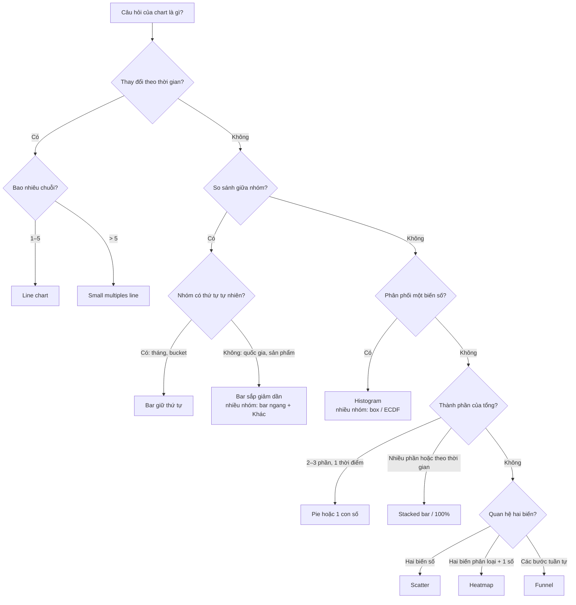
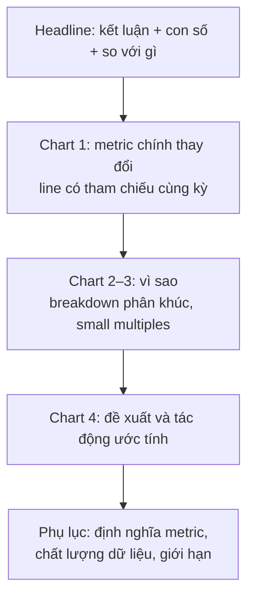

# Trực quan hoá & đọc biểu đồ

Với một Data Analyst, biểu đồ là sản phẩm chính: phần lớn kết quả phân tích đến tay người ra quyết
định dưới dạng một chart trong slide, một tile trên dashboard hoặc một ảnh dán vào Slack. Ở track
Data Science bạn đã dùng matplotlib/seaborn cho EDA, nơi người đọc chính là bạn. Module này đổi
người đọc: **CEO, PM, team marketing**, những người nhìn một chart trong năm giây rồi hành động. Vì
vậy trọng tâm không phải cú pháp vẽ mà là ba kỹ năng của DA senior: **chọn đúng chart cho câu
hỏi**, **vẽ sao cho không ai hiểu sai**, và **đọc chart của người khác** (kể cả chart của chính
mình tuần trước) một cách hoài nghi.

Module dùng hai bộ dữ liệu thật:

- **Bike Sharing (UCI)**: lượt thuê xe đạp Capital Bikeshare (Washington DC) 2011–2012, `day.csv`
  731 ngày, `hour.csv` 17 379 giờ, tổng 3 292 679 lượt, tách khách vãng lai (`casual`) và thành
  viên (`registered`), kèm thời tiết.
- **Online Retail II (UCI)**: giao dịch của một cửa hàng quà tặng online ở Anh; module chỉ đọc
  sheet `Year 2010-2011` (541 910 dòng, 2010-12-01 tới 2011-12-09). Hoá đơn bắt đầu bằng `C` là
  đơn huỷ.

```bash
uv run python data/download_dataset.py bike-sharing-uci
uv run python data/download_dataset.py online-retail-ii
```

Mọi đoạn code chạy từ thư mục gốc repo, lưu ảnh vào thư mục tạm của hệ điều hành (in đường dẫn ra
màn hình) để không làm bẩn git. Chạy không có màn hình thì đặt `MPLBACKEND=Agg`.

Sau module này bạn sẽ:

- Chọn chart theo **câu hỏi** (so sánh, xu hướng, phân phối, thành phần, quan hệ, luồng) cho đủ 8
  loại chart của roadmap: bar, line, scatter, funnel, histogram, stacked, heatmap, pie.
- Áp dụng pre-attentive attributes, data-ink, sắp xếp, nhãn trực tiếp và màu đúng loại palette.
- Nhận ra và tránh chart gây hiểu nhầm: trục cắt, dual axis, kỳ chưa đủ dữ liệu, tổng vs trung
  bình, Simpson's paradox.
- Đọc chart theo quy trình 5 bước, tách **quan sát** khỏi **kết luận**.
- Biến chart thành câu chuyện (headline là insight, small multiples, annotation) và chọn công cụ
  phù hợp: matplotlib, seaborn, plotly, Excel hay BI.

## 1. Nhắc lại nhanh

Bạn đã có ở track Data Science, module
[EDA & Data Storytelling](../../../data-science/modules/09-eda-storytelling/README.md):

- **matplotlib** là lớp nền: `Figure` chứa nhiều `Axes`; luôn dùng API hướng đối tượng
  (`fig, ax = plt.subplots()`, `ax.bar(...)`) thay vì `plt.bar(...)` để điều khiển được từng
  trục. **seaborn** đứng trên matplotlib, nhận DataFrame dạng long và tự gom nhóm, tô màu theo
  `hue`, vẽ small multiples bằng `col=`/`row=`.
- **EDA** là vẽ cho mình: nhanh, nhiều, xấu cũng được. **Explanatory chart** là vẽ cho người
  khác: ít, chọn lọc, có headline và chú thích. Module này gần như toàn bộ là loại thứ hai.
- Các bẫy đã gặp: trung bình bị đuôi dài kéo lệch, tỉ lệ thiếu mẫu số, Simpson's paradox trên tỉ
  lệ review xấu của Olist.

Phần dưới không lặp lại cú pháp; nó tập trung vào quyết định: chart nào, vì sao, và người xem sẽ
hiểu sai ở đâu.

## 2. Chart trả lời câu hỏi gì

### Bắt đầu từ câu hỏi, không từ loại chart

Một câu hỏi tốt cho chart viết được thành một câu có động từ so sánh: "Ngày nào trong tuần đông
khách nhất?", "Lượt thuê đang tăng hay giảm?", "Bao nhiêu % khách quay lại lần hai?". Nếu không
viết được câu đó, bạn chưa sẵn sàng chọn chart. Sáu loại câu hỏi bao phủ gần như mọi chart của DA:

| Loại câu hỏi | Ví dụ trên dữ liệu thật | Chart mặc định | Thay thế / lưu ý |
| --- | --- | --- | --- |
| So sánh (comparison) | Lượt thuê trung bình theo thứ trong tuần | **Bar chart** (trục từ 0) | Nhiều nhóm: bar ngang, sắp giảm dần; dot plot khi các giá trị gần nhau và không cần từ 0 |
| Xu hướng (trend) | Lượt thuê theo tháng 2011–2012 | **Line chart** | Ít điểm (≤ 6 kỳ) có thể dùng bar; > 5 chuỗi thì small multiples |
| Phân phối (distribution) | Lượt thuê mỗi giờ; giá trị mỗi hoá đơn | **Histogram** | So nhiều nhóm: box plot, ECDF; đuôi dài: trục log |
| Thành phần (composition) | Tỉ trọng `casual` / `registered` theo tháng | **Stacked bar** (tuyệt đối hoặc 100%) | **Pie** chỉ khi 2–3 phần và một thời điểm |
| Quan hệ (relationship) | Nhiệt độ và lượt thuê theo ngày | **Scatter plot** | Rất nhiều điểm: alpha, hexbin; hai chiều phân loại: **heatmap** |
| Luồng / chuyển đổi (flow) | Khách mua 1 → 2 → 3 → 5 → 10 lần | **Funnel chart** | Funnel thực chất là bar ngang có thứ tự; ghi rõ tỉ lệ so với bước trước và bước đầu |

**Heatmap** là chart cho ma trận hai chiều phân loại (giờ × thứ, cohort × tháng, category ×
vùng): mắt đọc màu kém chính xác hơn đọc độ dài, nên heatmap tốt để tìm **pattern** (giờ cao
điểm), không tốt để so hai ô cụ thể. Khi cần con số chính xác, in giá trị trong ô (`annot=True`)
hoặc dùng bar.



### Tám loại chart của roadmap trên Bike Sharing

Đoạn code dưới vẽ đủ tám loại trong một figure để bạn thấy mỗi chart trả lời câu hỏi nào. Bike
Sharing không có các bước tuần tự, nên panel funnel dùng funnel mua lặp lại thật trên Online Retail
II (khách có ít nhất 1, 2, 3, 5, 10 hoá đơn trong năm). Đoạn code đọc sheet `Year 2010-2011` một lần
(khoảng 20–60 giây vì là xlsx) và các đoạn sau dùng lại biến `sales`. Funnel không có sẵn trong
matplotlib: nó là bar ngang có thứ tự, đảo trục y để bước đầu nằm trên cùng.

```python
import os
import sys
import tempfile
from pathlib import Path

import matplotlib.pyplot as plt
import numpy as np
import pandas as pd
import seaborn as sns

ROOT = next(p for p in [Path.cwd(), *Path.cwd().parents] if (p / "pyproject.toml").exists())
sys.path.insert(0, str(ROOT))
from data.download_dataset import ensure  # noqa: E402

BIKE = ensure("bike-sharing-uci")
OUT = Path(tempfile.gettempdir()) / "da-m08"
OUT.mkdir(exist_ok=True)

day = pd.read_csv(BIKE / "day.csv", parse_dates=["dteday"])
hour = pd.read_csv(BIKE / "hour.csv", parse_dates=["dteday"])
WEEKDAY = ["CN", "T2", "T3", "T4", "T5", "T6", "T7"]  # weekday 0 = Chủ nhật

by_wd = day.groupby("weekday").cnt.mean()
monthly = day.set_index("dteday")[["casual", "registered", "cnt"]].resample("MS").sum()
heat = hour.pivot_table(index="weekday", columns="hr", values="cnt", aggfunc="mean")
heat.index = WEEKDAY

RETAIL = ensure("online-retail-ii")
raw = pd.read_excel(RETAIL / "online_retail_II.xlsx", sheet_name="Year 2010-2011")
raw["Invoice"] = raw["Invoice"].astype(str)
sales = raw[~raw.Invoice.str.startswith("C") & (raw.Quantity > 0) & (raw.Price > 0)].copy()  # bỏ đơn huỷ, dòng điều chỉnh
sales["revenue"] = sales.Quantity * sales.Price
cust = sales.dropna(subset=["Customer ID"]).groupby("Customer ID").Invoice.nunique()
funnel = pd.Series({f"≥ {k} đơn": int((cust >= k).sum()) for k in [1, 2, 3, 5, 10]})

fig, axes = plt.subplots(2, 4, figsize=(20, 9))
ax = axes.flat
ax[0].bar(WEEKDAY, by_wd.values, color="#9aa5b1")
ax[0].set_title("Bar: lượt thuê TB/ngày theo thứ")
ax[1].plot(monthly.index, monthly.cnt / 1000)
ax[1].set_title("Line: lượt thuê theo tháng (nghìn)")
ax[2].hist(hour.cnt, bins=40)
ax[2].set_title("Histogram: lượt thuê mỗi giờ")
ax[3].scatter(day.temp * 41, day.cnt, s=8, alpha=0.5)  # temp chuẩn hoá theo max 41°C
ax[3].set_title("Scatter: nhiệt độ (°C) vs lượt thuê/ngày")
ax[4].bar(monthly.index, monthly.registered / 1000, width=20, label="registered")
ax[4].bar(monthly.index, monthly.casual / 1000, width=20, bottom=monthly.registered / 1000, label="casual")
ax[4].legend(frameon=False)
ax[4].set_title("Stacked bar: thành phần theo tháng (nghìn)")
sns.heatmap(heat, ax=ax[5], cmap="viridis", cbar_kws={"label": "lượt/giờ"})
ax[5].set_title("Heatmap: giờ × thứ")
ax[6].pie([day.registered.sum(), day.casual.sum()], labels=["registered", "casual"], autopct="%.1f%%")
ax[6].set_title("Pie: chỉ 2 phần")
ax[7].barh(funnel.index, funnel.values, color="#4c78a8")
ax[7].invert_yaxis()
ax[7].set_title("Funnel: khách mua lặp lại (Online Retail II)")
fig.tight_layout()
fig.savefig(OUT / "eight_charts.png", dpi=80)
plt.close(fig)

print(f"{len(day)} ngày, {len(hour)} giờ, tổng {day.cnt.sum():,} lượt")
print("TB/ngày theo thứ:", dict(zip(WEEKDAY, by_wd.round(0).astype(int))))
print("tháng cao nhất:", monthly.cnt.idxmax().strftime("%Y-%m"), f"{monthly.cnt.max():,}")
print(f"casual chiếm {day.casual.sum() / day.cnt.sum():.1%} tổng lượt")
print("ô heatmap cao nhất:", heat.stack().idxmax(), round(heat.max().max()))
print("funnel khách:", funnel.to_dict())
print("ảnh:", OUT / "eight_charts.png")
```

Kết quả: tháng cao nhất 2012-09 (218 573 lượt); khách vãng lai chiếm 18.8%; ô đậm nhất heatmap là
**thứ Ba 17h** (544 lượt/giờ). Heatmap kể ngay một câu chuyện mà bar theo thứ không kể được: ngày
làm việc có hai đỉnh 8h và 17h (người đi làm), cuối tuần có một vòm buổi trưa (đi chơi). Bar theo
thứ chỉ cho thấy các ngày chênh nhau 11% (CN 4 229, T6 4 690), một khác biệt nhỏ che mất khác biệt
lớn về **hình dạng** trong ngày.

Bài học chọn chart: cùng một dữ liệu, chart trả lời câu hỏi khác nhau. Nếu câu hỏi là "nên bố trí
xe bù vào giờ nào", heatmap là đúng; nếu câu hỏi là "ngày nào nên bảo trì", bar theo thứ là đủ.

## 3. Nguyên tắc hiển thị

### Pre-attentive attributes: mắt thấy gì trước khi kịp nghĩ

Pre-attentive attributes là các thuộc tính thị giác não xử lý trong khoảng 250 ms, trước khi chú ý
có ý thức: vị trí, độ dài, màu (hue và độ đậm), kích thước, hình dạng, hướng, đóng khung. Hai hệ
quả thực dụng:

1. **Thứ tự độ chính xác** (Cleveland & McGill, 1984): vị trí trên trục chung > độ dài > góc/độ
   dốc > diện tích > độ đậm màu. Vì vậy bar và dot plot cho phép so chính xác, pie (góc) và bubble
   (diện tích) thì không, heatmap (màu) chỉ để thấy pattern.
2. **Dùng một thuộc tính để nhấn**: một bar màu cam giữa các bar xám được thấy ngay. Năm màu cùng
   nhấn thì không còn gì được nhấn.

### Data-ink và chartjunk

Edward Tufte định nghĩa data-ink ratio là phần mực dùng để thể hiện dữ liệu trên tổng mực in:

$$
\text{data-ink ratio} = \frac{\text{mực thể hiện dữ liệu}}{\text{tổng mực của chart}}
$$

Tăng tỉ lệ này bằng cách bỏ khung bốn cạnh, lưới đậm, nền xám, bóng đổ, hiệu ứng 3D, legend khi có
thể ghi nhãn trực tiếp. Đừng đẩy tới cực đoan: một lưới mờ giúp đọc giá trị, một đường tham chiếu
(target, trung bình kỳ trước) là mực "không phải dữ liệu" nhưng rất đáng giá.

### Sắp xếp, nhãn trực tiếp, chú thích

- **Sắp xếp**: category danh định (quốc gia, sản phẩm) sắp theo giá trị giảm dần; category có
  thứ tự (tháng, thứ, bucket tuổi, bước funnel) giữ thứ tự tự nhiên. Sắp thứ trong tuần theo giá
  trị là một lỗi hay gặp: người xem mất khả năng thấy "cuối tuần thấp hơn".
- **Nhãn trực tiếp** (direct labeling): ghi tên series ở cuối mỗi đường, ghi giá trị ở đầu bar
  quan trọng. Legend bắt mắt đi qua lại; với 4+ series người xem bỏ cuộc.
- **Trục**: ghi đơn vị (lượt/ngày, triệu GBP, %), định dạng số (4.2K, 1.5M), bỏ số thập phân
  không cần thiết. Tiêu đề trục thừa khi đơn vị đã nằm trong headline.
- **Chú thích** (annotation): sự kiện giải thích điểm bất thường ("Bão Sandy 29/10/2012", "Black
  Friday", "đổi định nghĩa active user"). Một annotation tiết kiệm năm phút giải thích trong họp.

### Màu: ba loại palette

| Loại palette | Khi nào | Ví dụ | Sai lầm hay gặp |
| --- | --- | --- | --- |
| Categorical (qualitative) | Phân biệt nhóm không có thứ tự | `tab10`, Okabe-Ito | > 7 màu: không ai nhớ màu nào là gì, gộp "Khác" |
| Sequential | Giá trị có thứ tự từ thấp đến cao | `viridis`, `Blues` | Dùng rainbow (`jet`): tạo ranh giới giả, không in đen trắng được |
| Diverging | Có điểm giữa có nghĩa (0, target, trung bình) | `RdBu`, `coolwarm` | Dùng cho dữ liệu không có điểm giữa; quên căn tâm (`center=0`) |

Thêm hai quy tắc: khoảng 8% nam giới mù màu đỏ–xanh lá, nên tránh cặp đỏ/xanh lá làm tín hiệu
duy nhất (thêm ký hiệu ▲▼ hoặc dùng cam/xanh dương); và **giữ màu nhất quán** giữa các chart trong
một dashboard: nếu "casual" màu cam ở chart đầu, nó phải cam ở mọi chart.

### Một chart áp dụng đủ nguyên tắc

```python
wd_order = by_wd.reindex([1, 2, 3, 4, 5, 6, 0])  # T2 → CN: thứ tự tự nhiên, không sắp theo giá trị
labels = [WEEKDAY[i] for i in wd_order.index]
colors = ["#f58518" if v == wd_order.max() else "#c9ced6" for v in wd_order.values]

fig, ax = plt.subplots(figsize=(7, 4))
bars = ax.bar(labels, wd_order.values, color=colors)
ax.bar_label(bars, labels=[f"{v / 1000:.1f}K" for v in wd_order.values], padding=3, fontsize=9)
ax.set_ylim(0, wd_order.max() * 1.15)  # bar: trục luôn từ 0
ax.spines[["top", "right", "left"]].set_visible(False)
ax.set_yticks([])  # đã có nhãn trực tiếp, bỏ trục y
ax.set_title("Thứ Sáu đông nhất, nhưng các ngày chỉ chênh nhau 11%", loc="left", fontsize=12)
fig.text(0.01, 0.01, "Lượt thuê trung bình mỗi ngày, Capital Bikeshare 2011–2012", fontsize=8, color="gray")
fig.tight_layout()
fig.savefig(OUT / "weekday_clean.png", dpi=100)
plt.close(fig)
print(f"chênh max/min: {wd_order.max() / wd_order.min() - 1:.1%}")
```

Chú ý headline: nó nói **kết luận** (và cả giới hạn của kết luận, "chỉ chênh 11%"), không nói "Lượt
thuê theo thứ". Một bar màu nhấn, phần còn lại xám; không legend, không trục y vì giá trị đã ghi
trên đầu bar.

## 4. Chart gây hiểu nhầm

Phần lớn chart gây hiểu nhầm không do cố ý mà do mặc định của công cụ và áp lực thời gian. DA
senior được trả tiền một phần để bắt những lỗi này, ở chart của mình và của người khác.

| Lỗi | Vì sao sai | Cách sửa |
| --- | --- | --- |
| **Trục y bị cắt** trên bar chart | Bar mã hoá bằng độ dài; cắt trục làm độ dài không còn tỉ lệ với giá trị | Bar luôn từ 0. Muốn phóng to khác biệt nhỏ: dot plot, hoặc vẽ **chênh lệch** (Δ, %) |
| **Dual axis** | Hai thang đo tự chọn nên ai vẽ cũng "chứng minh" được hai chuỗi đi cùng nhau; điểm cắt nhau vô nghĩa | Hai chart xếp chồng chung trục x; hoặc chỉ số hoá cả hai về 100 tại kỳ gốc |
| **Pie nhiều lát** | Mắt so góc kém; > 3 lát không xếp hạng được, lát nhỏ không đọc được | Bar ngang sắp giảm dần, gộp "Khác" |
| **3D** | Phối cảnh làm phần gần to hơn phần xa; che giá trị | Không bao giờ dùng cho dữ liệu |
| **Diện tích sai tỉ lệ** | Icon/bubble phóng theo chiều cao thì diện tích tăng theo bình phương | Bubble: bán kính tỉ lệ với căn bậc hai giá trị (`s=` trong matplotlib đã là diện tích) |
| **Chọn khoảng thời gian** | Cắt chuỗi từ đáy tạo "tăng trưởng", từ đỉnh tạo "khủng hoảng"; mùa vụ bị nhầm thành xu hướng | Hiện đủ ít nhất một chu kỳ mùa vụ; so cùng kỳ (YoY) |
| **Kỳ chưa đủ dữ liệu** | Tháng hiện tại mới có 9 ngày được vẽ cạnh tháng đủ 30 ngày | Bỏ kỳ dở dang, đánh dấu nét đứt, hoặc so cùng số ngày |
| **Tổng vs trung bình** | Nhóm có nhiều quan sát luôn thắng ở "tổng", dù hiệu suất mỗi quan sát kém hơn | Hỏi câu hỏi là quy mô hay hiệu suất; hiện cả n |
| **Simpson's paradox** | Xu hướng trong từng nhóm ngược với xu hướng gộp do khác cơ cấu (mix) | Phân tầng theo biến gây nhiễu; báo cáo cả gộp và từng nhóm |

### Lie factor: đo mức phóng đại

Tufte đo độ "nói dối" của một chart bằng tỉ số giữa độ lớn hiệu ứng trên hình và trong dữ liệu:

$$
\text{lie factor} = \frac{\text{độ lớn hiệu ứng thể hiện trên hình}}{\text{độ lớn hiệu ứng trong dữ liệu}}
$$

Lie factor gần 1 là trung thực; Tufte coi ngoài khoảng 0.95–1.05 là có vấn đề. Đoạn code dưới tính
lie factor của bar chart theo thứ khi trục y bắt đầu ở 4 200 thay vì 0, rồi kiểm ba cái bẫy khác
trên Bike Sharing.

```python
lo, hi = by_wd.min(), by_wd.max()
for y0 in [0, 4000, 4200]:
    shown = (hi - y0) / (lo - y0)  # tỉ lệ chiều cao bar trên hình
    print(f"trục từ {y0:>4}: bar cao nhất trông gấp {shown:5.2f} lần, thật ra gấp {hi / lo:.3f} "
          f"→ lie factor {(shown - 1) / (hi / lo - 1):5.1f}")

# Tổng vs trung bình: thời tiết đẹp "đóng góp" nhiều nhất vì có nhiều giờ nhất
w = hour.groupby("weathersit").cnt.agg(tong="sum", tb_moi_gio="mean", so_gio="size")
w["ti_trong_tong"] = w.tong / w.tong.sum()
print(w.round(3))

# Tổng gộp che hai xu hướng ngược nhau: ngày làm việc vs ngày nghỉ
mix = day.groupby("workingday")[["casual", "registered", "cnt"]].mean()
print(mix.round(0))
print("đổi khi sang ngày làm việc:", (mix.loc[1] / mix.loc[0] - 1).map("{:+.1%}".format).to_dict())

# Xu hướng gộp khác xu hướng trong nhóm: nhiệt độ vs lượt thuê
print(f"tương quan nhiệt độ–lượt thuê, gộp 2 năm: {day.temp.corr(day.cnt):.2f}")
print(day.groupby(["yr", "season"]).apply(lambda g: g.temp.corr(g.cnt), include_groups=False)
      .unstack().rename(index={0: 2011, 1: 2012}).round(2))
```

Đọc kết quả:

- **Trục cắt**: thật ra T6 chỉ hơn CN 11%; trục từ 4 200 làm bar T6 cao gấp **~17 lần** bar CN,
  lie factor khoảng 150. Đây là lý do "bar luôn từ 0" là quy tắc không có ngoại lệ, còn line chart
  thì được phép không từ 0 (line mã hoá bằng vị trí và độ dốc, không bằng độ dài).
- **Tổng vs trung bình**: trời quang (`weathersit = 1`) chiếm 71% tổng lượt thuê, đơn giản vì 11 413
  trong 17 379 giờ là trời quang. Câu hỏi "thời tiết ảnh hưởng bao nhiêu" phải dùng trung bình mỗi
  giờ: 205 lượt khi trời quang, 112 khi mưa/tuyết nhẹ. Báo cáo "phần lớn doanh thu đến từ ngày
  đẹp trời" là đúng nhưng vô dụng.
- **Gộp che hai xu hướng ngược**: ngày làm việc có tổng lượt/ngày **cao hơn 5.9%**, nhưng khách vãng
  lai **giảm 56%** và thành viên **tăng 34%**. Một chart "tổng theo loại ngày" sẽ kết luận "loại ngày
  không quan trọng", trong khi với team marketing khách vãng lai, đó là khác biệt lớn nhất.
- **Xu hướng trong nhóm khác xu hướng gộp**: gộp hai năm, nhiệt độ tương quan +0.63 với lượt thuê.
  Nhưng trong mùa 3 (21/6–22/9) tương quan gần 0, riêng 2012 là **−0.33**: khi đã nóng, nóng thêm làm
  *giảm* lượt thuê. Đây là hiện tượng tương tự Simpson (confounding): mùa là biến gây nhiễu, đường hồi quy gộp đi lên vì nó chủ
  yếu so mùa đông với mùa hè, không nói gì về "hôm nay nóng hơn hôm qua". Đề xuất "dự báo lượt
  thuê tăng khi nhiệt độ tăng" sẽ sai đúng vào mùa cao điểm.

Ví dụ Simpson's paradox kinh điển với đảo chiều hoàn toàn trên tỉ lệ (review xấu Olist theo bang
và tình trạng giao trễ) đã có ở module EDA của track Data Science. Cách phòng giống nhau: trước khi
kết luận từ một con số gộp, hỏi "cơ cấu (mix) của các nhóm có khác nhau giữa hai bên đang so không?".

### Dual axis: khi nào chấp nhận được

Dual axis gần như luôn có cách thay tốt hơn. Hai trường hợp chấp nhận được: (1) hai trục là **cùng
một đại lượng ở hai đơn vị** (°C và °F, VND và USD theo tỉ giá cố định), nên không có lựa chọn tuỳ
ý về thang; (2) cột là khối lượng, đường là tỉ lệ (số đơn và tỉ lệ chuyển đổi) cho người đọc nội
bộ đã quen dạng chart, với trục trái từ 0 và màu trục khớp màu series. Ngay cả trường hợp (2), hai
panel xếp chồng chung trục x thường dễ đọc hơn.

## 5. Đọc chart như một DA

### Quy trình 5 bước

Người đọc vội nhìn hình dạng rồi kết luận. DA đọc theo thứ tự cố định, vì phần lớn hiểu nhầm đến
từ bước 1 bị bỏ qua.


Câu hỏi kiểm ở mỗi bước:

1. **Trục và đơn vị**: trục y từ 0 không? Log hay tuyến tính? Số là tổng, trung bình, trung vị
   hay tỉ lệ, và mẫu số là gì? Khoảng thời gian nào, kỳ cuối đã đủ chưa? Có bộ lọc nào ẩn (chỉ khách
   có tài khoản, đã loại đơn huỷ)?
2. **Hình dạng tổng**: đi lên, đi xuống, phẳng, chu kỳ? Phân phối lệch hay đối xứng, một đỉnh hay
   hai đỉnh?
3. **Điểm bất thường**: điểm nào lệch hẳn? Lệch thật hay do dữ liệu (ngày lỗi pipeline, kỳ dở dang,
   đổi định nghĩa)?
4. **So với tham chiếu**: "giảm" so với cái gì? Tháng trước có mùa vụ khác; cùng kỳ năm trước thường
   là so sánh công bằng hơn.
5. **Câu hỏi tiếp theo**: chart hiếm khi trả lời "vì sao"; nó cho bạn biết cần breakdown theo chiều
   nào tiếp.

### Quan sát khác kết luận

Viết ra tách bạch hai cột trước khi nói trong họp:

| Quan sát (chart cho thấy) | Kết luận (cần thêm bằng chứng) |
| --- | --- |
| Lượt thuê tháng 12/2012 thấp hơn tháng 9/2012 43% | "Nhu cầu đang sụt giảm" (sai: mùa đông năm nào cũng giảm; tháng 12/2012 vẫn cao hơn 12/2011 42%) |
| Ngày 29/10/2012 chỉ có 22 lượt | "Hệ thống lỗi" hay "bão Sandy" (kiểm: `weathersit = 3`, trùng ngày bão đổ bộ) |
| Ngày nóng có nhiều lượt thuê hơn ngày lạnh | "Nóng hơn thì thuê nhiều hơn" (sai trong mùa hè, xem phần 4) |

### Ca thực tế: "doanh thu tháng này giảm 58%"

Online Retail II kết thúc ngày 2011-12-09. Vẽ doanh thu theo tháng một cách ngây thơ, tháng 12/2011
là cú rơi thẳng đứng. Đoạn code dưới dùng lại `raw` và `sales` đã đọc ở phần 2, vẽ lại đúng cách và
so sánh công bằng.

```python
print(f"{len(raw):,} dòng, {raw.InvoiceDate.min():%Y-%m-%d} → {raw.InvoiceDate.max():%Y-%m-%d}")

rev_m = sales.set_index("InvoiceDate").revenue.resample("MS").sum()
print(f"MoM tháng cuối (ngây thơ): {rev_m.iloc[-1] / rev_m.iloc[-2] - 1:+.1%}")

# So sánh công bằng: cùng ngày 1–9 của tháng
def window(start: str, end: str) -> float:
    return sales[(sales.InvoiceDate >= start) & (sales.InvoiceDate < end)].revenue.sum()

dec11, dec10, nov11 = window("2011-12-01", "2011-12-10"), window("2010-12-01", "2010-12-10"), window("2011-11-01", "2011-11-10")
print(f"1–9/12/2011 so với 1–9/12/2010: {dec11 / dec10 - 1:+.1%}; so với 1–9/11/2011: {dec11 / nov11 - 1:+.1%}")

# Vẽ: kỳ dở dang tách riêng, nét đứt và có chú thích
fig, ax = plt.subplots(figsize=(8, 4))
full, partial = rev_m.iloc[:-1], rev_m.iloc[-2:]
ax.plot(full.index, full / 1e6, marker="o", color="#4c78a8")
ax.plot(partial.index, partial / 1e6, ls="--", marker="o", color="#9aa5b1")
ax.annotate("Tháng 12: mới có dữ liệu tới 9/12", xy=(partial.index[-1], partial.iloc[-1] / 1e6),
            xytext=(-170, 25), textcoords="offset points", arrowprops={"arrowstyle": "->"}, fontsize=9)
ax.set_ylim(0, None)
ax.set_ylabel("triệu GBP")
ax.spines[["top", "right"]].set_visible(False)
ax.set_title("Tháng 12 chưa kết thúc: 9 ngày đầu cao hơn cùng kỳ năm trước", loc="left", fontsize=11)
fig.tight_layout()
fig.savefig(OUT / "retail_partial_month.png", dpi=100)
plt.close(fig)

# Mean vs median: một vài hoá đơn sỉ kéo trung bình
inv = sales.groupby("Invoice").revenue.sum()
print(f"giá trị hoá đơn: mean {inv.mean():.0f}, median {inv.median():.0f}, max {inv.max():,.0f}, skew {inv.skew():.0f}")
```

Kết quả: MoM ngây thơ **−57.7%**; nhưng 9 ngày đầu tháng 12/2011 đạt 638 811 GBP, **cao hơn 45.6%**
cùng 9 ngày năm 2010 và cao hơn 9 ngày đầu tháng 11/2011 (454 238 GBP). Hướng đúng là "tháng 12 đang
chạy tốt hơn năm ngoái", ngược hẳn câu chuyện của chart ngây thơ. Nhưng **chưa nên báo con số 45.6%**:
đây là doanh thu gộp, và hoá đơn lớn nhất của bộ dữ liệu (168 470 GBP, in ở dòng dưới) nằm trong 9 ngày
này, một mình chiếm phần lớn mức chênh. Trước khi báo con số, kiểm outlier và kiểm hoá đơn đó có bị huỷ
ngay sau đó không; làm vậy thì mức tăng thực nhỏ hơn nhiều. Bài Advanced 01 đào tiếp chuyện này.

Cùng dữ liệu, giá trị hoá đơn có mean 534 GBP nhưng median 304 GBP, max 168 470 GBP: một bar "giá trị
hoá đơn trung bình theo quốc gia" sẽ bị vài đơn sỉ quyết định. Với phân phối đuôi dài, vẽ histogram
trên trục log, báo median (kèm p25–p75), hoặc tách nhóm khách sỉ ra riêng.

## 6. Từ chart tới câu chuyện

### Headline là insight

Tiêu đề chart là câu người đọc nhớ nếu họ chỉ đọc một dòng. So sánh:

| Tiêu đề mô tả (yếu) | Tiêu đề insight (mạnh) |
| --- | --- |
| Lượt thuê theo giờ | Ngày làm việc có hai đỉnh đi làm 8h và 17h; cuối tuần đông buổi trưa |
| Doanh thu theo tháng | Tháng 12 chưa kết thúc: 9 ngày đầu cao hơn cùng kỳ năm trước |
| Funnel khách hàng | 1/3 khách không quay lại lần 2: bước mất nhiều khách nhất về số tuyệt đối |

Headline insight có ba phần: **cái gì** (metric), **bao nhiêu** (con số), **so với gì** (tham
chiếu). Phụ đề nhỏ phía dưới ghi phạm vi dữ liệu, bộ lọc, nguồn. Nếu không viết được headline insight,
có thể chart đó chưa nên có trong slide.

### Small multiples

Edward Tufte gọi small multiples là "một loạt chart nhỏ cùng thang đo, khác một chiều". Khi một
chart có quá nhiều đường (spaghetti chart), tách mỗi nhóm thành một panel chung trục giúp mắt so
**hình dạng**. Quy tắc: chung trục y (`sharey=True`) nếu muốn so độ lớn; riêng trục y nếu chỉ so
hình dạng, và nói rõ điều đó.

```python
prof = (hour.assign(loai_ngay=hour.workingday.map({1: "Ngày làm việc", 0: "Cuối tuần/lễ"}))
        .melt(id_vars=["hr", "loai_ngay"], value_vars=["casual", "registered"], var_name="khach", value_name="luot"))
g = sns.relplot(data=prof, x="hr", y="luot", col="khach", hue="loai_ngay", kind="line",
                errorbar=None, height=3.2, aspect=1.4, palette={"Ngày làm việc": "#4c78a8", "Cuối tuần/lễ": "#f58518"})
g.set_axis_labels("Giờ trong ngày", "Lượt thuê TB/giờ")
g.figure.suptitle("Thành viên đi làm theo giờ cao điểm; khách vãng lai đi chơi buổi trưa cuối tuần", x=0.02, ha="left", y=1.04)
g.savefig(OUT / "small_multiples.png", dpi=90)
plt.close(g.figure)

peak = hour.groupby(["workingday", "hr"])[["casual", "registered"]].mean().round(0)
print(peak.loc[[(1, 8), (1, 17), (0, 13)]])
```

Hai panel chung trục y cho thấy ngay: thành viên ngày làm việc lên khoảng 455 lượt/giờ lúc 8h và 468 lúc 17h, còn
khách vãng lai ngày làm việc gần như phẳng. Cùng dữ liệu vẽ thành một chart 4 đường với legend thì
người đọc phải tự làm việc đó.

### Annotation và thứ tự chart

- **Annotation** giải thích điểm bất thường ngay tại chỗ (bão, khuyến mãi, sự cố tracking) và đánh
  dấu kỳ dở dang. Đặt chữ gần dữ liệu, màu xám đậm, không viết hoa toàn bộ.
- **Thứ tự trong slide** theo kim tự tháp: chart kết luận trước (metric chính đã thay đổi bao nhiêu),
  rồi chart "vì sao" (breakdown theo phân khúc), cuối cùng là chart "làm gì" (ước tác động của đề
  xuất). Chart phụ lục (kiểm chất lượng dữ liệu, độ nhạy) để cuối.
- **Thứ tự trên dashboard** theo cách mắt quét (chữ F/Z): KPI tile hàng trên cùng, trend ngay dưới,
  breakdown và bảng chi tiết ở dưới cùng. Bộ lọc toàn cục ở trên hoặc trái, áp dụng cho mọi tile.



### Funnel cho PM: tỉ lệ so với bước trước, không chỉ so với bước đầu

```python
# cust, funnel đã tính ở phần 2
table = pd.DataFrame({"khach": funnel, "so_voi_dau": funnel / funnel.iloc[0],
                      "so_voi_buoc_truoc": funnel / funnel.shift(1)})
print(table.round(3))

fig, ax = plt.subplots(figsize=(7, 3.5))
bars = ax.barh(funnel.index, funnel.values, color="#4c78a8")
ax.invert_yaxis()
ax.bar_label(bars, labels=[f"{n:,}  ({p:.0%})" for n, p in zip(funnel, table.so_voi_dau)], padding=3)
ax.set_xlim(0, funnel.max() * 1.3)
ax.spines[["top", "right", "bottom"]].set_visible(False)
ax.set_xticks([])
ax.set_title("1 493 khách (34%) không quay lại lần 2: bước mất nhiều khách nhất", loc="left")
fig.tight_layout()
fig.savefig(OUT / "repeat_funnel.png", dpi=100)
plt.close(fig)
```

4 338 khách có mã trong năm: 65.6% mua từ 2 đơn, 46.3% từ 3 đơn, 25.7% từ 5 đơn, 9.0% từ 10 đơn.
Một funnel chỉ ghi số tuyệt đối buộc PM tự chia, nên ghi cả hai loại tỉ lệ, và phân biệt hai cách
nói "bước rơi lớn nhất":

- **Rơi tuyệt đối** (số khách mất ở mỗi bước): 1 493 → 835 → 896 → 723. Bước 1 → 2 mất nhiều khách
  nhất, nên cải thiện ở đây tác động lên nhiều người nhất.
- **Rơi tương đối** (tỉ lệ so với bước trước: 66% → 71% → 55% → 35%, tức mất 34%, 29%, 45%, 65%):
  bước ≥ 5 → ≥ 10 rơi mạnh nhất. Nhưng bước này gộp năm lần mua, còn bước 1 → 2 chỉ một lần, nên so
  tỉ lệ giữa các bước có độ dài khác nhau là so khập khiễng; funnel tốt có các bước cùng "độ dài".

Headline phải nói rõ đang dùng nghĩa nào: "bước mất nhiều khách nhất" khác "bước có tỉ lệ chuyển đổi
thấp nhất". Lưu ý giới hạn: đây là
funnel **tích luỹ trong một năm** chứ không phải funnel theo cohort, nên khách mới vào cuối năm
chưa có thời gian để quay lại; trình bày cho PM phải ghi rõ điều này.

## 7. Chọn công cụ vẽ

| Công cụ | Dùng khi | Loại công ty hay dùng | Mạnh | Yếu |
| --- | --- | --- | --- | --- |
| **matplotlib** | Chart tĩnh cho báo cáo, cần kiểm soát từng pixel, chạy trong pipeline/cron | Công ty có data team mạnh về Python, báo cáo tự động từ pipeline | Linh hoạt tuyệt đối, xuất PNG/SVG/PDF, không phụ thuộc trình duyệt | Verbose; mặc định xấu; không tương tác |
| **seaborn** | EDA nhanh trên DataFrame, chart thống kê (phân phối, small multiples, heatmap) | Data team Python (DS/DA), chủ yếu cho phân tích nội bộ | Một dòng cho groupby + hue + facet, palette tốt sẵn | Khó tuỳ biến sâu (phải xuống matplotlib), ít loại chart business (funnel, waterfall) |
| **plotly** | Chart tương tác trong notebook, HTML gửi đi, prototype dashboard (Dash, Streamlit) | Startup/tech company có DA/DS viết Python, cần app dữ liệu nhanh (Streamlit/Dash) | Hover, zoom, có funnel/sunburst/map sẵn, xuất HTML một tệp | HTML nặng; xuất ảnh tĩnh cần thêm `kaleido`; kiểm soát bố cục kém matplotlib |
| **Excel / Google Sheets** | Người nhận cần sửa số, phân tích một lần, dữ liệu < vài trăm nghìn dòng | Mọi công ty, đặc biệt SME và bộ phận tài chính, kinh doanh; Google Sheets ở công ty dùng Google Workspace | Ai cũng mở được, nhanh với pivot chart | Không tái lập được, dễ sai do copy-paste, giới hạn dòng |
| **Metabase / Superset** | BI tự host, SQL-first, nhiều người cần tự xem số | Startup/SME, công ty tech có data team tự vận hành hạ tầng, muốn tránh chi phí license | Miễn phí/mã nguồn mở, kết nối thẳng warehouse, phân quyền | Ít tuỳ biến chart, semantic layer hạn chế (Metabase) |
| **Power BI** | Doanh nghiệp dùng Microsoft 365, cần mô hình dữ liệu và DAX | Enterprise dùng Microsoft 365/Azure: ngân hàng, bán lẻ, sản xuất, công ty đa quốc gia | Data model mạnh, rẻ khi đã có license M365, row-level security | DAX khó; chạy tốt nhất trên Windows; khoá vào hệ Microsoft |
| **Tableau** | Phân tích trực quan khám phá, dashboard đẹp cho lãnh đạo | Enterprise lớn có ngân sách BI, công ty đã dùng Salesforce | Kéo thả nhanh, chart đẹp, cộng đồng lớn | License đắt; logic tính toán phân tán trong workbook khó review |
| **Looker Studio / Looker** | Dữ liệu đã nằm trên BigQuery, cần dashboard chia sẻ nhanh (Looker Studio) hoặc semantic layer LookML (Looker) | Công ty dùng Google Cloud/Google Workspace | Looker Studio miễn phí, kết nối BigQuery/Sheets sẵn; Looker có semantic layer mạnh | Looker Studio chậm với dữ liệu lớn, ít tính năng mô hình hoá; Looker đắt, phải học LookML |

Quy tắc quyết định thực dụng:

- **Ai xem và xem bao nhiêu lần?** Một lần, trong slide → matplotlib/seaborn (hoặc Excel). Hằng tuần
  bởi nhiều người → BI, để không phải vẽ lại tay mỗi tuần.
- **Người xem cần tự cắt lát không?** Có → BI hoặc plotly/Streamlit. Không → ảnh tĩnh, vì tương tác
  làm người xem tự tìm ra kết luận sai.
- **Số trên chart có phải khớp với số "chính thức" không?** Có → định nghĩa metric phải nằm ở một chỗ
  (SQL view, dbt model, semantic layer), BI đọc từ đó; đừng tính lại trong mỗi workbook.
- **Tái lập được không?** Chart trong slide cho quyết định lớn nên sinh từ code (notebook/script
  trong git), để ba tháng sau có người hỏi "con số này tính thế nào" bạn trả lời được.

ggplot2 (R) theo cùng triết lý "grammar of graphics" với seaborn objects và plotnine (Python):
khai báo dữ liệu, ánh xạ cột vào thuộc tính thị giác (`aes`), rồi thêm lớp hình (`geom_*`). Học một
cái thì đọc được cái kia. Plotly vẽ funnel chỉ với một lệnh:

```python
import plotly.graph_objects as go

pfig = go.Figure(go.Funnel(y=list(funnel.index), x=list(funnel.values), textinfo="value+percent initial+percent previous"))
pfig.update_layout(title="Funnel quay lại mua (Online Retail II, 12/2010–12/2011)")
pfig.write_html(OUT / "repeat_funnel.html", include_plotlyjs="cdn")
print("đã ghi", OUT / "repeat_funnel.html", "| ảnh trong", OUT, ":", sorted(p.name for p in OUT.iterdir()))
```

## 8. Tài liệu tham khảo

Roadmap gốc (mục Data Visualisation: Tools, Libraries, Charting; bản PDF ở `roadmap/data-analyst.pdf`):

- [roadmap.sh: Data Analyst](https://roadmap.sh/data-analyst)
- [Tableau](https://www.tableau.com/learn/training), [Power BI](https://learn.microsoft.com/en-us/power-bi/fundamentals/),
  [Metabase](https://www.metabase.com/learn/), [Apache Superset](https://superset.apache.org/docs/intro)
- [matplotlib](https://matplotlib.org/stable/users/index.html), [seaborn tutorial](https://seaborn.pydata.org/tutorial.html),
  [ggplot2](https://ggplot2.tidyverse.org/), [plotly Python](https://plotly.com/python/)

Sách:

- Cole Nussbaumer Knaflic. *Storytelling with Data* (Wiley, 2015) và
  [storytellingwithdata.com](https://www.storytellingwithdata.com/). Bỏ chartjunk, headline, chú ý có chủ đích.
- Claus O. Wilke. [Fundamentals of Data Visualization](https://clauswilke.com/dataviz/) (O'Reilly, 2019,
  đọc miễn phí). Chọn chart, màu, tỉ lệ diện tích, các lỗi hay gặp.
- Edward Tufte. *The Visual Display of Quantitative Information* (1983). Data-ink, lie factor, small multiples.
- Alberto Cairo. *How Charts Lie* (W. W. Norton, 2019). Đọc chart hoài nghi.

Bài báo và tài nguyên:

- William Cleveland & Robert McGill. [Graphical Perception](https://www.jstor.org/stable/2288400)
  (JASA, 1984). Thứ hạng độ chính xác của các kênh thị giác.
- [Financial Times Visual Vocabulary](https://github.com/Financial-Times/chart-doctor/tree/main/visual-vocabulary):
  chọn chart theo loại quan hệ.
- [Data to Viz](https://www.data-to-viz.com/): cây quyết định chọn chart và danh sách lỗi hay gặp.
- [ColorBrewer](https://colorbrewer2.org/): palette categorical/sequential/diverging an toàn cho người mù màu.

Dữ liệu:

- Fanaee-T & Gama. [Bike Sharing Dataset (UCI)](https://archive.ics.uci.edu/dataset/275/bike+sharing+dataset), CC BY 4.0.
- Daqing Chen. [Online Retail II (UCI)](https://archive.ics.uci.edu/dataset/502/online+retail+ii), CC BY 4.0.
