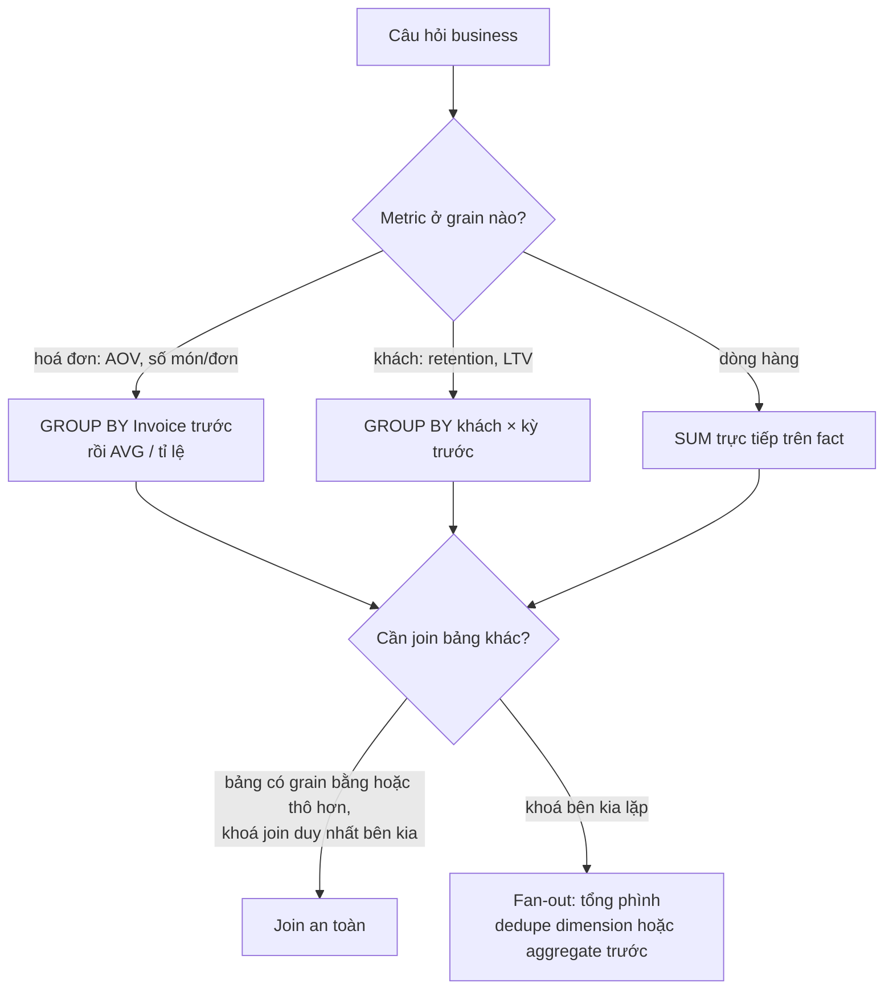
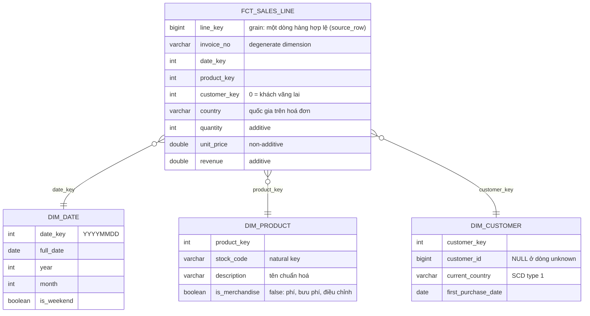
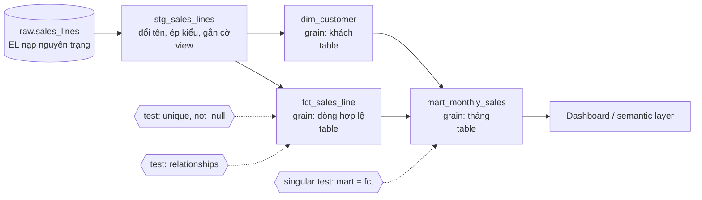

# Data modeling cho analytics

Data Engineer dựng bảng; Data Analyst là người **dùng** bảng mỗi ngày và là người đầu tiên bị hỏi khi
hai dashboard ra hai con số. Vì vậy DA senior cần đọc được (và nhiều khi tự viết) lớp model nằm giữa
dữ liệu thô và dashboard: bảng nào ở **grain** nào, measure nào cộng được, dimension nào có thể nhân bản
dòng khi join, metric "doanh thu" được định nghĩa ở đâu và ai chịu trách nhiệm. Module này không dạy
lại lý thuyết chuẩn hoá hay index (đã có ở track Data Engineer); nó dạy những quyết định modeling ảnh
hưởng trực tiếp tới con số mà stakeholder nhìn thấy.

Module dùng **Online Retail II (UCI, CC BY 4.0)**, sheet `Year 2010-2011`: 541 910 dòng giao dịch của
một cửa hàng quà tặng online ở Anh, 01/12/2010 tới 09/12/2011. Bộ **Grocery Sales** (sinh giả, giấy phép
không rõ) chỉ dùng như một schema quan hệ 7 bảng để luyện thiết kế; module 06 đã chứng minh bộ này là dữ
liệu sinh giả, nên không rút insight nào từ nó.

```bash
uv run python data/download_dataset.py online-retail-ii
```

Mọi đoạn code chạy từ thư mục gốc repo. Đoạn đầu đọc xlsx một lần (30–60 giây) rồi lưu bản parquet vào
thư mục tạm của hệ điều hành; các đoạn sau dùng lại biến `raw` và `lines`.

Sau module này bạn sẽ:

- Viết được câu khai báo **grain** cho mọi bảng và kiểm nó bằng truy vấn, nhận ra fan-out khi join hai
  bảng khác grain.
- Thiết kế **star schema** cho dữ liệu bán lẻ thật: fact, dimension, degenerate dimension, unknown member,
  chọn SCD theo câu hỏi business.
- Dựng project **dbt** nhỏ (staging → mart) chạy bằng `dbt-duckdb`, gắn **data quality test** và mô tả cột.
- Viết **định nghĩa metric** (metric layer / semantic layer) để hai báo cáo luôn ra cùng một con số.
- Chọn chỗ đặt logic: SQL view, dbt, semantic layer của BI tool hay spreadsheet.

## 1. Nhắc lại nhanh

Bạn đã có ở track Data Engineer:

- [Data modeling](../../../data-engineer/modules/02-data-modeling/README.md): OLTP và OLAP,
  normalization (1NF–3NF), bốn bước Kimball (chọn quy trình nghiệp vụ → **khai báo grain** → chọn dimension →
  chọn fact), star và snowflake, surrogate key, các loại fact table (transaction, periodic snapshot,
  accumulating snapshot) và **Slowly Changing Dimension**:
  - **SCD type 1**: ghi đè giá trị cũ, không giữ lịch sử (sửa lỗi chính tả, "quốc gia hiện tại").
  - **SCD type 2**: đóng phiên bản cũ (`valid_to`), mở phiên bản mới (`valid_from`, `is_current`); fact trỏ
    tới phiên bản đúng tại thời điểm giao dịch.
  - **SCD type 3**: thêm cột `previous_value`, chỉ giữ một bước lịch sử.
- [Batch pipelines, mục dbt](../../../data-engineer/modules/05-batch-pipelines/README.md): `source()`,
  `ref()`, materialization (`view`, `table`, `incremental`), `dbt build`, snapshot cho SCD2.
- [Serving & BI, mục semantic layer](../../../data-engineer/modules/09-serving-bi/README.md): entity,
  dimension, measure, metric; additive, semi-additive, non-additive; bẫy trung bình của trung bình.

Phần dưới không lặp lại cú pháp hay lý thuyết đó; nó nhìn từ phía người dùng bảng: grain sai thì số sai thế
nào, dimension bẩn thì dashboard lệch bao nhiêu, và DA viết gì để chặn lỗi trước khi stakeholder thấy.

## 2. Grain: câu quyết định mọi con số

**Grain** là câu trả lời cho "một dòng của bảng này là gì?". Viết nó thành một câu, có danh từ cụ thể:
"một dòng = một mặt hàng trên một hoá đơn bán hợp lệ". Mọi phép `SUM`, `COUNT`, `AVG` và mọi phép join đều
đúng hay sai theo câu đó. Ba lỗi hay gặp nhất của DA đều là lỗi grain:

| Lỗi | Triệu chứng | Ví dụ trên Online Retail II |
| --- | --- | --- |
| Tưởng một cặp cột là khoá | Dedupe theo cặp đó làm mất dòng thật | `(Invoice, StockCode)` lặp ở 9 566 cặp: cùng mặt hàng ghi nhiều dòng trên một hoá đơn |
| Lấy trung bình sai grain | "AOV" là trung bình dòng, không phải trung bình đơn | Trung bình doanh thu mỗi **dòng** 20.12 GBP, AOV thật (doanh thu / số hoá đơn) 534.40 GBP |
| Join hai bảng khác grain rồi cộng | Tổng phình to | Gắn tổng hoá đơn (grain hoá đơn) vào từng dòng rồi `SUM`: 728 triệu thay vì 10.67 triệu GBP, gấp 68 lần |

### Khai báo grain, rồi kiểm nó

Khai báo grain là một **giả thuyết**; kiểm nó bằng một truy vấn đếm khoá. Đoạn dưới đọc dữ liệu (một lần,
lưu cache parquet), lọc dòng hợp lệ theo định nghĩa chung của track (bỏ hoá đơn `C...`, bỏ `Quantity <= 0`
hoặc `Price <= 0`) và kiểm ba ứng viên khoá.

```python
import os
import sys
import tempfile
import uuid
from pathlib import Path

import duckdb
import pandas as pd

ROOT = next(p for p in [Path.cwd(), *Path.cwd().parents] if (p / "pyproject.toml").exists())
sys.path.insert(0, str(ROOT))
from data.download_dataset import ensure  # noqa: E402


def load_sheet(sheet: str = "Year 2010-2011") -> pd.DataFrame:
    """Đọc một sheet nguyên trạng + source_row (thứ tự dòng trong tệp); cache parquet trong thư mục tạm."""
    xlsx = ensure("online-retail-ii") / "online_retail_II.xlsx"
    st = xlsx.stat()
    cache = Path(tempfile.gettempdir()) / "da-cache" / f"m09_{sheet[-9:]}_{st.st_mtime_ns}_{st.st_size}.parquet"
    if cache.exists():
        return pd.read_parquet(cache)
    df = pd.read_excel(xlsx, sheet_name=sheet)
    df.insert(0, "source_row", range(1, len(df) + 1))
    for col in ["Invoice", "StockCode", "Description", "Country"]:
        df[col] = df[col].map(lambda x: None if pd.isna(x) else str(x))  # xlsx trộn int và str
    cache.parent.mkdir(parents=True, exist_ok=True)
    tmp = cache.with_suffix(f".{uuid.uuid4().hex}.tmp")
    df.to_parquet(tmp)
    os.replace(tmp, cache)  # ghi nguyên tử: tiến trình khác không đọc được tệp dở
    return df


raw = load_sheet()
valid = ~raw.Invoice.str.startswith("C") & (raw.Quantity > 0) & (raw.Price > 0)
lines = raw[valid].assign(revenue=lambda d: d.Quantity * d.Price)
print(f"{len(raw):,} dòng thô → {len(lines):,} dòng hợp lệ, doanh thu gộp {lines.revenue.sum():,.2f} GBP")

con = duckdb.connect()
con.register("lines", lines)
for keys in ["source_row", "Invoice, StockCode", "Invoice, StockCode, Quantity, Price"]:
    dup = con.execute(f"""
        SELECT count(*) AS repeated_keys, coalesce(sum(n), 0) AS rows_involved
        FROM (SELECT {keys}, count(*) AS n FROM lines GROUP BY ALL HAVING count(*) > 1)
    """).fetchall()[0]
    print(f"khoá ({keys}): {dup[0]:,} giá trị lặp, {dup[1]:,} dòng liên quan")

per_invoice = lines.groupby("Invoice").revenue.agg(["sum", "size"])
print(f"trung bình doanh thu mỗi dòng {lines.revenue.mean():.2f} GBP; AOV = {per_invoice['sum'].mean():.2f} GBP;"
      f" mỗi hoá đơn trung bình {per_invoice['size'].mean():.1f} dòng (trung vị {per_invoice['size'].median():.0f})")
```

Kết quả: 530 105 dòng hợp lệ, doanh thu gộp 10 666 702.54 GBP. Ngay cả bốn cột
`(Invoice, StockCode, Quantity, Price)` vẫn lặp (10 074 dòng liên quan), vì có 5 226 dòng trùng **y hệt**
dòng khác, kể cả giờ. Đó có thể là quét hàng hai lần, cũng có thể là lỗi xuất dữ liệu; DA không tự xoá mà
hỏi nghiệp vụ, rồi ghi quyết định vào tài liệu model. Trong lúc chờ, khoá duy nhất đáng tin là **số thứ tự
dòng trong tệp nguồn** (`source_row`): grain của fact là "một dòng của hệ thống bán hàng", không phải "một
mặt hàng trên một hoá đơn".

### Grain của metric khác grain của bảng

Fact ở grain dòng, nhưng câu hỏi business thường ở grain khác: AOV ở grain **hoá đơn**, retention ở grain
**khách × tháng**. Quy tắc: tổng hợp lên đúng grain của metric **trước**, rồi mới lấy trung bình hoặc tỉ lệ.
Muốn gắn thông tin của grain thô hơn (tổng hoá đơn, ngày mua đầu của khách) vào grain mịn hơn thì chỉ gắn
thuộc tính để **lọc/nhóm**, không gắn số để **cộng**. Một hoá đơn trung bình có 26.6 dòng, nên cộng tổng
hoá đơn sau khi gắn vào từng dòng làm tổng phình 68 lần.



## 3. Star schema cho Online Retail II

Tệp nguồn là một bảng phẳng: mỗi dòng mang cả thông tin giao dịch (số lượng, giá), sản phẩm (mã, mô tả),
khách (mã khách) và quốc gia. Star schema tách nó thành **một fact ở giữa** và các **dimension** xung
quanh, để mỗi thuộc tính có đúng một chỗ ở và mọi dashboard join theo cùng một đường.



### Fact, measure và mức "cộng được"

| Cột | Loại | Cộng theo mọi chiều? | Ghi chú |
| --- | --- | --- | --- |
| `revenue`, `quantity` | Measure additive | Có | Tổng theo ngày, sản phẩm, khách, quốc gia đều đúng |
| `unit_price` | Measure non-additive | Không | Cộng giá vô nghĩa; giá trung bình phải có trọng số số lượng |
| Số hoá đơn, số khách | `count distinct` | Không | Số khách của năm (4 338) khác tổng số khách từng tháng |
| Tồn kho cuối ngày (bộ khác) | Semi-additive | Không theo thời gian | Lấy giá trị cuối kỳ, không cộng các ngày |
| `invoice_no` | Degenerate dimension | Không phải measure | Mã giao dịch nằm luôn trong fact, không cần bảng riêng |

`unit_price` nằm ở fact chứ không ở `dim_product`: 3 366 trên 3 922 mã hàng có hơn một mức giá trong năm
(giá sỉ, giá khuyến mãi, điều chỉnh). Đặt giá vào dimension là âm thầm chọn một giá và làm sai mọi doanh
thu tính từ nó.

### Dimension bẩn làm sai dashboard như thế nào

Ba vấn đề thật của bộ này, mỗi cái là một quyết định modeling mà DA phải biết vì nó đổi con số:

1. **Một mã hàng nhiều mô tả.** 220 mã có từ 2 tới 4 mô tả (`85123A` là "WHITE HANGING HEART T-LIGHT
   HOLDER" và "CREAM HANGING HEART T-LIGHT HOLDER"; `23196` có 4 cách viết, kể cả lỗi chính tả "RETO").
   Dựng `dim_product` bằng `SELECT DISTINCT StockCode, Description` cho 4 161 dòng cho 3 922 mã; join
   fact vào đó theo `StockCode` làm thêm 54 214 dòng và doanh thu phình **12.3%**. Cách đúng: một dòng mỗi
   mã, chọn một mô tả chuẩn (ví dụ mô tả xuất hiện nhiều nhất), rồi **test `unique`** trên khoá.
2. **Mã không phải hàng hoá.** 22 mã như `DOT` (phí dotcom), `POST` (bưu phí), `M` (điều chỉnh thủ công),
   `AMAZONFEE`, `BANK CHARGES` mang 395 668 GBP doanh thu gộp. Không xoá chúng khỏi fact (doanh thu vẫn là
   doanh thu với Finance), mà gắn cờ `is_merchandise` ở dimension để báo cáo sản phẩm lọc ra.
3. **Khách vãng lai.** 132 220 dòng hợp lệ (1 428 hoá đơn, 1 755 277 GBP, **16.5%** doanh thu) không có
   `Customer ID`. Inner join với `dim_customer` sẽ làm mất 16.5% doanh thu không một lời cảnh báo. Pattern
   **unknown member**: thêm một dòng `customer_key = 0` ("khách vãng lai") và gán mọi dòng thiếu mã vào đó,
   để fact không bao giờ có khoá ngoại rỗng.

Đoạn dưới đo vấn đề 1 và 3 trên dữ liệu thật: đúng những phép đo một DA nên chạy trước khi tin một
dimension mới.

```python
naive_dim = lines[["StockCode", "Description"]].drop_duplicates()
joined = lines[["StockCode", "revenue"]].merge(naive_dim, on="StockCode")
print(f"dim_product ngây thơ: {len(naive_dim):,} dòng cho {naive_dim.StockCode.nunique():,} mã;"
      f" join: {len(lines):,} → {len(joined):,} dòng, doanh thu x{joined.revenue.sum() / lines.revenue.sum():.3f}")

canonical = (lines.groupby(["StockCode", "Description"]).size().rename("n").reset_index()
             .sort_values(["StockCode", "n", "Description"], ascending=[True, False, True])
             .drop_duplicates("StockCode"))
fixed = lines[["StockCode", "revenue"]].merge(canonical, on="StockCode")
print(f"dim_product một dòng mỗi mã: {len(canonical):,} dòng; join giữ {len(fixed):,} dòng, doanh thu x"
      f"{fixed.revenue.sum() / lines.revenue.sum():.3f}")

guest = lines["Customer ID"].isna()
print(f"khách vãng lai: {guest.sum():,} dòng, {lines.loc[guest, 'Invoice'].nunique():,} hoá đơn,"
      f" {lines.loc[guest, 'revenue'].sum():,.0f} GBP ({lines.loc[guest, 'revenue'].sum() / lines.revenue.sum():.1%})")
multi_country = lines.dropna(subset=["Customer ID"]).groupby("Customer ID").Country.nunique()
print(f"khách mua từ hơn một quốc gia: {(multi_country > 1).sum()} / {len(multi_country):,}")
```

### Chọn SCD theo câu hỏi, không theo thói quen

8 trên 4 338 khách có hoá đơn ở hai quốc gia (ví dụ khách 12370: Cyprus và Austria). Nếu `country` chỉ nằm
ở `dim_customer`, bạn phải chọn:

| Cách | "Doanh thu theo quốc gia" ra sao | Khi nào chọn |
| --- | --- | --- |
| SCD type 1 (quốc gia hiện tại) | Toàn bộ lịch sử của khách chuyển sang quốc gia mới | Danh sách khách cho CRM, "khách đang ở đâu" |
| SCD type 2 (phiên bản theo thời gian) | Mỗi giao dịch theo quốc gia tại thời điểm mua | Báo cáo tài chính theo thị trường, cần khớp sổ sách cũ |
| Thuộc tính của giao dịch (cột ở fact) | Theo quốc gia ghi trên hoá đơn | Khi quốc gia là nơi giao hàng của **từng đơn**, như ở bộ này |

Ở Online Retail II, quốc gia đi theo hoá đơn (khách vãng lai cũng có quốc gia), nên model trong module giữ
`country` ở fact và chỉ thêm `current_country` (type 1) ở `dim_customer` cho nhu cầu CRM. 8 khách là nhỏ,
nhưng quy tắc phải viết ra: tổng số khách theo quốc gia là 4 346, lớn hơn 4 338 khách thật, vì 8 khách được
đếm ở hai nước.

## 4. dbt cho DA: từ SQL rời rạc tới model có test

Phần lớn DA bắt đầu bằng một thư mục `queries/` đầy SQL chép đi chép lại: mỗi dashboard tự lọc đơn huỷ theo
cách riêng. **dbt** biến các `SELECT` đó thành model có tên, có phụ thuộc (`ref()`), có test và có tài liệu,
chạy lại được bằng một lệnh. Với DA, giá trị lớn nhất không phải tốc độ mà là: **định nghĩa nằm một chỗ,
có review, có test**.



Quy ước ba tầng mà dbt Labs khuyên dùng:

| Tầng | Việc | Không làm |
| --- | --- | --- |
| `staging` (`stg_`) | Một model mỗi bảng nguồn: đổi tên cột, ép kiểu, gắn cờ (`is_cancellation`, `is_valid_sale`) | Không lọc dòng, không join, không tính metric |
| `intermediate` (`int_`, tuỳ chọn) | Bước trung gian dùng lại: ghép đơn huỷ với đơn gốc, ngày mua đầu của khách | Không đưa thẳng ra dashboard |
| `marts` (`fct_`, `dim_`, `mart_`) | Bảng cho người dùng: fact/dimension ở grain đã khai báo, mart tổng hợp theo câu hỏi | Không đọc thẳng `source()` |

Đoạn dưới dựng một project dbt hai model trong thư mục tạm, nạp bảng thô thật vào DuckDB, chạy `dbt build`
(model + test) rồi in kết quả. Đó chính là cách test của bài Intermediate 01 chấm project của bạn.
`profiles.yml` đặt trong project và đường dẫn `--target-path`/`--log-path` trỏ ra thư mục tạm, nên không
đụng `~/.dbt/` hay làm bẩn repo. Khoá `flags: send_anonymous_usage_stats: false` trong `dbt_project.yml` tắt
telemetry (mặc định dbt gửi thống kê sử dụng ẩn danh về dbt Labs); khối `finally` dọn thư mục tạm kể cả khi
build lỗi giữa chừng.

```python
import shutil
import textwrap

from dbt.cli.main import dbtRunner

work = Path(tempfile.mkdtemp(prefix="m09_dbt_"))
try:
    proj = work / "project"
    (proj / "models").mkdir(parents=True)
    db = work / "retail.duckdb"
    files = {
        "dbt_project.yml": """
            name: m09_demo
            version: "1.0.0"
            config-version: 2
            profile: m09_demo
            flags:
              send_anonymous_usage_stats: false
            models:
              m09_demo:
                +materialized: table
        """,
        "profiles.yml": f"""
            m09_demo:
              target: dev
              outputs:
                dev: {{type: duckdb, path: "{db.as_posix()}", threads: 1}}
        """,
        "models/sources.yml": """
            version: 2
            sources:
              - name: raw
                schema: raw
                tables: [{name: sales_lines}]
        """,
        "models/stg_sales_lines.sql": """
            select source_row as line_id, cast("Invoice" as varchar) as invoice_no, "Country" as country,
                   "Quantity" * "Price" as amount,
                   not starts_with(cast("Invoice" as varchar), 'C') and "Quantity" > 0 and "Price" > 0 as is_valid_sale
            from {{ source('raw', 'sales_lines') }}
        """,
        "models/mart_country_revenue.sql": """
            select country, sum(amount) as revenue, count(distinct invoice_no) as orders
            from {{ ref('stg_sales_lines') }}
            where is_valid_sale
            group by country
        """,
        "models/schema.yml": """
            version: 2
            models:
              - name: stg_sales_lines
                columns:
                  - {name: line_id, data_tests: [unique, not_null]}
              - name: mart_country_revenue
                columns:
                  - {name: country, data_tests: [unique, not_null]}
        """,
    }
    for name, body in files.items():
        (proj / name).write_text(textwrap.dedent(body).strip() + "\n", encoding="utf-8")

    with duckdb.connect(str(db)) as c:
        c.execute("CREATE SCHEMA raw")
        c.register("src", raw)
        c.execute("CREATE TABLE raw.sales_lines AS SELECT * FROM src")

    res = dbtRunner().invoke(["build", "--project-dir", str(proj), "--profiles-dir", str(proj), "--quiet",
                              "--target-path", str(work / "target"), "--log-path", str(work / "logs")])
    print("dbt build:", "OK" if res.success else "LỖI", "|", [(r.node.name, str(r.status)) for r in res.result])
    with duckdb.connect(str(db)) as c:  # dbt-duckdb còn giữ kết nối trong cùng tiến trình: mở cùng cấu hình
        print(c.sql("SELECT * FROM mart_country_revenue ORDER BY revenue DESC LIMIT 3"))
finally:
    shutil.rmtree(work, ignore_errors=True)
```

Hai việc dbt làm hộ DA ở đây: thứ tự build suy ra từ `ref()` (mart chạy sau staging), và test chạy ngay sau
model mà nó kiểm; test lỗi thì model phía sau bị bỏ qua, nên dashboard không nhận bảng sai. dbt cũng sinh
**tài liệu và lineage** (`dbt docs generate`) từ các mô tả trong YAML: người hỏi "cột `revenue` này tính thế
nào" đọc được câu trả lời mà không phải mở SQL.

## 5. Data quality test: chặn lỗi trước khi stakeholder thấy

Một dashboard sai mà không ai biết nguy hiểm hơn một dashboard lỗi trắng. Test dữ liệu biến những giả định
trong đầu DA ("mỗi tháng một dòng", "mọi dòng có khách hợp lệ", "tổng mart bằng tổng fact") thành truy vấn
chạy mỗi lần build. dbt có bốn **generic test** sẵn và cho viết **singular test** (một `SELECT` trả về các
dòng vi phạm; không có dòng nào là đạt).

| Test | Giả định được kiểm | Lỗi thật nó bắt trên Online Retail II |
| --- | --- | --- |
| `unique` | Khoá của grain không lặp | `dim_product` dựng bằng `DISTINCT` có 220 mã lặp → fan-out 12.3% |
| `not_null` | Cột bắt buộc có giá trị | `customer_key` rỗng ở 16.5% doanh thu nếu quên unknown member |
| `accepted_values` | Giá trị thuộc tập cho phép | Cờ, trạng thái, mã tiền tệ bị thêm giá trị lạ khi nguồn đổi |
| `relationships` | Mọi khoá ngoại có trong dimension | Fact trỏ tới mã hàng chưa có trong `dim_product` (hàng mới, nạp lệch giờ) |
| Singular: đối soát | Tổng mart = tổng fact = số Finance chốt | Mart lọc thêm điều kiện, join nhân bản, sót tháng |
| Singular: độ phủ kỳ | Kỳ cuối đủ ngày trước khi so MoM | Tháng 12/2011 chỉ có dữ liệu tới 09/12 12:50 |

Mức độ (`severity`) quyết định test lỗi thì dừng build (`error`) hay chỉ cảnh báo (`warn`). Quy tắc thực
dụng: khoá, đối soát và khoá ngoại là `error` (số sai thì không được ra dashboard); phân phối, tỉ lệ thiếu,
độ tươi dữ liệu thường là `warn` kèm ngưỡng (`warn_if: ">100"`), để một ngày bất thường không chặn cả công
ty. Ngoài dbt, cùng ý tưởng có ở Great Expectations, Soda, pandera (Python) và tính năng data quality của
các warehouse; tên khác nhau, câu hỏi giống nhau.

Đoạn dưới chạy các kiểm tra đó bằng SQL thuần trên dữ liệu thật, đúng logic mà dbt sinh ra cho từng test,
để bạn thấy test "đỏ" trông thế nào trước khi viết nó trong YAML.

```python
con.register("naive_dim", naive_dim)
checks = {
    "unique: naive_dim.StockCode": "SELECT StockCode FROM naive_dim GROUP BY 1 HAVING count(*) > 1",
    "not_null: lines.\"Customer ID\"": "SELECT source_row FROM lines WHERE \"Customer ID\" IS NULL",
    "relationships: lines.StockCode → naive_dim": """
        SELECT l.source_row FROM lines l LEFT JOIN (SELECT DISTINCT StockCode FROM naive_dim) d USING (StockCode)
        WHERE d.StockCode IS NULL""",
    "đối soát: tổng theo tháng = tổng fact": """
        SELECT * FROM (SELECT sum(r) AS by_month FROM (SELECT date_trunc('month', InvoiceDate) m, sum(revenue) r
                                                        FROM lines GROUP BY 1)),
                      (SELECT sum(revenue) AS total FROM lines)
        WHERE abs(by_month - total) > 0.01""",
    "độ phủ: tháng cuối đủ ngày": """
        SELECT max(InvoiceDate) AS last_ts FROM lines
        HAVING max(InvoiceDate) < last_day(max(InvoiceDate)) + INTERVAL 1 DAY - INTERVAL 1 SECOND""",
}
for name, sql in checks.items():
    failures = con.execute(f"SELECT count(*) FROM ({sql})").fetchall()[0][0]
    print(f"{'ĐẠT ' if failures == 0 else 'LỖI '} {name}: {failures:,} dòng vi phạm")
```

Ba test "đỏ" đều là thông tin thật: dimension ngây thơ không unique (220 mã), 132 220 dòng không có mã
khách (cần unknown member, không phải xoá), và tháng cuối chưa đủ. Một test đỏ không tự động là lỗi pipeline;
nó là câu hỏi mà DA phải trả lời bằng một quyết định có ghi chép.

## 6. Metric layer: một định nghĩa, mọi báo cáo ra cùng số

Ba báo cáo "doanh thu tháng 11/2011" trên cùng dữ liệu, ba con số:

| Báo cáo | Cách tính | Doanh thu 11/2011 (GBP) | "AOV" |
| --- | --- | --- | --- |
| Dashboard Finance cũ | Cộng mọi dòng, kể cả hoá đơn huỷ (số âm) | 1 461 756.25 | không có |
| Dashboard Marketing cũ | Dòng hợp lệ nhưng chỉ của khách có `Customer ID`; AOV = trung bình **dòng** | 1 161 817.38 | 18.00 |
| Định nghĩa chung của track | Dòng hợp lệ, doanh thu gộp; AOV = doanh thu / số hoá đơn | **1 509 496.33** | **545.14** |

Không con số nào "sai" về số học; chúng trả lời ba câu hỏi khác nhau mà cùng mang nhãn "doanh thu". **Metric
layer** (còn gọi semantic layer) chữa bệnh này: mỗi metric được định nghĩa **một lần**, có tên, công thức,
bộ lọc, người chịu trách nhiệm và lưu ý; mọi dashboard, notebook, API hỏi metric theo tên thay vì tự viết
SQL. Công cụ: dbt Semantic Layer (MetricFlow), LookML của Looker, semantic model và DAX measure của Power
BI, Cube, Metabase (model + metric). Ở công ty nhỏ, một tệp YAML có review cộng một hàm Python đọc nó đã là
một metric layer đủ dùng; bài Intermediate 02 làm đúng điều đó.

Một định nghĩa metric tốt trả lời được sáu câu: **tính gì** (biểu thức, phép tổng hợp), **trên dòng nào**
(bộ lọc), **theo thời gian nào** (ngày đặt hay ngày giao), **cộng được qua kỳ không**, **ai chịu trách
nhiệm**, **lưu ý gì** (kỳ chưa đủ, dữ liệu bắt đầu từ đâu). Đoạn dưới đọc định nghĩa YAML và tính lại cho
thấy vì sao cột "cộng được qua kỳ" phải có trong định nghĩa.

```python
import yaml

METRICS = yaml.safe_load("""
metrics:
  - name: revenue
    description: Doanh thu gộp của dòng hợp lệ (bỏ hoá đơn C..., Quantity <= 0, Price <= 0).
    owner: Finance
    type: sum
    expr: revenue
    additive_over_time: true
  - name: orders
    description: Số hoá đơn hợp lệ khác nhau.
    owner: Finance
    type: count_distinct
    expr: Invoice
    additive_over_time: true
  - name: active_customers
    description: Số khách có mã có ít nhất một hoá đơn hợp lệ trong kỳ; khách vãng lai không tính.
    owner: CRM
    type: count_distinct
    expr: '"Customer ID"'
    additive_over_time: false
  - name: aov
    description: Giá trị đơn trung bình = revenue / orders, tính sau khi tổng hợp.
    owner: Finance
    type: ratio
    numerator: revenue
    denominator: orders
    additive_over_time: false
""")["metrics"]
SPEC = {m["name"]: m for m in METRICS}


def metric_sql(name: str) -> str:
    m = SPEC[name]
    if m["type"] == "ratio":
        return f"({metric_sql(m['numerator'])}) / nullif({metric_sql(m['denominator'])}, 0)"
    return f"sum({m['expr']})" if m["type"] == "sum" else f"count(DISTINCT {m['expr']})"


def query(names: list[str], by: str | None = None) -> pd.DataFrame:
    cols = ", ".join(f"{metric_sql(n)} AS {n}" for n in names)
    if by is None:
        return con.sql(f"SELECT {cols} FROM lines").df()
    return con.sql(f"SELECT {by} AS period, {cols} FROM lines GROUP BY 1 ORDER BY 1").df()


names = ["revenue", "orders", "active_customers", "aov"]
monthly = query(names, by="date_trunc('month', InvoiceDate)")
year = query(names).iloc[0]
for n in names:
    rule = "cộng được" if SPEC[n]["additive_over_time"] else "KHÔNG cộng"
    print(f"{n:17} ({rule:10}) cả năm {year[n]:>14,.2f} | cộng 13 tháng {monthly[n].sum():>14,.2f}"
          f" | trung bình 13 tháng {monthly[n].mean():>11,.2f}")
```

Hàng `active_customers` cho thấy cộng 13 tháng ra 13 054 "khách", gấp ba số khách thật cả năm (4 338), vì
một khách mua nhiều tháng bị đếm nhiều lần. Hàng `aov`: trung bình của 13 AOV tháng là 541.11, AOV cả năm là
534.40 GBP (trung bình của trung bình cho tháng 12/2011 với 819 đơn nặng ngang tháng 11/2011 với 2 769 đơn). Đó là lý do
metric layer giữ **định nghĩa** (tử số, mẫu số, phép tổng hợp) chứ không giữ con số đã tính, và tính lại ở
đúng grain mỗi lần được hỏi.

### Tài liệu hoá metric

Định nghĩa máy đọc được (YAML) chưa đủ; người đọc cần một **metric catalog** viết cho người. Một mục tối
thiểu:

| Trường | Ví dụ cho `aov` |
| --- | --- |
| Tên hiển thị, tên kỹ thuật | Giá trị đơn trung bình, `aov` |
| Định nghĩa một câu | Doanh thu gộp chia số hoá đơn hợp lệ trong kỳ |
| Công thức | `revenue / orders`, tính sau khi tổng hợp ở grain được hỏi |
| Bộ lọc, nguồn | Dòng hợp lệ của `fct_sales_line` |
| Owner | Trưởng nhóm Finance analytics (người duyệt mọi thay đổi định nghĩa) |
| Cộng được qua kỳ / qua chiều | Không; không lấy trung bình các AOV con |
| Lưu ý | Tháng 12/2011 chưa đủ và có hoá đơn 168 nghìn GBP bị huỷ sau đó, nên AOV tháng này (780 GBP) không so được |
| Phiên bản | v1 (2026-10), đổi định nghĩa thì tăng phiên bản và ghi ngày hiệu lực |

## 7. Chọn chỗ đặt logic modeling

Cùng một định nghĩa có thể nằm ở năm chỗ. Chọn sai chỗ không làm số sai ngay, nhưng làm số **lệch nhau theo
thời gian**, khi mỗi nơi được sửa một kiểu.

| Công cụ / chỗ đặt | Dùng khi | Mạnh | Yếu | Loại công ty hay dùng |
| --- | --- | --- | --- | --- |
| SQL view trong warehouse | Vài bảng, một DA, cần nhanh | Không thêm công cụ; ai có SQL đều dùng được | Không test, không phiên bản, view chồng view khó lần | Startup giai đoạn đầu, team data 1–2 người |
| **dbt** (dbt-core + adapter: DuckDB, Postgres, BigQuery, Snowflake...) | Từ vài chục model, nhiều người sửa, cần test và tài liệu | Git, review, test, lineage, docs; SQL là chính nên DA tự làm được | Thêm một công cụ và CI; cần kỷ luật đặt tên, phân tầng | Phổ biến ở công ty có "modern data stack", từ scale-up tới enterprise |
| Semantic layer của BI (LookML, Power BI semantic model + DAX, Tableau data model, Metabase model) | Metric dùng chủ yếu trong một BI tool, cần self-serve | Người dùng kéo thả mà vẫn đúng định nghĩa; quyền theo dòng | Khoá vào một tool; notebook/API khác không dùng được định nghĩa đó | Enterprise dùng Microsoft (Power BI), công ty dùng Looker/Google Cloud |
| Semantic layer độc lập (dbt Semantic Layer/MetricFlow, Cube) | Nhiều công cụ cùng hỏi một metric (BI, notebook, app) | Một định nghĩa cho mọi nơi; cache, API | Mới, thêm hạ tầng; cần người duy trì | Công ty data trưởng thành, nhiều team tiêu thụ metric |
| Spreadsheet / notebook | Phân tích một lần, prototype định nghĩa | Nhanh, linh hoạt | Định nghĩa chết theo tệp; không ai khác dùng lại | Mọi nơi, cho ad-hoc; không nên là nguồn sự thật |

Quy tắc ngón tay cái cho DA: logic **làm sạch và grain** đặt càng gần dữ liệu càng tốt (staging/mart trong
dbt hoặc view); logic **metric** đặt ở một chỗ duy nhất mà mọi dashboard đọc (mart có cột đã định nghĩa, hoặc
semantic layer); logic **trình bày** (định dạng, màu, thứ tự) mới đặt ở BI tool. Khi thấy cùng một
`WHERE Invoice NOT LIKE 'C%'` xuất hiện ở ba dashboard, đó là tín hiệu kéo nó xuống một model.

## 8. Tài liệu tham khảo

Roadmap gốc: [roadmap.sh: Data Analyst](https://roadmap.sh/data-analyst) (bản PDF ở `roadmap/data-analyst.pdf`;
phần data modeling không có link riêng, nên các nguồn dưới là tài liệu chính thức và sách gốc).

Dimensional modeling:

- Ralph Kimball & Margy Ross. *The Data Warehouse Toolkit*, 3rd ed. (Wiley, 2013), và
  [Kimball Group: Dimensional Modeling Techniques](https://www.kimballgroup.com/data-warehouse-business-intelligence-resources/kimball-techniques/dimensional-modeling-techniques/):
  grain, fact additive/semi-additive, degenerate dimension, SCD.
- Microsoft Learn. [Understand star schema and the importance for Power BI](https://learn.microsoft.com/en-us/power-bi/guidance/star-schema):
  star schema nhìn từ phía công cụ BI, measure, role-playing dimension.

dbt và data quality:

- [dbt Docs: What is dbt?](https://docs.getdbt.com/docs/introduction) và
  [How we structure our dbt projects](https://docs.getdbt.com/best-practices/how-we-structure/1-guide-overview): staging, intermediate, marts.
- [dbt Docs: Data tests](https://docs.getdbt.com/docs/build/data-tests): generic và singular test, `severity`, `warn_if`.
- [dbt-duckdb adapter](https://github.com/duckdb/dbt-duckdb): chạy dbt cục bộ trên DuckDB.
- [Great Expectations](https://docs.greatexpectations.io/docs/home/) và [Soda](https://docs.soda.io/): kiểm chất lượng dữ liệu ngoài dbt.

Metric / semantic layer:

- [dbt Semantic Layer (MetricFlow)](https://docs.getdbt.com/docs/use-dbt-semantic-layer/dbt-sl): semantic model, measure, metric.
- [Looker: LookML terms and concepts](https://cloud.google.com/looker/docs/lookml-terms-and-concepts).
- [Cube docs](https://cube.dev/docs): semantic layer độc lập.
- [Metabase: Models](https://www.metabase.com/docs/latest/data-modeling/models).

Dữ liệu:

- Daqing Chen. [Online Retail II (UCI)](https://archive.ics.uci.edu/dataset/502/online+retail+ii), CC BY 4.0.
- Grocery Sales Database (Kaggle, sinh giả, giấy phép không rõ): chỉ dùng schema, xem `data/README.md`.
