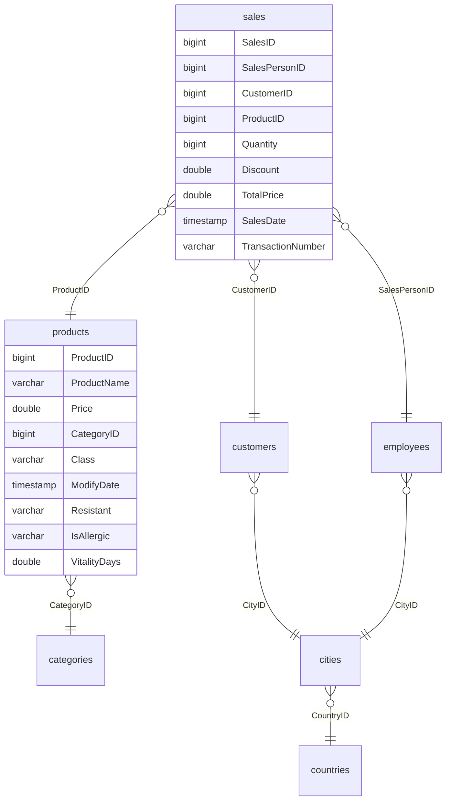

## Mục tiêu

Nhận một schema OLTP chuẩn hoá (bảng nối bảng qua khoá ngoại) và biến nó thành star schema mà người dùng BI kéo
thả không sai: chọn grain, làm phẳng dimension, đặt unknown member, quyết định cột tiền khi cột tổng của nguồn
không dùng được, và viết tài liệu thiết kế giải thích từng quyết định. Đây là việc DA làm khi được giao "nối
Metabase vào database bán hàng" mà không có Data Engineer bên cạnh.

## Đề bài

Bộ `grocery-sales-synthetic` là database bán lẻ **sinh giả** (module 06 đã chứng minh: `TotalPrice` luôn bằng 0,
mỗi `TransactionNumber` đúng một dòng, phân phối phẳng bất thường). Vì vậy bài này chỉ dùng **schema** và kiểm
**cấu trúc** (khoá, số dòng); không tính và không báo cáo bất kỳ chỉ số kinh doanh nào từ bộ này. Giấy phép không
rõ: không commit dữ liệu hay trích mẫu.

Schema nguồn (tên cột như tệp CSV; test nạp mỗi tệp thành bảng `raw_<tên tệp>`):

`categories(CategoryID, CategoryName)`, `customers(CustomerID, FirstName, MiddleInitial, LastName, CityID, Address)`,
`cities(CityID, CityName, Zipcode, CountryID)`, `countries(CountryID, CountryName, CountryCode)`,
`employees(EmployeeID, FirstName, MiddleInitial, LastName, BirthDate, Gender, CityID, HireDate)`.

1. **`starter/grocery_star.sql`**: dựng `dim_product`, `dim_customer`, `dim_employee` và `fct_sales` (cột, thứ tự
   và quy tắc ghi trong tệp; `dim_date` có sẵn làm mẫu). Star, không snowflake: tên danh mục, thành phố, quốc gia
   nằm thẳng trong dimension. Mỗi dimension có unknown member `-1`; fact giữ mọi dòng `sales`, khoá không khớp
   (kể cả `SalesDate` rỗng) trỏ về `-1`. Cột tiền: `unit_price` lấy từ giá sản phẩm, `net_amount = quantity *
   unit_price * (1 - discount)`. Tệp chạy lại được.
2. **`starter/DESIGN.md`** theo khung có sẵn: grain (và vì sao không chọn grain giỏ hàng), bảng và khoá (có sơ đồ),
   quyết định với dữ liệu nguồn, data test, và mục **Không rút insight**.

Không có lời giải duy nhất: test chấm phần bắt buộc của SQL và khung tài liệu; thiết kế chấm theo rubric trong
`SOLUTION.md`.

## Tiêu chí đạt

- Test trên dữ liệu nhỏ sinh trong test pass: đúng cột, đủ dòng, unknown member ở cả bốn dimension, dimension phẳng
  (tên ghép, thành phố, quốc gia, danh mục), `net_amount` đúng và để NULL khi không có giá, khoá unique, không có khoá
  ngoại mồ côi, chạy lại được.
- Trên bộ thật (6 758 125 dòng `sales`): đối soát cấu trúc pass (khoá unique, không mồ côi, đủ số dòng, đúng số dòng
  thiếu ngày). Test này SKIP nếu bạn chưa tải bộ dữ liệu.
- `DESIGN.md` 250-1200 từ, đủ mục, không còn TODO. Thiết kế chấm theo rubric (từ 70/100 là đạt).

## Gợi ý

### Gợi ý 1

Viết từng dimension bằng `SELECT` dòng unknown member `UNION ALL` truy vấn chính (`LEFT JOIN` ra bảng tra cứu, rồi
`coalesce(..., 'Unknown')`). `concat_ws(' ', FirstName, MiddleInitial, LastName)` bỏ qua phần NULL. Trong fact,
`LEFT JOIN` cả ba dimension theo khoá tự nhiên rồi `coalesce(key, -1)`; `strftime(SalesDate, '%Y%m%d')` cho
`date_key`.

### Gợi ý 2

Trước khi chọn grain giỏ hàng, đếm `count(DISTINCT TransactionNumber)` so với `count(*)`. Với cột tiền, hỏi: giá
trong `products` là giá **lúc bán** hay giá **hiện tại** (`ModifyDate` nói gì)? Nếu nguồn có lịch sử giá, fact phải
lấy giá theo ngày bán, giống SCD type 2 cho dimension.
