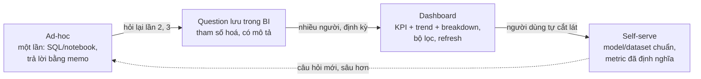
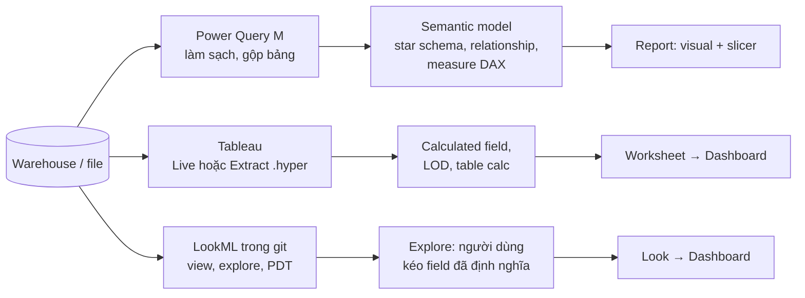
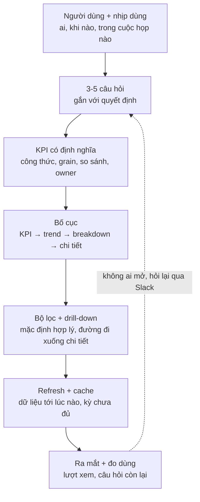

# BI & Dashboard

Module 08 dạy vẽ **một** chart đúng. Module này dạy biến chart thành **sản phẩm dùng hằng ngày**: một dashboard
mà Head of Sales mở mỗi sáng thứ Hai, một bộ question mà team marketing tự trả lời không cần nhắn DA, một app
nhỏ cho trưởng vận hành thử kịch bản. Ở công ty thật, phần lớn số liệu DA làm ra đến tay người dùng qua một
công cụ BI (Business Intelligence), và phần lớn sự cố cũng xảy ra ở đó: hai dashboard ra hai con số doanh thu,
dashboard chậm 40 giây nên không ai mở, tháng chưa hết đã bị vẽ như "doanh thu sụt 58%".

Module chia làm hai phần. **Khái niệm và so sánh** cho Power BI, Tableau, Looker (công cụ thương mại phổ biến
nhất trong tin tuyển dụng, nhưng cần license nên module không thực hành). **Thực hành** trên ba công cụ chạy
được trên máy: Metabase, Apache Superset (BI mã nguồn mở, tự host) và Streamlit + Plotly (dashboard bằng code).
Bài tập dựng question, chart, dashboard **qua API** bằng Python, để test kiểm được và để bạn quen với
"dashboard as code": dashboard có lịch sử trong git, review được như code.

Dữ liệu là hai bảng thật đã nạp vào Postgres (schema `da`), cả hai công cụ BI cùng đọc:

- `da.online_retail_ii`: 1 019 654 dòng hợp lệ của Online Retail II (đã bỏ hoá đơn huỷ `C...`, dòng
  `quantity <= 0` hoặc `price <= 0`, phần trùng giữa hai sheet), từ 01/12/2009 tới 09/12/2011 12:50, cột
  `revenue = quantity * price` (doanh thu gộp, đúng định nghĩa chung của track).
- `da.bike_hour`: 17 379 giờ của Bike Sharing (UCI), cột như `hour.csv` (`dteday` đang là text).

Bật dịch vụ (lần đầu Superset build image, mất vài phút; Metabase cần ~1 GB RAM):

```bash
docker compose -f setup/docker-compose.yml --profile bi up -d postgres metabase superset
uv run python setup/bi/load_da.py     # nạp hai bảng vào schema da (~1 phút, đọc xlsx)
uv run python setup/bi/init_bi.py     # admin Metabase + kết nối database `de` cho cả hai công cụ
# Metabase http://localhost:3000 (admin@example.com / DeLearning-Admin1), Superset http://localhost:8088 (admin / admin)
docker compose -f setup/docker-compose.yml stop superset metabase   # học xong thì tắt, giữ dữ liệu
```

Đoạn code ở phần 2, 3, 6, 7 chỉ cần `data/raw/bike-sharing-uci` (`uv run python data/download_dataset.py
bike-sharing-uci`); phần 4 và 5 cần BI đang chạy. Các đoạn chạy nối tiếp từ thư mục gốc repo, đoạn sau dùng lại
biến của đoạn trước.

Sau module này bạn sẽ:

- Dùng đúng bộ khái niệm chung của mọi công cụ BI: dataset/model, dimension và measure, grain, filter,
  drill-down, refresh, cache, quyền; biết chúng tên gì trong Power BI (DAX), Tableau (LOD) và Looker (LookML).
- Dựng question, model, dashboard có bộ lọc trên Metabase; dataset ảo, saved metric, chart, dashboard trên
  Superset; app KPI trên Streamlit có test bằng `AppTest`.
- Thiết kế KPI dashboard từ người dùng và quyết định, không từ dữ liệu có sẵn: câu hỏi, KPI có định nghĩa, bố
  cục, bộ lọc, drill-down, refresh và kỳ chưa đủ.
- Chọn công cụ BI theo người dùng, dữ liệu, ngân sách, hệ sinh thái, và quản trị self-serve để không có "hai
  con số doanh thu".

## 1. Nhắc lại nhanh: BI nằm ở đâu trong data platform

Track Data Engineer, module [Serving & BI](../../../data-engineer/modules/09-serving-bi/README.md), đã đi qua
phần hạ tầng phía sau dashboard:

- **Serving layer**: BI đọc bảng mart / aggregate đã được pipeline làm sạch, không đọc bảng thô. Dashboard
  chậm thường được sửa ở đây (bảng tổng hợp sẵn theo ngày, materialized view), không phải trong BI.
- **Semantic layer**: định nghĩa metric (doanh thu, khách active...) đặt ở **một** chỗ (dbt metrics, LookML,
  Cube, model Power BI) để mọi dashboard dùng chung công thức. Module 09 của track này làm phần đó với dbt.
- **Caching và pre-computation**: đánh đổi giữa độ tươi của số và tốc độ, chi phí query warehouse.
- **Dashboard vận hành** (ops) cần số gần thời gian thực và cảnh báo; dashboard điều hành (exec) cần số đúng,
  ổn định, có so sánh cùng kỳ.

Module này đứng ở phía người dùng: DA là người hỏi stakeholder cần quyết định gì, chọn KPI, dựng và duy trì
dashboard, và chịu trách nhiệm khi con số trên đó sai.

## 2. BI làm gì cho DA: self-serve, ad-hoc và khái niệm chung

### Vòng đời một câu hỏi

Một câu hỏi business đi qua bốn trạng thái. DA giỏi nhận ra câu hỏi đang ở trạng thái nào và chọn cách trả lời
tương ứng, thay vì dựng dashboard cho mọi thứ.



- **Ad-hoc** hợp với câu hỏi "vì sao", cần làm sạch, kiểm giả thuyết, kết hợp nhiều nguồn: SQL + notebook,
  trả lời bằng memo có kết luận. Đừng dựng dashboard cho câu hỏi chỉ hỏi một lần.
- **Dashboard** hợp với câu hỏi "cái gì, bao nhiêu, đang tăng hay giảm" được hỏi lặp lại theo nhịp (hằng ngày,
  hằng tuần) bởi nhiều người.
- **Self-serve** là cho người dùng business tự kéo thả trên dataset/model đã chuẩn hoá. Nó giảm hàng đợi ticket
  của DA, nhưng chỉ an toàn khi metric đã được định nghĩa sẵn ở model; self-serve trên bảng thô sinh ra mười
  định nghĩa doanh thu khác nhau (bài Advanced 02 audit đúng chuyện này).

### Khái niệm dùng chung cho mọi công cụ

| Khái niệm | Nghĩa | Metabase | Superset | Power BI | Tableau | Looker |
| --- | --- | --- | --- | --- | --- | --- |
| Nguồn | Kết nối tới database/warehouse | Database | Database | Data source (Power Query) | Data source | Connection |
| Lớp ngữ nghĩa | Bảng/cột đã chọn, đặt tên, định nghĩa metric | Model, Metric | Dataset (physical/virtual) + saved metric | Semantic model (dataset) | Published data source | LookML view, explore |
| Dimension | Cột để nhóm, lọc (nước, tháng, mùa) | Column | Column (groupby) | Column | Dimension (xanh dương = discrete) | `dimension` |
| Measure | Phép tổng hợp tính **sau** khi lọc | Aggregation, Metric | Metric | Measure (DAX) | Measure (xanh lá = continuous) | `measure` |
| Câu hỏi đơn | Một truy vấn + một hình | Question | Chart | Visual | Worksheet | Look |
| Bảng điều khiển | Nhiều hình + bộ lọc chung | Dashboard | Dashboard | Report / Dashboard | Dashboard | Dashboard |
| Bộ lọc người xem chọn | Áp dụng cho nhiều hình | Dashboard filter | Native filter | Slicer | Filter / Parameter | Filter |
| Đi sâu | Từ tổng xuống chi tiết | Drill-through | Drill to detail, drill by | Drill down / drill through | Action, hierarchy | Drill field |
| Làm mới | Lấy số mới từ nguồn | Query trực tiếp + cache | Query trực tiếp + cache | Import (lịch refresh) / DirectQuery | Extract (lịch) / Live | Query trực tiếp + PDT, datagroup |
| Quyền theo dòng | Mỗi người chỉ thấy phần của mình | Sandboxing (bản trả phí) | Row Level Security | RLS (DAX role) | User filter | `access_filter` |

Hai khái niệm quyết định đúng sai của số trên dashboard:

- **Grain** (mỗi dòng của nguồn là gì): dòng hàng, hoá đơn, khách-tháng. Đếm "số đơn" trên bảng grain dòng hàng
  bằng `COUNT(*)` là sai; phải `COUNT(DISTINCT invoice)`. Join bảng khách vào bảng dòng hàng rồi `SUM` doanh thu
  khách là nhân bản (fan-out, module 03).
- **Measure tính sau khi lọc, không tính sẵn rồi cộng**: tỉ lệ, trung bình, đếm distinct không cộng dồn được.
  Lưu "tỉ trọng khách vãng lai" thành cột cho từng ngày rồi để BI lấy trung bình là sai.

```python
import sys
from pathlib import Path

import pandas as pd

ROOT = next(p for p in [Path.cwd(), *Path.cwd().parents] if (p / "pyproject.toml").exists())
sys.path.insert(0, str(ROOT))
from data.download_dataset import ensure  # noqa: E402

day = pd.read_csv(ensure("bike-sharing-uci") / "day.csv", parse_dates=["dteday"])

# Measure đúng: tổng tử / tổng mẫu, tính SAU khi lọc (giống measure DAX, metric Superset, measure LookML)
ratio_of_sums = day.casual.sum() / day.cnt.sum()
# "Calculated column" rồi lấy trung bình: mỗi ngày một tỉ lệ, ngày ít khách nặng ngang ngày đông khách
avg_of_ratios = (day.casual / day.cnt).mean()
print(f"tỉ trọng khách vãng lai: tổng/tổng = {ratio_of_sums:.1%}, trung bình tỉ lệ ngày = {avg_of_ratios:.1%}")

by_wd = day.groupby("workingday").agg(casual=("casual", "sum"), cnt=("cnt", "sum"), days=("cnt", "size"))
by_wd["share"] = by_wd.casual / by_wd.cnt
print(by_wd.rename(index={0: "ngày nghỉ", 1: "ngày làm việc"}).round(3))
```

Tỉ trọng khách vãng lai đúng là **18.8%**; trung bình tỉ lệ từng ngày cho **17.6%**. Chênh 1.2 điểm % vì hai
cách cân trọng khác nhau: ngày nghỉ có tỉ trọng 31.7% nhưng chỉ chiếm 231/731 ngày và 30% lượt thuê. Trên
dashboard, sai lệch kiểu này lộ ra khi người xem lọc theo loại ngày rồi thấy hai tile không khớp với tổng. Quy
tắc: định nghĩa tỉ lệ là **measure** `SUM(casual) / SUM(cnt)` ở lớp ngữ nghĩa, không phải cột.

## 3. Power BI, Tableau, Looker: khái niệm và so sánh

Ba công cụ này không thực hành trong track (cần license, Power BI Desktop chỉ chạy trên Windows), nhưng xuất hiện
trong phần lớn tin tuyển DA. Điều nhà tuyển dụng muốn biết không phải bạn nhớ menu nào, mà bạn hiểu **logic
tính toán nằm ở đâu** trong mỗi công cụ.



### Power BI: data model và DAX

- **Power Query** (ngôn ngữ M) lấy dữ liệu và làm sạch; kết quả nạp vào **semantic model** (trước gọi là
  dataset) dạng star schema: bảng fact, bảng dimension, **relationship** (cardinality 1-n, hướng lọc single hoặc
  both). Hướng lọc "both" là nguồn sai số hay gặp: lọc ở bảng fact chảy ngược lên dimension rồi sang fact khác.
- **Import** chép dữ liệu vào model (nhanh, refresh theo lịch, số lần refresh mỗi ngày giới hạn theo license);
  **DirectQuery** query thẳng nguồn mỗi lần xem (số tươi, chậm hơn, phụ thuộc warehouse).
- **DAX**: **calculated column** tính một lần lúc refresh cho từng dòng (như cột mới trong bảng); **measure** tính
  lúc xem, trong **filter context** của ô đang hiển thị (các slicer, hàng/cột của matrix). `CALCULATE` đổi filter
  context: thêm, bỏ (`ALL`) hoặc thay bộ lọc. Hiểu filter context là hiểu DAX.

```text
Rides         := SUM(day[cnt])
Share of year := DIVIDE([Rides], CALCULATE([Rides], ALL(day[season])))
Rides LY      := CALCULATE([Rides], SAMEPERIODLASTYEAR('Date'[Date]))
```

Đoạn pandas dưới làm đúng việc của measure `Share of year` trên matrix năm × mùa: trong ô (2012, mùa 3), filter
context là {năm 2012, mùa 3}; `CALCULATE(..., ALL(season))` bỏ bộ lọc mùa nhưng **giữ** bộ lọc năm.

```python
# DAX:  Rides := SUM(day[cnt])
#       Share of year := DIVIDE([Rides], CALCULATE([Rides], ALL(day[season])))
# Ô (năm 2012, mùa 3) có filter context {year = 2012, season = 3}; CALCULATE(..., ALL(season)) bỏ filter mùa, giữ năm.
day["year"] = 2011 + day.yr
rides = day.groupby(["year", "season"]).cnt.sum()                    # [Rides] trong từng ô
year_total = rides.groupby(level="year").transform("sum")            # CALCULATE([Rides], ALL(season))
print((rides / year_total).unstack("season").round(3))
```

Mùa 3 (21/6-22/9) chiếm 33.8% lượt thuê năm 2011 và 31.3% năm 2012; mùa 1 (nhãn UCI `spring`, thật ra 21/12-20/3)
tăng từ 12.1% lên 15.7%. `SAMEPERIODLASTYEAR` cần một **bảng Date** liên tục đánh dấu là date table: time
intelligence của DAX không chạy đúng trên cột ngày của bảng fact (thiếu ngày, ví dụ ngày không có đơn).

### Tableau: dimension, measure, LOD

- Mỗi field là **dimension** (xanh dương, discrete: tạo header/nhóm) hoặc **measure** (xanh lá, continuous: tạo
  trục). Kéo field vào Rows/Columns/Marks là viết truy vấn; mức tổng hợp mặc định là các dimension đang có trong
  view (gọi là **view level of detail**).
- **LOD expression** tính ở mức chi tiết khác view: `{FIXED [Customer ID] : MIN([Order Date])}` cho ngày mua đầu
  của mỗi khách (cohort) bất kể view đang nhóm theo gì; `INCLUDE`, `EXCLUDE` thêm hoặc bỏ dimension.
  **Table calculation** (running total, % of total, rank) tính trên kết quả đã tổng hợp của view.
- **Live** query thẳng nguồn; **Extract** (`.hyper`) là bản chụp cột nén, refresh theo lịch trên Tableau
  Server/Cloud. Logic tính nằm rải trong từng workbook, nên hai workbook rất dễ có hai định nghĩa doanh thu;
  published data source có calculated field dùng chung là cách giảm rủi ro đó.

### Looker và LookML; Looker Studio là sản phẩm khác

- **LookML** là code (trong git, review bằng pull request) mô tả semantic layer: `view` (một bảng: `dimension`,
  `measure` như `type: sum`, `type: count_distinct`), `explore` (các view được join sẵn, kèm quan hệ
  `many_to_one` để Looker tránh fan-out khi tính measure), `model`. Người dùng business chỉ kéo field đã định
  nghĩa, Looker sinh SQL chạy thẳng trên warehouse (BigQuery, Snowflake...). **PDT** (persistent derived table) là
  bảng tổng hợp Looker tự build lại theo `datagroup`.
- Mạnh nhất ở quản trị metric: một định nghĩa doanh thu, review như code, mọi dashboard dùng chung.
- **Looker Studio** (trước là Google Data Studio) là công cụ dashboard miễn phí, kéo thả, nối Google Sheets,
  BigQuery, GA4; không có LookML. Nói "biết Looker" khi chỉ dùng Looker Studio là lỗi hay gặp trong phỏng vấn.

## 4. Metabase: question, model, dashboard

Metabase là BI mã nguồn mở dễ dùng nhất cho người không viết SQL: người dùng business tự hỏi bằng **query
builder** (chọn bảng, lọc, tổng hợp, nhóm), DA viết **native SQL** cho câu khó.

| Đối tượng | Là gì | Lưu ý |
| --- | --- | --- |
| Question (query builder) | Truy vấn MBQL (JSON) dựng bằng giao diện | Có **drill-through** tự động (click một cột → xem chi tiết, nhóm theo chiều khác); Metabase biết ngữ nghĩa từng cột |
| Question (native SQL) | SQL bạn viết, có biến `{{...}}` | Mạnh, nhưng không drill-through, người khác khó sửa; dùng cho logic không dựng được bằng builder |
| Model | Question đánh dấu là "nguồn chuẩn", có metadata (tên cột, mô tả, kiểu) | Lớp ngữ nghĩa nhẹ: người dùng self-serve bắt đầu từ model, không từ bảng thô |
| Metric | Một phép tổng hợp đã đặt tên trên bảng/model (các bản gần đây) | Định nghĩa doanh thu một lần, dùng lại trong question |
| Dashboard | Lưới 24 cột chứa card (question, text, link) + bộ lọc | Mỗi bộ lọc phải được **nối** (mapping) vào từng card, card không nối thì không lọc |
| Collection | Thư mục chứa question/dashboard, có phân quyền | Collection "official", verified question, chỉnh cache từng dashboard là tính năng bản trả phí (Pro/Enterprise) |

### Hai loại biến trong SQL: text variable và field filter

- **Text/number variable** `{{min_qty}}`: Metabase thay đúng giá trị vào chỗ biến; bạn tự viết `WHERE quantity >=
  {{min_qty}}` và tự xử lý khi trống (bọc `[[ ... ]]` để bỏ cả mệnh đề khi không có giá trị).
- **Field filter** `{{country}}` (tag kiểu `dimension` trỏ vào một cột): bạn viết `WHERE {{country}}`, không
  viết `country = ...`. Metabase sinh cả điều kiện, hỗ trợ nhiều giá trị, và khi trống thì thành `1 = 1`. Field
  filter tham chiếu cột bằng **tên bảng đầy đủ**, nên bảng trong `FROM` không được đặt alias.

Đoạn dưới gọi API như trình duyệt làm (Metabase là một REST API, giao diện chỉ là client của nó): tra id cột
`country`, chạy một SQL có field filter, và xem SQL thật Metabase sinh ra qua `/api/dataset/native`.

```python
sys.path.insert(0, str(ROOT / "setup" / "bi"))
import clients  # noqa: E402

mb = clients.metabase_session()
db = next(d for d in mb.get("/api/database").json()["data"] if d["name"] == "de")
meta = mb.get(f"/api/database/{db['id']}/metadata").json()
retail = next(t for t in meta["tables"] if t["schema"] == "da" and t["name"] == "online_retail_ii")
country = next(f for f in retail["fields"] if f["name"] == "country")

query = {
    "database": db["id"],
    "type": "native",
    "native": {
        "query": "SELECT round(sum(revenue)::numeric, 2) AS revenue FROM da.online_retail_ii "
                 "WHERE invoicedate >= '2011-11-01' AND invoicedate < '2011-12-01' AND {{country}}",
        "template-tags": {"country": {"id": "c", "name": "country", "display-name": "Quốc gia", "type": "dimension",
                                      "dimension": ["field", country["id"], None], "widget-type": "string/="}},
    },
}
for value in (None, ["Germany", "France"]):
    params = [] if value is None else [{"type": "string/=", "value": value,
                                        "target": ["dimension", ["template-tag", "country"]]}]
    compiled = mb.post("/api/dataset/native", json={**query, "parameters": params}).json()["query"]
    result = mb.post("/api/dataset", json={**query, "parameters": params}).json()["data"]["rows"][0][0]
    print(f"bộ lọc {value}: {result:,.2f} GBP; Metabase thay {{{{country}}}} bằng:")
    tail = compiled[compiled.rindex("'2011-12-01'") + len("'2011-12-01'"):]
    print("   ", " ".join(tail.split()))
```

Không lọc: doanh thu 11/2011 là 1 509 496.33 GBP và `{{country}}` thành `1 = 1`. Chọn Germany và France:
59 783.73 GBP, điều kiện thành `("da"."online_retail_ii"."country" = 'Germany') OR (... = 'France')`. Thấy rõ vì
sao alias `FROM da.online_retail_ii r` làm field filter hỏng.

### Dashboard, bộ lọc, cache

- Tạo question bằng `POST /api/card` (`dataset_query` kiểu `native` hoặc `query`), dashboard bằng `POST
  /api/dashboard`, đặt card lên lưới bằng `PUT /api/dashboard/<id>` với danh sách `dashcards` (vị trí `row`,
  `col`, kích thước `size_x`, `size_y` trên lưới 24 cột và `parameter_mappings` nối bộ lọc vào biến của card).
  Bài Basic 02 và Intermediate 02 làm đúng các bước này.
- **Cache**: Metabase lưu kết quả query; bản mã nguồn mở đặt một chính sách chung cho cả instance, bản trả phí
  chỉnh được theo database, dashboard, question. Dashboard họp sáng thứ Hai không cần query lại warehouse mỗi lần
  mở; dashboard vận hành thì cần.

## 5. Superset: dataset, chart, dashboard

Superset (Apache, gốc từ Airbnb) mạnh ở chỗ Metabase yếu: nhiều loại chart (ECharts), SQL Lab cho người viết SQL,
dataset ảo có metric dùng chung, Jinja template trong SQL, phân quyền chi tiết và RLS có sẵn trong bản mã nguồn
mở. Đổi lại, người dùng không biết SQL thấy khó hơn Metabase.

| Đối tượng | Là gì | Lưu ý |
| --- | --- | --- |
| Database | Kết nối SQLAlchemy (`postgresql+psycopg2://...`) | Bật "Expose in SQL Lab" để viết SQL |
| Dataset physical | Trỏ thẳng một bảng | Đơn giản nhất, nhưng logic nằm rải ở chart |
| Dataset virtual | Một câu SQL đặt tên, dùng như bảng | Nơi đặt cột tính sẵn (nhãn thời tiết, loại ngày) |
| Saved metric | Biểu thức tổng hợp đặt ở dataset: `SUM(casual) * 1.0 / NULLIF(SUM(cnt), 0)` | Lớp ngữ nghĩa nhẹ: mọi chart dùng chung định nghĩa |
| Chart | `viz_type` + `params` (form_data) + `query_context` | `params` để giao diện vẽ; `query_context` để API/cache/báo cáo chạy lại query |
| Dashboard | `position_json` (cây ROOT → GRID → ROW → CHART, lưới 12 cột) + native filter | Cross-filter: click một chart lọc các chart khác |

Hai công cụ cùng đọc một Postgres thì con số phải khớp. Đoạn dưới chạy cùng một SQL qua SQL Lab của Superset và
qua Metabase, rồi đối chiếu: đây là phép kiểm (reconcile) nên làm mỗi khi chuyển dashboard sang công cụ mới.

```python
ss = clients.superset_session()
de = ss.get("/api/v1/database/").json()["result"]
de_id = next(d["id"] for d in de if d["database_name"] == "de")
sql = "SELECT weathersit, round(avg(cnt)::numeric, 2) AS avg_rides, count(*) AS hours FROM da.bike_hour GROUP BY 1 ORDER BY 1"
superset_rows = ss.post("/api/v1/sqllab/execute/", json={"database_id": de_id, "sql": sql, "runAsync": False}).json()["data"]
metabase_rows = mb.post("/api/dataset", json={"database": db["id"], "type": "native", "native": {"query": sql}}).json()["data"]["rows"]
for s_row, m_row in zip(superset_rows, metabase_rows):
    print(s_row, "| Metabase:", m_row)
assert [float(r["avg_rides"]) for r in superset_rows] == [float(r[1]) for r in metabase_rows]
```

Trời quang trung bình 204.87 lượt/giờ, mưa/tuyết nhẹ 111.58; `weathersit = 4` chỉ có **3 giờ** trong hai năm,
nên con số 74.33 không đáng một cột trên chart (gộp vào nhóm 3 hoặc ghi n). Khi hai công cụ lệch nhau, nguyên
nhân hay gặp: một bên dùng dataset có bộ lọc ẩn, múi giờ khác, cache cũ, hoặc định nghĩa metric khác.

Bố cục dashboard Superset là một cây JSON; API nhận nó dưới dạng chuỗi trong `position_json`:

```json
{
  "DASHBOARD_VERSION_KEY": "v2",
  "ROOT_ID": {"type": "ROOT", "id": "ROOT_ID", "children": ["GRID_ID"]},
  "GRID_ID": {"type": "GRID", "id": "GRID_ID", "children": ["ROW-1"], "parents": ["ROOT_ID"]},
  "ROW-1": {"type": "ROW", "id": "ROW-1", "children": ["CHART-7"], "parents": ["ROOT_ID", "GRID_ID"],
            "meta": {"background": "BACKGROUND_TRANSPARENT"}},
  "CHART-7": {"type": "CHART", "id": "CHART-7", "children": [], "parents": ["ROOT_ID", "GRID_ID", "ROW-1"],
              "meta": {"chartId": 7, "width": 6, "height": 50}}
}
```

Cache của Superset đặt theo chart, dataset hoặc database (`cache_timeout`, giây) và theo cấu hình chung; kết quả
`/api/v1/chart/<id>/data/` trả kèm `is_cached` và `cached_dttm` để biết số đang xem là lúc nào.

## 6. Streamlit + Plotly: dashboard bằng code

Khi logic không vừa BI (mô phỏng kịch bản, gọi model, form nhập liệu, quy trình nhiều bước), DA viết app bằng
Python. Streamlit biến script thành web app: mỗi widget là một dòng code, Plotly cho chart tương tác.

Mô hình chạy khác hẳn BI và là nguồn lỗi số một:

- **Mỗi tương tác chạy lại toàn bộ script** từ trên xuống. Đọc 1 GB dữ liệu ở đầu script nghĩa là đọc lại mỗi
  lần người dùng đổi một bộ lọc, trừ khi bọc bằng `@st.cache_data` (cache theo tham số hàm).
- Biến thường mất sau mỗi lần chạy; trạng thái cần giữ (đã bấm nút, bước nào của wizard) để trong
  `st.session_state`.
- Logic tính KPI để trong **hàm thuần** (không gọi `st.*`) để test được bằng pytest; phần UI test bằng
  `streamlit.testing.v1.AppTest`, chạy app không cần trình duyệt.

```python
from streamlit.testing.v1 import AppTest

SCRIPT = '''
import streamlit as st

st.session_state.setdefault("runs", 0)
st.session_state.runs += 1                     # mỗi tương tác: chạy lại cả script

@st.cache_data
def load(n):                                   # cache theo tham số: chạy lại không đọc lại dữ liệu
    st.session_state.setdefault("loads", 0)
    st.session_state.loads += 1
    return list(range(n))

season = st.selectbox("Mùa", ["spring", "summer", "fall", "winter"])
data = load(10)
st.metric("Số lần chạy script", st.session_state.runs, help=f"load() thật sự chạy {st.session_state.loads} lần")
'''

at = AppTest.from_string(SCRIPT).run()
at.selectbox[0].set_value("fall").run()
at.selectbox[0].set_value("winter").run()
print("script chạy", at.metric[0].value, "lần; load() chạy", at.session_state.loads, "lần; lỗi:", list(at.exception))
```

Ba lần chạy script (mở app, hai lần đổi mùa) nhưng `load()` chỉ chạy một lần. `AppTest` đọc được mọi phần tử
(`at.metric`, `at.sidebar.selectbox`, `at.dataframe`, `at.exception`), đặt giá trị widget và chạy lại: bài Basic
03 chấm app KPI Bike Sharing theo cách này.

Streamlit không thay BI: không có phân quyền theo dòng, không có self-serve, mỗi thay đổi là một lần sửa code
và deploy. Dùng khi người dùng ít, logic riêng, cần tương tác mà BI không làm được.

## 7. Thiết kế KPI dashboard

Dashboard tốt được thiết kế ngược từ **quyết định**, không xuôi từ dữ liệu có sẵn. Câu hỏi đầu tiên với
stakeholder không phải "anh muốn xem gì" (câu trả lời luôn là "mọi thứ") mà "sáng thứ Hai anh quyết định gì, và
con số nào làm anh quyết định khác đi".



### Người dùng, câu hỏi, KPI

- **Một dashboard, một nhóm người dùng, một nhịp**. Dashboard cho CEO (tháng, xu hướng, so cùng kỳ) khác
  dashboard cho trưởng ca kho (giờ, hàng đợi, cảnh báo). Gộp hai thứ thành một dashboard "cho mọi người" là
  dashboard không ai dùng.
- **KPI có định nghĩa viết ra**: công thức, nguồn, grain, kỳ, so với gì, ai chịu trách nhiệm (owner). "Doanh thu"
  ở track này là doanh thu gộp trên dòng hợp lệ; dashboard phải ghi rõ điều đó trong mô tả card.
- **3-7 KPI**. Mỗi KPI thêm vào làm các KPI khác khó thấy hơn. KPI không gắn với quyết định nào thì bỏ.
- **Luôn có so sánh**: một con số đứng một mình không đọc được. So với kỳ trước, cùng kỳ năm trước, target;
  ghi delta và chiều tốt/xấu (chi phí tăng là xấu).

### Bố cục, bộ lọc, drill-down

- Mắt quét chữ F/Z: **KPI tile** hàng trên, **trend** ngay dưới, **breakdown** (theo nước, sản phẩm) rồi **bảng
  chi tiết** cuối cùng. Bài Intermediate 02 kiểm bố cục bằng hàm `validate_layout` (không chồng, không tràn lưới).
- **Bộ lọc toàn cục ít và có mặc định**: kỳ (mặc định kỳ đủ gần nhất), một hai chiều chính (quốc gia). Mỗi bộ lọc
  phải nối vào mọi card; card "lờ" bộ lọc là nguồn nhầm lẫn kinh điển (tile tổng không đổi khi chọn Germany).
- **Drill-down** là đường đi có chủ đích từ tổng xuống chi tiết: tile doanh thu → doanh thu theo nước → sản phẩm
  của nước đó → hoá đơn. Mỗi bước trả lời "vì sao" của bước trên. Câu hỏi sâu hơn ba bước là việc của ad-hoc.

### Refresh, cache và kỳ chưa đủ

- **Độ tươi theo nhịp quyết định**: họp tuần thì nạp hằng ngày là đủ; vận hành theo giờ thì cần nạp theo giờ. Số
  càng tươi càng tốn (query, warehouse, cache ít trúng).
- **Hiện "dữ liệu tới lúc"** (max timestamp của nguồn) trên dashboard. Người xem không biết pipeline chết từ hôm
  qua sẽ đọc số cũ như số mới.
- **Cache TTL không dài hơn chu kỳ nạp**, và nên xoá cache sau mỗi lần nạp; cache 24 giờ cho dữ liệu nạp mỗi giờ
  nghĩa là dashboard luôn chậm một ngày.
- **Kỳ chưa đủ** không đặt cạnh kỳ đủ như thể ngang nhau: bỏ khỏi KPI, vẽ nét đứt, hoặc so cùng số ngày. Đoạn dưới
  làm tile tuần cho Bike Sharing, dữ liệu kết thúc thứ Hai 31/12/2012.

```python
def weekly_tiles(df: pd.DataFrame, date_col: str, value_col: str) -> pd.DataFrame:
    """Tổng theo tuần ISO (thứ Hai-Chủ nhật), đánh dấu tuần chưa đủ 7 ngày dữ liệu."""
    d = df[[date_col, value_col]].copy()
    d["week"] = d[date_col].dt.to_period("W-SUN").dt.start_time
    out = d.groupby("week").agg(value=(value_col, "sum"), days=(date_col, "nunique"))
    out["complete"] = out.days == 7
    return out


tiles = weekly_tiles(day, "dteday", "cnt")
print(tiles.tail(3))
last_complete = tiles[tiles.complete].iloc[-1]
naive = tiles.value.iloc[-1] / tiles.value.iloc[-2] - 1
fair = last_complete.value / tiles[tiles.complete].value.iloc[-2] - 1
same_week_ly = tiles.loc[last_complete.name - pd.Timedelta(weeks=52)]
yoy = last_complete.value / same_week_ly.value - 1
print(f"WoW ngây thơ (tuần cuối 1 ngày): {naive:+.1%}; WoW trên tuần đủ: {fair:+.1%}; "
      f"so cùng tuần năm trước ({same_week_ly.name:%d/%m/%Y}): {yoy:+.1%}")
```

Tuần cuối (31/12/2012) mới có 1 ngày, 2 729 lượt: tile ngây thơ báo **-74.5%** so với tuần trước. Bỏ tuần chưa
đủ thì tuần đủ gần nhất (24-30/12) vẫn **-59.8%** so với tuần trước nó, vì đó là tuần Giáng sinh: so tuần liền kề
trộn mùa vụ. So cùng tuần năm trước (26/12/2011) còn **-28.4%**, trong khi cả năm 2012 tăng 65%: một tuần lễ
đơn lẻ nhiễu (thời tiết, ngày lễ rơi vào thứ mấy), nên dashboard tuần cần trend nhiều tuần, không chỉ một delta.

### Chọn công cụ

| Công cụ | Dùng khi | Loại công ty hay dùng | Mạnh | Yếu |
| --- | --- | --- | --- | --- |
| **Metabase** | Self-serve cho người không viết SQL, cần dựng nhanh, ngân sách thấp | Startup, SME, team data nhỏ tự host | Query builder dễ nhất, drill-through tự động, cài một container | Ít loại chart; quản trị nội dung (official, verified), cache chi tiết, sandboxing nằm ở bản trả phí |
| **Superset** | Team biết SQL, nhiều loại chart, cần RLS và phân quyền mà không trả license | Công ty tech có data engineer vận hành hạ tầng (Airbnb, nhiều scale-up) | Mã nguồn mở đầy đủ: SQL Lab, dataset ảo + metric, Jinja, RLS, cross-filter | Khó cho người dùng business; vận hành (Celery, cache, nâng cấp) tốn công |
| **Streamlit + Plotly** | Logic tuỳ biến: kịch bản what-if, gọi model, form; ít người dùng | Team DA/DS dùng Python, prototype nội bộ | Linh hoạt tuyệt đối, test được, trong git | Không self-serve, không RLS sẵn, mỗi thay đổi là deploy code |
| **Power BI** | Doanh nghiệp đã dùng Microsoft 365/Azure, cần data model và RLS | Enterprise: ngân hàng, bán lẻ, sản xuất, công ty đa quốc gia | Data model + DAX mạnh, rẻ khi đã có license M365, Excel tích hợp | DAX khó; Desktop chỉ chạy Windows; giới hạn refresh theo license; khoá vào hệ Microsoft |
| **Tableau** | Phân tích trực quan khám phá, dashboard đẹp cho lãnh đạo | Enterprise lớn có ngân sách BI, hệ Salesforce | Kéo thả nhanh, chart đẹp, LOD mạnh, cộng đồng lớn | License đắt; logic rải trong từng workbook khó review |
| **Looker (LookML)** | Cần một semantic layer quản trị bằng git trên warehouse | Công ty dùng Google Cloud/BigQuery, data team trưởng thành | Metric định nghĩa một lần, review như code, chống fan-out | Đắt; phải học LookML; cần người duy trì model |
| **Looker Studio** | Dashboard chia sẻ nhanh, miễn phí, nguồn Google (Sheets, GA4, BigQuery) | Marketing, SME dùng Google Workspace | Miễn phí, chia sẻ như Google Docs | Chậm với dữ liệu lớn, mô hình hoá yếu, khó quản trị nhiều nguồn |

Bốn câu hỏi chọn công cụ: **ai dùng** (biết SQL không, bao nhiêu người, có cần RLS), **dữ liệu ở đâu** (warehouse
nào, cần live hay extract), **công ty đang dùng hệ sinh thái nào** (M365, Google, Salesforce), và **ai duy trì**
(có data engineer vận hành server không, có ngân sách license không).

## 8. Tài liệu tham khảo

Roadmap gốc (mục Data Visualisation: Tableau, Power BI; bản PDF ở `roadmap/data-analyst.pdf`):

- [roadmap.sh: Data Analyst](https://roadmap.sh/data-analyst)

Tài liệu chính thức:

- Metabase: [Learn Metabase](https://www.metabase.com/learn/), [SQL field filters](https://www.metabase.com/docs/latest/questions/native-editor/field-filters),
  [Models](https://www.metabase.com/docs/latest/data-modeling/models), [API](https://www.metabase.com/docs/latest/api)
- Apache Superset: [Giới thiệu](https://superset.apache.org/docs/intro), [Creating your first dashboard](https://superset.apache.org/docs/using-superset/creating-your-first-dashboard),
  [API](https://superset.apache.org/docs/api)
- Streamlit: [Caching](https://docs.streamlit.io/develop/concepts/architecture/caching),
  [App testing](https://docs.streamlit.io/develop/concepts/app-testing); [Plotly Python](https://plotly.com/python/)
- Power BI: [Fundamentals](https://learn.microsoft.com/en-us/power-bi/fundamentals/),
  [DAX basics](https://learn.microsoft.com/en-us/power-bi/transform-model/desktop-quickstart-learn-dax-basics),
  [Star schema](https://learn.microsoft.com/en-us/power-bi/guidance/star-schema)
- Tableau: [Dimensions and measures](https://help.tableau.com/current/pro/desktop/en-us/datafields_typesandroles.htm),
  [Extracts](https://help.tableau.com/current/pro/desktop/en-us/extracting_data.htm), [LOD expressions](https://help.tableau.com/current/pro/desktop/en-us/calculations_calculatedfields_lod.htm)
- Looker: [What is LookML](https://cloud.google.com/looker/docs/what-is-lookml); [Looker Studio](https://lookerstudio.google.com/)

Sách và bài viết:

- Stephen Few. *Information Dashboard Design* (2nd ed., Analytics Press, 2013). Bố cục, mật độ, KPI tile.
- Steve Wexler, Jeffrey Shaffer, Andy Cotgreave. *The Big Book of Dashboards* (Wiley, 2017). Dashboard thật theo
  ngành, kèm phân tích vì sao hiệu quả.
- Cole Nussbaumer Knaflic. *Storytelling with Data* (Wiley, 2015) và [storytellingwithdata.com](https://www.storytellingwithdata.com/).

Dữ liệu:

- Daqing Chen. [Online Retail II (UCI)](https://archive.ics.uci.edu/dataset/502/online+retail+ii), CC BY 4.0.
- Fanaee-T & Gama. [Bike Sharing Dataset (UCI)](https://archive.ics.uci.edu/dataset/275/bike+sharing+dataset), CC BY 4.0.
