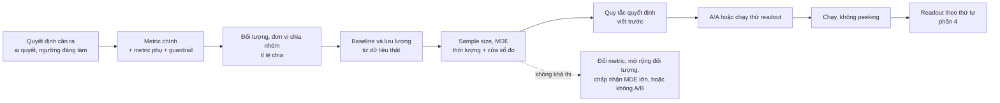
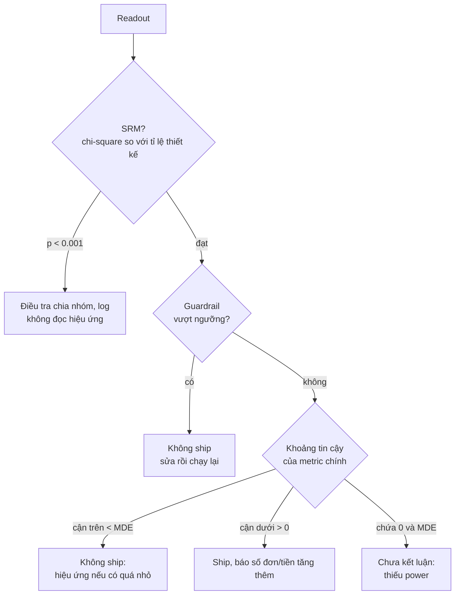
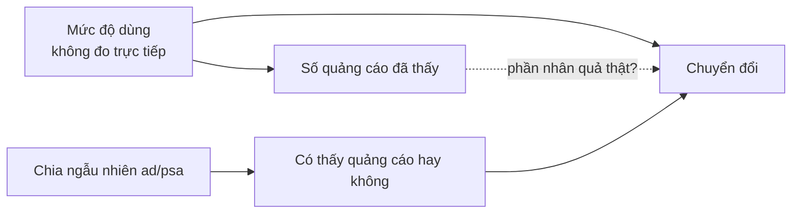

# Thống kê & Experimentation cho quyết định

Track Data Science đã dạy hypothesis testing, A/B test và regression từ phía người xây phương pháp: phân phối
của thống kê kiểm định, power, sequential testing, giả định của OLS. Module này đứng ở phía **Data Analyst**,
người nhận câu hỏi của stakeholder ("độ ẩm có ảnh hưởng không?", "chạy A/B 4 tuần là biết?", "chiến dịch có tạo
thêm đơn không?") và phải trả lời bằng một con số, một khoảng bất định và một khuyến nghị. Ba kỹ năng chính:
**thiết kế thí nghiệm sao cho nó trả lời được câu hỏi** (metric, guardrail, sample size, thời lượng), **đọc kết
quả theo đúng thứ tự** (độ tin cậy trước, hiệu ứng sau, quyết định theo quy tắc đặt trước), và **nói rõ khi dữ
liệu không cho phép kết luận nhân quả** (correlation, so trước/sau, DiD nhanh, regression để giải thích).

Module dùng ba bộ dữ liệu thật:

- **Online Retail II (UCI)**: giao dịch của một cửa hàng quà tặng online ở Anh, hai sheet (01/12/2009 tới
  09/12/2011, 1 044 848 dòng sau khi bỏ phần trùng). Dùng để lấy **baseline** và **lưu lượng** cho thiết kế thí
  nghiệm, và cho bài DiD.
- **marketing-ab (Kaggle, CC0)**: 588 101 người dùng của một chiến dịch quảng cáo, nhóm `ad` thấy quảng cáo, nhóm
  `psa` thấy thông điệp công ích ở cùng vị trí, chia 96/4. Một A/B test thật để đọc kết quả.
- **Bike Sharing (UCI)**: `day.csv`, 731 ngày thuê xe 2011-2012 ở Washington DC kèm thời tiết. Dùng cho
  correlation, so sánh nhóm và regression để giải thích.

```bash
uv run python data/download_dataset.py online-retail-ii
uv run python data/download_dataset.py marketing-ab        # cần Kaggle token
uv run python data/download_dataset.py bike-sharing-uci
```

Mọi đoạn code chạy từ thư mục gốc repo. Định nghĩa dùng chung của track: dòng hợp lệ của Online Retail II là hoá
đơn không bắt đầu bằng `C`, `quantity > 0`, `price > 0`; doanh thu = `quantity * price`; khách là `Customer ID`
khác NULL. Nhãn mùa của Bike Sharing theo Readme UCI (1 = spring), kèm lưu ý ở module 08: mã 1 thực tế phủ
khoảng 21/12-20/3.

Sau module này bạn sẽ:

- Chọn kiểm định theo loại metric và cách lấy mẫu; báo **độ lớn kèm khoảng tin cậy**, không chỉ p-value.
- Viết experiment brief: metric chính, guardrail, đơn vị chia nhóm, sample size và MDE từ baseline thật, thời
  lượng, quy tắc quyết định viết trước.
- Đọc một readout A/B: SRM, cân bằng nhóm, chênh lệch tuyệt đối và tương đối, quy ra số đơn, ra quyết định.
- Nhận ra khi nào số liệu chỉ là correlation, và dùng DiD nhanh để kiểm một claim "trước/sau".
- Dùng regression để **giải thích** (đọc hệ số theo đơn vị business, biến kiểm soát, robust SE), không để dự báo.

## 1. Nhắc lại nhanh

Phần lý thuyết đầy đủ nằm ở track Data Science:
[02-probability-statistics](../../../data-science/modules/02-probability-statistics/README.md) (mẫu và tổng thể,
CLT, khoảng tin cậy, bootstrap),
[03-ab-testing](../../../data-science/modules/03-ab-testing/README.md) (hypothesis testing, power, SRM, peeking,
multiple testing),
[05-econometrics-regression](../../../data-science/modules/05-econometrics-regression/README.md) (OLS, giả định,
robust SE, VIF) và [06-causal-inference](../../../data-science/modules/06-causal-inference/README.md) (DiD, synthetic
control). Tóm tắt những gì module này dùng liên tục:

| Khái niệm | Điều DA cần nhớ khi trả lời stakeholder |
| --- | --- |
| H0, p-value | p là xác suất thấy kết quả ít nhất cỡ này **nếu H0 đúng**. Không phải xác suất "B tốt hơn A", không đo độ lớn |
| Khoảng tin cậy (CI) | Khoảng các giá trị hiệu ứng tương thích với dữ liệu. Báo CI theo đơn vị business ("+540 tới +710 lượt/ngày") |
| Lỗi loại I, loại II, power | Alpha = tỉ lệ báo động giả khi không có hiệu ứng; power = xác suất phát hiện khi hiệu ứng thật bằng MDE |
| MDE | Hiệu ứng nhỏ nhất thí nghiệm được thiết kế để phát hiện. Đặt theo **mức đáng làm** cho business, không theo mong muốn |
| z-test tỉ lệ, chi-square | Metric 0/1 (mua hay không). Chi-square goodness of fit cho SRM, chi-square độc lập cho bảng chéo |
| Welch t-test | So trung bình hai nhóm, không giả định cùng phương sai. Mặc định thay cho t-test phương sai gộp |
| Correlation (Pearson r) | Đo quan hệ tuyến tính; r² là phần phương sai "giải thích" được. Không nói chiều nhân quả |
| OLS, hệ số | Thay đổi kỳ vọng của y khi x tăng 1 đơn vị, **giữ các biến khác trong model cố định** |
| Robust SE (HC3, HAC) | Hệ số giữ nguyên, chỉ sai số chuẩn đổi. HC3 khi phương sai sai số không đều, HAC khi có tự tương quan theo thời gian |

Phần còn lại của module giả định bạn đọc được các khái niệm này và tập trung vào **dùng chúng để ra quyết định**.

## 2. Từ câu hỏi business tới kiểm định

### Có ý nghĩa thống kê chưa phải là đáng kể

Trưởng vận hành hỏi: "độ ẩm có ảnh hưởng tới lượt thuê không?". Trên 731 ngày của Bike Sharing:

```python
import pandas as pd
from scipy import stats

day = pd.read_csv("data/raw/bike-sharing-uci/day.csv", parse_dates=["dteday"])
day = day.assign(temp_c=day.temp * 41, hum_pct=day.hum * 100)

for col in ["temp_c", "hum_pct"]:
    res = stats.pearsonr(day[col], day["cnt"])
    ci = res.confidence_interval()
    print(f"{col}: r = {res.statistic:.3f} [{ci.low:.3f}; {ci.high:.3f}], p = {res.pvalue:.2g}, "
          f"r² = {res.statistic ** 2:.1%}")

holiday, work = day[day.holiday == 1], day[day.workingday == 1]
for col in ["casual", "registered"]:
    t = stats.ttest_ind(holiday[col], work[col], equal_var=False)
    ci = t.confidence_interval()
    print(f"{col}: ngày lễ - ngày làm việc = {holiday[col].mean() - work[col].mean():+.0f} "
          f"[{ci.low:+.0f}; {ci.high:+.0f}], p = {t.pvalue:.2g}")
```

```text
temp_c: r = 0.627 [0.581; 0.670], p = 2.8e-81, r² = 39.4%
hum_pct: r = -0.101 [-0.172; -0.028], p = 0.0065, r² = 1.0%
casual: ngày lễ - ngày làm việc = +458 [+65; +851], p = 0.024
registered: ngày lễ - ngày làm việc = -1308 [-1999; -617], p = 0.00073
```

Độ ẩm "có ý nghĩa thống kê" (p = 0.0065) nhưng chỉ giải thích **1%** chênh lệch lượt thuê giữa các ngày; nhiệt
độ giải thích 39%. Với 731 quan sát, một quan hệ rất yếu vẫn đủ cho p nhỏ. Câu trả lời của DA: "có liên quan nhưng
rất yếu, chưa đủ để điều xe theo độ ẩm". Ngày lễ cho bài học ngược lại: tổng lượt thuê giảm không rõ (p = 0.08)
vì hai nhóm khách đi ngược chiều: thành viên (đi làm) giảm khoảng 1 300, khách vãng lai (đi chơi) tăng khoảng 460
mỗi ngày. "Không có ý nghĩa" ở tổng không có nghĩa "không ảnh hưởng".

### Chọn kiểm định theo câu hỏi

| Câu hỏi của stakeholder | Metric, cách lấy mẫu | Kiểm định / ước lượng | Báo cáo |
| --- | --- | --- | --- |
| Landing page mới có nhiều người đăng ký hơn? | Tỉ lệ 0/1, hai nhóm độc lập | z-test hai tỉ lệ (= chi-square 2×2) | Chênh lệch điểm %, CI, lift tương đối |
| Doanh thu/khách có tăng? | Trung bình, lệch phải, n lớn | Welch t-test, cắt đuôi ở ngưỡng đặt trước; bootstrap khi n nhỏ | Chênh lệch tiền/khách, CI, quy ra tổng |
| Ba phiên bản email, bản nào tốt nhất? | Tỉ lệ, nhiều nhóm | Chi-square tổng, rồi so từng cặp có hiệu chỉnh (Bonferroni, Holm) | Bảng các cặp với CI đã hiệu chỉnh |
| Cùng 30 cửa hàng trước/sau đổi layout | Hai lần đo trên cùng đơn vị | Paired t-test trên chênh lệch từng cửa hàng; cần nhóm đối chứng để nói nhân quả | Chênh lệch trung bình, CI; giới hạn "không có đối chứng" |
| Nhiệt độ liên quan thế nào tới lượt thuê? | Hai biến liên tục | Pearson r có CI (Spearman nếu quan hệ đơn điệu không tuyến tính) | r, r², chart scatter |
| "Phần lớn khách" mua nhiều hơn? | Phân phối, không phải trung bình | Mann-Whitney U, so phân vị | Xác suất một khách B mua nhiều hơn một khách A |

Hai lỗi hay gặp nhất của DA không nằm ở công thức: chọn kiểm định trả lời **câu hỏi khác** câu stakeholder hỏi
(Mann-Whitney khi CFO hỏi tổng doanh thu), và chạy nhiều kiểm định rồi chỉ báo cái có p < 0.05. Với 10 kiểm định
độc lập ở alpha 0.05, xác suất có ít nhất một "phát hiện" do may là 40%.

## 3. Thiết kế A/B từ phía DA

Thí nghiệm hỏng thường hỏng từ lúc thiết kế: metric không đo đúng quyết định, đối tượng quá nhỏ, thời lượng không
tính cửa sổ đo. DA viết **experiment brief** trước khi ai bật tính năng.



### Metric chính, metric phụ, guardrail

- **Metric chính** (primary, OEC): một metric, gắn trực tiếp với quyết định, nhạy với thay đổi, đo được trong thời
  lượng thí nghiệm. "Tỉ lệ khách mới mua lần hai trong 60 ngày" gắn với mục tiêu giữ chân, nhưng cửa sổ 60 ngày làm
  thí nghiệm chậm thêm hai tháng.
- **Metric phụ**: giúp hiểu cơ chế (tỉ lệ mở email, số đơn, giá trị đơn). Không dùng để đổi kết luận khi metric
  chính không đạt.
- **Guardrail**: thứ không được xấu đi, có **ngưỡng đặt trước**: thời gian tải trang, tỉ lệ huỷ đơn, biên lợi
  nhuận, khiếu nại. Vượt ngưỡng thì không ship dù metric chính tốt.
- **Đơn vị chia nhóm** phải trùng hoặc thô hơn đơn vị phân tích. Chia theo phiên mà phân tích theo người dùng thì
  một người nằm ở cả hai nhóm và sai số chuẩn bị tính sai.

Metric dạng trung bình (doanh thu/khách) phải chia cho **mọi** người được chia nhóm, kể cả người không mua; và với
đuôi dài, ngưỡng cắt (winsorize ở p99, chẳng hạn) phải ghi trong brief. Ở bài Advanced 01, cắt doanh thu 30 ngày ở
p99 làm độ lệch chuẩn giảm từ 2 332 xuống 551 GBP, tức cỡ mẫu cần cho cùng MDE giảm khoảng 18 lần.

### Sample size, MDE và thời lượng từ baseline thật

Với metric tỉ lệ, cỡ mẫu mỗi nhóm để phát hiện chênh lệch tuyệt đối MDE từ baseline p0 (hai phía):

$$n = \frac{\left(z_{1-\alpha/2}\sqrt{2\bar p(1-\bar p)} + z_{1-\beta}\sqrt{p_0(1-p_0) + p_1(1-p_1)}\right)^2}{\text{MDE}^2}, \qquad p_1 = p_0 + \text{MDE}, \quad \bar p = \frac{p_0 + p_1}{2}$$

Cỡ mẫu tỉ lệ với 1/MDE²: muốn thấy hiệu ứng nhỏ bằng một nửa thì cần gấp khoảng bốn lần số người. Trên Online
Retail II, baseline mua lần hai trong 60 ngày của khách mới là 35.2% và năm 2011 có trung bình 31.7 khách mới mỗi
tuần (Basic 02):

```python
import math

from scipy.stats import norm


def sample_size_per_arm(p0, mde_abs, alpha=0.05, power=0.8):
    """Số người mỗi nhóm để phát hiện p0 -> p0 + mde_abs, kiểm định hai phía."""
    p1 = p0 + mde_abs
    p_bar = (p0 + p1) / 2
    num = (norm.ppf(1 - alpha / 2) * math.sqrt(2 * p_bar * (1 - p_bar))
           + norm.ppf(power) * math.sqrt(p0 * (1 - p0) + p1 * (1 - p1)))
    return math.ceil(num**2 / mde_abs**2)


p0, weekly_new = 0.35196, 1488 / 47  # baseline mua lại 60 ngày, khách mới/tuần năm 2011 (Basic 02)
for mde in (0.02, 0.05, 0.10):
    n = sample_size_per_arm(p0, mde)
    print(f"MDE +{mde * 100:.0f} điểm % ({mde / p0:+.0%} tương đối): {n:,} mỗi nhóm, "
          f"{math.ceil(2 * n / weekly_new)} tuần gom khách")
```

```text
MDE +2 điểm % (+6% tương đối): 9,063 mỗi nhóm, 573 tuần gom khách
MDE +5 điểm % (+14% tương đối): 1,474 mỗi nhóm, 94 tuần gom khách
MDE +10 điểm % (+28% tương đối): 377 mỗi nhóm, 24 tuần gom khách
```

"Chạy 4 tuần là biết" thành "phải gom khách gần hai năm để thấy +5 điểm". Thời lượng thật còn cộng thêm **cửa sổ
đo** (khách vào tuần cuối cần thêm 60 ngày) và nên là bội số của tuần (chu kỳ ngày trong tuần), tối thiểu hai tuần.
Khi không khả thi, DA đưa ra lựa chọn thay vì im lặng: metric có cửa sổ ngắn hơn, đối tượng rộng hơn (mọi khách
đang hoạt động thay vì chỉ khách mới), chấp nhận MDE lớn hơn, hoặc dùng holdout dài hạn.

### Những lỗi thiết kế hay gặp

| Lỗi | Hậu quả | Cách tránh |
| --- | --- | --- |
| MDE theo mong muốn ("chắc tăng 20%") | Thí nghiệm thiếu power, kết quả "không có ý nghĩa" vô dụng | MDE = hiệu ứng nhỏ nhất đáng làm (hoà vốn chi phí) |
| Nhầm MDE tương đối và tuyệt đối | +5% của 35.2% chỉ là +1.8 điểm, cần hơn 11 nghìn khách mỗi nhóm thay vì 1 474 | Viết rõ "điểm %" hay "%" |
| Baseline tính cả khách chưa đủ cửa sổ | Baseline thấp giả tạo, cỡ mẫu sai | Chỉ tính khách đã có đủ thời gian quan sát |
| Chọn đối tượng bằng dữ liệu sau khi bắt đầu | Hai nhóm lệch nhau ngay từ đầu | Đối tượng cố định tại ngày bắt đầu |
| Không có quy tắc quyết định trước | Đổi metric, đổi ngưỡng sau khi thấy số | Brief ghi rõ ship/không ship/chưa kết luận theo CI |

## 4. Đọc kết quả và ra quyết định



Thứ tự là quy tắc: dữ liệu hỏng thì không có hiệu ứng nào đáng tin; guardrail hỏng thì metric chính tốt cũng không
cứu được; "có ý nghĩa nhưng chắc chắn nhỏ hơn MDE" là **không ship**, không phải "ship vì p < 0.05".

### Readout của một thí nghiệm thật

Bộ `marketing-ab`: nhóm `psa` không thấy quảng cáo, thiết kế chia 96/4.

```python
import numpy as np
import pandas as pd
from scipy import stats
from statsmodels.stats.proportion import proportions_ztest

ab = pd.read_csv("data/raw/marketing-ab/marketing_AB.csv")
g = ab.groupby("test group")["converted"].agg(users="size", conversions="sum")
print(g)

# 1. SRM: so với tỉ lệ THIẾT KẾ 96/4, không phải tỉ lệ quan sát
expected = np.array([0.96, 0.04]) * g["users"].sum()
print("SRM p =", round(stats.chisquare(g["users"], expected).pvalue, 4))

# 2. Hiệu ứng: chênh lệch tỉ lệ, khoảng tin cậy Wald, p của z-test
(ct, cc), (nt, nc) = g["conversions"], g["users"]
pt, pc = ct / nt, cc / nc
se = np.sqrt(pt * (1 - pt) / nt + pc * (1 - pc) / nc)
_, p = proportions_ztest([ct, cc], [nt, nc])
print(f"ad {pt:.3%} vs psa {pc:.3%}: {(pt - pc) * 100:+.3f} điểm % "
      f"[{(pt - pc - 1.96 * se) * 100:.3f}; {(pt - pc + 1.96 * se) * 100:.3f}], "
      f"tương đối {pt / pc - 1:+.1%}, p = {p:.1e}")
```

```text
             users  conversions
test group
ad          564577        14423
psa          23524          420
SRM p = 0.9998
ad 2.555% vs psa 1.785%: +0.769 điểm % [0.595; 0.943], tương đối +43.1%, p = 1.7e-13
```

Câu cho CMO không phải "lift 43%, p rất nhỏ" mà là: quảng cáo tăng tỉ lệ mua từ 1.79% lên 2.55% (+0.77 điểm %,
khoảng 0.60-0.94), tức khoảng **4 300 đơn tăng thêm** (0.0077 × 564 577) trong 14 423 đơn của nhóm thấy quảng
cáo; phần còn lại sẽ xảy ra kể cả không có quảng cáo. Có nên tiếp tục hay không phụ thuộc chi phí cho mỗi đơn
**tăng thêm**, không phải chi phí cho mỗi đơn. Bài Intermediate 01 đi tiếp: tỉ lệ `psa` lệch theo ngày (3.50% tới
4.71%) dù tổng thể đúng 96/4, một dấu hiệu cần hỏi đội kỹ thuật trước khi đọc kết quả theo ngày.

### Bẫy khi đọc kết quả

- **Peeking**: xem p-value mỗi ngày và dừng khi p < 0.05. Mô phỏng 28 lần nhìn khi A và B như nhau (đoạn code cuối mục này)
  cho khoảng 25-30% thí nghiệm "có ý nghĩa" ở một lúc nào đó, thay vì 5%. Muốn dừng sớm thì thiết kế sequential
  test từ đầu.
- **Novelty, primacy**: lift giảm dần theo tuần (người dùng tò mò) hoặc tăng dần (người dùng cần làm quen). Đọc
  theo tuần, chạy đủ lâu.
- **Phân khúc sau thí nghiệm**: tách 10 phân khúc thì gần như chắc có một phân khúc "có ý nghĩa". Đó là giả thuyết
  cho thí nghiệm sau.
- **Lift tương đối không có gốc**: "+43%" của 1.79% là +0.77 điểm. Luôn báo cả hai, kèm số tuyệt đối quy ra đơn
  hoặc tiền.
- **Lây nhiễm giữa nhóm** (network effect, chia sẻ mã giảm giá, marketplace hai phía): hiệu ứng đo được lệch về 0
  hoặc đổi dấu; cần chia theo cụm (vùng, thời gian).

Mô phỏng peeking: A và B như nhau, nhìn kết quả mỗi ngày trong 4 tuần.

```python
import numpy as np

rng = np.random.default_rng(0)
sims, days, per_day, p = 4000, 28, 500, 0.10  # A và B cùng tỉ lệ 10%, mỗi nhóm 500 người/ngày
a = rng.binomial(per_day, p, (sims, days)).cumsum(axis=1)
b = rng.binomial(per_day, p, (sims, days)).cumsum(axis=1)
n = per_day * np.arange(1, days + 1)
pooled = (a + b) / (2 * n)
z = (b - a) / n / np.sqrt(pooled * (1 - pooled) * 2 / n)
print(f"dừng khi p < 0.05 ở bất kỳ ngày nào: {(np.abs(z) > 1.96).any(axis=1).mean():.1%}")
print(f"chỉ nhìn ngày cuối: {(np.abs(z[:, -1]) > 1.96).mean():.1%}")
```

```text
dừng khi p < 0.05 ở bất kỳ ngày nào: 26.6%
chỉ nhìn ngày cuối: 5.2%
```

## 5. Correlation không phải causation, và DiD nhanh

### Biến gây nhiễu nằm ngay trong bảng A/B

Trong bộ `marketing-ab`, tỉ lệ mua tăng mạnh theo số quảng cáo người dùng đã thấy. Một slide có thể viết "thấy hơn
100 quảng cáo thì chuyển đổi gấp gần 70 lần" (17.14% so với 0.25% ở nhóm `ad`). Xem cả nhóm không thấy quảng cáo:

```python
import pandas as pd

ab = pd.read_csv("data/raw/marketing-ab/marketing_AB.csv")
bins = pd.cut(ab["total ads"], [0, 5, 20, 50, 100, ab["total ads"].max()],
              labels=["1-5", "6-20", "21-50", "51-100", ">100"])
rate = ab.groupby([bins, "test group"], observed=True)["converted"].mean().unstack() * 100
print(rate.round(2))
```

```text
test group     ad    psa
total ads
1-5          0.25   0.28
6-20         0.70   0.75
21-50        2.92   2.18
51-100      11.63   5.77
>100        17.14  11.88
```

Nhóm `psa` (chỉ thấy thông điệp công ích) cũng tăng từ 0.28% lên 11.88%. "Số lần thấy" là kết quả của **mức độ
dùng**: người dùng nhiều vừa thấy nhiều vị trí hiển thị vừa có xu hướng mua. So sánh nhân quả hợp lệ duy nhất là
`ad` với `psa`, vì chỉ biến đó được chia ngẫu nhiên.



Ba lời giải thích khác phải loại trừ trước khi nói "X gây ra Y": **biến gây nhiễu** (như trên), **nhân quả ngược**
(công ty mở trạm xe đạp ở nơi nhu cầu đã cao), và **chọn mẫu** (chỉ phân tích khách còn hoạt động). Thí nghiệm
ngẫu nhiên loại cả ba; khi không có thí nghiệm, DA dùng các thiết kế "gần thí nghiệm" và nói rõ giả định.

### Difference-in-differences trong năm phút

Tình huống điển hình: một chiến dịch, một chính sách giá, một thay đổi sản phẩm áp cho **một nhóm** (một nước, một
vùng, một kênh) từ một ngày, và ai đó báo cáo "sau khi áp dụng, chỉ số tăng X%". So trước/sau trộn tác động với mọi
thứ khác thay đổi cùng lúc (mùa vụ, xu hướng chung). DiD lấy một nhóm **đối chứng** không bị tác động và trừ phần
thay đổi chung:

$$\text{DiD} = (\bar y_{T,\text{sau}} - \bar y_{T,\text{trước}}) - (\bar y_{C,\text{sau}} - \bar y_{C,\text{trước}})$$

Ví dụ giả định: chi nhánh A áp dụng giao hàng miễn phí từ tháng 7, đơn/ngày tăng từ 200 lên 260 (+60); chi nhánh B
không áp dụng, cùng giai đoạn tăng từ 150 lên 195 (+45, mùa hè). DiD tuyệt đối = +15 đơn/ngày; trên thang tỉ lệ thì
A tăng 30%, B tăng 30%, DiD = 0. Hai cách đọc khác nhau vì giả định khác nhau: **xu hướng song song** trên thang tuyệt
đối hay trên thang tỉ lệ. Khi hai nhóm khác quy mô và tác động chung là mùa vụ, thang tỉ lệ (log) thường hợp lý hơn.

Checklist khi dùng DiD:

1. **Xu hướng trước song song**: vẽ hai nhóm (chỉ số hoá về 100) trong giai đoạn trước; khoảng cách đi ngang.
2. **Không có sự kiện khác** chỉ xảy ra ở một nhóm đúng lúc đó.
3. **Không tràn**: nhóm đối chứng không bị ảnh hưởng gián tiếp (khách đi mua ở chi nhánh bên cạnh).
4. **Placebo**: chạy cùng quy trình với mốc giả (giai đoạn trước) hoặc năm trước; "hiệu ứng" ở đó cho biết nhiễu
   thực tế của phương pháp.
5. **Báo khoảng tin cậy và độ nhạy**: với một nhóm được tác động nhỏ, DiD chỉ thấy được hiệu ứng lớn.

Bài Advanced 02 áp checklist này cho một claim "chiến dịch ở Đức tăng 68% khách" trên Online Retail II: các nước
châu Âu khác cũng tăng 57% cùng giai đoạn. Phương pháp đầy đủ hơn (event study, synthetic control, thời điểm áp dụng
khác nhau) ở DS [06-causal-inference](../../../data-science/modules/06-causal-inference/README.md).

## 6. Regression để giải thích

Regression ở module này trả lời "giữ các yếu tố khác như nhau, X đáng giá bao nhiêu Y?", không trả lời "ngày mai
bao nhiêu khách". Hai mục tiêu cần lựa chọn khác nhau:

| | Giải thích (module này) | Dự báo (module 13, 14) |
| --- | --- | --- |
| Câu hỏi | Mưa nhỏ làm mất bao nhiêu lượt thuê? | Ngày mai bao nhiêu lượt thuê? |
| Chọn biến | Theo nghiệp vụ: biến gây nhiễu phải có, biến trung gian không đưa vào | Biến nào giúp dự báo tốt hơn trên dữ liệu kiểm tra |
| Thước đo | Hệ số, CI theo đơn vị business, độ ổn định khi thêm biến | Sai số trên dữ liệu chưa thấy (MAE, MAPE) |
| R² | Không phải mục tiêu; R² thấp vẫn đọc được hệ số | Quan trọng (trên tập kiểm tra) |
| Biến trễ của y | Thường không: "hút" ảnh hưởng của các biến khác | Thường rất hữu ích |

### Hệ số thay đổi khi thêm biến kiểm soát

```python
import pandas as pd
import statsmodels.formula.api as smf

day = pd.read_csv("data/raw/bike-sharing-uci/day.csv")
day = day.assign(temp_c=day.temp * 41, hum_pct=day.hum * 100, wind_kmh=day.windspeed * 67,
                 season_name=day.season.map({1: "spring", 2: "summer", 3: "fall", 4: "winter"}),
                 weather=day.weathersit.map({1: "clear", 2: "mist", 3: "light_rain_snow"}),
                 year=2011 + day.yr)

steps = {
    "chỉ nhiệt độ": "cnt ~ temp_c",
    "+ năm": "cnt ~ temp_c + C(year)",
    "+ mùa": "cnt ~ temp_c + C(year) + C(season_name)",
    "+ thời tiết, ẩm, gió": "cnt ~ temp_c + C(year) + C(season_name) + C(weather) + hum_pct + wind_kmh",
}
for label, formula in steps.items():
    res = smf.ols(formula, day).fit(cov_type="HC3")
    low, high = res.conf_int().loc["temp_c"]
    print(f"{label:<22} {res.params['temp_c']:6.1f} lượt/°C  [{low:5.1f}; {high:5.1f}]  R² = {res.rsquared:.3f}")
```

```text
chỉ nhiệt độ            162.0 lượt/°C  [148.5; 175.4]  R² = 0.394
+ năm                   155.4 lượt/°C  [145.0; 165.7]  R² = 0.683
+ mùa                   130.2 lượt/°C  [112.7; 147.8]  R² = 0.749
+ thời tiết, ẩm, gió    125.3 lượt/°C  [108.6; 142.1]  R² = 0.818
```

Model một biến gán cho nhiệt độ cả phần của mùa (ánh sáng ban ngày, thói quen theo mùa): **omitted variable bias**.
Khi thêm mùa, hệ số giảm 25 lượt/°C rồi ổn định quanh 125. Hệ số ổn định khi thêm biến hợp lý là dấu hiệu tốt;
hệ số nhảy mạnh nghĩa là kết luận phụ thuộc vào lựa chọn model, phải nói ra.

### Đọc hệ số cho người không đọc bảng hệ số

- **Đổi đơn vị trước khi fit**: °C, %, km/h thay vì giá trị chuẩn hoá 0-1. Rồi nhân theo đơn vị người nghe dùng: "ấm
  hơn 5°C thêm khoảng 620 lượt/ngày (540-710)" (model đầy đủ của Intermediate 02, có thêm ngày lễ và ngày làm
  việc).
- **Biến phân loại so với nhóm gốc**: "mưa nhỏ so với trời quang: khoảng −1 900 lượt", chọn nhóm gốc dễ hiểu.
- **Phi tuyến**: thêm nhiệt độ bình phương, đường cong đạt đỉnh khoảng 27.6°C. "Mỗi 5°C thêm 620 lượt" đúng cho ngày
  xuân, thu; sai cho ngày hè vốn đã nóng.
- **Sai số chuẩn**: OLS mặc định giả định sai số độc lập, cùng phương sai. Dữ liệu theo ngày thường tự tương quan
  (Durbin-Watson 1.09 ở đây): HAC tăng sai số chuẩn của hệ số nhiệt độ từ 8.6 lên 14.8; kết luận về thời tiết vẫn
  đứng, nhưng CI rộng hơn là CI trung thực hơn.
- **Khi nào hệ số gần nhân quả**: thời tiết không bị ai chọn theo lượt thuê, nên ít nguy cơ nhân quả ngược. Biến
  như "số trạm mở mới" thì công ty chọn mở ở nơi nhu cầu đang tăng: hệ số trộn quyết định với tác động.

## 7. Chọn công cụ

| Công cụ | Dùng khi nào | Mạnh | Yếu | Loại công ty hay dùng |
| --- | --- | --- | --- | --- |
| **Excel / Google Sheets** (`T.TEST`, `CHISQ.TEST`, `CORREL`, `LINEST`, Analysis ToolPak) | Kiểm nhanh một bảng nhỏ; calculator sample size cho stakeholder tự đổi giả định | Ai cũng mở được; minh bạch từng ô; tốt cho what-if | Không có z-test tỉ lệ, robust SE, CI cho hệ số dễ dàng; khó tái lập; dễ sai khi dữ liệu lớn | Mọi công ty, ở đầu ra và khi trao đổi với business |
| **Calculator online** (Evan Miller, calculator của các nền tảng) | Ước lượng nhanh cỡ mẫu, kiểm chéo con số | Nhanh, không cần cài | Hộp đen về công thức (một phía/hai phía, tương đối/tuyệt đối); không lưu được lập luận | Mọi cỡ, nhất là giai đoạn lên ý tưởng |
| **Python** (`scipy.stats`, `statsmodels`, `pandas`) | Phân tích thật: readout, SRM, regression, DiD, A/A, mô phỏng | Linh hoạt, tái lập (notebook + git), đủ mọi kiểm định và robust SE | Cần người viết code; mỗi DA tự viết dễ ra mỗi người một kiểu | Công ty có team data dùng Python |
| **R** (`t.test`, `prop.test`, `lm`, `fixest`, `sandwich`) | Team có truyền thống thống kê, econometrics, nghiên cứu | Thư viện thống kê và econometrics sâu nhất; output bảng chuẩn | Ít dùng ở team DA thiên SQL/Python; khó đưa vào production | Ngân hàng, bảo hiểm, y tế, nghiên cứu, một số công ty tech |
| **Nền tảng experimentation** (Optimizely, Statsig, Eppo, GrowthBook tự host) | Công ty chạy hàng chục thí nghiệm mỗi tháng | Chia nhóm ổn định, log exposure, SRM tự động, scorecard có guardrail, sequential test, CUPED | Tốn tiền hoặc công vận hành; metric phải định nghĩa trong nền tảng; DA vẫn cần phân tích sâu bên ngoài | Công ty product/tech vừa và lớn, e-commerce |
| **BI tool** (Metabase, Superset, Power BI, Tableau) | Theo dõi metric trong lúc thí nghiệm chạy, chia sẻ kết quả đã phân tích | Dashboard dùng chung, tự lọc | Không có kiểm định, CI; khuyến khích peeking và đọc nhiễu | Mọi công ty, ở khâu trình bày |

Quy tắc của DA senior: tính bằng **code tái lập được** (Python/R) hoặc nền tảng đã kiểm định; trình bày bằng
**ngôn ngữ của người nghe** (số đơn, tiền, khoảng); đưa sheet/calculator khi stakeholder cần tự thử giả định, sau
khi đã đối chiếu số với cách tính chuẩn của team.

## 8. Tài liệu tham khảo

Roadmap gốc (mục Statistical Analysis: Hypothesis Testing, Correlation Analysis, Regression; bản PDF ở
`roadmap/data-analyst.pdf`):

- [roadmap.sh: Data Analyst](https://roadmap.sh/data-analyst)
- [OpenIntro Statistics](https://www.openintro.org/book/os/): inference cho tỉ lệ, trung bình, regression, đọc miễn
  phí.
- [Khan Academy: Statistics and Probability](https://www.khanacademy.org/math/statistics-probability)

Sách và bài viết về experimentation:

- Ron Kohavi, Diane Tang, Ya Xu. *Trustworthy Online Controlled Experiments: A Practical Guide to A/B Testing*
  (Cambridge University Press, 2020). Metric, guardrail, SRM, các bẫy khi đọc kết quả.
- Kohavi et al. [Seven Rules of Thumb for Web Site Experimenters](https://exp-platform.com/rules-of-thumb/) (KDD 2014).
- Fabijan et al. [Diagnosing Sample Ratio Mismatch in Online Controlled Experiments](https://exp-platform.com/Documents/2019_KDDFabijanGupchupFuptaOmhoverVermeerDmitriev.pdf) (KDD 2019).
- Evan Miller. [How Not To Run an A/B Test](https://www.evanmiller.org/how-not-to-run-an-ab-test.html) (peeking) và
  [Sample Size Calculator](https://www.evanmiller.org/ab-testing/sample-size.html).

Nhân quả và regression:

- Nick Huntington-Klein. [The Effect](https://theeffectbook.net/): dễ đọc nhất cho người mới; chương
  difference-in-differences.
- Scott Cunningham. [Causal Inference: The Mixtape](https://mixtape.scunning.com/): DiD, synthetic control.
- Matheus Facure. [Causal Inference for the Brave and True](https://matheusfacure.github.io/python-causality-handbook/landing-page.html): ví dụ Python.

Thư viện:

- [scipy.stats](https://docs.scipy.org/doc/scipy/reference/stats.html)
- [statsmodels: proportion, power](https://www.statsmodels.org/stable/stats.html),
  [OLS và robust covariance](https://www.statsmodels.org/stable/regression.html)
- [GrowthBook docs](https://docs.growthbook.io/): một nền tảng experimentation mã nguồn mở, tham khảo cách nền tảng
  định nghĩa metric, guardrail, SRM.

Dữ liệu:

- Online Retail II: [UCI](https://archive.ics.uci.edu/dataset/502/online+retail+ii) (CC BY 4.0)
- Marketing A/B Testing: [Kaggle](https://www.kaggle.com/datasets/faviovaz/marketing-ab-testing) (CC0)
- Bike Sharing: [UCI](https://archive.ics.uci.edu/dataset/275/bike+sharing+dataset) (CC BY 4.0)
