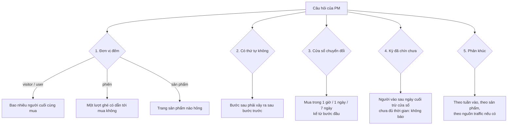
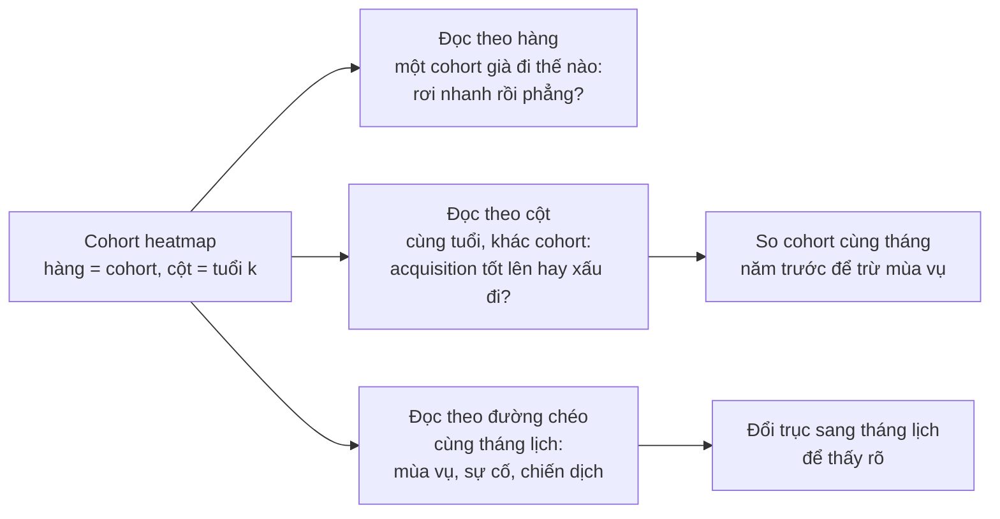
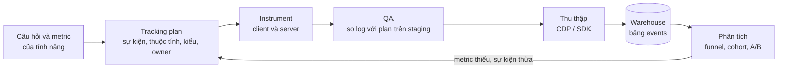

# Product & customer analytics

Module này là phần việc hằng ngày của một DA ngồi cạnh team product, CRM hoặc growth. Câu hỏi đến từ
người ra quyết định, không phải từ dữ liệu: PM hỏi **"người dùng rơi ở bước nào?"**, Head of CRM hỏi
**"khách mới có quay lại không, và nên gửi ưu đãi cho ai?"**, CMO hỏi **"được phép chi bao nhiêu để có
một khách mới?"**, merchandiser hỏi **"nên bày gì cạnh gì?"**. Mỗi câu có một kỹ thuật quen thuộc
(funnel, cohort, LTV/CAC, RFM, market basket), nhưng chỗ phân biệt DA senior là **định nghĩa**: đếm theo
ai, trong cửa sổ bao lâu, ô nào "chưa quan sát được", trung bình theo trọng số gì, và dữ liệu sự kiện có
đủ để trả lời không (tracking plan).

Module dùng hai bộ dữ liệu thật:

- **Online Retail II (UCI)**: giao dịch của một cửa hàng quà tặng online ở Anh (phần lớn khách là
  cửa hàng bán lẻ mua sỉ), 01/12/2009 tới 09/12/2011. Cohort và LTV đọc cả hai sheet (bỏ phần trùng
  01-09/12/2010); RFM và market basket đọc sheet `Year 2010-2011`.
- **Retailrocket events** (`ecommerce-events`): 2 755 641 sự kiện `view` / `addtocart` / `transaction` của
  1 407 580 visitor, 03/05 tới 18/09/2015. Giấy phép gốc CC BY-NC-SA 4.0: chỉ dùng để học, không đưa trích
  mẫu lên repo.

```bash
uv run python data/download_dataset.py online-retail-ii
uv run python data/download_dataset.py ecommerce-events   # cần Kaggle token
```

Mọi đoạn code chạy từ thư mục gốc repo, theo thứ tự (đoạn sau dùng lại biến của đoạn trước). Chạy không có
màn hình thì đặt `MPLBACKEND=Agg`; ảnh lưu vào thư mục tạm của hệ điều hành. Định nghĩa dùng chung của track:
dòng hợp lệ là hoá đơn không bắt đầu bằng `C`, `Quantity > 0`, `Price > 0`; doanh thu = `Quantity * Price`
(doanh thu gộp); khách là `Customer ID` khác null; **cohort** là tháng của hoá đơn hợp lệ đầu tiên;
**retention tháng k** là tỉ lệ khách của cohort có ít nhất một hoá đơn hợp lệ ở tháng thứ k sau tháng đầu;
tháng 12/2011 chưa đủ nên không tính.

Sau module này bạn sẽ:

- Định nghĩa funnel đúng câu hỏi: đơn vị đếm, thứ tự bước, **cửa sổ chuyển đổi**, kỳ chưa "chín", và funnel
  theo sản phẩm để tìm chỗ hỏng.
- Đọc cohort heatmap theo ba hướng (hàng, cột, đường chéo), phân biệt các loại retention, và đọc đường
  retention trung bình mà không bị đuôi ít cohort đánh lừa.
- Tính LTV đơn giản và LTV theo cohort, biết vì sao chúng lệch nhau, tính CAC payback với giả định ghi rõ.
- Chấm điểm RFM, gom thành segment có tên và **hành động** cho từng segment.
- Tìm luật mua kèm bằng support, confidence, lift (mlxtend), và biết luật nào đáng hành động.
- Viết tracking plan cho một tính năng và chọn công cụ product analytics.

## 1. Nhắc lại nhanh: đã có gì ở các module trước

Module này đứng trên bốn chỗ bạn đã học. Phần dưới chỉ nhắc ý chính; phần còn lại của module không làm lại.

- **Cohort và funnel bằng SQL**: module [SQL cho Data Analyst](../03-sql-for-analysts/README.md), phần 5 và bài
  Intermediate 01, Advanced 02. Hai CTE nền `first_month` và bảng hoạt động "một khách × một tháng"; ba bẫy cắt
  trái, kỳ chưa đủ, `NULL` khác `0`; funnel có thứ tự theo visitor và theo phiên 30 phút trên chính bộ Retailrocket
  (1 404 179 → 32 934 → 9 952 visitor). Ở đây làm bằng pandas và đi tiếp sang **đọc** kết quả.
- **Cohort retention có trọng số** (track Data Science, module
  [Coding cho DS](../../../data-science/modules/08-coding-for-ds/README.md)) và **RFM bằng k-means** (module
  [Classic ML](../../../data-science/modules/11-classic-ml/README.md), Olist). Ở đây RFM là **luật nghiệp vụ** có
  tên segment, cách đội CRM thật sự dùng; k-means trên RFM quay lại ở module ML cho DA.
- **Metric tree, north star, leading vs lagging**: module [Tư duy DA](../01-analyst-mindset/README.md). Retention
  là input metric của doanh thu (doanh thu = khách × tần suất × giá trị đơn); conversion là leading indicator.
- **Vẽ funnel và heatmap**: module [Trực quan hoá & đọc biểu đồ](../08-visualization-chart-reading/README.md):
  funnel ghi cả tỉ lệ so với bước đầu và bước trước, heatmap dùng palette sequential, ô trống khác ô 0.

## 2. Funnel: từ log sự kiện tới quyết định

### Năm quyết định trước khi đếm

Một funnel là chuỗi bước mà người dùng phải đi qua để tạo ra giá trị (xem → thêm giỏ → mua). Hai DA dựng funnel
trên cùng log có thể ra hai con số khác nhau gấp đôi, vì năm quyết định dưới đây. Ghi chúng ngay dưới chart.



1. **Đơn vị đếm**: visitor trả lời "bao nhiêu người mua", phiên trả lời "một lượt ghé có hiệu quả không", sản
   phẩm trả lời "trang nào hỏng". Đổi đơn vị là đổi câu hỏi.
2. **Thứ tự**: funnel có thứ tự chỉ đếm người làm bước sau **sau** bước trước. Module 03 đã đo: 2 129 visitor thêm
   giỏ trước lần xem đầu tiên, 3 321 visitor thêm giỏ mà không có lần xem nào trong dữ liệu.
3. **Cửa sổ chuyển đổi** (conversion window): "đã mua" trong bao lâu kể từ bước đầu. Không có cửa sổ thì người
   vào đầu kỳ có 4 tháng để mua, người vào cuối kỳ có vài ngày: tỉ lệ theo tuần sẽ giảm dần về cuối dù không có gì
   thay đổi.
4. **Kỳ đã chín chưa** (maturity): với cửa sổ 7 ngày, tuần vào nào kết thúc sau ngày cuối của dữ liệu trừ 7 ngày
   thì chưa đủ thời gian quan sát. Đó là **right-censoring**, cùng bản chất với ô `NULL` của cohort.
5. **Phân khúc**: một tỉ lệ gộp che mất cơ cấu (Simpson's paradox, module 08). Ít nhất tách theo thời gian và theo
   thứ quan trọng với câu hỏi (sản phẩm, nguồn traffic, thiết bị).

### Funnel có thứ tự và thời gian tới khi mua, bằng pandas

```python
import sys
import tempfile
from pathlib import Path

import matplotlib.pyplot as plt
import numpy as np
import pandas as pd

pd.set_option("display.width", 160)
pd.set_option("display.max_columns", 12)
ROOT = next(p for p in [Path.cwd(), *Path.cwd().parents] if (p / "pyproject.toml").exists())
sys.path.insert(0, str(ROOT))
from data.download_dataset import ensure  # noqa: E402

OUT = Path(tempfile.gettempdir()) / "da-m12"
OUT.mkdir(exist_ok=True)

raw = pd.read_csv(ensure("ecommerce-events") / "clean_events.csv",
                  usecols=["timestamp", "visitorid", "event", "itemid"])
events = pd.DataFrame({"visitor_id": raw.visitorid, "event": raw.event, "item_id": raw.itemid,
                       "event_time": pd.to_datetime(raw["timestamp"], unit="ms")})  # epoch mili giây, UTC
print(f"{len(events):,} sự kiện, {events.visitor_id.nunique():,} visitor, "
      f"{events.event_time.min():%Y-%m-%d %H:%M} → {events.event_time.max():%Y-%m-%d %H:%M}")

# Mốc đầu tiên của từng bước, có thứ tự: giỏ tính từ lần xem đầu, mua tính từ lần thêm giỏ đầu (đã tính)
t_view = events[events.event == "view"].groupby("visitor_id").event_time.min().rename("t_view")
cart = events[events.event == "addtocart"].join(t_view, on="visitor_id", how="inner")
t_cart = cart[cart.event_time >= cart.t_view].groupby("visitor_id").event_time.min().rename("t_cart")
buy = events[events.event == "transaction"].join(t_cart, on="visitor_id", how="inner")
t_buy = buy[buy.event_time >= buy.t_cart].groupby("visitor_id").event_time.min().rename("t_buy")
ft = pd.concat([t_view, t_cart, t_buy], axis=1)
print(ft.notna().sum().to_dict())

hours = (ft.t_buy - ft.t_view).dt.total_seconds().dropna() / 3600
print("giờ từ lần xem đầu tới lần mua đầu:", hours.quantile([0.5, 0.75, 0.9]).round(1).to_dict())
for label, h in [("1 giờ", 1), ("1 ngày", 24), ("7 ngày", 24 * 7), ("30 ngày", 24 * 30)]:
    print(f"mua trong {label}: {(hours <= h).mean():.1%} người mua")
```

Funnel có thứ tự cho cùng số với module 03: 1 404 179 → 32 934 → 9 952 visitor. Thời gian tới khi mua lệch rất
mạnh: **trung vị 0.4 giờ** (khoảng 23 phút), phân vị 75 là 9.9 giờ nhưng phân vị 90 là **220 giờ** (9 ngày).
62.8% người mua mua trong một giờ đầu, 79.6% trong một ngày, **88.6% trong 7 ngày**, 95.3% trong 30 ngày. Hai
hệ quả:

- Cửa sổ 7 ngày giữ gần 9/10 người mua và cho phép báo tỉ lệ của một tuần chỉ 7 ngày sau khi tuần đó kết thúc.
  Cửa sổ 30 ngày chính xác hơn nhưng con số "tuần này" phải chờ một tháng. Đây là đánh đổi **độ đầy đủ** với
  **độ kịp thời**, và là quyết định business (PM cần đọc số mỗi thứ Hai), không phải quyết định kỹ thuật.
- Vẽ histogram thời gian này phải dùng trục log; trung bình (bị đuôi 9 ngày kéo) gần như vô nghĩa.

### Tỉ lệ theo tuần vào, có cửa sổ và cờ "chưa chín"

```python
WINDOW = pd.Timedelta(days=7)
data_end = events.event_time.max()
ft["week"] = ft.t_view.dt.to_period("W-SUN").dt.start_time            # tuần thứ Hai → Chủ nhật
ft["cart_7d"] = (ft.t_cart - ft.t_view) <= WINDOW                    # NaT so sánh ra False
ft["buy_7d"] = (ft.t_buy - ft.t_view) <= WINDOW
weekly = ft.groupby("week").agg(visitors=("t_view", "size"), cart_rate=("cart_7d", "mean"),
                                buy_rate=("buy_7d", "mean"))
weekly["mature"] = weekly.index + pd.Timedelta(days=7) + WINDOW <= data_end
print(weekly.assign(cart_rate=weekly.cart_rate.round(4), buy_rate=weekly.buy_rate.round(4)).iloc[[0, 1, -3, -2, -1]])
ok = weekly[weekly.mature]
print(f"tuần đã chín: {len(ok)}/{len(weekly)}; buy_rate {ok.buy_rate.min():.2%} → {ok.buy_rate.max():.2%}")
```

21 tuần, 19 tuần đã chín. Tuần cuối (14-18/09, 4 ngày) có buy rate 0.49%, thấp nhất bảng, nhưng chưa chín: đặt
nó cạnh các tuần khác là báo một cú giảm không có thật. Tuần đầu cũng có vấn đề ngược lại: dữ liệu bắt đầu
03:00 Chủ nhật 03/05 nên "tuần" đó chỉ có một ngày (7 845 visitor), và "lần xem đầu" của họ có thể không phải
lần xem đầu thật (**cắt trái**). Trong 19 tuần chín, buy rate 7 ngày dao động 0.48% tới 0.79%: vẽ cả dải này
trước khi kết luận một tuần nào đó "giảm".

### Funnel theo sản phẩm: chỗ hỏng nằm ở đâu

```python
items = (events.groupby(["item_id", "event"]).visitor_id.nunique().unstack(fill_value=0)
         .reindex(columns=["view", "addtocart", "transaction"], fill_value=0))
items.columns = ["viewers", "carters", "buyers"]
popular = items[items.viewers >= 500].assign(cart_rate=lambda d: d.carters / d.viewers)
print(f"{len(items):,} sản phẩm; {len(popular)} sản phẩm có ≥ 500 người xem; "
      f"{(popular.carters == 0).sum()} trong số đó không ai thêm giỏ")
print(popular.sort_values("viewers", ascending=False).head(6))
print("sản phẩm có người mua nhiều hơn người thêm giỏ:", int((items.buyers > items.carters).sum()))
```

Trong 73 sản phẩm có ít nhất 500 người xem, **23 sản phẩm không có một lượt thêm giỏ**, kể cả sản phẩm được xem
nhiều nhất (2 911 người xem, 2 lượt thêm giỏ). Trước khi báo "trang sản phẩm này tệ", hãy nghĩ tới giả thuyết
khác: sản phẩm **hết hàng** hoặc ngừng bán (bộ Retailrocket gốc có thuộc tính `available` trong bảng item, bản
làm sạch đã bỏ), hoặc sự kiện thêm giỏ của trang đó không được gửi. Ngược lại, 565 sản phẩm có số người mua
**lớn hơn** số người thêm giỏ: có đường mua không qua giỏ (mua ngay) hoặc sự kiện giỏ bị thiếu. Cả hai đều là
câu hỏi cho tracking plan (phần 7), không phải cho chart.

## 3. Cohort và retention: đọc heatmap và đường retention

### Ba loại retention, ba câu trả lời

| Loại | Định nghĩa (tháng k của một cohort) | Trả lời câu hỏi | Bẫy |
| --- | --- | --- | --- |
| **Bracket / classic** (định nghĩa dùng chung của track) | Tỉ lệ khách có hoạt động **trong** tháng k | "Tháng thứ k còn bao nhiêu khách hoạt động" | Khách mua theo quý trông như rời đi rồi quay lại |
| **Unbounded / rolling** | Tỉ lệ khách có hoạt động ở tháng k **hoặc sau đó** | "Bao nhiêu khách chưa bỏ hẳn" | Luôn giảm dần, và **thay đổi khi có thêm dữ liệu** (cohort mới bị đánh giá thấp) |
| **Revenue retention** | Doanh thu tháng k / doanh thu tháng 0 của cohort | "Cohort còn mang lại bao nhiêu tiền" | Một khách sỉ đổi lịch là đổi cả con số (module 03) |

Product B2C (app, game) còn dùng **N-day retention** (quay lại đúng ngày 1, ngày 7, ngày 30). Không có loại nào
"đúng": chọn loại khớp nhịp mua của sản phẩm và ghi rõ trên chart.

### Ma trận cohort bằng pandas

```python
CACHE = Path(tempfile.gettempdir()) / "da-cache"


def read_sheet(sheet: str) -> pd.DataFrame:
    """Đọc một sheet Online Retail II; lần đầu 30-60 giây, sau đó đọc cache parquet trong thư mục tạm."""
    xlsx = ensure("online-retail-ii") / "online_retail_II.xlsx"
    stat = xlsx.stat()
    cache = CACHE / f"online_retail_II-{sheet.replace(' ', '_')}-{stat.st_mtime_ns}-{stat.st_size}.parquet"
    if cache.exists():
        return pd.read_parquet(cache)
    tx = pd.read_excel(xlsx, sheet_name=sheet)
    tx = tx.assign(Invoice=tx["Invoice"].astype(str), StockCode=tx["StockCode"].astype(str),
                   Description=tx["Description"].astype("string"))
    CACHE.mkdir(parents=True, exist_ok=True)
    tmp = cache.with_name(f"{cache.name}.tmp")
    tx.to_parquet(tmp, index=False)
    tmp.replace(cache)
    return tx


def clean_sales(tx: pd.DataFrame) -> pd.DataFrame:
    """Dòng hợp lệ theo định nghĩa dùng chung, kèm revenue."""
    s = tx.assign(Invoice=tx["Invoice"].astype(str))
    s = s[~s.Invoice.str.startswith("C") & (s.Quantity > 0) & (s.Price > 0)].copy()
    s["revenue"] = s.Quantity * s.Price
    return s


old, new = read_sheet("Year 2009-2010"), read_sheet("Year 2010-2011")
tx = pd.concat([old[old.InvoiceDate < "2010-12-01"], new], ignore_index=True)   # bỏ phần trùng 01-09/12/2010
sales = clean_sales(tx)
LAST = pd.Period("2011-11", "M")                                              # tháng đủ cuối cùng

cust = sales[sales["Customer ID"].notna()].assign(month=lambda d: d.InvoiceDate.dt.to_period("M"))
cohort = cust.groupby("Customer ID").month.min().rename("cohort")
act = cust[["Customer ID", "month"]].drop_duplicates().join(cohort, on="Customer ID")
act = act[act.month <= LAST]
act["k"] = (act.month - act.cohort).apply(lambda off: off.n)
sizes = act[act.k == 0].groupby("cohort").size()

counts = act.groupby(["cohort", "k"]).size().unstack(fill_value=0)
matrix = counts.div(sizes, axis=0)
ages = np.subtract.outer([(LAST - c).n for c in matrix.index], matrix.columns.to_numpy())
matrix = matrix.mask(ages < 0)                                                # ô chưa quan sát được: NaN
print(f"{len(sizes)} cohort, {sizes.sum():,} khách")
print(matrix.loc["2010-01":"2010-06", [1, 2, 3, 6, 10, 11, 12]].round(3))
print(matrix.loc[["2010-04", "2011-04", "2010-07", "2011-07"], [1, 3]].round(3))

fig, ax = plt.subplots(figsize=(10, 6))
im = ax.imshow(matrix.loc[:, 1:].to_numpy(), cmap="Blues", vmin=0, vmax=0.5, aspect="auto")
ax.set_xticks(range(0, 23, 2), [str(k) for k in range(1, 24, 2)])
ax.set_yticks(range(len(matrix)), [str(c) for c in matrix.index], fontsize=7)
ax.set_xlabel("tháng thứ k sau tháng đầu")
fig.colorbar(im, ax=ax, label="retention")
ax.set_title("Retention theo cohort: ô trắng là chưa quan sát được, không phải 0", loc="left")
fig.tight_layout()
fig.savefig(OUT / "cohort_heatmap.png", dpi=100)
plt.close(fig)
print(OUT / "cohort_heatmap.png")
```

24 cohort, 5 850 khách, khớp module 03. Bỏ cột k = 0 (luôn bằng 1) khỏi heatmap, nếu không cả bảng màu bị cột đó
chiếm.

### Đọc heatmap theo ba hướng



- **Theo hàng**: cohort 01/2010 rơi xuống 20.6% ở tháng 1 rồi dao động trong khoảng 15-32% suốt gần hai năm sau đó. Đường phẳng sau cú
  rơi đầu là dấu hiệu tốt: có một nhóm khách lõi ở lại.
- **Theo cột** (cùng tuổi): đừng so cohort 09/2011 với cohort 03/2011, vì tháng 1 của cohort tháng 9 rơi vào tháng
  10, mùa cao điểm. So **cùng tháng năm trước**: m1 của cohort 04/2011 là 25.5% so với 19.4% của 04/2010; cohort
  07/2011 21.6% so với 15.6% của 07/2010. Từ cohort tháng 4 tới tháng 10, cả 7 cặp đều cho 2011 cao hơn; nhưng cohort
  tháng 1-3/2011 lại thấp hơn năm trước, và mọi cohort 2011 nhỏ hơn nhiều (106 so với 294 khách ở tháng 4). Chọn hai
  tháng đẹp rồi kết luận "2011 tốt hơn" là cherry-picking: báo cả bảng.
- **Theo đường chéo** (cùng tháng lịch): ô của mọi cohort cùng sáng lên ở tháng 9-11 và tối đi ở tháng 12 tới
  tháng 2. Cohort 01/2010 có 30.3% ở tháng 11/2010 nhưng 17.2% ở tháng 12/2010. Đây là **mùa vụ của khách sỉ**
  (đặt hàng Giáng sinh trước tháng 12), không phải chất lượng cohort. Đổi trục sang tháng lịch
  (`cohort + k`) là thấy ngay (bài Basic 02).

### Đường retention trung bình: trọng số và số cohort phía sau mỗi điểm

```python
observed = matrix.notna()
weights = observed.mul(sizes, axis=0)                                    # chỉ cohort đã quan sát được tuổi k
curve = pd.DataFrame({
    "weighted": matrix.fillna(0).mul(sizes, axis=0).sum() / weights.sum(),
    "simple": matrix.mean(),
    "cohorts": observed.sum(),
})
print(curve.loc[[1, 3, 6, 12, 18, 21, 22, 23]].round(3))
print("không có cohort 12/2009:")
rest = matrix.drop(pd.Period("2009-12", "M"))
w_rest = rest.notna().mul(sizes.drop(pd.Period("2009-12", "M")), axis=0)
print((rest.fillna(0).mul(sizes, axis=0).sum() / w_rest.sum()).loc[[1, 12, 21, 22]].round(3))
```

Đường có trọng số (theo cỡ cohort) trả lời "một khách mới bất kỳ quay lại bao nhiêu %": 23.4% ở tháng 1, 22.7% ở
tháng 12. Trung bình đơn giản của các tỉ lệ (21.5% ở tháng 1) cho cohort 71 khách nặng bằng cohort 955 khách. Bẫy
lớn hơn nằm ở **đuôi**: điểm k = 23 (40.7%) chỉ có **một** cohort phía sau, là cohort 12/2009, cohort bị cắt trái
(chứa cả khách lâu năm mua lại trong tháng đầu của dữ liệu). Đường cong "cười" (đi lên ở cuối) gần như luôn là
ảo giác của ít cohort, không phải khách quay lại. Quy tắc: ghi số cohort dưới mỗi điểm, cắt đường khi còn dưới
3 cohort, và cân nhắc bỏ cohort cắt trái (bỏ cohort 12/2009 thì tháng 1 còn 21.0%, tháng 12 còn 18.4%).

## 4. LTV, CAC và payback

### Công thức đơn giản và vì sao nó thường quá lạc quan

Customer lifetime value (LTV) là lợi nhuận gộp một khách mang lại trong suốt thời gian còn là khách. Công thức
đơn giản nhất cho dịch vụ thuê bao hoặc khách mua đều đặn:

$$LTV \approx \frac{AOV \times f \times m}{1 - r}$$

với AOV là giá trị đơn trung bình, $$f$$ là số đơn mỗi khách mỗi năm, $$m$$ là biên lợi nhuận gộp, $$r$$ là tỉ lệ
khách năm nay còn mua năm sau (retention năm). $$\frac{1}{1-r}$$ là số năm sống trung bình nếu $$r$$ không đổi.
Phía chi phí, CAC (customer acquisition cost) là chi phí marketing và bán hàng chia cho số khách mới có được:

$$CAC = \frac{S}{N_{new}}$$

**Payback** là tháng đầu tiên mà lợi nhuận gộp luỹ kế của một khách (doanh thu luỹ kế nhân $$m$$) đạt CAC.

```python
year = cust[(cust.month >= pd.Period("2010-12", "M")) & (cust.month <= LAST)]
prev = cust[(cust.month >= pd.Period("2009-12", "M")) & (cust.month <= pd.Period("2010-11", "M"))]
aov = year.revenue.sum() / year.Invoice.nunique()
orders_per_year = year.Invoice.nunique() / year["Customer ID"].nunique()
r = len(set(prev["Customer ID"]) & set(year["Customer ID"])) / prev["Customer ID"].nunique()
MARGIN = 0.35                                                            # ví dụ giả định: dữ liệu không có giá vốn
print(f"AOV {aov:.0f} GBP, {orders_per_year:.2f} đơn/năm, retention năm {r:.1%}")
print(f"LTV đơn giản (lợi nhuận gộp): {aov * orders_per_year * MARGIN / (1 - r):,.0f} GBP")

# LTV theo cohort: doanh thu luỹ kế mỗi khách của cohort tới tuổi k
cust_k = cust[cust.month <= LAST].join(cohort, on="Customer ID")
cust_k["k"] = (cust_k.month - cust_k.cohort).apply(lambda off: off.n)
rev = cust_k.groupby(["cohort", "k"]).revenue.sum().unstack(fill_value=0)
ltv = rev.cumsum(axis=1).div(sizes, axis=0).mask(ages < 0)
print(ltv.loc["2010-01":"2010-06", [0, 2, 5, 11]].round(0))

new_2010 = cust_k[(cust_k.cohort >= pd.Period("2010-01", "M")) & (cust_k.cohort <= pd.Period("2010-11", "M"))]
first_year = new_2010[new_2010.k <= 11].groupby("Customer ID").revenue.sum()
print(f"khách mới 01-11/2010: {len(first_year):,}; doanh thu 12 tháng đầu mean {first_year.mean():.0f}, "
      f"median {first_year.median():.0f}; 1% khách lớn nhất chiếm {first_year.nlargest(len(first_year) // 100).sum() / first_year.sum():.1%}")
```

Trên khách hoạt động 12/2010-11/2011: AOV 473 GBP, 4.13 đơn mỗi năm, retention năm 63.6% (khách của 12/2009-11/2010
còn mua trong năm sau). Với biên lợi nhuận gộp **35% (ví dụ giả định, bộ dữ liệu không có giá vốn)**, LTV đơn giản
khoảng **1 878 GBP**. Nhưng khách mới 01-11/2010 (3 311 khách) chỉ mang lại **trung bình 1 449 GBP doanh thu, trung
vị 708 GBP** trong 12 tháng đầu, tức 507 GBP lợi nhuận gộp theo trung bình. Công thức đơn giản lạc quan vì:

- **r = 63.6% là retention của khách đã sống sót**: tập khách năm trước chứa nhiều khách lâu năm. Khách mới chỉ có
  khoảng 20% quay lại tháng sau (phần 3). Áp retention của khách cũ cho khách mới là lỗi phổ biến nhất.
- **Trung bình bị khách sỉ kéo**: 1% khách mới lớn nhất chiếm 15.8% doanh thu 12 tháng; khách "điển hình" (trung
  vị) chỉ bằng một nửa trung bình.
- **Giả định r không đổi theo tuổi**: đường retention thật rơi mạnh ở tháng đầu rồi phẳng.

LTV theo cohort đọc thẳng từ dữ liệu, không giả định: cohort 01/2010 có doanh thu luỹ kế 423 GBP mỗi khách ở tháng
0 và 2 043 GBP sau 12 tháng; cohort 05/2010 chỉ 1 054 GBP. Đổi lại, nó chỉ cho biết quá khứ tới tuổi đã quan sát;
muốn dự báo xa hơn phải ngoại suy đường cong (giữ đơn giản: nhân phần đuôi phẳng, và nói rõ đó là ngoại suy).

### CAC và payback: số giả định phải ghi là giả định

Bộ dữ liệu không có chi phí marketing. Một DA vẫn trả lời được câu "được chi bao nhiêu" bằng cách **lật ngược câu
hỏi**: với đường LTV theo cohort và biên lợi nhuận giả định, CAC tối đa bao nhiêu thì hoàn vốn trong 6 hay 12
tháng. Ví dụ giả định: CAC = 200 GBP, biên 35%, nên cần 200 / 0.35 = 571 GBP doanh thu luỹ kế mỗi khách.

```python
CAC = 200                                                                # ví dụ giả định
need = CAC / MARGIN
payback = ltv.apply(lambda row: next((k for k, v in row.dropna().items() if v >= need), None), axis=1).astype("Int64")
print(payback.loc["2010-01":"2010-12"].to_dict())
print("CAC tối đa để hoàn vốn trong 12 tháng (theo trung bình cohort):",
      (ltv.loc["2010-01":"2010-11", 11] * MARGIN).round(0).to_dict())
```

Với CAC giả định 200 GBP, các cohort 2010 hoàn vốn ở tháng thứ 0-3 (cohort 09/2010 hoàn vốn ngay tháng đầu); cohort
12/2010 cần tới tháng 4. Câu hỏi
ngược ("CAC tối đa để hoàn vốn trong 12 tháng") cho dải 329-715 GBP tuỳ cohort. Ba điều phải nói cùng con số:

- **Mọi con số CAC và biên ở đây là ví dụ giả định.** Thay bằng số thật của tài chính trước khi gửi ai.
- **LTV/CAC** thường được đặt ngưỡng khoảng 3 (tham chiếu phổ biến cho SaaS), nhưng ngưỡng hợp lý phụ thuộc vốn,
  tốc độ tăng trưởng và **thời gian hoàn vốn** công ty chịu được; payback ngắn quan trọng hơn khi tiền mặt eo hẹp.
- **CAC theo kênh**: CAC gộp (blended) trộn khách tự nhiên (CAC gần 0) với khách từ quảng cáo; quyết định chi thêm
  cho một kênh cần **CAC biên** của kênh đó, và LTV của khách đến từ đúng kênh đó.

## 5. RFM segmentation: từ điểm số tới hành động

### Ba con số, năm mức điểm, một bảng hành động

RFM mô tả mỗi khách bằng ba con số tại một ngày chốt (snapshot): **Recency** (bao nhiêu ngày từ lần mua cuối),
**Frequency** (bao nhiêu đơn), **Monetary** (bao nhiêu tiền). Mỗi con số đổi thành điểm 1-5 (5 là tốt nhất), rồi
một bảng luật gom các tổ hợp điểm thành segment có tên mà đội CRM hiểu được. Hai cách chấm điểm:

| Cách | Làm thế nào | Mạnh | Yếu |
| --- | --- | --- | --- |
| **Quintile** | Chia đều khách thành 5 nhóm theo thứ hạng | Luôn cân bằng 20% mỗi mức; hợp với Monetary lệch phải | Ngưỡng đổi mỗi lần chạy: khách không đổi hành vi vẫn đổi segment; nhiều khách cùng giá trị (F = 1) bị chia ngẫu nhiên |
| **Ngưỡng nghiệp vụ** | Mốc cố định có ý nghĩa: "mua trong 14 ngày", "từ 10 đơn" | Ổn định theo thời gian, giải thích được | Phải chọn mốc theo nhịp mua; nhóm có thể lệch cỡ |

Module dùng **ngưỡng** cho R (≤ 14, ≤ 30, ≤ 90, ≤ 180 ngày, còn lại) và F (1, 2, 3-4, 5-9, từ 10 đơn), **quintile**
cho M. Segment chỉ dùng R và F (lưới phổ biến của CRM); M dùng để ưu tiên trong segment.

```python
sales_11 = clean_sales(new)
known = sales_11[sales_11["Customer ID"].notna()]
snapshot = known.InvoiceDate.max().normalize() + pd.Timedelta(days=1)      # 2011-12-10
g = known.groupby("Customer ID")
rfm = pd.DataFrame({"recency": (snapshot - g.InvoiceDate.max().dt.normalize()).dt.days,
                    "frequency": g.Invoice.nunique(), "monetary": g.revenue.sum()})
rfm["R"] = 5 - np.searchsorted([14, 30, 90, 180], rfm.recency, side="left")
rfm["F"] = 1 + np.searchsorted([1, 2, 4, 9], rfm.frequency, side="left")
rfm["M"] = pd.qcut(rfm.monetary.rank(method="first"), 5, labels=[1, 2, 3, 4, 5]).astype(int)

SEGMENTS = [  # (tên, điểm R, điểm F): luật đầu tiên khớp thắng
    ("champions", [5], [4, 5]), ("loyal", [3, 4], [4, 5]), ("potential_loyalist", [4, 5], [2, 3]),
    ("new", [5], [1]), ("promising", [4], [1]), ("need_attention", [3], [3]), ("about_to_sleep", [3], [1, 2]),
    ("cant_lose", [1, 2], [5]), ("at_risk", [1, 2], [3, 4]), ("hibernating", [1, 2], [1, 2]),
]
rfm["segment"] = [next(n for n, rs, fs in SEGMENTS if r in rs and f in fs) for r, f in zip(rfm.R, rfm.F)]
summary = rfm.groupby("segment").agg(customers=("R", "size"), revenue=("monetary", "sum"),
                                     median_recency=("recency", "median"), median_frequency=("frequency", "median"))
summary["customer_share"] = summary.customers / len(rfm)
summary["revenue_share"] = summary.revenue / rfm.monetary.sum()
print(f"{len(rfm):,} khách, snapshot {snapshot:%Y-%m-%d}")
print(summary.sort_values("revenue", ascending=False).round(3))
```

4 338 khách. **Champions** (507 khách, 11.7%) mang lại **46.8%** doanh thu; champions và loyal cộng lại 24.1% khách,
69.5% doanh thu. **Hibernating** là nhóm đông nhất (1 164 khách, 26.8%) nhưng chỉ 6.4% doanh thu. Bảng hành động
là sản phẩm thật của RFM:

| Segment | Hành vi | Hành động gợi ý | Đo bằng |
| --- | --- | --- | --- |
| champions | Mua gần đây, nhiều lần | Giữ quan hệ: early access, quản lý tài khoản; **không** giảm giá đại trà | Retention, doanh thu giữ được |
| loyal | Nhiều đơn, gần đây vừa phải | Bán thêm (cross-sell từ phần 6), chương trình thành viên | Số đơn, giá trị đơn |
| potential_loyalist | Mua gần đây, 2-4 đơn | Gợi ý đơn tiếp theo theo nhịp mua, ưu đãi đơn thứ 3 | Tỉ lệ lên loyal |
| new / promising | Một đơn, gần đây | Onboarding: hướng dẫn, đơn thứ hai trong 30 ngày | Tỉ lệ có đơn thứ 2 |
| need_attention / about_to_sleep | Đang thưa dần | Nhắc lại có cá nhân hoá, ưu đãi có thời hạn | Tỉ lệ quay lại 60 ngày |
| at_risk / cant_lose | Từng mua nhiều, lâu chưa quay lại | Liên hệ trực tiếp (khách sỉ: gọi điện), hỏi lý do; ưu tiên M cao | Win-back rate, giá trị thu hồi |
| hibernating | Một hai đơn, lâu rồi | Chiến dịch chi phí thấp hoặc bỏ qua; đừng tốn ngân sách | Chi phí trên khách quay lại |

Ba lỗi hay gặp:

- **RFM là ảnh chụp, không phải dự báo**: "at risk" là mô tả; muốn biết chiến dịch win-back có hiệu quả, phải có
  nhóm đối chứng (module 11).
- **Cửa sổ dữ liệu**: "new" ở đây là "một đơn trong năm và mua trong 14 ngày". Trong 67 khách "new", 21 khách đã mua
  trước 12/2010 (sheet 2009-2010). Đặt tên segment theo đúng điều dữ liệu biết.
- **Monetary gộp khách sỉ và lẻ**: 10 khách lớn nhất chiếm 17.3% doanh thu năm; tách khách sỉ ra trước khi chấm
  quintile M, hoặc chấm theo nhóm khách.

## 6. Market basket analysis: support, confidence, lift

### Ba con số của một luật

Market basket analysis tìm các luật dạng "giỏ có A thì hay có B" ($$A \Rightarrow B$$) từ dữ liệu giỏ hàng (một hoá
đơn là một giỏ). Với $$N$$ giỏ:

$$\text{support}(A \Rightarrow B) = P(A \cap B), \qquad \text{confidence}(A \Rightarrow B) = \frac{P(A \cap B)}{P(A)}, \qquad \text{lift}(A \Rightarrow B) = \frac{P(A \cap B)}{P(A)\,P(B)}$$

- **Support**: luật phổ biến tới đâu (có đáng hành động không). Support 2% trên 19 773 giỏ là khoảng 395 giỏ.
- **Confidence**: trong giỏ có A, bao nhiêu phần có B. Không đối xứng, và **bị đánh lừa bởi B phổ biến**: nếu B có
  trong 11% mọi giỏ thì confidence 15% gần như không nói gì.
- **Lift**: confidence chia cho tỉ lệ nền của B. Lift = 1 là độc lập; lift > 1 là hay đi cùng; lift < 1 là ít đi
  cùng hơn ngẫu nhiên (có thể thay thế nhau). Lift đối xứng.

```python
from mlxtend.frequent_patterns import association_rules, fpgrowth

lines = sales_11[sales_11.StockCode.str.match(r"^\d{5}")]               # bỏ POST, DOT, M, BANK CHARGES...
names = lines.groupby("StockCode").Description.agg(lambda d: d.mode().iloc[0].strip())
basket = (lines[["Invoice", "StockCode"]].drop_duplicates().assign(bought=True)
          .pivot_table(index="Invoice", columns="StockCode", values="bought", aggfunc="any", fill_value=False))
print(f"{basket.shape[0]:,} giỏ × {basket.shape[1]:,} mã hàng")
print("mã có trong nhiều giỏ nhất:", basket.mean().nlargest(3).round(3).rename(names).to_dict())

itemsets = fpgrowth(basket, min_support=0.02, use_colnames=True)
rules = association_rules(itemsets, metric="lift", min_threshold=1.0)
one = rules[(rules.antecedents.apply(len) == 1) & (rules.consequents.apply(len) == 1)].copy()
one["A"] = one.antecedents.apply(lambda s: names[next(iter(s))])
one["B"] = one.consequents.apply(lambda s: names[next(iter(s))])
print(f"{len(itemsets)} itemset, {len(rules)} luật, {len(one)} luật một-một")
cols = ["A", "B", "support", "confidence", "lift"]
print(one.sort_values("lift", ascending=False)[cols].head(4).round(3).to_string(index=False))
print(one.sort_values("lift")[cols].head(2).round(3).to_string(index=False))
```

19 773 giỏ, 3 900 mã hàng. Với min support 2%: 389 itemset, 194 luật, 176 luật một-một. Luật lift cao nhất là các
**biến thể màu của cùng một sản phẩm**: trong giỏ có tách trà Regency màu hồng, 82.6% có màu xanh (lift 16.1). Luật
lift thấp nhất trong danh sách là giữa hai mặt hàng bán chạy nhất (túi Jumbo đỏ và giá nến trái tim trắng):
confidence 18-19%, lift 1.7, tức hai món phổ biến gặp nhau chỉ thường hơn ngẫu nhiên một chút.

Đọc luật như một DA:

- **Lift cao chưa chắc là cơ hội bán kèm**: biến thể màu đi cùng nhau vì khách sỉ mua đủ bộ. Hành động hợp lý là bày
  thành bộ, bán "set 3 màu", không phải gợi ý chéo (khách đã tự mua).
- **Support quyết định quy mô**: một luật lift rất cao nhưng chỉ xuất hiện trong vài chục giỏ ảnh hưởng ít doanh thu
  hơn một luật lift vừa phải xuất hiện trong hàng nghìn giỏ. Ưu tiên theo doanh thu kỳ vọng, không theo lift.
- **Mùa vụ**: chạy riêng hai nửa của sheet (12/2010-06/2011 và 07-12/2011, cùng min support 2%) được 172 và 340
  luật một-một, chỉ 106 luật chung.
  Cặp dây trang trí Giáng sinh (paper chain kit 50's và vintage Christmas) có support 4.5% ở nửa sau và không thành
  luật ở nửa đầu. Kiểm luật trên từng mùa trước khi dùng cho cả năm.
- **Luật là tương quan, không phải nhân quả**: "gợi ý B cho người mua A" có tăng doanh thu không phải đo bằng A/B
  test (module 11), vì người mua A có thể đã định mua B.
- **min_support quá thấp** làm số itemset bùng nổ (hàng chục nghìn luật, phần lớn là nhiễu); quá cao chỉ còn luật
  hiển nhiên. Bắt đầu từ số giỏ tối thiểu có ý nghĩa với business (vài trăm giỏ), rồi điều chỉnh.

## 7. Tracking plan, event instrumentation và chọn công cụ

### Dữ liệu sự kiện tốt bắt đầu từ một bản thiết kế

Mọi phân tích ở phần 2 bị giới hạn bởi những gì được ghi: bộ Retailrocket chỉ có `visitor_id`, `event`, `item_id`,
thời điểm. Không có phiên, nguồn traffic, thiết bị, giá, tình trạng còn hàng, vị trí click. Vì vậy câu "vì sao 23
sản phẩm được xem nhiều không ai thêm giỏ" không trả lời được. **Tracking plan** là tài liệu thống nhất giữa
product, engineering và data về: ghi sự kiện nào, khi nào, kèm thuộc tính nào, kiểu gì, ai sở hữu, phục vụ metric
nào.



Một dòng trong tracking plan thường có:

| Cột | Ví dụ | Vì sao cần |
| --- | --- | --- |
| `event` | `product_viewed`, `cart_item_added`, `order_completed` | Quy ước **object_action**, quá khứ, snake_case: đặt tên một lần, mọi nền tảng dùng chung |
| `trigger` | "Khi API thêm giỏ trả 200", không phải "khi bấm nút" | Hai đội instrument giống nhau; sự kiện server-side đáng tin hơn client cho giao dịch |
| `properties` | `item_id` (string, bắt buộc), `price` (number), `source` (enum: `search`, `recommendation`, `cross_sell`...) | Thuộc tính quyết định câu hỏi nào trả lời được; enum tránh `"Search"`, `"search "`, `"tim_kiem"` |
| Định danh | `anonymous_id`, `user_id`, `session_id`, thời điểm UTC | Nối hành vi trước và sau đăng nhập; phiên do client sinh nhất quán hơn tự chia 30 phút |
| `owner`, `metric` | Team checkout; "cart rate theo nguồn" | Có người chịu trách nhiệm khi sự kiện hỏng; sự kiện không phục vụ metric nào thì đừng thêm |
| `version`, trạng thái | `v2`, `live` / `deprecated` | Đổi định nghĩa mà không đổi tên làm chuỗi thời gian gãy âm thầm |

Nguyên tắc: bắt đầu từ **câu hỏi và metric**, không từ "ghi hết cho chắc" (chi phí, nhiễu, rủi ro dữ liệu cá nhân);
không đưa dữ liệu cá nhân (email, số điện thoại) vào thuộc tính sự kiện; kiểm sự kiện tự động so với plan (bài
Advanced 02) trước khi tính năng ra mắt, vì sửa tracking sau khi ra mắt nghĩa là mất dữ liệu của những tuần đầu,
đúng những tuần cần đo nhất.

### Chọn công cụ product analytics

| Công cụ | Dùng khi | Mạnh | Yếu | Loại công ty hay dùng |
| --- | --- | --- | --- | --- |
| **Google Analytics 4** | Website marketing, đo nguồn traffic và chiến dịch | Miễn phí, nối Google Ads, BigQuery export | Mô hình sự kiện giới hạn, sampling và ngưỡng ẩn danh, khó funnel/cohort theo user tuỳ biến | Mọi cỡ, nhất là doanh nghiệp làm marketing số |
| **Amplitude / Mixpanel** | PM tự trả lời funnel, retention, path mà không cần SQL | Funnel, cohort, retention có sẵn, nhanh, self-serve | Trả tiền theo lượng sự kiện; số lệch với warehouse nếu định nghĩa khác; dữ liệu nằm ngoài | Startup, công ty app/SaaS có team product mạnh |
| **PostHog** | Muốn product analytics kèm feature flag, session replay, tự host được | Mã nguồn mở, gói nhiều công cụ, SQL trên dữ liệu | Tự host tốn công vận hành; hệ sinh thái nhỏ hơn | Startup kỹ thuật, công ty cần dữ liệu ở lại trong hạ tầng mình |
| **Segment / RudderStack** (CDP) | Thu sự kiện một lần, gửi tới nhiều đích (warehouse, Amplitude, ads) | Một SDK, tracking plan và kiểm schema (Protocols, Tracking Plans) | Thêm một lớp chi phí và độ trễ; không phải công cụ phân tích | Công ty vừa và lớn có nhiều công cụ đích |
| **Warehouse + SQL/Python** (BigQuery, Snowflake, DuckDB; dbt) | Định nghĩa metric chính thức, nối sự kiện với đơn hàng, chi phí, CRM | Linh hoạt nhất, một nguồn sự thật, kiểm được | Cần DA/AE viết và bảo trì; PM không tự làm được | Mọi công ty có team data; nguồn chính cho LTV, CAC, RFM |
| **Excel / Google Sheets** | Bảng cohort hoặc RFM đã tổng hợp, kịch bản CAC what-if | Ai cũng mở, sửa giả định nhanh | Không xử lý log sự kiện thô, khó tái lập | Mọi công ty, ở đầu ra |

Quy tắc thực dụng: **product analytics tool cho câu hỏi nhanh của PM, warehouse cho con số chính thức**. Khi hai nơi
lệch nhau (thường do định nghĩa user, múi giờ, bot, sự kiện trùng), con số trong warehouse là số báo cáo, và định
nghĩa phải được ghi lại ở một chỗ (module semantic layer).

## 8. Tài liệu tham khảo

Roadmap gốc (mục Data Analysis Techniques, Customer Segmentation; bản PDF ở `roadmap/data-analyst.pdf`):

- [roadmap.sh: Data Analyst](https://roadmap.sh/data-analyst)

Sách và bài viết:

- Alistair Croll & Benjamin Yoskovitz. *Lean Analytics* (O'Reilly, 2013). Chọn metric theo mô hình kinh doanh và
  giai đoạn; funnel, retention, LTV/CAC cho từng loại sản phẩm.
- Peter Fader. *Customer Centricity* (Wharton, 2012) và [Bruce Hardie's notes](https://www.brucehardie.com/notes/)
  về mô hình LTV (BG/NBD, sBG): vì sao công thức retention không đổi sai.
- [Amplitude: Retention analysis](https://amplitude.com/docs/analytics/charts/retention-analysis/retention-analysis-interpret)
  (N-day, unbounded, bracket retention).
- [Mixpanel: Funnels](https://docs.mixpanel.com/docs/reports/funnels/funnels-overview) (conversion window, thứ tự
  bước, đơn vị đếm).
- [RudderStack: Tracking plans](https://www.rudderstack.com/docs/data-governance/tracking-plans/) (kiểm sự kiện
  theo plan) và [Segment: Naming conventions](https://segment.com/academy/collecting-data/naming-conventions-for-clean-data/)
  (object_action).
- [mlxtend: association_rules](https://rasbt.github.io/mlxtend/user_guide/frequent_patterns/association_rules/)
  và [fpgrowth](https://rasbt.github.io/mlxtend/user_guide/frequent_patterns/fpgrowth/).
- Agrawal & Srikant. *Fast Algorithms for Mining Association Rules* (VLDB 1994): bài gốc của Apriori.
- David Skok. [SaaS Metrics 2.0](https://www.forentrepreneurs.com/saas-metrics-2/): LTV/CAC, CAC payback.

Dữ liệu:

- Daqing Chen. [Online Retail II (UCI)](https://archive.ics.uci.edu/dataset/502/online+retail+ii), CC BY 4.0.
- [Retail Rocket cleaned events (Kaggle)](https://www.kaggle.com/datasets/cianaellington/retail-rocket-cleaned-events-dataset),
  bản làm sạch của [Retailrocket recommender system dataset](https://www.kaggle.com/datasets/retailrocket/ecommerce-dataset),
  CC BY-NC-SA 4.0.
