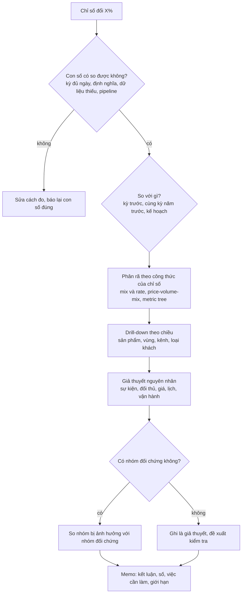
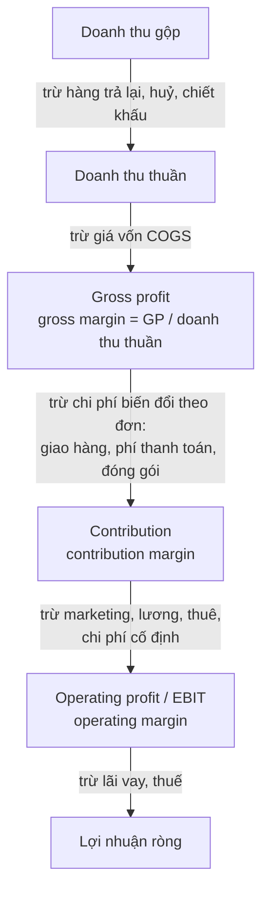
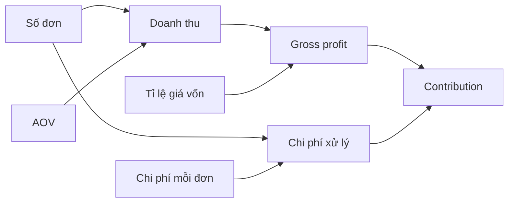
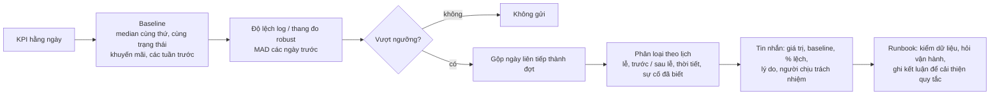

# Business & financial analytics

Phần lớn câu hỏi một DA nhận từ CEO, CFO, giám đốc kinh doanh không phải "vẽ giúp tôi chart" mà là năm loại câu: **vì
sao chỉ số này đổi** (root cause), **mình lời bao nhiêu trên mỗi đơn** (P&L, margin, unit economics), **giá và
khuyến mãi có đáng không** (pricing, promotion), **tháng sau bao nhiêu** (forecast), **nếu ... thì sao** (scenario,
what-if), và một loại không ai hỏi nhưng ai cũng cần: **báo tôi khi có chuyện** (giám sát KPI). Module này đi qua cả
sáu, ở mức một DA senior làm hằng tuần với phòng tài chính và kinh doanh: công thức đủ dùng, so sánh công bằng,
giả định ghi rõ, và câu trả lời mà người không biết SQL đọc được.

Module dùng ba bộ dữ liệu thật:

- **Online Retail II (UCI)**: giao dịch cửa hàng quà tặng online ở Anh, 2009-12-01 tới 2011-12-09. Quy tắc dòng hợp
  lệ và doanh thu gộp dùng chung của track (bỏ hoá đơn `C...`, bỏ dòng `Quantity <= 0` hoặc `Price <= 0`).
- **Rossmann Store Sales** (`store-sales`): doanh số, lượt khách, cờ khuyến mãi theo ngày của 1 115 cửa hàng
  Rossmann (Đức), 01/01/2013 tới 31/07/2015, cùng thông tin cửa hàng và đối thủ.
- **Bike Sharing (UCI)**: lượt thuê xe đạp mỗi ngày ở Washington DC, 2011-2012.

```bash
uv run python data/download_dataset.py online-retail-ii
uv run python data/download_dataset.py store-sales
uv run python data/download_dataset.py bike-sharing-uci
```

Mọi đoạn code chạy từ thư mục gốc repo, theo thứ tự (đoạn sau dùng biến của đoạn trước). Bộ dữ liệu không có giá
vốn, chi phí giao hàng, mức giảm giá: mọi con số chi phí trong module là **ví dụ giả định** và được ghi rõ như vậy.

Sau module này bạn sẽ:

- Điều tra một chỉ số biến động theo quy trình: kiểm con số, so sánh công bằng, phân rã (mix và rate,
  price-volume-mix), drill-down, nhóm đối chứng.
- Đọc và dựng P&L đơn giản; phân biệt gross margin, contribution margin, operating margin; tính unit economics
  của một đơn hàng.
- Đo tác động của khuyến mãi bằng so sánh công bằng, nhận ra kéo cầu và cannibalization; tính hoà vốn khi đổi giá.
- Làm dự báo doanh số ở mức DA (seasonal naive, moving average, ETS) và chọn phương pháp bằng backtest.
- Dựng mô hình driver và bảng kịch bản, phân tích độ nhạy.
- Thiết kế cảnh báo KPI có baseline mùa vụ, ngưỡng robust, gộp đợt và phân loại.

## 1. Nhắc lại nhanh

Ba phần của module dựa trên kiến thức đã có ở module khác; phần này chỉ nhắc chỗ nối.

- **Metric tree và phân rã LMDI**: module [01. Tư duy DA](../01-analyst-mindset/README.md) phần 5 dựng cây doanh thu =
  khách × tần suất × AOV và phân rã thay đổi giữa hai tháng sao cho cộng đúng tổng. Module này thêm hai cách phân
  rã khác hay dùng trong tài chính: **mix và rate** (khi trung bình toàn bộ là trung bình có trọng số của các nhóm) và
  **price-volume-mix** (khi doanh thu là tổng giá × lượng của nhiều sản phẩm).
- **Điều tra một cú giảm**: module [08. Trực quan hoá](../08-visualization-chart-reading/README.md) phần 5 và bài
  Advanced 01 điều tra "doanh thu tháng 12/2011 giảm 58%" (kỳ chưa đủ ngày, hoá đơn lớn bị huỷ). Module này dùng lại
  quy trình đó cho một câu hỏi khác: cửa hàng giảm trong khi chuỗi tăng.
- **Chuỗi thời gian**: track Data Science, module [07. Time series](../../../data-science/modules/07-time-series/README.md)
  đi sâu phân rã, ARIMA/ETS, LightGBM, backtest, prediction interval, reconciliation. Ở đây chỉ giữ phần một DA cần
  để trả lời FP&A có trách nhiệm: baseline, backtest, khoảng sai số, giả định.
- **Thí nghiệm**: tác động thật của giá và khuyến mãi đo tốt nhất bằng thí nghiệm có đối chứng (module 11 của track
  này; track Data Science module [04](../../../data-science/modules/04-advanced-experimentation/README.md) có bài
  thiết kế thí nghiệm trên chính Rossmann). Phần 4 dưới đây chỉ làm phân tích quan sát và chỉ ra giới hạn của nó.

## 2. Root cause khi chỉ số biến động

### Quy trình

Khi một chỉ số đổi mạnh, câu hỏi đầu tiên không phải "vì sao" mà là "**có thật không**". Thứ tự dưới đây tránh việc
mất hai ngày phân tích một ảo giác:



Ba kiểm tra hay bị bỏ qua ở bước "có thật không": **kỳ chưa đủ** (tháng hiện tại so với tháng đủ), **dữ liệu thiếu
một phần** (một nhóm cửa hàng, một quốc gia, một nguồn ngừng đổ về: tổng tụt nhưng không ai mua ít đi), và **lịch**
(lễ di động như Phục sinh, số ngày cuối tuần trong tháng, ngày lương). Bài Intermediate 02 có một ví dụ thật: tổng
doanh số tuần của mọi cửa hàng Rossmann tụt khoảng 14% từ tháng 7/2014 chỉ vì một nhóm cửa hàng không có dữ liệu.

### Mix và rate

Nhiều KPI là **trung bình có trọng số** của các nhóm: AOV = tổng (tỉ trọng đơn của nhóm × AOV của nhóm), tỉ lệ
chuyển đổi toàn site = tổng (tỉ trọng traffic của kênh × chuyển đổi của kênh). Thay đổi của trung bình tách được
thành hai phần cộng lại đúng bằng tổng thay đổi, với w là tỉ trọng và r là giá trị của từng nhóm:

$$
\bar r_1 - \bar r_0 = \underbrace{\sum_g (r_{1g} - r_{0g})\, w_{1g}}_{\text{rate}} + \underbrace{\sum_g (w_{1g} - w_{0g})\, r_{0g}}_{\text{mix}}
$$

Rate trả lời "trong từng nhóm, chỉ số đổi bao nhiêu"; mix trả lời "tỉ trọng các nhóm dịch chuyển làm trung bình đổi
bao nhiêu". Khi hai phần ngược dấu, trung bình toàn bộ có thể giảm dù mọi nhóm đều tăng (Simpson's paradox, module
08 phần 4). Ví dụ trên Online Retail II: AOV quý 1/2011 so với tháng 9-11/2011, tách theo đơn có mã khách và đơn
khách vãng lai:

```python
import os
import sys
import tempfile
from pathlib import Path

import numpy as np
import pandas as pd

ROOT = next(p for p in [Path.cwd(), *Path.cwd().parents] if (p / "pyproject.toml").exists())
sys.path.insert(0, str(ROOT))
from data.download_dataset import ensure  # noqa: E402

XLSX = ensure("online-retail-ii") / "online_retail_II.xlsx"


def read_sheet(sheet: str) -> pd.DataFrame:
    # lần đầu 30-90 giây; sau đó đọc cache parquet trong thư mục tạm (khoá theo mtime + size của tệp xlsx)
    stat = XLSX.stat()
    cache = (Path(tempfile.gettempdir()) / "da-cache"
             / f"online_retail_II-{sheet.replace(' ', '_')}-{stat.st_mtime_ns}-{stat.st_size}.parquet")
    if cache.exists():
        return pd.read_parquet(cache)
    df = pd.read_excel(XLSX, sheet_name=sheet)
    df = df.assign(Invoice=df["Invoice"].astype(str), StockCode=df["StockCode"].astype(str),
                   Description=df["Description"].astype("string"))
    cache.parent.mkdir(parents=True, exist_ok=True)
    tmp = cache.with_name(f"{cache.name}.{os.getpid()}.tmp")
    df.to_parquet(tmp, index=False)
    os.replace(tmp, cache)
    return df


tx = read_sheet("Year 2010-2011")
tx["revenue"] = tx["Quantity"] * tx["Price"]
valid = tx[~tx["Invoice"].str.startswith("C") & (tx["Quantity"] > 0) & (tx["Price"] > 0)]
orders = valid.groupby("Invoice").agg(revenue=("revenue", "sum"), date=("InvoiceDate", "first"),
                                      customer=("Customer ID", "first"))
orders["segment"] = np.where(orders["customer"].isna(), "guest", "known")


def mix_rate(orders: pd.DataFrame, a: tuple, b: tuple, by: str) -> pd.Series:
    """AOV hai kỳ [start, end) và phân rã thay đổi thành rate (trong nhóm) và mix (tỉ trọng nhóm)."""
    def stats(period):
        part = orders[(orders["date"] >= period[0]) & (orders["date"] < period[1])]
        g = part.groupby(by)["revenue"].agg(["sum", "size"])
        return g["sum"] / g["size"], g["size"] / g["size"].sum(), part["revenue"].mean()
    r0, w0, aov0 = stats(a)
    r1, w1, aov1 = stats(b)
    return pd.Series({"aov0": aov0, "aov1": aov1, "rate": ((r1 - r0) * w1).sum(), "mix": ((w1 - w0) * r0).sum()})


print(mix_rate(orders, ("2011-01-01", "2011-04-01"), ("2011-09-01", "2011-12-01"), "segment").round(2))
```

AOV tăng 29.26 GBP (+5.5%). Phân rã cho thấy câu chuyện khác hẳn con số: rate +50.90 nhưng mix −21.64. Nhóm khách
vãng lai có AOV gần gấp đôi (957 lên 1 866 GBP) nhưng tỉ trọng đơn giảm một nửa (9.2% xuống 4.6%); nhóm khách có
mã, 95% số đơn, chỉ tăng 2% (488 lên 497). Nếu báo "AOV tăng 5.5%" mà không phân rã, người đọc sẽ nghĩ khách quen
đang mua giỏ lớn hơn.

### Price, volume, mix

Khi doanh thu là tổng giá × lượng của nhiều sản phẩm, thay đổi doanh thu của các sản phẩm có ở cả hai kỳ tách thành
ba phần (p là giá bình quân, q là số lượng, Q là tổng số lượng, s = q / Q):

$$
\text{price} = \sum_i (p_{1i} - p_{0i})\, q_{1i}, \quad
\text{volume} = (Q_1 - Q_0) \sum_i s_{0i}\, p_{0i}, \quad
\text{mix} = Q_1 \sum_i (s_{1i} - s_{0i})\, p_{0i}
$$

cộng thêm hai dòng riêng cho **sản phẩm mới** (chỉ có ở kỳ sau) và **sản phẩm ngừng bán**. Ba điều cần nói kèm mỗi
PVM bridge:

- **Công thức là một lựa chọn**: tính giá trên lượng kỳ mới hay kỳ gốc cho ra số khác nhau, có khi khác cả dấu. Ghi
  công thức và giữ cố định qua các kỳ.
- **"Giá" là giá bình quân thực thu**, không phải giá niêm yết: bán xả, bậc giá sỉ, khuyến mãi đều làm nó đổi.
- **Cộng số lượng của các sản phẩm khác đơn vị** (một cái bút, một tấm thảm) làm volume và mix khó diễn giải; làm
  PVM theo nhóm sản phẩm khi có thể.

Bài Intermediate 01 làm PVM cho mùa cao điểm 2011 so với 2010 trên Online Retail II; bài Advanced 01 phân rã nhân
doanh số cửa hàng = ngày mở cửa × lượt khách mỗi ngày × chi tiêu mỗi khách.

## 3. P&L, margin và unit economics

### Cấu trúc P&L

P&L (báo cáo kết quả kinh doanh, income statement) đi từ doanh thu xuống lợi nhuận, mỗi bậc trừ một loại chi phí.
DA không cần lập báo cáo tài chính, nhưng phải biết mỗi loại margin trừ những gì để không so lệch với số của phòng
tài chính:



| Khái niệm | Công thức | Dùng để trả lời |
| --- | --- | --- |
| Gross margin | (doanh thu thuần − giá vốn) / doanh thu thuần | Định giá, đàm phán nhà cung cấp, so danh mục |
| Contribution margin | (doanh thu − mọi chi phí biến đổi) / doanh thu | Một đơn / một khách / một kênh có lời không; hoà vốn |
| Operating margin | lợi nhuận hoạt động / doanh thu thuần | Doanh nghiệp có hiệu quả không, sau chi phí cố định |
| Markup | (giá bán − giá vốn) / **giá vốn** | Cách phòng mua hàng đặt giá; markup 50% là margin 33% |
| Break-even | chi phí cố định / contribution margin | Cần bao nhiêu doanh thu để không lỗ |

Trên Online Retail II, phần trên cùng của P&L lấy được từ dữ liệu thật; phần dưới phải giả định:

```python
# tx, valid đã có ở phần 2
cancel = tx[tx["Invoice"].str.startswith("C")]
gross = valid["revenue"].sum()
returns = cancel["revenue"].sum()                      # âm: hoá đơn huỷ / trả hàng
fees_charged = valid.loc[valid["StockCode"].isin(["POST", "DOT"]), "revenue"].sum()
net = gross + returns
COGS_RATE = 0.60                                       # ví dụ giả định
pnl = pd.Series({
    "doanh thu gộp": gross,
    "huỷ / trả hàng": returns,
    "doanh thu thuần": net,
    "giá vốn (giả định 60%)": -COGS_RATE * net,
    "gross profit": (1 - COGS_RATE) * net,
})
print(pnl.round(0).to_string())
print(f"huỷ / trả hàng = {-returns / gross:.1%} doanh thu gộp; cước POST + DOT khách trả: {fees_charged:,.0f} GBP")
```

Hoá đơn huỷ và trả hàng bằng 8.4% doanh thu gộp, nên "doanh thu" trên dashboard (gộp, theo định nghĩa chung của
track) cao hơn doanh thu thuần mà phòng tài chính báo khoảng 0.9 triệu GBP mỗi năm. Hai con số đều đúng, với hai định
nghĩa; lỗi là để hai báo cáo dùng hai định nghĩa mà không ghi. Cước `POST` và `DOT` khách trả cũng nằm trong doanh thu
gộp; khi tính margin hàng hoá thì tách chúng ra.

### Unit economics

Unit economics hỏi một **đơn vị** (một đơn hàng, một khách, một cửa hàng, một chuyến xe) mang lại bao nhiêu sau chi
phí biến đổi của chính nó. Với một đơn hàng:

$$
\text{contribution} = \text{doanh thu} - \text{giá vốn} - \text{phí thanh toán} - \text{chi phí mỗi đơn} - \text{chi phí mỗi dòng} \times \text{số dòng}
$$

Ba lỗi hay gặp: gộp mọi chi phí thành "x% doanh thu" (chi phí giao hàng đi theo **số đơn**, không theo tiền, nên đơn
nhỏ bị đánh giá quá cao); tính giá vốn theo doanh thu khi mô phỏng tăng giá (tăng giá bán không làm hàng mua vào đắt
hơn); và đếm "tỉ lệ đơn lỗ" thay vì "tiền lỗ". Unit economics theo khách (LTV, CAC, payback) ở module 12. Bài Basic
02 tính contribution của từng đơn Online Retail II với một bộ giả định chi phí và trả lời câu "có nên đặt giá trị đơn
tối thiểu không".

## 4. Giá và khuyến mãi

### Đo tác động của khuyến mãi

Câu "ngày khuyến mãi bán nhiều hơn X%" là một **quan sát**; tác động tăng thêm (incremental) là phần doanh số không
có nếu không khuyến mãi. Giữa hai thứ đó có bốn khoảng cách:

| Vấn đề | Ví dụ | Cách xử lý ở mức DA |
| --- | --- | --- |
| So sánh không cùng điều kiện | Khuyến mãi chỉ chạy ngày thường, so với mọi ngày | So cùng thứ, cùng điều kiện mở cửa, cùng mùa |
| Kéo cầu (pull-forward) | Khách mua trữ trong tuần khuyến mãi, tuần sau mua ít | Xem doanh số trước, trong, sau đợt; tổng cả chu kỳ |
| Cannibalization | Sản phẩm khuyến mãi lấy doanh số của sản phẩm thay thế, hoặc cửa hàng gần đó | Đo cả nhóm sản phẩm / khu vực, không chỉ mã khuyến mãi |
| Halo | Khách đến vì khuyến mãi mua thêm hàng không khuyến mãi | Tách lượt khách và chi tiêu mỗi khách |

Rossmann chạy khuyến mãi đồng loạt toàn chuỗi, thứ Hai tới thứ Sáu, thường cách tuần. So ngày có và không có khuyến
mãi trên ngày thường mở cửa có bán, theo từng năm:

```python
train = pd.read_csv(ensure("store-sales") / "train.csv", parse_dates=["Date"], dtype={"StateHoliday": str})
days = train[(train["Open"] == 1) & (train["Sales"] > 0) & (train["DayOfWeek"] <= 5)]
by_year = days.groupby([days["Date"].dt.year, "Promo"])[["Sales", "Customers"]].mean().unstack("Promo")
lift = pd.DataFrame({
    "sales_lift": by_year[("Sales", 1)] / by_year[("Sales", 0)] - 1,
    "customers_lift": by_year[("Customers", 1)] / by_year[("Customers", 0)] - 1,
})
print(lift.round(3))
```

Lift khoảng 37-40% mỗi năm và ổn định, khoảng một nửa đến từ thêm lượt khách. "Ổn định" giúp lập kế hoạch nhưng không
chứng minh nhân quả: lịch đồng loạt toàn chuỗi nên không có nhóm đối chứng cùng thời điểm, và mọi tuần không khuyến
mãi đều ngay sau một tuần có khuyến mãi (nếu khách mua trữ, mốc so sánh đã bị kéo xuống). Bài Advanced 02 đi hết
phân tích này và đổi lift ra điều kiện có lãi.

### Elasticity và hoà vốn khi đổi giá

Price elasticity of demand là phần trăm đổi của lượng chia phần trăm đổi của giá. Với hai điểm (giá, lượng) dùng arc
elasticity để kết quả không phụ thuộc chiều so sánh:

$$
\varepsilon = \frac{(Q_1 - Q_0) / \tfrac{1}{2}(Q_1 + Q_0)}{(P_1 - P_0) / \tfrac{1}{2}(P_1 + P_0)}
$$

Ví dụ giả định: giá từ 10 lên 11, lượng từ 1 000 xuống 900, thì ε = (−100 / 950) / (1 / 10.5) ≈ −1.1. Ước elasticity
từ dữ liệu quan sát rất dễ sai (giá đổi cùng lúc với mùa, quảng cáo, đối thủ), nên DA thường trả lời câu ngược lại,
chỉ cần margin: **tăng giá p thì được mất tối đa bao nhiêu lượng** mà contribution không giảm. Với contribution margin
m và chi phí biến đổi theo đơn vị, lượng mới phải thoả (m + p) q' = m q, nên mức đổi lượng hoà vốn là −p / (m + p):

```python
# Mức giảm số lượng tối đa khi đổi giá p, với contribution margin m (chi phí biến đổi theo đơn vị)
margins = [0.20, 0.30, 0.40, 0.50]
changes = [-0.10, -0.05, 0.05, 0.10]
table = pd.DataFrame({f"giá {p:+.0%}": [-p / (m + p) for m in margins] for p in changes},
                     index=[f"margin {m:.0%}" for m in margins])
print(table.map(lambda v: f"{v:+.1%}"))
```

Đọc bảng: margin càng mỏng, giảm giá càng cần nhiều lượng bù (margin 20%, giảm giá 10% cần bán thêm 100%); tăng giá
thì ngược lại. Đặt con số này cạnh phản ứng thật của khách (từ thử nghiệm giá, hoặc ít nhất từ lần đổi giá trước) là
câu trả lời mà giám đốc kinh doanh cần.

## 5. Dự báo xu hướng doanh số ở mức DA

FP&A, vận hành, mua hàng cần con số tương lai để lên kế hoạch. Việc của DA không phải model tốt nhất có thể mà là
một con số **tin được, có khoảng sai số, có giả định ghi rõ**, và một cách chọn phương pháp mà người khác kiểm lại
được. Bốn phương pháp đủ cho phần lớn nhu cầu:

| Phương pháp | Dự báo | Hợp khi | Hỏng khi |
| --- | --- | --- | --- |
| Seasonal naive | Giá trị cùng kỳ mùa trước (cùng tuần năm trước, cùng thứ tuần trước) | Mùa vụ mạnh, xu hướng phẳng | Chuỗi tăng nhanh; lễ di động (Phục sinh) lệch pha |
| Seasonal naive × tăng trưởng | Cùng kỳ năm trước nhân tỉ lệ tăng gần đây so với cùng kỳ | Mùa vụ mạnh, tăng đều | Tăng trưởng đang đổi nhanh |
| Moving average | Trung bình k kỳ gần nhất | Không mùa vụ trong horizon, mức đang đổi | Chuỗi có chu kỳ ngắn hơn k (tuần cao / tuần thấp) |
| ETS (Holt-Winters) | Làm mượt mức, xu hướng, mùa vụ có trọng số giảm dần | Đủ vài chu kỳ mùa; xu hướng và mùa ổn định | Ít lịch sử so với độ dài mùa (mùa 52 tuần với 2 năm dữ liệu) |

Không có phương pháp thắng mọi chuỗi; **backtest** chọn giúp bạn: cắt lịch sử tại nhiều điểm, dự báo h kỳ tiếp theo
chỉ bằng dữ liệu trước điểm cắt, đo sai số (MAPE cho độ lớn, bias cho hướng), rồi lấy trung bình qua các điểm cắt. Ví
dụ trên lượt thuê xe tuần của Bike Sharing, horizon 8 tuần, ba điểm cắt năm 2012:

```python
bike = pd.read_csv(ensure("bike-sharing-uci") / "day.csv", parse_dates=["dteday"]).set_index("dteday")
weekly = bike["cnt"].resample("W-SUN").agg(["sum", "size"])
weekly = weekly.loc[weekly["size"] == 7, "sum"]                 # chỉ tuần đủ 7 ngày, nhãn là Chủ nhật


def methods(history: pd.Series, h: int) -> dict:
    last_year = history.iloc[-52:].iloc[:h].to_numpy(dtype=float)
    growth = history.iloc[-8:].sum() / history.iloc[-60:-52].sum()      # 8 tuần gần nhất so với cùng kỳ
    return {"seasonal_naive": last_year, "growth_adjusted": last_year * growth,
            "moving_average": np.repeat(history.iloc[-4:].mean(), h)}


rows = {}
for cutoff in ["2012-04-01", "2012-06-03", "2012-09-02"]:
    history, actual = weekly[:cutoff], weekly[cutoff:].iloc[1:9].to_numpy(dtype=float)
    rows[cutoff] = {k: np.mean(np.abs(v - actual) / actual) for k, v in methods(history, 8).items()}
print(pd.DataFrame(rows).T.map(lambda v: f"{v:.1%}"))
```

Năm 2012 lượt thuê tăng mạnh so với 2011, nên cùng tuần năm trước (seasonal naive) thấp hơn thực tế 30-43%. Nhân tỉ
lệ tăng 8 tuần gần nhất giúp ở tháng 6 và 9 nhưng tệ hơn ở tháng 4 (tỉ lệ 8 tuần đầu xuân là 2.3 lần, không giữ được
sang mùa hè). Moving average 4 tuần thắng ở cả ba điểm cắt vì horizon 8 tuần nằm gọn trong một đoạn mùa vụ thay đổi
chậm. Trên doanh số tuần Rossmann (bài Intermediate 02) kết quả ngược lại: doanh số xen kẽ tuần cao, tuần thấp theo
lịch khuyến mãi, moving average tệ nhất và seasonal naive gần tốt nhất. Cùng một phương pháp, hai chuỗi, hai kết luận:
đó là lý do không chọn phương pháp bằng cảm giác.

Khi gửi dự báo, kèm ba thứ: **khoảng** (ví dụ ± MAPE backtest, hoặc phân vị sai số; DS module 07 làm prediction
interval đúng nghĩa), **giả định** (lịch khuyến mãi, số cửa hàng, giá), và **phạm vi** (chuỗi so sánh được, đơn vị,
kỳ). Một con số không có ba thứ đó sẽ được dùng như cam kết.

## 6. Scenario và what-if

Dự báo trả lời "nếu mọi thứ tiếp tục như cũ"; scenario trả lời "nếu một vài thứ đổi". Cách làm chuẩn là **mô hình
driver**: viết chỉ số đích thành phép tính từ vài driver mà người ra quyết định hiểu và điều khiển được, mỗi driver có
một ô giả định riêng.



Mốc là tháng 11/2011 thật của Online Retail II; giá vốn và chi phí mỗi đơn là giả định:

```python
# Mô hình driver tháng (ví dụ giả định, mốc lấy từ dữ liệu thật tháng 11/2011)
nov = orders[(orders["date"] >= "2011-11-01") & (orders["date"] < "2011-12-01")]
base = {"orders": len(nov), "aov": nov["revenue"].mean(), "cogs_rate": 0.60, "cost_per_order": 8.0}


def contribution(d: dict) -> float:
    return d["orders"] * (d["aov"] * (1 - d["cogs_rate"]) - d["cost_per_order"])


scenarios = {
    "base": {},
    "xấu: đơn −10%, giá vốn 63%": {"orders": base["orders"] * 0.9, "cogs_rate": 0.63},
    "tốt: AOV +5%, cước 7 GBP": {"aov": base["aov"] * 1.05, "cost_per_order": 7.0},
}
table = pd.DataFrame({name: {"contribution": contribution({**base, **ch})} for name, ch in scenarios.items()}).T
table["so với base"] = table["contribution"] - table.loc["base", "contribution"]
print(f"tháng 11/2011: {base['orders']:,} đơn, AOV {base['aov']:.2f} GBP")
print(table.round(0))
# độ nhạy: mỗi driver +10%, các driver khác giữ nguyên
sens = {k: contribution({**base, k: v * 1.1}) / contribution(base) - 1 for k, v in base.items()}
print({k: f"{v:+.1%}" for k, v in sens.items()})
```

Bảng kịch bản cho thấy một tháng xấu (mất 10% đơn, nhà cung cấp tăng giá 3 điểm) lấy đi khoảng 99 nghìn GBP
contribution, tháng tốt thêm khoảng 33 nghìn. Phân tích độ nhạy (mỗi driver +10%, các driver khác giữ nguyên) cho
thấy giá vốn là driver nguy hiểm nhất (−15.6%), chi phí mỗi đơn gần như không đáng kể (−0.4%): biết điều này thì nên
dành thời gian xác minh giá vốn thay vì tranh luận về cước giao hàng. Biểu đồ tornado là cách trình bày quen thuộc
của bảng độ nhạy (bài Basic 02).

Quy tắc khi làm what-if cho người khác dùng:

- **Tách ô giả định khỏi ô công thức**, tô màu khác, ghi nguồn của từng giả định. Không gõ số cứng trong công thức.
- **Ba kịch bản có tên** (xấu, cơ sở, tốt), mỗi kịch bản là một bộ giả định nhất quán, không phải "mọi thứ −10%".
- **Hoà vốn** trả lời câu "giả định phải sai đến đâu thì quyết định đổi": ví dụ giá vốn lên bao nhiêu thì contribution
  về 0 (Goal Seek trong Excel).
- **Công cụ theo người dùng**: CFO muốn tự đổi số trong buổi họp thì spreadsheet (Data Table, Scenario Manager, Goal
  Seek; Google Sheets có Goal Seek qua add-on và bảng dữ liệu bằng công thức); mô hình chạy hằng tháng trên dữ liệu
  lớn thì Python hoặc SQL, xuất bảng kịch bản; doanh nghiệp lớn dùng công cụ FP&A chuyên (Anaplan, Pigment, Adaptive).

## 7. Giám sát KPI: anomaly, ngưỡng, alert

Cảnh báo KPI tốt có bốn phần: **baseline** (con số "bình thường" của hôm nay), **độ lệch và ngưỡng**, **gộp và phân
loại** để người nhận đọc được trong vài giây, và **runbook** (ai làm gì khi nhận). Thiếu bất kỳ phần nào, sau hai tuần
người nhận sẽ tắt thông báo.



| Loại ngưỡng | Cách tính | Ưu | Nhược |
| --- | --- | --- | --- |
| Cố định | KPI < giá trị đặt tay | Dễ hiểu | Báo theo mùa, không theo bất thường |
| So với kỳ trước | Giảm > x% so với hôm qua / tuần trước | Dễ làm | Kỳ trước có thể chính là ngoại lệ; bỏ qua chu kỳ tuần |
| Baseline mùa vụ + robust z | ln(KPI / median cùng thứ) chia 1.4826 × MAD | Trừ mùa vụ, chịu được ngoại lệ | Cần lịch sử; vẫn cần lịch lễ |
| Khoảng dự báo | Ngoài khoảng 95% của model dự báo | Có xu hướng, nhiều mùa vụ (Prophet, ETS) | Phức tạp, khoảng sai nếu model sai |

Ví dụ trên doanh số ngày của 934 cửa hàng Rossmann đủ dữ liệu, thứ Hai tới thứ Bảy, so hai quy tắc:

```python
# KPI: doanh số ngày của các cửa hàng có dữ liệu mọi ngày (thứ Hai - thứ Bảy)
full = train.groupby("Store")["Date"].nunique()
panel = train[train["Store"].isin(full[full == full.max()].index)]
daily = panel.groupby("Date").agg(sales=("Sales", "sum"), promo=("Promo", "max"),
                                  holiday=("StateHoliday", lambda s: (s != "0").mean()))
daily = daily[daily.index.day_of_week < 6]
kpi = daily["sales"]

fixed = kpi < kpi.quantile(0.05)                                     # quy tắc 1: dưới phân vị 5% cả kỳ
# quy tắc 2: median 4 ngày gần nhất cùng thứ và cùng trạng thái khuyến mãi; thang đo robust 60 ngày trước
baseline = kpi.groupby([kpi.index.day_of_week, daily["promo"]]).transform(
    lambda s: s.shift(1).rolling(4, min_periods=4).median())
ratio = np.log(kpi / baseline)
scale = 1.4826 * ratio.shift(1).rolling(60, min_periods=30).apply(
    lambda r: np.nanmedian(np.abs(r - np.nanmedian(r))), raw=True)
alerts = pd.DataFrame({"kpi_m": kpi / 1e6, "baseline_m": baseline / 1e6, "z": ratio / scale,
                       "holiday_share": daily["holiday"]})[(ratio / scale).abs() > 4]
print(f"{len(kpi)} ngày; quy tắc cố định: {fixed.sum()} cảnh báo "
      f"({(daily.loc[fixed, 'holiday'] > 0).sum()} ngày lễ), quy tắc mùa vụ: {len(alerts)} cảnh báo "
      f"({(alerts.holiday_share > 0).sum()} ngày lễ)")
print(alerts[alerts.holiday_share == 0].round(2).head(6))
```

Quy tắc cố định báo 41 ngày, 29 là ngày lễ (đóng cửa nên doanh số thấp, ai cũng biết). Quy tắc mùa vụ báo 48 ngày;
kiểm từng ngày với lịch lễ thì 27 là ngày lễ, 9 là một hai ngày trước lễ (khách mua trước khi đóng cửa, ví dụ
28/03/2013 trước Thứ Sáu Tuần Thánh), 5 là ngay sau lễ, 5 là ngày mà baseline bị kéo xuống vì có ngày lễ trong 4 tuần
trước (10/06/2013: hai trong bốn thứ Hai làm baseline là lễ, Phục sinh 01/04 và Ngũ Tuần 20/05), và 2 là tuần
trước Giáng sinh. Không cảnh báo nào là "sự cố thật". Với dữ liệu bán lẻ, phần lớn công sức làm cảnh báo là **lịch**: bỏ ngày lễ khỏi lịch sử của baseline, so ngày
lễ với cùng lễ năm trước, và gắn nhãn trước / sau lễ trước khi gửi. Bài Basic 03 làm đủ các bước trên Bike Sharing,
nơi thời tiết đóng vai trò của lịch.

### Chọn công cụ

| Công cụ | Dùng khi | Loại công ty hay dùng | Mạnh | Yếu |
| --- | --- | --- | --- | --- |
| **Excel / Google Sheets** | Mô hình driver, bảng kịch bản, P&L cho CFO tự đổi số | Mọi công ty; phòng tài chính, SME | Ai cũng mở được, Data Table / Goal Seek / Scenario Manager | Dễ sai do copy-paste, khó tái lập, giới hạn dòng |
| **Python (pandas, statsmodels)** | Phân rã, PVM trên hàng nghìn mã, backtest dự báo, cảnh báo phức tạp | Công ty có data team | Tái lập, test được, xử lý dữ liệu lớn | Người dùng cuối không tự đổi giả định được |
| **SQL lên lịch** (dbt test, job trong Airflow) | Cảnh báo ngưỡng đơn giản trên warehouse, kiểm chất lượng dữ liệu | Công ty có warehouse và DE | Gần dữ liệu, chạy tự động, review được trong git | Khó làm baseline mùa vụ, thống kê robust |
| **BI alert** (Metabase, Superset, Power BI data alert, Tableau) | Cảnh báo ngưỡng trên câu hỏi / dashboard có sẵn, gửi email / chat | Công ty đã có BI | Không cần code, gắn với dashboard người dùng đã quen | Thường chỉ ngưỡng cố định hoặc % đổi; ít kiểm soát logic |
| **Prophet / thư viện dự báo** | Baseline có xu hướng, nhiều mùa vụ, ngày lễ | Tech company, team DS hỗ trợ | Xử lý lễ và nhiều mùa vụ sẵn | Hộp đen với người dùng; phải backtest như mọi model |
| **Công cụ FP&A** (Anaplan, Pigment, Adaptive Planning) | Kế hoạch ngân sách, kịch bản nhiều phòng ban cùng sửa | Doanh nghiệp vừa và lớn có phòng FP&A | Quy trình duyệt, phân quyền, phiên bản kế hoạch | Đắt, cần người quản trị, DA thường chỉ cung cấp dữ liệu |
| **Công cụ anomaly / observability** (Anodot, Monte Carlo, Datadog) | Hàng trăm metric, cảnh báo tự động, giám sát dữ liệu | Công ty lớn, nhiều sản phẩm số | Tự học baseline, quản lý alert | Đắt; vẫn cần người định nghĩa metric và runbook |

Quy tắc thực dụng: câu hỏi một lần (vì sao, nếu thì sao) làm trong notebook hoặc spreadsheet; thứ chạy hằng ngày (dự
báo, cảnh báo) phải nằm trong pipeline có lịch chạy, có người chịu trách nhiệm và có cách tắt khi báo sai.

## 8. Tài liệu tham khảo

Roadmap gốc (mục Data Analysis Techniques, Diagnostic / Predictive / Prescriptive Analytics; bản PDF ở
`roadmap/data-analyst.pdf`):

- [roadmap.sh: Data Analyst](https://roadmap.sh/data-analyst)

Dự báo và giám sát:

- Rob J Hyndman, George Athanasopoulos. [Forecasting: Principles and Practice, 3rd ed.](https://otexts.com/fpp3/)
  (đọc miễn phí). Chương 5 (baseline, đánh giá dự báo), chương 8 (ETS).
- [statsmodels: ExponentialSmoothing](https://www.statsmodels.org/stable/generated/statsmodels.tsa.holtwinters.ExponentialSmoothing.html)
- [Prophet](https://github.com/facebook/prophet): dự báo có xu hướng, nhiều mùa vụ, ngày lễ.
- [NIST/SEMATECH e-Handbook: Detection of Outliers](https://www.itl.nist.gov/div898/handbook/eda/section3/eda35h.htm):
  z-score robust với median và MAD.
- Google SRE Book. [Monitoring Distributed Systems](https://sre.google/sre-book/monitoring-distributed-systems/):
  nguyên tắc cảnh báo ít mà đúng, có runbook.
- [Metabase: Alerts](https://www.metabase.com/docs/latest/questions/alerts) và
  [Superset: Alerts and Reports](https://superset.apache.org/docs/configuration/alerts-reports/).

Tài chính, giá, what-if:

- [Microsoft: Introduction to What-If Analysis in Excel](https://support.microsoft.com/en-us/office/introduction-to-what-if-analysis-22bffa5f-e891-4acc-bf7a-e4645c446fb4)
  (Scenario Manager, Goal Seek, Data Table).
- [Wikipedia: Contribution margin](https://en.wikipedia.org/wiki/Contribution_margin),
  [Price elasticity of demand](https://en.wikipedia.org/wiki/Price_elasticity_of_demand).
- Karen Berman, Joe Knight. *Financial Intelligence* (Harvard Business Review Press, 2013). Đọc P&L, margin cho người
  không làm tài chính.
- Alistair Croll, Benjamin Yoskovitz. *Lean Analytics* (O'Reilly, 2013). Unit economics và chỉ số theo mô hình kinh doanh.

Dữ liệu:

- Daqing Chen. [Online Retail II (UCI)](https://archive.ics.uci.edu/dataset/502/online+retail+ii), CC BY 4.0.
- [Rossmann Store Sales (Kaggle)](https://www.kaggle.com/datasets/pratyushakar/rossmann-store-sales), dữ liệu cuộc thi
  Kaggle 2015.
- Fanaee-T & Gama. [Bike Sharing Dataset (UCI)](https://archive.ics.uci.edu/dataset/275/bike+sharing+dataset), CC BY 4.0.
