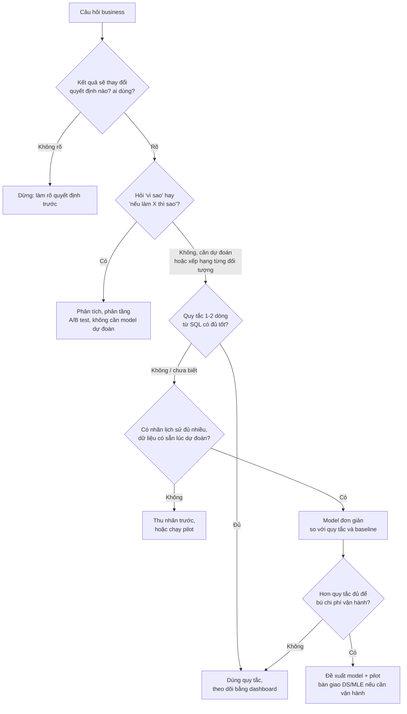
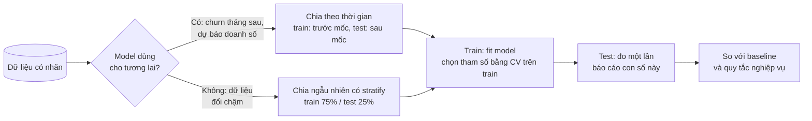
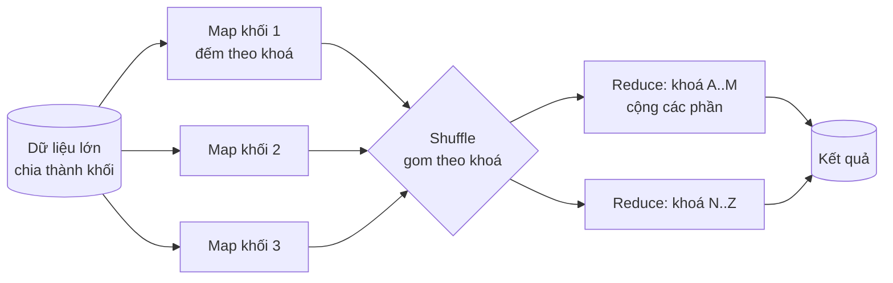

# ML & Big Data cho DA

Data Analyst không phải người train model cả ngày, nhưng là người bị hỏi nhiều nhất: *"Có nên làm model dự
đoán churn không?"*, *"Vendor nói model đúng 80%, vậy có tốt không?"*, *"Chia khách thành mấy nhóm bằng AI
được không?"*, *"Dữ liệu này có cần Spark không?"*. Trả lời được những câu đó cần hiểu ML và Big Data ở mức
**dùng và đọc kết quả**: biết bài toán thuộc loại nào, thuật toán nào hợp, model tốt hơn một quy tắc đơn giản
bao nhiêu, con số đánh giá có lừa không, và dữ liệu có thực sự "lớn" không. Module này dạy đúng mức đó, theo
góc nhìn của người phải giải thích kết quả cho business và quyết định khi nào ML **không** đáng làm.

Module dùng ba bộ dữ liệu thật:

- **Telco Customer Churn (IBM, Kaggle)**: 7 043 khách viễn thông, 21 cột, nhãn `Churn` (26.5% rời bỏ). Dùng
  cho phân loại, đọc hệ số và đánh giá model.
- **Online Retail II (UCI)**: sheet `Year 2010-2011`, dòng hợp lệ theo định nghĩa dùng chung của track (bỏ hoá
  đơn `C...`, bỏ dòng `Quantity <= 0` hoặc `Price <= 0`, doanh thu gộp `Quantity * Price`). Dùng cho k-means trên
  RFM và MapReduce.
- **Bike Sharing (UCI)**: `hour.csv`, 17 379 giờ thuê xe Capital Bikeshare 2011–2012. Dùng cho ví dụ map-reduce
  và bài "ML hay quy tắc" ở phần bài tập.

```bash
uv run python data/download_dataset.py telco-churn
uv run python data/download_dataset.py online-retail-ii
uv run python data/download_dataset.py bike-sharing-uci
```

Telco không ghi rõ giấy phép: chỉ đọc từ `data/raw/`, không trích mẫu vào repo. Mọi đoạn code chạy từ thư mục
gốc repo theo thứ tự (đoạn sau dùng lại biến của đoạn trước). Chạy không có màn hình thì đặt `MPLBACKEND=Agg`.

Sau module này bạn sẽ:

- Phân loại một câu hỏi business vào supervised, unsupervised hay reinforcement learning, và quyết định khi
  nào một quy tắc, một bảng SQL hay một thí nghiệm tốt hơn một model.
- Dùng và đọc kết quả năm thuật toán trong roadmap: Logistic Regression, Decision Tree, Naive Bayes, KNN,
  K-Means; dịch hệ số và luật của model thành câu cho stakeholder.
- Đánh giá model đúng cách: train/test, confusion matrix, precision/recall, ngưỡng, lift theo decile; nhận ra
  khi nào accuracy lừa.
- Giải thích Deep Learning (NN, CNN, RNN, Transformer, TensorFlow và PyTorch) ở mức đủ để biết khi nào nó đáng
  dùng cho ảnh và văn bản, và vì sao nó hiếm khi thắng trên bảng dữ liệu kinh doanh.
- Nói được Big Data là gì, Hadoop/Spark, parallel processing, MPI và MapReduce giải quyết gì, và kiểm tra dữ
  liệu của mình có cần chúng không.

## 1. Nhắc lại nhanh

Phần lý thuyết sâu đã có ở hai track khác. Module này chỉ nhắc ý chính và đi theo góc nhìn DA:

- Track Data Science: [Feature Engineering & Validation](../../../data-science/modules/10-feature-engineering/README.md)
  (data leakage, `Pipeline`, CV theo thời gian), [Classic ML](../../../data-science/modules/11-classic-ml/README.md)
  (bias-variance, metric và ngưỡng theo chi phí, calibration, k-means, SHAP),
  [Advanced ML](../../../data-science/modules/12-advanced-ml/README.md) (gradient boosting) và
  [Deep Learning với PyTorch](../../../data-science/modules/13-deep-learning/README.md) (CNN, RNN, Transformer).
- Track Data Engineer: [Spark & Big Data](../../../data-engineer/modules/06-spark-big-data/README.md) (cluster
  computing, HDFS, YARN, MapReduce, kiến trúc Spark, partition, shuffle).
- Module 11 của track này: regression để **giải thích** (hệ số, khoảng tin cậy), correlation không phải
  causation.

Ba điều cần nhớ từ đó:

- **Model học từ quá khứ để đoán trên dữ liệu chưa thấy.** Mọi con số đánh giá phải đo trên dữ liệu model chưa
  thấy khi học (test set), và test set phải giống cách model sẽ được dùng (thường là tương lai).
- **Dự đoán tốt không có nghĩa là hiểu nguyên nhân.** Model churn biết khách cáp quang rời nhiều hơn, không biết
  giảm giá cáp quang có giữ được họ không. Câu hỏi "làm X thì Y thay đổi bao nhiêu" cần thí nghiệm (module 11).
- **Big Data là vấn đề của công cụ, không phải của câu hỏi.** Câu hỏi business vẫn là "doanh thu theo nước",
  "khách nào sắp rời"; chỉ cách tính thay đổi khi dữ liệu không vừa một máy.

Phần dưới không lặp lại cách train hay tuning. Nó tập trung vào những quyết định DA phải đưa ra: có làm ML không,
đọc kết quả thế nào, và báo gì cho business.

## 2. ML nhìn từ ghế DA: loại bài toán và khi nào đáng làm

### Ba loại học máy

| Loại | Dữ liệu học | Câu hỏi business điển hình | Thuật toán trong roadmap | DA dùng khi nào |
| --- | --- | --- | --- | --- |
| **Supervised** (có giám sát) | Có nhãn đúng: khách đã rời hay chưa, giá bán thật | Khách nào sắp rời? Đơn này có bị review xấu? Doanh số tuần sau? | Logistic Regression, Decision Tree, Naive Bayes, KNN | Hay gặp nhất: chấm điểm rủi ro, ưu tiên danh sách gọi |
| **Unsupervised** (không giám sát) | Không có nhãn, chỉ có đặc trưng | Khách chia thành mấy nhóm? Giao dịch nào bất thường? | K-Means | Phân khúc để thiết kế chương trình, khám phá dữ liệu |
| **Reinforcement** (tăng cường) | Không có bộ dữ liệu sẵn: agent thử hành động, nhận thưởng, học dần | Giá động, đề xuất nội dung tối ưu dài hạn, robot, game | Q-learning, policy gradient (ngoài roadmap DA) | Gần như không: cần môi trường thử nghiệm và đội ML; DA đo kết quả |

Hai loại "lai" bạn sẽ nghe: **semi-supervised** (ít nhãn, nhiều dữ liệu không nhãn) và **self-supervised** (model
tự tạo nhãn từ dữ liệu, ví dụ đoán từ bị che trong câu: cách các LLM được huấn luyện trước). Supervised còn chia
theo kiểu nhãn: **classification** (nhãn là nhóm: rời / ở lại) và **regression** (nhãn là số: doanh số).

Reinforcement learning hay bị dùng sai chữ. "Hệ thống gợi ý học từ click" thường là supervised (đoán xác suất
click) cộng một chút **multi-armed bandit** (thử phương án, dồn dần lưu lượng về phương án thắng). Bandit là dạng
đơn giản nhất của RL và là thứ DA hay gặp nhất: nó giống A/B test nhưng phân bổ lưu lượng thay đổi theo kết quả.

### Predictive và explanatory

Cùng một logistic regression có thể phục vụ hai mục đích:

- **Predictive**: cần thứ hạng khách theo rủi ro cho đúng. Đo bằng test set (ROC-AUC, lift). Hệ số chỉ là phương
  tiện.
- **Explanatory**: cần biết yếu tố nào gắn với churn và mạnh cỡ nào. Đọc hệ số, khoảng tin cậy, p-value. Không
  cần model đoán giỏi, cần model đúng dạng và không bỏ sót biến gây nhiễu quan trọng.

DA hay làm cả hai một lúc, nên phải nói rõ con số nào trả lời câu hỏi nào. "Hợp đồng hai năm có odds churn thấp
hơn 75%" là câu explanatory; "top 10% khách điểm cao nhất có 73% rời bỏ" là câu predictive.

### Khi nào DA nên (và không nên) làm ML



Ba điểm DA hay quên:

1. **Model là một quyết định vận hành, không phải một notebook.** Ai chạy lại mỗi tuần? Dữ liệu đầu vào có sẵn lúc
   cần dự đoán không? Khi model hỏng ai biết? Một quy tắc SQL trong dashboard có chi phí vận hành gần bằng 0.
2. **Luôn có baseline.** Hai baseline tối thiểu: model ngây thơ (luôn đoán lớp đông nhất, dự báo bằng tuần trước)
   và quy tắc nghiệp vụ một dòng. Model chỉ đáng làm khi hơn cả hai một khoảng có giá trị bằng tiền.
3. **Nhãn có sẵn chưa chắc là nhãn đúng.** "Churn" trong dữ liệu là rời trong tháng gần nhất hay trong năm? Khách
   chuyển gói có tính là churn không? Định nghĩa nhãn quyết định model học cái gì.

Trên Telco, quy tắc một dòng "hợp đồng month-to-month và gắn bó tối đa 12 tháng" đã làm được nhiều việc:

```python
import sys
import tempfile
from pathlib import Path

import numpy as np
import pandas as pd

ROOT = next(p for p in [Path.cwd(), *Path.cwd().parents] if (p / "pyproject.toml").exists())
sys.path.insert(0, str(ROOT))
from data.download_dataset import ensure  # noqa: E402

pd.set_option("display.width", 160)
pd.set_option("display.max_columns", 20)

raw = pd.read_csv(ensure("telco-churn") / "WA_Fn-UseC_-Telco-Customer-Churn.csv")
y = (raw.Churn == "Yes").astype(int)

# Một quy tắc một dòng: hợp đồng month-to-month và gắn bó tối đa 12 tháng
rule = (raw.Contract == "Month-to-month") & (raw.tenure <= 12)
print(f"tỉ lệ churn chung {y.mean():.1%}")
print(f"quy tắc gắn cờ {rule.sum():,} khách ({rule.mean():.1%}), "
      f"trong đó {y[rule].mean():.1%} rời bỏ, bắt được {y[rule].sum() / y.sum():.1%} số khách rời")
```

Quy tắc gắn cờ 1 994 khách (28.3%), trong đó 51.4% rời bỏ, và bắt được 54.8% tổng số khách rời. Đó là thước đo
mà mọi model churn phải vượt. Phần 4 sẽ cho thấy logistic regression, ở cùng cỡ danh sách khoảng 30% khách, bắt
được khoảng 66% số khách rời: hơn quy tắc chừng 11 điểm phần trăm. Có đáng không phụ thuộc vào giá trị một khách
giữ được và chi phí duy trì model, không phụ thuộc vào ROC-AUC.

## 3. Năm thuật toán trong roadmap: dùng và đọc kết quả

### Mỗi thuật toán cho DA thứ gì để đọc

| Thuật toán | Ý tưởng một câu | Thứ DA đọc được | Mạnh | Yếu |
| --- | --- | --- | --- | --- |
| **Logistic Regression** | Cộng các đặc trưng có trọng số rồi đổi thành xác suất | Hệ số, odds ratio, khoảng tin cậy | Dễ giải thích, ổn định, xác suất dùng được, chuẩn để so | Chỉ quan hệ tuyến tính trên log-odds; phải tự tạo tương tác |
| **Decision Tree** | Chuỗi câu hỏi có/không chia dữ liệu thành nhóm thuần | Luật "nếu… thì…", tỉ lệ ở từng lá | Luật đọc được như SQL `CASE WHEN`; bắt được tương tác | Cây sâu overfit và đổi hình khi dữ liệu đổi chút |
| **Naive Bayes** | Áp dụng Bayes, giả định các đặc trưng độc lập khi biết nhãn | Xác suất có điều kiện theo từng đặc trưng | Rất nhanh, ít dữ liệu vẫn chạy, mạnh với văn bản (đếm từ) | Xác suất thường quá tự tin vì giả định độc lập sai |
| **KNN** | Nhìn k điểm giống nhất trong dữ liệu học, lấy đa số | "Khách giống khách này nhất là ai" | Không cần train, trực quan | Phải scale; chậm khi dữ liệu lớn; không có hệ số để giải thích |
| **K-Means** (unsupervised) | Chia điểm thành k cụm quanh k tâm | Hồ sơ từng cụm (median, tỉ trọng) | Đơn giản, nhanh, hợp để phân khúc | Phải chọn k, phải scale, cụm hình cầu, không có "đáp án đúng" |

Công thức logistic regression, cần để đọc hệ số:

$$
\log \frac{p}{1-p} = \beta_0 + \beta_1 x_1 + \dots + \beta_k x_k, \qquad \text{OR}_j = e^{\beta_j}
$$

$$\frac{p}{1-p}$$ là **odds** (ví dụ p = 0.2 thì odds là 0.25, "1 rời trên 4 ở lại"). Tăng $$x_j$$ một đơn vị, giữ các
biến khác cố định, thì odds nhân với odds ratio. OR 0.25 nghĩa là odds giảm 75%; OR 1.5 nghĩa là odds tăng 50%.
Odds ratio **không** phải tỉ số xác suất: khi p nhỏ hai cái gần nhau, khi p lớn thì không.

### Năm model trên cùng một bài toán

Mười đặc trưng dễ giải thích, chia train/test 75/25 có `stratify` để giữ tỉ lệ churn ở hai phần:

```python
from sklearn.linear_model import LogisticRegression
from sklearn.metrics import accuracy_score, precision_score, recall_score, roc_auc_score
from sklearn.model_selection import train_test_split
from sklearn.naive_bayes import GaussianNB
from sklearn.neighbors import KNeighborsClassifier
from sklearn.pipeline import make_pipeline
from sklearn.preprocessing import StandardScaler
from sklearn.tree import DecisionTreeClassifier, export_text

X = pd.DataFrame({
    "contract_one_year": (raw.Contract == "One year").astype(int),
    "contract_two_year": (raw.Contract == "Two year").astype(int),
    "tenure_years": raw.tenure / 12,
    "fiber_optic": (raw.InternetService == "Fiber optic").astype(int),
    "no_internet": (raw.InternetService == "No").astype(int),
    "electronic_check": (raw.PaymentMethod == "Electronic check").astype(int),
    "monthly_charges_10": raw.MonthlyCharges / 10,
    "senior": raw.SeniorCitizen,
    "tech_support": (raw.TechSupport == "Yes").astype(int),
    "paperless": (raw.PaperlessBilling == "Yes").astype(int),
})
X_train, X_test, y_train, y_test = train_test_split(X, y, test_size=0.25, random_state=42, stratify=y)

models = {
    "Logistic Regression": make_pipeline(StandardScaler(), LogisticRegression(max_iter=1000)),
    "Decision Tree (depth 3)": DecisionTreeClassifier(max_depth=3, random_state=0),
    "Decision Tree (depth 5)": DecisionTreeClassifier(max_depth=5, random_state=0),
    "Naive Bayes (Gaussian)": GaussianNB(),
    "KNN (k = 15, đã scale)": make_pipeline(StandardScaler(), KNeighborsClassifier(n_neighbors=15)),
}
rows = {}
for name, model in models.items():
    model.fit(X_train, y_train)
    pred, score = model.predict(X_test), model.predict_proba(X_test)[:, 1]
    rows[name] = {"accuracy": accuracy_score(y_test, pred), "precision": precision_score(y_test, pred),
                  "recall": recall_score(y_test, pred), "roc_auc": roc_auc_score(y_test, score)}
print(f"train {len(X_train):,} / test {len(X_test):,}; luôn đoán 'ở lại' có accuracy {1 - y_test.mean():.4f}")
print(pd.DataFrame(rows).T.round(4))
print(export_text(models["Decision Tree (depth 3)"], feature_names=list(X.columns), show_weights=True))
```

| Model (test 1 761 khách) | Accuracy | Precision | Recall | ROC-AUC |
| --- | --- | --- | --- | --- |
| Luôn đoán "ở lại" | 0.735 | không xác định | 0 | 0.5 |
| Logistic Regression | 0.792 | 0.631 | 0.520 | **0.841** |
| Decision Tree, sâu 3 | 0.777 | 0.678 | 0.302 | 0.803 |
| Decision Tree, sâu 5 | 0.792 | 0.618 | 0.561 | 0.821 |
| Naive Bayes | 0.739 | 0.505 | **0.784** | 0.824 |
| KNN, k = 15 | 0.796 | 0.641 | 0.520 | 0.826 |

Cách đọc bảng như DA:

- **Accuracy gần nhau và chỉ hơn baseline 4–6 điểm.** Model "luôn đoán ở lại" đã đúng 73.5%. Accuracy không giúp
  chọn model ở đây (phần 4).
- **Naive Bayes có recall cao nhất nhưng precision thấp nhất**: ở ngưỡng mặc định 0.5 nó gắn cờ nhiều khách hơn.
  So model ở ngưỡng mặc định là so hai chính sách gắn cờ khác nhau, không phải so hai model. ROC-AUC (xếp hạng)
  hoặc so ở **cùng số khách được gọi** mới công bằng.
- **Logistic regression xếp hạng tốt nhất** dù đơn giản nhất. Trên dữ liệu bảng ít cột, đây là chuyện thường: lý
  do để luôn thử nó trước.
- **Cây sâu 3 cho luật đọc được**: lần chia đầu là `tenure_years <= 0.88` (khoảng 10.5 tháng), rồi tới `fiber_optic`.
  Hai lá duy nhất đoán "rời" đều thuộc nhánh "gắn bó dưới khoảng 10.5 tháng và dùng cáp quang" (`weights` cho
  154/180 và 302/450 khách train rời bỏ, tức 86% và 67%). Đó là câu bạn có thể nói trong họp, và có thể viết lại
  thành `CASE WHEN` trong SQL để kiểm.

### Đọc hệ số logistic regression cho business

`statsmodels` cho bảng hệ số kèm khoảng tin cậy và p-value (sklearn không có). Biến số được đổi đơn vị trước khi
fit (`tenure_years` theo năm, `monthly_charges_10` theo 10 USD) để odds ratio có nghĩa với người nghe:

```python
import statsmodels.api as sm

logit = sm.Logit(y_train, sm.add_constant(X_train)).fit(disp=0)
ci = logit.conf_int()
odds = pd.DataFrame({
    "coef": logit.params, "odds_ratio": np.exp(logit.params),
    "ci_low": np.exp(ci[0]), "ci_high": np.exp(ci[1]), "p_value": logit.pvalues,
}).drop(index="const").sort_values("odds_ratio")
odds["odds_change_pct"] = (odds.odds_ratio - 1) * 100
print(odds.round(3))
```

| Đặc trưng | Odds ratio (khoảng tin cậy 95%) | Câu cho business |
| --- | --- | --- |
| `contract_two_year` | 0.25 (0.17–0.37) | So với month-to-month, cùng các yếu tố khác, odds rời bỏ thấp hơn khoảng 75% |
| `contract_one_year` | 0.48 (0.38–0.61) | Odds thấp hơn khoảng một nửa |
| `tenure_years` | 0.68 (0.65–0.72) | Mỗi năm gắn bó thêm, odds giảm khoảng 32% |
| `tech_support` | 0.67 (0.55–0.81) | Khách có gói hỗ trợ kỹ thuật: odds thấp hơn 33% |
| `fiber_optic` | 1.95 (1.44–2.66) | So với DSL: odds gần gấp đôi |
| `paperless` | 1.60 (1.36–1.89) | Hoá đơn điện tử: odds cao hơn 60% |
| `electronic_check` | 1.50 (1.29–1.75) | Trả bằng electronic check: odds cao hơn 50% |
| `senior` | 1.31 (1.09–1.58) | Khách cao tuổi: odds cao hơn 31% |
| `monthly_charges_10` | 1.09 (1.01–1.17) | Mỗi 10 USD cước thêm: odds cao hơn 9%, p = 0.022, yếu nhất |

Ba bẫy khi đọc hệ số:

1. **"Giữ các yếu tố khác cố định"** là điều kiện của mọi câu. Hệ số `fiber_optic` là chênh lệch giữa hai khách
   cùng cước tháng, cùng hợp đồng. Bỏ `monthly_charges_10` ra khỏi model thì hệ số cáp quang sẽ đổi, vì cáp quang
   đắt hơn.
2. **Không phải nhân quả.** "Paperless làm khách rời" là sai; paperless có thể chỉ đánh dấu nhóm khách trẻ, quen
   đổi nhà mạng. Hệ số chỉ ra nơi đáng điều tra hoặc thử nghiệm.
3. **Hệ số chỉ so được khi cùng thang.** OR của biến nhị phân (có/không) và của biến số (mỗi năm) không so trực
   tiếp; muốn xếp hạng tầm quan trọng thì chuẩn hoá biến, hoặc dùng permutation importance (DS module 11).

### Công cụ: làm ML ở đâu

| Công cụ | Dùng khi nào | Mạnh | Yếu | Loại công ty hay dùng |
| --- | --- | --- | --- | --- |
| **Excel / Google Sheets** (Analysis ToolPak, `LINEST`, Forecast Sheet) | Hồi quy tuyến tính nhanh, dự báo đơn giản cho người không code | Ai cũng mở được | Không có logistic regression, không có train/test, khó tái lập | Công ty nhỏ, phòng tài chính |
| **BI có sẵn ML** (Power BI Key Influencers, Tableau Explain Data) | Khám phá yếu tố gắn với chỉ số ngay trên dashboard | Không cần code, gần người dùng | Hộp đen, không đánh giá trên test, dễ bị đọc như nhân quả | Doanh nghiệp đã dùng Microsoft/Salesforce |
| **SQL ML** (BigQuery ML, Snowflake ML Functions, Databricks AutoML) | Dữ liệu đã ở warehouse, model đơn giản chạy định kỳ | Không kéo dữ liệu ra, lập lịch bằng SQL | Ít lựa chọn model, tốn tiền theo dữ liệu quét | Công ty đã có cloud warehouse |
| **Python: scikit-learn, statsmodels** | Phân tích nghiêm túc, cần đánh giá và giải thích | Đầy đủ, miễn phí, tái lập được, chuẩn ngành | Phải code; đưa vào vận hành cần thêm hạ tầng | Mọi nơi có đội dữ liệu |
| **AutoML** (Vertex AI, H2O, Azure AutoML) | Cần model mạnh nhanh, có ngân sách cloud | Tự thử nhiều model, tuning | Dễ quên baseline và leakage; khó giải thích | Doanh nghiệp vừa và lớn |
| **PyTorch / TensorFlow** | Ảnh, văn bản, âm thanh; model lớn | Linh hoạt nhất | Cần GPU và kỹ năng DS/MLE; quá sức cho bảng nhỏ | Công ty công nghệ, đội AI |

Với DA, `scikit-learn` + `statsmodels` trong notebook là mặc định để **đánh giá có nên làm hay không**; khi cần chạy
định kỳ trên warehouse, SQL ML là đường ngắn nhất; khi cần vận hành nghiêm túc, bàn giao cho DS/MLE kèm baseline và
định nghĩa nhãn.

## 4. Model evaluation: đọc kết quả trước khi tin

### Chia dữ liệu theo cách model sẽ được dùng



Hai lỗi làm con số đánh giá đẹp giả:

- **Data leakage**: đặc trưng chứa thông tin không có lúc dự đoán. Ví dụ `TotalCharges` của khách đã rời được chốt
  tại ngày rời; "số lần gọi tổng đài trong tháng rời" thường tăng vọt *vì* khách đang làm thủ tục huỷ. Hỏi cho mỗi
  cột: "tại thời điểm cần dự đoán, cột này đã có giá trị này chưa?"
- **Đo trên chính dữ liệu học**, hoặc thử hàng chục model rồi báo con số tốt nhất trên test. Test chỉ dùng một lần
  cho model cuối; chọn model dùng cross-validation trên train.

### Confusion matrix và vì sao accuracy lừa

|  | Model đoán "rời" | Model đoán "ở lại" |
| --- | --- | --- |
| **Thực tế rời** | TP (bắt đúng) | FN (bỏ sót) |
| **Thực tế ở lại** | FP (báo nhầm) | TN (đúng là ở lại) |

$$
\text{accuracy} = \frac{TP + TN}{n}, \qquad \text{precision} = \frac{TP}{TP + FP}, \qquad \text{recall} = \frac{TP}{TP + FN}
$$

Dịch sang ngôn ngữ chiến dịch giữ chân: **precision** là "trong số khách đội CSKH gọi, bao nhiêu phần trăm thật sự
sắp rời" (hiệu quả mỗi cuộc gọi); **recall** là "trong số khách sắp rời, bao nhiêu phần trăm được gọi" (độ phủ).
Accuracy trộn hai loại sai có giá rất khác nhau, và bị lớp đông nhất chi phối:

```python
from sklearn.metrics import confusion_matrix

p_test = logit.predict(sm.add_constant(X_test))
for threshold in [0.3, 0.5, 0.7]:
    tn, fp, fn, tp = confusion_matrix(y_test, (p_test >= threshold).astype(int)).ravel()
    print(f"ngưỡng {threshold}: gắn cờ {tp + fp:>4}, TP {tp:>3}, FP {fp:>3}, FN {fn:>3}, TN {tn:>4} | "
          f"accuracy {(tp + tn) / len(y_test):.3f}, precision {tp / (tp + fp):.3f}, recall {tp / (tp + fn):.3f}")

# Lift theo decile: sắp khách theo điểm giảm dần, chia 10 nhóm bằng nhau
ranked = pd.DataFrame({"churned": y_test.to_numpy(), "score": p_test.to_numpy()}).sort_values("score", ascending=False)
ranked["decile"] = np.arange(len(ranked)) * 10 // len(ranked) + 1
deciles = ranked.groupby("decile").churned.agg(n="size", churners="sum", rate="mean")
deciles["lift"] = deciles.rate / y_test.mean()
deciles["cum_capture"] = deciles.churners.cumsum() / y_test.sum()
print(deciles.head(4).round(3))

# Trong một phân khúc ít churn, accuracy của "luôn đoán ở lại" rất cao
two_year = raw.Contract == "Two year"
print(f"hợp đồng hai năm: {two_year.sum():,} khách, churn {y[two_year].mean():.1%}, "
      f"'luôn đoán ở lại' đúng {1 - y[two_year].mean():.1%}")
```

| Ngưỡng | Gắn cờ | TP | FP | FN | Accuracy | Precision | Recall |
| --- | --- | --- | --- | --- | --- | --- | --- |
| 0.3 | 680 | 362 | 318 | 105 | 0.760 | 0.532 | **0.775** |
| 0.5 | 385 | 243 | 142 | 224 | **0.792** | 0.631 | 0.520 |
| 0.7 | 116 | 91 | 25 | 376 | 0.772 | **0.784** | 0.195 |

Ngưỡng có accuracy cao nhất (0.5) bỏ sót 224 trong 467 khách rời. Hạ ngưỡng xuống 0.3 làm accuracy **giảm** nhưng
bắt thêm 119 khách rời với 176 cuộc gọi nhầm thêm. Đáng hay không là câu hỏi tiền: một khách giữ được đáng bao
nhiêu, một cuộc gọi tốn bao nhiêu. Accuracy không trả lời câu đó.

Accuracy lừa nặng hơn khi lớp hiếm: trong 1 695 khách hợp đồng hai năm chỉ 2.8% rời bỏ, nên "luôn đoán ở lại" đúng
97.2% mà không bắt được ai. Một vendor báo "model của chúng tôi đúng 97%" trên nhóm đó chưa nói được gì.

### Lift theo decile: ngôn ngữ chung với business

Sắp khách theo điểm rủi ro, chia 10 nhóm bằng nhau:

| Decile | Khách | Rời bỏ | Tỉ lệ | Lift | Tỉ trọng khách rời bắt được (cộng dồn) |
| --- | --- | --- | --- | --- | --- |
| 1 (điểm cao nhất) | 177 | 130 | 73.4% | 2.77 | 27.8% |
| 2 | 176 | 96 | 54.5% | 2.06 | 48.4% |
| 3 | 176 | 83 | 47.2% | 1.78 | 66.2% |
| 4 | 176 | 60 | 34.1% | 1.29 | 79.0% |

Câu cho business: *"Gọi 10% khách điểm cao nhất, cứ 4 cuộc thì gần 3 cuộc trúng khách sắp rời, gấp 2.8 lần gọi ngẫu
nhiên. Gọi 30% khách thì phủ được 66% số khách sắp rời."* So với quy tắc ở phần 2 (gọi 28% khách, phủ 55%), model
thêm khoảng 11 điểm độ phủ ở cùng ngân sách. **ROC-AUC** (0.841) tóm tắt chất lượng xếp hạng trên mọi ngưỡng: xác
suất model xếp một khách rời ngẫu nhiên cao hơn một khách ở lại ngẫu nhiên. Nó hữu ích để so model, nhưng
stakeholder hiểu bảng decile nhanh hơn.

### Checklist đọc một kết quả model

| Câu hỏi | Vì sao |
| --- | --- |
| Đo trên dữ liệu nào? Chia theo thời gian hay ngẫu nhiên? | Đo trên train hay chia ngẫu nhiên cho bài toán tương lai làm số đẹp giả |
| Baseline (lớp đông nhất, quy tắc nghiệp vụ) được bao nhiêu? | "80% accuracy" vô nghĩa khi baseline là 73.5% |
| Precision và recall ở ngưỡng sẽ dùng thật? | Ngưỡng là quyết định kinh doanh, không phải 0.5 mặc định |
| Có cột nào không có sẵn lúc dự đoán? | Leakage: model đẹp trên giấy, hỏng khi chạy thật |
| Kết quả có ổn định giữa các phân khúc, các tháng? | Model tốt trung bình có thể tệ ở nhóm quan trọng nhất |
| Dùng model thì hành động gì, đo tác động thế nào? | Model chỉ xếp hạng; tác động của hành động cần nhóm đối chứng |

## 5. Unsupervised: k-means và đặt tên segment

Phân khúc khách là chỗ DA gặp unsupervised nhiều nhất. K-means đặt k tâm, gán mỗi khách vào tâm gần nhất, dời tâm
về trung bình của nhóm, lặp tới khi ổn định; nó tối thiểu hoá **inertia** (tổng bình phương khoảng cách tới tâm):

$$
\text{inertia} = \sum_{c=1}^{k} \sum_{i \in c} \lVert x_i - \mu_c \rVert^2
$$

Vì dùng khoảng cách, k-means nhạy với **thang đo**: doanh thu (hàng nghìn GBP) sẽ lấn át recency (ngày) nếu không
đổi thang. RFM lại lệch phải rất mạnh, nên cách làm thường gặp là `log1p` rồi chuẩn hoá. Trên Online Retail II:

```python
import os

from sklearn.cluster import KMeans
from sklearn.metrics import silhouette_score


def read_retail_1011() -> pd.DataFrame:
    """Sheet 2010-2011; lần đầu đọc xlsx mất 20-90 giây, sau đó đọc bản parquet trong thư mục tạm."""
    xlsx = ensure("online-retail-ii") / "online_retail_II.xlsx"
    stat = xlsx.stat()
    cache = Path(tempfile.gettempdir()) / "da-cache" / f"retail-1011-{stat.st_size}-{int(stat.st_mtime)}.parquet"
    if cache.exists():
        return pd.read_parquet(cache)
    df = pd.read_excel(xlsx, sheet_name="Year 2010-2011")
    df["Invoice"] = df["Invoice"].astype(str)
    df["StockCode"] = df["StockCode"].astype(str)
    df["Description"] = df["Description"].astype("string")
    cache.parent.mkdir(exist_ok=True)
    tmp = cache.with_name(f"{cache.name}.{os.getpid()}.tmp")
    df.to_parquet(tmp)
    tmp.replace(cache)
    return df


tx = read_retail_1011()
ok = (~tx.Invoice.astype(str).str.startswith("C") & (tx.Quantity > 0) & (tx.Price > 0)
      & tx["Customer ID"].notna())
lines = tx[ok].assign(revenue=lambda d: d.Quantity * d.Price)
snapshot = pd.Timestamp("2011-12-10")
rfm = lines.groupby("Customer ID").agg(last=("InvoiceDate", "max"), frequency=("Invoice", "nunique"),
                                        monetary=("revenue", "sum"))
rfm["recency"] = (snapshot - rfm.pop("last")).dt.days
rfm = rfm[["recency", "frequency", "monetary"]]
print(rfm.describe().loc[["count", "mean", "50%", "max"]].round(1))

Z = np.log1p(rfm)
Z = (Z - Z.mean()) / Z.std(ddof=0)
for k in range(2, 7):
    km = KMeans(n_clusters=k, n_init=10, random_state=0).fit(Z)
    print(f"k = {k}: inertia {km.inertia_:,.0f}, silhouette {silhouette_score(Z, km.labels_):.3f}")

labels = KMeans(n_clusters=4, n_init=10, random_state=0).fit_predict(Z)
profile = rfm.assign(segment=labels).groupby("segment").agg(
    n=("recency", "size"), recency_median=("recency", "median"),
    frequency_median=("frequency", "median"), monetary_median=("monetary", "median"), revenue=("monetary", "sum"))
profile["share"] = profile.n / profile.n.sum()
profile["revenue_share"] = profile.pop("revenue") / rfm.monetary.sum()
print(profile.sort_values("monetary_median", ascending=False).round(3))
```

4 338 khách; median recency 50 ngày, median 2 hoá đơn, median 674.5 GBP (mean 2 054: lệch phải rất mạnh).

| k | Inertia | Silhouette |
| --- | --- | --- |
| 2 | 6 486 | **0.434** |
| 3 | 4 877 | 0.338 |
| 4 | 3 962 | 0.336 |
| 5 | 3 330 | 0.317 |
| 6 | 2 875 | 0.314 |

Silhouette (từ −1 tới 1, càng cao cụm càng tách bạch) chọn k = 2: "khách tốt" và "khách còn lại". Đúng về thống
kê, vô ích về kinh doanh: CRM đã biết điều đó. Inertia giảm đều, không có "khuỷu tay" rõ. **k là quyết định kinh
doanh**: bao nhiêu nhóm mà đội CRM thiết kế được chương trình khác nhau cho từng nhóm (thường 3–6), trong giới hạn
các cụm vẫn tách bạch chấp nhận được. Với k = 4:

| Cụm | Khách | Recency median (ngày) | Số hoá đơn median | Doanh thu median (GBP) | % khách | % doanh thu | Tên đề xuất |
| --- | --- | --- | --- | --- | --- | --- | --- |
| A | 713 | 8 | 10 | 3 729 | 16.4% | 64.7% | **Champions**: mua gần, mua nhiều |
| B | 1 187 | 54 | 4 | 1 345 | 27.4% | 24.0% | **At risk**: từng mua đều, lâu chưa quay lại |
| C | 812 | 16 | 2 | 471 | 18.7% | 5.0% | **New / promising**: mới mua, ít lần |
| D | 1 626 | 173 | 1 | 298 | 37.5% | 6.3% | **Hibernating**: một lần, đã lâu |

### Đặt tên segment: phần việc của DA

Thuật toán chỉ trả số 0–3. Biến chúng thành thứ đội CRM dùng được là việc của bạn:

1. **Đặt tên theo hành vi, so với toàn bộ khách**: "recency median 54 ngày, cao hơn median chung 50; 4 hoá đơn, cao
   hơn median 2" → mua đều nhưng đang chững lại → *At risk*. Tên gợi hành động, không gợi thuật toán ("cụm 1").
2. **Kèm cỡ và giá trị**: nhóm At risk là 27% khách, 24% doanh thu: đáng một chương trình riêng.
3. **Kiểm độ ổn định**: chạy lại với `random_state` khác, hoặc trên dữ liệu tháng sau; nếu khách nhảy cụm lung tung
   thì segment không dùng được để vận hành.
4. **So với quy tắc RFM đơn giản** (chia ngũ phân vị R, F, M; module 12): nếu quy tắc cho nhóm gần giống, dùng quy
   tắc, vì nó giải thích được và không đổi khi chạy lại.

Hai giới hạn cần nói với stakeholder: k-means luôn trả về đúng k cụm kể cả khi dữ liệu không có cụm thật; và ranh
giới giữa hai cụm là đường thẳng trong không gian đã đổi thang, nên hai khách gần ranh giới có thể rất giống nhau
dù khác tên.

## 6. Deep Learning: giới thiệu cho DA

### Neural network là gì

Một **neural network** (mạng nơ-ron) là nhiều lớp phép biến đổi nối tiếp: mỗi lớp lấy tổ hợp tuyến tính của đầu
vào rồi qua một hàm phi tuyến (ReLU, sigmoid). Logistic regression là mạng một lớp; thêm lớp ẩn thì mạng học được
quan hệ phi tuyến và tương tác mà không cần bạn tự tạo đặc trưng. "Deep" nghĩa là nhiều lớp. Mạng học bằng
**gradient descent**: đoán, đo sai số (loss), chỉnh trọng số theo hướng giảm sai số, lặp trên hàng triệu ví dụ.

| Kiến trúc | Dữ liệu hợp | Ý tưởng | Ứng dụng DA hay gặp |
| --- | --- | --- | --- |
| **MLP** (fully connected) | Bảng, vector | Mọi nơ-ron nối mọi đầu vào | Hiếm khi thắng gradient boosting trên bảng |
| **CNN** (convolutional) | Ảnh, tín hiệu | Bộ lọc nhỏ trượt trên ảnh, học cạnh → hình → vật thể | **Image recognition**: phân loại ảnh sản phẩm, đọc hoá đơn, kiểm lỗi sản xuất |
| **RNN / LSTM** | Chuỗi: văn bản, chuỗi thời gian | Đọc lần lượt từng bước, giữ "trí nhớ" | Trước đây cho NLP và dự báo; nay phần lớn thay bằng Transformer |
| **Transformer** | Văn bản, ảnh, chuỗi | **Attention**: mỗi phần tử nhìn mọi phần tử khác cùng lúc | **NLP**: phân loại phản hồi khách, tóm tắt, trích thông tin; nền tảng của LLM |

### Khi nào DA cần Deep Learning

DA hiếm khi train mạng từ đầu, nhưng ngày càng hay **dùng** model đã huấn luyện sẵn:

- **Văn bản**: phân loại 50 000 review thành chủ đề, chấm sentiment, trích tên sản phẩm từ ticket hỗ trợ. Dùng model
  pre-trained (Hugging Face) hoặc LLM qua API, rồi kiểm tra trên vài trăm mẫu gán nhãn tay. Lưu ý dữ liệu nhạy cảm
  không gửi ra API bên ngoài khi chưa được phép.
- **Ảnh**: đếm sản phẩm trên kệ, phân loại ảnh hư hỏng. Thường do đội DS/MLE làm; DA đo kết quả kinh doanh.
- **Embeddings**: biến văn bản/sản phẩm thành vector để tìm "giống nhau", gom nhóm, tìm kiếm ngữ nghĩa.

Trên **bảng dữ liệu kinh doanh** (khách, đơn hàng, giao dịch), deep learning hiếm khi đáng công. Trên Telco, một MLP
hai lớp ẩn cùng mười đặc trưng xếp hạng **kém hơn** logistic regression:

```python
from sklearn.neural_network import MLPClassifier

mlp = make_pipeline(StandardScaler(), MLPClassifier(hidden_layer_sizes=(32, 16), max_iter=500,
                                                    early_stopping=True, random_state=0))
mlp.fit(X_train, y_train)
print(f"ROC-AUC trên test: MLP {roc_auc_score(y_test, mlp.predict_proba(X_test)[:, 1]):.3f}, "
      f"logistic regression {roc_auc_score(y_test, p_test):.3f}")
```

MLP 0.828, logistic regression 0.841. Bảng 7 043 dòng, mười cột không có cấu trúc không gian hay thứ tự để mạng khai
thác; mạng chỉ thêm tham số, thêm độ bất ổn và mất khả năng giải thích. Với dữ liệu bảng, thứ tự thử hợp lý là
quy tắc → logistic regression / cây nông → gradient boosting (DS module 12).

### TensorFlow và PyTorch

| | PyTorch | TensorFlow (Keras) |
| --- | --- | --- |
| Nguồn gốc | Meta, nay thuộc PyTorch Foundation (Linux Foundation) | Google |
| Phong cách | Code Python thuần, debug như code thường | Keras API cấp cao, ít code cho model chuẩn |
| Nghiên cứu, model mới | Chiếm đa số bài báo và model trên Hugging Face | Ít hơn |
| Triển khai | TorchServe, ONNX, ExecuTorch cho thiết bị | TF Serving, TFLite cho di động, TF.js cho trình duyệt |
| Khi nào gặp | Hầu hết dự án mới, LLM, đội nghiên cứu | Hệ thống cũ, sản phẩm Google, di động |
| DA cần biết | Đọc được code inference, dùng model Hugging Face | Đọc được `model.predict`, biết Keras là gì |

DA không cần chọn giữa hai framework; đội DS/MLE chọn. Điều DA cần là đặt câu hỏi đúng cho dự án DL: *đo trên dữ liệu
nào, baseline đơn giản là gì, sai thì tốn bao nhiêu, ai kiểm khi dữ liệu thay đổi*.

## 7. Big Data: khi nào dữ liệu thực sự "lớn"

### Khái niệm và các chữ V

Big Data là dữ liệu mà công cụ một máy thông thường không xử lý được trong thời gian chấp nhận được. Năm chữ V
thường được dùng để mô tả:

| V | Nghĩa | Ví dụ |
| --- | --- | --- |
| **Volume** | Khối lượng | Hàng TB log click, hàng tỉ giao dịch thẻ |
| **Velocity** | Tốc độ sinh dữ liệu | Sự kiện app mỗi giây, cảm biến IoT |
| **Variety** | Đa dạng kiểu | Bảng, JSON, ảnh, văn bản, âm thanh |
| **Veracity** | Độ tin cậy | Dữ liệu thiếu, trùng, sai từ nhiều nguồn |
| **Value** | Giá trị | Có trả lời được câu hỏi đáng tiền không |

Ngưỡng "lớn" thay đổi theo phần cứng. Online Retail II (khoảng 1 triệu dòng hai sheet) và Telco là dữ liệu nhỏ;
pandas đọc trong vài giây (trừ định dạng xlsx). Một laptop 16 GB RAM với DuckDB hoặc Polars xử lý thoải mái hàng
trăm triệu dòng Parquet. Câu hỏi đầu tiên luôn là: *dữ liệu có thật sự cần nhiều máy không, hay chỉ cần đúng định
dạng và đúng công cụ?*

### Lưu trữ

| Lớp | Ví dụ | Ý chính cho DA |
| --- | --- | --- |
| Định dạng tệp | CSV, JSON (theo dòng); **Parquet**, ORC (theo cột, nén) | Parquet nhỏ hơn CSV nhiều lần, chỉ đọc cột cần: truy vấn nhanh và rẻ hơn |
| Hệ thống tệp phân tán | **HDFS** (Hadoop) | Chia tệp thành block (mặc định 128 MB), mỗi block nhân bản 3 máy |
| Object storage | S3, GCS, Azure Blob, MinIO | Rẻ, gần như vô hạn; nền của data lake / lakehouse ngày nay |
| Table format | Delta Lake, Apache Iceberg | Thêm transaction, schema, time travel lên tệp Parquet |
| Warehouse | BigQuery, Snowflake, Redshift | Lưu + tính toán được quản lý; DA chỉ viết SQL |

### Hadoop, Spark và MapReduce

**MapReduce** (Google, 2004) là mô hình lập trình chia một phép tính lớn thành hai bước chạy song song trên nhiều
máy:



- **Map**: mỗi máy xử lý khối dữ liệu của nó, phát ra cặp (khoá, giá trị): (nước, doanh thu), (từ, 1).
- **Shuffle**: gom mọi cặp cùng khoá về cùng một máy. Bước tốn nhất vì đi qua mạng.
- **Reduce**: gộp các giá trị của một khoá: cộng, đếm, lấy max.

Phép gộp phải **cộng dồn được** (sum, count, min, max). Trung bình phải tách thành (tổng, đếm) rồi chia ở cuối;
median không tách được như vậy, nên hệ thống phân tán tính xấp xỉ (`approx_percentile`). Đây là lý do DA đã gặp ở
module 07: trung bình của trung bình sai.

**Hadoop** (2006) là bản mã nguồn mở của ý tưởng đó: HDFS lưu, YARN cấp tài nguyên, MapReduce tính, Hive cho viết SQL
thay vì code Java. Nhược điểm: mỗi bước ghi kết quả trung gian xuống đĩa, nên chậm với phép tính nhiều bước.

**Apache Spark** (2014) giữ dữ liệu trung gian trong bộ nhớ, tối ưu cả chuỗi phép tính (lazy evaluation, DAG), và
cho API DataFrame + **Spark SQL** gần như pandas và SQL. Spark thay MapReduce trong hầu hết hệ thống mới, và chạy trên
YARN, Kubernetes hoặc nền tảng quản lý (Databricks, EMR, Dataproc). DA thường gặp Spark qua Databricks SQL hay
notebook PySpark, viết SQL như trên warehouse.

### Parallel processing và MPI

**Parallel processing** là chia việc cho nhiều nhân CPU hoặc nhiều máy chạy cùng lúc. Hai kiểu chính:

- **Data parallelism**: cùng một phép tính, mỗi worker một phần dữ liệu (MapReduce, Spark, DuckDB chia nhiều luồng).
- **Task parallelism**: các việc khác nhau chạy cùng lúc (tải năm nguồn API song song).

Phần việc không chia được giới hạn tốc độ tăng. **Định luật Amdahl**: nếu tỉ lệ p của công việc chạy song song được
trên N worker thì

$$
\text{speedup}(N) = \frac{1}{(1 - p) + p / N}
$$

Với p = 0.9, 8 worker chỉ nhanh 4.7 lần, và dù vô hạn worker cũng không quá 10 lần. Thêm chi phí khởi tạo tiến trình,
chia và gửi dữ liệu, nên với dữ liệu nhỏ, chạy song song thường **chậm hơn** chạy một luồng (bài Basic 03 đo điều này).

**MPI** (Message Passing Interface) là chuẩn cho các tiến trình trên nhiều máy gửi nhận thông điệp trực tiếp với nhau
(`send`, `recv`, `broadcast`, `reduce`, `allreduce`). Nó là nền của tính toán hiệu năng cao (HPC: mô phỏng thời tiết,
vật lý) và của huấn luyện deep learning phân tán (`allreduce` cộng gradient giữa các GPU). Khác MapReduce/Spark: MPI
không tự chịu lỗi, không tự chia dữ liệu, lập trình viên điều khiển mọi thứ. DA gần như không viết MPI; biết nó để
hiểu vì sao huấn luyện model lớn cần cụm GPU nối mạng nhanh.

### MapReduce bằng tay trên một máy

Ý tưởng map-reduce dùng được ngay trong pandas khi tệp lớn hơn RAM: đọc theo khối, tính kết quả từng phần, gộp lại.
Trên Bike Sharing, đếm lượt thuê và số giờ theo ngày trong tuần:

```python
import duckdb

csv = ensure("bike-sharing-uci") / "hour.csv"


def map_chunk(chunk: pd.DataFrame) -> dict[int, tuple[int, int]]:
    """Map: mỗi khối trả (tổng lượt thuê, số giờ) theo ngày trong tuần, chỉ trên khối của nó."""
    g = chunk.groupby("weekday").cnt.agg(["sum", "size"])
    return {int(day): (int(row["sum"]), int(row["size"])) for day, row in g.iterrows()}


def reduce_partials(partials: list[dict]) -> pd.DataFrame:
    """Reduce: cộng các kết quả từng phần theo khoá, rồi mới chia (không lấy trung bình của trung bình)."""
    total: dict[int, list[int]] = {}
    for part in partials:
        for day, (s, n) in part.items():
            acc = total.setdefault(day, [0, 0])
            acc[0] += s
            acc[1] += n
    out = pd.DataFrame(total, index=["rides", "hours"]).T.sort_index()
    out["rides_per_hour"] = out.rides / out.hours
    return out


partials = [map_chunk(chunk) for chunk in pd.read_csv(csv, chunksize=5_000)]  # 4 khối, như 4 máy
mapreduce = reduce_partials(partials)
direct = pd.read_csv(csv).groupby("weekday").cnt.agg(rides="sum", hours="size")
assert (mapreduce[["rides", "hours"]] == direct).all().all()
print(f"{len(partials)} khối; kết quả map-reduce khớp groupby")
print(mapreduce.round(1))

# Cùng câu hỏi bằng SQL: DuckDB tự chia việc cho nhiều luồng CPU
print(duckdb.sql(f"""
    SELECT weekday, sum(cnt) AS rides, count(*) AS hours, round(avg(cnt), 1) AS rides_per_hour
    FROM read_csv_auto('{csv}') GROUP BY weekday ORDER BY weekday
"""))
```

17 379 giờ chia thành 4 khối; kết quả gộp khớp từng con số với `groupby` và với SQL (thứ Năm, `weekday = 4`, cao
nhất: 196.4 lượt mỗi giờ). Chỗ hay sai: nếu mỗi khối trả **trung bình** rồi reduce lấy trung bình các trung bình, kết
quả lệch vì các khối có số giờ khác nhau. Đó cũng là việc Spark làm bên trong khi bạn viết `avg()`.

### Chọn công cụ theo cỡ dữ liệu

| Công cụ | Dùng khi nào | Mạnh | Yếu | Loại công ty hay dùng |
| --- | --- | --- | --- | --- |
| **pandas** | Tới vài GB, vừa RAM | Quen thuộc, hệ sinh thái lớn | Một luồng, tốn RAM (2–5 lần cỡ dữ liệu) | Mọi nơi |
| **Polars** | Vài GB tới vài chục GB trên một máy | Nhiều luồng, lazy, nhanh | API khác pandas, ít thư viện đi kèm hơn | Đội dữ liệu hiện đại, startup |
| **DuckDB** | SQL trên Parquet/CSV tới hàng trăm GB, laptop hoặc server | Nhanh, không cần server, chạy ngoài RAM | Một máy, không dành cho nhiều người ghi cùng lúc | DA/DS mọi cỡ công ty |
| **Cloud warehouse** (BigQuery, Snowflake, Redshift) | Dữ liệu dùng chung toàn công ty, TB trở lên | Không vận hành hạ tầng, scale tự động, quyền truy cập | Tính tiền theo dữ liệu quét hoặc thời gian chạy | Doanh nghiệp vừa và lớn |
| **Spark** (PySpark, Databricks, EMR) | TB–PB, pipeline phức tạp, lakehouse, ML trên dữ liệu lớn | Scale ngang gần như vô hạn, SQL + Python | Phải hiểu partition, shuffle; khởi động chậm; tốn tiền cụm | Công ty có data platform lớn |
| **Hadoop MapReduce / Hive** | Hệ thống cũ còn chạy | Ổn định, chịu lỗi | Chậm, nhiều code; hầu như không chọn cho dự án mới | Ngân hàng, viễn thông có hệ thống từ 2010s |
| **Dask** | Muốn giữ API pandas khi dữ liệu vượt RAM | Gần pandas, chạy một máy hoặc cụm | Hiệu năng thua Polars/DuckDB ở nhiều phép | Đội Python khoa học |
| **MPI** | Mô phỏng HPC, huấn luyện DL phân tán | Hiệu năng cao nhất, độ trễ thấp | Lập trình khó, không tự chịu lỗi | Viện nghiên cứu, đội AI lớn |

Thứ tự hợp lý cho DA: SQL trên warehouse nơi dữ liệu đang nằm → DuckDB/Polars trên Parquet ở máy mình → Spark khi
dữ liệu đã ở lakehouse hoặc thật sự vượt một máy. Trước khi xin cụm Spark, thử: chỉ đọc cột cần, lọc sớm, đổi CSV
sang Parquet, tổng hợp ở warehouse rồi mới kéo về.

## 8. Tài liệu tham khảo

Roadmap gốc (mục Machine Learning, Big Data, Deep Learning trong `roadmap/data-analyst.pdf`):

- [roadmap.sh: Data Analyst](https://roadmap.sh/data-analyst)
- scikit-learn: [User Guide](https://scikit-learn.org/stable/user_guide.html),
  [Logistic regression](https://scikit-learn.org/stable/modules/linear_model.html#logistic-regression),
  [Decision Trees](https://scikit-learn.org/stable/modules/tree.html),
  [Naive Bayes](https://scikit-learn.org/stable/modules/naive_bayes.html),
  [Nearest Neighbors](https://scikit-learn.org/stable/modules/neighbors.html),
  [K-Means](https://scikit-learn.org/stable/modules/clustering.html#k-means),
  [Model evaluation](https://scikit-learn.org/stable/modules/model_evaluation.html),
  [Common pitfalls (leakage)](https://scikit-learn.org/stable/common_pitfalls.html)
- [statsmodels `Logit`](https://www.statsmodels.org/stable/generated/statsmodels.discrete.discrete_model.Logit.html)
- [Google Machine Learning Crash Course](https://developers.google.com/machine-learning/crash-course)
  (phần Classification: accuracy, precision, recall, ROC)
- Deep Learning: [PyTorch tutorials](https://docs.pytorch.org/tutorials/),
  [TensorFlow / Keras](https://www.tensorflow.org/guide/keras),
  [Hugging Face course (NLP)](https://huggingface.co/learn/llm-course/chapter1/1)
- Big Data: [Apache Hadoop](https://hadoop.apache.org/),
  [Apache Spark: Spark SQL guide](https://spark.apache.org/docs/latest/sql-programming-guide.html),
  [MPI Forum](https://www.mpi-forum.org/),
  [Python `multiprocessing`](https://docs.python.org/3/library/multiprocessing.html),
  [DuckDB: Parquet](https://duckdb.org/docs/stable/data/parquet/overview)

Sách và bài viết:

- Jeffrey Dean, Sanjay Ghemawat. [MapReduce: Simplified Data Processing on Large Clusters](https://research.google/pubs/mapreduce-simplified-data-processing-on-large-clusters/) (OSDI 2004).
- Matei Zaharia và cộng sự. *Spark: Cluster Computing with Working Sets* (HotCloud 2010).
- Gareth James, Daniela Witten, Trevor Hastie, Robert Tibshirani. [An Introduction to Statistical Learning](https://www.statlearning.com/)
  (đọc miễn phí; chương 4 phân loại, chương 12 unsupervised).
- Foster Provost, Tom Fawcett. *Data Science for Business* (O'Reilly, 2013). Lift, chi phí, ML từ góc nhìn quyết định kinh doanh.
- [Amdahl's law](https://en.wikipedia.org/wiki/Amdahl%27s_law) (Wikipedia, có ví dụ số).

Dữ liệu:

- IBM. [Telco Customer Churn (Kaggle)](https://www.kaggle.com/datasets/blastchar/telco-customer-churn), giấy phép không ghi rõ.
- Daqing Chen. [Online Retail II (UCI)](https://archive.ics.uci.edu/dataset/502/online+retail+ii), CC BY 4.0.
- Hadi Fanaee-T. [Bike Sharing (UCI)](https://archive.ics.uci.edu/dataset/275/bike+sharing+dataset), CC BY 4.0.
