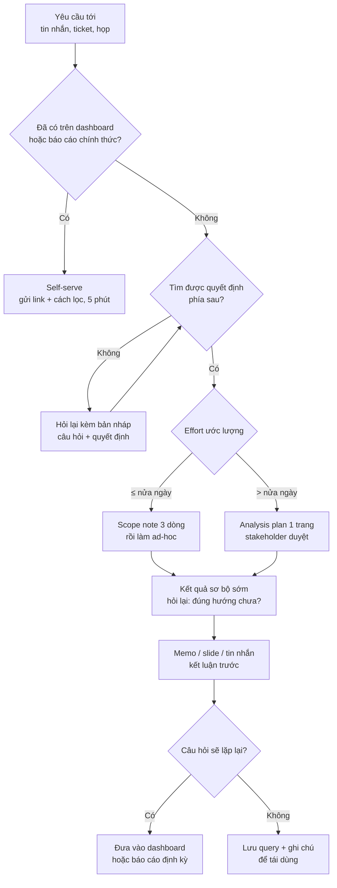
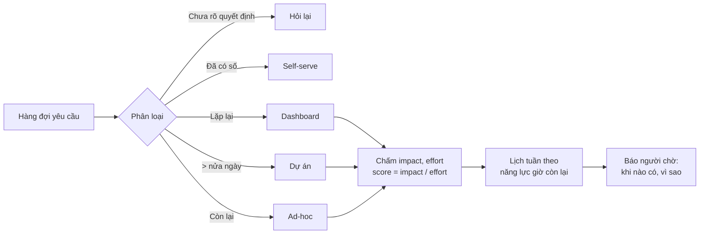
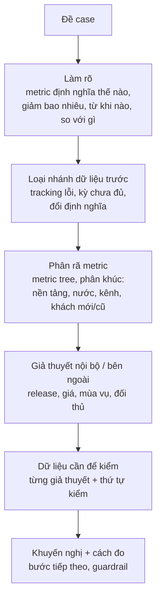
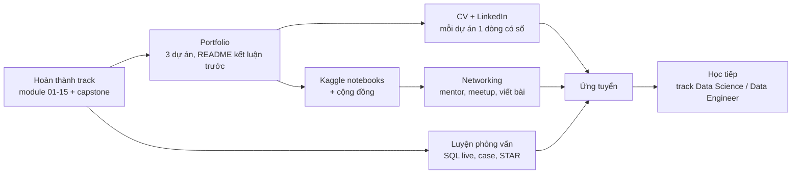

# Stakeholder, storytelling & phỏng vấn

Phân tích đúng mà không ai dùng thì coi như chưa làm. Phần lớn thời gian của một DA senior không nằm ở
câu SQL mà ở hai đầu của nó: **đầu vào** (hiểu người hỏi thật sự cần quyết định gì, cắt phạm vi, chọn
việc nào làm trước, việc nào để họ tự làm trên dashboard) và **đầu ra** (một memo, một slide, một tin
nhắn mà người bận nhất công ty đọc một phút là hành động được). Module cuối của track gom các kỹ năng đó
lại, thêm cách dùng AI/LLM khi phân tích mà không làm lộ dữ liệu hay tin nhầm con số, rồi chuyển sang
chuyện đi làm: các vòng phỏng vấn DA (SQL live, take-home, case interview) và phần cuối của roadmap
(portfolio, Kaggle, khoá học, networking).

Module dùng lại hai bộ dữ liệu thật của track:

- **Online Retail II (UCI)**, sheet `Year 2010-2011`: 541 910 dòng, 01/12/2010 tới 09/12/2011. Dòng hợp
  lệ và doanh thu theo định nghĩa dùng chung của track (bỏ hoá đơn `C...`, bỏ `Quantity <= 0` hoặc
  `Price <= 0`; doanh thu = `Quantity * Price`, doanh thu gộp).
- **Bike Sharing (UCI)**: `day.csv` 731 ngày, `hour.csv` 17 379 giờ, Capital Bikeshare 2011-2012.

```bash
uv run python data/download_dataset.py online-retail-ii
uv run python data/download_dataset.py bike-sharing-uci
```

Sau module này bạn sẽ:

- Biến một câu hỏi mơ hồ thành phạm vi rõ ràng bằng một bộ câu hỏi làm rõ ngắn, và biết khi nào nói
  "chưa" hoặc "dashboard đã có".
- Xếp ưu tiên một hàng đợi yêu cầu theo impact/effort; phân biệt việc self-serve, ad-hoc, dashboard và
  dự án.
- Viết memo, slide và tin nhắn theo kim tự tháp: headline là kết luận có con số, bằng chứng chọn lọc,
  giới hạn đặt cạnh kết luận.
- Dùng LLM để tăng tốc mà vẫn kiểm lại được từng con số, và không gửi dữ liệu nhạy cảm ra ngoài.
- Chuẩn bị cho SQL live, take-home, case interview; dựng portfolio và kế hoạch học, kết nối sau track.

## 1. Nhắc lại nhanh: analysis plan, headline, SCQA, memo

Các mảnh dưới đây đã có ở module trước; module này nối chúng thành một quy trình từ lúc nhận yêu cầu
tới lúc người hỏi hành động, nên chỉ nhắc ý chính:

- **Analysis plan một trang** (module [Vai trò DA & tư duy phân tích](../01-analyst-mindset/README.md),
  phần 7): bối cảnh và quyết định, câu hỏi đã đóng khung, giả thuyết, metric, dữ liệu và giới hạn,
  phương pháp, đầu ra và thời hạn, ngoài phạm vi. Viết cho phân tích dài hơn nửa ngày.
- **Headline là insight** (module [Trực quan hoá & đọc biểu đồ](../08-visualization-chart-reading/README.md),
  phần 6): cái gì, bao nhiêu, so với gì. Thứ tự chart theo kim tự tháp: kết luận, vì sao, làm gì,
  phụ lục.
- **SCQA và kim tự tháp Minto** (track DS, [EDA & Data Storytelling](../../../data-science/modules/09-eda-storytelling/README.md),
  phần 7): Situation, Complication, Question, Answer; kết luận trước, lý lẽ sau, chi tiết cuối. Dashboard
  để theo dõi, memo để quyết định.
- **Memo BLUF và nói về bất định** (track DS, [ML System Design](../../../data-science/modules/15-ml-system-design/README.md),
  phần 7): câu đầu là khuyến nghị và việc cần quyết; khoảng và kịch bản thay cho một con số; tách điều
  đã đo, điều ước lượng, điều giả định.

Phần dưới không lặp lại các khung đó mà trả lời những câu hỏi còn lại: trước khi có analysis plan thì
hỏi gì, khi có mười yêu cầu cùng lúc thì làm cái nào, đưa kết quả qua kênh nào, dùng AI ở bước nào, và
chứng minh tất cả những điều đó trong một buổi phỏng vấn.

## 2. Nhận yêu cầu mơ hồ và scoping

### Câu người ta nói và câu họ cần

Yêu cầu đến tay DA hiếm khi là câu hỏi đã đóng khung. Nó là một câu nhắn lúc 5 giờ chiều, một ảnh chụp
dashboard có khoanh đỏ, hay "anh cần số này cho cuộc họp sáng mai". Việc đầu tiên không phải mở SQL mà
là tìm **quyết định** đằng sau câu nói:

| Câu người hỏi nói | Câu hỏi thật thường là | Quyết định phía sau |
| --- | --- | --- |
| "Kéo cho anh doanh thu theo nước" | Có nên mở rộng ra thị trường nào năm sau? | Phân bổ ngân sách marketing, tuyển sales |
| "Sao dashboard hôm nay thấp vậy?" | Có sự cố cần xử lý ngay không, hay chỉ là kỳ chưa đủ dữ liệu? | Gọi đội vận hành hay không |
| "Làm phân tích khách hàng giúp chị" | Nhóm khách nào nên giữ, nhóm nào bỏ? | Ngân sách chương trình khách thân thiết |
| "Cho em file tất cả đơn hàng tháng trước" | Đối soát với số kế toán, hoặc tự làm pivot | Không cần DA, cần quyền truy cập đúng bảng |
| "Kiểm tra chiến dịch email có hiệu quả không" | Có nên chạy lại chiến dịch, với ngân sách bao nhiêu? | Gia hạn hay dừng chiến dịch |

Nếu không tìm được quyết định nào, đó là tín hiệu: có thể yêu cầu là tò mò (vẫn có thể làm, nhưng xếp sau),
hoặc người hỏi đang chuyển tiếp câu hỏi của sếp họ và bạn cần nói chuyện với người cuối cùng.

### Năm câu hỏi làm rõ

Hỏi ít, đúng chỗ. Năm câu dưới đủ cho phần lớn yêu cầu; mỗi câu chặn một kiểu làm sai hay gặp:

1. **"Kết quả này dùng để quyết định gì, và ai quyết?"** Chặn việc trả lời đúng câu hỏi sai.
2. **"So với cái gì thì gọi là tốt / xấu?"** Kỳ trước, cùng kỳ năm trước, mục tiêu, nhóm đối chứng. Một con
   số không có tham chiếu không dẫn tới hành động.
3. **"Phạm vi là gì?"** Thời gian (12 tháng đủ hay tính cả tháng đang chạy), nhóm khách, kênh, nước; định
   nghĩa metric (doanh thu gộp hay ròng, khách mới theo cách nào).
4. **"Cần chính xác tới đâu, khi nào?"** Ước lượng đúng hướng trong hai giờ hay con số đối soát kế toán
   trong hai tuần. Đây là câu quyết định effort.
5. **"Nếu kết quả là X, anh/chị sẽ làm gì khác?"** Câu hỏi mạnh nhất. Nếu mọi kết quả đều dẫn tới cùng
   một hành động, phân tích không cần làm, hoặc chỉ cần làm rất nhỏ.

Câu hỏi làm rõ **tồi** là câu hỏi đẩy việc của DA sang người hỏi ("anh muốn dùng bảng nào?", "chị muốn
group by cột gì?") hoặc câu hỏi có thể tự trả lời bằng năm phút xem dữ liệu ("dữ liệu có từ năm nào?").
Hỏi lại kèm **một bản nháp**: "Em hiểu là anh cần X để quyết định Y, em sẽ so với Z, loại trừ W, gửi trước
thứ Năm. Đúng không ạ?" Người bận trả lời "đúng" hoặc sửa một chữ nhanh hơn nhiều so với trả lời năm
câu hỏi mở.

### Scope note: hợp đồng nhỏ trước khi làm

Với việc dưới nửa ngày, scope note là ba dòng trong tin nhắn trả lời. Với việc lớn hơn, nó mở rộng thành
analysis plan (phần 1). Nội dung tối thiểu:

- **Sẽ trả lời**: câu hỏi đã đóng khung, metric và định nghĩa.
- **Sẽ không trả lời**: những phần cắt bỏ, và vì sao (không có dữ liệu, không ảnh hưởng quyết định, để
  vòng sau).
- **Đầu ra và mốc**: một con số kèm câu giải thích, một bảng, một memo; ngày gửi bản sơ bộ, ngày gửi bản cuối.

Scope creep ("tiện thì chia thêm theo kênh", "thêm cả năm 2009 nhé") không xấu, nhưng mỗi lần thêm là một
lần thương lượng lại mốc thời gian, nói thành lời: "Được, thêm theo kênh thì em gửi thứ Hai thay vì thứ
Sáu, hay em gửi bản hiện tại thứ Sáu rồi bổ sung sau?"



### Ước lượng và nói "chưa"

DA mới thường nhận mọi việc rồi trễ hết. DA senior nói rõ chi phí cơ hội: "Tuần này em đang làm phân tích
giá cho anh B, deadline thứ Năm. Việc của chị cần khoảng một ngày; em làm từ thứ Sáu được không, hay chị
muốn em hỏi anh B lùi lại?" Người quyết định thứ tự là người nắm ưu tiên của cả team (trưởng nhóm, PM),
không phải DA và không phải người nói to nhất. Ước lượng thì nhân đôi phần dữ liệu: gần như mọi phân tích
tốn thời gian nhất ở bước tìm đúng bảng, hiểu định nghĩa và làm sạch, không phải ở bước tính.

## 3. Ưu tiên: impact/effort, self-serve vs ad-hoc

### Ma trận impact/effort

Khi hàng đợi có mười yêu cầu, xếp theo thứ tự đến là cách tệ nhất: việc nhỏ đến sau phải chờ việc lớn đến
trước, việc quan trọng chìm giữa việc tò mò. Cách đơn giản và đủ dùng là chấm hai trục:

- **Impact (1-5)**: quyết định phía sau lớn cỡ nào: tiền, số người bị ảnh hưởng, có đảo ngược được
  không. Một quyết định ngân sách cả năm là 5; một con số cho slide nội bộ là 1-2.
- **Effort (giờ)**: thời gian ước lượng tới bản đủ để quyết định, không phải tới bản hoàn hảo.

| | Effort thấp (≤ 8 giờ) | Effort cao (> 8 giờ) |
| --- | --- | --- |
| **Impact cao (≥ 4)** | **Quick win**: làm ngay | **Big bet**: viết analysis plan, chia mốc, xếp lịch |
| **Impact thấp (≤ 3)** | **Fill-in**: làm khi có khoảng trống, hoặc gom nhiều việc một lần | **Money pit**: từ chối hoặc đề xuất cách rẻ hơn |

Trong một nhóm, xếp tiếp theo tỉ số impact chia effort. Các khung của PM như RICE (Reach × Impact ×
Confidence ÷ Effort) thêm hai yếu tố: **reach** (bao nhiêu người dùng kết quả) và **confidence** (mức chắc
chắn về impact). Với DA, confidence thường là câu "nếu kết quả là X thì họ có thật sự làm gì khác không";
nếu không chắc, chia đôi impact.

Ví dụ giả định, không phải dữ liệu thật: một tuần có 30 giờ cho việc theo yêu cầu. Ba yêu cầu: A (impact 5,
6 giờ), B (impact 4, 20 giờ), C (impact 2, 10 giờ). A là quick win làm trước (score 0.83); B là big bet
(0.20) vẫn vừa 24 giờ còn lại; C là money pit (0.20): không còn chỗ, đề xuất cách rẻ hơn hoặc để tuần
sau. Hai việc cùng score 0.20 nhưng khác hẳn nhau về cách xử lý, nên ma trận và score dùng cùng nhau.

### Self-serve, ad-hoc, dashboard hay dự án

Không phải yêu cầu nào cũng nên thành một phân tích:

| Loại | Dấu hiệu | DA làm gì | Lỗi hay gặp |
| --- | --- | --- | --- |
| **Self-serve** | Số đã có trên dashboard / báo cáo chính thức, người hỏi chỉ chưa biết cách lọc | Gửi link kèm cách lọc; ghi lại câu hỏi để cải thiện dashboard | Tự kéo lại số bằng SQL, ra số lệch dashboard, mất niềm tin |
| **Ad-hoc** | Câu hỏi một lần, ≤ nửa ngày, có quyết định rõ | Scope note, làm, trả lời kết luận trước, lưu query | Không lưu query, tháng sau làm lại từ đầu |
| **Dashboard / báo cáo định kỳ** | Câu hỏi lặp lại (cùng câu ≥ 2 lần, hoặc "tuần nào cũng cần") | Đầu tư một lần: metric có định nghĩa, refresh tự động (module [BI & Dashboard](../10-bi-dashboards/README.md)) | Dựng dashboard cho câu hỏi một lần, không ai mở lần hai |
| **Dự án phân tích** | > nửa ngày, quyết định lớn, nhiều nguồn dữ liệu | Analysis plan, mốc, bản sơ bộ, memo | Làm im lặng ba tuần rồi trình bày một lần |

Self-serve tốt giải phóng thời gian DA cho câu hỏi khó, nhưng nó cần đầu tư: metric có một định nghĩa
(module [Data modeling cho analytics](../09-analytics-data-modeling/README.md)), dashboard có hướng dẫn, và
**office hours** hằng tuần để người dùng hỏi cách dùng thay vì xin số. Quy tắc thực dụng của nhiều team:
"câu hỏi ad-hoc thứ hai giống câu thứ nhất là ticket dựng dashboard".



Bài Basic 03 cài đặt đúng quy trình này thành code: phân loại một hàng đợi yêu cầu, chấm góc phần tư và
lập lịch tuần theo năng lực.

## 4. Storytelling: từ notebook tới memo, slide, tin nhắn

### Kim tự tháp trên một phân tích thật

Giám đốc kinh doanh hỏi: *"Năm sau có nên đẩy mạnh bán ra nước ngoài không?"* Notebook của bạn có rất
nhiều bảng; trước khi viết, tách vài con số trả lời được câu hỏi. Đoạn code dưới đọc sheet `Year 2010-2011`
(lần đầu khoảng 20-60 giây vì là xlsx, sau đó đọc bản parquet cache trong thư mục tạm của hệ điều hành; cùng
khoá cache với module 06) và tính trên 12 tháng đủ (12/2010 tới 11/2011, bỏ tháng 12/2011 mới có 9 ngày).
Các đoạn code sau trong module dùng lại biến `sales`.

```python
import os
import sys
import tempfile
from pathlib import Path

import pandas as pd

ROOT = next(p for p in [Path.cwd(), *Path.cwd().parents] if (p / "pyproject.toml").exists())
sys.path.insert(0, str(ROOT))
from data.download_dataset import ensure  # noqa: E402


def read_sheet(sheet: str) -> pd.DataFrame:
    """Đọc một sheet Online Retail II; lần đầu lưu parquet vào thư mục tạm (xlsx mất 20-60 giây)."""
    src = ensure("online-retail-ii") / "online_retail_II.xlsx"
    st = src.stat()
    cache = Path(tempfile.gettempdir()) / "da-cache" / f"online_retail_II-{sheet.replace(' ', '_')}-{st.st_size}-{st.st_mtime_ns}.parquet"
    if not cache.exists():
        df = pd.read_excel(src, sheet_name=sheet, dtype={"Invoice": str, "StockCode": str, "Description": str})
        cache.parent.mkdir(parents=True, exist_ok=True)
        tmp = cache.with_name(f"{cache.name}.{os.getpid()}.tmp")
        df.to_parquet(tmp, index=False)
        os.replace(tmp, cache)  # ghi atomic
    return pd.read_parquet(cache)


tx = read_sheet("Year 2010-2011")
sales = tx[~tx["Invoice"].str.startswith("C") & (tx["Quantity"] > 0) & (tx["Price"] > 0)].copy()
sales["revenue"] = sales["Quantity"] * sales["Price"]
year = sales[sales["InvoiceDate"] < "2011-12-01"]  # 12 tháng đủ: 12/2010 - 11/2011

uk = year["Country"] == "United Kingdom"
intl_share = year.loc[~uk, "revenue"].sum() / year["revenue"].sum()
known = year.dropna(subset=["Customer ID"])
intl_cust = known[known["Country"] != "United Kingdom"].groupby("Customer ID")["revenue"].sum().sort_values(ascending=False)
uk_cust = known[known["Country"] == "United Kingdom"].groupby("Customer ID")["revenue"].sum().sort_values(ascending=False)
print(f"doanh thu 12 tháng: {year['revenue'].sum():,.0f} GBP; ngoài UK {intl_share:.1%}, {year.loc[~uk, 'Country'].nunique()} giá trị Country")
print(f"10 khách lớn nhất chiếm {intl_cust.head(10).sum() / intl_cust.sum():.1%} doanh thu ngoài UK (có mã khách), "
      f"ở UK là {uk_cust.head(10).sum() / uk_cust.sum():.1%}")
print(f"khách có mã: ngoài UK {len(intl_cust)}, UK {len(uk_cust)}")
```

Kết quả: 12 tháng có 10 027 892 GBP doanh thu, 15.9% đến từ 37 giá trị `Country` khác UK (kể cả `Unspecified`, `European Community`). Nhưng 10 khách lớn nhất mang
49.8% doanh thu ngoài UK (trong phần có mã khách), so với 14.3% ở UK: "thị trường quốc tế" thực ra là một
nhóm nhỏ khách sỉ cộng một nền khách rộng ở vài nước. Ghép vào SCQA:

| Phần | Nội dung |
| --- | --- |
| Situation | Ngoài UK mang 15.9% doanh thu, từ 411 khách có mã, rải ở hơn 30 nước |
| Complication | Một nửa số đó (49.8%) nằm ở 10 khách; mất một khách lớn là mất cả một "thị trường" |
| Question | Đầu tư mở rộng thị trường hay giữ khách lớn? |
| Answer | Tách hai việc: quản lý khách lớn như key account; chọn mở rộng ở nước có nền khách rộng (bài tập có thể đi tiếp: nước nào, bằng chứng gì) |

Headline là câu Answer kèm con số, không phải câu Situation. "Doanh thu quốc tế 2011" là nhãn thư mục;
"Nửa doanh thu ngoài UK đến từ 10 khách: mở rộng quốc tế cần tách khách lớn khỏi thị trường" là kết luận
người đọc có thể đồng ý hoặc phản bác.

### Bậc thang headline

Một cách tự chấm headline là xem nó đứng ở bậc nào:

| Bậc | Ví dụ (Online Retail II, tháng 11/2011) | Người đọc làm được gì |
| --- | --- | --- |
| 1. Nhãn | "Doanh thu theo tháng" | Không gì; phải tự đọc chart |
| 2. Quan sát | "Doanh thu tháng 11 đạt 1.51 triệu GBP" | Biết con số, không biết tốt hay xấu |
| 3. So sánh | "Doanh thu tháng 11 tăng 31% so với tháng 10, cao nhất năm" | Biết hướng và độ lớn |
| 4. Insight | "Tháng 11 tăng 31% nhờ số đơn (+36%), giá trị mỗi đơn còn giảm 4%" | Biết **vì sao**, biết đòn bẩy nào |
| 5. Khuyến nghị | "Mùa cao điểm đến từ số đơn chứ không từ đơn lớn hơn: chuẩn bị năng lực xử lý đơn trước tháng 9" | Biết **làm gì** |

Số liệu: tháng 10/2011 có 1 154 979 GBP, 2 040 hoá đơn, AOV 566; tháng 11/2011 có 1 509 496 GBP, 2 769 hoá
đơn, AOV 545. Memo cho người quyết định nên ở bậc 4-5; chart trong phụ lục ở bậc 3 là đủ. Bậc 5 chỉ viết
khi bằng chứng đủ cho hành động; nếu chưa, viết bậc 4 và nói rõ bước kiểm tiếp theo. Bài Basic 02 luyện
chấm headline theo các bậc này và theo lỗi số liệu.

### Viết số cho người đọc

- **Làm tròn theo quyết định**: "1.51 triệu GBP" thay vì "1 509 496.33 GBP"; giữ chữ số đủ để phân biệt các
  phương án. Bảng phụ lục mới giữ số đầy đủ.
- **Luôn có tham chiếu**: so với kỳ trước, cùng kỳ, mục tiêu. Ghi rõ kỳ so sánh trong câu.
- **Phần trăm và điểm phần trăm**: tỉ lệ khách vãng lai từ 19.9% xuống 18.2% là giảm **1.7 điểm phần trăm**,
  không phải giảm 1.7%.
- **Kỳ chưa đủ**: tháng 12/2011 có 9 ngày; so nó với tháng 11 đủ là lỗi kinh điển (module 08). Ghi
  "tính tới 09/12" ngay cạnh số.
- **Một đơn vị cho một trang**: GBP hoặc triệu GBP, không trộn; ngày theo một định dạng.
- **Nguồn và định nghĩa** ở chân trang hoặc phụ lục: "doanh thu gộp, bỏ hoá đơn huỷ; dữ liệu tới 09/12/2011".

### Memo, slide hay tin nhắn

| Kênh | Khi nào | Cấu trúc | Lỗi hay gặp |
| --- | --- | --- | --- |
| **Tin nhắn** (Slack, Teams, email ngắn) | Ad-hoc, một câu hỏi, một con số | Dòng 1: câu trả lời có số. Dòng 2: so với gì, giới hạn. Dòng 3: link query/notebook | Gửi ảnh chụp bảng không có câu trả lời; giải thích cách làm trước kết luận |
| **Memo 1 trang** | Quyết định cần đọc kỹ, gửi trước cuộc họp | Headline, bối cảnh và câu hỏi, khuyến nghị, 3 bằng chứng có số, giới hạn, bước tiếp theo | Kể theo thứ tự đã làm; 5 trang không có kết luận |
| **Slide** | Trình bày trực tiếp, nhiều người, cần thảo luận | Mỗi slide một thông điệp, tiêu đề slide là câu kết luận; slide đầu là tóm tắt; phụ lục ở cuối | 30 slide số liệu; tiêu đề slide là nhãn ("Doanh thu Q4") |
| **Dashboard** | Câu hỏi lặp lại, theo dõi | KPI trên cùng, trend, breakdown (module 10) | Dùng dashboard để trả lời câu hỏi một lần |

Bài Intermediate 01 luyện kênh khó nhất: memo một trang viết từ một notebook có sẵn, cho người không đọc code.

Hai kỹ thuật slide của các công ty tư vấn đáng dùng cho DA:

- **Ghost deck**: trước khi phân tích, viết sẵn tiêu đề từng slide như thể đã biết kết quả ("Mùa cao điểm
  đến từ số đơn"), chart để trống. Nó buộc bạn chỉ làm phân tích cần cho câu chuyện và lộ ra sớm chỗ thiếu
  dữ liệu. Khi số thật khác giả thuyết, sửa tiêu đề theo số, không sửa số theo tiêu đề.
- **Đọc ngang tiêu đề**: chỉ đọc tiêu đề các slide từ đầu đến cuối; nếu chúng tạo thành một đoạn văn có lý
  lẽ, deck đã ổn. Nếu chỉ là danh sách nhãn, chưa ổn.

### Trước và sau buổi trình bày

- **Pre-wire**: gửi trước kết quả cho người bị ảnh hưởng nhiều nhất (trưởng nhóm có chỉ số xấu đi) để họ
  không bị bất ngờ trước mặt sếp. Phản bác của họ thường chỉ ra lỗ hổng thật trong dữ liệu.
- **Chuẩn bị ba câu hỏi khó nhất** và phụ lục trả lời chúng: "số này khác dashboard vì sao?", "có phải do
  mùa vụ không?", "nhân quả hay tương quan?".
- **Kết thúc bằng quyết định**: ai làm gì trước ngày nào; gửi lại memo tóm tắt sau buổi họp. Một phân tích
  không có bước tiếp theo sẽ bị quên trong hai tuần.

## 5. Dùng AI/LLM khi phân tích và cách kiểm lại

### AI giúp ở đâu, không giúp ở đâu

LLM (ChatGPT, Claude, Gemini, Copilot...) tăng tốc rõ ở các việc **có thể kiểm được nhanh** và chậm hoặc
nguy hiểm ở các việc **nghe hợp lý nhưng không kiểm được**:

| Việc | AI hữu ích | Rủi ro chính | Cách kiểm |
| --- | --- | --- | --- |
| Viết nháp SQL / pandas từ mô tả | Rất hữu ích, nhất là cú pháp ít dùng (window function, regex) | Hiểu sai grain, join nhân dòng, sai định nghĩa metric | Chạy trên dữ liệu nhỏ biết trước đáp án; đối soát tổng |
| Giải thích code / query người khác viết | Hữu ích | Bỏ sót điều kiện lọc quan trọng | Đọc lại các dòng `WHERE`, `JOIN` |
| Brainstorm giả thuyết, câu hỏi làm rõ | Hữu ích, nhiều góc nhìn | Giả thuyết chung chung, không gắn dữ liệu | Lọc theo dữ liệu bạn có |
| Viết lại memo cho gọn, đổi giọng văn | Hữu ích | Làm mất sắc thái giới hạn, "làm tròn" nhân quả | So từng con số và từng câu giới hạn với bản gốc |
| **Tự đọc dữ liệu và đưa ra con số** | Thấp | Bịa số (hallucination), hiểu sai mã cột (`weekday = 0` là Chủ nhật hay thứ Hai?), quên chuẩn hoá đơn vị | Tính lại mọi số bằng code của bạn |
| **Kết luận nhân quả, khuyến nghị** | Thấp | Nói chắc chắn điều dữ liệu không chứng minh | Đó là việc của bạn, ký tên bạn |

Nguyên tắc: **AI viết nháp, người chịu trách nhiệm về số**. Mỗi con số trong memo phải truy được về một
query hoặc một cell bạn đã chạy, không phải về một câu trả lời của chatbot.

### Dữ liệu nào không gửi

Dán dữ liệu vào một dịch vụ AI bên ngoài là **chuyển dữ liệu ra khỏi công ty**. Trước khi dán, kiểm:

- **Chính sách công ty**: công cụ nào được duyệt (bản enterprise thường cam kết không dùng dữ liệu để
  train, có hợp đồng xử lý dữ liệu), công cụ nào cấm.
- **Dữ liệu cá nhân**: tên, email, số điện thoại, địa chỉ, mã khách gắn được với người thật. Ở Việt Nam,
  tính tới 10/2026, khung chính là Luật Bảo vệ dữ liệu cá nhân số 91/2025/QH15 (thông qua 26/06/2025, hiệu lực
  01/01/2026) và Nghị định 356/2025/NĐ-CP hướng dẫn luật (ban hành 31/12/2025, hiệu lực 01/01/2026, thay Nghị định
  13/2023/NĐ-CP); EU có GDPR. Gửi cho bên thứ ba cần cơ sở pháp lý, không phải "cho nhanh". Đây là kiến thức tham
  khảo, không phải tư vấn pháp lý: văn bản có thể được sửa đổi, nên kiểm văn bản hiện hành và hỏi bộ phận pháp chế
  trước khi quyết định.
- **Dữ liệu kinh doanh nhạy cảm**: doanh thu chưa công bố, giá vốn, hợp đồng, kế hoạch sản phẩm.
- **Bí mật kỹ thuật**: chuỗi kết nối, API key, mật khẩu trong notebook (module 05).

Cách làm an toàn, theo thứ tự ưu tiên: gửi **schema và mô tả cột** thay vì dữ liệu; gửi **bảng đã tổng
hợp** thay vì từng dòng; thay mã định danh bằng mã giả (pseudonymize) hoặc bỏ hẳn; dùng **model chạy cục bộ**
(Ollama, LM Studio) hoặc bản enterprise đã duyệt khi bắt buộc phải gửi dữ liệu dòng. Bài Intermediate 02
viết hàm tạo "hồ sơ an toàn để gửi LLM" cho một bảng.

### Kiểm lại: một ví dụ thật

Bạn nhờ LLM viết query "giá trị đơn hàng trung bình (AOV)" và nhận về `SELECT AVG(Quantity * Price) FROM
sales`. Query chạy, ra số hợp lý, và sai: nó lấy trung bình trên **dòng sản phẩm**, không phải trên **hoá
đơn**. Đoạn code dưới (dùng lại `sales` ở phần 4) kiểm bằng cách tính cả hai:

```python
line_avg = sales["revenue"].mean()  # AVG(Quantity * Price): trung bình trên DÒNG
invoice_avg = sales.groupby("Invoice")["revenue"].sum().mean()  # AOV: trung bình trên HOÁ ĐƠN
print(f"{len(sales):,} dòng, {sales['Invoice'].nunique():,} hoá đơn")
print(f"trung bình mỗi dòng: {line_avg:,.2f} GBP; AOV: {invoice_avg:,.2f} GBP; gấp {invoice_avg / line_avg:.1f} lần")
```

530 105 dòng hợp lệ thuộc 19 960 hoá đơn: trung bình mỗi dòng 20.12 GBP, AOV thật 534.40 GBP, gấp 26.6
lần. Lỗi không nằm ở cú pháp mà ở **grain**, đúng loại lỗi mà LLM khó thấy vì nó không biết một dòng của
bảng là gì. Danh sách kiểm sau khi nhận code hoặc số từ AI:

1. **Grain**: một dòng của bảng kết quả là gì? Có khớp với câu hỏi không?
2. **Đối soát tổng**: tổng các nhóm có bằng tổng chung? Số dòng có hợp lý?
3. **Định nghĩa**: bộ lọc (huỷ, giá 0, kỳ chưa đủ) có khớp định nghĩa chính thức?
4. **Mã cột**: mã phân loại (mùa, thứ, trạng thái) được hiểu theo data dictionary hay theo "lẽ thường"?
5. **Đơn vị**: dữ liệu chuẩn hoá (nhiệt độ chia 41), tiền tệ, nghìn hay triệu.
6. **Một trường hợp biết trước đáp án**: chạy trên 5 dòng tự tính tay được.
7. **Ngôn ngữ kết luận**: AI có biến tương quan thành nhân quả khi viết lại không?

### Chọn công cụ AI cho việc phân tích

Tên sản phẩm trong bảng tính tới 10/2026; các hãng đổi tên và gói dịch vụ thường xuyên, nên kiểm lại trước khi chọn.

| Công cụ | Dùng khi nào | Mạnh | Yếu | Loại công ty hay dùng |
| --- | --- | --- | --- | --- |
| Chat LLM bản enterprise (ChatGPT Enterprise/Team, Claude for Work, Gemini for Workspace) | Viết nháp SQL, giải thích, viết lại memo | Model mạnh, dữ liệu không dùng để train theo hợp đồng | Phải tự kiểm số; có chi phí theo người dùng | Công ty có chính sách AI rõ, nhiều nhân viên văn phòng |
| Chat LLM bản cá nhân miễn phí | Học, hỏi cú pháp, dữ liệu công khai | Miễn phí, nhanh | Dữ liệu có thể bị lưu/dùng để train; thường bị cấm cho dữ liệu công ty | Cá nhân, freelancer với dữ liệu công khai |
| Trợ lý trong IDE / notebook (GitHub Copilot, Jupyter AI, Cursor) | Viết code trong ngữ cảnh repo | Thấy code xung quanh, gợi ý tại chỗ | Gửi đoạn code (có thể chứa dữ liệu mẫu, key) lên dịch vụ | Team có nhiều code phân tích trong git |
| AI trong công cụ BI (Power BI Copilot, Tableau Pulse/Agent, Metabase Metabot) | Người dùng self-serve hỏi bằng ngôn ngữ tự nhiên | Dùng semantic layer, định nghĩa metric có sẵn | Chỉ tốt khi model dữ liệu và định nghĩa metric tốt; khó kiểm logic sinh ra | Công ty đã chuẩn hoá BI |
| Model cục bộ (Ollama, LM Studio) | Dữ liệu không được rời máy, thử nghiệm | Dữ liệu không ra ngoài, không tốn phí theo lượt | Model nhỏ hơn, cần máy đủ RAM/GPU, tự vận hành | Ngân hàng, y tế, công ty có yêu cầu dữ liệu chặt |

Câu hỏi chọn công cụ: dữ liệu có được rời khỏi máy/công ty không; kết quả có cần lặp lại cho nhiều người
(BI) hay chỉ cho bạn (chat, IDE); ai kiểm số trước khi nó đến tay người quyết định.

## 6. Phỏng vấn DA: SQL live, take-home, case interview

### Các vòng thường gặp

| Vòng | Kiểm gì | Chuẩn bị |
| --- | --- | --- |
| Screen với recruiter / HR | Động lực, kỳ vọng lương, mức khớp vai trò | Câu chuyện 60 giây: bạn là ai, đã làm gì có số, vì sao vị trí này |
| SQL live (30-60 phút) | Viết SQL đúng dưới áp lực, nói to suy nghĩ, kiểm kết quả | Join, group by, window function, CTE, NULL, kỳ chưa đủ (module 03) |
| Python / spreadsheet (tuỳ công ty) | pandas cơ bản, pivot, công thức | Module 02, 04 |
| Take-home (2-8 giờ, nộp sau vài ngày) | Toàn bộ quy trình: làm rõ, làm sạch, phân tích, viết | Bài Advanced 01 của module này |
| Case interview / product sense | Đóng khung, metric, giả thuyết, khuyến nghị | Phần dưới, module 01, 11, 12 |
| Behavioral / stakeholder | Làm việc với người, xử lý bất đồng, sai lầm | Chuẩn bị 5-6 câu chuyện theo STAR |

### SQL live: nói to và tự kiểm

Người phỏng vấn chấm **quy trình** nhiều hơn đáp án: bạn có hỏi lại grain và định nghĩa, có viết từng bước
(CTE) và kiểm kết quả trung gian, có tự phát hiện điều lạ trong output không. Ví dụ câu hỏi: "Ngày nào trong
tuần có giá trị đơn trung bình cao nhất?" Trước khi viết, hỏi: đơn huỷ tính không, AOV là trên hoá đơn,
ngày theo giờ nào. Rồi viết theo hai bước: gom về hoá đơn, sau đó gom theo thứ. Đoạn dưới chạy câu SQL bằng
DuckDB trực tiếp trên DataFrame `sales` (phần 4):

```python
import duckdb

q = """
WITH inv AS (                       -- bước 1: một dòng mỗi hoá đơn
    SELECT Invoice, MIN(InvoiceDate) AS ts, SUM(Quantity * Price) AS revenue
    FROM sales
    GROUP BY Invoice
)
SELECT dayname(ts) AS weekday, COUNT(*) AS invoices, ROUND(AVG(revenue), 2) AS aov
FROM inv
GROUP BY 1
ORDER BY aov DESC
"""
by_weekday = duckdb.sql(q).df()
print(by_weekday.to_string(index=False))
n_inv = duckdb.sql("SELECT COUNT(DISTINCT Invoice) FROM sales").fetchall()[0][0]
print("kiểm: tổng hoá đơn", n_inv, "== tổng cột invoices:", by_weekday["invoices"].sum())
```

Thứ Ba có AOV cao nhất (613.01 GBP, 3 554 hoá đơn), Chủ nhật thấp nhất (369.25 GBP). Ứng viên tốt nói thêm
hai điều không ai hỏi: bảng **chỉ có sáu ngày**, không có thứ Bảy (cửa hàng không xuất hoá đơn thứ Bảy:
một sự thật về vận hành, không phải lỗi query); và tổng hoá đơn đối soát khớp 19 960. Nếu còn thời gian:
"AOV là trung bình, đuôi dài do khách sỉ; em muốn xem median theo thứ trước khi kết luận thứ Ba tốt hơn".

Mẹo cho vòng này: viết `SELECT * ... LIMIT 5` nhìn dữ liệu trước; đặt tên CTE theo grain; khi bí, nói ra
cách bạn sẽ làm bằng lời rồi viết từng phần; luôn kết thúc bằng một câu kiểm.

### Take-home

Take-home kiểm thứ mà SQL live không kiểm được: bạn **chọn làm gì** khi có nhiều thời gian và dữ liệu bẩn.
Người chấm thường đọc 2 phút đầu của README và quyết định ở đó. Vì vậy:

- **Time box** theo đề (thường ghi 3-4 giờ) và ghi nhật ký thời gian. Nộp đúng giờ với giới hạn rõ ràng tốt
  hơn nộp trễ "hoàn hảo"; làm 20 giờ cho bài 3 giờ là tín hiệu xấu về ước lượng.
- **Trang đầu là tóm tắt cho người ra quyết định**: kết luận, 3 con số, khuyến nghị. Code và chi tiết ở sau.
- **Ghi giả định** khi đề mơ hồ (đề thường cố ý mơ hồ): "đơn huỷ không tính", "tháng 12/2011 chưa đủ nên bỏ".
- **Tái lập được**: chạy từ đầu tới cuối bằng một lệnh, có hướng dẫn cài; không đường dẫn tuyệt đối.
- **Một phân tích sâu tốt hơn năm phân tích nông**; phần "nếu có thêm thời gian" cho thấy bạn biết còn gì.

### Case interview

Case cho DA thường là "metric X giảm, vì sao?" hoặc "đo thành công của tính năng Y thế nào?". Người phỏng vấn
chấm cấu trúc và độ tỉnh táo, không chấm đáp án:



Ví dụ ngắn: "Số đơn hằng tuần giảm 10%". Câu trả lời tốt bắt đầu bằng "giảm so với tuần trước hay cùng kỳ,
tuần này có ngày lễ không", rồi kiểm tracking (sự kiện đặt hàng có bị mất ở app version mới?), rồi phân rã
số đơn = số phiên × tỉ lệ chuyển đổi, cắt theo nền tảng, nước, khách mới/cũ, rồi mới đến giả thuyết business.
Ứng viên yếu nhảy ngay vào "chắc do đối thủ khuyến mãi".

### Behavioral: STAR có số

Câu hỏi hành vi ("kể về lần bạn bất đồng với stakeholder", "lần phân tích của bạn sai") trả lời theo
**STAR**: Situation, Task, Action, Result. Phần Result nên có số và có bài học. Chuẩn bị trước 5-6 câu
chuyện dùng lại được cho nhiều câu hỏi: một lần thay đổi quyết định nhờ dữ liệu, một lần nói "không" với
yêu cầu, một lần phát hiện lỗi số của chính mình, một lần giải thích kỹ thuật cho người không kỹ thuật, một
lần làm với dữ liệu bẩn và deadline gấp. Người mới chưa có kinh nghiệm đi làm dùng dự án portfolio (phần 7).

## 7. Portfolio, Kaggle, khoá học, networking

Phần cuối của roadmap Data Analyst gồm bốn việc sau khi đã có kỹ năng: xây **portfolio** dự án (roadmap gợi
ý *predicting sales trends* và *customer segmentation*), tham gia **Kaggle competitions**, học tiếp qua
**khoá học và chứng chỉ** (Coursera, edX, Udemy, DataCamp), và **cập nhật, kết nối** qua cộng đồng, mentor,
webinar. Sau đó roadmap trỏ sang track **AI and Data Scientist** (trong repo này là track
[Data Science](../../../data-science/README.md)).

### Portfolio: ít dự án, mỗi dự án trả lời một câu hỏi

Nhà tuyển dụng xem portfolio khoảng một đến ba phút. Họ tìm: bạn có đặt được câu hỏi business, làm sạch được
dữ liệu thật, ra kết luận có số và viết rõ không. Ba dự án tốt hơn mười notebook "Titanic EDA".

| Thành phần | Dự án tốt | Dự án yếu |
| --- | --- | --- |
| Câu hỏi | "Nên cắt SKU nào để giảm tồn kho mà không mất khách lớn?" | "Phân tích bộ dữ liệu bán lẻ" |
| Dữ liệu | Thật, ghi nguồn và giấy phép, mô tả hạn chế | Bộ đồ chơi, không nói nguồn |
| README màn hình đầu | Kết luận, 3 con số, 1 chart, khuyến nghị | Cách cài thư viện |
| Phương pháp | Đơn giản nhất mà đủ, giải thích lựa chọn | Model phức tạp không cần thiết |
| Giới hạn | Nói rõ điều chưa biết | Không có |
| Tái lập | Một lệnh chạy lại; không commit dữ liệu lớn, không commit key | Đường dẫn tuyệt đối, `.env` trong repo |

Gợi ý dự án lấy từ chính track này (dữ liệu có giấy phép rõ, đã quen):

| Dự án (theo roadmap) | Dữ liệu | Module nền | Câu hỏi business |
| --- | --- | --- | --- |
| Predicting sales trends | `store-sales`, Online Retail II | 13 (dự báo, backtest) | Cần chuẩn bị kho, nhân sự bao nhiêu cho 8 tuần tới? |
| Customer segmentation | Online Retail II (RFM, k-means) | 12, 14 | Nhóm khách nào đáng chăm sóc riêng, với ngân sách nào? |
| Phân tích thí nghiệm | `marketing-ab` | 11 | Có nên mở rộng chiến dịch quảng cáo không? |
| Dashboard vận hành | Bike Sharing trên Metabase/Superset | 08, 10 | Điều phối xe theo giờ và thời tiết thế nào? |
| Capstone dunnhumby | dunnhumby Complete Journey | toàn track | Dự án tổng hợp, đưa vào portfolio được |

Đăng ở đâu: GitHub (README làm trang chính, [GitHub Pages](https://pages.github.com/) nếu muốn trang web),
Kaggle Notebooks, Tableau Public cho dashboard, blog cá nhân. Mỗi dự án có một đoạn tóm tắt dùng được ngay
trong CV và trong câu trả lời phỏng vấn. Bài Advanced 02 lập kế hoạch portfolio và viết một công cụ tự kiểm
repo dự án (README đủ mục, có giấy phép dữ liệu, không có tệp lớn hay key).

### Kaggle: dùng đúng cách cho DA

[Kaggle](https://www.kaggle.com/competitions) có ba thứ, giá trị khác nhau với DA:

- **Competitions**: chủ yếu là bài toán dự báo, chấm bằng một metric trên tập test ẩn. Tốt để luyện pandas,
  feature, validation và đọc lời giải của người thắng; ít giống công việc DA hằng ngày (không có stakeholder,
  câu hỏi đã đóng khung sẵn). Bắt đầu với competition dạng "Getting Started" hoặc "Playground", mục tiêu là
  học, không phải xếp hạng.
- **Datasets**: kho dữ liệu lớn cho dự án portfolio. Kiểm giấy phép và nguồn gốc trước khi dùng: nhiều bộ là
  bản sao không rõ nguồn hoặc dữ liệu sinh ngẫu nhiên (module 06, bài nghi ngờ dữ liệu).
- **Notebooks và discussion**: đọc notebook được vote cao để học cách người khác trình bày; viết notebook của
  bạn với câu hỏi business và kết luận, đó là portfolio công khai.

### Khoá học và chứng chỉ

Roadmap gợi ý các nền tảng Coursera, edX, Udemy, DataCamp. Chứng chỉ có ích nhất khi bạn **chuyển ngành** và
CV chưa có kinh nghiệm DA: nó cho thấy bạn đã học có hệ thống (ví dụ
[Google Data Analytics Certificate](https://www.coursera.org/professional-certificates/google-data-analytics)
trên Coursera). Chứng chỉ của nhà cung cấp công cụ (Power BI PL-300, Tableau, Google Cloud, Databricks)
có ích khi công ty mục tiêu dùng đúng công cụ đó. Với người đã có kinh nghiệm, một dự án portfolio tốt
thuyết phục hơn chứng chỉ. Chọn khoá học theo **khoảng trống** của bạn (thống kê, SQL nâng cao, một công
cụ BI cụ thể), không học lại thứ đã biết.

### Cập nhật và networking

- **Cộng đồng**: [Locally Optimistic](https://locallyoptimistic.com/) (blog và Slack về analytics),
  [DataTalks.Club](https://datatalks.club/), [dbt Community](https://www.getdbt.com/community), các group
  data trên Facebook/LinkedIn ở Việt Nam, meetup tại Hà Nội và TP.HCM.
- **Mentor**: một người đi trước nửa giờ mỗi tháng giúp nhiều hơn mười khoá học: hỏi cụ thể (xem CV, xem
  một dự án, luyện một buổi case interview).
- **Học công khai**: viết ngắn về một phân tích, một lỗi đã gặp, một kỹ thuật; tuyển dụng thường đến từ
  người đã đọc bài của bạn.
- **Webinar, hội thảo**: đi để hỏi và gặp người, không chỉ để nghe; theo dõi sau đó bằng một tin nhắn cụ thể.



## 8. Tài liệu tham khảo

Roadmap gốc (phần cuối: portfolio, Kaggle, khoá học, networking; bản PDF ở `roadmap/data-analyst.pdf`):

- [roadmap.sh: Data Analyst](https://roadmap.sh/data-analyst)
- [Kaggle Competitions](https://www.kaggle.com/competitions), [Kaggle Datasets](https://www.kaggle.com/datasets),
  [Kaggle Learn](https://www.kaggle.com/learn)
- [Google Data Analytics Certificate (Coursera)](https://www.coursera.org/professional-certificates/google-data-analytics),
  [edX](https://www.edx.org/); Udemy và DataCamp (tìm theo tên, trang chặn truy cập tự động)

Storytelling và làm việc với stakeholder:

- Barbara Minto. *The Pyramid Principle* ([barbaraminto.com](https://www.barbaraminto.com/)). SCQA, kết luận trước.
- Cole Nussbaumer Knaflic. *Storytelling with Data* (Wiley, 2015), [storytellingwithdata.com](https://www.storytellingwithdata.com/).
- Intercom. [RICE: simple prioritization for product managers](https://www.intercom.com/blog/rice-simple-prioritization-for-product-managers/).
- [Locally Optimistic](https://locallyoptimistic.com/): bài viết về vận hành team analytics, self-serve, nhận yêu cầu.

AI/LLM và dữ liệu:

- [OWASP Top 10 for LLM Applications](https://genai.owasp.org/llm-top-10/): rò rỉ thông tin nhạy cảm, tin quá mức vào output.
- [NIST AI Risk Management Framework](https://www.nist.gov/itl/ai-risk-management-framework).
- Bộ Công an. [Luật Bảo vệ dữ liệu cá nhân số 91/2025/QH15](https://mps.gov.vn/chinh-sach-phap-luat/co-so-du-lieu-van-ban/luat-bao-ve-du-lieu-ca-nhan-1753688803)
  (văn bản và tình trạng hiệu lực).
- EY Việt Nam. [Nghị định 356/2025/NĐ-CP quy định chi tiết Luật Bảo vệ dữ liệu cá nhân](https://www.ey.com/vi_vn/technical/tax/tax-and-law-updates/nghi-dinh-so-356-2025-nd-cp-quy-dinh-chi-tiet-mot-so-dieu-va-bien-phap-thi-hanh-luat-bao-ve-du-lieu-ca-nhan)
  (tóm tắt; nghị định thay Nghị định 13/2023/NĐ-CP từ 01/01/2026).
- [Ollama](https://ollama.com/): chạy model cục bộ khi dữ liệu không được rời máy.

Phỏng vấn:

- Nick Singh & Kevin Huo. [Ace the Data Science Interview](https://www.acethedatascienceinterview.com/) (2021): SQL, product sense, case.
- [DataLemur](https://datalemur.com/), [StrataScratch](https://www.stratascratch.com/): câu SQL phỏng vấn thật.
- [The STAR interview method](https://www.themuse.com/advice/star-interview-method) (The Muse).

Portfolio:

- [GitHub: About READMEs](https://docs.github.com/en/repositories/managing-your-repositorys-settings-and-features/customizing-your-repository/about-readmes),
  [GitHub Pages](https://pages.github.com/), [Quarto](https://quarto.org/) (notebook thành trang web, báo cáo).

Dữ liệu:

- Daqing Chen. [Online Retail II (UCI)](https://archive.ics.uci.edu/dataset/502/online+retail+ii), CC BY 4.0.
- Fanaee-T & Gama. [Bike Sharing Dataset (UCI)](https://archive.ics.uci.edu/dataset/275/bike+sharing+dataset), CC BY 4.0.
