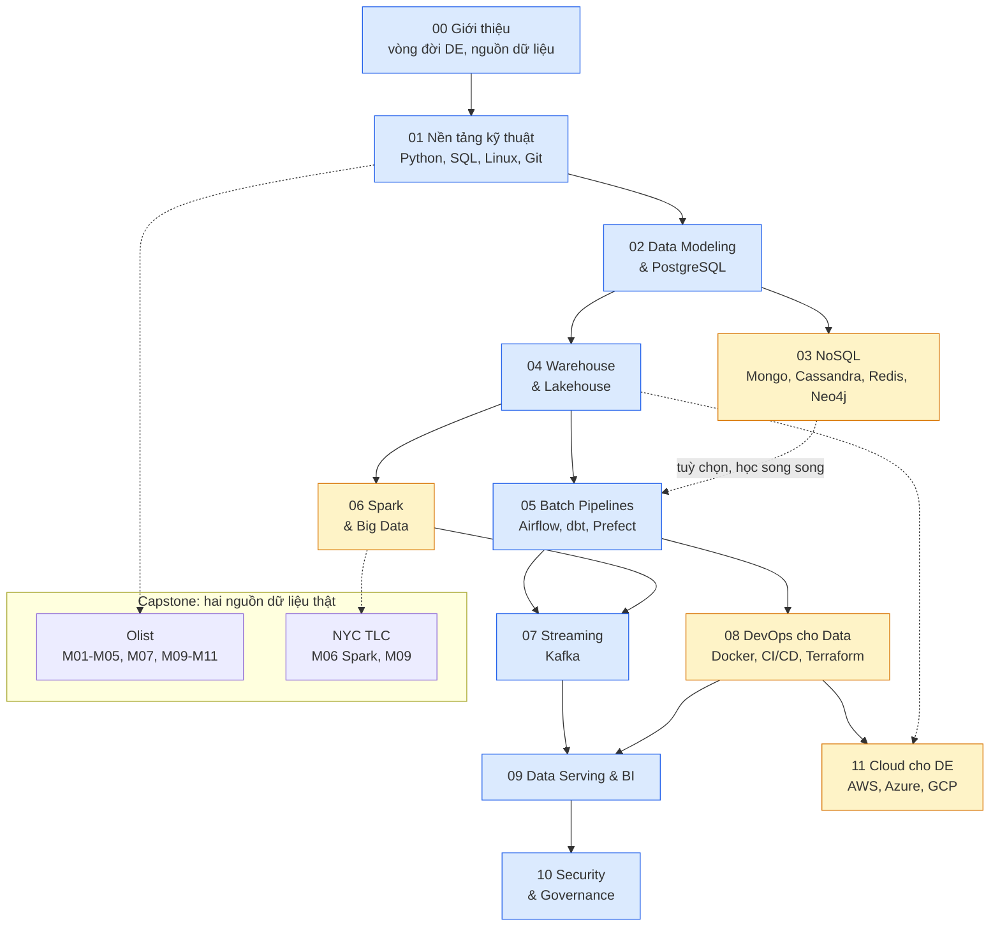
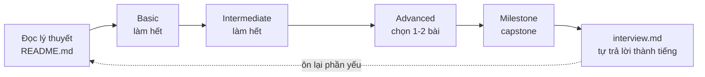

# Lộ trình Data Engineer

Lộ trình tự học Data Engineer bám theo [roadmap.sh/data-engineer](https://roadmap.sh/data-engineer),
thiết kế cho người muốn học cách **xây và vận hành hệ thống dữ liệu**. Nếu đã có nền
Data Analyst / Data Scientist (SQL, pandas), bạn có thể đi thẳng vào phần chính. Nếu mới hoàn toàn,
bắt đầu từ phần 0 của module 01 và bài nhập môn Python/SQL rồi mới học generator, window function.

Lộ trình gồm 12 module (00–11). Mỗi module có lý thuyết (`README.md`), câu hỏi phỏng vấn (`interview.md`),
bài tập 3 mức Basic → Intermediate → Advanced (102 bài, bài lập trình có test tự chấm), cùng milestone của dự án capstone
[Olist Data Platform](capstone/README.md), xây trên hai nguồn dữ liệu thật: Olist (xương sống) và NYC TLC (cho Spark ở M06).

Cài đặt môi trường: xem [`setup/SETUP.md`](../../setup/SETUP.md). Dữ liệu: [`data/README.md`](../../data/README.md).

## Phần bổ sung: từ biết khái niệm tới tự vận hành

Mỗi module có thêm tình huống thực hành mở rộng: dữ liệu đến muộn, nguồn đổi schema, đo hiệu năng,
phân quyền, ngắt job và khôi phục. Các tình huống có kết quả nộp/tiêu chí đối chiếu; không phải tất cả
đều được chấm tự động. Giữ log và số đo thực tế, không chỉ đánh dấu đã đọc.

| Điểm bắt đầu | Học và kiểm chứng |
| --- | --- |
| Chưa biết Python/SQL | [Phần 0 module 01](modules/01-foundations/README.md), [bài nhập môn](modules/01-foundations/exercises/basic/00-order-basics/README.md) |
| Muốn hiểu CDC | [Bài sink offline](modules/07-streaming-kafka/exercises/intermediate/04-cdc-sink/README.md) → [lab PostgreSQL/Debezium/Kafka](modules/07-streaming-kafka/cdc-lab.md) |
| Muốn biết xử lý sự cố | Phần thực hành mở rộng module 05–08, thu thập runbook và bằng chứng khôi phục |
| Muốn thử cloud | [Lab GCP](modules/11-cloud/cloud-gcp-lab.md); cần tự chọn chạy cloud thật, có thể phát sinh phí |
| Muốn tự đánh giá | [M12: bài xây dựng độc lập](capstone/milestones/m12-independent-build.md), làm sau phần local M01–M10; cloud là tùy chọn |

Test đạt chứng minh các hành vi được test ở phạm vi bài, chưa chứng minh chịu được mọi sự cố hoặc tải
production. Tiêu chí hoàn thành là tự giải thích được quyết định, tự dựng lại hệ thống và đối chiếu dữ liệu.

## Sơ đồ lộ trình



**Xanh** là trục chính, nên học theo thứ tự. **Vàng** là nhánh có thể học song song hoặc lùi lại
nếu gấp: NoSQL (03) ít gặp hơn trong phỏng vấn DE junior so với SQL/warehouse; Spark (06) và
DevOps (08) quan trọng nhưng không chặn việc học Airflow/Kafka. Cloud (11) học sau 08 vì dùng lại Terraform,
nhưng nên học trước khi đi phỏng vấn: hầu hết vị trí DE làm trên AWS, Azure hoặc GCP.

## Các module

| # | Module | Mục tiêu | Kỹ năng chính | Dịch vụ Docker |
| --- | --- | --- | --- | --- |
| 00 | Giới thiệu & vòng đời DE | Hiểu DE khác DS/DA ở đâu, vòng đời và nguồn dữ liệu thật; thu thập từ API, log, IoT | Vòng đời DE, undercurrents, thu thập dữ liệu, chọn công nghệ | không (cần mạng cho bài API) |
| 01 | Nền tảng kỹ thuật | Viết code data "production-grade" và hiểu hệ phân tán ở mức khái niệm | Python (typing, packaging, logging), SQL nâng cao (window, CTE), Bash, Git, networking, distributed systems | không |
| 02 | Data Modeling & Relational DB | Thiết kế schema OLTP và star schema, tối ưu truy vấn | Normalization, star/snowflake, SCD, index, transaction, isolation level | `postgres` |
| 03 | NoSQL | Chọn kho dữ liệu đúng bài toán, model theo truy vấn | CAP, document, wide-column, key-value, graph | `mongo`, `cassandra`, `redis`, `neo4j` |
| 04 | Data Warehouse & Lakehouse | Xây kho phân tích và data lake có cấu trúc | OLAP, columnar, Parquet, Delta Lake, medallion, data mart, data mesh | `minio` |
| 05 | Batch Pipelines | Pipeline idempotent, có lịch, có test | ETL vs ELT, Airflow, dbt, Prefect, backfill | `postgres`, Airflow (`setup/airflow`) |
| 06 | Spark & Big Data | Xử lý dữ liệu vượt RAM một máy | Spark DataFrame, partition, shuffle, join strategy, HDFS/YARN | không (PySpark local, cần Java) |
| 07 | Streaming với Kafka | Xử lý event thời gian thực đáng tin cậy | Topic, partition, consumer group, delivery semantics, windowing | `kafka` |
| 08 | DevOps cho Data | Đóng gói, tự động hoá, hạ tầng như code | Docker, Kubernetes, CI/CD, Terraform, monitoring, testing | tuỳ bài |
| 09 | Data Serving & BI | Đưa dữ liệu tới người dùng cuối | Semantic layer, Metabase, Streamlit, Reverse ETL | `postgres`, `metabase` |
| 10 | Security & Governance | Dữ liệu đúng, an toàn, tuân thủ | AuthN/AuthZ, encryption, masking, data quality, lineage, GDPR/LGPD | `postgres` |
| 11 | Cloud cho Data Engineer | Chọn và ghép dịch vụ cloud cho data platform, kiểm soát chi phí | Dịch vụ tương đương AWS/Azure/GCP, IAM, VPC, FinOps, S3 bằng boto3 | `localstack` hoặc `minio` |

Bật dịch vụ theo module: `docker compose -f setup/docker-compose.yml up -d <tên dịch vụ>`.
Tắt khi học xong để tiết kiệm RAM: `docker compose -f setup/docker-compose.yml down`.

## Cách học hiệu quả khi muốn đi nhanh

Mỗi module theo vòng lặp:



1. **Lý thuyết (1–2 giờ)**: đọc lướt một lượt, đánh dấu từng phần "đã đọc" trong app. Chạy thử
   code mẫu thay vì chỉ đọc. Không cần nhớ hết, bài tập sẽ kéo bạn quay lại.
2. **Basic**: làm hết, mỗi bài 15–30 phút. Kẹt quá 20 phút thì mở gợi ý 1, rồi gợi ý 2.
3. **Intermediate**: làm hết. Đây là mức công việc thật của DE junior. So lời giải mẫu
   (`SOLUTION.md`) **sau khi** test của bạn pass, để học cách làm khác.
4. **Advanced**: chọn 1–2 bài gần công việc bạn nhắm tới. Không có đáp án duy nhất; tự chấm theo
   rubric trong `SOLUTION.md`.
5. **Milestone capstone**: làm ngay sau module, khi kiến thức còn nóng. Đây là thứ bạn đem đi
   phỏng vấn.
6. **Phỏng vấn**: đọc câu hỏi trong `interview.md`, **tự trả lời thành tiếng** 1–2 phút trước khi
   xem đáp án mẫu.

Chạy test bài tập:

```bash
uv run pytest tracks/data-engineer/modules/<module>/exercises/<level>/<bài> -q              # code của bạn
SOLUTION=1 uv run pytest tracks/data-engineer/modules/<module>/exercises/<level>/<bài> -q   # lời giải mẫu
```

### Lịch gợi ý

| Nhịp độ | Thời gian / tuần | Tổng |
| --- | --- | --- |
| Tăng tốc (đã có SQL/Python vững) | 20–25 giờ | ~8–10 tuần |
| Vừa đi làm vừa học | 8–10 giờ | ~5–6 tháng |

Với nền DA/DS, bạn có thể đi nhanh module 01 (chỉ tập trung Git, Bash, packaging Python, SQL window
nâng cao) và dồn thời gian cho 02, 04, 05, 07 — bốn module được hỏi nhiều nhất.

### Chuẩn bị phỏng vấn

- **SQL vẫn là vòng loại số 1**: luyện window function, gaps & islands, dedup, SCD, đọc `EXPLAIN`.
- **Data modeling**: tự thiết kế star schema cho một bài toán lạ (Uber, Spotify) trong 20 phút,
  nói rõ grain trước tiên.
- **System design**: luyện vẽ kiến trúc batch + streaming end-to-end, nói được trade-off
  (latency vs cost, exactly-once vs at-least-once, warehouse vs lakehouse).
- **Kể chuyện bằng capstone**: chuẩn bị 3 câu chuyện theo dạng STAR từ dự án Olist: một bug dữ
  liệu bạn tìm ra, một lần tối ưu hiệu năng, một quyết định thiết kế có trade-off.
- **Lợi thế DA/DS**: nhấn mạnh bạn hiểu người dùng dữ liệu (analyst, model), nên thiết kế
  pipeline phục vụ đúng nhu cầu và có ý thức về data quality.

## Map với roadmap.sh

| Nhánh trên roadmap.sh/data-engineer | Module |
| --- | --- |
| Programming Skills (Python, Java/Scala), SQL, Linux basics, Git, Networking, Distributed Systems basics | 01 |
| Data Modeling, Normalization, Relational DB (PostgreSQL, MySQL), Indexing, Transactions | 02 |
| NoSQL: Document, Column, Key-Value, Graph; CAP theorem | 03 |
| Data Warehousing (Redshift, BigQuery, Snowflake), Data Lakes, Lakehouse, Data Mart, Data Mesh, OLAP vs OLTP | 04 |
| Data Pipelines, ETL vs ELT, Data Ingestion, Orchestration (Airflow, Prefect, Dagster), dbt | 05 |
| Cluster Computing, Hadoop, HDFS, YARN, MapReduce, Apache Spark | 06 |
| Messages vs Streams, Messaging Systems (Kafka, RabbitMQ), Batch vs Streaming | 07 |
| Containers (Docker, Kubernetes), CI/CD, Infrastructure as Code (Terraform), Monitoring, Testing | 08 |
| Data Serving, Data Analytics, BI tools (Tableau, Power BI, Metabase), Reverse ETL | 09 |
| Data Security (AuthN/AuthZ, Encryption, Tokenization, Masking), Data Quality, Lineage, Governance, GDPR | 10 |
| Cloud Computing (AWS, GCP, Azure) | 11: kiến trúc, IAM, mạng, FinOps; lab GCP và milestone M11 tùy chọn |

Lưu ý: lộ trình chạy toàn bộ trên máy local bằng Docker (MinIO thay S3/GCS, DuckDB/PostgreSQL thay
BigQuery/Snowflake) để học miễn phí. Khái niệm chuyển thẳng sang cloud được; khi phỏng vấn hãy
nói rõ bản tương đương trên cloud của từng thành phần.
