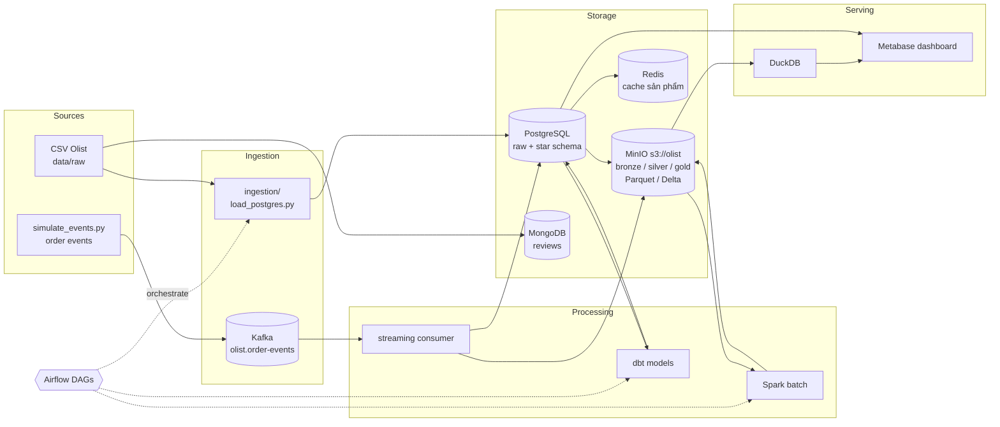
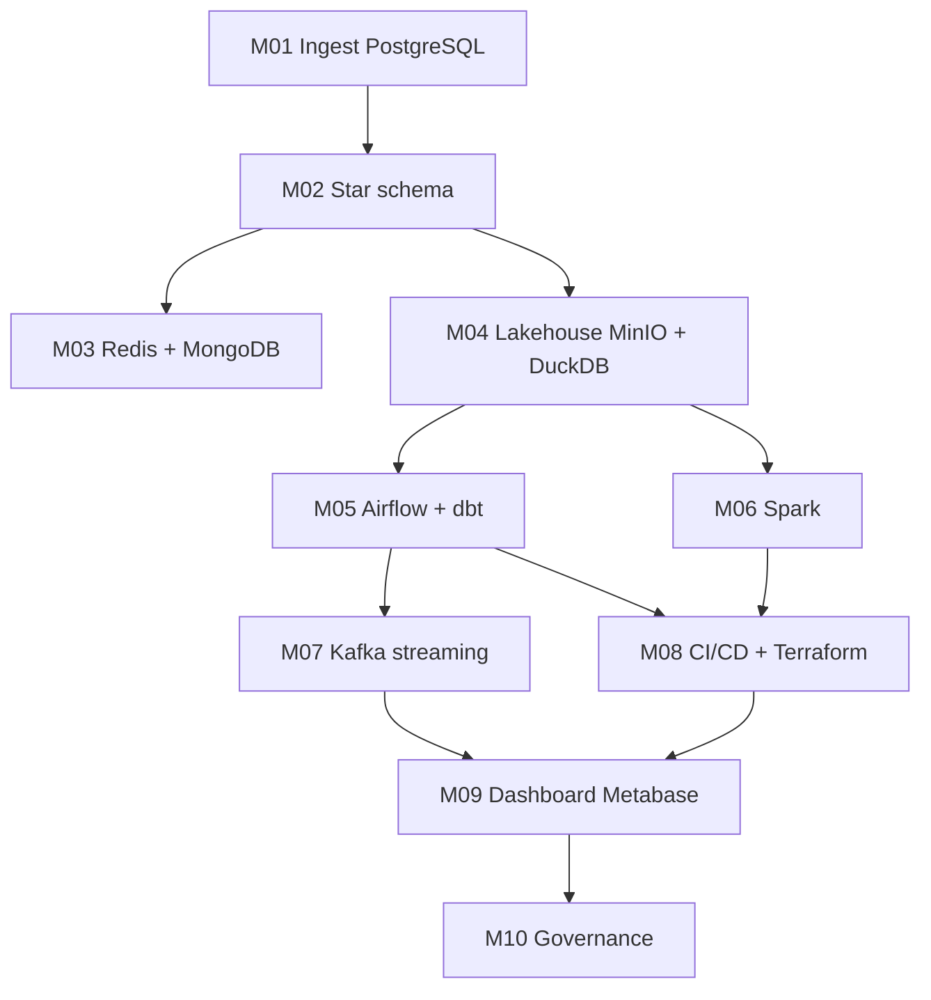

# Olist Data Platform

Dự án capstone xuyên suốt lộ trình Data Engineer. Bạn xây một nền tảng dữ liệu hoàn chỉnh cho một
sàn thương mại điện tử Brazil (bộ dữ liệu Olist): từ nạp dữ liệu thô, mô hình hoá, lakehouse,
orchestration, xử lý batch lớn, streaming thời gian thực, CI/CD, dashboard cho tới governance.

Mỗi module kết thúc bằng một **milestone**. Milestone sau dùng lại kết quả của milestone trước, nên
làm xong cả 10 bạn có một repo portfolio chạy được từ đầu đến cuối bằng vài lệnh.

## Mục tiêu dự án

- Có một pipeline **end-to-end, chạy lại được (reproducible)**: `docker compose up` + vài lệnh `uv run`
  là dựng lại toàn bộ.
- Trả lời được các câu hỏi kinh doanh: doanh thu theo bang/tháng, tỉ lệ giao trễ theo seller,
  điểm review trung bình theo danh mục, đơn đang kẹt ở trạng thái nào (gần thời gian thực).
- Thể hiện các kỹ năng nhà tuyển dụng hỏi: data modeling, idempotency, orchestration, streaming,
  testing, IaC, data quality, bảo vệ PII.

## Dữ liệu

- Bộ giả lập cùng schema Olist: `uv run python data/generate_olist.py --orders 50000` (ghi vào `data/raw/`).
- Bộ thật (tuỳ chọn, cần Kaggle token): `uv run python data/download_olist.py`.
- Event thời gian thực: `uv run python data/simulate_events.py --kafka --rate 20`.

Schema và ERD: xem [`data/README.md`](../../../data/README.md).

## Kiến trúc tổng thể



## Milestone nối nhau thế nào



| Milestone | Sau module | Dùng lại | Tạo ra |
| --- | --- | --- | --- |
| [M01](milestones/m01-ingest-postgres.md) | 01 Foundations | `data/raw` | schema `raw` trong Postgres, script ingest idempotent |
| [M02](milestones/m02-star-schema.md) | 02 Data Modeling | schema `raw` | schema `dw`: `fact_order_items`, `dim_*`, SCD2 cho seller |
| [M03](milestones/m03-nosql.md) | 03 NoSQL | `raw.products`, reviews | cache Redis, collection `reviews` trong MongoDB |
| [M04](milestones/m04-lakehouse.md) | 04 Warehouse & Lakehouse | `raw`, `dw` | bucket `olist` bronze/silver/gold, truy vấn DuckDB |
| [M05](milestones/m05-airflow-dbt.md) | 05 Batch Pipelines | M01, M02, M04 | DAG `olist_daily`, dự án dbt `models/olist_dbt` |
| [M06](milestones/m06-spark.md) | 06 Spark | bronze trên MinIO | job Spark tạo gold `seller_performance` |
| [M07](milestones/m07-kafka.md) | 07 Streaming | `simulate_events.py` | consumer dedup + xử lý late event, bảng `order_status_live` |
| [M08](milestones/m08-cicd-terraform.md) | 08 DevOps | toàn bộ code | GitHub Actions, Terraform tạo bucket/user MinIO |
| [M09](milestones/m09-dashboard.md) | 09 Serving & BI | `dw`, gold, `order_status_live` | dashboard Metabase, app Streamlit |
| [M10](milestones/m10-governance.md) | 10 Security & Governance | toàn bộ | data quality check, lineage, masking PII, role |

## Cấu trúc code

Code của capstone nằm ở [`project/`](project/). Khung đã có sẵn:

```
project/
├── README.md        # README của portfolio (bạn viết lại dần)
├── ingestion/       # M01, M03: nạp dữ liệu
├── models/          # M02 SQL DDL, M05 dự án dbt
├── dags/            # M05: DAG Airflow (được mount vào setup/airflow)
├── streaming/       # M07: producer/consumer Kafka
├── infra/           # M08: Terraform, docker
├── dashboards/      # M09: export Metabase, app Streamlit
└── tests/           # test của bạn, chạy bằng uv run pytest
```

## Trình bày lên GitHub làm portfolio

Nhà tuyển dụng thường chỉ dành 2–3 phút cho một repo. Hãy làm cho 2 phút đó đáng giá:

1. **Tách thành repo riêng** khi xong M05: copy `project/` ra repo `olist-data-platform`, kèm
   `docker-compose.yml` và script sinh dữ liệu (đừng commit dữ liệu thô).
2. **README đầu trang** gồm: một câu mô tả, sơ đồ kiến trúc (mermaid ở trên), ảnh chụp dashboard,
   khối "Quick start" ≤ 5 lệnh, bảng công nghệ.
3. **Mục "Design decisions"**: vì sao chọn star schema thay vì OBT, vì sao partition theo
   `order_purchase_date`, cách đảm bảo idempotency, cách xử lý event trùng/trễ. Đây là chỗ thể hiện
   tư duy, thường được hỏi lại trong phỏng vấn.
4. **CI xanh** (badge GitHub Actions) và test chạy được không cần Docker cho phần lớn logic.
5. **Commit có ý nghĩa**: mỗi milestone một nhánh/PR, mô tả PR ngắn gọn, giống làm việc nhóm thật.
6. **Ghi rõ giới hạn**: dữ liệu giả lập, chạy local, những gì sẽ làm khác khi lên cloud
   (BigQuery/Snowflake, MSK, MWAA…).

## Tiêu chí hoàn thành toàn dự án

- [ ] Từ máy sạch, làm theo README dựng lại toàn bộ trong ≤ 30 phút.
- [ ] Chạy lại pipeline hai lần không tạo bản ghi trùng.
- [ ] Có ít nhất 1 dashboard trả lời 4 câu hỏi kinh doanh ở trên.
- [ ] CI chạy lint + test trên mỗi push.
- [ ] Không có PII dạng rõ (email, tên, zip đầy đủ) ở tầng gold/dashboard.
