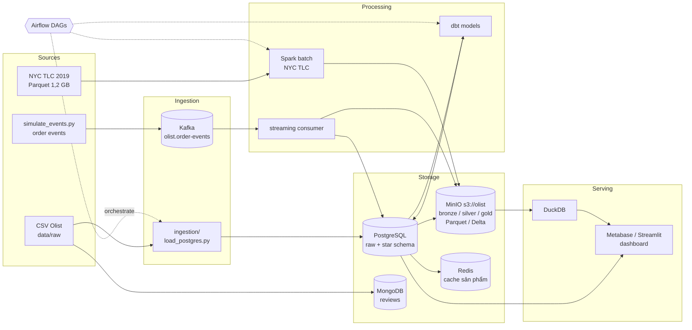
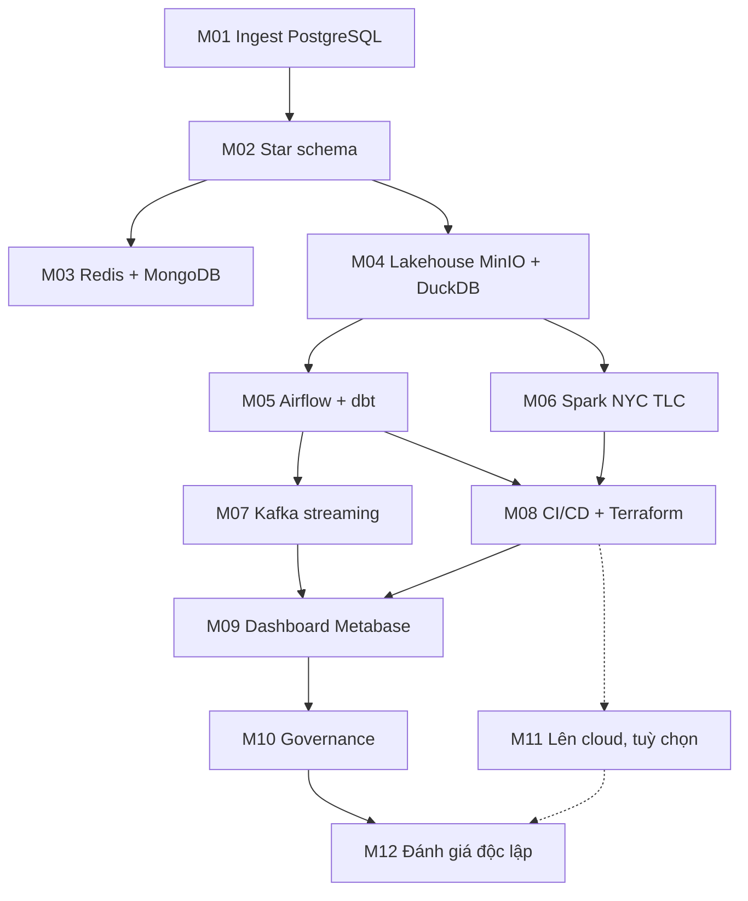

# Olist Data Platform

Dự án capstone xuyên suốt lộ trình Data Engineer. Bạn xây một nền tảng dữ liệu hoàn chỉnh trên
**dữ liệu thật** từ hai nguồn: sàn thương mại điện tử Brazil **Olist** (~99 nghìn đơn, 9 bảng quan hệ) và
chuyến **Yellow Taxi New York 2019** của NYC TLC (~84,6 triệu chuyến, 1,2 GB Parquet). Olist là xương sống
(nạp dữ liệu thô, mô hình hoá, lakehouse, orchestration, streaming, dashboard, governance); NYC TLC là nguồn
đủ lớn để xử lý batch bằng Spark có ý nghĩa.

Mỗi module kết thúc bằng một **milestone**. M01–M10 xây nền tảng local, M11 thử cloud tùy chọn;
M12 là bài đánh giá độc lập để tự thiết kế và xử lý sự cố. Milestone sau dùng lại kết quả trước,
giúp bạn xây portfolio có thể dựng lại và kiểm chứng từ đầu đến cuối.

## Mục tiêu dự án

- Có một pipeline **end-to-end, chạy lại được (reproducible)**: `docker compose up` + vài lệnh `uv run`
  là dựng lại toàn bộ.
- Trả lời được các câu hỏi kinh doanh: doanh thu theo bang/tháng, tỉ lệ giao trễ theo seller,
  điểm review trung bình theo danh mục, đơn đang kẹt ở trạng thái nào (gần thời gian thực); và với
  NYC TLC: nhu cầu taxi theo giờ/khu vực, tỉ lệ tip theo borough.
- Thể hiện các kỹ năng nhà tuyển dụng hỏi: data modeling, idempotency, orchestration, streaming,
  testing, IaC, data quality, bảo vệ PII.

## Dữ liệu

| Nguồn | Lệnh | Ghi vào | Dùng ở |
| --- | --- | --- | --- |
| Olist thật (mặc định, cần Kaggle token, xem đầu tệp `data/download_olist.py`) | `uv run python data/download_olist.py` | `data/raw/olist_*.csv` (9 tệp, ~120 MB) | M01–M05, M07, M09–M11 |
| NYC TLC Yellow Taxi 2019 | `uv run python data/download_dataset.py nyc-tlc` | `data/raw/nyc-tlc/` (12 tệp Parquet + bảng zone, ~1,2 GB) | M06, M09 |
| Event đơn hàng giả lập trên `order_id` thật | `uv run python data/simulate_events.py --kafka --rate 20 --orders-csv data/raw` | topic Kafka | M07 |

**Không có Kaggle token?** Dùng bộ giả lập cùng schema làm phương án dự phòng:
`uv run python data/generate_olist.py --out data/raw/olist_synthetic`, rồi truyền
`--data-dir data/raw/olist_synthetic` cho các script. Bộ giả lập cũng là dữ liệu cho test và cho M12; con
số trong báo cáo và dashboard của bài nộp cuối phải lấy từ bộ thật.

Schema và ERD: xem [`data/README.md`](../../../data/README.md).

## Bước 0: khám phá dữ liệu thật

Trước M01, mở [`project/notebooks/olist_exploration.ipynb`](project/notebooks/olist_exploration.ipynb)
(nút **Mở trong VS Code**): làm sạch, dựng bảng sạch mức đơn `data/clean/olist/order_facts.parquet`, rút
insight có số (trễ hạn vs điểm review, trễ theo bang, thanh toán, độ tập trung seller, danh mục, khách mua
lại), vẽ biểu đồ và viết `project/notebooks/report.md` (4 mục **Bộ dữ liệu**, **Làm sạch**, **Insight**,
**Giới hạn**). Những bất thường tìm được ở đây là đầu vào cho DDL (M01), grain và `is_late` (M02), KPI dashboard
(M09) và rule chất lượng (M10).

```bash
uv run pytest tracks/data-engineer/capstone/project/tests/test_olist_exploration.py -q -rs
```

Hàm còn TODO thì test của hàm đó skip kèm lời nhắc; làm xong thì test so với số tham chiếu của bộ thật.

## Kiến trúc tổng thể



## Milestone nối nhau thế nào



| Milestone | Sau module | Dùng lại | Tạo ra |
| --- | --- | --- | --- |
| [M01](milestones/m01-ingest-postgres.md) | 01 Foundations | Olist thật `data/raw`, notebook khám phá | schema `raw` trong Postgres, script ingest idempotent |
| [M02](milestones/m02-star-schema.md) | 02 Data Modeling | schema `raw` | schema `dw`: `fact_order_items`, `dim_*`, SCD2 cho seller |
| [M03](milestones/m03-nosql.md) | 03 NoSQL | `raw.products`, reviews | cache Redis, collection `reviews` trong MongoDB |
| [M04](milestones/m04-lakehouse.md) | 04 Warehouse & Lakehouse | `raw`, `dw` | bucket `olist` bronze/silver/gold, truy vấn DuckDB |
| [M05](milestones/m05-airflow-dbt.md) | 05 Batch Pipelines | M01, M02, M04 | DAG `olist_daily`, dự án dbt `models/olist_dbt` |
| [M06](milestones/m06-spark.md) | 06 Spark | NYC TLC `data/raw/nyc-tlc`, [bài 06/intermediate/04](../modules/06-spark-big-data/exercises/intermediate/04-nyc-taxi-real/README.md) | job Spark tạo gold `nyc_zone_daily` trên MinIO |
| [M07](milestones/m07-kafka.md) | 07 Streaming | `simulate_events.py` | consumer dedup + xử lý late event, bảng `order_status_live` |
| [M08](milestones/m08-cicd-terraform.md) | 08 DevOps | toàn bộ code | GitHub Actions, Terraform tạo bucket/user MinIO |
| [M09](milestones/m09-dashboard.md) | 09 Serving & BI | `dw`, gold Olist + NYC TLC, `order_status_live` | dashboard Metabase, app Streamlit (mở trên trình duyệt) |
| [M10](milestones/m10-governance.md) | 10 Security & Governance | toàn bộ | data quality check, lineage, masking PII, role |
| [M11](milestones/m11-cloud-deploy.md) (tuỳ chọn) | 11 Cloud | M04, M08 | lake + warehouse trên free tier một cloud, hoặc LocalStack/MinIO |
| [M12](milestones/m12-independent-build.md) | Sau phần local M01–M10; có thể đọc sau module 11 | kiến thức toàn lộ trình | bài thiết kế độc lập, sự cố, khôi phục và rubric |

Lab bổ trợ: [CDC thật](../modules/07-streaming-kafka/cdc-lab.md),
[GCP từ Parquet tới KPI](../modules/11-cloud/cloud-gcp-lab.md).

## Cấu trúc code

Code của capstone nằm ở [`project/`](project/). Khung đã có sẵn:

```
project/
├── README.md        # README của portfolio (bạn viết lại dần)
├── notebooks/       # Bước 0: khám phá Olist thật, report.md
├── ingestion/       # M01, M03, M04, M06: nạp dữ liệu, lakehouse, job Spark
├── models/          # M02 SQL DDL, M05 dự án dbt
├── dags/            # M05: DAG Airflow (được mount vào setup/airflow)
├── streaming/       # M07: producer/consumer Kafka
├── infra/           # M08: Terraform, docker
├── dashboards/      # M09: export Metabase, app Streamlit
└── tests/           # test của bạn, chạy bằng uv run pytest
```

## Trình bày lên GitHub làm portfolio

Nhà tuyển dụng thường chỉ dành 2–3 phút cho một repo. Hãy làm cho 2 phút đó đáng giá:

1. **Tách thành repo riêng** khi xong M05: copy `project/` ra repo `olist-data-platform`, kèm
   `docker-compose.yml` và lệnh tải dữ liệu (đừng commit dữ liệu thô hay `data/clean/`).
2. **README đầu trang** gồm: một câu mô tả, sơ đồ kiến trúc (mermaid ở trên), ảnh chụp dashboard,
   khối "Quick start" ≤ 5 lệnh, bảng công nghệ.
3. **Mục "Design decisions"**: vì sao chọn star schema thay vì OBT, vì sao partition theo
   `order_purchase_date`, cách đảm bảo idempotency, cách xử lý event trùng/trễ. Đây là chỗ thể hiện
   tư duy, thường được hỏi lại trong phỏng vấn.
4. **CI xanh** (badge GitHub Actions) và test chạy được không cần Docker cho phần lớn logic.
5. **Commit có ý nghĩa**: mỗi milestone một nhánh/PR, mô tả PR ngắn gọn, giống làm việc nhóm thật.
6. **Ghi rõ giới hạn**: Olist là mẫu đã ẩn danh và bị cắt ở hai đầu, event Kafka là giả lập trên `order_id`
   thật, chạy local; những gì sẽ làm khác khi lên cloud (BigQuery/Snowflake, MSK, MWAA…).

## Bài nộp cuối

Kết thúc lộ trình (sau M10, M11 nếu làm), bạn nộp **một dự án hoàn chỉnh trên dữ liệu thật**: repo portfolio
`olist-data-platform` (hoặc thư mục `project/` nếu chưa tách repo) gồm đủ 5 phần:

1. **Pipeline chạy được**: từ máy sạch, `docker compose up` + lệnh tải dữ liệu + một lệnh (DAG `olist_daily`
   hoặc `make`) đi hết nạp → `raw` → `dw` → lakehouse → `mart`, kèm job Spark NYC TLC. Chạy lại không trùng dữ liệu.
2. **Dữ liệu sạch**: bảng `dw`/`mart`/gold đã qua quality gate của M10, số dòng và tổng tiền khớp nguồn, bất thường
   được gắn cờ hoặc đưa vào quarantine chứ không bị xoá im lặng.
3. **Insight**: `notebooks/report.md` (Bước 0) cập nhật theo số của pipeline, ít nhất 5 phát hiện có số, mỗi số kèm
   ý nghĩa kinh doanh; có ít nhất một insight từ NYC TLC.
4. **Dashboard xem trên trình duyệt**: Metabase (M09, `http://localhost:3000`) hoặc app Streamlit
   (`http://localhost:8501`) đọc từ `mart.*`/gold, trả lời các câu hỏi kinh doanh ở trên, có bộ lọc ngày/bang.
5. **README portfolio**: một câu mô tả, sơ đồ kiến trúc hai nguồn, ảnh dashboard, Quick start ≤ 5 lệnh, Design
   decisions, mục Governance, giới hạn của dữ liệu.

## Tiêu chí hoàn thành toàn dự án

- [ ] Từ máy sạch, làm theo README dựng lại toàn bộ trong ≤ 30 phút (chưa tính thời gian tải dữ liệu).
- [ ] Chạy lại pipeline hai lần không tạo bản ghi trùng.
- [ ] Mọi con số trên dashboard và trong báo cáo lấy từ Olist/NYC TLC thật, khớp số tham chiếu của notebook khám phá
  (vd. 99 441 đơn, 6,77% đơn đã giao bị trễ).
- [ ] Dashboard mở được trên trình duyệt và trả lời các câu hỏi kinh doanh ở trên.
- [ ] CI chạy lint + test trên mỗi push.
- [ ] Không có PII dạng rõ (email, tên, zip đầy đủ) ở tầng gold/dashboard.
