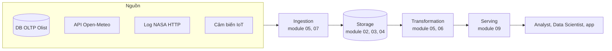
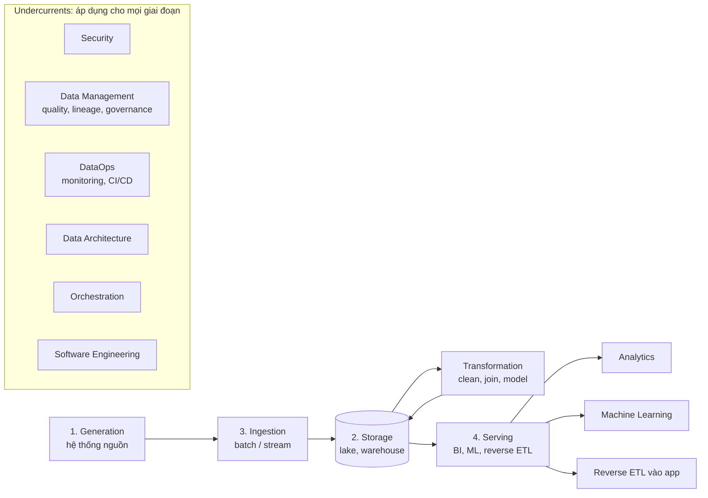
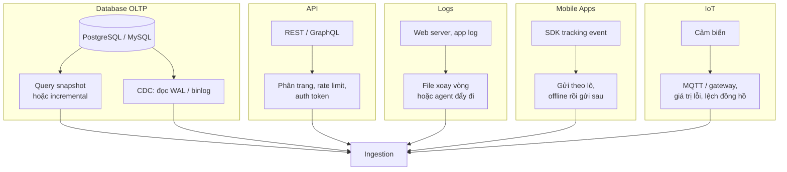

# Giới thiệu và vòng đời Data Engineering

Bạn đã từng là người *dùng* dữ liệu: mở notebook, đọc bảng `orders`, vẽ biểu đồ, train model. Câu
hỏi bạn ít phải trả lời là: bảng đó từ đâu ra, ai bảo đảm nó có đủ dữ liệu hôm qua lúc 7 giờ sáng,
và nếu nguồn đổi một cột thì chuyện gì xảy ra? Đó là việc của Data Engineer.

Module này không dạy công cụ. Nó cho bạn **bản đồ** để biết mỗi module sau (01–11) nằm ở đâu, và
những **quyết định** mà một Data Engineer phải đưa ra trước khi viết dòng code đầu tiên: dữ liệu đến
từ đâu, đến nhanh thế nào, lấy về có hợp pháp không, tốn bao nhiêu tiền, dùng công nghệ gì. Ví dụ
xuyên suốt là Olist (sàn thương mại điện tử Brazil, ~100 nghìn đơn 2016–2018) cùng ba nguồn dữ liệu
thật bạn sẽ tự thu thập trong bài tập: API thời tiết Open-Meteo, access log web server của NASA
(07/1995) và dữ liệu cảm biến chất lượng không khí UCI.



## 1. Data Engineering là gì, và khác DS, DA ở đâu

Định nghĩa thực dụng (theo *Fundamentals of Data Engineering*, Reis & Housley): **Data Engineering
là việc thiết kế, xây dựng và vận hành các hệ thống lấy dữ liệu thô từ nguồn, biến nó thành thông
tin chất lượng cao, ổn định để người khác dùng được** (analytics, machine learning, ứng dụng). Hai
chữ quan trọng nhất là *ổn định* và *người khác*: sản phẩm của bạn không phải một insight, mà là một
hệ thống chạy mỗi ngày mà không cần bạn ngồi canh.

### Cùng một câu hỏi, ba vai trò làm ba việc khác nhau

Câu hỏi kinh doanh của Olist: *"Giao hàng trễ có làm điểm review giảm không?"*

| | Data Analyst | Data Scientist | Data Engineer |
| --- | --- | --- | --- |
| **Câu hỏi họ trả lời** | Tỉ lệ đơn trễ theo bang, tháng; review trung bình của đơn trễ so với đúng hạn | Dự đoán đơn nào sẽ trễ và bị review 1 sao, đo tác động nhân quả | Làm sao để bảng `orders`, `reviews` có sẵn, đúng, mới mỗi sáng cho hai người kia |
| **Sản phẩm** | Dashboard, báo cáo, SQL ad-hoc | Model, notebook, thí nghiệm A/B | Pipeline, bảng warehouse, data contract, alert |
| **Đơn vị thành công** | Insight dẫn tới quyết định | Model tốt hơn baseline, được dùng | SLA đạt (dữ liệu có trước 7h), không mất dòng, chi phí kiểm soát được |
| **Công cụ chính** | SQL, BI (Metabase, Power BI), Excel | Python, pandas, scikit-learn, notebook | SQL, Python, Airflow, dbt, Spark, Kafka, Docker, cloud |
| **Khi dữ liệu sai** | Phát hiện số lạ trên dashboard | Model drift, metric offline đẹp nhưng online tệ | Là người bị gọi lúc 3h sáng, phải tìm gốc lỗi và backfill |
| **Thời gian sống của code** | Một báo cáo, vài tuần | Một thí nghiệm, vài tháng | Nhiều năm, nhiều người sửa |

Ranh giới thực tế mờ hơn bảng: công ty nhỏ có một người làm cả ba; công ty lớn tách thêm **Analytics
Engineer** (người viết dbt, sở hữu tầng transform và semantic layer, đứng giữa DA và DE) và **ML
Engineer** (đưa model vào production). Điều quan trọng là bạn biết mình đang đội mũ nào.

### Vì sao người làm DA/DS chuyển sang DE có lợi thế

Bạn đã biết dữ liệu xấu trông thế nào từ phía người dùng: cột null bất ngờ, timestamp lệch múi giờ,
đơn trùng làm doanh thu phồng. DE giỏi là người **thiết kế pipeline với cái nhìn của người dùng cuối**.
Thứ bạn cần học thêm là phía "sản xuất": code chạy không người giám sát, dữ liệu không vừa RAM, hệ
thống nhiều máy, và kỷ luật vận hành. Đó là nội dung của module 01 (Nền tảng kỹ thuật) trở đi.

### Đừng nhầm DE với "người chạy ETL"

Hai hiểu lầm thường gặp:

- **"DE là viết script copy dữ liệu."** Script copy là 10% công việc. 90% còn lại là: chạy lại có
  nhân đôi không (idempotency, module 05), nguồn đổi schema thì sao (data contract, module 05 và 10),
  ai được đọc cột email (module 10), tốn bao nhiêu tiền mỗi tháng (module 11).
- **"DE là biết nhiều công cụ."** Công cụ thay đổi vài năm một lần (Hadoop → Spark → lakehouse).
  Nguyên lý thì không: partition, idempotent, incremental, schema evolution, trade-off latency với
  chi phí. Module này và module 01 tập trung vào nguyên lý.

## 2. Kỹ năng và trách nhiệm của Data Engineer

### Trách nhiệm, và module nào dạy nó

| Trách nhiệm | Câu hỏi cụ thể bạn phải trả lời | Module |
| --- | --- | --- |
| Viết code production | Script có retry, logging, exit code, test không? | 01 Nền tảng kỹ thuật |
| Mô hình hoá dữ liệu | Bảng fact `order_items` có grain gì? Khách đổi địa chỉ thì lưu lịch sử thế nào (SCD)? | 02 Data Modeling |
| Chọn kho lưu trữ | Session giỏ hàng để ở Redis hay PostgreSQL? | 03 NoSQL, 04 Warehouse |
| Xây pipeline batch | Chạy lại ngày 2018-03-01 có nhân đôi đơn không? Backfill 6 tháng mất bao lâu? | 05 Batch Pipelines |
| Xử lý dữ liệu lớn | 1,2 GB taxi NYC một tháng: pandas hay Spark? | 06 Spark |
| Xử lý realtime | Đơn mới phải lên dashboard trong 10 giây, hay 1 giờ là đủ? | 07 Streaming |
| Vận hành | Pipeline chạy trong container nào, deploy bằng CI ra sao, ai nhận alert? | 08 DevOps for Data |
| Phục vụ dữ liệu | Dashboard đọc bảng nào, query bao lâu, metric "doanh thu" định nghĩa một chỗ hay mười chỗ? | 09 Serving & BI |
| Bảo mật, chất lượng | Analyst có được thấy CPF (số định danh) của khách không? Ai được báo khi 30% đơn mất `customer_id`? | 10 Security & Governance |
| Hạ tầng và chi phí | Bucket S3 này công khai không? Job này tốn bao nhiêu mỗi tháng? | 11 Cloud |

### Hai kiểu Data Engineer

Reis & Housley phân biệt hai kiểu, hữu ích khi đọc mô tả công việc:

- **Type A (Abstraction)**: dùng công cụ có sẵn, managed service (Fivetran, BigQuery, dbt Cloud) để
  ráp hệ thống nhanh, tránh tự xây. Phổ biến ở startup và công ty có đội data nhỏ.
- **Type B (Build)**: tự xây công cụ khi hàng có sẵn không đáp ứng (quy mô, chi phí, yêu cầu đặc
  thù). Phổ biến ở công ty có data là sản phẩm lõi.

Người mới nên bắt đầu như Type A: hiểu sâu một stack phổ biến, rồi mới tự xây khi có lý do rõ ràng.

### Kỹ năng theo thứ tự ưu tiên

1. **SQL thật vững** (window function, CTE, đọc query plan). Mọi warehouse, mọi tool transform đều
   quy về SQL. Module 01 và 02.
2. **Python cho code production**, không chỉ notebook. Module 01.
3. **Data modeling**: grain, khoá, SCD, star schema. Kỹ năng ít người mới có nhất và đắt giá nhất. Module 02.
4. **Một orchestrator + một tool transform** (Airflow + dbt). Module 05.
5. **Linux, Git, Docker, CI**. Module 01 và 08.
6. **Một cloud** ở mức dùng được object storage, IAM, warehouse. Module 11.
7. **Spark, Kafka**: học khi bài toán đòi hỏi, đừng học vì CV. Module 06, 07.

Kỹ năng mềm quan trọng ngang kỹ thuật: hỏi đúng câu cho chủ nguồn dữ liệu và người dùng (phần 5),
viết tài liệu, và nói "không" với yêu cầu realtime không cần thiết (phần 7).

## 3. Vòng đời Data Engineering và các undercurrent

Roadmap chia vòng đời thành bốn giai đoạn: **Generation → Storage → Ingestion → Serving**. Sách của
Reis & Housley thêm **Transformation** giữa Ingestion và Serving; roadmap gộp nó vào Serving. Module
này theo năm giai đoạn vì transform là nơi DE dành nhiều thời gian nhất.

Bên dưới mọi giai đoạn là các **undercurrent**: những mối quan tâm xuyên suốt, không thuộc riêng
bước nào nhưng bỏ qua thì cả vòng đời hỏng.



Storage được vẽ ở giữa vì nó không phải "một bước": dữ liệu được lưu ở nguồn, lưu thô sau ingest,
lưu lại sau mỗi lần transform. Đánh số 2 theo roadmap, nhưng về luồng dữ liệu thì ingestion xảy ra
trước khi dữ liệu nằm trong storage *của bạn*.

### Mỗi giai đoạn với Olist

| Giai đoạn | Việc xảy ra với Olist | Quyết định chính của DE | Module sâu hơn |
| --- | --- | --- | --- |
| **Generation** | Khách đặt hàng → ứng dụng ghi vào PostgreSQL OLTP các bảng `orders`, `order_items`, `payments` | DE *không sở hữu* nguồn; phải thoả thuận về schema, tần suất đổi, cách lấy | 00 (phần 4, 5), 02 |
| **Ingestion** | Mỗi đêm lấy đơn có `updated_at` của hôm qua; hoặc CDC đọc WAL của PostgreSQL | Batch hay stream? Pull hay push? Full hay incremental? | 05, 07 |
| **Storage** | Ghi Parquet thô vào object storage (MinIO/S3), nạp vào warehouse | Lake, warehouse hay lakehouse? Partition theo gì? Giữ dữ liệu thô bao lâu? | 03, 04, 11 |
| **Transformation** | Dedup đơn, chuẩn hoá timestamp, dựng `fct_orders`, `dim_customers` | Transform ở đâu (Spark hay SQL trong warehouse)? Grain của bảng fact? | 02, 05, 06 |
| **Serving** | Dashboard tỉ lệ giao trễ; feature cho model dự đoán trễ; đẩy danh sách khách review thấp về CRM | Ai dùng, độ trễ chấp nhận được, định nghĩa metric ở đâu | 09 |

### Undercurrents cụ thể là gì

| Undercurrent | Ví dụ cụ thể trong dự án Olist | Module |
| --- | --- | --- |
| **Security** | Credential PostgreSQL nằm trong secret manager, không trong code; analyst chỉ thấy email đã mask | 10, 11 |
| **Data Management** | Kiểm `order_id` không null, không trùng; lineage cho biết `fct_orders` đọc từ bảng nào; catalog mô tả từng cột | 10 |
| **DataOps** | Alert khi số đơn hôm nay giảm 50% so với trung bình 7 ngày; CI chạy test dbt trước khi merge | 05, 08 |
| **Data Architecture** | Chọn medallion (bronze/silver/gold) trên lakehouse; kiến trúc có chịu được gấp 10 lần dữ liệu không | 04, 11 |
| **Orchestration** | Airflow DAG: ingest xong mới transform; lỗi thì retry 3 lần rồi báo | 05 |
| **Software Engineering** | Code trong Git, có test, review qua PR, infrastructure as code | 01, 08 |

Một cách tự kiểm: với mỗi pipeline bạn viết, đi qua 6 dòng của bảng này. Dòng nào bạn không trả lời
được là chỗ hệ thống sẽ hỏng trước.

## 4. Data Generation: các nguồn dữ liệu

Data Engineer gần như **không bao giờ sở hữu hệ thống nguồn**. Database thuộc đội backend, API thuộc
đối tác, log thuộc đội hạ tầng, firmware cảm biến thuộc nhà sản xuất. Hiểu nguồn tạo dữ liệu thế nào
quyết định 80% độ khó của pipeline: dữ liệu có bị sửa sau khi tạo không, có đến trễ không, có trùng
không, schema đổi khi nào.



### So sánh nhanh năm loại nguồn

| Nguồn | Hình dạng dữ liệu | Cách lấy điển hình | Rủi ro chính | Ví dụ trong khoá học |
| --- | --- | --- | --- | --- |
| **Database** | Bảng có schema, bản ghi bị **update/delete** | Query incremental theo `updated_at`, hoặc CDC | Query nặng làm chậm DB production; bỏ sót delete | Olist (`orders`, `order_items`) |
| **API** | JSON lồng nhau, mỗi lần một trang | Pull theo lịch, có auth, phân trang | Rate limit (HTTP 429), API đổi version, timeout | Open-Meteo Historical Weather |
| **Logs** | Dòng text bán cấu trúc, **append-only** | Đọc file, hoặc agent (Fluent Bit, Vector) đẩy về | Định dạng không chuẩn, dòng hỏng, khối lượng lớn | NASA HTTP log 07/1995 |
| **Mobile Apps** | Event JSON (`screen_view`, `add_to_cart`) | SDK gửi lô về collector, hoặc export từ Firebase/GA4 | Đến trễ nhiều ngày (offline), đồng hồ máy sai, nhiều version app | (lý thuyết; bài tập dùng log thay thế) |
| **IoT** | Time series số, tần suất cố định | MQTT/gateway → stream, hoặc file định kỳ | Giá trị lỗi (sentinel), cảm biến drift, mất kết nối | UCI Air Quality |

### Database

Đây là nguồn quen thuộc nhất với bạn, nhưng góc nhìn khác: database OLTP được tối ưu cho ứng dụng
(ghi nhanh từng dòng), không phải cho bạn đọc cả bảng. Ba cách lấy, theo độ phức tạp tăng dần:

1. **Full snapshot**: `SELECT * FROM orders` mỗi đêm. Đơn giản, bắt được cả delete (so hai snapshot),
   nhưng chi phí tăng tuyến tính theo kích thước bảng. Ổn cho bảng nhỏ (`product_category_name_translation`).
2. **Incremental theo watermark**: `WHERE updated_at > :last_run`. Rẻ, nhưng **không thấy dòng bị xoá**
   và phụ thuộc vào việc ứng dụng cập nhật `updated_at` đúng. Module 05 phần 3.
3. **Change Data Capture (CDC)**: đọc write-ahead log (WAL của PostgreSQL, binlog của MySQL) bằng
   Debezium. Thấy mọi insert/update/delete, gần realtime, không tải lên query, nhưng phải vận hành
   thêm Kafka. Module 07 phần 9 và lab CDC.

Quy tắc: **không bao giờ chạy query phân tích nặng trên DB primary**. Đọc từ read replica, hoặc dùng CDC.

### APIs

API là cửa duy nhất vào dữ liệu SaaS (Shopify, Stripe, Google Ads) và dữ liệu công khai. Ví dụ
Open-Meteo Historical Weather API trả thời tiết theo giờ từ dữ liệu tái phân tích ERA5:

```text
GET https://archive-api.open-meteo.com/v1/archive
    ?latitude=-23.55&longitude=-46.63            # São Paulo, nơi nhiều khách Olist nhất
    &start_date=2018-01-01&end_date=2018-01-31
    &hourly=temperature_2m,precipitation
    &timezone=America/Sao_Paulo
```

Những việc API buộc bạn xử lý mà file CSV thì không:

- **Giới hạn mỗi request**: không lấy được cả năm trong một lần một cách an toàn; bạn chia theo cửa
  sổ thời gian (từng tháng) hoặc theo cursor/page mà API trả về.
- **Rate limit**: Open-Meteo bản miễn phí giới hạn số lời gọi mỗi phút, giờ, ngày; vượt thì nhận
  HTTP 429. Client phải có timeout, retry với exponential backoff + jitter (module 01 phần 5).
- **Tính tái lập**: lưu **response thô** trước khi parse. Nếu logic parse sai, bạn sửa và chạy lại
  từ file thô thay vì gọi API lần nữa (có khi dữ liệu đã đổi).
- **Hợp đồng ngầm**: API đổi field, đổi kiểu, thêm version. Ghim version trong URL nếu có, và validate
  schema của response.

### Logs

Log là dữ liệu **append-only**, khối lượng lớn, bán cấu trúc. Một dòng NASA HTTP log (Common Log Format):

```text
199.72.81.55 - - [01/Jul/1995:00:00:01 -0400] "GET /history/apollo/ HTTP/1.0" 200 6245
```

Gồm: host, identity, user, timestamp **kèm múi giờ**, request line, status code, số byte. Bài học
từ log thật: sẽ luôn có một số ít dòng không khớp regex của bạn (request bị cắt, ký tự lạ), và có
giá trị đặc biệt nhưng hợp lệ (số byte là `-` khi response không có body). Pipeline đúng **không sập vì một dòng hỏng**: tách dòng lỗi ra file reject, đếm tỉ lệ, và
cảnh báo khi tỉ lệ vượt ngưỡng. Bộ log tháng 7/1995 có khoảng 1,9 triệu request trong ~20 MB gzip,
đủ lớn để thấy vì sao phải đọc streaming thay vì `readlines()`.

### Mobile Apps

App gửi event hành vi (`app_open`, `view_item`, `purchase`) qua SDK (Firebase, Segment, Amplitude,
hoặc collector tự viết). Đặc thù làm khổ DE:

- **Đến trễ**: máy offline gom event, vài ngày sau mới gửi. Bảng "event hôm qua" chạy lúc 7h sáng
  sẽ thiếu. Phải phân biệt **event time** (lúc người dùng bấm) và **ingestion time** (lúc server
  nhận), và cho phép cập nhật lại các partition cũ (module 07 phần 6, module 05 phần 2).
- **Đồng hồ máy sai**: người dùng chỉnh giờ điện thoại; timestamp từ client không đáng tin bằng
  timestamp server.
- **Nhiều version app cùng lúc**: version cũ gửi schema cũ mãi mãi. Schema phải tiến hoá tương thích
  ngược (module 07 phần 5).
- **Trùng lặp**: SDK retry khi mạng chập chờn, cùng một event đến hai lần. Cần `event_id` để dedup.

### IoT

Cảm biến tạo time series liên tục, tần suất cố định. Bộ UCI Air Quality (cảm biến khí ở một thành
phố Ý, theo giờ, 03/2004 → 04/2005) cho thấy dữ liệu IoT thật trông thế nào:

- Giá trị thiếu được mã hoá là **`-200`** (sentinel), không phải null. Lấy trung bình thẳng sẽ ra số sai.
- File CSV dùng `;` làm dấu phân cách và **dấu phẩy thập phân** (`2,6`), ngày dạng `10/03/2004`.
- Cảm biến rẻ bị **drift** theo thời gian; bộ dữ liệu có cột ground truth từ máy phân tích chuẩn để
  so sánh.
- Ở hệ thống thật: thiết bị mất mạng rồi gửi bù, nhiều thiết bị gửi qua **MQTT** về gateway, khối
  lượng lớn nhưng mỗi bản ghi nhỏ.

Bài học chung cho mọi nguồn: **đọc dữ liệu thô trước khi tin tài liệu**. Mọi điều trên bạn chỉ phát
hiện khi mở file ra xem, đúng như cách bạn làm EDA, chỉ khác là bạn phải mã hoá phát hiện đó thành
validation chạy mỗi ngày.

## 5. Data Collection Considerations: hỏi gì trước khi lấy dữ liệu

Trước khi viết pipeline cho một nguồn mới, DE phải trả lời một loạt câu hỏi. Trả lời sai lúc đầu thì
sau này phải viết lại cả pipeline, không chỉ sửa một hàm.

| Yếu tố | Câu hỏi cần hỏi | Ảnh hưởng tới thiết kế | Ví dụ |
| --- | --- | --- | --- |
| **Volume** | Bao nhiêu dòng/byte mỗi ngày? Tổng lịch sử bao nhiêu? Tăng bao nhiêu mỗi năm? | pandas hay Spark; full load hay incremental; chi phí lưu trữ | Olist ~100k đơn cả lịch sử: một máy dư sức. Taxi NYC 2019 ~1,2 GB Parquet: bắt đầu cần nghĩ tới Spark/DuckDB |
| **Velocity** | Dữ liệu sinh ra nhanh thế nào? Người dùng cần nó **mới tới mức nào**? | Batch hằng ngày, micro-batch hay streaming | Báo cáo doanh thu: hằng ngày đủ. Phát hiện gian lận thanh toán: vài giây |
| **Variety / Schema** | Có schema cố định không? Ai đổi nó, có báo trước không? Dữ liệu lồng nhau? | Validate schema, schema registry, data contract, lưu thô để replay | API trả JSON lồng; log là text; IoT là số |
| **Rate limit và tải nguồn** | Nguồn chịu được bao nhiêu request/query? Có giờ cấm không? | Throttling, backoff, đọc từ replica, lịch chạy ngoài giờ cao điểm | Open-Meteo giới hạn lời gọi; DB production không cho query nặng giờ hành chính |
| **Privacy (PII)** | Có tên, email, số điện thoại, CPF, vị trí không? Ai được thấy? | Mask/hash khi ingest, tách cột nhạy cảm, phân quyền | Olist đã ẩn danh khách; dữ liệu thật của công ty bạn thì không |
| **Chi phí** | Lấy dữ liệu tốn tiền không (API trả phí theo call, egress cloud)? Lưu bao lâu? | Cache, incremental, lifecycle policy, chọn tần suất | Gọi lại toàn bộ API mỗi đêm thay vì incremental có thể đắt gấp hàng trăm lần |
| **Pháp lý và giấy phép** | Ta có quyền thu thập, lưu, dùng cho mục đích này không? Giấy phép dữ liệu là gì? | Lưu giấy phép, retention, quyền xoá dữ liệu cá nhân | GDPR (EU), LGPD (Brazil, áp dụng cho dữ liệu kiểu Olist), Nghị định 13/2023/NĐ-CP và Luật Bảo vệ dữ liệu cá nhân (Việt Nam); điều khoản API; UCI Air Quality theo CC BY 4.0 |
| **Chất lượng và độ tin cậy** | Có giá trị thiếu, trùng, sentinel không? Nguồn hay sập không? | Quality check, reject table, alert, retry | `-200` ở UCI; dòng log hỏng ở NASA; event trùng ở mobile |
| **Late data và cập nhật** | Bản ghi có bị sửa sau khi tạo không? Đến trễ tối đa bao lâu? | Lookback window, upsert, CDC, reprocess partition cũ | Trạng thái đơn Olist đổi từ `shipped` sang `delivered` nhiều ngày sau |

### Thành checklist khi gặp chủ nguồn dữ liệu

1. Cho tôi xem 100 dòng thật (không phải tài liệu).
2. Khoá chính là gì? Bản ghi có bị update/delete không? Có cột `updated_at` đáng tin không?
3. Mỗi ngày bao nhiêu dữ liệu, giờ cao điểm lúc nào?
4. Khi schema đổi, ai báo cho tôi, báo trước bao lâu?
5. Có dữ liệu cá nhân không? Ai được phép đọc?
6. Người dùng cuối cần dữ liệu mới tới mức nào, và **chuyện gì xảy ra nếu trễ 1 giờ**?

Câu 6 là câu quan trọng nhất và hay bị bỏ qua: "realtime" thường là "trước cuộc họp 9h sáng". Câu
trả lời bằng văn bản cho các câu hỏi này chính là bản nháp đầu của **data contract** (module 05 phần 7,
module 10 phần 8).

### Thu thập có đạo đức

Với dữ liệu công khai (API, web), tuân theo điều khoản sử dụng, `robots.txt`, giới hạn tốc độ của
nguồn, và ghi nguồn + giấy phép cạnh dữ liệu (repo này làm vậy trong `data/README.md`). "Lấy được"
không có nghĩa là "được phép lấy".

## 6. Storage, Ingestion, Serving: những quyết định đầu tiên

Phần này không dạy chi tiết (đó là việc của module 03–09), mà chỉ ra **các trục quyết định** bạn sẽ
gặp lại nhiều lần.

### Ingestion: bốn trục

| Trục | Lựa chọn | Chọn bên trái khi | Chọn bên phải khi |
| --- | --- | --- | --- |
| Tần suất | **Batch** ↔ **Streaming** | Người dùng chấp nhận trễ phút/giờ; muốn đơn giản, rẻ | Quyết định phải ra trong giây (gian lận, tồn kho realtime) |
| Chiều | **Pull** (ta gọi nguồn) ↔ **Push** (nguồn gửi ta) | Nguồn là DB/API ta có quyền đọc | Nguồn là app/thiết bị gửi event, webhook |
| Phạm vi | **Full** ↔ **Incremental** | Bảng nhỏ, cần bắt delete đơn giản | Bảng lớn, có watermark hoặc CDC |
| Biến đổi | **ETL** ↔ **ELT** | Phải lọc PII trước khi vào kho; kho đích yếu | Warehouse mạnh, muốn giữ thô để transform lại (mặc định hiện nay) |

Mặc định hợp lý cho người mới: **batch, pull, incremental, ELT**, rồi chỉ chuyển sang streaming khi có
yêu cầu latency được nói ra bằng con số. Module 05 (batch) và 07 (streaming) đi sâu từng trục.

### Storage: ba câu hỏi

- **Truy cập kiểu gì?** Đọc/ghi từng dòng theo khoá (OLTP, key-value: module 02, 03) hay quét tổng
  hợp hàng triệu dòng (OLAP, columnar: module 04)?
- **Nhiệt độ dữ liệu?** Hot (truy cập liên tục, đắt), warm, cold (lưu trữ lâu, rẻ, đọc chậm). Log
  NASA 1995 là cold; đơn hôm nay là hot. Lifecycle policy trên object storage: module 11.
- **Giữ thô bao lâu?** Lưu dữ liệu thô bất biến (bronze) cho phép transform lại khi logic đổi. Đây là
  lý do lake/lakehouse phổ biến: module 04 phần 5.

### Serving: phục vụ ai

| Người dùng | Cần gì | Hình thức | Module |
| --- | --- | --- | --- |
| Analyst, quản lý | Bảng tổng hợp, metric nhất quán | Mart trong warehouse, semantic layer, dashboard | 09 phần 1–5 |
| Data Scientist | Dữ liệu chi tiết, lịch sử dài, tái lập được | Bảng feature, snapshot theo thời điểm | 04, 09 |
| Ứng dụng, đội vận hành | Dữ liệu đã tính đưa về hệ thống họ dùng | Reverse ETL, API | 09 phần 6–7 |

Serving tốt bắt đầu bằng câu hỏi "ai dùng, để quyết định gì", không phải "dùng tool BI nào".

## 7. Chọn công nghệ đúng

Đây là chỗ người mới hay sai nhất: chọn Kafka + Spark + Kubernetes cho 100 nghìn dòng vì "công ty
lớn dùng". Reis & Housley gọi đó là **resume-driven development**. Nguyên tắc: công nghệ phục vụ yêu
cầu, không ngược lại.

### Các tiêu chí, và câu hỏi đi kèm

| Tiêu chí | Câu hỏi | Ghi chú |
| --- | --- | --- |
| **Quy mô và năng lực đội** | Đội có mấy người? Ai vận hành lúc nửa đêm? | 2 DE không nên tự vận hành cluster Kafka + Spark + Airflow trên Kubernetes |
| **Time to value** | Bao lâu thì có kết quả đầu tiên? | Managed service ra kết quả nhanh hơn tự dựng |
| **Interoperability** | Có nói chuyện được với phần còn lại (SQL, Parquet, S3 API) không? | Chuẩn mở (Parquet, Iceberg/Delta, S3 API) giảm lock-in |
| **Chi phí (TCO)** | Tổng chi phí gồm license, hạ tầng, **và giờ công vận hành**? | Open source "miễn phí" vẫn tốn người; module 11 phần 7 |
| **Build vs buy** | Đây có phải lợi thế cạnh tranh của công ty không? | Không phải thì mua/dùng managed; phải thì cân nhắc tự xây |
| **Managed vs self-hosted** | Có yêu cầu dữ liệu nằm on-premise không? | Pháp lý có thể buộc self-hosted |
| **Monolith vs modular** | Một nền tảng làm tất cả, hay ráp từng phần tốt nhất? | Modular linh hoạt nhưng nhiều chỗ nối để hỏng |
| **Khả năng thay thế** | Nếu bỏ công cụ này sau 2 năm thì đau tới đâu? | Ưu tiên quyết định **đảo ngược được** (two-way door) |

### Ma trận quyết định: một ví dụ

Bài toán: Olist muốn dashboard doanh thu và tỉ lệ giao trễ, cập nhật hằng ngày. Dữ liệu ~100 nghìn
đơn, tăng ~5 nghìn đơn/tháng. Đội: 1 DE, 2 analyst. Ba phương án, chấm 1–5 (5 là tốt), trọng số theo
mức quan trọng với *bài toán này*:

| Tiêu chí | Trọng số | A: PostgreSQL + cron + SQL | B: DuckDB/Parquet + Airflow + dbt | C: Kafka + Spark + lakehouse trên Kubernetes |
| --- | --- | --- | --- | --- |
| Đáp ứng latency (hằng ngày) | 0,25 | 5 | 5 | 5 |
| Chi phí vận hành, công sức | 0,25 | 5 | 4 | 1 |
| Khả năng mở rộng 2–3 năm | 0,15 | 3 | 4 | 5 |
| Năng lực đội hiện tại | 0,20 | 5 | 4 | 1 |
| Quan sát, test, tái lập | 0,15 | 2 | 5 | 4 |
| **Điểm có trọng số** | | **4,25** | **4,40** | **3,05** |

Điểm có trọng số tính bằng

$$\text{score} = \sum_i w_i \cdot s_i, \quad \sum_i w_i = 1$$

B thắng sít sao A, và C thua xa dù "mạnh nhất". Điểm số không phải chân lý; giá trị của ma trận là
**buộc bạn viết ra tiêu chí và trọng số**, để người khác phản biện được. Nếu yêu cầu đổi thành "phát
hiện gian lận trong 5 giây", trọng số latency tăng và C bắt đầu có lý. Đó chính là bài tập "chọn
công nghệ" của module này.

### Vài mặc định hợp lý cho năm 2026

- Dữ liệu dưới vài trăm GB: một máy với **DuckDB hoặc PostgreSQL** thường đủ và nhanh hơn bạn nghĩ.
  Spark khi dữ liệu thật sự không vừa một máy (module 06).
- Lưu thô dạng **Parquet trên object storage**, format bảng mở (Delta/Iceberg) khi cần update và
  time travel (module 04).
- Transform bằng **SQL + dbt**; orchestration bằng **Airflow** hoặc Prefect/Dagster (module 05).
- Streaming chỉ khi có yêu cầu latency cụ thể bằng con số (module 07).
- Mọi thứ trong Git, chạy trong container, hạ tầng bằng Terraform (module 08).

Capstone của khoá học đi đúng con đường này: bắt đầu từ milestone m01 (nạp Olist vào PostgreSQL bằng
một script ingest đạt chuẩn, module 01 phần 7), rồi mở rộng dần khi các module sau thêm công cụ.

## 8. Tài liệu tham khảo

- roadmap.sh, Data Engineer Roadmap: https://roadmap.sh/data-engineer
- Joe Reis, Matt Housley, *Fundamentals of Data Engineering* (O'Reilly, 2022), chương 1–4 (vòng đời,
  undercurrents, kiến trúc, chọn công nghệ): https://www.oreilly.com/library/view/fundamentals-of-data/9781098108298/
- Martin Kleppmann, *Designing Data-Intensive Applications*, chương 1 (reliability, scalability,
  maintainability): https://dataintensive.net/
- Maxime Beauchemin, The Rise of the Data Engineer: https://www.freecodecamp.org/news/the-rise-of-the-data-engineer-91be18f1e603/
- AWS, What is Data Engineering?: https://aws.amazon.com/what-is/data-engineering/
- IBM, What is data engineering?: https://www.ibm.com/think/topics/data-engineering
- Data Engineering Zoomcamp (DataTalksClub), khoá miễn phí: https://github.com/DataTalksClub/data-engineering-zoomcamp
- Debezium docs, Change Data Capture: https://debezium.io/documentation/
- Open-Meteo Historical Weather API: https://open-meteo.com/en/docs/historical-weather-api
- NASA-HTTP logs (Internet Traffic Archive): https://ita.ee.lbl.gov/html/contrib/NASA-HTTP.html
- UCI Machine Learning Repository, Air Quality: https://archive.ics.uci.edu/dataset/360/air+quality
- W3C, Common Log Format: https://www.w3.org/Daemon/User/Config/Logging.html#common-logfile-format
- MQTT specification: https://mqtt.org/mqtt-specification/
- GDPR (văn bản chính thức): https://eur-lex.europa.eu/eli/reg/2016/679/oj
- Kaggle, Brazilian E-Commerce Public Dataset by Olist: https://www.kaggle.com/datasets/olistbr/brazilian-ecommerce
